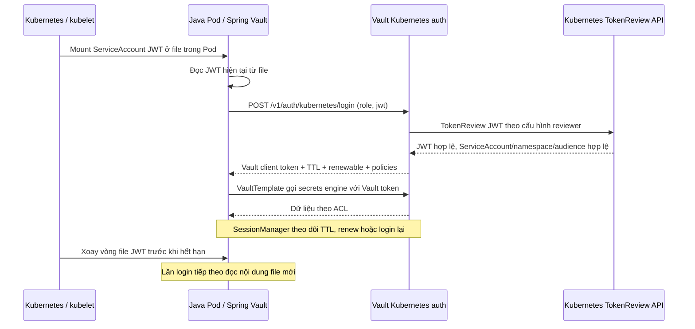
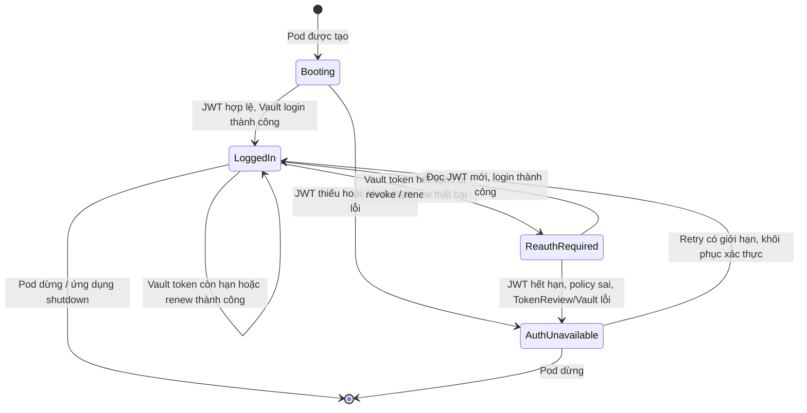

# Xử lý token hết hạn, Pod khởi động lại và đăng nhập lại với Spring Vault

## 1. Vì sao bài toán này quan trọng?

Trong chương **Kubernetes và JWT** của module **SPRING_VAULT**, một ứng dụng Java thường chạy trong Pod, dùng JWT của Kubernetes ServiceAccount để xác thực với HashiCorp Vault và nhận **Vault client token**. Ứng dụng sau đó dùng `VaultTemplate` đọc KV secrets, yêu cầu Transit encryption hoặc lấy những thông tin bí mật khác theo policy đã cấp.

Vòng đời của Pod và token không đồng bộ: Pod có thể chạy lâu hơn JWT, Vault token có thể hết hạn khi Pod vẫn hoạt động, kết nối Vault có thể gián đoạn, hoặc Pod bị thay thế trong một đợt rollout. Nếu ứng dụng đọc JWT một lần ở lúc khởi động hay cố giữ Vault token cũ mãi, lần đăng nhập lại sẽ thất bại hoặc request đọc secret sẽ nhận lỗi xác thực.

Bài học giải thích cách duy trì xác thực an toàn trong những tình huống này. Sau khi học, bạn có thể:

- Phân biệt hạn sử dụng của Kubernetes ServiceAccount JWT, Vault client token và lease của dynamic secret.
- Cấu hình projected ServiceAccount token để kubelet tự xoay vòng, đồng thời để Spring Vault đọc **JWT hiện hành** mỗi lần cần đăng nhập.
- Dùng Spring Cloud Vault hoặc `LifecycleAwareSessionManager` để duy trì Vault session, gia hạn token và tái đăng nhập khi cần.
- Xử lý Pod restart/rollout, lỗi `401`/`403`, TokenReview thất bại và Vault tạm không sẵn sàng.
- Thiết kế kiểm thử, log, metric và readiness cho ứng dụng dùng Vault trong Kubernetes.

> **Giả định xuyên suốt:** Vault đã bật **Kubernetes auth method** tại mount `auth/kubernetes`, ứng dụng dùng `ServiceAccount` tên `payments-app` trong namespace `payments`, và Vault role tên `payments-read`. Tên môi trường, mount và secret trong ví dụ đều là giá trị minh họa.

## 2. Ba vòng đời cần phân biệt

| Thành phần | Ai cấp? | Dùng để làm gì? | Khi hết hạn hoặc mất hiệu lực |
|---|---|---|---|
| **Kubernetes ServiceAccount JWT** | Kubernetes TokenRequest API; kubelet có thể yêu cầu và mount token | Là bằng chứng nhận dạng của Pod gửi tới `auth/kubernetes/login` | Kubelet xoay vòng projected token; lần Vault login tiếp theo phải đọc JWT mới. JWT cũ có thể bị từ chối khi hết hạn hoặc Pod/ServiceAccount ràng buộc bị xóa. |
| **Vault client token (`LoginToken`)** | Vault trả về sau khi xác thực thành công bằng Kubernetes JWT | Gửi trong các request `VaultTemplate` tới KV, Transit, PKI... theo Vault policy | Nếu renewable, session manager cố gắng renew. Khi không renew được hoặc token bị thu hồi/hết hạn, cần login lại bằng JWT hợp lệ. |
| **Lease của dynamic secret** | Secrets engine của Vault, ví dụ database/PKI | Xác định hạn dùng và khả năng renew/revoke **của secret được cấp** | Secret phải được renew hoặc cấp lại theo contract của engine; gia hạn Vault client token không tự kéo dài mọi dynamic secret lease. |

Ngoài ba loại trên, **reviewer JWT** có thể được Vault dùng để gọi Kubernetes `TokenReview` API. Nếu reviewer JWT hết hạn, **mọi lần Kubernetes login mới** có thể thất bại, dù JWT của Pod ứng dụng vẫn còn hợp lệ. Đây là lỗi cấu hình giữa Vault và Kubernetes, không phải lỗi token của riêng ứng dụng.

### Một chu trình đăng nhập bình thường



**Điểm mấu chốt:** Kubernetes JWT **không** phải Vault client token. Việc kubelet thay file JWT không tự hủy Vault token đang dùng; tương tự, `renew` Vault token không gia hạn thời hạn của JWT Kubernetes. Mỗi thành phần có cơ chế cấp, kiểm tra và làm mới riêng.

## 3. Cơ chế hết hạn và xoay vòng Kubernetes ServiceAccount JWT

Kubernetes hiện đại hỗ trợ **projected ServiceAccount token** có các claim như `sub`, `iss`, `aud`, `exp` và thông tin ràng buộc Pod/ServiceAccount. Kubelet lấy token thông qua TokenRequest API, ghi vào projected volume và tự làm mới khi token gần hết hạn. Theo tài liệu Kubernetes, kubelet bắt đầu thử xoay vòng khi token đã qua khoảng **80% TTL hoặc quá 24 giờ**. Đây là hành vi của kubelet, không phải cam kết rằng ứng dụng chắc chắn sẽ nhận token mới nếu API server đang lỗi.

Một projected token có thể được tạo với audience `vault` và TTL yêu cầu 3.600 giây. Kubernetes có thể quyết định thời hạn thực tế theo cấu hình cluster; ứng dụng không nên mã hóa cứng thời điểm hết hạn từ giá trị yêu cầu.

Về mặt filesystem, Kubernetes cập nhật projected volume theo cơ chế thay đổi mục tiêu symlink để ứng dụng thấy file token hiện hành. Vì vậy:

- Mỗi **lần đăng nhập lại**, ứng dụng phải **mở và đọc lại đường dẫn file JWT** thay vì giữ chuỗi JWT hoặc file descriptor đã đọc từ lúc start.
- Đừng copy JWT vào environment variable, ConfigMap, file cố định khác hoặc một biến Java `static final String` rồi dùng lâu dài.
- Đừng log JWT, Vault client token hay giá trị secret. Chỉ log thông tin không nhạy cảm như phase, loại lỗi, request ID và thời điểm.
- Token có audience dành cho Vault nên được dùng đúng mục đích. Audience của JWT phải phù hợp với yêu cầu của Vault role và cơ chế xác minh của cluster.

Nếu dùng **Vault JWT/OIDC auth method** thay cho **Vault Kubernetes auth method**, quy tắc xác minh khác đi: JWT/OIDC auth xác minh chữ ký/claim qua OIDC/JWKS và thông thường **không gọi Kubernetes TokenReview API tại mỗi lần login**. Điều đó ảnh hưởng đến khả năng nhận biết Pod đã bị xóa trước khi JWT hết hạn. Những cấu hình dưới đây dành cho **Kubernetes auth method**.

## 4. Cấu hình Kubernetes projected token cho Pod

Đoạn YAML dưới đây tạo ServiceAccount và một Deployment tối giản. Pod chỉ mount JWT phục vụ Vault ở `/var/run/secrets/vault/token` và không cần mount JWT ServiceAccount mặc định cho mục đích này.

```yaml
apiVersion: v1
kind: ServiceAccount
metadata:
  name: payments-app
  namespace: payments
---
apiVersion: apps/v1
kind: Deployment
metadata:
  name: payments-api
  namespace: payments
spec:
  replicas: 2
  selector:
    matchLabels:
      app: payments-api
  template:
    metadata:
      labels:
        app: payments-api
    spec:
      serviceAccountName: payments-app
      automountServiceAccountToken: false
      containers:
        - name: payments-api
          image: registry.example.invalid/payments-api:demo
          volumeMounts:
            - name: vault-auth-token
              mountPath: /var/run/secrets/vault
              readOnly: true
      volumes:
        - name: vault-auth-token
          projected:
            sources:
              - serviceAccountToken:
                  path: token
                  audience: vault
                  expirationSeconds: 3600
```

Ở đây `automountServiceAccountToken: false` tắt mount mặc định, còn projected volume `vault-auth-token` vẫn được khai báo tường minh. Quyền truy cập file phải phù hợp với user mà container chạy; nên dùng service account riêng và policy Vault giới hạn đúng secret path cần thiết. Tên image chỉ là placeholder, không phải image để triển khai trực tiếp.

Các điều kiện cần xác minh trước khi triển khai:

1. Kubernetes cluster hỗ trợ projected ServiceAccount token, Pod thực sự nhìn thấy file tại đường dẫn đã cấu hình.
2. Audience `vault` trong projected JWT khớp với audience Vault role yêu cầu; nếu dùng audience khác, phải cấu hình đồng nhất hai phía.
3. Vault có thể truy cập Kubernetes API để thực hiện TokenReview và có danh tính reviewer với quyền cần thiết.
4. Role Vault gắn đúng `payments-app` / `payments`, không dùng wildcard rộng cho mọi service account hay namespace.

Ví dụ tạo role ở **Vault** (giả định Kubernetes auth config đã được thiết lập và policy `payments-kv-read` đã tồn tại):

```bash
vault write auth/kubernetes/role/payments-read \
  bound_service_account_names=payments-app \
  bound_service_account_namespaces=payments \
  audience=vault \
  token_policies=payments-kv-read \
  token_ttl=20m \
  token_max_ttl=1h
```

Policy cấp cho Vault client token nên chỉ chứa quyền cần thiết, ví dụ `read` trên `kv-app/data/payments/config`. **Kubernetes RBAC** kiểm soát truy cập Kubernetes API, trong khi **Vault policy** kiểm soát secrets engine; hai lớp phân quyền này độc lập. Reviewer Kubernetes phải có quyền gọi `TokenReview` (thông thường qua `system:auth-delegator`) theo kiến trúc của hệ thống.

## 5. Spring Cloud Vault: cấu hình cho vòng đời token

Nếu ứng dụng dùng Spring Cloud Vault với `VaultTemplate` được Spring quản lý, cấu hình chính nằm trong `application.yml`:

```yaml
spring:
  cloud:
    vault:
      uri: https://vault.example.internal:8200
      authentication: KUBERNETES
      kubernetes:
        kubernetes-path: kubernetes
        role: payments-read
        service-account-token-file: /var/run/secrets/vault/token
      session:
        lifecycle:
          enabled: true
          refresh-before-expiry: 10s
          expiry-threshold: 20s
```

Giải thích:

| Thuộc tính | Ý nghĩa |
|---|---|
| `spring.cloud.vault.authentication=KUBERNETES` | Sử dụng ServiceAccount JWT của Pod để đăng nhập Vault theo role. |
| `kubernetes.kubernetes-path` | Mount của Kubernetes auth method; `kubernetes` là ví dụ mặc định. |
| `kubernetes.role` | Tên Vault role sẽ dùng tại `/auth/kubernetes/login`. |
| `kubernetes.service-account-token-file` | Đường dẫn JWT **được kubelet duy trì**; phải trùng với `volumeMount` ở Pod. |
| `session.lifecycle.enabled` | Bật quản lý vòng đời Vault login token, mặc định đã bật trong Spring Cloud Vault. |
| `refresh-before-expiry` | Khoảng thời gian cố gắng làm mới Vault token trước khi hết hạn. |
| `expiry-threshold` | Ngưỡng dưới đó session token được xem là không còn đủ TTL để dùng; nên lớn hơn `refresh-before-expiry`. |

`refresh-before-expiry: 10s` và `expiry-threshold: 20s` là tham số minh họa. Cần điều chỉnh theo TTL do Vault role thực tế cấp, độ trễ mạng và hành vi lỗi. Không dùng khoảng refresh lớn hơn gần toàn bộ TTL của token quá ngắn.

Spring Cloud Vault thông thường sử dụng `LifecycleAwareSessionManager` để quản lý đăng nhập, renew và re-login. Khi Vault client token còn khả năng gia hạn, session manager cố gia hạn theo lịch; nếu token hết hiệu lực hoặc không thể renew và state bị loại bỏ, lần lấy session token tiếp theo sẽ dẫn đến một lần đăng nhập mới. Việc login mới đòi hỏi **Kubernetes JWT đang còn hiệu lực**. Một lỗi mạng kéo dài vẫn có thể làm lần login thất bại; cấu hình lifecycle không bảo đảm mọi request sẽ luôn thành công. Tham khảo hành vi theo phiên bản Spring Vault/Spring Cloud Vault đang sử dụng.

> Nếu ứng dụng chỉ dùng thư viện **Spring Vault Core**, không dùng auto-configuration của Spring Cloud Vault, bạn cần tự cấu hình `ClientAuthentication` và một `SessionManager` phù hợp. Đừng thay vòng đời này bằng một Vault token cố định cấu hình trong code hoặc biến môi trường.

## 6. Spring Vault Core: luôn đọc JWT hiện hành khi đăng nhập

Spring Vault có `KubernetesAuthenticationOptions` và `KubernetesServiceAccountTokenFile` để đọc JWT từ file trong Pod. Khi tạo `ClientAuthentication` theo cách thủ công, một phương thức trong cấu hình kế thừa `AbstractVaultConfiguration` có thể sử dụng:

```java
import org.springframework.vault.authentication.ClientAuthentication;
import org.springframework.vault.authentication.KubernetesAuthentication;
import org.springframework.vault.authentication.KubernetesAuthenticationOptions;
import org.springframework.vault.authentication.KubernetesServiceAccountTokenFile;

@Override
public ClientAuthentication clientAuthentication() {
    KubernetesAuthenticationOptions options =
            KubernetesAuthenticationOptions.builder()
                    .path("kubernetes")
                    .role("payments-read")
                    .jwtSupplier(new KubernetesServiceAccountTokenFile(
                            "/var/run/secrets/vault/token"))
                    .build();

    // vaultClient() là client do AbstractVaultConfiguration cung cấp
    // ở các phiên bản Spring Vault mới.
    return new KubernetesAuthentication(options, vaultClient());
}
```

Đây là **đoạn trích phương thức** của một lớp cấu hình Spring Vault, không phải một Java file độc lập. Kiểu `vaultClient()` và constructor của `KubernetesAuthentication` có thể khác giữa các dòng Spring Vault; ví dụ theo API mới, còn các phiên bản cũ dùng `RestOperations`. Với Spring Cloud Vault, ưu tiên cấu hình tự động ở mục trước để tránh khai báo hai bean authentication/session cạnh tranh nhau.

`KubernetesServiceAccountTokenFile` thực hiện vai trò `Supplier<String>` đọc credential qua resource. Điều cần giữ là **supplier dựa trên file token đang được xoay vòng**, thay vì gọi `Files.readString(...)` một lần lúc tạo bean rồi đưa kết quả tĩnh vào mọi lần đăng nhập. Sau khi session cũ hết hạn, `KubernetesAuthentication` phải nhận token JWT đang có tại đường dẫn file hiện hành.

### Luồng trạng thái của ứng dụng



Trên ứng dụng production, `AuthUnavailable` nên được phản ánh qua trạng thái phục vụ request và thông báo lỗi thích hợp. Không ép mọi thất bại Vault thành trạng thái buộc Kubernetes khởi động lại Pod ngay lập tức; đó có thể là sự cố chung của Vault, TokenReview hoặc mạng.

## 7. Kịch bản 1: Vault client token hết hạn trong khi Pod vẫn chạy

Giả sử Vault role cấp Vault token với TTL 20 phút. Trong khi đó projected Kubernetes JWT có TTL yêu cầu 60 phút. Ứng dụng đọc KV secret ở phút thứ 2; đến gần phút 20, có ba khả năng:

1. **Vault token renewable và renew được:** session manager gửi yêu cầu gia hạn, nhận TTL mới rồi tiếp tục dùng session. Không cần lấy Kubernetes JWT mới chỉ để renew Vault token.
2. **Vault token không thể renew hoặc đã hết hạn:** session manager bỏ session cũ và thực hiện Kubernetes login mới khi cần. Mỗi lần login phải lấy lại JWT từ projected file, vì JWT ban đầu có thể đã được thay bởi kubelet.
3. **Vault hoặc Kubernetes TokenReview đang lỗi:** cả renew hoặc login mới có thể thất bại. Request sử dụng secret có thể lỗi cho đến khi hạ tầng phục hồi; cần quan sát, retry theo giới hạn và khôi phục theo quy trình vận hành.

Một thời điểm minh họa:

| Thời điểm | Sự kiện | Cách ứng dụng xử lý |
|---|---|---|
| T+0 | Pod nhận JWT A, Vault login cấp token V1 | Session manager giữ V1. |
| T+19 phút | V1 gần hết TTL | Cố renew nếu có quyền và còn trong giới hạn TTL. |
| T+48 phút | Kubelet có thể đã thay JWT A bằng JWT B | Đường dẫn file vẫn giữ nguyên; nội dung đã đổi. |
| T+65 phút | Session manager cần login mới | Đọc JWT **B hoặc JWT hiện hành khác** và nhận Vault token V2. |

Các mốc chỉ dùng để minh họa. TTL thực tế và thời điểm rotate/renew phụ thuộc Kubernetes, Vault role, auth method và độ trễ hệ thống. `token_max_ttl`, `token_explicit_max_ttl` hoặc policy của Vault có thể chặn gia hạn vượt giới hạn; khi đó đăng nhập mới là điều bình thường.

**Không tạo retry vô hạn ngay trong luồng request** với `while(true)` hay gọi `/auth/kubernetes/login` trên mọi lần đọc KV. Session manager đã hỗ trợ chia sẻ Vault token giữa các request và đồng bộ việc lấy token. Nếu dịch vụ có nhiều replica, nên giới hạn tốc độ retry, áp dụng exponential backoff với jitter cho các lỗi tạm thời, tránh tạo đợt login đồng thời khi Vault mới phục hồi.

## 8. Kịch bản 2: Pod khởi động lại, rollout hoặc bị thay thế

Khi Pod bị xóa và Pod mới được tạo bởi Deployment, nó có **vòng đời và token ServiceAccount riêng**. Dù ServiceAccount name/namespace vẫn như cũ, token mới có thể ràng buộc với Pod mới. Vault client token của tiến trình cũ **không cần và không nên** được chia sẻ cho Pod mới.

Trình tự kỳ vọng:

1. Scheduler tạo Pod mới và kubelet mount projected ServiceAccount JWT vào đường dẫn được cấu hình.
2. Ứng dụng Spring bắt đầu; Vault session chưa có hoặc bắt đầu một vòng xác thực mới.
3. `KubernetesAuthentication` đọc JWT đang mount, gửi `role` + `jwt` tới Vault `auth/kubernetes/login`.
4. Vault xác minh JWT qua Kubernetes TokenReview, đối chiếu ServiceAccount, namespace và audience với role, rồi cấp Vault client token mới.
5. Ứng dụng đọc được những secrets bắt buộc trước khi sẵn sàng phục vụ request; readiness chuyển sang trạng thái phù hợp.

Nếu shutdown êm, session manager có thể revoke Vault **service token** của phiên cũ khi kết thúc. Nếu Pod bị kill hoặc node mất điện, không thể giả định Vault token cũ đã được revoke tức thì: token có thể còn hiệu lực đến khi hết TTL hoặc bị thu hồi từ phía Vault. Chính sách TTL và nguyên tắc ít quyền nhất là biện pháp giảm thiểu rủi ro cho các trường hợp đó.

### Readiness và liveness

- **Readiness** phản ánh Pod có đáp ứng các tác vụ yêu cầu Vault/secret hay chưa. Khi chưa lấy được credential bắt buộc, Pod có thể ở `NotReady` thay vì nhận lưu lượng rồi trả lỗi hàng loạt.
- **Liveness** nên kiểm tra tiến trình còn hoạt động, tránh phụ thuộc trực tiếp vào việc Vault có đang phục vụ hay không. Nếu Vault tạm bị gián đoạn, liveness gắn chặt với Vault sẽ tạo vòng lặp restart trên tất cả replica.
- **Startup probe** có thể hữu ích nếu khởi động phải tải cấu hình/secret qua Vault và cần thêm thời gian. Nếu Spring Config Data import bắt buộc lấy dữ liệu Vault trước khi tạo web server, lỗi Vault lúc bootstrap có thể làm app startup thất bại; cân nhắc chính sách retry/restart và startup timeout theo yêu cầu sản phẩm.

Để quan sát rollout (không in token):

```bash
kubectl -n payments rollout restart deployment/payments-api
kubectl -n payments rollout status deployment/payments-api
kubectl -n payments get pods -l app=payments-api
kubectl -n payments logs deployment/payments-api --since=10m
```

Trong production, chỉ chạy `rollout restart` khi có chủ đích vận hành; để kiểm thử restart, dùng một namespace cô lập. Log phải đủ cho thấy tiến trình login/renew thất bại hay thành công **mà không lộ JWT, `X-Vault-Token`, dữ liệu KV hoặc lease credential**.

## 9. Kịch bản 3: JWT hết hạn hoặc TokenReview không còn hoạt động

Đây là tình huống dễ bị nhầm với việc Vault client token hết hạn. Khi `auth/kubernetes/login` không thành công, xem xét **hai danh tính** có thể hết hạn:

| Căn nguyên | Triệu chứng | Kiểm tra và khắc phục |
|---|---|---|
| App dùng **JWT cũ** đã bị xoay vòng | Đăng nhập đầu tiên thành công, vài giờ sau re-login thất bại dù file trên disk đã thay đổi | Kiểm tra supplier có đọc lại file mỗi lần login; bỏ cơ chế cache JWT tĩnh. |
| Kubelet không xoay vòng được JWT | File token quá hạn, Pod không thể login khi Vault token hết TTL | Kiểm tra token volume và sự cố Kubernetes API/kubelet; khôi phục việc xoay vòng. |
| JWT `aud` không khớp Vault role | `login` bị từ chối ngay từ đầu hoặc sau khi đổi cấu hình | So sánh `audience` trong projected volume và Vault Kubernetes auth role; kiểm tra TokenReview audience. |
| ServiceAccount/namespace không khớp role | Vault từ chối JWT dù token đúng chữ ký | Đối chiếu tên SA, namespace và các ràng buộc Vault role. |
| **Reviewer JWT** của Vault hết hạn | Nhiều Pod đồng loạt không thể đăng nhập mới; những Pod có Vault token còn hiệu lực có thể vẫn hoạt động | Kiểm tra cấu hình `auth/kubernetes/config`, TokenReview quyền `system:auth-delegator`, thời hạn reviewer JWT và kết nối tới Kubernetes API. |
| Pod cũ bị xóa nhưng JWT vẫn được tái sử dụng | Đăng nhập bằng JWT bị ràng buộc Pod cũ thất bại | Pod mới phải dùng token mới của chính nó; không cache/copy JWT của Pod cũ. |

Với Vault chạy **bên trong Kubernetes**, tài liệu HashiCorp hướng dẫn cho Vault phiên bản hỗ trợ có thể sử dụng service account token cục bộ làm reviewer và đọc lại file theo chu kỳ; tránh lưu một reviewer JWT ngắn hạn cố định trong cấu hình. Với Vault chạy bên ngoài cluster, phải thiết kế riêng cách cung cấp và làm mới reviewer credential, hoặc cấu hình mô hình TokenReview phù hợp với yêu cầu RBAC. Đừng phát tán đặc quyền `system:auth-delegator` cho tất cả workload nếu kiến trúc chỉ cần một reviewer riêng.

Một cách kiểm tra **sự hiện diện** của file JWT trong container mà không in nội dung:

```bash
kubectl -n payments exec deployment/payments-api -- \
  sh -c 'test -s /var/run/secrets/vault/token && echo token-file-present'
```

Lệnh chỉ hữu ích nếu image có `sh` và quyền đọc file theo user hiện hành. Không dùng `cat` file token hoặc đẩy JWT lên hệ thống giám sát để chẩn đoán. Nếu cần đối chiếu claim `aud`/`exp`, thực hiện trong môi trường kiểm soát với công cụ không log token và chỉ hiển thị những trường cần thiết.

## 10. Xử lý lỗi ở ranh giới VaultTemplate và dịch vụ ứng dụng

Ứng dụng có thể gặp `VaultException` và những ngoại lệ liên quan đến HTTP status, network hoặc authentication từ Spring Vault. `401` và `403` thường cần được điều tra cùng **request nào thất bại**: `auth/kubernetes/login`, `auth/token/renew-self` hay một request KV/Transit/PKI sau login. Chỉ nhìn status code là chưa đủ để kết luận JWT hết hạn.

| Vị trí xảy ra lỗi | Nguyên nhân thường gặp | Hành động phù hợp |
|---|---|---|
| `auth/kubernetes/login` | JWT hết hạn, audience/role không khớp, reviewer lỗi, Vault không truy cập Kubernetes API | Phân loại lỗi tạm thời và lỗi cấu hình; kiểm tra JWT file, role, TokenReview, Vault audit. |
| `auth/token/renew-self` | Vault token không renewable, vượt max TTL, token bị revoke, Vault tạm gián đoạn | Để session manager quản lý invalidation/re-login; không tạo vòng renew vô hạn. |
| `kv-app/data/...` sau khi login | Vault token hết hạn hoặc policy không có `read` | Xác minh lifecycle session và Vault ACL. `403` sau login có thể là thiếu quyền, **không tự động coi là JWT hết hạn**. |
| Các request đồng loạt timeout | Vault, DNS, TLS hoặc mạng cluster gặp sự cố | Timeout hợp lý, retry có backoff và metric; giữ readiness phù hợp. |
| Kết nối được nhưng `404` secret | Secret path/mount không tồn tại hoặc secret đã bị xóa | Xử lý như lỗi dữ liệu/cấu hình; đăng nhập lại thường không giải quyết được. |

Hướng dẫn xử lý trong Java:

1. **Để Spring Vault quản lý token:** không tự bắt mọi `VaultException` rồi gửi `auth/kubernetes/login` bằng một JWT đã cache.
2. **Phân loại lỗi:** authentication/authorization khác với timeout hoặc secret missing; ghi mã lỗi và request path được chuẩn hóa, tránh log giá trị nhạy cảm.
3. **Retry có giới hạn:** áp dụng tại ranh giới nghiệp vụ cho request đọc an toàn khi lỗi tạm thời, với exponential backoff, jitter và deadline tổng. Đánh giá riêng tính idempotent của các thao tác ghi/Transit/PKI.
4. **Fail theo chính sách:** nếu secret bắt buộc không khả dụng, không tự chuyển sang hard-code secret hoặc bỏ qua quyền truy cập. Có thể từ chối tác vụ nhạy cảm cho đến khi phục hồi.

Việc bật lifecycle token không tự cập nhật giá trị đã inject vào `@Value` hoặc bản sao secret lưu trong bộ nhớ ứng dụng. **Vault client token**, **KV secret rotation** và **dynamic secret lease renewal** là ba luồng khác nhau. Đối với dynamic leases, xem xét `SecretLeaseContainer` hay cơ chế refresh riêng, và với cấu hình KV đã nạp vào Spring Environment cần chiến lược reload theo đúng thời điểm yêu cầu.

## 11. Giám sát, cảnh báo và an toàn vận hành

Theo dõi đủ dữ liệu để trả lời: "lỗi là do Vault token, Kubernetes JWT, TokenReview hay mạng?"

| Tín hiệu | Cách sử dụng |
|---|---|
| Tỷ lệ login thành công/thất bại của `auth/kubernetes/login` | Phát hiện lỗi ràng buộc SA/role/audience, reviewer JWT hoặc Vault connectivity. |
| Tỷ lệ renew thành công/thất bại và số lần re-login | Phân biệt renew thường lệ với re-auth tăng đột biến. |
| TTL còn lại của Vault token ở mức tổng hợp | Phát hiện token gần hết hạn bất thường; không xuất token value/accessor như nhãn metric. |
| Readiness và số lần restart theo Deployment/namespace | Xác định lỗi tập trung sau rollout hoặc Vault outage. |
| Vault audit log và request ID | Tra cứu actor, auth path, error code theo quyền truy cập audit; tránh dùng audit raw payload trong dashboard rộng. |
| TokenReview failure trên Vault/Kubernetes API | Xác nhận reviewer token, RBAC hay endpoint Kubernetes gặp lỗi. |

Metric nên dùng nhãn có độ phân biệt vừa phải như `operation=login|renew|read`, `result=success|failure`, `namespace`, `service`, `reason_category`. Không dùng JWT, Vault token, toàn bộ secret path chứa dữ liệu cá nhân hoặc request ID làm nhãn metric vì có thể gây rò rỉ và độ phân biệt quá cao.

Đặt cảnh báo khi số login thất bại tăng liên tục, đặc biệt khi xảy ra **đồng thời trên nhiều replica/namespace**; đó là tín hiệu lỗi ở Vault Kubernetes auth, reviewer hoặc Kubernetes API. Một replica lỗi riêng lẻ sau restart lại gợi ý cấu hình Pod, ServiceAccount, volume mount hoặc mạng của nó.

## 12. Thực hành và kiểm thử tích hợp

Trong namespace thử nghiệm có Vault và Kubernetes auth được cấu hình, hãy xác minh tối thiểu các tình huống sau. Dùng secret mẫu, role và policy tách biệt với môi trường production.

| Ca kiểm thử | Cách tạo tình huống | Kết quả mong đợi |
|---|---|---|
| Đăng nhập lần đầu | Tạo Deployment sử dụng projected JWT và role đúng | `VaultTemplate` đọc thành công secret được policy cho phép; Pod trở thành Ready sau khi đã có dữ liệu cần thiết. |
| Vault token gần hết hạn | Role có TTL ngắn trong test và cho phép renew | Session manager renew trước expiry; ứng dụng tiếp tục phục vụ read. |
| Re-login sau khi token không renew được | Role dùng TTL/max TTL ngắn, hoặc thu hồi token test có kiểm soát | Session manager tạo phiên mới bằng JWT **còn hợp lệ**; ứng dụng đọc secret trở lại. |
| JWT được kubelet rotate | Giảm `expirationSeconds` ở namespace test theo giới hạn cluster, quan sát qua nhiều chu kỳ | Sau JWT rotation, lần re-login tiếp theo vẫn thành công vì supplier đọc file hiện hành. |
| Pod restart/rollout | `kubectl rollout restart` trên Deployment test | Pod mới có JWT và Vault token mới, không cần copy token của Pod cũ. |
| Vault tạm không sẵn sàng | Chặn kết nối Vault trong môi trường test có kiểm soát | Log/metric thể hiện lỗi, không lộ token; retry có giới hạn, readiness phản ánh khả năng phục vụ. |
| Role sai hoặc thiếu Vault policy | Đổi sang role không bound đúng SA/namespace hoặc thiếu quyền `read` trong test | Login hoặc đọc secret bị từ chối đúng vị trí, không cấp thêm đặc quyền ngoài phạm vi. |
| Reviewer token/RBAC lỗi | Tắt quyền TokenReview trên một cấu hình Vault test riêng | Nhiều login mới thất bại; hệ thống phân biệt được sự cố reviewer với file JWT của một Pod. |

Ví dụ kiểm tra đơn giản bằng Spring Boot Test **chỉ dành cho lần đọc thành công**. Test phải chạy trong môi trường có thể kết nối Vault, với `VaultTemplate` đã cấu hình Kubernetes auth và mount KV v2 `kv-app` có khóa giả `payments/config`:

```java
import static org.junit.jupiter.api.Assertions.assertNotNull;

import org.junit.jupiter.api.Test;
import org.springframework.beans.factory.annotation.Autowired;
import org.springframework.boot.test.context.SpringBootTest;
import org.springframework.vault.core.VaultTemplate;

@SpringBootTest
class KubernetesVaultAuthenticationIT {

    @Autowired
    VaultTemplate vaultTemplate;

    @Test
    void authenticatesWithServiceAccountAndReadsKv() {
        var kv = vaultTemplate.opsForVersionedKeyValue("kv-app");

        var response = kv.get("payments/config");

        assertNotNull(response, "Secret mẫu cần tồn tại và được phép đọc");
    }
}
```

Test trên **không tự chứng minh** JWT rotation, renew, re-login hay Pod restart. Muốn kiểm tra các vòng đời đó, phải chạy test dài hạn hoặc orchestration trên cluster test, theo dõi sự kiện xác thực và kiểm chứng request đọc secret vẫn hoạt động sau mỗi tình huống. Không tạo test bằng cách sửa JWT thật của workload production, vô hiệu hóa policy hoặc in token để kiểm tra.

### Checklist nghiệm thu cho môi trường triển khai

- [ ] Pod dùng đúng ServiceAccount/namespace; projected token có audience phù hợp với Vault role.
- [ ] JVM có thể đọc file token hiện hành; không cache JWT cố định lúc startup.
- [ ] Spring Vault/Cloud Vault có quản lý token lifecycle; renew và re-login được thử bằng TTL ngắn trong môi trường test.
- [ ] Pod mới login độc lập sau rollout; không chia sẻ Vault token giữa Pod cũ và mới.
- [ ] Lỗi `403` do policy được phân biệt với lỗi login do JWT/audience/TokenReview.
- [ ] Readiness, timeout, retry và cảnh báo hoạt động trong sự cố Vault/Kubernetes API.
- [ ] Không log hoặc xuất metrics chứa JWT, Vault token, secret values; các role/policy tuân thủ quyền tối thiểu.
- [ ] Secret/lease có chiến lược refresh riêng, không dựa vào việc renew Vault client token để kéo dài mọi tài nguyên.

## 13. Tổng kết kiến thức

Trong SPRING_VAULT, để ứng dụng Java tiếp tục truy cập HashiCorp Vault qua `VaultTemplate` khi token hết hạn hoặc Pod bị thay thế, cần bảo đảm **ba việc liên tiếp**: kubelet duy trì ServiceAccount JWT, `KubernetesAuthentication` đọc JWT **hiện hành** khi đăng nhập, và `SessionManager` gia hạn hoặc cấp lại Vault client token theo lifecycle. Khi Pod restart, ứng dụng thực hiện xác thực mới bằng JWT của Pod mới; khi JWT rotate, phải dùng file token mới trong lần login sau. Policy ít quyền nhất, kiểm tra TokenReview, giám sát lỗi và kiểm thử trên cluster cô lập giúp vận hành tin cậy trong thực tế.

## Tài liệu tham khảo

- Spring Cloud Vault — [Kubernetes authentication](https://docs.spring.io/spring-cloud-vault/reference/authentication.html).
- Spring Cloud Vault — [Session token lifecycle management](https://docs.spring.io/spring-cloud-vault/docs/current/reference/html/#vault.authentication.session-lifecycle).
- Spring Vault — [Authentication methods: Kubernetes](https://docs.spring.io/spring-vault/reference/vault/authentication.html).
- Spring Vault API — [`LifecycleAwareSessionManager`](https://docs.spring.io/spring-vault/reference/api/java/org/springframework/vault/authentication/LifecycleAwareSessionManager.html).
- Spring Vault API — [`KubernetesServiceAccountTokenFile`](https://docs.spring.io/spring-vault/reference/api/java/org/springframework/vault/authentication/KubernetesServiceAccountTokenFile.html).
- HashiCorp Vault — [Kubernetes auth method](https://developer.hashicorp.com/vault/docs/auth/kubernetes).
- HashiCorp Vault — [Kubernetes auth HTTP API](https://developer.hashicorp.com/vault/api-docs/auth/kubernetes).
- Kubernetes — [ServiceAccount tokens](https://kubernetes.io/docs/concepts/security/service-accounts/) và [projected service account token](https://kubernetes.io/docs/reference/kubernetes-api/core/pod-v1/#ServiceAccountTokenProjection).
