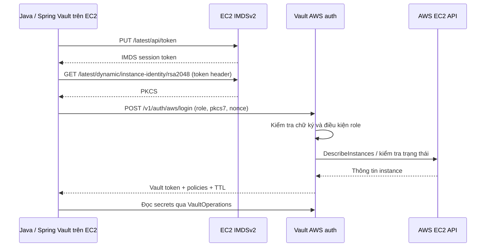

# AWS EC2 và tài liệu nhận dạng từ metadata service

## 1. Bối cảnh và mục tiêu

Khi ứng dụng Java chạy trên Amazon EC2 cần truy cập HashiCorp Vault, **Spring Vault** có thể sử dụng cơ chế **AWS EC2 authentication** để lấy Vault token mà không phải đóng gói sẵn token hoặc mật khẩu vào image. Ứng dụng gửi cho Vault bằng chứng nhận dạng do AWS ký, được truy xuất qua **EC2 Instance Metadata Service (IMDS)**. Sau khi xác minh, Vault cấp token với quyền được ràng buộc theo role và policy.

Trong chương **Xác thực cloud** của module **SPRING_VAULT**, bài này giúp bạn:

- Hiểu **Instance Identity Document (IID)**, chữ ký PKCS#7 và vai trò của IMDS.
- Lấy IID/chữ ký bằng **IMDSv2**, phân biệt IMDS session token với Vault token.
- Cấu hình AWS auth method loại `ec2`, role binding, quyền Vault và quyền AWS phía máy chủ Vault.
- Dùng `AwsEc2Authentication` và `VaultOperations` / `VaultTemplate` trong ứng dụng Java.
- Xử lý nonce, token TTL, lỗi mạng/quyền và kiểm thử tích hợp trên EC2.

**Phạm vi:** Vault AWS auth method hỗ trợ cả `auth_type=ec2` và `auth_type=iam`. Bài này tập trung `ec2` dùng dữ liệu nhận dạng AWS ký. Với `iam`, workload ký một request AWS STS `GetCallerIdentity` bằng SigV4; đó là quy trình khác.

## 2. Instance Identity Document là gì?

**IID** là một JSON được AWS cung cấp cho mỗi EC2 instance, mô tả danh tính và đặc tính triển khai. Ví dụ minh họa (mọi ID đều giả):

```json
{
  "accountId": "123456789012",
  "architecture": "x86_64",
  "availabilityZone": "ap-southeast-1a",
  "imageId": "ami-0123456789abcdef0",
  "instanceId": "i-0123456789abcdef0",
  "instanceType": "t3.small",
  "pendingTime": "2026-11-20T08:00:00Z",
  "region": "ap-southeast-1",
  "version": "2017-09-30"
}
```

Các field đáng chú ý:

| Trường | Ý nghĩa | Cách dùng khi xác thực |
| --- | --- | --- |
| `instanceId` | Mã instance cụ thể | Vault xác minh instance tồn tại và đang chạy qua AWS API. |
| `accountId` | AWS account chứa instance | Ràng buộc `bound_account_id`. |
| `region` | Region triển khai | Ràng buộc `bound_region`. |
| `imageId` | AMI được dùng để khởi tạo | Ràng buộc `bound_ami_id`. |
| `pendingTime` | Mốc thời gian vòng đời instance | Có liên quan đến một số chính sách tái đăng nhập / instance migration. |
| `availabilityZone`, `instanceType` | Thông tin môi trường | Phục vụ kiểm tra và quan sát, không tự động trở thành quyền truy cập Vault. |

**IID dạng JSON thuần không phải bằng chứng xác thực.** Ai cũng có thể tạo một JSON với cùng các field. Cơ chế EC2 auth dựa trên **chữ ký AWS** của IID để chứng minh nguồn gốc và tính toàn vẹn, kết hợp kiểm tra instance thực tế và điều kiện role của Vault.

### Những dữ liệu cần phân biệt

| Dữ liệu | Nguồn | Mục đích |
| --- | --- | --- |
| **IID JSON** | `/latest/dynamic/instance-identity/document` | Nội dung nhận dạng instance; chưa xác minh nếu đứng một mình. |
| **PKCS#7 signature** | `/latest/dynamic/instance-identity/rsa2048` hoặc `/pkcs7` | Bằng chứng AWS ký, dùng trong Vault EC2 login. |
| **IMDSv2 session token** | `PUT /latest/api/token` | Chỉ dùng để gọi IMDS trên chính EC2. |
| **Vault token** | Vault trả sau `auth/aws/login` | Credential dùng đọc KV, Transit, PKI... theo Vault policy. |
| **Client nonce** | Client hoặc Vault tạo khi EC2 login | Giảm nguy cơ giả mạo đăng nhập lại bằng chữ ký IID bị sao chép. |

IMDSv2 session token **không phải** AWS access key, không phải nonce của Vault, và không được gửi lên endpoint Vault login. Ngược lại, Vault token là credential có quyền truy cập secret và phải được bảo vệ nghiêm ngặt.

## 3. Luồng xác thực AWS EC2 trong Vault



Các bước:

1. Ứng dụng gọi **IMDS** trên EC2 để lấy bằng chứng nhận dạng đã ký.
2. Spring Vault gửi chữ ký PKCS#7, tên **Vault auth role** và nonce thích hợp tới `POST /v1/auth/aws/login`.
3. Vault xác minh chữ ký bằng chứng thư AWS, trích xuất thông tin EC2, đối chiếu ràng buộc role và gọi AWS EC2 API để xác minh instance còn chạy.
4. Vault cấp **Vault token** nếu mọi điều kiện đạt. Token chỉ có những policy được role gán.
5. Spring Vault sử dụng token này qua `VaultTemplate` để thao tác với các secrets engine.

Hai bên có trách nhiệm tách biệt: **EC2 workload** lấy tài liệu từ IMDS; **Vault server/auth plugin** cần quyền AWS thích hợp để gọi `DescribeInstances`. EC2 workload không phải mang AWS access key tĩnh để đăng nhập bằng `auth_type=ec2`.

## 4. Đọc IID và chữ ký bằng IMDSv2

IMDS chạy tại địa chỉ link-local `http://169.254.169.254` của EC2. Với **IMDSv2**, trước khi GET metadata, client yêu cầu session token qua HTTP PUT. Token có TTL do client đề nghị và tối đa 21.600 giây (6 giờ). Trên EC2 nên đặt `HttpTokens=required` để yêu cầu token cho mọi lần truy cập IMDS.

Ví dụ Bash sau chỉ chạy trên **EC2 thử nghiệm** có `curl` và `jq`:

```bash
set -euo pipefail

IMDS="http://169.254.169.254"

# Lấy session token IMDSv2, TTL 5 phút.
IMDS_TOKEN="$(
  curl --fail --silent --show-error --noproxy "*" \
    -X PUT "$IMDS/latest/api/token" \
    -H "X-aws-ec2-metadata-token-ttl-seconds: 300"
)"

# Lấy JSON instance identity document để kiểm tra các trường nhận dạng.
IID="$(
  curl --fail --silent --show-error --noproxy "*" \
    -H "X-aws-ec2-metadata-token: $IMDS_TOKEN" \
    "$IMDS/latest/dynamic/instance-identity/document"
)"
printf '%s\n' "$IID" | jq '{accountId, instanceId, imageId, region, pendingTime}'

# Dùng endpoint RSA-2048 thích hợp cho đường xác thực PKCS#7
# trên Vault hiện đại; bỏ ký tự xuống dòng trước khi gửi.
PKCS7="$(
  curl --fail --silent --show-error --noproxy "*" \
    -H "X-aws-ec2-metadata-token: $IMDS_TOKEN" \
    "$IMDS/latest/dynamic/instance-identity/rsa2048" \
    | tr -d '\r\n'
)"
test -n "$PKCS7"

# Chỉ hiển thị số byte chữ ký, không in payload.
printf '%s' "$PKCS7" | wc -c
```

Giải thích:

- `--noproxy "*"` giúp truy vấn IMDS trực tiếp, tránh qua HTTP proxy.
- `/document` là JSON thuần; `/rsa2048` là dữ liệu đã ký để Vault xác thực. Với Vault API, giá trị của `/rsa2048` được truyền vào **field `pkcs7`**.
- IMDS còn có `/pkcs7` và `/signature`. Field Vault `identity` + `signature` là một cách đăng nhập khác, yêu cầu cặp IID base64 và chữ ký đúng loại. **Không** lẫn dữ liệu `/rsa2048` vào field `signature`.
- Với Vault 1.12 trở lên, kiểm tra tương thích của chứng thư/chữ ký SHA-1: HashiCorp khuyến nghị đường **`/rsa2048` kết hợp `pkcs7`**.
- Chỉ in ra các trường IID cần thiết để chẩn đoán. Không log `IMDS_TOKEN`, `PKCS7` hoặc Vault token.

### IMDSv1 và IMDSv2

| | IMDSv1 | IMDSv2 |
| --- | --- | --- |
| Truy xuất | HTTP GET trực tiếp | HTTP PUT lấy session token, sau đó GET có token header |
| Bảo vệ trước một số đường SSRF | Ít rào chắn hơn | Bổ sung cơ chế session token và header |
| EC2 yêu cầu `HttpTokens=required` | Không dùng được | Là cách truy cập bắt buộc |
| Đề xuất | Chỉ dành cho tương thích đặc biệt | **Ưu tiên IMDSv2** |

IMDSv2 không thay thế phân quyền hệ điều hành: một tiến trình không đáng tin nếu vẫn truy cập được IMDS cũng có thể tự xin IMDS token. Với container chạy trên EC2, cần kiểm tra metadata hop limit, proxy, network namespace và giới hạn tiến trình có quyền truy cập IMDS.

## 5. Cấu hình Vault AWS auth và chính sách đọc secret

Các lệnh bên dưới do **quản trị viên Vault** thực hiện, với instance/account/AMI giả định. Chỉ sử dụng trong môi trường thử nghiệm và thay bằng giá trị thật.

```bash
# Bật AWS auth ở mount auth/aws.
vault auth enable -path=aws aws

# Policy đọc KV v2 theo đúng scope của ứng dụng.
vault policy write payment-read - <<'HCL'
path "secret/data/apps/payment/*" {
  capabilities = ["read"]
}
HCL

# Role cho ứng dụng EC2, kèm ràng buộc giảm phạm vi truy cập.
vault write auth/aws/role/payment-ec2 \
  auth_type=ec2 \
  bound_account_id=123456789012 \
  bound_region=ap-southeast-1 \
  bound_ami_id=ami-0123456789abcdef0 \
  token_policies=payment-read \
  token_ttl=30m \
  token_max_ttl=2h
```

Phải có KV secrets engine **phiên bản 2** mount tại `secret/`, secret thử nghiệm và quyền vận hành phù hợp. Khả năng đọc secret được quyết định bởi **Vault token policy** (ví dụ `payment-read`), không phải chỉ vì EC2 login thành công.

| Tham số | Tác dụng |
| --- | --- |
| `auth_type=ec2` | Buộc role sử dụng EC2 identity; AWS auth role mới có thể mặc định là `iam` nếu không khai báo. |
| `bound_account_id` | Giới hạn tài khoản AWS. |
| `bound_region` | Giới hạn vùng triển khai. |
| `bound_ami_id` | Giới hạn AMI; nhiều instance có thể dùng chung một AMI. |
| `bound_vpc_id`, `bound_subnet_id` | Có thể thêm ràng buộc mạng. |
| `bound_ec2_instance_id` | Có thể giới hạn tới instance cụ thể khi nghiệp vụ yêu cầu. |
| `token_policies` | Chỉ định policy Vault được gắn khi login thành công. |
| `token_ttl`, `token_max_ttl` | Quy định thời hạn token Vault, tách biệt với IMDS token. |

Không nên dùng `bound_ami_id` làm điều kiện duy nhất nếu cùng AMI xuất hiện ở nhiều môi trường. Cần phối hợp account, region, VPC/subnet và các policy quyền tối thiểu.

### Quyền AWS thuộc về phía Vault

Vault AWS auth backend sử dụng `ec2:DescribeInstances` để kiểm tra thông tin và trạng thái EC2. Nếu bật ràng buộc IAM role/instance profile, có thể cần thêm `iam:GetInstanceProfile`. Cấp các quyền đó cho danh tính **Vault server/auth plugin**, ưu tiên cách cấp credential theo workload/federation thay vì lưu AWS access key tĩnh trong code Java.

AWS permission của Vault dùng để **xác minh instance**. Vault policy như `secret/data/apps/payment/*` dùng để **cho phép đọc secrets**. Đây là hai lớp quyền khác nhau.

## 6. Login thủ công với chữ ký PKCS#7

Sau khi lấy được biến `PKCS7` trên EC2 và cấu hình `VAULT_ADDR` cùng TLS hợp lệ:

```bash
# Trên EC2 thử nghiệm, sẽ có Vault client token trong kết quả;
# không đưa stdout của lệnh vào log tự động.
vault write auth/aws/login \
  role=payment-ec2 \
  pkcs7="$PKCS7"
```

Endpoint HTTP tương ứng là `POST /v1/auth/aws/login`:

```json
{
  "role": "payment-ec2",
  "pkcs7": "<PKCS7_VALUE_WITHOUT_NEWLINES>",
  "nonce": "<STRONG_NONCE_IF_USED>"
}
```

Vault có thể nhận **`pkcs7`**, hoặc cặp **`identity` + `signature`** đúng định dạng. Khi dùng cặp thứ hai, `identity` là JSON IID được mã hóa Base64 và `signature` là chữ ký RSA tương ứng từ IMDS. Không cần cung cấp cả hai kiểu cùng một request.

**Chữ ký IID không phải một bí mật có thể thu hồi như mật khẩu**, nhưng việc lộ chữ ký vẫn là rủi ro: bên có bản sao có thể thử đăng nhập giả mạo EC2. Hãy hạn chế quyền đọc IMDS và bảo vệ PKCS#7, nonce cùng dữ liệu phản hồi Vault.

## 7. Cấu hình Spring Vault trong ứng dụng Java

### 7.1. Cấu hình `AwsEc2Authentication`

Spring Vault từ phiên bản **3.2** hỗ trợ IMDSv2. Mẫu Java dưới đây sử dụng API **Spring Vault 4.1.x** (constructor với `VaultClient` và `RestClient`), dành cho service thực thi trực tiếp trên EC2; với phiên bản 3.x cần đối chiếu constructor tương ứng. Chọn `V2` rõ ràng và URL `/rsa2048` thay vì giả định mọi phiên bản có cùng mặc định.

```java
import java.net.URI;

import org.springframework.context.annotation.Configuration;
import org.springframework.vault.authentication.AwsEc2Authentication;
import org.springframework.vault.authentication.AwsEc2AuthenticationOptions;
import org.springframework.vault.authentication.ClientAuthentication;
import org.springframework.vault.client.VaultEndpoint;
import org.springframework.vault.config.AbstractVaultConfiguration;
import org.springframework.web.client.RestClient;

@Configuration
public class Ec2VaultConfiguration extends AbstractVaultConfiguration {

    @Override
    public VaultEndpoint vaultEndpoint() {
        return VaultEndpoint.from(
            URI.create("https://vault.internal.example:8200"));
    }

    @Override
    public ClientAuthentication clientAuthentication() {
        AwsEc2AuthenticationOptions options = AwsEc2AuthenticationOptions
            .builder()
            .path("aws")       // Auth mount: auth/aws
            .role("payment-ec2")
            .version(
                AwsEc2AuthenticationOptions.InstanceMetadataServiceVersion.V2)
            .identityDocumentUri(URI.create(
                "http://169.254.169.254/latest/dynamic/instance-identity/rsa2048"))
            .build();

        // Dùng HTTP client riêng cho EC2 IMDS.
        return new AwsEc2Authentication(
            options, vaultClient(), RestClient.create());
    }
}
```

Cần thiết lập TLS trust đúng cho Vault, timeout phù hợp và tránh đi qua HTTP proxy khi gọi IMDS. `RestClient` tới IMDS không cần và không được nhận Vault token. Ví dụ chủ đích tách cấu hình authentication khỏi nghiệp vụ; nếu dùng Spring Cloud Vault auto-configuration, hãy cấu hình auth đúng theo phiên bản Spring Cloud Vault đang sử dụng.

### 7.2. Đọc KV v2 với `VaultOperations` / `VaultTemplate`

Sau login, Spring Vault quản lý Vault token dùng cho các request đã xác thực. Code đọc secret không phải tự tạo lại chữ ký IID:

```java
import org.springframework.stereotype.Service;
import org.springframework.vault.core.VaultOperations;
import org.springframework.vault.core.VaultKeyValueOperations;
import org.springframework.vault.core.VaultKeyValueOperationsSupport.KeyValueBackend;
import org.springframework.vault.support.VaultResponse;

@Service
public class PaymentSecretReader {

    private final VaultKeyValueOperations kv;

    public PaymentSecretReader(VaultOperations vaultOperations) {
        this.kv = vaultOperations.opsForKeyValue(
            "secret", KeyValueBackend.KV_2);
    }

    public String apiKey() {
        VaultResponse response = kv.get("apps/payment/config");
        if (response == null || response.getData() == null) {
            throw new IllegalStateException("Payment secret not found");
        }

        Object value = response.getData().get("apiKey");
        if (!(value instanceof String key) || key.isBlank()) {
            throw new IllegalStateException("Missing apiKey field");
        }
        return key;  // Không log giá trị secret.
    }
}
```

`opsForKeyValue("secret", KV_2)` tự xử lý đoạn `data/` của KV v2; truyền vào đường logic `apps/payment/config`. Khi muốn sử dụng Transit encryption, PKI hoặc lease, mã Java cần gọi đúng API Spring Vault và có Vault policy tương ứng. EC2 authentication chỉ cấp danh tính, **không tự cấp quyền trên mọi secrets engine**.

## 8. Nonce, TOFU và vòng đời Vault token

IID và chữ ký có thể được nhiều tiến trình trên cùng EC2 đọc; một bản sao bị lấy cắp có thể được dùng thử để giả mạo yêu cầu login. EC2 auth dùng **Trust On First Use (TOFU)** cùng nonce để hạn chế các lần đăng nhập lặp lại từ bên không giữ nonce hợp lệ.

1. Ở lần login đầu, client tạo hoặc nhận một nonce. Vault lưu ràng buộc `instanceId` và nonce trong **identity accesslist**.
2. Lần login tiếp theo của cùng instance yêu cầu nonce khớp (nếu cho phép tái đăng nhập và nonce được sử dụng).
3. Nếu một bên không hợp lệ đăng nhập trước, client thật có thể nhận lỗi login; đây là tín hiệu cần điều tra.
4. Theo tài liệu Spring Vault, **nonce mặc định chỉ nằm trong bộ nhớ tiến trình**. Restart có thể làm mất nonce, gây lỗi **login mới**, dù EC2 chưa đổi.

Chính sách `disallow_reauthentication` có thể tắt login lần sau, phù hợp một số workload bất biến nhưng khiến **cấp lại token** khó khăn khi token hết hạn. Với nonce bị mất, quản trị viên có thể cân nhắc thao tác có kiểm soát trên `auth/aws/identity-accesslist/<instance-id>` sau khi điều tra. **Không tự động xóa accesslist** mỗi khi ứng dụng bị từ chối login: thao tác ấy mở lại cơ hội đăng nhập đầu tiên và làm suy yếu TOFU.

| Thành phần | TTL / thời gian tồn tại | Khi hết hạn hoặc bị mất |
| --- | --- | --- |
| **IMDSv2 token** | Tối đa 6 giờ, do EC2 IMDS cấp | Xin IMDS token khác; không tác động trực tiếp tới Vault token đã có. |
| **IID/chữ ký** | Gắn với identity của EC2, không phải credential ngắn hạn | Nếu bị sao chép có rủi ro replay; nonce/role binding giúp giảm rủi ro. |
| **Vault EC2 nonce** | Gắn với bản ghi instance ID; có thể chỉ giữ trong RAM của client | Tái login có thể bị từ chối; cần kế hoạch xử lý restart. |
| **Vault client token** | TTL/max TTL theo role và Vault | Renew nếu cho phép, hoặc thực hiện login mới khi cần. |

`LifecycleAwareSessionManager` của Spring Vault có thể **gia hạn Vault token** và thực hiện lại authentication khi cần token mới. Renew token và login mới là hai thao tác khác nhau: renew **không khôi phục nonce bị mất**. Hãy kiểm tra tình huống restart và token đạt max TTL trong Auto Scaling Group, deployment rolling hoặc service tự khởi động lại.

Không dùng chung một nonce hard-code cho nhiều instance. Nếu cần nonce tồn tại qua restart, chỉ áp dụng giải pháp quản lý, lưu trữ và phân phối có kiểm soát theo thiết kế bảo mật.

## 9. So sánh AWS EC2 auth và AWS IAM auth

HashiCorp hiện khuyến nghị **IAM auth** cho nhiều use case vì linh hoạt hơn và phù hợp mô hình IAM workload. EC2 auth có ích khi cần tin cậy **bằng chứng nhận dạng instance** và ràng buộc theo thuộc tính EC2.

| Tiêu chí | AWS EC2 auth | AWS IAM auth |
| --- | --- | --- |
| Bằng chứng | IID có chữ ký AWS | Request STS `GetCallerIdentity` ký bằng AWS SigV4 |
| Danh tính | EC2 instance | IAM principal (user/role) |
| Nguồn dữ liệu | EC2 IMDS | AWS credential provider, ví dụ IAM instance profile |
| Nền tảng | EC2 | EC2, ECS, Lambda và workload có IAM credentials |
| Điều kiện điển hình | AMI, account, region, VPC/subnet, instance ID | Principal ARN, IAM role và một số điều kiện suy luận EC2 |
| Chống phát lại | Nonce / TOFU | SigV4 có giới hạn thời gian |
| Lựa chọn | Cần gắn chặt với EC2 identity | Thường phù hợp hơn với hệ thống quản lý danh tính AWS thống nhất |

Một EC2 có thể truy cập **cả IID lẫn IAM instance profile credentials**. Điều này không có nghĩa hai cơ chế Vault auth dùng cùng request hoặc cùng thông tin đăng nhập.

## 10. Lỗi thường gặp và cách xử lý

| Triệu chứng | Nguyên nhân thường gặp | Kiểm tra |
| --- | --- | --- |
| IMDS GET trả `401` | Thiếu/đã hết hạn IMDSv2 token hoặc đang dùng IMDSv1 trên instance `HttpTokens=required` | Xin token qua PUT, thêm header `X-aws-ec2-metadata-token`. |
| IMDS timeout | Chạy ngoài EC2, proxy, network namespace, container hop limit hoặc IMDS bị chặn | Kiểm tra mạng tới `169.254.169.254` và cấu hình EC2. |
| Vault login trả `400` / lỗi signature | Dùng `/pkcs7` chữ ký cũ, nhầm field `signature`, dữ liệu base64 sai | Thử `/rsa2048` với field `pkcs7`; bảo toàn dữ liệu gốc trừ xuống dòng. |
| Login bị từ chối do role | Role `iam` thay vì `ec2`, sai AMI/account/region hoặc sai mount | Đọc role, kiểm tra các ràng buộc và path `auth/aws`. |
| Lỗi khi Vault kiểm tra AWS | Vault auth backend thiếu `ec2:DescribeInstances` hoặc AWS API không kết nối | Kiểm tra quyền và networking **phía Vault**, không chỉ EC2 app. |
| Login đầu được, lần sau lỗi | Nonce không khớp sau restart hoặc do một client khác đã login trước | Điều tra audit, accesslist và nonce; không reset mù quáng. |
| Login được nhưng đọc KV `403` | Vault policy thiếu quyền đọc đúng path `secret/data/...` | Kiểm tra `token_policies`, policy mount KV v2. |
| Token cũ hết hạn | Không renew được, vượt token max TTL, login mới lỗi nonce | Kiểm tra session manager và chính sách tái login. |

Một số nguyên tắc vận hành:

- Dùng HTTPS/TLS xác minh chứng thư cho kết nối **Java → Vault**. HTTP link-local chỉ dùng cho truy cập IMDS trên EC2.
- Hạn chế quyền đọc IMDS của tiến trình/container, bảo vệ signed IID và nonce khỏi bị lộ.
- Không in log Vault token, IMDSv2 token, PKCS#7 và bí mật KV; log mã lỗi, trạng thái, role và request ID theo mức độ cho phép.
- Với lỗi cấu hình hoặc `403`, không retry vô hạn. Chỉ retry có giới hạn với backoff cho lỗi mạng nhất thời hoặc `5xx`.
- Gắn policy theo ứng dụng và nguyên tắc quyền tối thiểu; không dùng policy root cho workload.

## 11. Bài thực hành và kiểm thử tích hợp

Chuẩn bị EC2 thử nghiệm có IMDSv2, Vault thử nghiệm với AWS auth role `payment-ec2`, KV v2 và policy đọc secret giả. Không dùng tài khoản, token hoặc secret sản xuất.

| Ca | Thao tác | Kết quả kỳ vọng |
| --- | --- | --- |
| A — IID | Lấy JSON IID qua IMDSv2 | Có instance ID, account ID, image ID, region; JSON thuần chưa là bằng chứng xác thực. |
| B — PKCS#7 | Lấy `/rsa2048` bằng token IMDSv2 | Nhận chữ ký, loại xuống dòng khi gửi field `pkcs7`. |
| C — Role khớp | Login EC2 auth từ Java trên EC2 hợp lệ | Có Vault token với policy đã cấu hình. |
| D — Sai AMI hoặc account | Đổi bound role sang giá trị khác với IID | Vault từ chối login. |
| E — Thiếu quyền AWS | Thử role Vault server thiếu `DescribeInstances` | Xác thực EC2 thất bại; lỗi thuộc cấu hình backend. |
| F — KV `403` | Loại quyền `read` trên path ứng dụng | Login vẫn có thể thành công nhưng đọc secret bị từ chối. |
| G — IMDSv2 required | Chặn IMDSv1, dùng cấu hình `V2` | GET không token thất bại; flow V2 hoạt động. |
| H — Restart ứng dụng | Login rồi restart trước lần login kế tiếp | Quan sát rủi ro mất nonce; có phương án xử lý an toàn. |
| I — Token TTL | Giảm TTL trong môi trường test | Quan sát renew/relogin khi token hết hạn. |
| J — Chạy local | Chạy cùng cấu hình trên laptop | Không truy cập được IID EC2 thật; dùng cơ chế auth riêng cho môi trường dev. |

Ở **unit test**, có thể mock HTTP request tới IMDSv2 và Vault để kiểm tra header token, cấu trúc payload `pkcs7`, lỗi quyền/timeout và retry. Đây chỉ là kiểm tra logic giao tiếp; để xác minh chữ ký AWS, role binding, nonce và AWS API, phải có **integration test** trên EC2 thật hoặc môi trường được cấu hình tương đương, sử dụng Vault thực.

## 12. Câu hỏi tự kiểm tra

1. Tại sao nhận được JSON IID chứa `instanceId` chưa đủ chứng minh người gửi thật sự chạy trên EC2 đó?
2. IMDSv2 token khác Vault token ở nguồn cấp, quyền sử dụng và TTL như thế nào?
3. Vì sao endpoint `/rsa2048` lại gửi vào field `pkcs7` của Vault EC2 login?
4. Khi Vault server thiếu `ec2:DescribeInstances`, lỗi phát sinh ở phía nào?
5. Nonce chống rủi ro gì? Vì sao restart ứng dụng có thể làm login mới thất bại?
6. Đăng nhập Vault thành công nhưng đọc KV v2 trả `403` thì bạn kiểm tra ở đâu?
7. Trường hợp nào AWS IAM auth phù hợp hơn EC2 auth?

**Ghi nhớ:** ứng dụng Java trên EC2 lấy bằng chứng nhận dạng **có chữ ký AWS** qua IMDSv2, gửi đến Vault AWS EC2 auth để xác minh, rồi nhận **Vault token giới hạn bởi policy**. An toàn phụ thuộc vào chứng cứ được ký, kiểm tra instance đang chạy, các role binding, nonce chống phát lại và quản lý vòng đời token.

## Tài liệu tham khảo

- [AWS EC2 — Instance identity documents](https://docs.aws.amazon.com/AWSEC2/latest/UserGuide/instance-identity-documents.html): cấu trúc IID và cách truy xuất.
- [AWS EC2 — Verify the instance identity document](https://docs.aws.amazon.com/AWSEC2/latest/UserGuide/verify-iid.html): cách kiểm tra PKCS#7.
- [AWS EC2 — Configure IMDS options](https://docs.aws.amazon.com/AWSEC2/latest/UserGuide/configuring-instance-metadata-options.html): IMDSv2, token và hop limit.
- [HashiCorp Vault — AWS auth method](https://developer.hashicorp.com/vault/docs/auth/aws): luồng EC2 và IAM, nonce, role và hướng dẫn sử dụng.
- [HashiCorp Vault — AWS auth HTTP API](https://developer.hashicorp.com/vault/api-docs/auth/aws): endpoint login, field `pkcs7`, `identity`, `signature`, `nonce` và điều kiện role.
- [Spring Vault — Authentication Methods](https://docs.spring.io/spring-vault/reference/vault/authentication.html): `AwsEc2Authentication`, IMDSv2, nonce và session lifecycle.
- [Spring Vault — AwsEc2AuthenticationOptions](https://docs.spring.io/spring-vault/reference/api/java/org/springframework/vault/authentication/AwsEc2AuthenticationOptions.html): phiên bản IMDS, role, URI, auth mount.
