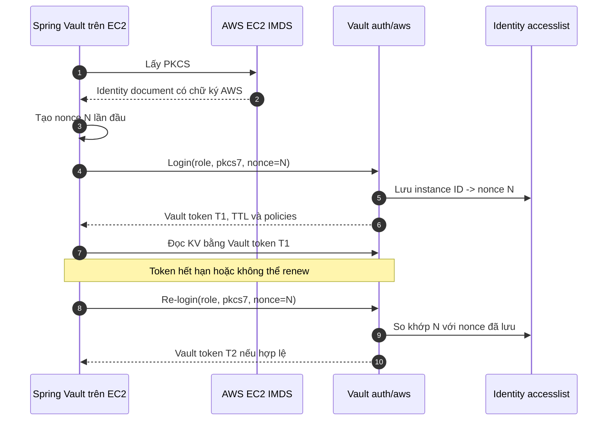
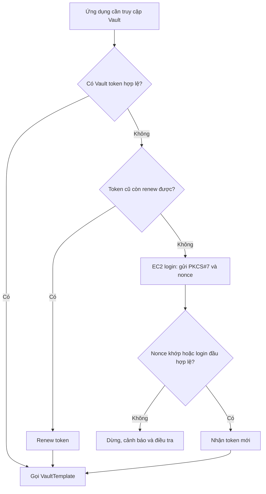

# Nonce và vòng đời đăng nhập lại với AWS EC2

Trong hệ thống Java dùng **Spring Vault**, một ứng dụng chạy trên Amazon EC2 có thể đăng nhập HashiCorp Vault bằng **AWS EC2 authentication**: dùng tài liệu định danh instance có chữ ký AWS để nhận **Vault token**, sau đó dùng token truy cập KV secrets, Transit hoặc PKI theo chính sách phân quyền. Nhưng tài liệu định danh EC2 có thể được đọc lại nhiều lần, kể cả bởi một tiến trình khác cùng máy. Vault vì vậy dùng **nonce** kết hợp nguyên tắc **Trust On First Use (TOFU)** để nhận biết client đã đăng nhập trước đó.

Chủ đề **Xác thực cloud** này đi sâu vào một vấn đề thực tế: ứng dụng đăng nhập lần đầu thành công, sau đó phải gia hạn token hoặc đăng nhập lại, nhưng **khởi động lại Java process lại làm mất nonce**. Bài học giải thích cơ chế, điểm hỏng, cách dùng `AwsEc2Authentication`, `VaultTemplate`, quy trình vận hành và lựa chọn xác thực phù hợp cho workload.

## 1. Mục tiêu

Sau bài học, bạn có thể:

- Phân biệt tài liệu định danh EC2, nonce, IMDSv2 session token và Vault login token.
- Giải thích cách Vault gắn nonce với EC2 instance ID trong `identity-accesslist`.
- Mô tả trạng thái trước và sau các sự kiện **renew**, **re-login**, application restart, EC2 reboot và stop/start.
- Cấu hình role `auth_type=ec2` và Spring Vault để dùng nonce một cách có kiểm soát.
- Xử lý lỗi sai/mất nonce mà không vô tình bỏ cơ chế bảo vệ TOFU.

**Phạm vi:** xác thực EC2 thông qua Vault AWS auth method (ví dụ `auth/aws/`). AWS **IAM auth** cũng thuộc nhóm AWS auth nhưng dùng chữ ký yêu cầu STS `GetCallerIdentity` và **không áp dụng client nonce theo TOFU này**.

## 2. Bốn thông tin cần phân biệt

| Thông tin | Nguồn | Dùng để làm gì? | Khi nào cần? |
| --- | --- | --- | --- |
| **Instance identity document / PKCS#7 signature** | AWS EC2 Instance Metadata Service (IMDS) | Chứng minh tài liệu mô tả instance được AWS ký | Mỗi lần EC2 login vào Vault |
| **EC2 client nonce** | Spring Vault sinh hoặc ứng dụng cung cấp; Vault ghi lại theo instance ID | Chứng minh client đã được chấp nhận ở lần login đầu | Lần EC2 login đầu và các lần **re-login** |
| **IMDSv2 session token** | EC2 metadata service | Cho phép gửi request đến metadata endpoint IMDSv2 | Khi client lấy metadata qua IMDSv2 |
| **Vault login token** | Vault cấp qua `auth/aws/login` | Cấp quyền gọi Vault KV, Transit, PKI... | Mỗi request tới tài nguyên Vault |

**Nonce không phải Vault token**: nonce không dùng làm `X-Vault-Token`, không cấp quyền KV và không cần kèm theo mỗi request `VaultTemplate`. **IMDSv2 token cũng không phải nonce**: nó chỉ phục vụ việc đọc metadata ở `169.254.169.254`.

### Vì sao cần nonce?

AWS ký identity document giúp Vault kiểm tra tài liệu đến từ AWS, nhưng một bên có quyền đọc metadata PKCS#7 có thể sao chép nó và gửi request login đến Vault. Vì vậy chỉ dựa vào PKCS#7 không đủ để phân biệt hai tiến trình cùng có tài liệu. TOFU cho **client đầu tiên** đăng nhập instance và gắn một nonce với instance đó; những lần login tiếp theo phải chứng minh biết **đúng nonce cũ**.

TOFU vẫn có một giới hạn: **client xấu login trước** có thể chiếm suất đầu tiên, khiến client hợp lệ bị từ chối. Do đó ứng dụng phải có cơ chế cảnh báo nếu bị từ chối lần đầu hoặc lần login lại bất thường.

## 3. Luồng xác thực EC2 và vai trò Vault

Giả sử:

- EC2 instance ID: `i-0123456789abcdef0`.
- AWS account: `111122223333`, region: `ap-southeast-1`.
- Vault AWS auth mount: `auth/aws/`, role: `payment-ec2`.
- Workload Spring Vault: `payment-service`, chỉ được đọc KV v2 `secret/data/payment/runtime`.

Khi client gửi `POST /v1/auth/aws/login`, Vault kiểm tra chữ ký identity document, trạng thái/ràng buộc EC2, role và cơ chế nonce. Thành công, Vault cấp token theo `token_policies`, `token_ttl` và các giới hạn của role.



Trong sơ đồ, **nonce N giữ nguyên**, còn **Vault token T1/T2 là các token khác nhau**. Nonce không được thay mỗi khi token gần hết TTL.

### Đăng nhập lần đầu

1. Client lấy PKCS#7 identity document từ IMDS.
2. Spring Vault thông thường **tự sinh nonce mạnh ở client** và gửi kèm `role`, `pkcs7` đến Vault.
3. Nếu instance ID chưa có trong `identity-accesslist`, Vault chấp nhận lần login đầu khi các điều kiện AWS/role hợp lệ, rồi ghi lại nonce.
4. Vault trả về Vault token để client thực hiện công việc.

Vault cũng hỗ trợ trường hợp **client không gửi nonce**: khi cho phép reauthentication, Vault có thể tự tạo nonce, gửi lại trong auth metadata và lưu vào accesslist. Client khi đó phải lưu giá trị response để dùng lại. Nếu client **tự cung cấp nonce**, Vault không cần gửi lại nonce đã được cung cấp. Với **Spring Vault**, luồng mặc định thường tạo nonce từ phía ứng dụng.

### Đăng nhập lại

Khi Vault cần cấp token mới cho cùng instance, client gửi lại identity document và **nonce đã dùng ở lần login đầu**. Vault so với entry theo instance ID:

- Nonce **khớp**: có thể login lại, nếu ràng buộc AWS/role vẫn đúng.
- Nonce **khác, rỗng hoặc bị mất**: login bị từ chối khi instance đã được ràng buộc và role đang cho phép reauthentication theo TOFU.
- Chỉ sao chép PKCS#7 của instance: không đủ để qua bước so khớp nonce.

Entry này nằm tại `auth/aws/identity-accesslist/<instance-id>`; đây là danh sách các instance đã được chấp nhận, **không phải danh sách Vault token**.

## 4. Token renewal khác với re-login

`VaultTemplate` làm việc bằng **Vault token** lấy từ `SessionManager`; Spring Vault có `LifecycleAwareSessionManager` giúp quản lý việc lấy/gia hạn token và đăng nhập lại. Đối với token có khả năng renew, session manager có thể gia hạn token; chỉ khi cần token mới mới phát sinh một yêu cầu EC2 login mới.

| Trạng thái | Token | Tác động đến nonce |
| --- | --- | --- |
| Vừa khởi động lần đầu | Chưa có token | Cần nonce mới để đăng nhập đầu tiên |
| Token còn hạn | Dùng token đang có | Không cần gửi nonce trên từng request Vault |
| Renew thành công | Token được gia hạn | Nonce phía Vault và client **không đổi** |
| Token hết hạn/chạm giới hạn renew | Phải xin token mới | Re-login bắt buộc gửi **nonce cũ** |
| Java process restart trên cùng EC2 | Token/session trong RAM mất | Nếu nonce chỉ trong RAM, client cũng mất nonce |
| Reboot EC2 | Process phải chạy lại | Nếu nonce không được bảo toàn, login lại có thể bị từ chối |

Token có thể có `token_ttl`, `token_max_ttl`, `renewable`, `token_period` hoặc giới hạn riêng tùy role. **Hết TTL của Vault token không xóa nonce** và **token được renew không có nghĩa nonce được rotate**.



Điểm quyết định tính sẵn sàng là **Spring Vault giữ hoặc phục hồi được nonce khi thật sự phải re-login**.

## 5. Vấn đề cốt lõi: restart làm mất nonce

Theo tài liệu Spring Vault, `AwsEc2Authentication` mặc định sinh nonce và **giữ trong bộ nhớ**. Cùng một instance của client có thể đăng nhập lại nhiều lần khi process còn sống. Nhưng sau khi Java process khởi động lại, nonce cũ mất; một `AwsEc2Authentication` mới có thể tạo nonce khác.

| Sự kiện | Nonce client | Nonce Vault đã lưu | Kết quả |
| --- | --- | --- | --- |
| 08:00: Login lần đầu | `N1` | Chưa có | Login thành công; Vault lưu `N1` |
| 12:00: Token cũ không renew được | `N1` | `N1` | Re-login thành công |
| 15:00: Restart Java trên cùng instance | `N2` | `N1` | Re-login **bị từ chối** |
| Sau khi khôi phục `N1` an toàn | `N1` | `N1` | Có thể re-login lại |

### Cách thiết kế nonce

**Nonce chỉ trong RAM:** không phải lưu trữ thêm secret, nhưng cần chấp nhận rằng restart process trên **cùng instance** có thể làm mất khả năng re-login. Cách này có thể phù hợp với workload ngắn hạn thay **cả EC2 instance** khi deploy.

**Nonce do ứng dụng cung cấp và giữ bền vững:** sinh giá trị đủ mạnh **một lần riêng cho mỗi instance**, lưu ở nguồn an toàn giới hạn quyền, rồi tải **đúng giá trị đó** qua các lần restart. Chú ý việc cấp phát và phân phối nonce qua nhiều tiến trình trên một instance: dùng chung nonce không phải một thiết kế cô lập ứng dụng, vì Vault gắn nó theo **instance ID**.

**Chuyển sang AWS IAM auth:** khi instance có IAM instance profile, IAM auth thường đơn giản hơn về re-login vì không có TOFU client nonce. Tài liệu Vault Agent khuyến nghị IAM auth khi có thể do tính phức tạp của cơ chế EC2 TOFU.

**Không lưu nonce cố định dùng chung toàn Auto Scaling Group.** Nonce là chứng cứ riêng của client/instance; dùng chung làm tăng hậu quả nếu một instance bị lộ. Cũng không hardcode nonce vào source code, image AMI, `application.yml` trong repository hay log.

## 6. Cấu hình phía Vault

Các lệnh sau là ví dụ cho **quản trị viên** trong môi trường thử nghiệm hoặc đã được phê duyệt. Cần có quyền admin phù hợp và Vault auth method được cấu hình để kiểm tra AWS instance. Sử dụng `VAULT_ADDR` trỏ tới Vault qua TLS.

### 6.1. Bật AWS auth và tạo policy

```bash
# Chỉ thực hiện nếu chưa có auth mount tương ứng.
vault auth enable aws
```

Ví dụ policy giới hạn workload chỉ đọc một secret KV v2:

```hcl
# payment-read.hcl
path "secret/data/payment/runtime" {
  capabilities = ["read"]
}
```

```bash
vault policy write payment-read payment-read.hcl
```

### 6.2. Tạo role đăng nhập EC2

```bash
vault write auth/aws/role/payment-ec2 \
  auth_type=ec2 \
  bound_account_id=111122223333 \
  bound_region=ap-southeast-1 \
  token_policies=payment-read \
  token_ttl=30m \
  token_max_ttl=4h \
  disallow_reauthentication=false \
  allow_instance_migration=false

vault read auth/aws/role/payment-ec2
```

Giải thích:

- **`auth_type=ec2` là bắt buộc phải xác định rõ** khi tạo role EC2 trên mount `aws` hiện đại; nếu bỏ qua, role có thể mặc định sang `iam`.
- `bound_account_id`/`bound_region` hạn chế instance được đăng nhập; có thể thêm `bound_ami_id`, `bound_vpc_id`, `bound_subnet_id` hoặc `bound_ec2_instance_id` phù hợp môi trường.
- `token_policies` quy định quyền của **Vault token**, hoàn toàn khác quyền IAM của EC2 instance.
- `disallow_reauthentication=false` cho phép login lại khi nonce hợp lệ.
- `allow_instance_migration=false` yêu cầu kiểm nonce bình thường, không kích hoạt ngoại lệ stop/start.
- Hai tùy chọn **`allow_instance_migration` và `disallow_reauthentication` không thể cùng bật**.

Vault server phải có khả năng xác minh thông tin EC2 ở AWS; tùy triển khai có thể cần IAM permissions hoặc cấu hình xác thực cross-account. Nếu mount chọn `auth/aws-ec2/` thay vì `auth/aws/`, sửa path **nhất quán** ở role, Spring config và API.

## 7. HTTP login và IMDSv2

Yêu cầu EC2 login gửi tới `POST /v1/auth/aws/login`:

```http
POST /v1/auth/aws/login
Content-Type: application/json

{
  "role": "payment-ec2",
  "pkcs7": "<noi-dung-pkcs7-khong-xuong-dong>",
  "nonce": "<nonce-rieng-cho-instance>"
}
```

Phản hồi rút gọn minh họa:

```json
{
  "auth": {
    "client_token": "<vault-token>",
    "policies": ["default", "payment-read"],
    "lease_duration": 1800,
    "renewable": true,
    "metadata": {"role": "payment-ec2"}
  }
}
```

Các trường response thực tế và khả năng renew tùy role, token type, Vault version. `client_token` **không được log hoặc ghi vào file cấu hình**.

### Lấy PKCS#7 từ EC2 IMDSv2

Khi EC2 yêu cầu IMDSv2, client cần lấy **IMDS session token** trước khi truy xuất identity document:

```bash
# Chạy trong EC2 được phép đọc instance metadata.
IMDS_TOKEN=$(curl --fail --silent --show-error -X PUT \
  "http://169.254.169.254/latest/api/token" \
  -H "X-aws-ec2-metadata-token-ttl-seconds: 60")

curl --fail --silent --show-error \
  -H "X-aws-ec2-metadata-token: $IMDS_TOKEN" \
  "http://169.254.169.254/latest/dynamic/instance-identity/pkcs7"
```

Trong ứng dụng Java, nên để Spring Vault xử lý metadata retrieval. Spring Vault **3.2+** có hỗ trợ IMDSv2; các phiên bản khác nhau có thể có giá trị mặc định khác nhau nên cấu hình rõ phiên bản IMDS và kiểm tra dependency thực tế. **IMDS token không truyền vào trường `nonce` của Vault**.

## 8. Spring Vault – cấu hình nonce trong Java

API `AwsEc2AuthenticationOptions` có builder thiết lập `path`, `role`, `version` (IMDS) và `nonce`:

```java
import org.springframework.vault.authentication.AwsEc2AuthenticationOptions;

AwsEc2AuthenticationOptions options =
    AwsEc2AuthenticationOptions.builder()
        .path("aws")
        .role("payment-ec2")
        .version(
            AwsEc2AuthenticationOptions.InstanceMetadataServiceVersion.V2)
        .nonce(AwsEc2AuthenticationOptions.Nonce.generated())
        .build();
```

`Nonce.generated()` dùng một nonce được sinh cho client, **không tự đảm bảo bền vững qua process restart**. Khi đã có nguồn cung cấp nonce ổn định riêng cho EC2 instance, dùng:

```java
// loadNonce() là phương thức ứng dụng tự xây dựng,
// trả nonce từ nguồn an toàn; không phải API có sẵn của Spring Vault.
char[] perInstanceNonce = loadNonce();

AwsEc2AuthenticationOptions options =
    AwsEc2AuthenticationOptions.builder()
        .path("aws")
        .role("payment-ec2")
        .version(
            AwsEc2AuthenticationOptions.InstanceMetadataServiceVersion.V2)
        .nonce(AwsEc2AuthenticationOptions.Nonce.provided(perInstanceNonce))
        .build();
```

Đăng ký `AwsEc2Authentication` làm `ClientAuthentication` trong cấu hình Spring Vault và để `SessionManager` quản lý Vault token. Với Spring Vault 4.1, constructor có dạng:

```java
AwsEc2Authentication auth =
    new AwsEc2Authentication(options, vaultClient, awsMetadataClient);
// vaultClient: VaultClient
// awsMetadataClient: RestClient kết nối IMDS đã cấu hình phù hợp.
```

Đây là **đoạn minh họa cấu hình**, các biến dependency và import cần do ứng dụng cung cấp. Constructor khác nhau giữa các phiên bản Spring Vault; kiểm tra Javadoc của dependency đang dùng.

### Spring Cloud Vault: cấu hình khai báo

Nếu dùng **Spring Cloud Vault Config**, có thể cấu hình:

```yaml
spring:
  cloud:
    vault:
      uri: https://vault.internal.example:8200
      authentication: AWS_EC2
      aws-ec2:
        aws-ec2-path: aws
        role: payment-ec2
        nonce: "<nonce-duoc-cap-rieng-cho-ec2-tu-nguon-an-toan>"
      session:
        lifecycle:
          enabled: true
          refresh-before-expiry: 10s
          expiry-threshold: 20s
```

Giá trị `nonce` ở YAML trên **chỉ là placeholder**; trong thực tế nạp từ một nguồn an toàn theo môi trường triển khai, không commit giá trị vào repository hoặc AMI. Một nonce **trống** thường khiến Spring Cloud Vault tự sinh nonce; muốn vượt qua restart, giá trị phải **được tái sử dụng chính xác**.

### `VaultTemplate` sau khi login

Ứng dụng gọi API secret bằng `VaultOperations`/`VaultTemplate`, không phải tự gửi nonce trong từng lời gọi:

```java
import org.springframework.vault.core.VaultOperations;
import org.springframework.vault.core.VaultKeyValueOperationsSupport;
import org.springframework.vault.support.VaultResponse;

public final class PaymentSettingsReader {
    private final VaultOperations vault;

    public PaymentSettingsReader(VaultOperations vault) {
        this.vault = vault;
    }

    public VaultResponse read() {
        return vault.opsForKeyValue(
            "secret",
            VaultKeyValueOperationsSupport.KeyValueBackend.KV_2
        ).get("payment/runtime");
    }
}
```

Nonce chỉ dùng lúc `ClientAuthentication` login; request KV sử dụng Vault token do session manager cấp.

## 9. `disallow_reauthentication` và `allow_instance_migration`

### Cho phép login lại – mặc định

`disallow_reauthentication=false`: Vault cho login nhiều lần từ cùng EC2 instance khi nonce hợp lệ. Đây là chế độ phù hợp với workload chạy lâu, có token TTL hữu hạn và nhu cầu login lại sau khi hết giới hạn renew.

### Chỉ cho login một lần

`disallow_reauthentication=true`: chỉ cấp một lần login cho mỗi instance ID; nonce không còn ý nghĩa trong các login tiếp theo vì mọi lần re-login đều bị chặn. Nếu token không còn dùng được, ứng dụng **không thể tự xin token mới** với instance đó cho đến khi có quy trình vận hành can thiệp. Không bật chế độ này chỉ để “sửa lỗi nonce”.

### Cho phép migration sau EC2 stop/start

`allow_instance_migration=true` dùng trường `pendingTime` của instance identity document: nếu EC2 stop/start và `pendingTime` mới hơn thời điểm đã lưu, Vault có thể chấp nhận nonce mới. Đây là **ngoại lệ** của TOFU và cần đánh giá rủi ro. **EC2 reboot không thay đổi `pendingTime` theo cách này**, nên bật migration không giải quyết trường hợp restart ứng dụng hoặc reboot mất nonce.

Không cấu hình đồng thời `disallow_reauthentication=true` và `allow_instance_migration=true`.

## 10. Mất nonce: quy trình điều tra và khôi phục

Nếu service vừa restart trên cùng EC2, lấy metadata bình thường nhưng login vào Vault thất bại, có khả năng client đang dùng nonce mới trong khi Vault giữ nonce cũ.

Quy trình xử lý:

1. Xác minh **instance ID**, Vault auth mount và role thực sự của client; kiểm tra ràng buộc AWS như account, region, trạng thái `running`, AMI/VPC/subnet.
2. Phân biệt lỗi đọc IMDSv2, lỗi quyền AWS của Vault server, role sai và **nonce mismatch**. Không suy luận chỉ từ HTTP 403.
3. Dùng tài khoản vận hành có quyền phù hợp xem entry `identity-accesslist` của **đúng instance**. Entry có thể chứa `client_nonce`, vì vậy không in response vào ticket/log.
4. Kiểm tra xem nonce cũ có thể khôi phục từ nguồn lưu trữ an toàn không. Điều tra khả năng có process khác login trước hoặc rò rỉ PKCS#7/nonce.
5. Chỉ sau khi phê duyệt, nếu không thể khôi phục nonce, **xóa entry đúng instance ID** để cho phép khởi tạo lại TOFU; đồng thời xem xét thu hồi các Vault token trước đó nếu có dấu hiệu xâm nhập.
6. Đăng nhập lại bằng nonce mới, xác nhận policy/TTL và thực hiện kiểm thử đọc một secret được cấp phép.

Lệnh xem entry (chỉ cho người vận hành, tránh đưa output nhạy cảm vào log):

```bash
vault read auth/aws/identity-accesslist/i-0123456789abcdef0
```

Lệnh khôi phục có quyền admin **sau khi xác minh và phê duyệt**:

```bash
vault delete auth/aws/identity-accesslist/i-0123456789abcdef0
```

**Xóa accesslist entry không tự động thu hồi các Vault token cũ** vì token lifecycle và TOFU identity tracking là hai cơ chế khác nhau. Nếu nghi ngờ bị chiếm quyền, phải điều tra audit và dùng quy trình thu hồi token phù hợp.

Không để ứng dụng tự động xóa entry rồi thử login trong vòng lặp: cách đó phá hiệu quả TOFU và có thể che giấu hành vi giả mạo.

## 11. Bảng lỗi và cách xử lý

| Hiện tượng | Nguyên nhân thường gặp | Hướng kiểm tra |
| --- | --- | --- |
| Không login được lần đầu | Role chưa tạo, `auth_type=iam`, ràng buộc EC2 không khớp | Đọc Vault role, AWS identity và thông báo auth |
| Login thành công trước restart, thất bại sau restart | Spring Vault sinh nonce mới | Khôi phục nonce cũ hoặc reset entry được phê duyệt |
| Lỗi khi có hai Java process trên một EC2 | Hai process dùng nonce khác nhau cho cùng instance ID | Thiết kế một chủ thể xác thực hoặc chọn IAM auth |
| EC2 reboot xong không thể re-login | Nonce trong RAM mất | Phục hồi nonce; migration không giải quyết reboot |
| EC2 stop/start xong không login | Nonce mất hoặc instance constraints thay đổi | Kiểm tra `pendingTime`, role và chính sách migration |
| Không đọc được PKCS#7 qua IMDS | Client dùng IMDSv1 khi instance bắt buộc IMDSv2 | Chọn metadata retrieval hỗ trợ IMDSv2 |
| Token hết TTL, secret read bị từ chối | Token không renew được và re-login thất bại | Phân biệt token lifecycle với nonce mismatch |
| Login được nhưng đọc KV 403 | Thiếu `read` trên `secret/data/...` | Sửa ACL của Vault token, không chỉnh nonce |
| Không thể login dù đã xóa entry | AWS signature/role/token client còn vấn đề | Đọc lỗi cụ thể, xác minh request và quyền server |

## 12. Quan sát, bảo mật và kiểm thử tích hợp

Nên đo số lần **login thành công/thất bại**, lỗi theo role/instance, thời điểm restart/deploy, số lần **token renewal**, lần bắt đầu **re-login**, độ trễ IMDS/Vault và những thao tác quản trị `identity-accesslist`.

**Không ghi log** nonce, IMDSv2 token, PKCS#7, Vault `client_token` hay secret payload. HashiCorp lưu ý nonce do **Vault backend tự sinh và trả trong response** có thể xuất hiện plaintext trong audit log; client tự cấp nonce sẽ không cần nhận lại nonce đó trong response. Hạn chế quyền đọc metadata và lưu nonce theo đúng phạm vi instance/workload.

Kiểm thử tối thiểu trong môi trường EC2/Vault riêng:

| Ca | Thao tác | Kỳ vọng |
| --- | --- | --- |
| Login đầu | Instance chưa có accesslist entry, nonce `N1` | Vault lưu `N1` và cấp token |
| Re-login thành công | Dùng lại `N1` | Nhận token mới |
| Re-login sai nonce | Đổi `N1` thành `N2` | Bị từ chối |
| Renew token | Token renewable, còn trong max TTL | Renew, không đổi nonce |
| Restart và mất nonce | Process mới tạo `N2` | Login thất bại |
| Restart và giữ nonce | Process mới nạp lại `N1` | Có thể login |
| Hai process trên cùng EC2 | Mỗi process có nonce khác | Không thể coi hai nonce là hai danh tính EC2 độc lập |
| `disallow_reauthentication=true` | Login lần hai cùng instance | Bị chặn |
| Reboot với nonce RAM | Mất nonce, không migration | Login thất bại khi cần token mới |
| Reset entry do operator | Xóa đúng instance entry sau kiểm tra | Login mới có thể lập TOFU lại |
| Đọc KV thiếu ACL | Token đã login, thiếu `read` | Lỗi quyền KV độc lập nonce |

Test nên xác minh cả **Vault auth event**, **instance accesslist state**, **token renew/re-login** và **quyền truy cập secret**; unit test mô phỏng không thay thế kiểm thử EC2 metadata và Vault backend thực.

## 13. So sánh nhanh với AWS IAM auth

| Đặc tính | AWS EC2 auth | AWS IAM auth |
| --- | --- | --- |
| Chứng cứ AWS | EC2 identity document có chữ ký | STS `GetCallerIdentity` ký bằng IAM credentials |
| Ràng buộc quyền | Vault role với bound instance/account/region... | Vault role với IAM principal/bound constraints |
| Client nonce TOFU | **Có** | **Không** |
| Restart cùng instance | Phải giữ nonce hoặc can thiệp an toàn | Không có vấn đề EC2 nonce |
| Hợp với | EC2 có quy trình quản lý instance identity/nonce | Workload có IAM instance profile/role, triển khai động |

Khi ứng dụng Java cần restart hoặc scale liên tục và đã có IAM role phù hợp, **AWS IAM auth** thường đơn giản hơn trong vận hành. Khi cần xác thực dựa vào EC2 instance identity, vẫn có thể dùng EC2 auth nếu đã có chiến lược bảo toàn nonce và quy trình khôi phục được giám sát.

## 14. Câu hỏi tự kiểm tra

1. `VaultTemplate` có phải gửi nonce mỗi lần đọc KV v2 không? Vì sao?
2. Nếu token TTL là 30 phút, có cần sinh nonce mới cứ mỗi 30 phút không?
3. Vì sao application restart cùng instance có thể thất bại dù PKCS#7 không thay đổi?
4. `allow_instance_migration` giúp gì sau **stop/start**, và vì sao không giải quyết **reboot**?
5. Vì sao xóa `identity-accesslist` không có nghĩa đã thu hồi Vault tokens cũ?
6. Hai ứng dụng khác nhau trên cùng EC2 có thể tự tạo hai nonce và mong Vault coi là hai EC2 identity độc lập không?

**Ghi nhớ:** Nonce bảo vệ **quyền tiếp tục đăng nhập của client đã được TOFU chấp nhận**, trong khi Vault token bảo vệ **quyền thực thi request**. Quản lý đúng nonce, token TTL, session lifecycle và quy trình xử lý lỗi là điều kiện để Spring Vault vận hành tin cậy trên AWS EC2.

## Tài liệu tham khảo

- [HashiCorp Vault – AWS auth method: client nonce, reauthentication và instance migration](https://developer.hashicorp.com/vault/docs/auth/aws)
- [HashiCorp Vault – AWS auth HTTP API: role, login và identity-accesslist](https://developer.hashicorp.com/vault/api-docs/auth/aws)
- [Spring Vault – Authentication Methods: AWS-EC2](https://docs.spring.io/spring-vault/reference/vault/authentication.html)
- [Spring Vault – AwsEc2AuthenticationOptions API](https://docs.spring.io/spring-vault/reference/api/java/org/springframework/vault/authentication/AwsEc2AuthenticationOptions.html)
- [Spring Vault – LifecycleAwareSessionManager API](https://docs.spring.io/spring-vault/reference/api/java/org/springframework/vault/authentication/LifecycleAwareSessionManager.html)
- [Spring Cloud Vault – AWS-EC2 authentication và session token lifecycle](https://docs.spring.io/spring-cloud-vault/docs/current/reference/html/)
- [Vault Agent – AWS auto-auth: khuyến nghị IAM khi có thể](https://developer.hashicorp.com/vault/docs/agent-and-proxy/autoauth/methods/aws)
