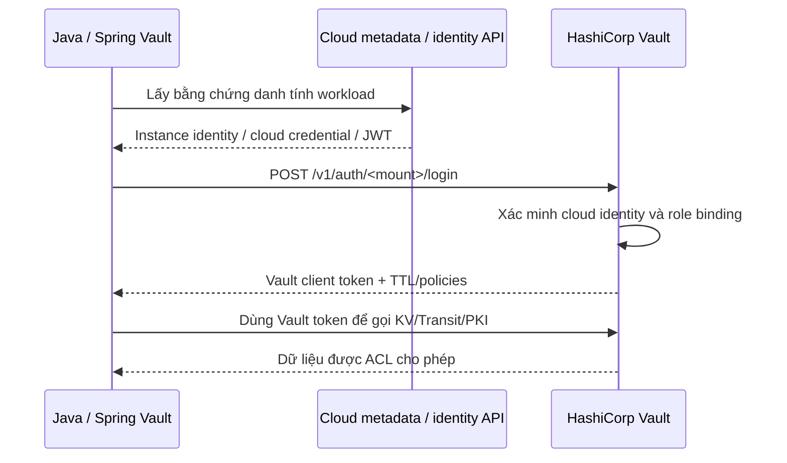
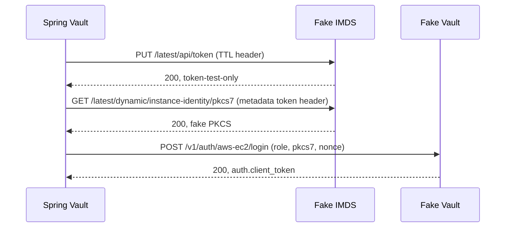

# IMDS và tùy chọn được hỗ trợ theo phiên bản client

Khi ứng dụng Java chạy trên EC2, Azure VM hoặc Google Compute Engine, **Instance Metadata Service (IMDS)** cung cấp thông tin về workload và trong một số trường hợp cung cấp bằng chứng danh tính hoặc credential ngắn hạn. Spring Vault có thể sử dụng các thông tin này để thực hiện đăng nhập HashiCorp Vault, nhận **Vault token**, rồi truy cập KV secrets, Transit encryption hay PKI trong phạm vi policy của Vault.

Điểm dễ sai là xem tất cả IMDS như nhau hoặc cấu hình một thuộc tính mà **phiên bản Spring Vault/Spring Cloud Vault đang sử dụng chưa hỗ trợ**. Ví dụ, AWS IMDSv2 yêu cầu lấy metadata session token trước khi đọc EC2 identity document; trong khi đó AWS-IAM dùng yêu cầu STS có chữ ký, Azure MSI lấy thông tin VM và identity token, còn GCP-GCE dựa vào identity JWT từ metadata server. Bài học thuộc chương **Xác thực cloud** này trình bày luồng hoạt động, giới hạn theo phiên bản client, cách cấu hình và kiểm thử.

## 1. Phân biệt IMDS, danh tính cloud và Vault token

Ba loại thông tin sau có vai trò khác nhau:

| Thành phần | Được cấp bởi | Dùng để làm gì | Có thay thế được nhau không? |
| --- | --- | --- | --- |
| Metadata / bằng chứng danh tính instance | Dịch vụ metadata của nền tảng cloud | Chứng minh workload đang chạy trên instance hoặc VM cụ thể | Không phải Vault token |
| **AWS IMDSv2 session token** | IMDS chạy trên EC2 | Cho phép client gọi HTTP GET vào metadata server EC2 khi phiên làm việc còn hạn | Không dùng làm credential để gọi Vault |
| **Vault client token** | Vault sau khi xác thực cloud thành công | Gửi trong `X-Vault-Token` để dùng KV, Transit, PKI... theo ACL policy | Không phải IMDS token, IAM access key hay Azure/GCP identity token |

Luồng tổng quát:



Ở AWS-IAM, client không nhất thiết lấy một identity document; nó ký yêu cầu `STS GetCallerIdentity` bằng AWS credentials rồi gửi dữ liệu yêu cầu đã ký cho Vault. Việc **AWS SDK lấy credentials từ IMDS** chỉ là một trong các nguồn có thể được dùng, tùy workload và credential provider.

IMDS là dịch vụ nằm ở môi trường runtime của cloud. Gọi trực tiếp địa chỉ link-local từ máy phát triển hoặc container không nằm trên EC2/Azure VM có thể thất bại là hành vi bình thường, không nhất thiết Vault bị lỗi.

## 2. AWS IMDSv1 và IMDSv2: khác nhau ở giao thức

Đối với EC2, địa chỉ metadata IPv4 thường là `http://169.254.169.254` (có thể dùng endpoint IPv6 khi instance và mạng hỗ trợ). Hai phiên bản khác nhau ở cách truy cập:

| Thuộc tính | IMDSv1 | IMDSv2 |
| --- | --- | --- |
| Khởi tạo phiên | Không có | `PUT /latest/api/token` với TTL |
| Đọc metadata | `GET` trực tiếp | `GET` kèm header `X-aws-ec2-metadata-token` |
| Khi instance đặt `HttpTokens=required` | Bị từ chối | Hoạt động khi có token hợp lệ |
| Khuyến nghị triển khai mới | Tránh phụ thuộc | Chọn IMDSv2 và yêu cầu token trên EC2 |

Ví dụ giao thức IMDSv2 trên EC2 (minh họa giao tiếp, **không chạy trên máy ngoài EC2**):

```http
PUT /latest/api/token HTTP/1.1
Host: 169.254.169.254
X-aws-ec2-metadata-token-ttl-seconds: 120

HTTP/1.1 200 OK

<IMDS_SESSION_TOKEN>
```

```http
GET /latest/dynamic/instance-identity/pkcs7 HTTP/1.1
Host: 169.254.169.254
X-aws-ec2-metadata-token: <IMDS_SESSION_TOKEN>

HTTP/1.1 200 OK

<PKCS7_SIGNED_EC2_IDENTITY_DOCUMENT>
```

Các chuỗi nằm trong dấu `<...>` chỉ là placeholder. Trong ứng dụng thật, Spring Vault thực hiện việc truy cập metadata theo lựa chọn cấu hình; không nên tự gọi các URL bằng mã ứng dụng nếu thư viện đã hỗ trợ.

TTL của IMDSv2 token nằm trong phạm vi **1 giây đến 6 giờ**, độc lập với TTL của Vault login token. Khi hết hạn, client phải lấy IMDS token mới. Nếu EC2 bắt buộc IMDSv2 mà client chỉ thực hiện GET kiểu IMDSv1, request metadata thường trả `401 Unauthorized`; nguyên nhân nằm ở **bước đọc metadata**, chưa phải Vault policy.

Khi triển khai ứng dụng trong container trên EC2, cần xét thêm network namespace, firewall, proxy và **metadata response hop limit**. Thay đổi hop limit chỉ khi topo mạng yêu cầu và phải duy trì quyền truy cập metadata theo nguyên tắc tối thiểu.

## 3. Spring Vault hỗ trợ IMDSv2 từ phiên bản nào?

**Spring Vault 3.2 trở lên** cung cấp tùy chọn AWS-EC2 authentication cho cả IMDSv1 và IMDSv2, thông qua `AwsEc2AuthenticationOptions`. Với bản cũ hơn 3.2, không được mặc định rằng lớp `AwsEc2Authentication` đã biết lấy IMDSv2 session token.

Các API quan trọng:

| API/tùy chọn | Spring Vault trước 3.2 | Spring Vault 3.2.x | Spring Vault 4.0.x | Spring Vault 4.1.x |
| --- | --- | --- | --- | --- |
| `AwsEc2Authentication` cho EC2 signed identity | Có | Có | Có | Có |
| `AwsEc2AuthenticationOptions.builder().version(V2)` | Chưa có | Có | Có | Có |
| `metadataTokenTtl(Duration)` | Chưa có | Có | Có | Có |
| `metadataTokenRequestUri(URI)` | Chưa có | Có | Có | Có |
| Constructor qua `RestOperations` | Có | Có | Có (tương thích) | Có nhưng deprecated |
| Constructor qua `RestClient` | Chưa có | Chưa có | Có | Có |
| Constructor nhận `VaultClient` cho AWS-EC2 | Chưa có | Chưa có | Không dùng theo API 4.0 | Có từ 4.1 |

`InstanceMetadataServiceVersion` có hai giá trị `V1` và `V2`; phiên bản IMDS ở đây không liên quan tới **KV secrets engine v1/v2**. Để tránh hành vi thay đổi theo mặc định của thư viện/BOM, **cấu hình rõ `V2`** khi môi trường EC2 yêu cầu IMDSv2. Tên chính xác của lớp, builder method và constructor nên được đối chiếu với JavaDoc của **phiên bản dependency đã resolve**, vì nhiều ví dụ trực tuyến thuộc nhánh 3.x trong khi ứng dụng đang chạy nhánh 4.x.

Ví dụ cấu hình tùy chọn với Spring Vault **3.2+**:

```java
import java.time.Duration;
import org.springframework.vault.authentication.AwsEc2AuthenticationOptions;
import org.springframework.vault.authentication.AwsEc2AuthenticationOptions.InstanceMetadataServiceVersion;

AwsEc2AuthenticationOptions options = AwsEc2AuthenticationOptions.builder()
        .path("aws-ec2")              // Phải khớp với auth mount trong Vault
        .role("orders-ec2")           // Role đã được bind với EC2 identity
        .version(InstanceMetadataServiceVersion.V2)
        .metadataTokenTtl(Duration.ofMinutes(2))
        .build();
```

Ví dụ khởi tạo client tùy nhánh API (các đối tượng `vaultRestOperations`, `vaultClient` đã được tạo trong cấu hình kết nối Vault):

```java
// Spring Vault 3.2.x: dùng RestOperations.
ClientAuthentication auth32 = new AwsEc2Authentication(
        options, vaultRestOperations, new RestTemplate());

// Spring Vault 4.1.x: dùng VaultClient + RestClient cho IMDS.
ClientAuthentication auth41 = new AwsEc2Authentication(
        options, vaultClient, RestClient.create());
```

Hai đoạn khởi tạo trên minh họa **hai cách tương ứng hai nhánh phiên bản**, không đặt đồng thời trong cùng một source file với hai phiên bản thư viện. Với 4.0.x, đối chiếu constructor nhận `RestClient` cho cả Vault và metadata. `vaultRestOperations` phải trỏ tới base URL của Vault; HTTP client dùng cho metadata gửi request tới địa chỉ IMDS, không dùng lại token interceptor của Vault. Cấu hình timeout hữu hạn cho metadata request, đặc biệt ở các môi trường có thể không truy cập được `169.254.169.254`.

**Lưu ý Spring Cloud Vault:** `spring.cloud.vault.authentication: AWS_EC2` là cấu hình chọn phương thức xác thực cấp Spring Cloud Vault. Các property phổ biến như `aws-ec2.role`, `aws-ec2.aws-ec2-path`, `aws-ec2.identity-document`, `aws-ec2.nonce` **không đồng nghĩa** với builder API `version(V2)`. Không tự tạo property `spring.cloud.vault.aws-ec2.imds-version` rồi giả định mọi nhánh Spring Cloud Vault đều bind nó. Nếu phiên bản Spring Cloud Vault không công bố tùy chọn này, cần dùng cơ chế custom `ClientAuthentication`/cấu hình được phiên bản hỗ trợ hoặc nâng cấp phụ thuộc phù hợp.

## 4. Chọn AWS-EC2 hay AWS-IAM?

Cả hai đều đăng nhập được Vault bằng danh tính AWS nhưng **bằng chứng gửi tới Vault khác nhau**.

| Vấn đề | AWS-EC2 auth | AWS-IAM auth |
| --- | --- | --- |
| Đối tượng xác thực | EC2 instance identity document (PKCS#7) và nonce | IAM principal qua yêu cầu `STS GetCallerIdentity` có SigV4 signature |
| Phụ thuộc IMDS | Trực tiếp đọc EC2 identity metadata | Gián tiếp nếu credential provider lấy credentials từ EC2 instance profile |
| Nơi dùng điển hình | EC2 có auth role gắn với instance/AMI | EC2 instance profile, ECS task role, Lambda execution role hoặc credential provider phù hợp |
| Spring Vault API | `AwsEc2Authentication`, `AwsEc2AuthenticationOptions` | `AwsIamAuthentication`, `AwsIamAuthenticationOptions` |
| Việc phải cấu hình ở Vault | Mount AWS EC2 auth và role binding đúng | Mount AWS IAM auth và role binding đúng ARN/principal |

Trên **ECS và Lambda**, không nên mặc định có EC2 identity document để dùng `AwsEc2Authentication`. Với `AwsIamAuthentication`, SDK có thể lấy temporary credentials từ ECS task endpoint, runtime môi trường hoặc các nguồn khác. Trên EC2, credential provider có thể truy cập IMDS để lấy IAM role credentials; khi đó chính **AWS SDK và phiên bản SDK** quyết định cách nói chuyện với IMDS.

Trường hợp dùng AWS-IAM, cần kiểm tra cả dependency AWS SDK tương thích với Spring Vault/Spring Cloud Vault đang dùng. Các tài liệu Spring Vault 3.x/4.1 minh họa AWS SDK v1 (`com.amazonaws:aws-java-sdk-core`), trong khi một số nhánh Spring Cloud Vault mới dùng AWS SDK v2 (`software.amazon.awssdk:auth`). Cấu hình một class như `InstanceProfileCredentialsProvider` từ ví dụ cũ mà không có đúng SDK trên classpath sẽ gây lỗi biên dịch hoặc runtime.

Ngoài ra, IAM role của AWS **không tự động trở thành Vault policy**. Vault server phải có auth role tương ứng, ràng buộc đúng principal và gán policy tối thiểu để `VaultTemplate` truy cập được đường dẫn bí mật cần thiết.

## 5. IMDS ở Azure và GCP: cùng ý tưởng, khác giao thức

| Nền tảng | Phương thức Spring Vault | Dữ liệu lấy từ môi trường | Điểm cần lưu ý |
| --- | --- | --- | --- |
| Azure VM/Managed Identity | `AzureMsiAuthentication`, `AzureMsiAuthenticationOptions` | Thông tin VM và managed identity OAuth2 token từ Azure Instance Metadata Service | Role/identity trong Vault phải khớp, endpoint và request header theo hợp đồng Azure |
| Google Compute Engine | `GcpComputeAuthentication`, `GcpComputeAuthenticationOptions` | Identity JWT ký cho service account qua GCE metadata server | Token có audience và identity ràng buộc theo role của Vault |
| GCP IAM | `GcpIamCredentialsAuthentication`, `GcpIamCredentialsAuthenticationOptions` | Credential cho phép gọi IAM Credentials `signJwt` API | Cần quyền ký JWT và dependency Google Cloud thích hợp; luồng không bắt buộc bắt đầu bằng GCE IMDS |
| Kubernetes | `KubernetesAuthentication` | ServiceAccount JWT được mount trong pod | Đây là Kubernetes auth, không đồng nghĩa cloud IMDS |

**Azure:** `AzureMsiAuthenticationOptions` có thể nhận trực tiếp thông tin môi trường; nếu không cung cấp đầy đủ, Spring Vault truy vấn Azure metadata endpoint. Azure có yêu cầu riêng về header (chẳng hạn `Metadata: true`) và luồng lấy token. Không sao chép cơ chế `PUT /latest/api/token` của AWS sang Azure.

**GCE:** metadata server dùng hợp đồng HTTP riêng (ví dụ header `Metadata-Flavor: Google`). `GcpComputeAuthentication` nhận instance identity JWT để đăng nhập Vault; nó không dùng AWS PKCS#7 hay IAM SigV4.

**GCP IAM:** nhận JWT do IAM Credentials API ký; nó khác với việc lấy JWT từ Compute Engine metadata. Trong các phiên bản Spring Vault hiện đại, `GcpIamCredentialsAuthentication` là API thay cho `GcpIamAuthentication` cũ đã deprecated. Đối với SDK credentials và lifecycle OAuth2 của Google, cần đối chiếu khả năng sử dụng synchronous/reactive của chính phiên bản client.

Sơ đồ ra quyết định:

```text
Ứng dụng chạy ở đâu?
|
+-- EC2, muốn ràng buộc theo instance      -> AWS-EC2 (kiểm tra IMDSv2)
|
+-- EC2/ECS/Lambda, muốn ràng buộc IAM      -> AWS-IAM (SDK credential provider)
|
+-- Azure VM với managed identity          -> Azure MSI
|
+-- Google Compute Engine service account  -> GCP-GCE
|
+-- GCP với quyền IAM signJwt              -> GCP-IAM Credentials
|
+-- Kubernetes pod với service account     -> Kubernetes auth
```

Phương thức cuối cùng còn phụ thuộc cách tổ chức role và policy trong Vault. Không chọn một auth method chỉ vì một endpoint metadata có thể truy cập được.

## 6. Kiểm tra phiên bản client theo cách có thể lặp lại

Trong một dự án Spring Boot/Spring Cloud Vault, hãy thực hiện lần lượt:

1. Xác định **phiên bản `spring-vault-core` thực sự được resolve**, thay vì chỉ đọc số version Spring Boot trong file cấu hình.
2. Kiểm tra Spring Cloud Vault BOM/starter có đưa thêm lớp cấu hình authentication hoặc giới hạn property nào không.
3. Mở JavaDoc **đúng minor version** của `AwsEc2AuthenticationOptions`, builder và `AwsEc2Authentication`; tìm `version`, `metadataTokenTtl`, `metadataTokenRequestUri`, các constructor `RestOperations`/`RestClient`/`VaultClient`.
4. Đối chiếu auth mount path, role, Spring Vault/Spring Cloud Vault, AWS SDK và JDK mà ứng dụng đang chạy.
5. Trong môi trường EC2 thử nghiệm, đặt `HttpTokens=required`; xác minh luồng client có `PUT /latest/api/token` trước khi đọc identity document và hoàn tất đăng nhập Vault.
6. Kiểm tra policy kết quả bằng một lệnh đọc secret được phép và một lệnh đọc path bị cấm.

Ví dụ với Maven hoặc Gradle (chạy **trong dự án Java của người học**, không phải yêu cầu của bài viết):

```bash
# Maven: xác định phiên bản thực tế trên dependency graph
./mvnw dependency:tree -Dincludes=org.springframework.vault:spring-vault-core

# Gradle: xem dependency đã được chọn cho runtime
./gradlew dependencyInsight --dependency spring-vault-core --configuration runtimeClasspath
```

Tài liệu chính thức để đối chiếu:

- Spring Vault Authentication Methods: https://docs.spring.io/spring-vault/reference/vault/authentication.html
- Spring Vault JavaDoc AwsEc2AuthenticationOptions: https://docs.spring.io/spring-vault/reference/api/java/org/springframework/vault/authentication/AwsEc2AuthenticationOptions.html
- JavaDoc builder, bao gồm IMDS version và TTL: https://docs.spring.io/spring-vault/reference/api/java/org/springframework/vault/authentication/AwsEc2AuthenticationOptions.AwsEc2AuthenticationOptionsBuilder.html
- Spring Cloud Vault Authentication: https://docs.spring.io/spring-cloud-vault/reference/authentication.html
- AWS IMDSv2 protocol: https://docs.aws.amazon.com/AWSEC2/latest/UserGuide/configuring-instance-metadata-service.html

Đường dẫn `reference/` ở trên thường hướng tới tài liệu bản hiện hành; với một dự án sử dụng bản cũ, hãy chọn bản tài liệu tương ứng thay vì áp dụng nguyên xi API mới.

## 7. Ví dụ kiểm thử IMDSv2 không cần EC2 thật

Để kiểm tra luồng cloud authentication, một unit test chỉ mock kết quả `ClientAuthentication.login()` là chưa đủ: cần quan sát **HTTP request tới metadata server** và **HTTP request login tới Vault**. Có thể dựng hai server giả độc lập (WireMock hoặc MockWebServer), mỗi server đóng một vai trò.

Với AWS-EC2 IMDSv2, ba bước tối thiểu cần kiểm tra là:



Ví dụ fixture **IMDS** dùng trong mock HTTP:

```http
PUT /latest/api/token
X-aws-ec2-metadata-token-ttl-seconds: 120

HTTP/1.1 200 OK
Content-Type: text/plain

token-test-only
```

```http
GET /latest/dynamic/instance-identity/pkcs7
X-aws-ec2-metadata-token: token-test-only

HTTP/1.1 200 OK
Content-Type: text/plain

FAKE-PKCS7-FOR-HTTP-MOCK
```

Ví dụ fixture **Vault login** riêng biệt:

```http
POST /v1/auth/aws-ec2/login
Content-Type: application/json

{"role":"orders-ec2","pkcs7":"FAKE-PKCS7-FOR-HTTP-MOCK","nonce":"<GENERATED_NONCE>"}
```

```json
{
  "auth": {
    "client_token": "vault-token-for-test-only",
    "lease_duration": 300,
    "renewable": true,
    "policies": ["orders-read"]
  }
}
```

Trong mock, chỉ cần so sánh `role`, sự hiện diện của `pkcs7` và `nonce`; nonce mặc định được tạo ngẫu nhiên nên không được hardcode giá trị của nó. Các giá trị `FAKE-...` ở trên **không phải PKCS#7 hay token thật**; phù hợp với HTTP contract test có stub, nhưng không thể dùng để đăng nhập một Vault instance thật.

Để chuyển hướng request metadata sang fake server, sử dụng `identityDocumentUri(...)` và `metadataTokenRequestUri(...)` (có từ Spring Vault 3.2) cùng một HTTP client riêng. Đối với bản 4.1, inject `RestClient` metadata vào constructor tương ứng; với 3.2 sử dụng `RestOperations`. Cấu hình Vault client trỏ server giả thứ hai.

Các assertions cần có:

| Tình huống | Kỳ vọng |
| --- | --- |
| EC2 yêu cầu IMDSv2, client dùng `V2` | Có request PUT token; GET PKCS#7 có header token; mới POST login |
| IMDS token endpoint trả `401` hoặc `403` | Dừng ở bước metadata; không báo đây là lỗi Vault ACL |
| Metadata GET thiếu token hoặc dùng token hết hạn | Xử lý đúng lỗi IMDS, không gửi bằng chứng rỗng sang Vault |
| IMDS timeout / mạng không tới | Authentication fail rõ ràng; timeout hữu hạn, retry có giới hạn |
| Login Vault trả `403` | IMDS đã thành công nhưng Vault auth role/binding không chấp nhận |
| Vault login thành công nhưng KV path bị từ chối | Authentication thành công, lỗi nằm ở Vault policy cho secret path |
| Chạy lại sau restart | Kiểm tra chiến lược nonce và re-authentication trong điều kiện thực tế |

Khi kiểm thử thực tế với Vault test instance, tạo auth mount và role riêng, xác thực bằng workload thử nghiệm rồi gọi `VaultTemplate` đọc một KV key, thử Transit encrypt hoặc PKI issuance nếu quyền Vault cho phép. Các test này bổ sung cho mock HTTP vì Vault thật mới kiểm tra chữ ký identity, IAM principal và policy.

## 8. Những lỗi thường gặp và cách khoanh vùng

| Triệu chứng | Khả năng thường gặp | Kiểm tra trước tiên |
| --- | --- | --- |
| IMDS trả `401` trên EC2 | EC2 yêu cầu IMDSv2 nhưng client GET kiểu v1, hoặc thiếu token | Cấu hình `version(V2)`, HTTP PUT và header GET |
| `404` ở URL metadata | Sai endpoint/path, dùng endpoint AWS trên Azure/GCP | URL theo provider, metadata token URI, identity document URI |
| Timeout tại `169.254.169.254` | Chạy ngoài EC2, container/network chặn route, proxy hoặc hop limit | Môi trường runtime, no-proxy cho link-local, network namespace |
| Metadata thành công, Vault login `403` | Auth mount/role sai, policy role binding không khớp | `auth/<mount>/login`, role, cấu hình Vault auth backend |
| Login Vault OK, đọc KV `403` | ACL policy thiếu path/capability | Policy của Vault token, KV v1/v2 path thực tế |
| Lỗi `NoSuchMethodError`/`NoClassDefFoundError` | Spring Vault/Spring Cloud Vault/AWS SDK lệch phiên bản | Dependency tree và constructor/method theo JavaDoc |
| AWS-EC2 login lỗi khi app restart | Nonce trước đó không được giữ qua restart | Cơ chế nonce của AWS-EC2 auth, thiết kế tái đăng nhập |
| AWS-IAM lỗi dù IMDS EC2 hoạt động | STS signature, principal binding, credential provider hoặc quyền IAM | IAM role được chọn, region/STS endpoint, Vault role |

Không ghi metadata session token, Vault client token, IAM credentials, identity JWT, signed requests hoặc PKCS#7 thực vào log. Để giám sát, ưu tiên số lần authentication thành công/thất bại, loại lỗi, độ trễ IMDS/Vault và thời điểm Vault token được làm mới. Cấu hình `LifecycleAwareSessionManager` phù hợp để quản lý Vault token lifecycle; **IMDS token TTL** và **Vault token TTL** là hai vòng đời riêng.

Đặc biệt lưu ý nonce của AWS-EC2 auth: cơ chế **Trust On First Use** (TOFU) tạo nonce để hỗ trợ re-authentication, nhưng nonce chỉ nằm trong bộ nhớ ở luồng mặc định. Việc khởi động lại ứng dụng làm mất nonce có thể tạo tình huống phải can thiệp ở chính sách đăng nhập. Đừng vô hiệu hóa nonce hoặc chuyển sang nonce cố định chỉ để làm một bài test pass; hãy đánh giá lại mô hình tin cậy của auth role và cách vận hành workload.

## 9. Bài thực hành

Một ứng dụng Spring Vault chạy trên EC2 với cấu hình bắt buộc `HttpTokens=required`; nhóm phát triển đang nâng từ Spring Vault 3.1 lên 3.2+ và muốn đọc KV v2 sau đăng nhập AWS-EC2.

1. Mô tả vì sao client cũ có thể bị `401` ngay tại IMDS, kể cả khi Vault hoàn toàn sẵn sàng.
2. Viết `AwsEc2AuthenticationOptions` có role `orders-ec2`, `version(V2)` và `metadataTokenTtl(Duration.ofMinutes(2))`.
3. Lập hai fixture HTTP cho `PUT /latest/api/token` và `GET /latest/dynamic/instance-identity/pkcs7`; kiểm tra token header chỉ được gửi tới IMDS.
4. Mock Vault login trả `auth.client_token`; dùng `VaultTemplate` đọc KV v2 với token sau đăng nhập (có thể bổ sung integration test với Vault test instance).
5. Đặt `403` lần lượt ở bước metadata, bước Vault login và bước KV read; phân loại chính xác tầng gây lỗi.
6. Đối chiếu constructor đã dùng với phiên bản `spring-vault-core` được resolve và ghi lại khả năng cấu hình tương ứng của Spring Cloud Vault.

**Tiêu chí hoàn thành:** phân biệt được IMDSv1/IMDSv2, IMDS session token và Vault token; chọn đúng auth method theo workload; xác định rõ **tùy chọn nào chỉ xuất hiện từ Spring Vault 3.2**; cấu hình API khớp minor version; thử nghiệm được cả luồng thành công lẫn lỗi theo từng tầng mà không cần dùng credential cloud thật.
