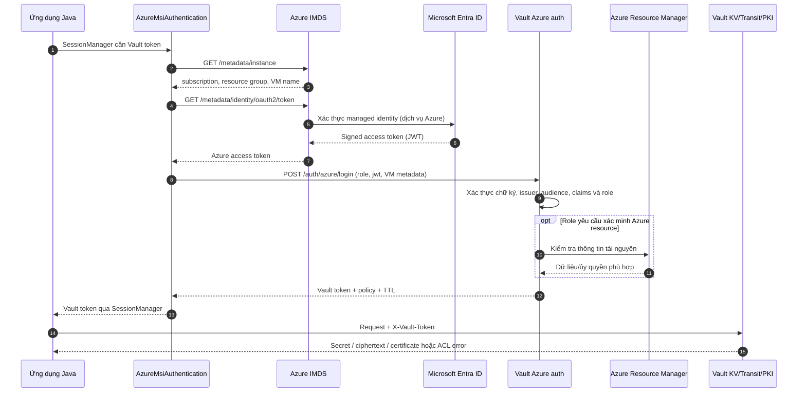

# Azure managed identity và metadata của môi trường máy ảo trong Spring Vault

## 1. Mục tiêu và bối cảnh

Khi ứng dụng Java chạy trên **Azure Virtual Machine (VM)** cần gọi **HashiCorp Vault**, một câu hỏi quan trọng là: ứng dụng lấy danh tính ở đâu để Vault tin cậy, nếu không đưa sẵn Vault token hoặc mật khẩu vào file cấu hình?

Cơ chế **Azure managed identity** giải quyết phần cấp danh tính cho workload. Azure gắn một danh tính được Microsoft Entra ID quản lý cho tài nguyên Azure; tiến trình trong VM có thể yêu cầu **access token** của danh tính đó thông qua **Azure Instance Metadata Service (IMDS)**. Vault có **Azure authentication method** để kiểm tra token và ràng buộc danh tính với một role, sau đó phát hành **Vault token**. Trong Spring Vault, `AzureMsiAuthentication` đảm nhiệm chuỗi xác thực; `VaultTemplate` sử dụng Vault token để thao tác KV secrets, Transit encryption, PKI hoặc API Vault khác theo policy.

Bài thuộc chương **Xác thực cloud** của module **SPRING_VAULT**, tập trung vào:

- Phân biệt managed identity, metadata VM, Microsoft Entra access token và Vault token.
- Hiểu chính xác luồng IMDS → Microsoft Entra → Vault Azure auth → `VaultTemplate`.
- Cấu hình VM, Azure auth method, Vault role và Spring Vault đúng thứ tự.
- Xử lý khác biệt giữa system-assigned và user-assigned identity, VM và VM Scale Set (VMSS).
- Phân tích lỗi, các giới hạn tin cậy, vòng đời token và cách kiểm thử tích hợp.

**Phạm vi:** ví dụ chính dùng workload Java chạy **trực tiếp trên Azure VM**, HashiCorp Vault độc lập với Azure Key Vault. Với AKS, Azure App Service hoặc môi trường ngoài VM, cách cung cấp identity và metadata có thể khác; không mặc nhiên dùng nguyên mô hình IMDS của VM.

## 2. Phân biệt bốn đối tượng liên quan đến xác thực

| Đối tượng | Nguồn và vai trò | Có dùng trực tiếp để gọi KV/Transit/PKI của HashiCorp Vault không? |
| --- | --- | --- |
| **Managed identity** | Danh tính được Microsoft Entra ID quản lý và gắn với tài nguyên Azure | Không; danh tính là cơ sở để lấy chứng cứ đăng nhập |
| **IMDS instance metadata** | Thông tin môi trường VM qua địa chỉ link-local: subscription, resource group, VM name, resource ID... | Không; đây là dữ liệu ngữ cảnh, không phải chữ ký hay credential |
| **Microsoft Entra access token** (JWT) | Token do Azure cấp cho managed identity, có issuer, audience, expiry và các claim về identity | Không trực tiếp; dùng làm `jwt` trong yêu cầu **đăng nhập Vault Azure auth** |
| **Vault client token** | Token được Vault phát hành sau khi role và identity được xác minh, gắn với Vault policies/TTL | **Có**; Spring Vault đưa token này vào các request nghiệp vụ đến Vault |

**Điểm then chốt:** Spring Vault không lấy token của Microsoft Entra rồi gửi nguyên token đó làm `X-Vault-Token`. Azure token được dùng để **đổi lấy Vault token** tại `auth/azure/login`; Vault token mới mang quyền được quyết định bằng **Vault policy**.

Đồng thời, **Azure RBAC** và **Vault ACL policies** giải quyết hai lớp khác nhau. Azure RBAC có thể cho Vault auth plugin quyền đọc thông tin Azure Resource Manager khi cần xác minh tài nguyên; Vault policy quyết định workload có được đọc `secret/data/orders` hoặc dùng `transit/encrypt/orders` hay không.

## 3. Managed identity trên máy ảo

### 3.1. System-assigned và user-assigned

| Tiêu chí | System-assigned managed identity | User-assigned managed identity |
| --- | --- | --- |
| Vòng đời | Liên kết với một tài nguyên Azure, thường bị xóa khi tài nguyên/danh tính bị gỡ | Tài nguyên identity độc lập, có thể tiếp tục tồn tại khi VM thay đổi |
| Gắn vào workload | Bật identity trên VM | Tạo identity riêng rồi gắn vào một hoặc nhiều VM/tài nguyên được hỗ trợ |
| Chọn danh tính khi gọi IMDS | Có thể dùng danh tính mặc định nếu không mơ hồ | Khi VM có nhiều user-assigned identities, phải chỉ rõ danh tính cần lấy token |
| Phân quyền | Quyền của service principal đại diện cho danh tính | Quyền của service principal đại diện cho identity được chọn |
| Rủi ro triển khai | Mất identity khi vòng đời tài nguyên kết thúc | Dùng nhầm identity nếu gắn nhiều identity hoặc không chọn chính xác |

Các tham số lựa chọn trong **IMDS token endpoint** bao gồm `client_id`, `object_id` hoặc `msi_res_id` theo API Microsoft. Giá trị **client/application ID**, **object/principal ID** và **Azure resource ID** là các loại định danh khác nhau; không hoán đổi chúng.

Một chi tiết về Spring Vault: builder `AzureMsiAuthenticationOptions` công bố `role(...)`, `path(...)`, `vmEnvironment(...)`, `instanceMetadataUri(...)` và `identityTokenServiceUri(...)`. **Builder này không có phương thức `clientId(...)` để chọn user-assigned identity**. Với VM gắn nhiều identities, cần kiểm tra khả năng hỗ trợ của phiên bản đang dùng và thiết kế cơ chế chọn token đúng danh tính (chẳng hạn cấu hình/triển khai tích hợp được kiểm chứng) trước khi lên production. Đừng suy đoán rằng chỉ đặt `client_id` của Vault auth plugin là đủ để chọn danh tính trên VM: đó là **cấu hình phía Vault**, không phải bộ chọn IMDS của workload.

### 3.2. Một VM có managed identity chưa đồng nghĩa Vault đã chấp nhận

Phải thỏa **đồng thời** các điều kiện:

1. Identity được bật/gắn vào VM và IMDS có thể cấp access token đúng identity/audience.
2. Vault đã bật `azure` auth method và cấu hình tenant/resource/audience tương ứng.
3. Vault role ràng buộc danh tính và phạm vi Azure thích hợp; thông tin metadata/claims phải khớp.
4. Bản thân Vault auth plugin có phương thức xác thực và quyền tra cứu Azure API thích hợp khi role cần kiểm tra tài nguyên.
5. Vault role cấp token policy đúng; policy cho phép đúng API path ứng dụng cần gọi.

Không có bước nào tự động cấp quyền đọc tất cả KV secrets chỉ vì VM có managed identity.

## 4. Azure Instance Metadata Service (IMDS)

IMDS là dịch vụ metadata tại **`169.254.169.254`**, địa chỉ **link-local, không định tuyến**; ứng dụng truy cập từ bên trong Azure VM/VMSS được hỗ trợ. IMDS dùng **HTTP**, được thiết kế để VM hỏi chính thông tin của mình. Đây là ngoại lệ có chủ đích đối với nguyên tắc dùng HTTPS trên mạng công cộng; client phải bypass proxy và gửi header `Metadata: true`.

Có **hai loại endpoint** cần phân biệt:

| Endpoint | Trả về | Được Spring Vault dùng như thế nào? |
| --- | --- | --- |
| `/metadata/instance` | JSON chứa `compute.subscriptionId`, `compute.resourceGroupName`, `compute.name`, `compute.resourceId` và các thuộc tính VM/VMSS | Lấy dữ liệu môi trường để gửi vào Vault Azure login khi chưa cấu hình `AzureVmEnvironment` |
| `/metadata/identity/oauth2/token` | JSON chứa `access_token`, `expires_on`, `token_type`, `resource` | Lấy Microsoft Entra access token của managed identity; `AzureMsiAuthentication` đưa JWT vào Vault login |

### 4.1. Đọc metadata VM

Chạy **chỉ trên VM thử nghiệm của bạn**, ví dụ:

```bash
curl --silent --show-error --fail --noproxy '*' \
  -H 'Metadata: true' \
  'http://169.254.169.254/metadata/instance?api-version=2025-04-07' \
  | jq '.compute | {
      subscriptionId, resourceGroupName, name, resourceId, location
    }'
```

Ví dụ kết quả đã rút gọn và dùng ID giả:

```json
{
  "subscriptionId": "11111111-2222-3333-4444-555555555555",
  "resourceGroupName": "rg-orders-dev",
  "name": "orders-vm-01",
  "resourceId": "/subscriptions/11111111-2222-3333-4444-555555555555/resourceGroups/rg-orders-dev/providers/Microsoft.Compute/virtualMachines/orders-vm-01",
  "location": "southeastasia"
}
```

Những trường dữ liệu này cho Vault biết workload đang khai báo mình chạy trong subscription/resource group/VM nào. **Metadata không tự đủ để chứng minh danh tính**: Vault cần kiểm chứng JWT do Azure ký và các ràng buộc role/claim tương ứng.

### 4.2. Xin access token của managed identity

Với Azure public cloud, một yêu cầu IMDS phổ biến là:

```http
GET /metadata/identity/oauth2/token?api-version=2018-02-01&resource=https%3A%2F%2Fmanagement.azure.com%2F HTTP/1.1
Host: 169.254.169.254
Metadata: true
```

Phản hồi có dạng:

```json
{
  "access_token": "<REDACTED_AZURE_ACCESS_TOKEN>",
  "expires_in": "3599",
  "expires_on": "1893456000",
  "resource": "https://management.azure.com/",
  "token_type": "Bearer"
}
```

Các giá trị trên chỉ minh họa cấu trúc, không phải một token hợp lệ. `resource` xác định **audience** của token. Token gửi Vault phải có audience mà Azure auth method của Vault được cấu hình chấp nhận; URI `https://management.azure.com/` là ví dụ thông dụng cho Azure Resource Manager của public cloud. Cloud quốc gia/sovereign cloud có endpoint riêng, phải cấu hình tương ứng cả hai phía.

Để kiểm tra **chỉ metadata không nhạy cảm** của phản hồi, tránh xuất `access_token`:

```bash
curl --silent --show-error --fail --noproxy '*' \
  -H 'Metadata: true' \
  'http://169.254.169.254/metadata/identity/oauth2/token?api-version=2018-02-01&resource=https%3A%2F%2Fmanagement.azure.com%2F' \
  | jq '{token_type, resource, expires_on}'
```

Nếu VM có nhiều user-assigned identities, IMDS có tham số `client_id`/`object_id`/`msi_res_id` để chọn danh tính; **chỉ sử dụng một tham số thích hợp**, không dựa vào việc Azure tùy chọn identity ngẫu nhiên.

Lưu ý về bảo mật: mã có thể truy cập IMDS trên VM cũng có thể xin token cho identity gắn vào VM. Chỉ cài workload tin cậy và giới hạn truy cập IMDS cho tiến trình/container không đáng tin khi mô hình triển khai yêu cầu. Không ghi access token hoặc JWT claim nhạy cảm vào log, trace hay kết quả CI.

### 4.3. Các điều kiện kết nối IMDS

- IMDS không phải hostname public; gọi từ laptop hoặc container không chạy trong VM được hỗ trợ thường sẽ không thành công.
- Phải gửi `Metadata: true`, không gửi header `X-Forwarded-For` và bỏ qua proxy.
- VM cần cấu hình networking phù hợp, dùng primary NIC/IP như yêu cầu của Azure; cần đặt connect/read timeout.
- IMDS có thể trả `400` khi thiếu header/tham số; `404` khi endpoint/giá trị không tồn tại; `410`/`429` khi tạm thời chưa sẵn sàng hoặc rate limit; `5xx` khi dịch vụ gặp sự cố. Retry có giới hạn và backoff cho lỗi tạm thời.
- Không xây dựng URL IMDS từ đầu vào do người dùng kiểm soát: điều đó tạo bề mặt SSRF qua backend ứng dụng.

## 5. Luồng xác thực VM → Vault → API secrets



Sơ đồ mô tả thứ tự logic; request nội bộ Azure và số request thực tế có thể khác theo cấu hình, phiên bản và cache. `AzureMsiAuthentication` dùng **IMDS để lấy credential** và gọi **Vault login**; `SessionManager` quản lý việc dùng lại hoặc gia hạn Vault token. Khi nhiều request KV đến cùng một workload, không cần đăng nhập Azure/Vault mới cho từng request miễn là phiên hiện tại còn hợp lệ.

Định dạng yêu cầu Vault phía trên về bản chất là:

```http
POST /v1/auth/azure/login HTTP/1.1
Content-Type: application/json

{
  "role": "orders-azure-vm",
  "jwt": "<AZURE_MANAGED_IDENTITY_JWT>",
  "subscription_id": "11111111-2222-3333-4444-555555555555",
  "resource_group_name": "rg-orders-dev",
  "vm_name": "orders-vm-01"
}
```

`role` và `jwt` là hai trường bắt buộc. Với role có các ràng buộc yêu cầu kiểm tra thông tin Azure resource, Vault thường cần các trường subscription/resource group và `vm_name` hoặc `vmss_name`; role chỉ ràng buộc service principal/group có thể không yêu cầu đủ các trường như trên. Mount path `azure` trong ví dụ là **mặc định**, có thể đổi nếu tổ chức dùng nhiều auth mount.

## 6. Chuẩn bị Azure và cấu hình Vault

Phần này minh họa cách cấu hình trên môi trường test và giải thích các quyết định an toàn. Giả định operator đã có quyền cấu hình Azure và quyền quản trị auth method của một Vault test.

### 6.1. Bước 1 — Gắn identity với VM

Trên Azure, bật **System-assigned managed identity** cho `orders-vm-01` hoặc gắn một user-assigned identity rõ ràng. Xác minh VM có thể đọc metadata và xin token cho đúng resource/audience. Ghi lại:

- Microsoft Entra **tenant ID**.
- Azure **subscription ID** và **resource group** của VM.
- **VM name** hoặc **VM scale set name**, tùy hình thức triển khai.
- **Service principal object ID** của managed identity để ràng buộc role phía Vault. Không nhầm với app/client ID.
- Azure endpoint phù hợp với môi trường public/national cloud.

### 6.2. Bước 2 — Kích hoạt và cấu hình Azure auth method tại Vault

```bash
# Bật Azure auth method ở mount mặc định, chỉ thực hiện một lần.
vault auth enable azure
```

Vault Azure auth plugin còn cần khả năng xác minh danh tính và, trong một số ràng buộc, tra cứu Azure Resource Manager. **Đây là credential/identity của chính Vault auth plugin**, khác với identity của VM ứng dụng.

Ví dụ khi **Vault server cũng chạy trên Azure** và đã được gắn managed identity có quyền Azure phù hợp, có thể dùng cấu hình kiểu MSI của Vault:

```bash
vault write auth/azure/config \
  tenant_id="<ENTRA_TENANT_ID>" \
  resource="https://management.azure.com/" \
  auth_type="msi"
```

Khi Vault chạy ngoài Azure, operator cần thiết lập cách Vault auth plugin truy cập Azure APIs, chẳng hạn service principal credential với phạm vi quyền tối thiểu hoặc workload identity federation được phiên bản Vault hỗ trợ. **Không chép client secret vào source code, shell history, tài liệu hay log**; áp dụng kênh cấu hình secrets an toàn của tổ chức. Một cấu hình auth plugin thành công **không** thay thế bước gắn identity cho VM.

Tùy Vault release, việc khai báo `auth_type` và credential có thể thay đổi; sử dụng tham số tương thích với phiên bản Vault thực tế.

### 6.3. Bước 3 — Tạo policy tối thiểu cho ứng dụng

Giả sử workload chỉ cần đọc secret KV v2 tại mount `secret`, path `orders`:

```hcl
path "secret/data/orders" {
  capabilities = ["read"]
}
```

Operator lưu nội dung policy này thành tên `orders-vault-read` trong Vault. Nếu muốn thêm quyền Transit hoặc PKI, cần **policy path riêng** với capabilities phù hợp; không cấp quyền wildcard toàn Vault hoặc root token chỉ để đơn giản hóa cấu hình.

### 6.4. Bước 4 — Tạo role Azure auth ràng buộc workload

```bash
vault write auth/azure/role/orders-azure-vm \
  token_policies="orders-vault-read" \
  bound_service_principal_ids="<MANAGED_IDENTITY_SERVICE_PRINCIPAL_OBJECT_ID>" \
  bound_subscription_ids="<AZURE_SUBSCRIPTION_ID>" \
  bound_resource_groups="rg-orders-dev" \
  token_ttl="30m"
```

**Cần xác nhận tên field TTL/token policy với phiên bản Vault đang dùng:** API của Azure auth role hỗ trợ các trường policy/TTL theo giao diện auth method và token parameters. Bản mẫu này minh họa cấu hình ý định; operator kiểm tra role đã đọc lại qua `vault read auth/azure/role/orders-azure-vm`.

Ý nghĩa từng binding:

| Ràng buộc | Mục đích |
| --- | --- |
| `bound_service_principal_ids` | Chỉ chấp nhận service principal của managed identity đã chọn; tài liệu hiện hành yêu cầu khai báo mục này **hoặc** `bound_group_ids` |
| `bound_subscription_ids` | Giới hạn các subscription có thể đăng nhập với role |
| `bound_resource_groups` | Giới hạn resource group của VM/nguồn identity |
| `bound_locations` | Có thể giới hạn Azure region nếu cần |
| `token_policies` | Các Vault ACL policies được gắn với **Vault token** sau login |
| `token_ttl` | TTL ban đầu của Vault token phát hành từ role, chịu các giới hạn của Vault |

Đặc biệt: khi thêm binding dựa trên thuộc tính tài nguyên, Vault có thể cần Azure API để đối chiếu VM với thông tin claim và role. Thiếu quyền `Microsoft.Compute/virtualMachines/*/read` hoặc quyền đọc resource liên quan ở phía Azure có thể làm login thất bại, dù managed identity của ứng dụng đã xin JWT thành công. Quyền đọc Azure resource cần được cấp cho **identity/credential Vault auth plugin đang dùng để gọi ARM**, theo quy mô tài nguyên cần xác minh.

### 6.5. Role và Vault policy không phải Azure RBAC

Khi workload đọc `secret/data/orders`:

1. Azure xác nhận managed identity và phát hành JWT.
2. Vault Azure auth method kiểm tra role bindings và cấp **Vault token**.
3. Vault KV engine đối chiếu **Vault policy** của token với path yêu cầu.
4. Azure RBAC trên VM **không trực tiếp** quyết định quyền đọc Vault KV. Azure RBAC chỉ tham gia những lần Vault cần gọi Azure APIs.

Tương tự, có thể dùng cùng Vault token cho Transit và PKI **nếu** policy cấp quyền trên đúng endpoint. Managed identity không tự thêm các quyền đó.

## 7. Tích hợp trong ứng dụng Java bằng Spring Vault

### 7.1. Cấu hình `AzureMsiAuthentication`

Spring Vault có implementation `AzureMsiAuthentication`, một `ClientAuthentication` lấy môi trường VM và Azure identity token rồi đăng nhập Vault. Ví dụ sau minh họa **Spring Vault 4.1.x**, có constructor nhận `VaultClient`; với Spring Vault 3.x/4.0 hoặc phiên bản khác, kiểm tra constructor tương ứng trong API docs thay vì thay thế tùy ý.

```java
import java.net.URI;

import org.springframework.context.annotation.Configuration;
import org.springframework.vault.authentication.AzureMsiAuthentication;
import org.springframework.vault.authentication.AzureMsiAuthenticationOptions;
import org.springframework.vault.authentication.ClientAuthentication;
import org.springframework.vault.client.VaultEndpoint;
import org.springframework.vault.config.AbstractVaultConfiguration;

@Configuration
public class VaultAzureConfiguration extends AbstractVaultConfiguration {

    @Override
    public VaultEndpoint vaultEndpoint() {
        return VaultEndpoint.from(
            URI.create("https://vault.example.internal:8200"));
    }

    @Override
    public ClientAuthentication clientAuthentication() {
        AzureMsiAuthenticationOptions options =
            AzureMsiAuthenticationOptions.builder()
                .role("orders-azure-vm")
                .build();

        return new AzureMsiAuthentication(options, vaultClient());
    }
}
```

**Cách hoạt động:** Spring Vault sử dụng `SessionManager` để lấy và tái sử dụng Vault token. Khi cần login, `AzureMsiAuthentication` gọi IMDS để lấy VM environment (nếu chưa cung cấp) và Azure managed identity access token, rồi gửi yêu cầu đến mount `auth/azure/login`. API Vault cho phép ứng dụng được phát hành Vault token gắn policy và TTL theo role.

`AzureMsiAuthenticationOptions.builder().role(...)` là **tên Vault Azure auth role**, không phải tên VM, tên Azure RBAC role hay ID của managed identity.

Nếu tổ chức mount auth method tại đường dẫn khác, ví dụ `auth/cloud-azure`, cấu hình `.path("cloud-azure")` và nhất quán với cấu hình Vault. Đừng tự thêm `auth/` hoặc `/login` vào giá trị path trước khi kiểm tra hợp đồng builder.

### 7.2. Khi muốn chỉ rõ metadata VM

Mặc định nếu chưa truyền môi trường VM, Spring Vault truy vấn IMDS. Có thể cung cấp metadata một cách có chủ đích khi thiết kế test hoặc môi trường có thông tin ổn định:

```java
import org.springframework.vault.authentication.AzureVmEnvironment;
import org.springframework.vault.authentication.AzureMsiAuthenticationOptions;

AzureMsiAuthenticationOptions options =
    AzureMsiAuthenticationOptions.builder()
        .role("orders-azure-vm")
        .vmEnvironment(new AzureVmEnvironment(
            "11111111-2222-3333-4444-555555555555",
            "rg-orders-dev",
            "orders-vm-01"))
        .build();
```

Cấu hình `vmEnvironment(...)` **chỉ thay thế phần truy vấn metadata VM**. Nó **không** tạo managed identity, không tạo JWT hợp lệ và không cho phép ứng dụng chạy trên laptop giả làm VM Azure. `AzureMsiAuthentication` vẫn phải có khả năng truy cập identity token service để lấy JWT thực tế. Nếu môi trường VM thay đổi (autoscale, redeploy, rename, subscription/resource group khác), hardcode giá trị metadata sẽ gây lỗi hoặc mâu thuẫn; thường nên để IMDS trả metadata đúng từng instance.

### 7.3. Dùng Vault token cho KV secrets

Sau xác thực, code nghiệp vụ không cần quan tâm JWT của Azure:

```java
import org.springframework.stereotype.Service;
import org.springframework.vault.core.VaultOperations;
import org.springframework.vault.support.VaultResponse;

@Service
public class OrdersSecretAccess {

    private final VaultOperations vault;

    public OrdersSecretAccess(VaultOperations vault) {
        this.vault = vault;
    }

    public void verifyKvAccess() {
        // KV v2: mount "secret", logical key "orders"
        // Dùng đường dẫn API là "secret/data/orders".
        VaultResponse response = vault.read("secret/data/orders");
        if (response == null) {
            throw new IllegalStateException("Secret path not found");
        }
        // Không log response: nó có thể chứa thông tin nhạy cảm.
    }
}
```

Ở ví dụ này, `VaultOperations` được Spring quản lý. Mọi yêu cầu `read` sử dụng Vault token do `SessionManager` cung cấp. Với KV v2 có thể thay bằng `opsForKeyValue("secret", KV_2)` để dùng API theo engine. Không truyền Azure JWT vào `X-Vault-Token` hoặc in token ra log.

Khi dùng **Spring Cloud Vault** để nạp secrets vào cấu hình từ rất sớm, phần auth có thể chạy ngay tại giai đoạn ConfigData bootstrap; cần cấu hình riêng theo phiên bản Spring Cloud Vault đang sử dụng. Ví dụ Java ở trên dành cho **Spring Vault core**.

## 8. Những trường hợp làm sai ý nghĩa VM metadata

### 8.1. VM Scale Set

Với **VMSS**, role hoặc login có thể cần `vmss_name` thay vì `vm_name`; hai thông tin không tương đương. Trong Spring Vault, `AzureVmEnvironment` hỗ trợ trường scale set theo API, nhưng cần kiểm tra cấu hình VMSS orchestration (Uniform/Flexible) và claim Azure tương ứng.

```java
AzureVmEnvironment scaleSetEnvironment =
    new AzureVmEnvironment(
        "<SUBSCRIPTION_ID>",
        "rg-orders-prod",
        "orders-vmss-instance-name",
        "orders-vmss");
```

Khi dùng VMSS, không hardcode cùng một VM name cho mọi instance. Đọc metadata trong **từng instance** và bảo đảm lựa chọn `vm_name`/`vmss_name` tương thích với HashiCorp Vault Azure auth login.

### 8.2. Identity của VM khác với identity của Vault server

Nếu Vault chạy trên một VM Azure và chính Vault auth plugin dùng managed identity để gọi Azure API, ta có **hai identity riêng**:

- **Application VM identity**: dùng để xin JWT đăng nhập Vault.
- **Vault server identity**: dùng để xác thực với Azure APIs khi Vault phải đọc Azure resource metadata.

Hai identity này có vai trò và quyền khác nhau. Không cấp cho workload Azure ARM quyền đọc rộng chỉ vì Vault auth plugin cần đọc metadata, và không dùng một identity có toàn bộ quyền của cả hai dịch vụ khi không cần thiết.

### 8.3. Metadata là ngữ cảnh, token mới là chứng cứ

Dữ liệu JSON về VM có thể được ứng dụng khai báo trong login body; bên gọi có thể thay chuỗi `vm_name` hoặc `resource_group_name`. Vault phải kiểm tra các thông tin đó với **chữ ký JWT, claim của Azure** và khi cần với Azure Resource Manager. Không coi metadata do client tự gửi là thông tin đã được xác thực.

Các claim như `xms_mirid` hoặc `xms_az_rid` có vai trò trong ràng buộc danh tính Azure resource của Vault; sự hiện diện và cấu trúc của claim khác nhau giữa system-assigned/user-assigned identities và resource/audience. Token xin cho audience tùy ý `api://...` có thể không chứa claim VM mà Vault cần. Phải đối chiếu cấu hình auth method/role với loại token thực tế, không bỏ role bindings để né lỗi.

## 9. Vòng đời token và chiến lược triển khai

### 9.1. Hai TTL độc lập

| Token | Ai cấp và dùng ở đâu? | Khi nào cần làm mới? |
| --- | --- | --- |
| **Azure access token/JWT** | Microsoft Entra ID cấp qua managed identity/IMDS, dùng cho Vault Azure login | Khi cần thực hiện login Vault mới và JWT trước đã hết hạn/không hợp lệ |
| **Vault token** | Vault phát hành sau role match, dùng cho KV/Transit/PKI | Có thể được gia hạn (`renew-self`) nếu renewable và chưa vượt giới hạn; nếu không được, phải đăng nhập lại |

Ví dụ: workload gọi IMDS lúc 10:00, nhận Azure JWT rồi login Vault và nhận Vault token TTL 30 phút. Khi ứng dụng đọc KV lúc 10:05 và 10:10, thường dùng **cùng Vault token**. Lần renew Vault token lúc gần 10:30 **không đồng nghĩa** phải xin Azure JWT mới. Chỉ khi cần login Vault lại, client mới cần JWT còn hiệu lực cho yêu cầu auth.

`LifecycleAwareSessionManager` có thể quản lý vòng đời Vault token tùy metadata TTL/renewability và cấu hình. Cách được dùng phổ biến khi kế thừa `AbstractVaultConfiguration` là dùng session manager do Spring Vault quản lý. Đừng tạo `AzureMsiAuthentication` và `VaultTemplate` mới cho mỗi HTTP request vì điều đó có thể dẫn đến login storm và khó kiểm soát token lifecycle.

### 9.2. Những tình huống đăng nhập lại

- VM restart hoặc ứng dụng restart làm mất cache/session trong process: lần lấy token tiếp theo có thể gọi lại IMDS và Vault login.
- Vault token hết TTL, đến max TTL hoặc bị revoke: nếu còn identity hợp lệ, workload có thể đăng nhập Vault lại theo cơ chế auth.
- Managed identity bị gỡ, đổi tenant, không còn gắn trên VM: xin JWT mới có thể thất bại.
- Azure role binding/Vault role thay đổi: JWT có thể hợp lệ nhưng Vault không chấp nhận identity tương ứng hoặc không cấp policy mong muốn.
- Vault không sẵn sàng hoặc mạng giữa VM và Vault bị chặn: IMDS có thể vẫn hoạt động nhưng login Vault thất bại.

**Tuyệt đối không đặt Vault token hoặc Azure JWT vào retry logs.** Retry có backoff cho lỗi tạm thời và giới hạn số lần; đối với `permission denied` do role/policy, retry liên tiếp bằng cùng credential thường không giải quyết được vấn đề.

## 10. Xử lý lỗi theo nơi phát sinh

| Hiện tượng | Nơi kiểm tra trước | Nguyên nhân điển hình và hành động |
| --- | --- | --- |
| `169.254.169.254` timeout | VM → IMDS | Chạy ngoài VM, proxy, route/primary NIC không phù hợp, timeout hoặc IMDS gián đoạn |
| IMDS trả 400 | Request IMDS | Thiếu `Metadata: true`, thiếu `api-version`/`resource`, hoặc sai query |
| IMDS token trả lỗi identity | Azure identity | Chưa bật identity, nhiều user-assigned identities nhưng không chỉ định, hoặc identity bị tháo khỏi VM |
| IMDS trả 410/429/5xx | IMDS | Dịch vụ đang tạm thời chưa sẵn sàng/rate limit; retry với giới hạn và backoff |
| Vault `auth/azure/login` trả 400/403 | Vault auth method | Sai Vault role, path, JWT/tenant/audience hoặc token hết hạn; đọc audit log đã che dữ liệu nhạy cảm |
| Vault báo mismatch VM/resource group | Vault role và metadata | Sai `bound_*`, `vm_name`/`vmss_name` hoặc metadata khác claim; so lại thông tin VM thật |
| Vault không xác minh được Azure resource | Vault → ARM | Credential/plugin auth của Vault thiếu quyền đọc Azure resource, sai tenant/subscription hoặc ARM không khả dụng |
| Login thành công nhưng đọc KV bị 403 | Vault ACL policies | Role cấp policy thiếu `read` cho `secret/data/orders`, sai KV v1/v2 hoặc sai mount path |
| Chạy được trên VM A, lỗi trên VM B | Identity/metadata từng VM | VM B dùng identity khác, metadata khác, role quá chặt hoặc VMSS cấu hình khác |

Hãy quan sát riêng ba nhóm request: **IMDS/token**, **Vault auth login** và **Vault secret API**. Azure token không hợp lệ gây lỗi ở bước login; Vault token không có quyền gây lỗi ở API KV/Transit/PKI. Không kết luận mọi 403 đều cần xin lại Azure token.

### Giám sát hữu ích

- Tỷ lệ/thời gian gọi IMDS instance và identity token endpoints; lỗi IMDS 400/410/429/5xx.
- Số Vault Azure login thành công/thất bại theo role và nguồn workload.
- Số Vault token renew, renew failure, TTL gần hết và số lần re-login.
- Số lần Vault API trả `permission denied` theo endpoint (không đưa token/secret vào label).
- Vault audit log và Azure Activity/diagnostic logs đã loại bỏ credential; dùng trace ID/correlation ID nếu có.

## 11. Thực hành và kiểm thử tích hợp

### Bài thực hành A — Chứng minh metadata và JWT là hai nguồn khác nhau

1. Trên một Azure VM **dành cho test**, bật managed identity rồi gọi `/metadata/instance` để kiểm tra subscription, resource group và VM name.
2. Gọi `/metadata/identity/oauth2/token` với audience được Vault cấu hình; **chỉ đọc `token_type`, `resource`, `expires_on`**, không in `access_token`.
3. Tạo hoặc đọc Vault Azure role dành cho VM; kiểm tra binding service principal, subscription và resource group.
4. Chạy ứng dụng Spring Vault đã cấu hình `AzureMsiAuthentication`, quan sát một lần login và thao tác đọc KV.
5. Xác định từ logs bảo mật rằng API KV dùng **Vault token**, không phải JWT Azure.

**Kết quả mong đợi:** trình bày được danh tính VM, metadata và hai token với mục đích riêng. Số lần đọc KV không tương đương số lần Vault login.

### Bài thực hành B — Thử sai ràng buộc

Chỉ thao tác trên role/VM thử nghiệm:

1. Cho role bind đúng identity và metadata: login thành công.
2. Đổi binding service principal trong role test sang một object ID không khớp: login thất bại.
3. Khôi phục binding identity nhưng đặt resource group test sai: quan sát lỗi xác minh hoặc role mismatch tùy cấu hình.
4. Khôi phục role và bỏ quyền `read` trên path KV: login có thể thành công nhưng đọc KV bị 403.
5. Khôi phục policy/role test và xác nhận hệ thống hoạt động trở lại.

**Kết quả mong đợi:** phân biệt ba loại lỗi: **chứng minh identity**, **ràng buộc role** và **Vault ACL policy**.

### Bài thực hành C — Vòng đời phiên và khả năng khôi phục

1. Cho ứng dụng gọi `VaultTemplate` nhiều lần trên cùng session manager; đếm số login trong Vault audit log.
2. Dùng role test với TTL phù hợp và quan sát renew hoặc re-login theo cấu hình, tuyệt đối không revoke token production.
3. Khởi động lại process trên VM để quan sát việc lấy phiên mới.
4. Giả lập Vault tạm thời không kết nối được; đo timeout/retry và thông báo lỗi ở ứng dụng.
5. Giám sát sự kiện IMDS rate limit hoặc metadata unavailable bằng mock client/test double trong môi trường CI.

**Kết quả mong đợi:** xác định nguyên nhân của timeout, lỗi Vault auth, lỗi permission và lỗi vòng đời token bằng tín hiệu cụ thể.

### Bài thực hành D — Unit/integration test không dùng Azure thật

Tách các trách nhiệm để kiểm thử:

| Thành phần giả lập | Kiểm thử quan trọng |
| --- | --- |
| Fake IMDS instance endpoint | Đúng `subscriptionId`, `resourceGroupName`, `name`, JSON thiếu field, timeout |
| Fake IMDS identity endpoint | Token response đúng cấu trúc, lỗi 400/429/5xx, thiếu identity, selection nhiều identities |
| Fake Vault Azure auth endpoint | Body chứa `role`, `jwt`, metadata phù hợp; trả Vault token với policy/TTL mô phỏng |
| Fake Vault KV endpoint | `VaultTemplate` đính Vault token hợp lệ, phân biệt 403 và 404, không lộ secrets |
| Integration test trên Azure VM sandbox | Xác minh chữ ký/audience/claim và ràng buộc role bằng Vault thực trong môi trường cách ly |

Lưu ý: fake IMDS chỉ kiểm chứng logic HTTP/metadata/client, **không thể thay thế** kiểm chứng chữ ký JWT, Azure RBAC và Vault auth thực. Không gán token giả cho bài test production như một danh tính Azure hợp lệ.

## 12. Checklist trước khi đưa lên môi trường thật

- [ ] VM/VMSS gắn đúng managed identity; identity có vòng đời và người sở hữu rõ ràng.
- [ ] Phía Java gọi IMDS đúng, bypass proxy, có timeout/retry hạn chế; không để endpoint IMDS bị dùng như proxy SSRF.
- [ ] Token Azure dùng đúng **resource/audience**, tenant và identity mong muốn.
- [ ] Vault Azure auth mount, tenant và Vault role khớp Azure identity/metadata.
- [ ] Vault auth plugin có quyền Azure API cần thiết; ứng dụng chỉ có quyền Azure tối thiểu.
- [ ] Vault role cấp **Vault policy tối thiểu** cho KV, Transit, PKI và các path được phép.
- [ ] Có quản lý TTL/renew/re-login của Vault token và tình huống restart/revoke.
- [ ] Có metrics/audit bảo mật, không log Azure JWT, Vault token hoặc secret.
- [ ] Có integration test cho trường hợp đúng và ít nhất một trường hợp role mismatch, policy denied, IMDS lỗi.
- [ ] Đã kiểm tra cơ chế chọn user-assigned identity nếu VM gắn nhiều identities; không dựa vào tham số builder chưa được hỗ trợ.

## 13. Câu hỏi tự đánh giá

1. Vì sao đọc `/metadata/instance` thành công chưa chứng minh VM được phép đăng nhập HashiCorp Vault?
2. `AzureMsiAuthentication` sử dụng Azure JWT và Vault token ở những thời điểm nào?
3. Metadata `subscriptionId`, `resourceGroupName` và `name` khác gì với claim có chữ ký trong access token?
4. Khi VM có nhiều user-assigned identities, Spring Vault builder mặc định có cung cấp `clientId(...)` không? Cần kiểm tra/thiết kế thêm gì?
5. Vì sao credential của Vault Azure auth plugin và managed identity của VM ứng dụng là hai danh tính khác nhau?
6. Nếu Vault login thành công nhưng KV trả 403, nên kiểm tra Azure RBAC hay Vault policy trước?
7. Vì sao token Azure hết hạn không có nghĩa mọi request KV đang dùng Vault token lập tức thất bại?
8. Khi chạy trong VMSS, metadata/role binding cần chú ý gì ở `vmss_name` và `vm_name`?
9. Cần mô phỏng những lỗi nào khi integration test Spring Vault và IMDS trên CI?
10. Trong trường hợp nào nên cấu hình `AzureVmEnvironment` thủ công, và tại sao cấu hình đó không thể giả mạo managed identity?

## 14. Tổng kết và tài liệu tham khảo

Mô hình Azure VM authentication kết nối **danh tính workload do Azure quản lý** với **quyền truy cập HashiCorp Vault do policy kiểm soát**. IMDS cung cấp metadata và access token; Vault Azure auth method xác minh danh tính và cấp Vault token; Spring Vault quản lý phiên, cung cấp token cho `VaultTemplate`. Mỗi bước có TTL, cấu hình quyền và lỗi riêng.

Tài liệu gốc để kiểm tra chi tiết API theo phiên bản đang dùng:

- [Spring Vault — Authentication Methods, Azure (MSI)](https://docs.spring.io/spring-vault/reference/vault/authentication.html)
- [Spring Vault API — AzureMsiAuthentication](https://docs.spring.io/spring-vault/reference/api/java/org/springframework/vault/authentication/AzureMsiAuthentication.html)
- [Spring Vault API — AzureMsiAuthenticationOptions Builder](https://docs.spring.io/spring-vault/reference/api/java/org/springframework/vault/authentication/AzureMsiAuthenticationOptions.AzureMsiAuthenticationOptionsBuilder.html)
- [HashiCorp Vault — Azure auth method](https://developer.hashicorp.com/vault/docs/auth/azure)
- [HashiCorp Vault API — Azure role/config/login](https://developer.hashicorp.com/vault/api-docs/auth/azure)
- [Microsoft Learn — Azure Instance Metadata Service](https://learn.microsoft.com/en-us/azure/virtual-machines/instance-metadata-service)
- [Microsoft Learn — Request managed identity token from Azure VM](https://learn.microsoft.com/en-us/entra/identity/managed-identities-azure-resources/how-to-use-vm-token)
