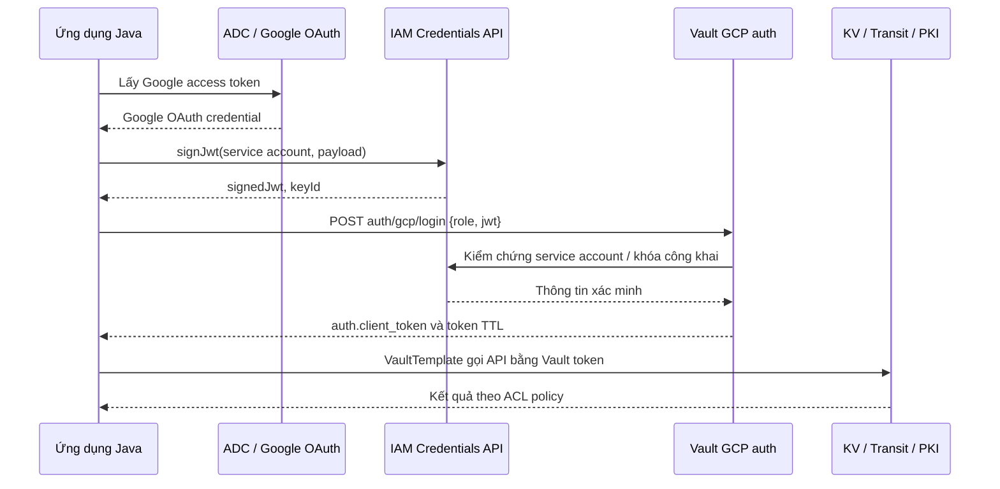

# GCP IAM Credentials API và việc ký JWT cho service account

Trong ứng dụng Java sử dụng **Spring Vault**, một workload chạy trên Google Cloud có thể xác thực với HashiCorp Vault bằng danh tính **Google Cloud IAM service account**. Workload gọi **IAM Service Account Credentials API** để Google ký một JSON Web Token (JWT) ngắn hạn, sau đó gửi JWT đến Vault. Nếu chữ ký và điều kiện của Vault role hợp lệ, Vault cấp một **Vault client token** để ứng dụng dùng qua `VaultTemplate`.

Bài học thuộc chương **Xác thực cloud** của module **SPRING_VAULT**. Trọng tâm là cách gọi `projects.serviceAccounts.signJwt`, thiết kế claims `sub`, `aud` và `exp`, phân quyền giữa Google IAM và Vault, tích hợp `GcpIamCredentialsAuthentication` với Spring Vault, cùng kiểm tra lỗi và thực hành an toàn.

> **Phân biệt:** JWT do Google ký là bằng chứng danh tính để **đăng nhập Vault**. Vault client token do Vault phát hành **sau khi xác thực** mới là credential để đọc KV secrets, gọi Transit, PKI hoặc truy cập các engine khác. Hai loại token có TTL và quyền độc lập.

## 1. Vì sao dùng IAM Credentials API thay cho private key?

Service account đại diện cho workload trên Google Cloud. Một cách ký JWT truyền thống là tải tệp JSON chứa private key của service account và dùng thư viện để tự ký. Cách đó tạo ra một secret dài hạn cần lưu, phân phối, giám sát và xoay vòng. Nếu private key rò rỉ, bên ngoài có thể giả mạo danh tính cho đến khi khóa bị thu hồi.

Với **Service Account Credentials API**:

1. Workload lấy Google OAuth access token qua **Application Default Credentials (ADC)** hoặc cơ chế xác thực Google tương đương.
2. Caller có quyền `iam.serviceAccounts.signJwt` trên service account đích.
3. Google ký JWT bằng khóa **do Google quản lý**, rồi trả `signedJwt` và `keyId`; ứng dụng không cần tải private key.
4. Ứng dụng gửi JWT vào `POST /v1/auth/gcp/login` của Vault với tên role.
5. Vault xác minh JWT, service account và role binding; chỉ sau đó Vault mới phát hành token kèm Vault ACL policy.

| Vai trò | Chức năng | Nguồn quyền |
| --- | --- | --- |
| Principal gọi API | Xin Google ký JWT cho một service account cụ thể. | Google IAM permission `iam.serviceAccounts.signJwt` trên **service account đích**. |
| Service account đích | Danh tính được chứng minh bởi JWT; có thể chính là caller hoặc tài khoản được phép impersonate. | IAM policy của service account và điều kiện của Vault role. |
| IAM Credentials API | Tạo chữ ký bằng khóa do Google quản lý. | Dịch vụ Google Cloud `iamcredentials.googleapis.com`. |
| Vault GCP auth method | Xác minh service account, chữ ký, claims và role binding. | Vault role `type=iam`, `bound_service_accounts`. |
| Vault client token | Cho phép gọi các API secrets. | Các Vault ACL policy gắn với token. |

Nếu caller ký thay cho một service account khác, đó là hành vi **impersonation** cần được ủy quyền chặt chẽ. Role Google `roles/iam.serviceAccountTokenCreator` bao gồm quyền ký JWT và những quyền tạo credential khác. Chỉ bind role tại service account cần dùng thay vì cấp trên toàn project nếu không có lý do đặc biệt.

### 1.1. Luồng kết nối giữa Java, Google và Vault



Google xác nhận quyền **ký** và nguồn gốc JWT; Vault quyết định danh tính có được phép **đăng nhập role** và token sau login có thể **đọc/ghi secret nào**. Đây là hai ranh giới quyền khác nhau.

## 2. Các API Google thường bị nhầm với `signJwt`

| API / nguồn JWT | Kết quả | Trường hợp dùng |
| --- | --- | --- |
| `projects.serviceAccounts.signJwt` | JWT tự khai báo claims, được Google ký và trả trong `signedJwt`. | **Vault GCP IAM role** `type=iam`. |
| `projects.serviceAccounts.generateAccessToken` | Google OAuth 2.0 access token. | Gọi các Google Cloud API, **không phải** JWT do Vault IAM auth mong đợi. |
| `projects.serviceAccounts.generateIdToken` | Google OIDC ID token theo audience chỉ định. | Dịch vụ xác thực bằng Google ID token; không tự động thay thế `signJwt` trong Vault IAM. |
| GCE metadata `.../identity` | Instance identity JWT. | **Vault GCP GCE role** `type=gce`, không phải luồng IAM role trong bài. |
| JSON service account private key | Vật liệu để tự ký JWT ở phía ứng dụng. | Cần quản lý khóa dài hạn; ưu tiên API ký được quản lý khi có thể. |

Vault GCP auth hỗ trợ cả `type=iam` và `type=gce`. Hai kiểu role kiểm tra dữ liệu danh tính khác nhau: **IAM** chứng minh service account qua `signJwt`; **GCE** dùng JWT nhận từ metadata identity của instance. Vì vậy cũng không lấy audience của GCE để áp dụng cho IAM.

## 3. Gọi `projects.serviceAccounts.signJwt` đúng định dạng

### 3.1. Endpoint và quyền truy cập

Endpoint REST hiện hành là:

```http
POST https://iamcredentials.googleapis.com/v1/projects/-/serviceAccounts/payments-runtime@demo-project.iam.gserviceaccount.com:signJwt
Authorization: Bearer <GOOGLE_OAUTH_ACCESS_TOKEN>
Content-Type: application/json
```

Trong đường dẫn trên:

- Phần `projects/-/serviceAccounts/{ACCOUNT_EMAIL_OR_UNIQUE_ID}` xác định **service account được ký thay**, không nhất thiết là caller.
- Ký tự **`-` là bắt buộc** trong `projects/-/` của **IAM Service Account Credentials API**. Không thay bằng project ID.
- Google access token cần quyền IAM `iam.serviceAccounts.signJwt` trên **service account đích**. Quyền này có trong `roles/iam.serviceAccountTokenCreator`; có thể dùng cách cấp quyền chặt hơn khi phù hợp chính sách tổ chức.
- Các OAuth scope được API hỗ trợ gồm `https://www.googleapis.com/auth/cloud-platform` hoặc `https://www.googleapis.com/auth/iam`.
- Dịch vụ IAM Service Account Credentials API phải được bật ở project áp dụng, đồng thời workload cần kết nối HTTPS đến `iamcredentials.googleapis.com`.

Header `Authorization` này chứa **Google OAuth access token** để gọi Google API. Sau khi ký, **`signedJwt`** mới được gửi cho Vault. Không dùng OAuth access token thay cho `jwt` trong request Vault.

### 3.2. Bộ JWT claims dành cho Vault GCP IAM

Giả sử Vault role tên `payments-gcp-iam` được bind với service account `payments-runtime@demo-project.iam.gserviceaccount.com`. Claims tối thiểu:

```json
{
  "sub": "payments-runtime@demo-project.iam.gserviceaccount.com",
  "aud": "vault/payments-gcp-iam",
  "exp": 1795600000
}
```

Giá trị `exp` chỉ minh họa định dạng Unix timestamp, **không nên dùng lại**. Mỗi lần ký, ứng dụng phải tự tính `exp` từ thời gian hiện tại, ví dụ `now + 600` giây.

| Claim | Mục đích | Quy tắc |
| --- | --- | --- |
| `sub` | Email hoặc ID của service account đứng tên JWT. | Phải phù hợp tài khoản được Vault xác minh và bind với role. |
| `aud` | Đối tượng nhận JWT theo chuẩn riêng của Vault GCP IAM. | **`vault/<VAULT_ROLE>`**, ví dụ `vault/payments-gcp-iam`. |
| `exp` | Thời điểm hết hạn JWT theo NumericDate. | **Số nguyên Unix timestamp tính bằng giây**, lớn hơn hiện tại và không vượt ngưỡng của Vault role. |
| `iat` | Thời điểm phát hành nếu có. | Hỗ trợ nhận biết thời gian phát hành; không thay thế `exp`. |

Theo tài liệu HashiCorp Vault, ba claim **`sub`, `aud` và `exp`** là yêu cầu tối thiểu của phương thức IAM. Với **IAM Credentials API mới**, Google **không tự thêm `exp`** vào payload. Nếu bỏ qua claim này, Google có thể vẫn tạo chữ ký nhưng Vault từ chối đăng nhập do thiếu thời gian hết hạn.

Vault role có thuộc tính `max_jwt_exp`, **mặc định 15 phút và giá trị tối đa 1 giờ**. IAM Credentials API cho phép claim `exp` cách hiện tại tối đa 12 giờ, nhưng đó là giới hạn của **Google API**, không phải giới hạn đăng nhập Vault. Thời hạn JWT được Vault chấp nhận phải tuân theo giới hạn của **Vault role**, thường nên chọn khoảng **5–10 phút** cho đăng nhập.

**Lỗi phổ biến:** dùng `aud` dạng `http://vault/<role>` lấy từ ví dụ GCE; với `type=iam` ở đây, cần chính xác `vault/<role>`.

### 3.3. Trường `payload` phải là chuỗi JSON

Body request gửi tới Google:

```json
{
  "payload": "{\"sub\":\"payments-runtime@demo-project.iam.gserviceaccount.com\",\"aud\":\"vault/payments-gcp-iam\",\"exp\":1795600000}"
}
```

**`payload` là string chứa JSON đã serialize**, không phải object JSON lồng trực tiếp. Body sau là **sai** với `signJwt`:

```json
{
  "payload": {
    "sub": "payments-runtime@demo-project.iam.gserviceaccount.com",
    "aud": "vault/payments-gcp-iam",
    "exp": 1795600000
  }
}
```

Khi lập trình Java bằng Jackson, nên có hai bước: serialize đối tượng claims thành `String`; sau đó đặt chuỗi ấy vào field `payload` của request Google.

Google trả phản hồi thành công:

```json
{
  "keyId": "GOOGLE_MANAGED_SIGNING_KEY_ID",
  "signedJwt": "<HEADER.PAYLOAD.SIGNATURE>"
}
```

`signedJwt` gồm ba phần JWT được mã hóa Base64URL: header, payload, signature. Header chứa `kid` liên quan khóa ký. Google giữ private key; bên xác minh có thể tra cứu public key tương ứng. **Mã hóa Base64URL không phải mã hóa bí mật nội dung**, vì vậy không nên log hoặc phát tán `signedJwt`.

## 4. Chuẩn bị phía Google Cloud và Vault

### 4.1. Cấp quyền ký trên Google Cloud

Giả định môi trường thử nghiệm:

```text
Google project:  demo-project
Service account: payments-runtime@demo-project.iam.gserviceaccount.com
Workload:        payments-api
Vault auth path: auth/gcp
Vault IAM role:  payments-gcp-iam
```

Các bước cấu hình tổng quát:

1. Bật **IAM Service Account Credentials API** trong project cần thiết.
2. Gắn danh tính hợp lệ với workload qua attached service account, Workload Identity Federation hoặc cơ chế Google phù hợp.
3. Xác định **caller thật sự** đang được ADC chọn và cấp quyền `iam.serviceAccounts.signJwt` trên `payments-runtime@demo-project.iam.gserviceaccount.com`.
4. Hạn chế quyền ký vào đúng service account đích; nếu dùng `roles/iam.serviceAccountTokenCreator`, tránh cấp không cần thiết ở cấp project.
5. Kiểm tra OAuth scope, chính sách tổ chức và khả năng truy cập Google API.

Trong GKE, Kubernetes service account và Google IAM service account có thể liên kết qua Workload Identity; caller thực tế đôi khi khác danh tính trong `sub`. Vì vậy, quyền IAM phải xét trên danh tính caller mà ADC sử dụng, không suy đoán chỉ từ tên pod hoặc service account dự định dùng.

### 4.2. Bật GCP auth method và tạo role IAM trong Vault

Ví dụ dưới đây dành cho quản trị viên của **Vault lab đã được cô lập**:

```bash
# Mỗi mount chỉ cần bật một lần.
vault auth enable gcp

# Policy chỉ cho đọc đúng một KV v2 secret.
vault policy write payments-read - <<'HCL'
path "secret/data/payments/config" {
  capabilities = ["read"]
}
HCL

# Cấu hình Vault IAM role.
vault write auth/gcp/role/payments-gcp-iam \
  type="iam" \
  policies="payments-read" \
  bound_service_accounts="payments-runtime@demo-project.iam.gserviceaccount.com" \
  max_jwt_exp=900
```

Trong role này:

- `type=iam` cho biết Vault sẽ chấp nhận danh tính service account đã chứng minh bằng JWT ký qua IAM Credentials API.
- `bound_service_accounts` là danh sách tài khoản được phép đăng nhập role. Một JWT có chữ ký Google hợp lệ nhưng `sub` nằm ngoài danh sách vẫn không được Vault cấp token.
- `policies=payments-read` gắn **Vault ACL policy** cho token được cấp sau đăng nhập; đây không phải Google IAM policy.
- `max_jwt_exp=900` hạn chế độ dài hiệu lực của JWT dùng để login còn 900 giây.
- Path `secret/data/payments/config` là đường dẫn ACL của KV **v2**; không dùng `secret/payments/config` nếu secret engine là KV v2.

Vault server/plugin cũng cần quyền truy vấn Google Cloud để xác minh service account và khóa công khai, ví dụ `iam.serviceAccounts.get`, `iam.serviceAccountKeys.get` tùy cấu hình. Phải phân biệt **principal xin ký JWT** và **danh tính Vault server dùng để xác minh JWT**; hai phía có nhu cầu quyền khác nhau. Nếu Vault dùng Workload Identity Federation cho plugin, cần cấu hình quan hệ tin cậy của plugin riêng.

Không cấu hình `bound_service_accounts="*"` chỉ để làm bài tập khi đã biết service account cụ thể; quyền bind quá rộng khiến role dễ bị dùng sai.

## 5. Thực hành REST: từ Google `signJwt` đến Vault login

Ví dụ Bash sử dụng `gcloud`, `curl`, `jq` và danh tính Google đã được cấp quyền phù hợp. Các biến địa chỉ/email dưới đây là giả định. Tránh bật `set -x` vì shell có thể in bearer token và request nhạy cảm.

### 5.1. Tạo JWT có TTL ngắn, ký bằng Google

```bash
ROLE="payments-gcp-iam"
SERVICE_ACCOUNT="payments-runtime@demo-project.iam.gserviceaccount.com"
VAULT_ADDR="https://vault.example.internal:8200"

# Tạo exp là thời điểm Unix UTC + 10 phút.
NOW="$(date -u +%s)"
EXP="$((NOW + 600))"

# Payload claims là một chuỗi JSON.
CLAIMS="$(jq -nc \
  --arg sub "$SERVICE_ACCOUNT" \
  --arg aud "vault/$ROLE" \
  --argjson exp "$EXP" \
  '{sub:$sub, aud:$aud, exp:$exp}')"

# Body Google API chứa payload kiểu STRING.
SIGN_REQUEST="$(jq -nc --arg payload "$CLAIMS" '{payload:$payload}')"

# Caller đã đăng nhập Google CLI và có quyền signJwt trên SA đích.
GOOGLE_ACCESS_TOKEN="$(gcloud auth print-access-token)"

# Chỉ trích signedJwt; không in credential ra terminal.
SIGNED_JWT="$(curl --fail --silent --show-error \
  --request POST \
  --header "Authorization: Bearer $GOOGLE_ACCESS_TOKEN" \
  --header "Content-Type: application/json" \
  --data "$SIGN_REQUEST" \
  "https://iamcredentials.googleapis.com/v1/projects/-/serviceAccounts/$SERVICE_ACCOUNT:signJwt" \
  | jq -er '.signedJwt')"
```

Có thể dùng thư viện Google Cloud chính thức trong Java thay cho CLI, nhưng các quy tắc request vẫn giống nhau: `exp` được tính mới mỗi lần, `aud` phải đúng role, field `payload` là string JSON và kết quả cần lấy là `signedJwt`.

### 5.2. Đưa JWT được ký đến Vault

```bash
LOGIN_BODY="$(jq -nc \
  --arg role "$ROLE" \
  --arg jwt "$SIGNED_JWT" \
  '{role:$role, jwt:$jwt}')"

# Trích Vault token vào biến tạm, không echo.
VAULT_TOKEN="$(curl --fail --silent --show-error \
  --request POST \
  --header "Content-Type: application/json" \
  --data "$LOGIN_BODY" \
  "$VAULT_ADDR/v1/auth/gcp/login" \
  | jq -er '.auth.client_token')"
```

Tương đương với request HTTP:

```http
POST /v1/auth/gcp/login
Content-Type: application/json

{
  "role": "payments-gcp-iam",
  "jwt": "<JWT_DUOC_GOOGLE_KY>"
}
```

Khi hợp lệ, Vault có thể trả:

```json
{
  "data": null,
  "auth": {
    "client_token": "<VAULT_TOKEN_REDACTED>",
    "policies": ["default", "payments-read"],
    "lease_duration": 1800,
    "renewable": true,
    "token_type": "service"
  }
}
```

Đây là **Vault token**. Thời hạn `auth.lease_duration` là TTL của Vault token tại thời điểm cấp, không phải `exp` của JWT Google. Khi JWT hết hạn sau 10 phút nhưng Vault token còn hiệu lực, ứng dụng vẫn có thể dùng Vault token đến khi vòng đời riêng của nó kết thúc. Khi cần đăng nhập lại, phải ký JWT mới với `exp` mới.

## 6. Tích hợp Spring Vault bằng `GcpIamCredentialsAuthentication`

Spring Vault hỗ trợ `GcpIamCredentialsAuthenticationOptions` và `GcpIamCredentialsAuthentication`. Implementation này gọi **IAM Service Account Credentials API** để ký JWT cho service account, đăng nhập Vault và cho phép `SessionManager` sử dụng Vault token cho các lời gọi `VaultTemplate`.

### 6.1. Dependency và lựa chọn API hiện hành

Ví dụ khai báo Gradle với version được quản lý qua BOM phù hợp của dự án:

```groovy
dependencies {
    implementation("org.springframework.vault:spring-vault-core")
    implementation("com.google.cloud:google-cloud-iamcredentials")
}
```

Lớp `GcpIamCredentialsAuthentication` hiện hành dùng thư viện Google Cloud IAM Credentials tương ứng. `GcpIamAuthentication` cũ từng dùng Google **IAM API** tại `iam.googleapis.com`; API `signJwt` cũ đó đã bị Google đánh dấu **deprecated**. Với mã mới, ưu tiên API `iamcredentials.googleapis.com` và class `GcpIamCredentialsAuthentication` tương thích với version Spring Vault đang dùng.

### 6.2. Cấu hình ClientAuthentication với ADC

Trong class kế thừa `AbstractVaultConfiguration` đã cấu hình `vaultEndpoint()`, TLS và kết nối Vault, có thể override phương thức:

```java
import java.io.IOException;

import com.google.auth.oauth2.GoogleCredentials;
import org.springframework.vault.authentication.ClientAuthentication;
import org.springframework.vault.authentication.GcpIamCredentialsAuthentication;
import org.springframework.vault.authentication.GcpIamCredentialsAuthenticationOptions;

// Đoạn mã nằm trong class extends AbstractVaultConfiguration.
@Override
public ClientAuthentication clientAuthentication() {
    try {
        GoogleCredentials adc = GoogleCredentials.getApplicationDefault();

        GcpIamCredentialsAuthenticationOptions options =
                GcpIamCredentialsAuthenticationOptions.builder()
                        .role("payments-gcp-iam")
                        .credential(adc)
                        .build();

        return new GcpIamCredentialsAuthentication(options, vaultClient());
    } catch (IOException exception) {
        throw new IllegalStateException(
                "Không thể lấy Google Application Default Credentials", exception);
    }
}
```

Cơ chế hoạt động:

1. ADC chọn Google credential của môi trường, có thể là attached service account hoặc danh tính Workload Identity Federation. Không bắt buộc phải đưa private key vào mã nguồn.
2. `role("payments-gcp-iam")` chọn Vault IAM role tương ứng; helper tạo JWT có audience dành cho role.
3. `GcpIamCredentialsAuthentication` xử lý việc gọi Google để ký JWT, sau đó login Vault.
4. Spring Vault dùng `SessionManager` và `VaultTemplate` để gửi token Vault tới các API tiếp theo; mã nghiệp vụ không cần truyền JWT Google trong mỗi lần đọc KV.

Cần đảm bảo credential được ADC chọn chứa hoặc xác định được service account cần dùng và có quyền ký trên service account đó. Nếu môi trường ADC cho ra loại credential không chứa đủ định danh service account, có thể phải cấu hình thêm thông tin service account/project theo tùy chọn của Spring Vault và cơ chế impersonation thực tế.

**Ghi chú tương thích:** mã trên dùng kiểu Spring Vault cung cấp ở phiên bản hỗ trợ `GcpIamCredentialsAuthentication`. Nếu ứng dụng dùng **Spring Cloud Vault**, có thể cấu hình qua `spring.cloud.vault.authentication=GCP_IAM` và các thuộc tính `spring.cloud.vault.gcp-iam.*` theo đúng version, thay vì tự tạo lớp xác thực theo ví dụ trên.

Implementation `GcpIamCredentialsAuthentication` sử dụng API Google đồng bộ, không cung cấp `AuthenticationSteps` cho authentication reactive theo tài liệu Spring Vault. Khi dùng stack reactive, cần kiểm tra cơ chế xác thực hỗ trợ ở phiên bản đang triển khai.

### 6.3. Đọc KV v2 với VaultTemplate sau khi login

```java
import java.util.Map;

import org.springframework.vault.core.VaultKeyValueOperations;
import org.springframework.vault.core.VaultKeyValueOperationsSupport.KeyValueBackend;
import org.springframework.vault.core.VaultTemplate;
import org.springframework.vault.support.VaultResponse;

public class PaymentsSecretReader {
    private final VaultTemplate vaultTemplate;

    public PaymentsSecretReader(VaultTemplate vaultTemplate) {
        this.vaultTemplate = vaultTemplate;
    }

    public String loadEndpoint() {
        VaultKeyValueOperations kv = vaultTemplate.opsForKeyValue(
                "secret", KeyValueBackend.KV_2);

        VaultResponse response = kv.get("payments/config");
        if (response == null || response.getData() == null) {
            throw new IllegalStateException("Không tìm thấy payments/config");
        }

        Map<String, Object> data = response.getData();
        Object endpoint = data.get("endpoint");
        if (!(endpoint instanceof String) || ((String) endpoint).isBlank()) {
            throw new IllegalStateException("Thiếu endpoint hợp lệ");
        }

        return (String) endpoint;
    }
}
```

Đoạn đọc này thành công khi ứng dụng đã login bằng đúng Vault role và Vault token có capability `read` trên API path `secret/data/payments/config`. **JWT hợp lệ không tự cấp quyền đọc mọi secret**; Vault ACL policy quyết định quyền của token.

Nếu cần mã hóa qua Transit hoặc xin chứng chỉ PKI, Vault token phải có các capability thích hợp, ví dụ `update` trên `transit/encrypt/<key>` hoặc `pki/issue/<role>`; quyền ký JWT của Google không tự tạo ra các quyền đó.

## 7. Phân biệt các thời hạn và vòng đời token

| Đối tượng | Ai cấp? | Giới hạn/vòng đời | Dùng để làm gì? |
| --- | --- | --- | --- |
| Google OAuth access token | Google OAuth/ADC | Theo credential/scope; thường được thư viện Google làm mới. | Gọi `signJwt` trên Google API. |
| JWT `signedJwt` | Google ký theo yêu cầu caller. | `exp` của claims và `max_jwt_exp` của Vault IAM role. | Login một phiên vào Vault. |
| Vault token `auth.client_token` | Vault sau khi xác thực GCP IAM. | `auth.lease_duration`, `renewable`, các giới hạn Vault token. | Gọi KV, Transit, PKI, database secrets... |
| Lease của secret động | Vault secret engine. | `lease_id`, `lease_duration`, `renewable` riêng. | Sử dụng credential động do Vault phát hành. |

Ví dụ: JWT dùng để login có hạn **10 phút**, Vault token có TTL **30 phút** và credential database động có lease **15 phút**. Không lấy một TTL để thay thế các TTL còn lại. Nếu Vault token được gia hạn thành công, việc đó không kéo dài JWT Google đã ký; nếu credential database có lease hết hạn, token Vault còn hạn cũng không làm credential cũ sống lại.

Trong ứng dụng Spring Vault, nên dùng `SessionManager` phù hợp để xử lý vòng đời Vault token; khi cần tái xác thực, helper có thể tạo JWT Google mới. Không cache `signedJwt` dài hạn và không tự cố renew JWT bằng endpoint Vault vì JWT Google không phải Vault token.

## 8. Các lỗi phổ biến và cách khắc phục

| Triệu chứng | Nguyên nhân thường gặp | Gợi ý xử lý |
| --- | --- | --- |
| Google trả `403 PERMISSION_DENIED` khi `signJwt` | Principal caller thiếu `iam.serviceAccounts.signJwt` trên service account được ký. | Kiểm tra ADC đang dùng principal nào và IAM binding trên **đúng service account đích**. |
| Google báo API chưa kích hoạt hoặc scope sai | IAM Credentials API chưa bật hoặc credential không đủ scope/quyền. | Bật API và kiểm tra OAuth scope cùng chính sách tổ chức. |
| Google báo lỗi resource name | Email/ID sai hoặc thay `-` bằng project ID trong API hiện hành. | Dùng path `projects/-/serviceAccounts/{EMAIL_OR_ID}:signJwt`. |
| Google từ chối định dạng request | `payload` là object thay vì string JSON, hoặc claims bị serialize sai. | Serialize claims trước, đặt chuỗi vào field `payload`. |
| Vault từ chối thiếu `exp` | IAM Credentials API mới không tự thêm `exp`. | Tạo `exp` dạng integer epoch giây tại thời điểm login. |
| Vault báo JWT vượt `max_jwt_exp` | `exp` cách thời điểm hiện tại quá lâu. | Giảm thời hạn JWT xuống dưới giới hạn role, cân nhắc lệch đồng hồ. |
| Vault từ chối vì `aud` hoặc role | JWT khai báo audience sai hoặc khác tên role gửi lên Vault. | Với IAM role dùng `aud="vault/<role>"` chính xác. |
| JWT Google ký thành công nhưng Vault login bị từ chối | `sub` không được bind, chữ ký/khóa không xác minh được hoặc cấu hình Vault GCP thiếu quyền. | Kiểm tra `bound_service_accounts`, role, quyền tra cứu của Vault server và thời hạn JWT. |
| Vault login thành công, nhưng đọc KV bị `403` | Token Vault thiếu ACL `read` tại API path thực. | Kiểm tra `secret/data/...` và policy gắn với role. |
| Chạy trên máy dev được, chạy GKE/Cloud Run lại lỗi | ADC ở từng môi trường lấy principal khác nhau. | Kiểm tra attached service account/Workload Identity và quyền ký của caller thực tế. |
| Ví dụ Java cũ gọi Google IAM API | Dùng `GcpIamAuthentication`/endpoint `iam.googleapis.com` đã deprecated. | Chuyển sang `GcpIamCredentialsAuthentication` và IAM Credentials API phù hợp version. |

**Gợi ý quan sát:** giám sát tỷ lệ và độ trễ `signJwt`, login Vault, số lần tái xác thực, mã 403/429/5xx, `request_id` Vault (nếu có) và TTL token. Không ghi lại toàn bộ HTTP body hay header Authorization.

**Dữ liệu không được log:** Google access token, JWT `signedJwt`, `auth.client_token`, key service account, Workload Identity assertion, AppRole/SecretID (nếu workload khác), nội dung KV/Transit/PKI bí mật. Luôn dùng TLS hợp lệ cho kết nối đến Google và Vault.

## 9. Bài lab kiểm thử tích hợp

Để kiểm chứng luồng xác thực, dùng project và Vault **test** với service account/role được giới hạn quyền:

1. Cấu hình một principal được quyền `signJwt` chỉ cho một service account test.
2. Tạo Vault GCP IAM role bind service account đó và gắn policy `read` duy nhất cho một KV v2 secret.
3. Tạo JWT có `sub`, `aud`, `exp` đúng; đăng nhập Vault và đọc một giá trị qua `VaultTemplate`.
4. Sửa `aud` thành một role khác, xác nhận Vault từ chối.
5. Đặt `exp` quá xa (ví dụ 1 giờ trong khi role có `max_jwt_exp=900`), xác nhận Vault từ chối.
6. Dùng service account không nằm trong `bound_service_accounts`, xác nhận JWT ký thành công cũng không login được.
7. Bỏ capability `read` của Vault policy, xác nhận login có thể thành công nhưng đọc secret bị từ chối.
8. Khởi động lại ứng dụng hoặc để phiên thử nghiệm hết hạn, kiểm tra việc tạo JWT mới và tái xác thực đúng cơ chế; sau thử nghiệm, thu hồi token và dọn tài nguyên test.

### 9.1. Bài tập tình huống và đáp án

**Tình huống A:** Một workload có `roles/iam.serviceAccountTokenCreator` trên service account test và gọi `signJwt` thành công, nhưng `auth/gcp/login` trả lỗi vì sai role. Quyền Google IAM đã sai chưa?

**Đáp án:** Chưa thể kết luận vậy. Quyền Google đã cho phép ký; Vault còn kiểm tra `aud`, `sub`, chữ ký, giới hạn `exp` và role binding. Cần sửa cấu hình Vault hoặc claims phù hợp role.

**Tình huống B:** JWT có `exp = now + 3600`, còn role Vault có `max_jwt_exp=900`. JWT được Google ký hợp lệ; Vault có chấp nhận không?

**Đáp án:** Không. Giới hạn của Vault role chặt hơn khả năng ký của Google API. Hãy cấp JWT ngắn hơn (ví dụ `now + 600`).

**Tình huống C:** JWT hết hạn sau 5 phút nhưng Vault token sau login còn hạn 30 phút. Sau phút thứ 6, có cần đăng nhập lại ngay không?

**Đáp án:** Không, nếu Vault token vẫn hợp lệ. JWT chỉ dùng lúc login; Vault token có TTL và vòng đời riêng. Khi cần login lại phải tạo signed JWT mới.

**Tình huống D:** Có quyền `signJwt` và login Vault thành công; có thể tự động gọi Transit encryption, cấp PKI certificate và đọc tất cả KV secrets không?

**Đáp án:** Không. Vault ACL policy quyết định quyền truy cập từng API path. IAM signJwt chỉ cho phép tạo bằng chứng danh tính phía Google, không thay thế Vault ACL.

**Tình huống E:** Trong Java, một lập trình viên gửi `"payload": {"sub": "...", "aud": "...", "exp": 1795600000}` tới Google API. Vì sao lỗi?

**Đáp án:** `payload` của `signJwt` phải là **chuỗi JSON** sau khi serialize claims, không phải JSON object.

## 10. Ghi nhớ và tài liệu đối chiếu

- **Ký JWT:** `projects.serviceAccounts.signJwt` của Google IAM Service Account Credentials API nhận `payload` là **string JSON** và trả `signedJwt`, `keyId`.
- **Claims cho Vault IAM:** `sub` chỉ service account, `aud` có dạng `vault/<role>` và `exp` là epoch seconds. JWT phải còn hạn và đáp ứng `max_jwt_exp` của Vault role.
- **Hai lớp quyền:** Google IAM `iam.serviceAccounts.signJwt` trên service account đích cho phép ký; Vault role `type=iam` và `bound_service_accounts` quyết định login; Vault ACL policy quyết định quyền sử dụng token.
- **Spring Vault:** `GcpIamCredentialsAuthentication` giúp làm việc với IAM Credentials API; `SessionManager` duy trì Vault token; `VaultTemplate` đọc KV, Transit/PKI khi được cấp quyền.
- **An toàn:** ưu tiên ADC/Workload Identity và khóa do Google quản lý; tránh private key lưu dài hạn, giới hạn quyền/TTL, bảo vệ JWT và các bearer token khỏi log.

Tài liệu chính thức để kiểm tra lại khi nâng cấp hoặc đổi cấu hình:

1. [HashiCorp Vault – Google Cloud auth method](https://developer.hashicorp.com/vault/docs/auth/gcp): quy trình IAM, claims, role binding.
2. [HashiCorp Vault – GCP auth HTTP API](https://developer.hashicorp.com/vault/api-docs/auth/gcp): cấu hình auth method và role.
3. [Google Cloud – IAM Service Account Credentials signJwt](https://docs.cloud.google.com/iam/docs/reference/credentials/rest/v1/projects.serviceAccounts/signJwt): endpoint, permissions, định dạng request/response.
4. [Google Cloud – Migration to Service Account Credentials API](https://docs.cloud.google.com/iam/docs/migrating-to-credentials-api): thay thế API IAM signJwt cũ.
5. [Spring Vault – Authentication Methods](https://docs.spring.io/spring-vault/reference/vault/authentication.html): GCP IAM, `GcpIamCredentialsAuthentication` và tích hợp Java.
