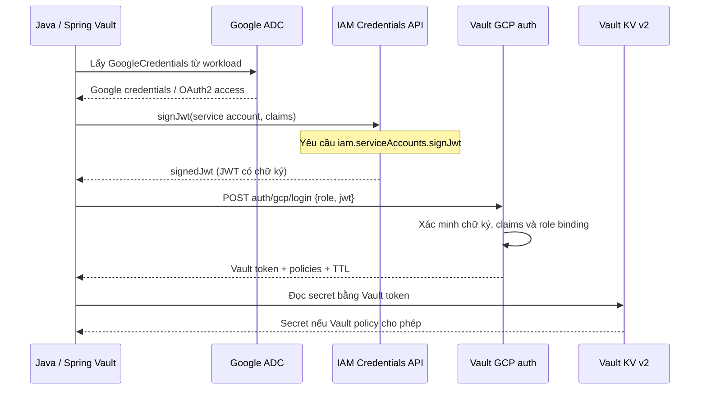

# GcpIamCredentialsAuthentication và khác biệt với API GCP cũ

## 1. Bối cảnh và mục tiêu

Trong chương **Xác thực cloud** của **Spring Vault**, bài này tập trung vào cách ứng dụng Java sử dụng `GcpIamCredentialsAuthentication` để đăng nhập **HashiCorp Vault** bằng định danh **Google Cloud IAM service account**. Đây là điểm khởi đầu để ứng dụng tiếp tục dùng `VaultTemplate` / `VaultOperations` đọc KV secrets, gọi Transit encryption, PKI hoặc quản lý secret có lease theo chính sách Vault. Bài học cũng giải thích vì sao cần thay thế `GcpIamAuthentication` và Google IAM API cũ bằng **IAM Service Account Credentials API**.

Đến cuối bài, bạn có thể:

- Giải thích luồng GCP IAM `signJwt` → Vault GCP auth → Vault token và phân biệt ba loại thông tin xác thực trong luồng.
- Chọn đúng `GcpIamCredentialsAuthentication`, `GcpIamCredentialsAuthenticationOptions` và dependency tương ứng với phiên bản Spring Vault.
- Cấu hình Google ADC, quyền ký JWT, Vault GCP role và Vault policy theo nguyên tắc quyền tối thiểu.
- Phân biệt API mới, API cũ và phương thức xác thực GCE, đồng thời lập kế hoạch chuyển đổi mà không làm gián đoạn truy cập secret.
- Chẩn đoán lỗi đăng nhập, vòng đời token, giới hạn reactive và thiết kế kiểm thử tích hợp.

> **Phạm vi:** Đây là cơ chế **Vault GCP auth với role kiểu `iam`**. Google Cloud IAM cấp quyền gọi API Google, còn **Vault policy** cấp quyền đọc/ghi secrets trong Vault. Hai hệ thống phân quyền độc lập; xác thực thành công không đồng nghĩa được đọc mọi secret.

## 2. Luồng hoạt động của GCP IAM authentication

Một workload chạy trên Google Cloud có thể nhận **Application Default Credentials (ADC)** thông qua định danh của môi trường chạy. Khi cần đăng nhập Vault, ứng dụng không gửi thẳng Google OAuth access token cho Vault. Nó dùng Google credentials để yêu cầu **IAM Service Account Credentials API** ký một JWT cho service account, sau đó nộp JWT đã ký tới Vault.



Các lớp thông tin xác thực xuất hiện ở những giai đoạn khác nhau:

| Thành phần | Được dùng để làm gì? | Ai xác minh/quản lý? |
|---|---|---|
| Google ADC / OAuth 2 access token | Xác thực lời gọi từ ứng dụng tới IAM Credentials API | Google Cloud IAM; cần quản lý hạn dùng OAuth token |
| Signed JWT từ `signJwt` | Chứng minh service account cụ thể trước Vault GCP auth | Vault xác minh JWT, thời hạn, khóa ký và role binding |
| Vault token nhận từ `auth/gcp/login` | Gắn vào các yêu cầu `VaultTemplate` đọc hoặc thao tác secret | Vault và Spring Vault session manager; chịu Vault TTL, policy, revoke |

JWT ký bởi Google là **bằng chứng đăng nhập**, không phải Vault token để gọi `secret/data/...`. Ngược lại, Vault token không cấp quyền gọi Google APIs.

### Claims và thời gian hiệu lực

Với Vault role `orders-reader` và service account `orders-api@sample-project.iam.gserviceaccount.com`, JWT được ký có payload tối thiểu tương tự:

```json
{
  "sub": "orders-api@sample-project.iam.gserviceaccount.com",
  "aud": "vault/orders-reader",
  "exp": 1793000000
}
```

`exp` trên chỉ là một timestamp minh họa, **không** dùng trực tiếp trong thực tế. Khi gửi yêu cầu thật, `exp` phải được tính lại bằng Unix time (giây) ở tương lai, nằm trong giới hạn `max_jwt_exp` của Vault role. Giá trị mặc định thường là **15 phút**; giới hạn tối đa cho JWT IAM trong role này là **1 giờ**. Chênh lệch đồng hồ giữa workload và máy chủ cũng có thể làm JWT bị từ chối.

Phương thức `GcpIamCredentialsAuthentication` xây dựng JWT và gọi API ký; ứng dụng thông thường không cần tự tạo hoặc lưu signed JWT. Nếu viết `signJwt` thủ công để khảo sát lỗi, tuyệt đối không log nguyên JWT hoặc response.

## 3. API mới khác API GCP cũ ở đâu?

Có hai lớp Spring Vault với tên gần giống nhau nhưng sử dụng **hai Google APIs khác nhau**.

| Khía cạnh | Cách cũ | Cách mới được ưu tiên |
|---|---|---|
| Spring Vault authentication | `GcpIamAuthentication` | `GcpIamCredentialsAuthentication` |
| Cấu hình options | `GcpIamAuthenticationOptions` | `GcpIamCredentialsAuthenticationOptions` |
| Google API ký JWT | IAM API cũ | IAM **Service Account Credentials** API |
| Địa chỉ HTTP điển hình | `iam.googleapis.com/v1/projects/-/serviceAccounts/...:signJwt` | `iamcredentials.googleapis.com/v1/projects/-/serviceAccounts/...:signJwt` |
| Java dependency điển hình | `com.google.apis:google-api-services-iam` cùng Google auth library | `com.google.cloud:google-cloud-iamcredentials` cùng các dependency được quản lý tương thích |
| Google credentials | Phụ thuộc API Google IAM đời cũ/`GoogleCredential` | `com.google.auth.oauth2.GoogleCredentials` |
| Tình trạng | API Google IAM `signJwt` cũ và lớp `GcpIamAuthentication` đã deprecated | Cơ chế thay thế của Spring Vault; dùng API ký JWT hiện hành |
| Phía Vault | `gcp` auth mount, role kiểu `iam` | **Vẫn cùng Vault GCP auth mount và role kiểu `iam`** |

**Điểm khác biệt chính là client gọi API nào để ký JWT**, không phải đổi sang một Vault auth method khác. Endpoint Vault vẫn là `auth/<mount>/login`, trong ví dụ là `auth/gcp/login`. Cả hai đều gửi `role` và `jwt`, và Vault tiếp tục quyết định policy.

Một thay đổi dễ gây nhầm lẫn: tên Google method **`projects.serviceAccounts.signJwt`** xuất hiện ở cả API cũ và API mới. Muốn phân biệt phải kiểm tra **dịch vụ và thư viện**:

```text
API cũ:
  POST https://iam.googleapis.com/v1/projects/-/serviceAccounts/SA_EMAIL:signJwt

API mới:
  POST https://iamcredentials.googleapis.com/v1/projects/-/serviceAccounts/SA_EMAIL:signJwt

Vault login (giống nhau):
  POST https://vault.example.internal/v1/auth/gcp/login
```

Khi cấu hình `serviceAccountId`, hãy truyền email service account phù hợp với `bound_service_accounts` trong Vault role; phần `projects/-/serviceAccounts/` là đường dẫn resource do Google API sử dụng, không phải tên role trong Vault.

### API cũ và `GcpComputeAuthentication` là hai chuyện khác nhau

`GcpComputeAuthentication` (GCP GCE auth) đọc **instance identity JWT** từ metadata service của máy ảo/instance, tương ứng Vault role kiểu `gce`. Nó **không** phải bản kế tiếp của `GcpIamAuthentication` và không phải cơ chế dùng IAM Credentials `signJwt`. Nếu hệ thống đang dùng `gce` role, đừng chuyển sang `GcpIamCredentialsAuthentication` chỉ vì thấy từ khóa "GCP"; cần đánh giá lại ràng buộc identity và loại role.

## 4. Chuẩn bị phía Google Cloud và Vault

### 4.1. Phía Google Cloud

Ví dụ dùng workload `orders-api` và service account:

```text
Project:            sample-project
Service account:    orders-api@sample-project.iam.gserviceaccount.com
Vault auth mount:   gcp
Vault auth role:    orders-reader
Vault KV v2 mount:  secret
KV logical path:    orders/prod/partner-api
```

Cần bảo đảm:

1. Workload lấy được ADC của **đúng service account**. Trên GCE, Cloud Run, GKE hoặc môi trường có Workload Identity Federation, cơ chế ADC khác nhau; kiểm tra identity thực tế thay vì suy từ tên deployment.
2. Bật **IAM Service Account Credentials API** (`iamcredentials.googleapis.com`) cho project liên quan; API IAM nền tảng cũng cần hoạt động theo cấu hình của Vault.
3. Principal thực hiện ký JWT có quyền **`iam.serviceAccounts.signJwt` trên service account đích**. Role có sẵn `roles/iam.serviceAccountTokenCreator` bao gồm quyền này, nhưng khá rộng. Chỉ cấp trên service account cụ thể (hoặc dùng custom role đúng quyền), tuyệt đối tránh cấp role rộng toàn project nếu không cần.
4. Nếu ADC trả về credentials đại diện người dùng, impersonation hoặc Workload Identity, cần xác định email service account đích rõ ràng. Việc có OAuth access token hợp lệ **không tự động** có quyền `signJwt`.
5. Tránh phát hành service account key JSON tĩnh khi workload có thể dùng identity gắn với môi trường. Không commit key JSON hoặc base64 key vào repository; base64 **không** phải mã hóa.

**Phân biệt quyền hai phía:** Principal của ứng dụng gọi `signJwt` cần Google IAM permission. Phía **Vault server**, khi xác minh danh tính, cần quyền/credentials Google Cloud phù hợp để kiểm tra service account và public signing keys. Với role kiểu `iam`, tài liệu Vault nêu các quyền liên quan như `iam.serviceAccounts.get` và `iam.serviceAccountKeys.get`; không cần mặc định trao cho Vault server quyền ký JWT thay ứng dụng.

### 4.2. Phía Vault

Ví dụ các lệnh sau được thực hiện bởi **người vận hành có quyền quản trị Vault**, không chạy trong ứng dụng Java:

```shell
# Chỉ cần enable một lần tại auth mount tương ứng.
vault auth enable -path=gcp gcp

# Bind đúng service account; dùng policy chỉ đọc một secret minh họa.
vault write auth/gcp/role/orders-reader \
  type=iam \
  bound_service_accounts=orders-api@sample-project.iam.gserviceaccount.com \
  token_policies=orders-partner-read \
  max_jwt_exp=10m \
  token_ttl=20m
```

Nếu auth method đã được enable, không chạy lại lệnh `vault auth enable`. Cấu hình xác thực GCP phía Vault, danh tính dịch vụ Vault và quyền đọc key Google phải được thiết lập phù hợp với hạ tầng.

Nội dung policy `orders-partner-read` (HCL):

```hcl
path "secret/data/orders/prod/partner-api" {
  capabilities = ["read"]
}
```

Lệnh ví dụ để nạp policy từ file HCL do người vận hành chuẩn bị:

```shell
vault policy write orders-partner-read orders-partner-read.hcl
```

Vì `secret` là KV v2, Vault policy phải trỏ đến `secret/data/...`. Trong mã `VaultTemplate` / `VaultOperations`, khi dùng `opsForKeyValue("secret", KV_2)`, đường dẫn logical chỉ là `orders/prod/partner-api`.

Sử dụng `bound_service_accounts` là kiểm soát identity. Không đặt `*` nếu workload chỉ dùng một service account. `token_policies` giới hạn quyền Vault và có thể bổ sung các ràng buộc như TTL; đây là chính sách phía Vault, **khác** với `roles/iam.serviceAccountTokenCreator` của Google Cloud.

## 5. Cấu hình Java với `GcpIamCredentialsAuthentication`

### 5.1. Dependency

Tối thiểu cần Spring Vault và thư viện Google Cloud IAM Credentials tương thích với phiên bản đang dùng. Ví dụ Maven (version do BOM hoặc dependency management của dự án quản lý):

```xml
<dependencies>
    <dependency>
        <groupId>org.springframework.vault</groupId>
        <artifactId>spring-vault-core</artifactId>
    </dependency>
    <dependency>
        <groupId>com.google.cloud</groupId>
        <artifactId>google-cloud-iamcredentials</artifactId>
    </dependency>
</dependencies>
```

Nếu không sử dụng BOM quản lý các phiên bản này, phải chọn các version tương thích một cách tường minh. Không chỉ đổi class Spring Vault mà giữ nguyên dependency cũ `google-api-services-iam` rồi mong API mới hoạt động.

### 5.2. Ví dụ Spring Vault 4.1.x

Ví dụ sau dùng **Spring Vault 4.1.x**: class mới với `VaultClient`. `AbstractVaultConfiguration` cung cấp bean `VaultTemplate` và cơ chế quản lý session; ứng dụng không cần tự gắn `X-Vault-Token` vào mọi request.

```java
import java.io.IOException;
import java.net.URI;
import java.time.Duration;

import com.google.auth.oauth2.GoogleCredentials;
import org.springframework.context.annotation.Configuration;
import org.springframework.vault.authentication.ClientAuthentication;
import org.springframework.vault.authentication.GcpIamCredentialsAuthentication;
import org.springframework.vault.authentication.GcpIamCredentialsAuthenticationOptions;
import org.springframework.vault.client.VaultEndpoint;
import org.springframework.vault.config.AbstractVaultConfiguration;

@Configuration
public class GcpVaultConfiguration extends AbstractVaultConfiguration {

    @Override
    public VaultEndpoint vaultEndpoint() {
        String vaultUri = getEnvironment()
                .getRequiredProperty("app.vault.uri");
        return VaultEndpoint.from(URI.create(vaultUri));
    }

    @Override
    public ClientAuthentication clientAuthentication() {
        try {
            GoogleCredentials adc =
                    GoogleCredentials.getApplicationDefault();

            var options =
                    GcpIamCredentialsAuthenticationOptions.builder()
                            .path("gcp")
                            .role("orders-reader")
                            .serviceAccountId(
                                "orders-api@sample-project.iam.gserviceaccount.com")
                            .credentials(adc)
                            .jwtValidity(Duration.ofMinutes(10))
                            .build();

            return new GcpIamCredentialsAuthentication(
                    options, vaultClient());
        } catch (IOException e) {
            throw new IllegalStateException(
                    "Không lấy được Google Application Default Credentials",
                    e);
        }
    }
}
```

```yaml
app:
  vault:
    uri: https://vault.example.internal:8200
```

**Các điểm cần đọc kỹ trong ví dụ:**

- `GoogleCredentials.getApplicationDefault()` lấy danh tính Google theo **ADC chain** của runtime. Trên máy phát triển nó có thể dùng credential của người dùng, khác với service account production.
- `serviceAccountId(...)` cố định service account cần ký. Điều này đặc biệt hữu ích khi ADC không phải một `ServiceAccountCredentials` có thể tự suy ra account ID. Principal của ADC vẫn phải có quyền ký trên account được chỉ định.
- `path("gcp")` là **tên auth mount của Vault**, không phải path chứa secret. Nếu Vault mount tại `gcp-prod`, cấu hình phải trùng.
- `role("orders-reader")` là tên **Vault auth role**, không phải Google IAM role.
- `jwtValidity(Duration.ofMinutes(10))` phải không vượt quá `max_jwt_exp=10m` của role. Đây là thời hạn JWT dùng cho **login**, không phải TTL của Vault token (`token_ttl`).
- `vaultClient()` là API mà `AbstractVaultConfiguration` cung cấp trong Spring Vault 4.1.x. Trong phiên bản cũ hơn, ví dụ constructor có thể nhận `RestOperations`/`restOperations()`; phải đối chiếu Javadoc theo phiên bản trước khi sao chép.
- Cấu hình TLS/CA trust và timeout cho kết nối Vault phải phù hợp môi trường. Không bỏ xác thực TLS để khắc phục lỗi chứng chỉ.

**Lưu ý tên builder:** Javadoc cho `GcpIamCredentialsAuthenticationOptionsBuilder` công bố phương thức `credentials(GoogleCredentials)` (số nhiều). Một số ví dụ văn bản có thể hiển thị cách gọi `credential(...)`; khi biên dịch phải theo API có thực của version đang dùng. Ví dụ trên sử dụng `credentials(...)` tương ứng API tham khảo.

### 5.3. Dùng `VaultTemplate` sau khi đăng nhập

Use case của ứng dụng không cần biết JWT ký ra sao. Sau khi Spring Vault có Vault token, ứng dụng đọc secret như thường lệ:

```java
import java.util.Map;
import org.springframework.stereotype.Repository;
import org.springframework.vault.core.VaultOperations;
import org.springframework.vault.core.VaultKeyValueOperationsSupport.KeyValueBackend;
import org.springframework.vault.support.VaultResponse;

@Repository
public class PartnerCredentialRepository {

    private final VaultOperations vault;

    public PartnerCredentialRepository(VaultOperations vault) {
        this.vault = vault;
    }

    public String readPartnerApiKey() {
        VaultResponse response = vault
                .opsForKeyValue("secret", KeyValueBackend.KV_2)
                .get("orders/prod/partner-api");

        Map<String, Object> data =
                response == null ? null : response.getData();
        if (data == null || !(data.get("apiKey") instanceof String apiKey)
                || apiKey.isBlank()) {
            throw new IllegalStateException(
                    "Thiếu cấu hình khóa truy cập đối tác");
        }
        return apiKey;
    }
}
```

`VaultOperations` là interface; trong cấu hình trên, Spring Vault tạo `VaultTemplate` là một hiện thực phổ biến. Ví dụ dùng Java có pattern matching cho `instanceof`; điều chỉnh cú pháp nếu dự án dùng Java cũ. Không ghi `apiKey`, signed JWT hoặc Vault token vào log.

## 6. Trường hợp dùng Spring Cloud Vault

Spring Cloud Vault cho phép cấu hình auth bằng properties, ví dụ:

```yaml
spring:
  cloud:
    vault:
      uri: https://vault.example.internal:8200
      authentication: GCP_IAM
      gcp-iam:
        gcp-path: gcp
        role: orders-reader
        jwt-validity: 10m
        service-account-id: orders-api@sample-project.iam.gserviceaccount.com
```

Cấu hình trên chọn cơ chế **GCP IAM** ở mức Spring Cloud Vault. Tuy nhiên, **không được suy luận chỉ từ chuỗi `authentication: GCP_IAM` rằng một bản Spring Cloud Vault cụ thể đã dùng `GcpIamCredentialsAuthentication` mới**. Một số tài liệu Spring Cloud Vault vẫn mô tả dependency `google-api-services-iam` và `GcpIamAuthentication` cũ. Khi mục tiêu là chuyển sang API ký mới, cần kiểm tra source/runtime và bộ phiên bản Spring Cloud Vault ↔ Spring Vault đang triển khai. Nếu tự cung cấp cấu hình `ClientAuthentication`, phải kiểm tra auto-configuration để tránh có hai luồng authentication/session mâu thuẫn.

Không đặt `credentials.location: classpath:credentials.json` trong ứng dụng production nếu môi trường hỗ trợ ADC từ workload identity; nhúng JSON key vào artifact làm tăng bề mặt rò rỉ. Khi cần chạy local, dùng một cơ chế development credentials có phạm vi hạn chế và không tái sử dụng identity production.

## 7. Vòng đời đăng nhập, session và giới hạn reactive

### Ba hạn dùng độc lập

| Thời gian | Ý nghĩa | Cách quản lý |
|---|---|---|
| Google OAuth 2 access token | Cho phép gọi IAM Credentials `signJwt` | Google credentials library làm mới theo cơ chế phù hợp với ADC |
| JWT từ `signJwt` | Bằng chứng đăng nhập Vault, giới hạn `exp` / `max_jwt_exp` | Ký mới khi cần login, không dùng làm token truy cập secret |
| Vault token | Cho phép thao tác Vault theo policy và TTL | Spring Vault `SessionManager`, có thể dùng `LifecycleAwareSessionManager` để quản lý renew/relogin |

Đừng suy ra rằng **`jwtValidity=10m`** làm Vault token hết hạn sau 10 phút. Ví dụ Vault role có `token_ttl=20m` thì TTL của Vault token do Vault quyết định và có thể được renew theo tính chất token/policy. Khi token bị revoke hoặc quá hạn không thể gia hạn, ứng dụng phải đăng nhập lại theo khả năng của session manager.

Nên cấu hình cơ chế quản lý session thay vì mỗi nghiệp vụ tự `login()` hoặc cache vĩnh viễn Vault token. Monitor các sự kiện refresh Google credentials, lỗi ký JWT, lỗi Vault login, lỗi renewal và lỗi truy cập secrets theo **mã lỗi**, không thu thập token hay payload.

### Synchronous API và reactive

Theo tài liệu Spring Vault, `GcpIamCredentialsAuthentication` gọi Google IAM Credentials bằng **API đồng bộ** và **không hỗ trợ `AuthenticationSteps`**. Điều này quan trọng khi dùng `ReactiveVaultTemplate` hoặc luồng WebFlux không blocking: không được mặc nhiên giả định có thể cắm class này vào reactive authentication stack một cách trong suốt. Nếu yêu cầu kiến trúc là non-blocking end-to-end, cần chọn giải pháp authentication được reactive stack hỗ trợ hoặc thiết kế ranh giới blocking chuyên biệt và kiểm thử khả năng tải; không thực hiện lời gọi Google synchronous ngay trên event loop.

## 8. Quy trình di chuyển từ `GcpIamAuthentication`

Đối với ứng dụng hiện có sử dụng GCP IAM auth cũ:

1. **Kiểm kê:** Xác định Spring Vault và Spring Cloud Vault versions, nơi xây dựng `ClientAuthentication`, auth mount, Vault role/policy, tên service account và dependency Google API đang có.
2. **Xác minh phía Google:** Bật IAM Credentials API, kiểm tra ADC ở từng môi trường và quyền `iam.serviceAccounts.signJwt` trên service account thực sự ký JWT; phân biệt quyền của caller với quyền xác minh của Vault server.
3. **Thay implementation:** Đổi `GcpIamAuthentication` → `GcpIamCredentialsAuthentication` và options tương ứng. Dùng `GoogleCredentials`, `com.google.cloud:google-cloud-iamcredentials`, builder `credentials(...)` và constructor phù hợp phiên bản.
4. **Giữ nguyên Vault auth role khi phù hợp:** Vì payload vẫn nộp tới `auth/gcp/login` với role kiểu `iam`, không tự ý tạo lại mount hoặc mở rộng policy. Chỉ điều chỉnh khi identity được phép đăng nhập thật sự thay đổi.
5. **Kiểm tra TTL/claims:** Đồng bộ `jwtValidity` với `max_jwt_exp`; xác minh `sub`, `aud=vault/<role>` và đồng hồ hệ thống.
6. **Triển khai thử:** Test đăng nhập mới, đọc một secret đúng quyền, từ chối secret khác, làm mới session và quan sát lỗi; rollout từng phần và kiểm tra telemetry.
7. **Loại bỏ phần cũ:** Khi toàn bộ deployments xác nhận không còn phụ thuộc API cũ, mới gỡ dependency, code path và các cấu hình/keys không cần thiết.

Không cần rotate tất cả KV secrets chỉ vì đổi Google API ký JWT: thay đổi này nằm ở **authentication flow**. Tuy nhiên, nếu quá trình di chuyển thay đổi service account hoặc Vault policy, phải đánh giá lại quyền và session đã phát hành.

## 9. Lỗi thường gặp và cách chẩn đoán

| Triệu chứng | Nhóm nguyên nhân có thể xảy ra | Cách khoanh vùng |
|---|---|---|
| `GoogleCredentials.getApplicationDefault()` lỗi | Workload chưa có ADC, biến môi trường trỏ file không tồn tại | Kiểm tra nguồn identity theo runtime, quyền file/metadata, tránh in key |
| Google trả `403 PERMISSION_DENIED` khi `signJwt` | Caller thiếu `iam.serviceAccounts.signJwt` trên target SA | Kiểm tra principal ADC, serviceAccountId đích và IAM binding trên **service account** |
| Google `404` / API disabled | Service account ID sai, IAM Credentials API chưa bật, project không đúng | Kiểm tra resource `projects/-/serviceAccounts/<email>` và API enablement |
| JWT được ký nhưng Vault `auth/gcp/login` từ chối | `aud`/`sub`/`exp` sai, role không tồn tại, `max_jwt_exp` thấp, Vault không xác minh được key | Kiểm tra `path`, `role`, bound SA, thời gian hệ thống và cấu hình Vault GCP auth |
| Đăng nhập thành công nhưng KV `403` | Vault token không có policy đúng secret path | Đối chiếu `token_policies` và `secret/data/...` dành cho KV v2 |
| `401/403` sau một thời gian chạy | Vault token hết hạn, revoke, renew/relogin lỗi | Kiểm tra session manager, TTL, sự kiện authentication và network |
| Nhiều `429` hoặc timeout từ Google | Hạn mức API, retry/khởi động đồng loạt, vấn đề mạng | Giới hạn retry với backoff/jitter, tránh login cho mỗi request, theo dõi quota |
| Java không tìm thấy class/method `credentials(...)` | Trộn Spring Vault / Google dependency versions, chép snippet thuộc version khác | Đối chiếu Javadoc theo version, kiểm tra dependency tree |
| Reactive flow bị chặn | GCP IAM Credentials implementation có lời gọi sync | Kiểm tra `AuthenticationSteps` và kiến trúc scheduler/client phù hợp |

Trình tự chẩn đoán hữu ích là **Google ADC → Google ký JWT → Vault login → Vault policy → Vault secret engine**. Dừng tại chặng lỗi đầu tiên, thay vì đổi đồng thời cả IAM bindings và Vault policy. Phân loại các tín hiệu trong metric, log/trace đã lọc: `auth_method=gcp_iam`, `stage=google_sign_jwt|vault_login|vault_access`, error code, latency, tỷ lệ login/renew thành công. Tránh dùng signed JWT, service-account key, Google OAuth token hoặc Vault token làm giá trị metric/trace.

## 10. Kiểm thử tích hợp và tình huống thực hành

Unit test lớp nghiệp vụ có thể mock `VaultOperations`; không cần Google Cloud thật. Với phần đăng nhập, mock Google IAM Credentials transport hoặc fake `ClientAuthentication` để kiểm tra cách tầng khác xử lý Vault token; các test này **không chứng minh** IAM bindings và Vault role thật đã đúng.

Integration test trong môi trường cô lập cần kiểm tra:

1. ADC của workload test thực sự nhận đúng identity, có thể ký JWT theo quyền được cấp, không sử dụng key production.
2. Vault auth method được enable và role `orders-reader` ràng buộc đúng service account; signed JWT có `aud`, `sub`, `exp` hợp lệ.
3. Với token nhận được, `VaultOperations` đọc `orders/prod/partner-api` (KV v2) thành công nhưng bị từ chối khi đọc key nằm ngoài policy.
4. Test chủ động hai lỗi: gỡ quyền `signJwt` ở môi trường thử nghiệm và đổi `bound_service_accounts` sang account khác. Cả hai phải thất bại ở **hai chặng khác nhau**.
5. Test clock skew / `jwtValidity` vượt `max_jwt_exp`, sự cố IAM Credentials API, Vault timeout, Vault token hết hạn/revoke và cơ chế hồi phục.
6. Kiểm tra logs/traces/metrics không chứa Google access token, signed JWT, Vault token hoặc plaintext secret.

**Bài tập vận dụng:** Một `billing-api` đang chạy trên GKE, code dùng `GcpIamAuthentication` và dependency `google-api-services-iam`. Sau khi nâng cấp, `signJwt` trả `403`, trong khi service vẫn truy cập các Google APIs khác bình thường. Hãy giải thích tại sao OAuth access token hợp lệ không chứng minh có quyền `iam.serviceAccounts.signJwt`; xác định principal của workload và service account đích; đề xuất binding IAM tối thiểu; sau đó viết test cho tình huống login Vault thành công nhưng đọc KV bị từ chối do Vault policy.

Đáp án đạt yêu cầu phải phân biệt rạch ròi **Google principal ký JWT**, **Google service account được xác nhận**, **Vault GCP auth role** và **Vault token policy**. Bốn yếu tố này phối hợp để cho phép truy cập secret mà không cấp quyền quá rộng.

## 11. Tài liệu tham khảo chính thức

- [Spring Vault — Authentication Methods, GCP-IAM authentication](https://docs.spring.io/spring-vault/reference/vault/authentication.html): luồng auth và phân biệt implementation mới/cũ.
- [Spring Vault — GcpIamCredentialsAuthentication Javadoc](https://docs.spring.io/spring-vault/reference/api/java/org/springframework/vault/authentication/GcpIamCredentialsAuthentication.html): constructor và kiểu đồng bộ.
- [Spring Vault — GcpIamCredentialsAuthenticationOptionsBuilder Javadoc](https://docs.spring.io/spring-vault/reference/api/java/org/springframework/vault/authentication/GcpIamCredentialsAuthenticationOptions.GcpIamCredentialsAuthenticationOptionsBuilder.html): `credentials`, `serviceAccountId`, `path`, `role`, `jwtValidity`.
- [HashiCorp Vault — Google Cloud auth method](https://developer.hashicorp.com/vault/docs/auth/gcp): JWT claims, xác minh, permissions và role.
- [HashiCorp Vault — Google Cloud auth HTTP API](https://developer.hashicorp.com/vault/api-docs/auth/gcp): `bound_service_accounts`, `token_policies`, `max_jwt_exp`.
- [Google — IAM Credentials API signJwt](https://cloud.google.com/iam/docs/reference/credentials/rest/v1/projects.serviceAccounts/signJwt): API ký JWT mới và quyền `iam.serviceAccounts.signJwt`.
- [Google — Legacy IAM API signJwt (deprecated)](https://cloud.google.com/iam/docs/reference/rest/v1/projects.serviceAccounts/signJwt): API cũ cần chuyển đổi.
- [Spring Cloud Vault — Authentication methods](https://docs.spring.io/spring-cloud-vault/reference/authentication.html): properties `GCP_IAM`; đối chiếu runtime/version khi di chuyển.
