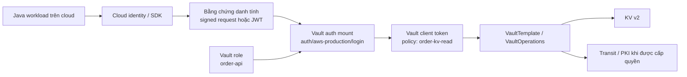

# Tùy chọn role, auth path và các SDK bổ sung

Khi triển khai **Spring Vault** trên AWS, Google Cloud hoặc Microsoft Azure, ứng dụng Java có thể xác thực với HashiCorp Vault bằng **danh tính workload do cloud cấp**. Ứng dụng không cần đóng gói một Vault token dài hạn trong image để gọi `VaultTemplate`. Thay vào đó, ứng dụng chứng minh danh tính đang chạy trên nền tảng cloud, Vault xác minh chứng cứ rồi cấp một **Vault client token** có policy giới hạn.

Trong chương **Xác thực cloud**, ba nhóm tùy chọn rất dễ nhầm là **role**, **auth path** và **SDK/thư viện hỗ trợ**. Chúng trả lời ba câu hỏi khác nhau:

- **Role:** workload nào được đăng nhập vào Vault, và token nhận được có những quyền gì?
- **Auth path:** ứng dụng gửi yêu cầu đăng nhập tới **auth mount nào** trong Vault?
- **SDK bổ sung:** mã Java lấy và ký bằng chứng nhận dạng cloud theo cơ chế nào?

Bài học giải thích cách chọn và kiểm tra ba nhóm đó, từ cấu hình Vault đến ứng dụng Spring. Ví dụ dùng KV v2 để xác nhận đăng nhập; cùng một client token có thể được Vault cho phép sử dụng Transit encryption, PKI hoặc backend khác khi policy tương ứng được cấp.

## 1. Hiểu đúng các lớp danh tính

Một lần đăng nhập cloud thường đi qua ba lớp:

| Lớp | Ví dụ | Chức năng |
| --- | --- | --- |
| **Cloud identity / principal** | AWS IAM role gắn với EC2/ECS/EKS; GCP service account; Azure managed identity | Chứng minh tiến trình đang chạy dưới danh tính cloud hợp lệ |
| **Vault auth role** | `order-api` trong auth mount `aws-production` | Khai báo danh tính nào được login và các policy/TTL của Vault token |
| **Vault client token** | Token được Vault trả về sau login | Dùng trong các lần gọi KV, Transit, PKI qua `VaultOperations` |

**Cloud IAM role và Vault role không phải cùng một đối tượng.** Một AWS IAM role có ARN như `arn:aws:iam::<account-id>:role/orders-workload`; một Vault role có tên `order-api`. Vault role chứa quy tắc ràng buộc cloud principal với các Vault token policy. Chọn đúng tên role mà không cấu hình ràng buộc danh tính thì vẫn không login được.

**Auth mount và Vault role cũng độc lập.** Role `order-api` dưới `auth/aws-production/role/order-api` khác với role cùng tên dưới `auth/aws-development/role/order-api`. Cấu hình `role=order-api` phải đi cùng đúng đường dẫn mount.



Lưu ý: một ứng dụng có thể chạy trên AWS nhưng đăng nhập bằng Kubernetes auth, hoặc chạy trong Kubernetes nhưng chọn AWS IAM auth. Tên nền tảng không tự quyết định auth method; hãy chọn loại bằng chứng mà môi trường thật sự có và Vault đã được cấu hình để xác minh.

## 2. So sánh các phương án xác thực cloud

| Cơ chế | Bằng chứng được gửi tới Vault | Thường dùng ở đâu? | Điều kiện nổi bật |
| --- | --- | --- | --- |
| **AWS IAM** | Yêu cầu STS `GetCallerIdentity` đã ký bằng AWS Signature V4 | EC2 instance profile, ECS task role, EKS workload IAM identity, ứng dụng có AWS credentials ngắn hạn | Workload có credential chain hợp lệ; Vault role ràng buộc IAM principal |
| **AWS EC2** | EC2 instance identity document và chữ ký, có thể kèm nonce | EC2 khi muốn xác thực dựa trên instance identity | Chỉ phù hợp danh tính EC2; cần bảo vệ metadata và cấu hình role/nonce |
| **GCP GCE** | JWT nhận dạng instance từ metadata service | Compute Engine hoặc môi trường được GCP hỗ trợ | Vault role ràng buộc project, zone, service account hoặc thuộc tính VM theo hỗ trợ của backend |
| **GCP IAM** | JWT được ký bằng danh tính GCP service account qua cơ chế IAM phù hợp | Workload có quyền sử dụng danh tính service account GCP | Quyền ký JWT, claim/audience và cấu hình GCP auth backend phải khớp |
| **Azure MSI / managed identity** | Azure managed identity token lấy từ endpoint metadata của môi trường | VM, App Service và dịch vụ Azure hỗ trợ managed identity | Managed identity và Vault role phải khớp ràng buộc subscription/resource group/service principal |

Tên authentication enum, property cụ thể và phương thức nào được Spring Vault/Spring Cloud Vault hỗ trợ trực tiếp **phụ thuộc phiên bản**. Hãy đối chiếu tài liệu của đúng dependency đang dùng; không tự suy tên cấu hình từ tên cơ chế Vault. Nếu native authentication không hỗ trợ biến thể cloud cần dùng, có thể xây một thành phần `ClientAuthentication` phù hợp thay vì đưa credential tĩnh vào service nghiệp vụ.

### Chọn cơ chế theo workload

1. Nếu chạy AWS với IAM role và có thể ký request STS: **AWS IAM** thường thuận tiện vì tận dụng credential ngắn hạn do nền tảng cấp.
2. Nếu cần chứng minh một EC2 instance cụ thể và chấp nhận ràng buộc của EC2 identity: cân nhắc **AWS EC2**.
3. Trên Google Cloud, cân nhắc **GCP GCE** khi có instance identity từ metadata, hoặc **GCP IAM** khi cần danh tính service account có khả năng ký JWT phù hợp.
4. Trên Azure, ưu tiên **managed identity** khi dịch vụ hỗ trợ và Vault Azure auth đã cấu hình.
5. Nếu workload đã có cơ chế nhận dạng khác như Kubernetes service account/JWT, đánh giá auth method tương ứng trước khi chọn cloud auth để tránh thêm lớp cấp credential không cần thiết.

Không lựa chọn chỉ theo việc một SDK đã có sẵn trong `build.gradle`. Phải chứng minh auth method phù hợp danh tính thực tế, giới hạn quyền và có đường xử lý khi token hết hạn.

## 3. Role: khóa nối cloud identity với Vault policy

### 3.1. Vai trò của Vault role

Vault role do **quản trị viên Vault** tạo dưới một auth mount. Với từng cơ chế, role thường định nghĩa các điều kiện như:

- Cloud principal nào được phép xác thực: AWS IAM principal ARN; GCP service account hoặc VM/project; Azure resource/subscription và service principal.
- Vault token được cấp kèm **policy** nào; ví dụ chỉ có quyền đọc `kv/data/orders/runtime`.
- Thời gian sống token, khả năng gia hạn, giới hạn sử dụng và các ràng buộc bổ sung nếu backend hỗ trợ.
- Một số cơ chế có tham số bảo mật riêng: IAM server ID header với AWS, nonce/identity binding với EC2, claims/audience hoặc điều kiện resource với cloud khác.

Mã Java **chỉ cần biết tên Vault role cần login**, không cần quyền quản trị để tạo hoặc sửa role. Nếu workload nhận token quyền quá rộng, cần sửa cấu hình Vault role/policy; thay đổi tên Java service không tự giảm quyền.

### 3.2. Ví dụ Vault role cho AWS IAM

Giả sử môi trường production có AWS IAM role `orders-workload` thuộc một AWS account, còn ứng dụng chỉ được đọc secret KV v2 `kv/orders/runtime`.

Policy HCL `order-kv-read.hcl`:

```hcl
path "kv/data/orders/runtime" {
  capabilities = ["read"]
}
```

Người quản trị Vault thực hiện **trên môi trường thử nghiệm hoặc môi trường đã được phê duyệt cấu hình**:

```bash
vault policy write order-kv-read order-kv-read.hcl

# Tạo một auth mount AWS tên aws-production nếu chưa tồn tại.
vault auth enable -path=aws-production aws

# Cấu hình AWS IAM role dành cho workload orders.
vault write auth/aws-production/role/order-api \
  auth_type=iam \
  bound_iam_principal_arn="arn:aws:iam::<account-id>:role/orders-workload" \
  token_policies="order-kv-read" \
  token_ttl="20m" \
  token_max_ttl="1h"
```

`<account-id>` là giá trị minh họa; thay bằng account ID thực tế. Tùy triển khai và phương thức xác minh AWS, quản trị viên còn cần cấu hình quyền/cách Vault kiểm tra IAM principal, thông số AWS endpoint/region và ràng buộc bảo mật liên quan. Không dùng ví dụ này như toàn bộ quy trình triển khai AWS auth production.

Ở đây:

- `orders-workload` là **AWS IAM role** của workload.
- `order-api` là **Vault auth role**; Spring Vault sẽ gửi tên này khi đăng nhập.
- `aws-production` là **auth mount path**, không phải tên AWS region.
- `order-kv-read` là **Vault policy** gắn vào client token trả về.

Không nhầm `bound_iam_principal_arn` với tên Vault role. Nếu một workload dùng STS assumed-role session, cần bảo đảm cách Vault xác định ARN và điều kiện ràng buộc thực sự khớp principal; đừng dùng wildcard cho mọi role chỉ để login vượt qua kiểm tra.

### 3.3. Cấp quyền của role và hành vi KV

Với KV v2, API đọc dữ liệu dùng đường dẫn hệ thống `kv/data/orders/runtime`, nên Vault policy cần cấp `read` tại đúng path này. Trong API Spring Vault `opsForKeyValue("kv", KV_2)`, ứng dụng dùng đường dẫn logic `orders/runtime`; thư viện xử lý cấu trúc API KV v2.

Policy không có quyền đọc secret khác, không có quyền sửa Vault role và không tự có quyền gọi Transit hoặc PKI. Nếu ứng dụng cần Transit encryption hoặc PKI, cần cấp đúng policy cho operation và path cụ thể. Điều đó giữ danh tính workload độc lập với tập quyền nghiệp vụ.

## 4. Auth path: nơi Vault nhận yêu cầu đăng nhập

Vault cho phép mount cùng một loại auth method nhiều lần, với tên khác nhau. Ví dụ:

| Môi trường | Auth mount | Endpoint login | Vault role |
| --- | --- | --- | --- |
| Development AWS | `aws-development` | `auth/aws-development/login` | `order-api` |
| Production AWS | `aws-production` | `auth/aws-production/login` | `order-api` |
| Production GCP | `gcp-production` | `auth/gcp-production/login` | `order-api` |
| Production Azure | `azure-production` | `auth/azure-production/login` | `order-api` |

Hai role cùng tên ở các mount khác nhau có thể có policy, ràng buộc cloud principal và TTL khác nhau. Vì vậy cần kiểm tra **bộ ba** `authentication type + mount path + role`. Chỉ thay role mà giữ auth path sai sẽ không đổi được danh tính như mong muốn.

### Quy tắc ánh xạ đường dẫn

- Đường dẫn Vault API: `auth/<mount-name>/login`.
- Trong nhiều property kiểu `aws-path`, `gcp-path` hoặc `azure-path` của Spring Cloud Vault, giá trị cần nhập là **tên mount** như `aws-production`, không kèm tiền tố `auth/` hoặc hậu tố `/login`.
- Không dùng **KV mount** `kv` để thay cho **authentication mount** `aws-production`. Chúng có mục đích riêng.
- Nếu admin đã mount auth method tại một tên tùy chỉnh, client phải dùng tên tùy chỉnh đó; giá trị mặc định `aws`/`gcp`/`azure` không tự trỏ sang mount mới.

Kiểm tra bằng danh tính quản trị có quyền quan sát mount:

```bash
vault auth list
vault read auth/aws-production/role/order-api
```

Lệnh `vault read auth/.../role/...` là thao tác quản trị/kiểm tra, **không phải bước bắt buộc của consumer**. Nếu consumer bị `403` khi đọc cấu hình role nhưng login thành công, điều đó có thể hoàn toàn đúng theo phân quyền.

### Namespace và path trong Vault Enterprise

Khi dùng Vault Enterprise namespace, **namespace** là ngữ cảnh tìm auth mount và policy; nó không phải phần mở rộng tùy ý của `aws-path`. Ví dụ auth mount `aws-production` có thể tồn tại ở nhiều namespace với cấu hình khác nhau. Ứng dụng phải dùng đúng Vault namespace theo cơ chế namespace/header mà phiên bản client hỗ trợ, đồng thời dùng đúng tên auth mount bên trong namespace đó.

## 5. Cấu hình Spring Cloud Vault: ví dụ AWS IAM

Trong hệ sinh thái Spring, thư viện **Spring Vault** cung cấp `VaultOperations`/`VaultTemplate` và các thành phần xác thực; **Spring Cloud Vault** giúp cấu hình client và tích hợp với môi trường Spring Boot.

Ví dụ ứng dụng Java chạy trên AWS, được môi trường cung cấp AWS credentials qua instance profile/task role/workload identity, đã có Vault role `order-api` trong mount `aws-production`:

```yaml
spring:
  cloud:
    vault:
      uri: ${VAULT_URI}
      authentication: AWS_IAM
      aws-iam:
        role: order-api
        aws-path: aws-production

app:
  vault:
    kv-mount: kv
    secret-path: orders/runtime
```

Các property `spring.cloud.vault.aws-iam.role` và `spring.cloud.vault.aws-iam.aws-path` là ví dụ cho Spring Cloud Vault hỗ trợ AWS IAM; khi sử dụng một phiên bản cụ thể, hãy xác nhận tên property trong metadata/configuration reference của phiên bản đó. `VAULT_URI` nên sử dụng HTTPS và chuỗi tin cậy TLS được cấu hình đúng. Nếu ứng dụng dùng Vault làm nguồn Spring Config Data, còn cần cấu hình bootstrap/import phù hợp phiên bản Spring Boot/Spring Cloud, ví dụ `spring.config.import`; lựa chọn đó độc lập với logic chọn AWS IAM role.

Ở runtime:

1. Spring Vault cần một **AWS credential provider hợp lệ** từ môi trường workload.
2. Thành phần xác thực tạo **STS `GetCallerIdentity` request được ký** theo cơ chế AWS IAM.
3. Request được chuyển đến endpoint login của Vault dưới `auth/aws-production/login` cùng Vault role `order-api`.
4. Vault xác minh bằng chứng và ràng buộc principal của role, rồi trả client token theo `token_policies`.
5. `VaultTemplate`/`VaultOperations` sử dụng token đó cho thao tác KV, Transit hoặc PKI được policy cho phép.

Lúc này không cần lưu `VAULT_TOKEN` dài hạn trong config ứng dụng. Tránh đặt `AWS_ACCESS_KEY_ID`/`AWS_SECRET_ACCESS_KEY` cố định trong source; ưu tiên AWS temporary credentials gắn với workload, credential provider chain đáng tin cậy và IAM policy tối thiểu.

### Ví dụ service nghiệp vụ sử dụng VaultOperations

```java
import org.springframework.stereotype.Service;
import org.springframework.vault.core.VaultKeyValueOperations;
import org.springframework.vault.core.VaultKeyValueOperationsSupport.KeyValueBackend;
import org.springframework.vault.core.VaultOperations;
import org.springframework.vault.support.VaultResponse;

@Service
public final class OrderRuntimeSettings {

    private final VaultKeyValueOperations kv;

    public OrderRuntimeSettings(VaultOperations vault) {
        this.kv = vault.opsForKeyValue("kv", KeyValueBackend.KV_2);
    }

    public String requireRegion() {
        VaultResponse response = kv.get("orders/runtime");
        if (response == null || response.getData() == null) {
            throw new IllegalStateException("Vault configuration unavailable");
        }
        Object region = response.getData().get("region");
        if (!(region instanceof String) || ((String) region).isBlank()) {
            throw new IllegalStateException("Vault region configuration invalid");
        }
        return (String) region;
    }
}
```

Service không tự cầm AWS credential, gọi STS hay tạo Vault client mỗi request. Nó chỉ cần `VaultOperations` được Spring cấu hình bằng auth method đã chọn. Đây là ranh giới cần giữ ngay cả khi sau này đổi workload sang GCP/Azure.

## 6. Đổi cloud hoặc auth path mà vẫn giữ mã nghiệp vụ

Tư duy quản trị cấu hình là giữ tên đầu vào ổn định theo từng môi trường, đồng thời thay đổi đúng các giá trị phục vụ xác thực. Bảng dưới là **minh họa về nhóm cấu hình cần xác nhận**:

| Phương thức | Chọn trong cấu hình | Role cần khớp | Path cần khớp | Bằng chứng cần lấy được |
| --- | --- | --- | --- | --- |
| AWS IAM | `AWS_IAM` | Vault AWS IAM role | AWS auth mount | AWS credentials để ký STS request |
| AWS EC2 | `AWS_EC2` | Vault AWS EC2 role | AWS auth mount | EC2 instance identity metadata |
| GCP GCE | GCP GCE auth (nếu bản client hỗ trợ) | Vault GCP GCE role | GCP auth mount | GCE instance identity JWT |
| GCP IAM | GCP IAM auth (nếu bản client hỗ trợ) | Vault GCP IAM role | GCP auth mount | Ký JWT với service account phù hợp |
| Azure MSI | Azure managed identity auth (nếu bản client hỗ trợ) | Vault Azure role | Azure auth mount | Managed identity token của workload |

**Ví dụ về Azure MSI:** cloud identity gắn với VM/App Service cần phù hợp điều kiện của Vault Azure role. Managed identity token phải lấy theo resource/audience mà Vault Azure auth yêu cầu. Một Azure role có thể ràng buộc subscription, resource group hoặc principal; chọn đúng `role` mà identity không khớp ràng buộc vẫn dẫn tới login bị từ chối.

**Ví dụ về GCP:** GCE identity JWT và IAM-signed JWT là hai cách chứng minh khác nhau. GCP service account có thể tồn tại trong cả hai tình huống, nhưng cơ chế ký và các trường Vault kiểm tra không giống nhau. Không hoán đổi enum, issuer hoặc token audience chỉ vì cùng là GCP. Cần đảm bảo backend GCP auth của Vault và quyền liên quan tới IAM Credentials API đã được cấu hình.

**Ví dụ về AWS EC2:** nếu chọn EC2 auth, thư viện lấy tài liệu danh tính instance từ metadata service; điều này khác với AWS IAM auth ký `GetCallerIdentity`. Một workload không chạy trong EC2 phù hợp hoặc không truy cập metadata theo chính sách sẽ không thể tự tạo EC2 identity document hợp lệ.

Trên một cloud có nhiều môi trường, có thể dùng **một auth mount với nhiều Vault role** hoặc **nhiều auth mount tách biệt**. Chọn cấu trúc dựa trên quyền quản trị, kiểm soát policy và khả năng vận hành; đừng xem việc đặt path khác nhau là cơ chế bảo mật duy nhất. Mỗi mount/role vẫn phải cấu hình ràng buộc principal và policy rõ ràng.

## 7. SDK bổ sung: cần gì và khi nào?

Các cơ chế cloud auth có hai việc phải hoàn thành:

1. **Nhận bằng chứng cloud identity:** credentials, metadata token hoặc chữ ký từ môi trường.
2. **Đăng nhập Vault và quản lý phiên:** gửi request tới đúng auth mount, lấy Vault token và dùng token trong `VaultOperations`.

Spring Vault xử lý phần Vault; phần **lấy/ký bằng chứng cloud** có thể cần thư viện, module hoặc SDK chuyên biệt tùy cơ chế và phiên bản. Không có một “cloud auth SDK” chung cho AWS, GCP, Azure.

| Trường hợp | Phần có thể cần thêm | Cách quyết định |
| --- | --- | --- |
| AWS IAM | AWS credential provider và ký AWS Signature V4 cho STS; tùy phiên bản có dependency AWS SDK tương ứng | Kiểm tra tài liệu Spring Vault auth đang chọn và dependency runtime |
| AWS EC2 | Khả năng gọi metadata endpoint instance và xử lý instance identity document | Kiểm tra môi trường EC2, IMDSv2/security settings và hỗ trợ của client |
| GCP GCE | Client lấy JWT từ metadata server, có thể cần thư viện Google auth | Kiểm tra GCE runtime và module Spring Vault đang dùng |
| GCP IAM | Khả năng ký JWT cho service account, đôi khi cần IAM Credentials API/Google auth SDK | Kiểm tra quyền `signJwt`, API và phiên bản integration |
| Azure MSI | Managed identity token client/IMDS request, có thể cần Azure identity SDK ở custom integration | Kiểm tra runtime hỗ trợ MSI và Spring Vault auth implementation |

### Minh họa dependency Gradle

Nếu tích hợp qua **Spring Cloud Vault**, dependency cơ sở thường là starter Vault Config:

```groovy
dependencies {
    implementation("org.springframework.cloud:spring-cloud-starter-vault-config")

    // Chỉ thêm SDK theo cơ chế đã chọn và hướng dẫn đúng phiên bản.
    // Ví dụ nếu tự viết bộ lấy credential / ký JWT / token:
    // implementation("software.amazon.awssdk:sts")
    // implementation("com.google.auth:google-auth-library-oauth2-http")
    // implementation("com.azure:azure-identity")
}
```

Đây là các **ví dụ thư viện có thể hữu ích khi tự tích hợp cloud APIs**, không phải danh sách dependency bắt buộc để Spring Cloud Vault dùng được cả ba cloud. Với AWS IAM, implementation của Spring Vault có thể sử dụng một phiên bản AWS SDK khác với SDK mà ứng dụng tự thêm; thêm `software.amazon.awssdk:sts` không tự thay thế signer mà Spring Vault hiện dùng. Các bản Spring Cloud nên được quản lý phiên bản qua BOM tương thích với Spring Boot.

Một quy trình kiểm tra dependency thực tế:

1. Xác định **phiên bản Spring Vault / Spring Cloud Vault** mà dự án đang dùng.
2. Xác nhận auth method native có hỗ trợ mode và cách lấy credential của workload không.
3. Đọc tài liệu dependency tương ứng và kiểm tra classpath runtime: thiếu signer/SDK sẽ báo lỗi ngay khi tạo auth client hoặc lúc login.
4. Chỉ thêm SDK hoặc custom `ClientAuthentication` cho phần còn thiếu, không thay toàn bộ pipeline `VaultOperations`.
5. Dùng credential provider chain/managed identity mặc định của runtime; cấu hình lại chỉ khi có yêu cầu cụ thể và có cách kiểm thử.

Với **Spring Vault thuần**, ứng dụng tự tổ chức `VaultEndpoint`, `RestOperations`/request factory, `ClientAuthentication` và `VaultTemplate` hoặc session manager. Khi viết custom authentication, tránh thực hiện ký và phát token ngay trong controller/service nghiệp vụ; cung cấp một bean quản lý đăng nhập có thể kiểm thử và quan sát riêng.

## 8. Bảo vệ bằng chứng cloud và quản lý token

Dù cloud auth giảm phụ thuộc vào mật khẩu tĩnh, **bằng chứng cloud và Vault token vẫn nhạy cảm**:

- **AWS IAM:** request STS đã ký chứa dữ liệu xác thực; không log toàn bộ request được ký, authorization header hoặc credential. Giới hạn khả năng truy cập EC2/ECS/EKS metadata và thiết lập IAM role tối thiểu.
- **AWS EC2:** instance identity document/nonce chỉ nên lấy từ metadata service tin cậy; xem xét rủi ro metadata SSRF và binding/replay của backend.
- **GCP:** metadata identity token hoặc JWT đã ký có thể bị lợi dụng trong TTL; phải bảo vệ token, audience và quyền IAM service account.
- **Azure:** managed identity token phải có resource/audience hợp lệ; giới hạn quyền truy cập managed identity endpoint và việc chia sẻ danh tính giữa các ứng dụng.
- **Vault token:** có TTL/renewal/revocation riêng. Token đã cấp được dùng cho KV/Transit/PKI; không ghi vào log, tracing hoặc HTTP error. Role và auth mount cần thiết kế TTL phù hợp vòng đời ứng dụng.

Một bean `VaultTemplate` có thể được tái sử dụng giữa nhiều request, nhưng điều đó **không tự bảo đảm** token sẽ được gia hạn hoặc xác thực lại. Spring Vault/session manager cần được cấu hình tương thích với cloud auth method và khả năng cấp lại bằng chứng. Token có thể bị thu hồi sớm hơn TTL; ứng dụng cần xử lý lỗi rõ ràng và có kế hoạch re-auth.

**Ranh giới không thể bỏ qua:** quyền IAM/cloud quyết định workload nào có thể tạo bằng chứng; Vault role quyết định bằng chứng nào được chấp nhận để lấy token; Vault policy quyết định token đó đọc/ghi tài nguyên nào. Cần kiểm thử đủ cả ba ranh giới.

## 9. Chẩn đoán lỗi role, auth path và SDK

| Hiện tượng | Nguyên nhân có thể | Cách kiểm tra |
| --- | --- | --- |
| Vault login trả `404` | Sai tên auth mount, backend chưa mount, sai API path | Xem mount name và endpoint `auth/<mount>/login`; tránh thêm `auth/` hai lần |
| Login trả `400` hoặc `403` | Vault role không tồn tại, principal không khớp, chứng cứ sai/chưa đủ, role binding bị từ chối | Đối chiếu auth method, Vault role, principal ARN/claims, hạn chế backend |
| AWS IAM không ký được STS request | Không có AWS credentials, credential chain sai, lỗi SDK hoặc STS endpoint/region | Kiểm tra danh tính runtime, SDK signer, vùng AWS và network |
| AWS EC2 metadata không truy cập được | Không chạy ở EC2 phù hợp, metadata bị chặn, IMDS configuration sai | Kiểm tra instance/IMDS policy và network metadata |
| GCP login lỗi JWT | Audience/issuer/ký JWT không hợp lệ hoặc service account không được ràng buộc | Kiểm tra loại GCP auth, claims, IAM Credentials API và Vault role |
| Azure login lỗi identity | Managed identity chưa bật, chọn sai identity hoặc resource/audience | Kiểm tra token source, managed identity principal và Vault role |
| Ứng dụng lỗi `ClassNotFoundException`/`NoClassDefFoundError` | Thiếu dependency runtime hoặc lệch phiên bản SDK | Kiểm tra dependency tree/BOM của đúng bản Spring Vault |
| Login thành công nhưng KV `403` | Vault token không có quyền vào `kv/data/...` | Kiểm tra `token_policies` và đúng đường dẫn KV v2 |
| Đang chạy thì lỗi sau một thời gian | Token hết hạn/revoke; auth client không refresh credential hoặc không re-auth | Kiểm tra token TTL, session manager, cloud credential rotation |
| Dev chạy, production lỗi | Auth path, namespace, cloud account/project, role hoặc metadata khác môi trường | So sánh cấu hình theo môi trường, không hard-code mặc định |

Khi log, chỉ ghi loại auth, tên role/mount **không nhạy cảm** và mã lỗi. Thực tế tên role hoặc path cũng có thể tiết lộ cấu trúc hệ thống, nên chỉ đưa vào kênh log nội bộ phù hợp. Không ghi access key, metadata JWT, signed STS request, client token hoặc secret values.

Không retry vô hạn lỗi `403` do policy sai. Với lỗi mạng hoặc dịch vụ cloud tạm thời, retry cần timeout, số lần tối đa và backoff phù hợp; retry login cũng có thể tạo nhiều Vault token nếu không kiểm soát.

## 10. Bài thực hành: đổi mount và phát hiện cấu hình sai

Bài thực hành dùng Vault cô lập và một workload AWS có IAM role hợp lệ. Các bước cấu hình cloud role cần do môi trường thử nghiệm thực hiện; không nên thử bằng root token/credential production.

1. Tạo policy `order-kv-read` chỉ đọc `kv/data/orders/runtime`; tạo secret thử nghiệm `orders/runtime` trong KV v2 mount `kv`.
2. Bật AWS auth dưới mount `aws-development`, cấu hình Vault role `order-api` ràng buộc đúng AWS IAM principal của workload.
3. Cấu hình Spring Cloud Vault với `authentication: AWS_IAM`, `role: order-api` và `aws-path: aws-development`; xác minh service Java đọc được secret thử nghiệm.
4. Đổi **chỉ `aws-path`** thành một mount không tồn tại. Quan sát lỗi login và xác nhận nguyên nhân là auth path thay vì KV path.
5. Trả về auth path đúng, nhưng đổi `role` thành role không tồn tại. Quan sát lỗi role; đừng sửa Vault policy tùy tiện chỉ để làm bài kiểm thử pass.
6. Thêm role hợp lệ nhưng ràng buộc AWS principal khác. Xác minh Vault không cấp token cho workload hiện tại.
7. Khôi phục role đúng, sau đó bỏ quyền đọc KV khỏi policy thử nghiệm. Login có thể thành công nhưng thao tác KV phải bị từ chối.
8. Kiểm tra log không chứa signed STS payload hoặc token; xác minh ứng dụng không tạo `VaultTemplate` mới cho mỗi request.

Đối với GCP và Azure, thực hiện chuỗi kiểm thử tương đương: tách **lỗi nhận dạng cloud**, **lỗi ràng buộc Vault role**, **lỗi auth mount** và **lỗi Vault policy** thành các tình huống riêng. Kết quả mong đợi là một ứng dụng chỉ có quyền theo role/policy đã khai báo, chứ không phải mọi lần login đều thành công.

### Kiểm thử tự động nên có

- **Unit test:** mock `VaultOperations` để xác nhận code nghiệp vụ xử lý KV thiếu hoặc bị từ chối mà không lộ secret.
- **Configuration test:** kiểm tra auth method, role và mount được bind đúng property; khi đổi profile dev/prod không mang nhầm role/path.
- **Integration test:** dùng Vault thử nghiệm với auth mount và role cụ thể; kiểm tra login, policy denial và đường tái xác thực. Phần cloud signature/metadata cần dùng credential hoặc môi trường kiểm thử phù hợp; mock thuần không chứng minh Vault đã xác minh principal thật.
- **Operational test:** kiểm tra credential ngắn hạn được refresh, Vault token hết hạn/revoke được xử lý, TLS/timeout phù hợp và dependency runtime đầy đủ.

## 11. Checklist trước khi đưa vào vận hành

- Xác định rõ **cloud principal**, **Vault auth role**, **Vault auth mount path** và **Vault policy** cho mỗi workload.
- Xác nhận authentication mode thực sự được hỗ trợ bởi **phiên bản Spring Vault/Spring Cloud Vault** đang dùng.
- Kiểm tra mỗi môi trường có mount/role/namespace đúng; nhập path theo format property yêu cầu, tránh lẫn `auth/`, `/login` và KV mount.
- Ràng buộc Vault role vào cloud identity cụ thể; áp dụng least privilege và TTL phù hợp cho client token.
- Sử dụng credential provider chain hoặc managed identity của workload; hạn chế cấp credential tĩnh và quyền truy cập metadata.
- Chỉ thêm SDK cần thiết theo phiên bản và cơ chế; khóa version bằng dependency management và kiểm tra runtime classpath.
- Bảo vệ signed request, JWT và Vault token khỏi log/metrics/tracing; dùng TLS và kiểm soát outbound endpoints.
- Kiểm thử login, đọc KV, từ chối policy, sai role, sai auth path, lỗi SDK và vòng đời re-auth; xác minh quyền Transit/PKI riêng nếu sử dụng.

**Ghi nhớ:** `role` chọn quy tắc **ai được lấy Vault token và token có quyền gì**; `auth path` chọn **nơi Vault xử lý việc đăng nhập**; SDK phù hợp giúp ứng dụng **chứng minh danh tính cloud**. Cấu hình đúng cả ba mới giúp `VaultTemplate` truy cập HashiCorp Vault ổn định, có giới hạn quyền và dễ vận hành.

