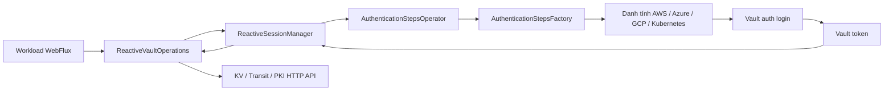
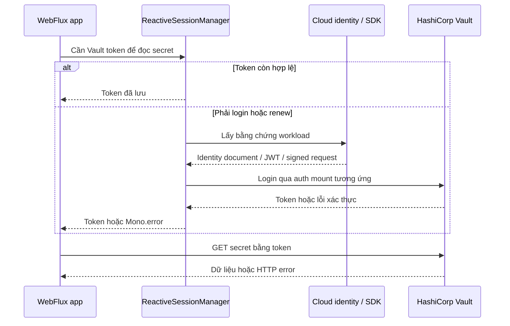

# Giới hạn hỗ trợ reactive của từng cơ chế xác thực

## 1. Đặt vấn đề: dùng WebFlux có đồng nghĩa mọi cloud authentication đều reactive?

Trong module **SPRING_VAULT**, ứng dụng Java cần chứng minh danh tính workload với HashiCorp Vault trước khi sử dụng `VaultTemplate` để đọc KV secrets, quản lý token/lease, gọi Transit encryption hoặc PKI. Khi ứng dụng chạy trên **Spring WebFlux**, việc chọn phương thức xác thực cloud cũng ảnh hưởng tới khả năng vận hành theo mô hình non-blocking.

Spring Vault cung cấp cả API đồng bộ (`VaultOperations`/`VaultTemplate`) lẫn API reactive (`ReactiveVaultOperations`/`ReactiveVaultTemplate`). Tuy nhiên, **Vault có hỗ trợ một phương thức xác thực không đồng nghĩa Spring Vault triển khai phương thức ấy hoàn toàn reactive**. Một số cơ chế cần gọi metadata service hoặc SDK cloud để lấy bằng chứng danh tính; một cơ chế có thể đăng nhập Vault thành công theo kiểu đồng bộ nhưng không có `AuthenticationSteps` để chạy trong hạ tầng xác thực reactive.

Mục tiêu của bài:

- Giải thích vai trò của `ClientAuthentication`, `AuthenticationStepsFactory`, `AuthenticationStepsOperator` và reactive session trong luồng đăng nhập.
- Đối chiếu giới hạn reactive của **AWS EC2, AWS IAM, Azure MSI, GCP GCE và GCP IAM**; liên hệ với Kubernetes và AppRole khi thiết kế workload authentication.
- Nhận diện sự khác nhau giữa *API reactive*, *luồng xác thực có hỗ trợ reactive* và *toàn bộ tác vụ thực sự không blocking*.
- Chọn phương án tích hợp, kiểm thử, xử lý lỗi và giám sát để ứng dụng không mắc kẹt khi làm mới Vault token.

> Phạm vi tương thích phụ thuộc phiên bản Spring Vault, Spring Cloud Vault, thư viện cloud và cấu hình triển khai. Các ví dụ dưới đây dùng những API được mô tả trong tài liệu Spring Vault 4.x / Spring Cloud Vault 5.x; khi dùng bản cũ, cần đối chiếu Javadoc của đúng phiên bản đang chạy.

## 2. Ba tầng phải phân biệt

| Tầng | Thành phần Spring | Câu hỏi cần trả lời |
| --- | --- | --- |
| **Truy cập Vault** | `VaultTemplate` hoặc `ReactiveVaultTemplate` | Ứng dụng gọi KV/Transit/PKI theo kiểu blocking hay trả `Mono`/`Flux`? |
| **Tạo token từ danh tính workload** | `ClientAuthentication`, `AuthenticationStepsFactory`, `AuthenticationStepsOperator` | Cơ chế xác thực có thể biểu diễn thành các bước để reactive executor chạy không? |
| **Giữ token theo vòng đời phiên** | `SessionManager` hoặc `ReactiveSessionManager` (ví dụ `ReactiveLifecycleAwareSessionManager`) | Token được tái sử dụng, renew và đăng nhập lại thế nào, có đưa blocking vào event loop không? |

`ClientAuthentication` là hợp đồng đăng nhập đồng bộ, thường cung cấp `VaultToken`. Nhiều implementation còn triển khai `AuthenticationStepsFactory`: tạo một chuỗi `AuthenticationSteps` mô tả việc lấy credential, chuẩn bị payload và gửi request đăng nhập. `AuthenticationStepsOperator` dùng chuỗi đó trong pipeline reactive để cung cấp token. `ReactiveVaultTemplate` sử dụng token supplier hoặc reactive session manager thích hợp khi gọi Vault.



Sơ đồ thể hiện các vai trò logic, không có nghĩa mỗi thao tác đều xảy ra ở mỗi request: **session manager giữ và gia hạn token**, vì vậy ứng dụng không nên đăng nhập Vault lại sau mỗi lần đọc một secret.

**Reactive-compatible** trong bài nghĩa là cơ chế có thể tham gia luồng `AuthenticationSteps` mà Spring Vault dùng cho xác thực reactive. Điều đó **chưa bảo đảm tất cả thao tác bên trong là non-blocking**: provider credentials của SDK, đọc file, ký dữ liệu, DNS, truy cập instance metadata service hoặc các hook tùy biến vẫn cần được kiểm tra riêng.

## 3. Ma trận giới hạn hỗ trợ reactive theo từng cloud auth

| Cơ chế / Spring class | Bằng chứng gửi cho Vault | `AuthenticationStepsFactory` | Khả năng dùng trong luồng reactive tiêu chuẩn | Giới hạn đáng chú ý |
| --- | --- | --- | --- | --- |
| **AWS EC2** — `AwsEc2Authentication` | Instance identity document/PKCS#7 từ EC2 metadata; tùy cấu hình kèm nonce | Có | **Có** | Phụ thuộc EC2 IMDS, nonce, identity document; cần xem cách lấy metadata và vòng đời nonce. |
| **AWS IAM** — `AwsIamAuthentication` | Request STS `GetCallerIdentity` được ký AWS Signature V4 | Có | **Có** | Lấy/refresh AWS credentials và ký request qua AWS SDK; credential provider cụ thể có thể dùng API đồng bộ. |
| **Azure MSI** — `AzureMsiAuthentication` | Managed identity JWT và thông tin môi trường VM | Có | **Có** | Phụ thuộc Azure instance metadata/identity token service, quyền của managed identity và role binding tại Vault. |
| **GCP GCE** — `GcpComputeAuthentication` | Identity JWT từ GCE metadata service | Có | **Có** | Phải có môi trường cung cấp GCE identity token và Vault role khớp instance/service account. |
| **GCP IAM** — `GcpIamCredentialsAuthentication` | JWT được ký nhờ IAM Credentials API `signJwt` | **Không** | **Không hỗ trợ qua `AuthenticationSteps` tiêu chuẩn** | Google OAuth 2 token + IAM Credentials SDK có vòng đời/token API đồng bộ; đây là giới hạn đã nêu rõ trong tài liệu Spring Vault. |

Ma trận nói về **implementation có sẵn**, không phải việc Vault server hỗ trợ hay không hỗ trợ cơ chế. Ví dụ, Vault chấp nhận login GCP IAM qua API `auth/gcp/login`, nhưng implementation `GcpIamCredentialsAuthentication` của Spring Vault không cung cấp `AuthenticationSteps` cho reactive. Các bản cũ có tên `GcpIamAuthentication`; khi nâng cấp cần kiểm tra API thay thế và trạng thái deprecated.

> **Điểm mấu chốt:** AWS EC2/IAM, Azure MSI, GCP GCE có thể tham gia reactive authentication flow; **GCP IAM là trường hợp ngoại lệ nổi bật**. Đừng suy ra từ việc ứng dụng có `spring-boot-starter-webflux` rằng mọi cách đăng nhập Vault đều tự động chuyển thành non-blocking.

### 3.1. AWS EC2: identity document và vấn đề nonce

AWS EC2 auth dựa trên tài liệu danh tính instance và bằng chứng được AWS ký, thay vì ứng dụng phải chứa AWS access key tĩnh. Khi login, Vault kiểm tra danh tính và ràng buộc role. Spring Vault hỗ trợ `AuthenticationSteps` cho cơ chế này.

Điểm cần kiểm tra trong một service reactive:

- Endpoint IMDS và cách đọc instance identity document có truy cập được từ runtime (EC2, container trên host EC2, cấu hình mạng) hay không.
- IMDSv2 yêu cầu lấy session token metadata trước khi đọc dữ liệu; hỗ trợ phụ thuộc phiên bản Spring Vault. Đọc metadata có thể thất bại bởi hop limit, proxy hoặc rule mạng.
- AWS EC2 auth thường sử dụng **nonce** để chống việc tái sử dụng identity document trái phép. Nonce mặc định trong Spring Vault được lưu trong bộ nhớ tiến trình; sau restart cần đánh giá quy tắc xác thực lại.
- Vault token TTL và chính sách renew cần được quản lý bởi session, không nhầm với lifetime của instance identity document.

Ở đây “có reactive flow” không bảo đảm không có I/O bên ngoài request Vault; đo lường việc đọc IMDS và hành vi khi kết nối chậm.

### 3.2. AWS IAM: request STS được ký và AWS credentials provider

AWS IAM auth tạo chữ ký trên request STS `GetCallerIdentity`, sau đó gửi các trường đã ký cho Vault. Vault dùng chúng để xác minh danh tính IAM principal. Spring Vault có `AwsIamAuthentication` triển khai `AuthenticationStepsFactory`, vì vậy cơ chế này **có đường tích hợp reactive**.

Tuy nhiên, việc lấy thông tin từ credential chain có thể liên quan environment variables, shared credential profile, EC2 instance profile, ECS task role hoặc phương thức khác của AWS SDK. Một provider đồng bộ có thể tải credential, refresh cache hoặc gọi metadata service. Bởi vậy:

1. Dùng IAM role gắn với workload, tránh hard-code access key/secret key.
2. Kiểm tra phiên bản AWS SDK tương thích và cấu hình signing; trong tài liệu Spring Cloud Vault mới, AWS IAM yêu cầu `software.amazon.awssdk:auth` (AWS SDK v2).
3. Nếu có thao tác blocking ở provider hoặc mã tùy biến, tách nó khỏi Netty event-loop hoặc sử dụng cơ chế tương thích theo hướng dẫn SDK; không cho rằng chữ `reactive` tự giải quyết mọi blocking.
4. Kiểm tra `X-Vault-AWS-IAM-Server-ID` và Vault role binding khi dùng server ID để giảm nguy cơ replay.

### 3.3. Azure MSI: có AuthenticationSteps, phụ thuộc môi trường Azure

`AzureMsiAuthentication` lấy token của managed identity và thông tin VM (subscription, resource group, VM name) khi cần, rồi đăng nhập vào auth mount Azure của Vault. Implementation có thể dùng reactive authentication flow.

Giới hạn thực tế thường nằm ở identity token service và IMDS. Ví dụ một service được đưa vào Docker cục bộ, CI hoặc môi trường không có managed identity có thể không lấy được token. Việc đó là **lỗi điều kiện môi trường/xác thực**, không chứng minh `ReactiveVaultTemplate` không hỗ trợ Azure MSI. Cũng cần phân biệt cơ chế Azure MSI dành cho danh tính hạ tầng phù hợp với các phương thức liên kết danh tính Azure khác: không tự cho rằng mọi dạng Microsoft Entra workload identity đều có cùng luồng xác thực.

### 3.4. GCP GCE: có AuthenticationSteps, cần metadata identity JWT

`GcpComputeAuthentication` lấy JWT nhận diện instance thông qua metadata service của Compute Engine và gửi cho Vault GCP GCE auth. Spring Vault có `AuthenticationStepsFactory` cho cơ chế này.

Một môi trường GCP khác không tự động tương đương GCE: Workload Identity, Cloud Run hay máy trạm không nhất thiết cung cấp cùng endpoint hoặc cùng kiểu identity assertion. Kiểm tra chỗ chạy thực tế, service account, audience, ràng buộc Vault role và khả năng truy cập metadata server trước khi bật chế độ này. Token nhận từ metadata và Vault token sau khi đăng nhập là hai token khác nhau, có TTL và policy riêng.

### 3.5. GCP IAM: giới hạn reactive cần xử lý có chủ đích

`GcpIamCredentialsAuthentication` dùng Google credentials để gọi IAM Credentials API `projects.serviceAccounts.signJwt`. Quá trình này cần duy trì OAuth 2 access token và thực hiện lời gọi Google IAM. Theo tài liệu Spring Vault, các API liên quan ở implementation này là **synchronous**, do đó **không hỗ trợ `AuthenticationSteps`**, là cơ chế cần cho reactive login mặc định. Đây là giới hạn của client Spring Vault, không phải Vault GCP auth method thiếu tính năng.

Nếu ứng dụng WebFlux cần GCP IAM auth, có ba hướng để đánh giá:

1. **Đưa phần xác thực/Vault interaction qua infrastructure đồng bộ** và cô lập các lời gọi blocking ở executor/scheduler phù hợp; kiểm tra riêng cơ chế làm mới token. Không gọi `VaultTemplate` hoặc SDK đồng bộ trực tiếp trong Netty event-loop.
2. **Chọn phương thức workload identity khác có reactive support phù hợp môi trường** (ví dụ GCP GCE khi thật sự chạy trên môi trường có metadata identity JWT, hoặc Kubernetes/JWT auth khi hạ tầng hỗ trợ), sau khi thẩm định Vault role/policy.
3. **Dùng Vault Agent auto-auth** hoặc dịch vụ trung gian có trách nhiệm quản lý token, nếu kiến trúc tổ chức cho phép. Khi ấy luồng cung cấp token cho ứng dụng phải được thiết kế rõ; không tự chuyển đổi lớp `GcpIamCredentialsAuthentication` thành reactive bằng cách đổi cấu hình WebFlux.

Nếu bắt buộc xây custom auth integration, cần xác minh việc lấy Google credentials, OAuth refresh và ký JWT có thể vận hành non-blocking. Chỉ bọc một hàm đồng bộ trong `Mono.fromCallable(...)` mà không định vị scheduler phù hợp **không** tạo ra một luồng an toàn cho event-loop.

## 4. So sánh Spring Vault core và Spring Cloud Vault auto-configuration

Sự khác nhau này dễ gây nhầm khi đọc tài liệu:

- **Spring Vault core** cung cấp các lớp authentication, `AuthenticationSteps`, session manager và `ReactiveVaultTemplate` để người phát triển cấu hình trực tiếp.
- **Spring Cloud Vault** cung cấp cấu hình thuộc tính `spring.cloud.vault.*`, tích hợp Spring Boot và tự tạo những bean cần thiết khi điều kiện auto-configuration phù hợp. Khả năng cấp bean reactive theo cơ chế xác thực có thể có giới hạn riêng.

Tài liệu Spring Cloud Vault mô tả rằng khi dùng stack WebFlux, auto-configuration reactive được bật theo điều kiện và có thể tắt qua `spring.cloud.vault.reactive.enabled=false`. **Tắt reactive auto-configuration chỉ thay đổi cấu hình client được tạo; không biến lời gọi đồng bộ thành non-blocking.**

Ví dụ phụ để thấy sự khác nhau giữa tầng API và tầng auto-config là **AppRole**: Spring Vault core từng bổ sung hỗ trợ full-pull trong reactive AppRole, nhưng tài liệu Spring Cloud Vault vẫn nêu giới hạn auto-config reactive ở **simple pull**, chưa hỗ trợ full pull theo cùng cách. Vì thế không thể kết luận chỉ từ việc một lớp implement `AuthenticationStepsFactory` rằng mọi tổ hợp cấu hình Spring Cloud Vault được hỗ trợ.

Các cơ chế **Kubernetes authentication**, **JWT authentication** và **AppRole authentication** cũng có implementation `AuthenticationStepsFactory` trong Spring Vault; chúng hữu ích khi một workload chạy trên Kubernetes hoặc cần một phương pháp xác thực khác AWS/Azure/GCP. Tuy nhiên, mỗi phương thức vẫn cần đúng role binding, credentials/token source và xác minh reactive auto-configuration của version triển khai.

## 5. Ví dụ: cấu hình AWS IAM cho một ứng dụng WebFlux

Giả sử service Java `orders-api` chạy trên AWS với IAM role được Vault bind vào auth mount `aws/`. Cấu hình minh họa cho Spring Cloud Vault:

```yaml
spring:
  config:
    import: "vault://"
  cloud:
    vault:
      uri: ${VAULT_ADDR}
      authentication: AWS_IAM
      reactive:
        enabled: true
      aws-iam:
        role: orders-api
        aws-path: aws
        server-name: vault.example.internal
```

`spring.config.import` áp dụng cho các bản Spring Boot/Spring Cloud Vault sử dụng Config Data API. Phải bảo đảm `server-name`, role và mount khớp cấu hình Vault, ứng dụng có AWS credentials provider được hỗ trợ và dependency AWS SDK cần thiết. Giá trị `${VAULT_ADDR}` và danh tính workload đến từ môi trường triển khai.

Sau khi auto-configuration tạo bean `ReactiveVaultOperations`, nghiệp vụ có thể đọc KV v2 theo kiểu reactive:

```java
import org.springframework.stereotype.Service;
import org.springframework.vault.core.ReactiveVaultOperations;
import org.springframework.vault.core.VaultKeyValueOperationsSupport.KeyValueBackend;
import reactor.core.publisher.Mono;

@Service
public class OrderSecrets {

    private final ReactiveVaultOperations vault;

    public OrderSecrets(ReactiveVaultOperations vault) {
        this.vault = vault;
    }

    public Mono<String> databaseUser() {
        return vault.opsForKeyValue("secret", KeyValueBackend.KV_2)
                .get("orders/db")
                .switchIfEmpty(Mono.error(new IllegalStateException("Secret orders/db không tồn tại")))
                .flatMap(response -> {
                    Object username = response.getData() == null
                            ? null : response.getData().get("username");
                    return username instanceof String name
                            ? Mono.just(name)
                            : Mono.error(new IllegalStateException("Secret thiếu username"));
                });
    }
}
```

Các điểm cần hiểu khi đọc ví dụ:

- `ReactiveVaultOperations` trả `Mono` từ hoạt động đọc, không cần gọi `.block()` trong controller/service WebFlux.
- `opsForKeyValue("secret", KV_2)` tự ánh xạ key logic `orders/db` đến path KV v2 `secret/data/orders/db`; session sẽ cung cấp Vault token.
- Thao tác đọc `Mono` có thể thất bại do **login cloud** (IAM identity/STS/Vault role), **token/session** (TTL/renew) hoặc **ACL KV** (`secret/data/orders/db`). Phải phân biệt những điểm này khi điều tra lỗi.
- Mã giả định dự án đã tích hợp đúng dependency và bật reactive auto-configuration. Việc có một bean reactive không xác nhận AWS credential provider bên dưới không blocking; cần kiểm thử thời gian cấp và gia hạn token.

## 6. Chọn cách triển khai theo môi trường

| Nơi chạy workload | Lựa chọn thường cần đánh giá | Tiêu chí xác minh |
| --- | --- | --- |
| EC2 instance | AWS EC2 hoặc AWS IAM | Có IMDS/instance identity document hay IAM principal phù hợp? Nonce và credential refresh ra sao? |
| ECS/Lambda trên AWS | AWS IAM | AWS SDK nhận task/execution role thích hợp và tạo được STS signed request không? |
| Azure VM có managed identity | Azure MSI | IMDS/identity endpoint, managed identity token và Vault role binding sẵn sàng không? |
| Compute Engine trên GCP | GCP GCE | Metadata identity JWT, service account và Vault GCP role có hợp lệ không? |
| GCP cần ký JWT bằng IAM Credentials API | GCP IAM | Có chấp nhận đường synchronous và tách thread đúng cách, hay cần auth architecture khác? |
| Kubernetes chạy trên AWS/Azure/GCP | Kubernetes hoặc JWT auth; cân nhắc cloud IAM theo runtime | Vault bind đúng service account/token issuer/audience? Cơ chế xác thực có đáp ứng reactive không? |

Không có cơ chế “tốt nhất” cho mọi cloud. Quyết định cần dựa vào danh tính nền tảng thực tế, quyền tối thiểu của Vault role, khả năng gia hạn/đăng nhập lại, điều kiện metadata service, chính sách token và hành vi dưới tải. Đối với Spring Vault, một lựa chọn được hỗ trợ reactive cần được kiểm tra cả **luồng login** lẫn các bước lấy danh tính cloud ở thời điểm token cần được cấp lại.

## 7. Xử lý lỗi và giám sát luồng reactive authentication



| Triệu chứng | Vị trí cần kiểm tra | Hành động phù hợp |
| --- | --- | --- |
| Không có bean `ReactiveVaultOperations`, lỗi auto-config reactive | Dependency Spring Vault/WebFlux, `reactive.enabled`, phiên bản, auth mode | Kiểm tra điều kiện bean, tài liệu version và cơ chế có `AuthenticationSteps` hay không. |
| GCP IAM không vào được reactive authentication flow | Client dùng `GcpIamCredentialsAuthentication` đồng bộ, thiếu `AuthenticationSteps` | Thiết kế sync integration riêng hoặc chọn auth method khác; không ép `.block()` vào event-loop. |
| Timeout trước request login tới Vault | AWS IMDS/credential provider, Azure MSI, GCE metadata, Google IAM SDK | Theo dõi thời gian lấy danh tính và quyền truy cập metadata; kiểm tra thread bị blocking. |
| `403`/`400` ở `auth/<mount>/login` | Role binding, JWT/audience, cloud principal, CIDR hoặc payload | Kiểm tra Vault audit và cấu hình role; không quy mọi lỗi thành thiếu reactive support. |
| Login thành công nhưng KV/Transit/PKI bị `403` | Vault token đã cấp nhưng thiếu policy tại path secrets engine | Kiểm tra capability trên path thực tế (ví dụ `secret/data/...` với KV v2). |
| Sau nhiều giờ mới lỗi khi token hết hạn | Token renewal, reauthentication, cloud credential refresh, nonce | Kiểm thử login lại/renew; không chỉ dựa vào test khởi động ban đầu. |
| Event-loop latency tăng vọt khi refresh token | Blocking SDK, DNS, filesystem hoặc callback tự viết | Đo stack/thread thực tế; đưa blocking có chủ đích sang scheduler riêng nếu không có lựa chọn async. |

Theo dõi thời gian lấy cloud identity, thời gian Vault login, tỷ lệ login/renew thất bại, số lần reauthentication, HTTP status theo **auth mount**, số ứng dụng không có token và thời gian đáp ứng của API nghiệp vụ. Khi thu thập trace/log, giữ `request_id`/correlation ID an toàn và các metadata cần thiết; **không log Vault token, AWS signed headers, Google JWT, Azure identity token, SecretID hoặc nội dung bí mật**.

Trong WebFlux, dùng `onErrorResume` hoặc `onErrorMap` để phân loại lỗi và phản hồi phù hợp. Không tự động biến lỗi xác thực thành secret mặc định hoặc trả `Mono.empty()` như thể secret không tồn tại. Retry chỉ nên áp dụng có giới hạn cho lỗi tạm thời và cân nhắc đặc tính của hoạt động tạo token/secret.

## 8. Kiểm thử: từ khả năng chạy được đến khả năng không blocking

Mỗi cơ chế cần ít nhất hai lớp kiểm tra: **(a)** Vault chấp nhận danh tính và cấp token; **(b)** pipeline không chặn event-loop trong điều kiện danh tính, metadata và session thực tế.

| Kịch bản thử nghiệm | Điều cần chứng minh | Cách đánh giá |
| --- | --- | --- |
| AWS EC2 lần đầu và sau restart | Identity document/nonce hợp lệ, session lấy lại token theo chính sách | Chạy test với role kiểm thử; kiểm tra thời điểm login mới và metadata failures. |
| AWS IAM SDK credentials có độ trễ | Có reactive auth flow nhưng độ trễ của provider không chặn event-loop | Mô phỏng credential provider chậm; kiểm tra threads và tail latency song song nhiều request. |
| Azure MSI metadata chập chờn | Timeout của metadata được xử lý, không mất kiểm soát số lần retry | Fault injection vào metadata/identity endpoint trong staging. |
| GCP GCE thiếu identity metadata | Lỗi được báo đúng nguồn; workload không tự nhận là GCE | Chạy ở môi trường không có GCE metadata và xác nhận fail rõ ràng. |
| GCP IAM trong cấu hình reactive | Giới hạn `AuthenticationSteps` được nhận diện khi khởi tạo, tránh chuyển đổi ngầm | Kiểm thử wiring/auto-config, xác minh lối tích hợp đồng bộ đã chọn. |
| Cloud identity đúng, ACL sai | Login thành công nhưng `403` tại secrets engine | Dùng KV v2/Transit test policy tối thiểu và kiểm tra phân loại lỗi. |
| Token hết hạn hoặc không renew được | Cơ chế thực hiện login mới đúng lúc, kể cả sau nhiều giờ | Dùng TTL ngắn trong Vault thử nghiệm; kiểm tra luồng refresh dưới tải. |

`StepVerifier` của Reactor hữu ích để kiểm tra `Mono` hoàn tất, lỗi hay thời gian chờ, nhưng **không tự chứng minh non-blocking**. Hãy bổ sung giám sát thread/latency hoặc công cụ phát hiện blocking khi thích hợp (ví dụ BlockHound trong test), đồng thời kiểm tra các trường hợp token refresh. Mock IMDS/STS/IAM giúp kiểm tra xây request và cách xử lý lỗi; để chứng minh kết nối cloud-to-Vault thực sự hoạt động, vẫn cần một môi trường tích hợp có danh tính cloud và Vault role thật dành cho test.

Không dùng token production hoặc bí mật thật trong integration tests. Với Vault KV, Transit, PKI và dynamic secrets, cấp policy thử nghiệm rõ ràng để kết quả lỗi từ secrets engine không lẫn với lỗi cloud authentication. Đặc biệt, lease của database dynamic secrets là vòng đời khác với **Vault client token** và **JWT/IAM credential** dùng ở bước đăng nhập.

## 9. Tình huống thực hành: vì sao service GCP IAM lỗi còn GCP GCE chạy được?

Một nhóm triển khai hai service WebFlux cùng truy cập Vault: `audit-api` chạy trên Compute Engine và dùng `GCP_GCE`; `billing-api` dùng Google IAM Credentials `signJwt` qua `GCP_IAM`. Cả hai có thể đăng nhập Vault qua cơ chế của Google khi chạy đồng bộ. Khi chuyển sang reactive auto-configuration, `audit-api` hoạt động nhưng `billing-api` không dựng được luồng xác thực như mong đợi.

**Phân tích:**

1. `GcpComputeAuthentication` có `AuthenticationStepsFactory`, có thể tạo luồng authentication reactive dựa trên GCE metadata identity JWT.
2. `GcpIamCredentialsAuthentication` không có `AuthenticationSteps` do phần OAuth lifecycle và IAM Credentials API ở implementation này dùng giao diện đồng bộ.
3. Hai service có thể dùng cùng Vault GCP auth mount, nhưng vẫn khác **cách chứng minh danh tính** và **khả năng tích hợp client reactive**. Đây không phải dấu hiệu Vault GCP engine bị hỏng.
4. Cần chọn đường tích hợp đồng bộ tách khỏi event-loop cho `billing-api`, hoặc đổi phương thức workload authentication nếu hệ thống đáp ứng được; sau đó test lại login, token renew/re-login và policy trên secrets engine.

**Câu hỏi tự kiểm tra:** Nếu `AwsIamAuthentication` triển khai `AuthenticationStepsFactory`, có được khẳng định mọi AWS credential provider đều không blocking? **Không.** Interface này chứng minh có khả năng mô tả authentication flow để reactive executor xử lý; việc lấy/refresh credentials phụ thuộc SDK và provider cụ thể. Phải kiểm tra bằng test và quan sát runtime.

## 10. Checklist quyết định và tài liệu tham khảo

Trước khi kết luận một cloud auth phù hợp với Spring WebFlux, hãy xác nhận:

1. Cơ chế đó có trong **version Spring Vault thực tế**, và implementation có tạo `AuthenticationSteps` cho reactive authentication không?
2. **Spring Cloud Vault auto-configuration** của version đang dùng có hỗ trợ đúng kiểu cấu hình này hay cần viết bean riêng?
3. Môi trường có cung cấp **identity evidence** phù hợp (IMDS, metadata JWT, AWS credential chain, Azure managed identity, Google IAM Credentials API) và Vault role có bind đúng danh tính không?
4. Phần SDK/metadata/credential provider có thể blocking không; nếu có, nó chạy trên thread nào và xử lý timeout/backoff thế nào?
5. Vault token được renew/re-authenticated theo TTL ra sao? Các thao tác KV, Transit, PKI và secret lease được theo dõi độc lập thế nào?

**Tài liệu chính thức để kiểm tra theo phiên bản:**

- [Spring Vault — Authentication Methods](https://docs.spring.io/spring-vault/reference/vault/authentication.html): cơ chế cloud auth, các lớp xác thực và giới hạn GCP IAM.
- [Spring Vault — Reactive Infrastructure](https://docs.spring.io/spring-vault/reference/vault/reactive-template.html): `ReactiveVaultTemplate`, `ReactiveVaultOperations`, reactive session/token supplier.
- [Spring Vault — AuthenticationStepsFactory Javadoc](https://docs.spring.io/spring-vault/reference/api/java/org/springframework/vault/authentication/AuthenticationStepsFactory.html): những implementation có `AuthenticationSteps`.
- [Spring Cloud Vault — Authentication methods](https://docs.spring.io/spring-cloud-vault/reference/authentication.html): thuộc tính AWS/GCP/Azure, WebFlux reactive auto-configuration và giới hạn AppRole/GCP IAM.

**Kết luận thực hành:** Spring Vault hỗ trợ reactive authentication cho nhiều cơ chế cloud, nhưng **khả năng reactive được quyết định bởi luồng xác thực của implementation**, đặc biệt là `AuthenticationSteps`. GCP IAM hiện có giới hạn do SDK đồng bộ; AWS EC2/IAM, Azure MSI và GCP GCE có hỗ trợ luồng reactive nhưng vẫn phải kiểm tra các thao tác lấy danh tính ngoài Vault. Phân biệt rõ ba tầng *cloud identity → Vault token → KV/Transit/PKI* sẽ giúp ứng dụng Java dùng Spring Vault giữ được tính an toàn, khả năng quan sát và hiệu năng đúng với kỳ vọng WebFlux.
