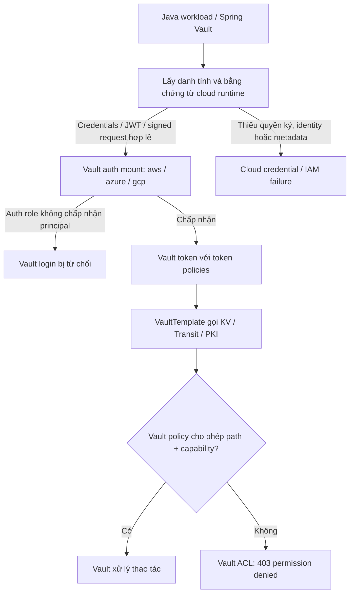
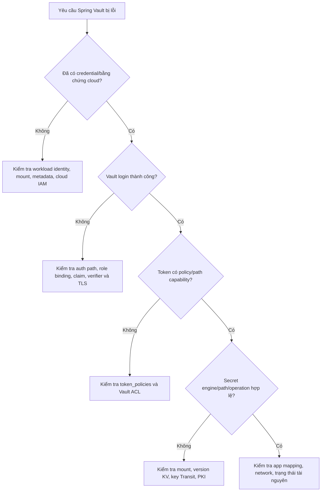

# Kiểm tra quyền của môi trường cloud và policy Vault riêng biệt

Trong **SPRING_VAULT**, ứng dụng Java có thể xác thực với HashiCorp Vault bằng danh tính của workload trên AWS, Azure hoặc Google Cloud, rồi dùng `VaultTemplate` để đọc KV secrets, gọi Transit encryption hay yêu cầu chứng chỉ từ PKI. Khi một yêu cầu thất bại với `403`, điều cần kiểm tra đầu tiên là **lớp nào đã từ chối thao tác**: môi trường cloud, Vault authentication backend hay chính sách truy cập tài nguyên Vault.

Bài này thuộc chương **Xác thực cloud**. Mục tiêu là xây dựng quy trình kiểm tra **quyền cloud IAM/identity và Vault ACL policy một cách độc lập**, đọc đúng tín hiệu lỗi, cấu hình ít đặc quyền và xác minh quyền thật bằng các thao tác có kiểm soát. Cần phân biệt thêm ba yếu tố: danh tính cloud mà workload đang sử dụng, ràng buộc danh tính trong **Vault auth role**, và **Vault policy** được gắn cho token sau login.

## 1. Ba cổng kiểm tra và hai hệ thống phân quyền

Một request Spring Vault qua xác thực cloud thường đi qua chuỗi:



**Cloud IAM** quyết định workload là ai và có thể làm gì với tài nguyên/API **của cloud**. Một số cơ chế xác thực Vault còn yêu cầu quyền cloud cụ thể để tạo bằng chứng danh tính, chẳng hạn ký JWT bằng Google IAM. **Vault auth role** ánh xạ bằng chứng cloud hợp lệ đến vai trò được cấu hình trên Vault, có thể kiểm tra principal, dự án, tài khoản, subscription hay ràng buộc môi trường. **Vault ACL policy** quyết định token Vault được thao tác gì với những đường dẫn của secret engines.

| Lớp | Nơi quản lý | Câu hỏi cần trả lời | Ví dụ được phép | Ví dụ bị từ chối |
| --- | --- | --- | --- | --- |
| **Cloud identity / IAM** | AWS IAM/STS, Azure identity/RBAC, Google Cloud IAM | Workload là principal nào? Có lấy hoặc ký bằng chứng danh tính được không? | Workload sử dụng role/managed identity được cấp đúng | Không có identity, không được `iam.serviceAccounts.signJwt`, metadata service lỗi |
| **Vault authentication role** | Vault auth method tại `auth/<mount>/` | Principal này có được login bằng role Vault đã định nghĩa không? | AWS role ARN khớp bound principal | Role Vault sai tên, principal không thuộc binding, audience không khớp |
| **Vault token policy** | Vault ACL/policy engine | Token sau login có `read`, `list`, `update`… trên **đúng API path** không? | `read` tại `secret/data/apps/orders` | Token chỉ đọc KV nhưng gọi `transit/encrypt/orders` |
| **Secret engine / resource state** | KV, Transit, PKI, backend dịch vụ | Đường dẫn có tồn tại, engine có bật, lease/khóa/chứng chỉ có hợp lệ không? | KV v2 được mount và secret tồn tại | KV mount sai, key Transit không tồn tại, chứng chỉ đã hết hạn |

Các lớp trên hỗ trợ nhau nhưng **không thay thế nhau**. IAM role có quyền đọc S3 **không mặc nhiên** cấp quyền đọc KV trên Vault. Ngược lại, Vault policy `read` cho KV **không cấp** quyền đọc S3. Xác thực cloud thành công cũng **không chứng minh** mọi thao tác Vault đều được phép.

## 2. Ranh giới trust: cloud principal, Vault role và Vault token

Giả sử service `orders-service` chạy bằng AWS IAM role `arn:aws:iam::111122223333:role/orders-vault-login`. Client sử dụng credential cloud để chứng minh danh tính với Vault; auth backend `aws` kiểm tra yêu cầu và so sánh với ràng buộc trong role Vault có tên `orders-service`. Nếu login được phép, Vault phát token chứa policy `orders-kv-reader`. Chính policy này mới cho phép đọc `secret/data/apps/orders`.

Ba chữ “role” dễ gây nhầm:

1. **AWS IAM role** định danh workload trong AWS và giới hạn thao tác cloud của workload.
2. **Vault auth role** (ví dụ `auth/aws/role/orders-service`) quy định principal cloud nào được login và những policy/token settings được phát.
3. **Vault ACL policy** (ví dụ `orders-kv-reader`) định nghĩa capabilities theo Vault API path.

Đặt cùng tên cho ba đối tượng có thể giúp theo dõi, nhưng tên giống nhau **không tạo ra quan hệ quyền**; phải kiểm tra các binding, token policies và path thực tế.

### Phân biệt quyền của workload và quyền của Vault server

Ở một số cơ chế, Vault server còn cần identity/quyền cloud **riêng để xác minh bằng chứng** hoặc tra cứu metadata. Chẳng hạn backend AWS EC2 có thể cần truy vấn API để xác minh thông tin instance; backend Azure/GCP có thể cần cloud API theo cách triển khai. Quyền này thuộc **Vault server hoặc plugin verifier**, không phải quyền đọc KV của ứng dụng Java.

Vì vậy khi cloud auth lỗi, phải xác định **principal nào đã gọi API cloud bị từ chối**: workload đang lấy/ký assertion hay Vault server đang kiểm tra danh tính. Cấp thêm IAM policy cho workload sẽ không giải quyết lỗi quyền của verifier phía Vault; cấp quyền admin cho Vault server cũng không bù được identity workload cấu hình sai.

## 3. Trường hợp AWS: IAM auth và EC2 auth

Spring Vault hoặc Spring Cloud Vault có thể dùng các cơ chế AWS khác nhau. Hai kiểu phổ biến của Vault AWS auth backend là **IAM** và **EC2**:

| Điểm kiểm tra | AWS IAM auth | AWS EC2 auth |
| --- | --- | --- |
| Bằng chứng đăng nhập | Yêu cầu AWS STS `GetCallerIdentity` được ký bằng credential AWS của workload | Instance identity document cùng bằng chứng chữ ký của EC2 |
| Danh tính cần đối chiếu | IAM principal/role và những ràng buộc trong Vault auth role | EC2 instance và những ràng buộc theo instance/AMI/VPC/subnet/role |
| Nguồn credential của ứng dụng | Credential chain phù hợp như IAM role của runtime (EC2/ECS/EKS), hoặc cách cấp tạm thời khác | Thông tin định danh instance qua môi trường EC2 |
| Kiểm tra cloud permissions | Quyền để lấy/assume credential hợp lệ nếu quy trình workload yêu cầu | Kiểm tra instance metadata và khả năng phía Vault tra cứu/kiểm chứng EC2 |
| Phân quyền KV/Transit/PKI | Vẫn do Vault token policies quyết định | Vẫn do Vault token policies quyết định |

**Chi tiết AWS dễ sai:** `sts:GetCallerIdentity` dùng để xác định principal và AWS không yêu cầu một IAM policy `Allow` tường minh cho API này; kể cả có explicit deny, API có thể vẫn trả thông tin nhận dạng. Vì vậy không kết luận “AWS IAM auth thất bại vì thiếu `Allow sts:GetCallerIdentity`” chỉ dựa trên việc không thấy quyền này trong IAM policy. Cần xem credential có hợp lệ, signature, endpoint/region, cấu hình auth role, network và quyền phía backend.

Với workload chạy trên EKS dùng IRSA hoặc cơ chế identity mới của nền tảng, hãy kiểm tra trust relationship, ràng buộc ServiceAccount, credential provider chain và kết quả principal thực tế. Một Pod bị gán sai role có thể lấy được AWS credential **hoàn toàn hợp lệ** nhưng Vault vẫn từ chối vì role ARN không nằm trong bound principals.

### Thực hành 1: kiểm tra AWS principal tại đúng runtime

Chạy bên trong container/Pod/VM đang chạy ứng dụng (trong môi trường test hoặc bằng cơ chế debug đã phê duyệt):

```bash
aws sts get-caller-identity --query '{Account:Account,Arn:Arn,UserId:UserId}'
```

Kết quả giả định:

```json
{
  "Account": "111122223333",
  "Arn": "arn:aws:sts::111122223333:assumed-role/orders-vault-login/session-abc",
  "UserId": "AROATESTEXAMPLE:session-abc"
}
```

Đây là bằng chứng workload đang dùng principal nào; **chưa chứng minh** Vault login đã thành công. ARN của session dạng `assumed-role` có thể khác IAM role ARN dạng `arn:aws:iam::...:role/...` dùng để bind trong Vault. Cần hiểu cơ chế chuẩn hóa/đối chiếu principal của AWS auth backend thay vì so sánh chuỗi ARN tùy tiện. Nếu kết quả cho thấy role ngoài dự kiến, sửa cloud workload identity/binding trước khi kiểm tra Vault policy.

### Thực hành 2: cấu hình Vault policy cho đúng KV v2 API path

Giả sử Vault đã mount **KV v2** tại `secret/` và ứng dụng chỉ cần đọc `apps/orders`. Một Vault policy HCL có thể là:

```hcl
# orders-kv-reader.hcl
path "secret/data/apps/orders" {
  capabilities = ["read"]
}
```

Người vận hành Vault với quyền quản trị policy phù hợp áp dụng policy và tạo Vault AWS IAM auth role (ví dụ trong môi trường lab, với AWS account giả định):

```bash
vault policy write orders-kv-reader orders-kv-reader.hcl
vault write auth/aws/role/orders-service auth_type=iam bound_iam_principal_arn=arn:aws:iam::111122223333:role/orders-vault-login token_policies=orders-kv-reader token_ttl=15m
```

Điều kiện trước: backend `aws` đã được bật/cấu hình tại `auth/aws/` và người thực hiện có quyền quản trị backend/policy. Lệnh trên dùng role ARN minh họa, không dùng để cấp quyền trực tiếp trong AWS. Các ràng buộc IAM ARN, tùy chọn xác minh unique ID và quyền tra cứu metadata phải được đánh giá theo cấu hình/version Vault cụ thể.

**Tại sao path là `secret/data/apps/orders`?** KV v2 sử dụng endpoint API `data` cho đọc/ghi nội dung; còn code Java có thể gọi tên mount `secret` và logical path `apps/orders`. Cấp quyền tại `secret/apps/orders` theo thói quen KV v1 thường không cho phép KV v2 hoạt động. Nếu cần liệt kê secret, phải cấp capability `list` trên endpoint `secret/metadata/...` tương ứng; không thêm `list`/`create`/`update` khi ứng dụng chỉ cần đọc đúng một secret.

### Thực hành 3: client Java đọc secret bằng Spring Vault

Ví dụ dưới đây giả định Spring Vault client đã xác thực bằng cloud auth và dependency `VaultOperations` đã được cấu hình sẵn:

```java
import org.springframework.stereotype.Service;
import org.springframework.vault.core.VaultKeyValueOperationsSupport.KeyValueBackend;
import org.springframework.vault.core.VaultOperations;
import org.springframework.vault.support.VaultResponse;

@Service
public class OrdersConfigReader {
    private final VaultOperations vault;

    public OrdersConfigReader(VaultOperations vault) {
        this.vault = vault;
    }

    public String readServiceEndpoint() {
        VaultResponse response = vault
            .opsForKeyValue("secret", KeyValueBackend.KV_2)
            .get("apps/orders");

        if (response == null || response.getData() == null) {
            throw new IllegalStateException("Required Vault secret not found");
        }

        Object endpoint = response.getData().get("serviceEndpoint");
        if (!(endpoint instanceof String value) || value.isBlank()) {
            throw new IllegalStateException("Required field is missing");
        }
        return value;
    }
}
```

Service phụ thuộc `VaultOperations`, không nhúng cloud access key hay Vault token vào mã Java. Vai trò của Spring Vault ở đây là gửi thao tác đến đúng KV v2 endpoint và cung cấp token theo session manager; Vault mới là nơi quyết định capability `read`. Không log giá trị secret để chứng minh policy đúng.

Khi dùng **Spring Cloud Vault** với cơ chế AWS IAM được hỗ trợ bởi phiên bản đang sử dụng, cấu hình có thể có dạng:

```yaml
spring:
  cloud:
    vault:
      uri: https://vault.example.internal:8200
      authentication: AWS_IAM
      aws-iam:
        role: orders-service
```

Ví dụ giả định ứng dụng đã có starter và truststore/TLS hợp lệ. Spring Cloud Vault sẽ tìm AWS credentials bằng cơ chế client được tích hợp; **không** cấp quyền cloud thông qua YAML này và **không** tự tạo Vault auth role. Cấu hình mount, region, endpoint STS và các thuộc tính khác phụ thuộc phiên bản thư viện, môi trường triển khai và backend Vault; cần xác minh tài liệu đúng version.

## 4. Trường hợp Azure: Managed Identity, Azure RBAC và Vault policy

Azure Managed Identity cung cấp danh tính cho workload mà không cần nhúng client secret tĩnh. Trong mô hình Vault Azure auth, workload lấy token/bằng chứng danh tính từ Azure identity endpoint theo yêu cầu của phương thức xác thực; Vault đối chiếu với các ràng buộc trong Azure auth role, ví dụ subscription, resource group hoặc identity cụ thể.

Cần phân biệt các phép kiểm tra:

1. **Managed Identity đã được gán cho workload chưa?** Với user-assigned identity, client có chọn đúng identity/ID không? Identity endpoint có trả token hợp lệ không?
2. **Azure RBAC của identity** có cần cho một thao tác Azure riêng hay không? Quyền đọc Azure Key Vault, Storage, VM… chỉ áp dụng cho những tài nguyên Azure tương ứng.
3. **Vault Azure auth role** có cho danh tính/subscription/resource group này login hay không? Vault server có đủ quyền/điều kiện để xác minh identity theo backend đang triển khai hay không?
4. **Vault token policy** có capability trên `secret/data/...`, `transit/...` hoặc `pki/...` hay không?

Ví dụ: một managed identity có `Reader` trên Azure resource group vẫn có thể bị Vault từ chối login vì không khớp ràng buộc role; một identity login thành công vẫn có thể nhận Vault `403` khi đọc KV nếu token không có `read`. Đừng cố sửa Vault `403` bằng cách cấp `Owner`/`Contributor` trên Azure subscription, vì hai hệ thống phân quyền độc lập.

Khi kiểm tra, cần phân biệt token Azure dùng để **xác thực với Vault** và token **Vault** cấp sau login. Chúng có issuer, audience, TTL và hệ thống quyền khác nhau. Không coi Microsoft Entra ID access token như một Vault token để gọi thẳng Vault KV endpoint.

## 5. Trường hợp Google Cloud: GCP IAM và GCE auth

Hai cách xác thực GCP phổ biến là **GCP IAM auth** và **GCE auth**:

| Cơ chế | Bằng chứng cloud | Kiểm tra cloud IAM/identity | Kiểm tra phía Vault |
| --- | --- | --- | --- |
| **GCP IAM auth** | JWT được ký thay mặt service account, theo cơ chế auth backend hỗ trợ | Principal tạo chữ ký phải có quyền `iam.serviceAccounts.signJwt` trên service account đích nếu dùng IAM Credentials API; có credential/workload identity hợp lệ | Vault role IAM có chấp nhận service account/claim của JWT và cấp policy đúng không? |
| **GCE auth** | Instance identity token/metadata từ Compute Engine | VM/service account được gán đúng, metadata identity có sẵn, môi trường đáp ứng điều kiện lấy token | Vault role GCE có khớp project, service account, zone/instance group và những ràng buộc đã khai báo không? |

Với GCP IAM auth, đừng cấp vai trò `Owner` chỉ để có thể ký JWT. Nếu cần cơ chế IAM Credentials API, cấp đúng quyền `iam.serviceAccounts.signJwt` trên **service account phù hợp**, thường qua role có sẵn chứa quyền đó hoặc custom role tối thiểu. Phạm vi người được quyền ký danh tính rất nhạy cảm: ký thay service account khác có thể mở rộng khả năng giả mạo workload.

Với GCE auth, việc VM truy cập được metadata endpoint cũng chưa đồng nghĩa Vault role cho phép VM đó login. Ngoài ra, Vault token được cấp sau login không khiến service account tự có thêm quyền GCS, BigQuery hay Cloud KMS. Ngược lại, GCP IAM permission với những dịch vụ này không mở Vault KV policy.

Nếu dùng Workload Identity Federation, phải phân biệt nguồn federated credential, service account identity được ánh xạ và token/JWT cuối cùng được Vault backend chấp nhận. Kiểm tra **identity thực tế tại runtime**, không suy từ tên dự án hay Kubernetes namespace.

## 6. Kiểm tra từng lớp theo thứ tự có thể tái hiện

Mỗi bước nên có chủ sở hữu rõ ràng: **cloud/deployment operator** kiểm tra identity workload; **Vault auth administrator** kiểm tra auth mount và role binding; **Vault policy administrator** kiểm tra ACL; **application developer** kiểm tra path và operation thực tế của Spring Vault.



### Bước 1 — Xác minh danh tính cloud của **đúng process**

Đừng kiểm tra từ máy laptop rồi suy ra Pod hoặc VM dùng cùng identity. Với AWS có thể dùng `aws sts get-caller-identity` bên trong runtime test. Với Azure/GCP, dùng API identity/metadata hoặc SDK phù hợp để **xác minh subject, client ID/service account, project/subscription**; không in access token/JWT lên console. Nếu runtime không lấy được identity, sửa cloud cấp phát hoặc cloud IAM trước.

### Bước 2 — Xác minh login vào **đúng Vault auth mount**

Tên role Vault, mount auth và identity binding phải khớp; ví dụ `auth/aws/` khác `auth/aws-prod/`. Kiểm tra endpoint Vault, TLS trust chain, namespace (nếu dùng Vault Enterprise), IAM principal/claim/audience và role constraints. Kết quả login cần được xem ở mức **thành công/thất bại, loại policy, TTL**, không ghi raw Vault token. Nếu backend bị lỗi khi truy vấn API cloud, phải điều tra identity/quyền của verifier tương ứng.

### Bước 3 — Xem token và capability sau login

Từ một **Vault token thử nghiệm đã được cấp hợp lệ**, có thể kiểm tra policy gắn với token và capability trên API path cụ thể:

```bash
vault token lookup
vault token capabilities secret/data/apps/orders
vault token capabilities transit/encrypt/orders
vault token capabilities pki/issue/orders
```

Chạy trong môi trường lab, với token test có phạm vi tối thiểu; lệnh lookup có thể hiển thị **metadata token**, vì vậy tránh chụp/đưa nguyên output vào log công khai. Các lệnh `capabilities` kiểm tra chính token đang dùng bởi CLI; nếu app sử dụng token khác, kết luận không áp dụng cho app. Kiểm tra các policy tên được gắn vào token; thay role binding không mặc nhiên thu hồi các token đã được cấp trước đó. Vault policy document được cập nhật có thể tác động đến các token đang tham chiếu policy đó.

### Bước 4 — Đối chiếu operation với **path thật** của secret engine

| Spring Vault / mục đích | Ví dụ Vault API path | Capability thường cần |
| --- | --- | --- |
| KV v2 đọc `apps/orders` từ mount `secret` | `secret/data/apps/orders` | `read` |
| KV v2 liệt kê keys trong `apps/` | `secret/metadata/apps` | `list` |
| Transit mã hóa bằng key `orders` | `transit/encrypt/orders` | `update` |
| Transit giải mã bằng key `orders` | `transit/decrypt/orders` | `update` |
| PKI cấp chứng chỉ với role `orders` | `pki/issue/orders` | `update` |

Đây là các **path mẫu** cho mount/role giả định. Policy thực tế phụ thuộc engine, API endpoint và method được gọi. Với Transit, người chỉ cần encrypt thường **không cần** quyền decrypt. Với PKI, quyền `issue` cấp chứng chỉ là quyền mạnh; giới hạn role PKI, domain, TTL và điều kiện phát hành phía Vault. Không dùng `path "*" { capabilities = ["sudo", ...] }` để “sửa nhanh” lỗi từ ứng dụng.

## 7. Bốn kịch bản 403 không giống nhau

| Triệu chứng | Trạng thái các lớp | Kết luận | Hành động |
| --- | --- | --- | --- |
| Workload không có identity cloud, không ký được assertion | **Cloud credential/IAM FAIL**; Vault chưa xử lý login | Lỗi trước authentication | Sửa gán identity, quyền ký hoặc credential provider |
| Cloud identity có thật nhưng login Vault bị từ chối | Cloud có thể PASS, **Vault auth role FAIL** | Principal/claim không khớp, auth mount/role cấu hình sai hoặc verifier lỗi | Kiểm tra binding, role, audience, auth path, quyền verifier |
| Login Vault thành công, đọc KV v2 nhận `403` | Cloud PASS, Vault auth PASS, **Vault ACL FAIL** | Token thiếu `read` trên `secret/data/...` | Kiểm tra token policies, capabilities và KV v2 API path |
| Token có `read`, gọi `transit/decrypt/orders` bị từ chối | Cloud PASS, Vault auth PASS, quyền KV PASS, **quyền Transit FAIL** | Quyền theo engine và operation độc lập | Nếu thực sự cần decrypt, cấp `update` trên path decrypt cụ thể theo least privilege |

Lỗi `403` có thể xuất hiện từ Azure/GCP API, Vault auth endpoint hoặc Vault secret engine. **Mã HTTP giống nhau không chứng minh cùng nguyên nhân**; trước hết xác định request URL/phase và principal được sử dụng. `404` do sai mount/path và lỗi TTL cũng phải được xem xét, không mặc định mọi thứ là policy.

## 8. Least privilege ở cả cloud lẫn Vault

Khi thiết kế quyền, giữ hai chính sách độc lập:

- **Phía cloud:** workload chỉ cần quyền lấy/tạo bằng chứng danh tính theo auth method và quyền gọi những dịch vụ cloud mà nó thực sự sử dụng. Quyền thao tác cloud tài nguyên khác được đánh giá riêng. Với IAM signJwt, thu hẹp quyền ký đúng service account; với AWS IAM auth, xác minh credential chain và principal, không mặc định thêm `Allow sts:GetCallerIdentity` là lời giải.
- **Phía Vault:** auth role bind đúng tập principal/identity dự kiến; token nhận những policy cụ thể, TTL phù hợp. Cấp `read` KV tại đúng path, chỉ cấp `update` Transit encrypt/decrypt hoặc PKI issue theo yêu cầu. Tách policy theo chức năng, tránh wildcard toàn mount hoặc `sudo`.
- **Phía vận hành:** quản lý identity và policy bằng IaC được review; audit thay đổi cloud role và Vault policy bằng hai đường kiểm tra riêng. Tài khoản kiểm tra production nên có quyền quan sát phù hợp, không cần root.
- **Phía ứng dụng:** dùng Spring Vault `ClientAuthentication`/`SessionManager` được cấu hình, quản lý token/lease đúng vòng đời, giới hạn retry, timeout và không log credential hay secret.

Một thiết kế tốt cho `orders-service` có thể cho phép **đọc KV** và **Transit encrypt**, nhưng **không** cho phép Transit decrypt, xóa KV, cấp PKI tùy ý hoặc truy cập cloud bucket không liên quan. Đó là hai (hoặc nhiều) lớp quyền nhỏ kết hợp, không phải một role admin đa năng.

### Policy mẫu khi ứng dụng chỉ cần KV read và Transit encrypt

```hcl
# orders-app.hcl
path "secret/data/apps/orders" {
  capabilities = ["read"]
}

path "transit/encrypt/orders" {
  capabilities = ["update"]
}
```

Nếu dùng policy này thay `orders-kv-reader` trong lab, operator cần cập nhật cấu hình role Vault để token mới nhận `orders-app`. Không cần cấp `transit/decrypt/orders` nếu service chỉ mã hóa; việc thay policy gắn token cần xét thời điểm phát lại token và thu hồi token cũ nếu phạm vi thay đổi mang tính an ninh.

## 9. Quan sát lỗi, token/lease và kiểm thử tích hợp

### Logging an toàn

Nên log các thuộc tính phân loại như:

```text
component=spring-vault
phase=vault_operation
auth_method=aws_iam
vault_mount=secret
operation=kv_v2_read
outcome=permission_denied
request_id=<correlation-id>
```

Đây là cấu trúc minh họa, không phải log format mặc định của thư viện. Không in Vault token, AWS signing headers, Azure/GCP access token, ServiceAccount JWT, secret ID, private key, KV response, ciphertext nhạy cảm hay toàn bộ exception chứa payload. Chỉ log path ở mức đã kiểm soát nếu path có thể chứa tenant/user ID. Có thể thu thập Vault audit logs theo chính sách bảo vệ log, nhưng không đưa audit payload trực tiếp vào dashboard công khai.

### Vòng đời token và lease

Cloud credential có thể được rotate, Vault token có TTL riêng, còn database credential/PKI certificate được Vault phát có lease hoặc thời hạn độc lập. Khi token hết hạn, `SessionManager` có thể renew hoặc re-login theo cơ chế được cấu hình; nếu identity cloud hết hiệu lực thì re-login cũng có thể thất bại. Sự thay đổi cloud IAM/Vault auth role thường ảnh hưởng các login mới; không giả định nó tự thu hồi token đã phát. Đảm bảo có quy trình revoke/rotation khi policy hoặc identity bị thu hẹp vì sự cố bảo mật.

`SecretLeaseContainer` hoặc cơ chế quản lý lease phù hợp có thể theo dõi secret động, nhưng nó không thay Vault ACL policy. Khi credential backend hết TTL, client có thể gặp lỗi dù cả cloud identity và Vault token đang hợp lệ. Cần phân biệt TTL token, TTL lease, thời hạn chứng chỉ PKI và rotation cloud credential trong metrics.

### Ma trận kiểm thử theo ranh giới quyền

| Test | Thiết lập tối thiểu | Kỳ vọng |
| --- | --- | --- |
| Cloud principal sai | Đổi role/service account trong test runtime | Danh tính thực tế được phát hiện; Vault login fail do binding |
| Thiếu quyền ký GCP IAM | Bỏ `iam.serviceAccounts.signJwt` trong môi trường cô lập | Không tạo được proof; Vault ACL không bị đổ lỗi |
| Vault auth role không bind principal | Giữ cloud credential hợp lệ, đổi binding trong Vault lab | Login bị từ chối ngay từ auth endpoint |
| Vault role bind đúng nhưng token policy thiếu | Login thành công với token giới hạn | KV read trả `403` và `capabilities` không có `read` |
| Nhầm KV v1 với KV v2 | Chỉ cấp `secret/apps/orders` rồi gọi KV v2 | Thao tác không được phép; sửa đúng `secret/data/apps/orders` |
| Transit chỉ encrypt | Cấp `update` cho `transit/encrypt/orders`, không cho decrypt | Encrypt PASS, decrypt bị từ chối |
| Token hết TTL, cloud identity còn hợp lệ | Token ngắn hạn và thử lại theo session management | Re-login/renew theo cấu hình hoặc trạng thái thất bại có kiểm soát |
| Vault server thiếu quyền xác minh metadata | Gỡ quyền backend verifier trong lab thích hợp | Auth fail tại verifier, không nhầm thành policy của KV |
| Rolling shutdown | Dừng context khi đang renew/retry | Dừng scheduler/resources theo ownership, không tiếp tục ghi secret |

Tách quyền setup lab của Vault operator khỏi token thử nghiệm được cấp cho ứng dụng. Có thể sử dụng Vault dev/Testcontainers trong test, song chỉ dùng root token để dựng fixture và **không** chạy service nghiệp vụ bằng root token. Với AWS/Azure/GCP, dùng account/project/subscription test, không in nội dung assertion vào báo cáo.

## 10. Quy trình xử lý sự cố 403 trong Spring Vault

Khi một request từ Java thất bại, hãy đi theo thứ tự sau:

1. **Xác định pha lỗi.** Exception xuất phát khi client lấy cloud identity, gọi `auth/.../login` hay gọi `secret/...`/`transit/...`/`pki/...`? Giữ correlation ID để liên kết với log Vault.
2. **Kiểm tra identity runtime.** Principal AWS/Azure/GCP thực tế có đúng workload mong đợi không? Credential ban đầu có hợp lệ và đủ quyền **tạo proof** theo auth method không?
3. **Kiểm tra Vault auth role.** Mount path, role, audience/claim, principal/instance/project/subscription bindings và quyền verifier phù hợp chưa?
4. **Kiểm tra token được cấp.** Token có policy dự kiến không, TTL còn hiệu lực không và client Java có thực sự dùng token vừa xác minh hay không?
5. **Kiểm tra path và capabilities.** So sánh operation Spring Vault với API path thật; KV v2 cần `data` hoặc `metadata` tương ứng. Với Transit/PKI, đối chiếu method và role/key cụ thể.
6. **Sửa tại lớp gây lỗi và kiểm tra lại.** IAM role thay đổi phải xác minh principal mới; Vault role/policy thay đổi phải thử login/token và thao tác tối thiểu. Không thử cấp admin rộng rồi giữ nguyên.

Ví dụ kết quả điều tra hợp lệ:

> `orders-service` trên AWS hiện dùng đúng role `orders-vault-login`, STS trả principal mong đợi và Vault login thành công. Token có policy `orders-kv-reader` nhưng thao tác thực tế là `POST /v1/transit/encrypt/orders`. Vault từ chối vì policy không có capability `update` tại `transit/encrypt/orders`. Nếu thiết kế yêu cầu encrypt, cấp quyền **tại Vault policy** cho path này, sau đó kiểm tra lại bằng token ứng dụng.

## 11. Tự đánh giá

**Tình huống A.** Service account GCP có quyền đọc Cloud Storage và có thể lấy identity, nhưng gọi Vault `transit/encrypt/orders` bị `403` sau login. Có phải cấp thêm `storage.objects.get`? **Không.** Nếu login thành công, cần kiểm tra Vault token policy, path `transit/encrypt/orders` và capability `update`.

**Tình huống B.** AWS role ARN chạy thực tế khác role ARN bị giới hạn trong Vault IAM auth role. Có nên thêm `read` cho `secret/data/apps/orders`? **Chưa.** Vấn đề là Vault login bị chặn bởi identity binding; phải xác minh IAM principal và cấu hình Vault auth role trước.

**Tình huống C.** Azure managed identity có `Contributor` trên subscription nhưng ứng dụng không đọc được KV v2 từ Vault. Azure `Contributor` có giúp không? **Không trực tiếp.** Cần chứng minh Managed Identity login Vault được rồi kiểm tra Vault policies và mount/path của KV.

**Tình huống D.** Vault token có `read` với `secret/data/apps/orders` nhưng Java gọi `opsForKeyValue("secret", KV_2).get("apps/orders")` trả `null`. Có chắc là thiếu Vault ACL? **Không.** Cần kiểm tra mount KV v2, path logic, dữ liệu tồn tại và tình trạng version; `null` có thể biểu thị secret không có tại path đó.

Khi luôn kiểm tra riêng **cloud identity/quyền tạo bằng chứng**, **Vault auth role** và **Vault token ACL**, nhóm phát triển Spring Vault có thể chẩn đoán chính xác lỗi, giới hạn đặc quyền và chứng minh được quyền truy cập thực tế tới KV, Transit, PKI mà không mở rộng IAM hoặc Vault policy không cần thiết.

