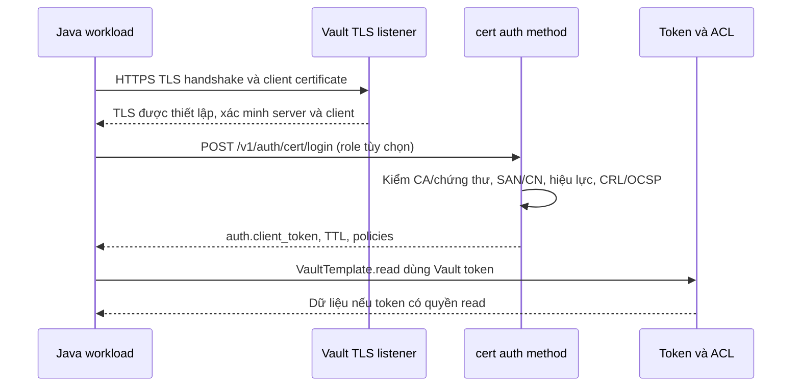

# ClientCertificateAuthentication và cert auth method trong Spring Vault

## 1. Mục tiêu và tình huống sử dụng

Trong chương **Chứng thư và tài khoản** của **Spring Vault**, một ứng dụng Java có thể xác thực với HashiCorp Vault bằng **chứng thư X.509 của workload** thay vì phân phối sẵn Vault token hoặc cặp AppRole RoleID/SecretID. HashiCorp Vault cung cấp **TLS Certificate Authentication**, thường gọi là **`cert` auth method**. Phía Java, Spring Vault cung cấp **`ClientCertificateAuthentication`** để đăng nhập bằng chứng thư được cấu hình trong TLS client.

Ví dụ, dịch vụ `order-service` có một chứng thư máy khách do CA nội bộ cấp. Khi triển khai, nền tảng cung cấp keystore chứa chứng thư và khóa riêng, cùng truststore để xác minh máy chủ Vault. Dịch vụ dùng TLS kết nối đến Vault, gọi `auth/cert/login` để lấy token và dùng `VaultTemplate` đọc `KV v2`; token sau đó có thể được dùng với Transit hoặc PKI nếu policy cho phép.

Sau bài học, bạn có thể:

- Phân biệt **TLS/mTLS**, **cert authentication**, **Vault token** và **ACL policy**.
- Cấu hình `cert` auth method với CA/chứng thư tin cậy, ràng buộc danh tính và quyền tối thiểu.
- Chuẩn bị client keystore, server truststore và cấu hình Spring Vault dùng `ClientCertificateAuthentication`.
- Hiểu luồng đăng nhập và kiểm tra bằng Vault CLI, HTTP API, Java.
- Xử lý chứng thư hết hạn, thu hồi, thay chứng thư, giới hạn token và lỗi TLS.
- Thiết kế kiểm thử tích hợp có trường hợp thành công/thất bại, bảo vệ khóa riêng và dữ liệu nhạy cảm.

## 2. Chứng thư TLS khác gì với token Vault?

Có **hai lớp xác minh** riêng:

| Lớp | Bằng chứng | Bên xác minh | Kết quả |
|---|---|---|---|
| Xác minh máy chủ TLS | Chứng thư máy chủ Vault và chuỗi CA | Java HTTP client thông qua **truststore** | Khẳng định kết nối đang tới máy chủ tin cậy |
| Xác minh chứng thư máy khách TLS | Chứng thư máy khách + bằng chứng sở hữu **private key** | TLS listener của Vault hoặc tầng proxy tin cậy | Chứng minh client sở hữu khóa của chứng thư trình diện |
| `cert` auth method | Chứng thư đã trình diện qua kết nối TLS, phù hợp role/CA và ràng buộc | Vault auth backend tại `auth/cert/login` | Phát hành một **Vault token** có TTL và policies |
| Phân quyền Vault | Vault token gắn với request | Hệ thống token/ACL của Vault | Cho phép hoặc từ chối đọc KV, encrypt Transit, issue PKI… |

**Điểm mấu chốt:** kết nối HTTPS có xác minh chứng thư máy khách **không tự tạo Vault token**. Để dùng cert auth, workload phải thực hiện đăng nhập `POST /v1/auth/cert/login`. Vault trả token trong trường `auth.client_token`; những request dữ liệu tiếp theo dùng token đó. Spring Vault kết nối phần đăng nhập, quản lý phiên và `VaultTemplate` để ứng dụng không phải tự nối header token.

**Keystore ≠ truststore:**

- **Client keystore:** chứa **khóa riêng** và chứng thư (có thể kèm intermediate chain) mà Java trình diện trong TLS handshake. Đây là tài sản bí mật cần bảo vệ.
- **Client truststore:** chứa CA tin cậy để Java kiểm tra chứng thư **máy chủ Vault**; thường khác CA cấp chứng thư máy khách.
- **`auth/cert/certs/<name>` trên Vault:** cấu hình chứng thư công khai hoặc CA mà **Vault chấp nhận để xác thực workload**. Đây là tập tin/đối tượng cấu hình của Vault, không phải Java truststore.

Chứng thư được dùng để đăng nhập phải hợp lệ theo X.509 và mục đích sử dụng phù hợp; với `cert` auth, Vault chấp nhận Extended Key Usage **`ClientAuth` hoặc `Any`**. Chứng thư chỉ có mục đích `serverAuth` không phù hợp cho client authentication.

## 3. Luồng hoạt động với Spring Vault



Đăng nhập chuẩn nằm ở `POST /v1/auth/cert/login`. Body **không cần chứa private key hay toàn bộ chứng thư** vì bằng chứng được truyền trong phiên TLS. Có thể gửi `{"name":"java-api"}` để Vault kiểm tra riêng role chứng thư `java-api`. Nếu không có `name`, Vault có thể thử các role chứng thư đã cấu hình; trong ứng dụng nên cố định role phù hợp để kết quả dễ kiểm soát.

Khi Spring Vault dùng `ClientCertificateAuthentication`, đối tượng này chịu trách nhiệm thực hiện lần đăng nhập. `SessionManager` quản lý Vault token được cấp; `VaultTemplate` dùng token đó cho request đến secret engines.

## 4. Điều kiện trước khi bật cert auth

Ví dụ xuyên suốt sử dụng môi trường **Vault thử nghiệm tách biệt**, các tên giả định:

| Thành phần | Giá trị minh họa |
|---|---|
| Vault | `https://vault.test.internal:8200` |
| Auth mount | `cert` |
| Tên role cert | `java-api` |
| DNS SAN của client certificate | `order-service.test.internal` |
| KV v2 mount | `kv-e2e` |
| Key đọc thử | `service/config` |
| Policy Vault | `order-kv-read` |

Cần chuẩn bị:

1. Vault listener đã bật HTTPS và chấp nhận chứng thư máy khách cho cert auth: cấu hình listener phải có `tls_disable = false` và `tls_disable_client_certs = false`. Tùy kiến trúc, TLS listener có thể tùy chọn yêu cầu client certificate ngay từ handshake hoặc chỉ yêu cầu tại cert login. Xác minh cấu hình tương ứng với phiên bản Vault và hạ tầng.
2. Client có một **cặp khóa riêng/chứng thư** hợp lệ. Chứng thư có EKU `clientAuth`, DNS SAN khớp `order-service.test.internal`, chuỗi CA đúng và chưa hết hạn.
3. Vault được cấu hình tin cậy CA/chứng thư client trên **role cert**. Hệ thống cấp phát phải bảo vệ khóa riêng.
4. Java có thể kiểm tra chứng thư **máy chủ Vault** qua truststore và hostname verification. Không tắt kiểm tra TLS để vượt lỗi lab.
5. Máy có quyền quản trị môi trường test để bật auth method, ghi policy và cấu hình role. Workload Java **không cần** các quyền quản trị này.

Nếu Vault đặt sau reverse proxy hay load balancer kết thúc TLS, phải có cơ chế truyền danh tính chứng thư **được Vault tin cậy và kiểm soát**, kèm cấu hình listener tương ứng. Tuyệt đối không cho client tự gửi một header giả mạo chứa chứng thư rồi dùng làm bằng chứng xác thực.

## 5. Thiết lập cert auth method và policy trên Vault

### 5.1. Tạo KV v2 và policy cho workload

Các thao tác tạo mount dưới đây chỉ chạy khi môi trường test **chưa có** những mount đó:

```bash
# Dùng token quản trị giới hạn trong Vault test.
vault auth enable -path=cert cert
vault secrets enable -path=kv-e2e -version=2 kv

vault kv put -mount=kv-e2e service/config feature=enabled
```

Định nghĩa policy `order-kv-read.hcl`:

```hcl
path "kv-e2e/data/service/config" {
  capabilities = ["read"]
}
```

```bash
vault policy write order-kv-read order-kv-read.hcl
```

Đường dẫn `data/` là đường dẫn HTTP ACL của **KV v2**, khác với đường dẫn thân thiện của lệnh CLI `vault kv get`. Policy này chỉ cho phép đọc đúng một secret. Nó **không** cho phép cấp chứng thư PKI, giải mã Transit, liệt kê mọi key hay thay role chứng thư.

### 5.2. Đăng ký CA/chứng thư tin cậy vào role `java-api`

Ví dụ sử dụng `client-ca.pem` là **CA certificate public** dùng để cấp chứng thư cho workload thử nghiệm; file này **không** chứa private key:

```bash
vault write auth/cert/certs/java-api \
  display_name=java-api \
  certificate=@client-ca.pem \
  allowed_dns_sans="order-service.test.internal" \
  token_policies="order-kv-read" \
  token_ttl="15m" \
  token_max_ttl="1h"
```

Khi role chứa một CA, chứng thư client phải được cấp bởi CA tin cậy **và** thỏa các điều kiện ràng buộc, chẳng hạn DNS SAN trên. Không nên chỉ tin cậy một CA lớn mà không giới hạn danh tính: nhiều workload khác do cùng CA cấp có thể được chấp nhận nếu role quá rộng.

Với chứng thư tự ký dành riêng một client, có thể đăng ký **chứng thư public của chính client** thay cho CA. Khi xoay sang một cặp khóa/chứng thư mới, phải cập nhật role tin cậy nếu kiểu cấu hình không chấp nhận chứng thư mới.

Các tùy chọn bổ sung hữu ích trong policy xác thực gồm `allowed_common_names`, `allowed_uri_sans`, `allowed_email_sans`, `required_extensions`, `token_bound_cidrs`, `ocsp_enabled` và cơ chế CRL. Hãy chọn ràng buộc tương ứng với nội dung chứng thư **thực tế**, đặc biệt ưu tiên SAN thay vì phụ thuộc CN lịch sử.

Có thể kiểm tra **metadata cấu hình role**, không in credential nhạy cảm:

```bash
vault read auth/cert/certs/java-api
```

Lưu ý: `auth/cert/certs/java-api` là cấu hình trust của cert auth backend, không phải một tài khoản OS/LDAP và không chứa mật khẩu đăng nhập của workload.

## 6. Chuẩn bị chứng thư và các kho TLS cho Java

Giả sử hệ thống PKI đã cấp cho workload:

- `order-client.crt`: chứng thư X.509 có EKU `clientAuth`.
- `order-client.key`: **khóa riêng** khớp với chứng thư client.
- `client-intermediates.pem`: các intermediate CA cần thiết (nếu có).
- `vault-server-ca.pem`: CA để xác minh chứng thư HTTPS của Vault server.

Chứng thư có thể được cấp bởi Vault PKI hoặc một PKI doanh nghiệp. **PKI cấp chứng thư** và **cert auth dùng chứng thư để login** là hai chức năng riêng: không có quyền `pki/issue` chỉ vì sở hữu chứng thư client.

### 6.1. Tạo PKCS#12 keystore cho client

Trong một máy làm việc bảo mật, dùng OpenSSL để chuyển key/cert thành keystore có mật khẩu:

```bash
# Chỉ minh họa; OpenSSL sẽ yêu cầu mật khẩu khi xuất file.
openssl pkcs12 -export \
  -inkey order-client.key \
  -in order-client.crt \
  -certfile client-intermediates.pem \
  -name vault-client \
  -out order-client.p12
```

**Không commit** `order-client.key`, `order-client.p12`, mật khẩu keystore hoặc các secret vào Git. Với container/Kubernetes, phân phối bằng secret volume, identity-based injection hoặc cơ chế secret management phù hợp; giới hạn quyền đọc file trong môi trường chạy.

### 6.2. Tạo truststore xác minh Vault server

```bash
# Nhập chứng thư CA của máy chủ Vault vào truststore riêng.
keytool -importcert -noprompt \
  -alias vault-server-ca \
  -file vault-server-ca.pem \
  -keystore vault-truststore.p12 \
  -storetype PKCS12
```

Chỉ cần truststore riêng nếu JVM chưa tin cậy CA cấp chứng thư máy chủ Vault. **Không nhầm** `vault-server-ca.pem` với `client-ca.pem`: loại thứ nhất giúp Java xác minh **server**, loại thứ hai giúp Vault xác minh **client**.

Đối với môi trường chỉ có chứng thư PEM, Spring Vault hỗ trợ cấu hình PEM ở tầng SSL; bài này sử dụng PKCS#12 để minh họa rõ ranh giới keystore/truststore.

## 7. Đăng nhập bằng Vault CLI và HTTP API

### 7.1. Xác minh credential trước khi tích hợp Java

```bash
vault login -method=cert \
  -ca-cert=vault-server-ca.pem \
  -client-cert=order-client.crt \
  -client-key=order-client.key \
  name=java-api
```

- `-ca-cert` là CA của **TLS server Vault**.
- `-client-cert` và `-client-key` là danh tính TLS của workload.
- `name=java-api` chọn role chứng thư đã cấu hình ở `auth/cert/certs/java-api`.
- Lệnh thành công cho thấy Vault cấp token, nhưng **không chứng minh** token có quyền ngoài các policy được cấp.

Lệnh `vault login` có thể in/lưu token trong môi trường CLI. Chỉ chạy trên máy lab được bảo vệ; không sao chép output chứa token vào tài liệu, ticket hay CI log.

### 7.2. Tương ứng với HTTP API

```http
POST /v1/auth/cert/login
Content-Type: application/json

{"name": "java-api"}
```

Ví dụ `curl` chỉ xuất **mã HTTP**, tránh làm lộ token ở đầu ra:

```bash
curl --silent --show-error \
  --output /dev/null \
  --write-out "cert login: HTTP %{http_code}\n" \
  --request POST \
  --cacert vault-server-ca.pem \
  --cert order-client.crt \
  --key order-client.key \
  --header "Content-Type: application/json" \
  --data '{"name":"java-api"}' \
  "https://vault.test.internal:8200/v1/auth/cert/login"
```

Khi login thành công, Vault trả đối tượng `auth` chứa `client_token`, TTL, cờ `renewable` và policy. Phần phản hồi bí mật được bỏ đi trong ví dụ để log chỉ chứa trạng thái. Trong kiểm thử đầy đủ, đọc token **trong bộ nhớ** rồi gọi một endpoint được phép, không in token.

Nếu listener yêu cầu client certificate ngay trong TLS handshake, thiếu chứng thư sẽ làm handshake thất bại trước khi Vault xử lý HTTP; nếu listener chấp nhận handshake nhưng role không khớp, `auth/cert/login` thường bị Vault từ chối.

## 8. Cấu hình `ClientCertificateAuthentication` trong Spring Vault

Ví dụ Java sau dùng các API **Spring Vault 4.1**. Với dự án đang khóa phiên bản Spring Vault khác, đối chiếu Javadoc phiên bản đó: các bản 3.x sử dụng constructor dựa trên `RestOperations`, còn API 4.1 ưu tiên `VaultClient`.

```java
import java.net.URI;

import org.springframework.context.annotation.Configuration;
import org.springframework.core.io.FileSystemResource;
import org.springframework.vault.authentication.ClientAuthentication;
import org.springframework.vault.authentication.ClientCertificateAuthentication;
import org.springframework.vault.authentication.ClientCertificateAuthenticationOptions;
import org.springframework.vault.client.VaultEndpoint;
import org.springframework.vault.config.AbstractVaultConfiguration;
import org.springframework.vault.support.SslConfiguration;

@Configuration
public class CertificateVaultConfiguration
        extends AbstractVaultConfiguration {

    @Override
    public VaultEndpoint vaultEndpoint() {
        return VaultEndpoint.from(
                URI.create(required("VAULT_ADDR")));
    }

    @Override
    public SslConfiguration sslConfiguration() {
        return SslConfiguration.create(
                new FileSystemResource(required("VAULT_CLIENT_KEYSTORE")),
                required("VAULT_CLIENT_KEYSTORE_PASSWORD").toCharArray(),
                new FileSystemResource(required("VAULT_SERVER_TRUSTSTORE")),
                required("VAULT_SERVER_TRUSTSTORE_PASSWORD").toCharArray()
        );
    }

    @Override
    public ClientAuthentication clientAuthentication() {
        ClientCertificateAuthenticationOptions options =
                ClientCertificateAuthenticationOptions.builder()
                        .path("cert")
                        .role("java-api")
                        .build();

        // Client TLS được cấu hình bởi sslConfiguration().
        return new ClientCertificateAuthentication(options, vaultClient());
    }

    private static String required(String name) {
        String value = System.getenv(name);
        if (value == null || value.isBlank()) {
            throw new IllegalStateException("Missing configuration: " + name);
        }
        return value;
    }
}
```

Đặt các biến môi trường ở runtime (không lưu mật khẩu vào repository):

| Tên biến | Ý nghĩa |
|---|---|
| `VAULT_ADDR` | URL HTTPS Vault, ví dụ `https://vault.test.internal:8200` |
| `VAULT_CLIENT_KEYSTORE` | Đường dẫn đến `order-client.p12` chứa key và cert |
| `VAULT_CLIENT_KEYSTORE_PASSWORD` | Mật khẩu PKCS#12 của workload |
| `VAULT_SERVER_TRUSTSTORE` | Đường dẫn `vault-truststore.p12` |
| `VAULT_SERVER_TRUSTSTORE_PASSWORD` | Mật khẩu truststore |

`SslConfiguration` chỉ có hiệu lực với HTTP client phù hợp. Theo tài liệu Spring Vault, khi dùng cấu hình SSL riêng cho Spring Vault như trên, cần có **Apache Http Components trên classpath** và xác minh request factory thực tế sử dụng cấu hình SSL đó. Đừng giả định mọi HTTP client tự nạp keystore chỉ vì file đã có trên đĩa.

Trong môi trường production, không nhất thiết phải dùng biến môi trường chứa password nếu nền tảng hỗ trợ giải pháp bảo mật hơn (file secret được mount, secret injection, keystore được quản lý bởi workload identity). Ví dụ dùng environment để làm rõ sự phụ thuộc tại runtime.

### 8.1. Sử dụng `VaultTemplate` sau khi đăng nhập

Khi `CertificateVaultConfiguration` được đăng ký trong Spring context, lớp cấu hình tạo `SessionManager` và `VaultTemplate` tương ứng. Mã nghiệp vụ chỉ cần `VaultTemplate`:

```java
import java.util.Map;

import org.springframework.stereotype.Service;
import org.springframework.vault.core.VaultTemplate;
import org.springframework.vault.support.VaultResponse;

@Service
public class VaultServiceConfigReader {

    private final VaultTemplate vaultTemplate;

    public VaultServiceConfigReader(VaultTemplate vaultTemplate) {
        this.vaultTemplate = vaultTemplate;
    }

    @SuppressWarnings("unchecked")
    public String readFeatureFlag() {
        VaultResponse response = vaultTemplate.read(
                "kv-e2e/data/service/config");

        if (response == null || response.getData() == null) {
            throw new IllegalStateException("KV secret not found");
        }

        // KV v2: payload nằm dưới data.data.
        Object raw = response.getData().get("data");
        if (!(raw instanceof Map<?, ?> values)) {
            throw new IllegalStateException("Unexpected KV v2 response");
        }

        Object flag = values.get("feature");
        if (!(flag instanceof String result)) {
            throw new IllegalStateException("Feature flag missing");
        }
        return result;
    }
}
```

Với ví dụ ở trên, giá trị kiểm thử là `enabled`. Đường dẫn `kv-e2e/data/service/config` ứng với KV v2 và policy đọc đã đăng ký. Trong ứng dụng thật, có thể dùng API `opsForVersionedKeyValue` thay vì tự bóc cấu trúc map, tùy nhu cầu phiên bản và kiểu dữ liệu.

**Không log toàn bộ `VaultResponse`**: dữ liệu trả về có thể chứa password, key hoặc token, ngay cả khi secret mẫu trong bài chỉ là cờ cấu hình.

### 8.2. Với Spring Cloud Vault

Khi ứng dụng dùng **Spring Cloud Vault**, có thể cấu hình xác thực kiểu `CERT` thông qua properties của thư viện, sử dụng keystore/truststore và `cert-auth-path`/role tương ứng. Tên property và sơ đồ YAML phải theo đúng **phiên bản Spring Cloud Vault** trong dự án; không trộn cấu hình Spring Cloud Vault với API JavaConfig thuần ở trên mà không xác định bean nào sở hữu `SessionManager`.

## 9. Chính sách phân quyền và quản lý chứng thư

Một hệ thống triển khai nên phân định:

| Chủ thể | Quyền cần thiết | Điều không nên cấp |
|---|---|---|
| Quản trị Vault test | Bật auth mount, cấu hình role cert, policy, tạo KV fixture | Không dùng token quản trị trong workload |
| PKI/CA | Cấp, gia hạn và thu hồi client certificate | Không tự động cấp quyền đọc mọi secret |
| Workload Java | Khóa riêng/chứng thư client và token có policy tối thiểu | Không cấp `sudo`, `root`, quản trị mount hay quyền cấp cert rộng |
| Bộ giám sát | Đọc trạng thái và log đã lọc dữ liệu nhạy cảm | Không cần truy cập private key, token hay payload secret |

Chứng thư TLS có vòng đời **Not Before/Not After**, có thể bị thu hồi bằng CRL hoặc OCSP tùy cấu hình Vault. Token Vault được phát hành sau đăng nhập có **TTL/renewability và vòng đời riêng**:

- Xoay chứng thư client **không mặc nhiên thu hồi** Vault token đã phát hành.
- Thu hồi chứng thư làm các lần **đăng nhập mới** không hợp lệ khi kiểm tra thu hồi được cấu hình và thực thi phù hợp; token cũ phải xử lý riêng nếu muốn ngắt truy cập ngay.
- `LifecycleAwareSessionManager` có thể gia hạn/tái xác thực token theo chính sách; khi thay keystore cần bảo đảm **TLS client/SSL context thực sự nạp chứng thư mới**. Thay file `.p12` trên đĩa không đảm bảo HTTP client đang chạy tự nạp lại.
- Nếu role gắn CA chung, hãy giới hạn tên workload qua SAN/extension, chính sách cấp chứng thư và quyền ACL. Một CA rộng không đồng nghĩa mọi workload cùng được quyền đọc secret.

Không lẫn lộn **chứng thư dùng xác thực workload** với chứng thư được **Vault PKI engine cấp cho khách hàng hoặc dịch vụ khác**. Workload chỉ có quyền gọi `pki/issue` nếu token được gán policy tương ứng; cert auth chỉ giải quyết bước đăng nhập.

## 10. Các lỗi thường gặp và cách chẩn đoán

| Hiện tượng | Vị trí lỗi/khả năng | Cách kiểm tra |
|---|---|---|
| `SSLHandshakeException`, `PKIX path building failed` | Java không tin cậy CA chứng thư **server** | Kiểm tra truststore, chain của Vault server, hostname/SAN |
| TLS handshake bị từ chối do client certificate | Key/cert không được nạp, sai private key, hết hạn, EKU không phù hợp, listener yêu cầu cert | Kiểm tra keystore alias, key-password, cert chain, listener TLS và log TLS đã lọc |
| `auth/cert/login` trả 4xx | Role không khớp, CA không tin cậy, SAN/CN sai hoặc chứng thư bị thu hồi | Đối chiếu role `auth/cert/certs/java-api`, tên SAN, CRL/OCSP, thông báo Vault |
| Login thành công nhưng KV đọc 403 | Token không có `read` cho `kv-e2e/data/service/config` | Kiểm tra token policies và đường dẫn ACL của KV v2 |
| Request KV thành công dù client cert vừa hết hạn | Session vẫn dùng token Vault đã cấp | Kiểm tra vòng đời token; ép **một login mới trong test** để xác minh chứng thư |
| Thay `.p12` nhưng vẫn dùng chứng thư cũ | HTTP client/SSLContext đang cache key material | Tái tạo client/session hoặc dùng cơ chế reload được kiểm chứng; thử login mới |
| Login thất bại sau khi rotate CA | CA mới chưa đăng ký hoặc chain chưa đúng | Cập nhật role tin cậy, intermediate chain, lập kế hoạch gối đầu trước khi bỏ CA cũ |
| 5xx, timeout, mất kết nối | Vault không sẵn sàng, gateway hoặc mạng có sự cố | Theo dõi health/latency, retry giới hạn và phân biệt lỗi hạ tầng với lỗi chứng thư |

Đừng gộp `403` ở bước **login** với `403` khi **đọc secret**: bước đầu liên quan chứng thư và role, bước sau liên quan policy của token. Nếu `cert` auth method được mount tại tên khác, cả lệnh CLI lẫn `options.path(...)` phải dùng đúng tên mount đó.

Khi giám sát, thu thập số lượt login, tỷ lệ thành công/thất bại, thời gian xử lý, số token tái xác thực, hạn còn lại của chứng thư, CRL/OCSP và thời điểm đổi CA. Không log private key, Vault token, keystore password, nội dung secret, raw HTTP authentication body hay response `auth.client_token`.

## 11. Thực hành kiểm thử tích hợp có kiểm soát

Chạy kiểm thử trên Vault test, với chứng thư test độc lập và key KV v2 không chứa bí mật thật. Có thể dùng Vault trong container/test namespace; khi cần TLS thật, listener phải được cấu hình đầy đủ với chứng thư máy chủ và cơ chế cert auth. Tránh mặc định dùng Vault dev listener HTTP vì **bài test cert auth cần TLS thực sự**.

### 11.1. Kịch bản thành công

1. Cấp một client certificate với DNS SAN `order-service.test.internal` và EKU `ClientAuth` từ CA test đã đăng ký ở `java-api`.
2. Dựng `order-client.p12` và truststore của máy chủ Vault; xác minh kết nối TLS.
3. Dùng `vault login -method=cert name=java-api` để kiểm chứng cấu hình Vault độc lập với Java.
4. Khởi động Spring context với `CertificateVaultConfiguration`. Gọi `VaultServiceConfigReader.readFeatureFlag()`; kỳ vọng `enabled`.
5. Xác minh sự kiện login ở audit log test và chính sách của token (qua cơ chế kiểm tra an toàn), nhưng **không in token**.
6. Khi token được gia hạn hoặc tái xác thực, quan sát cơ chế session theo phiên bản Spring Vault thực tế.

### 11.2. Kịch bản âm tính

| Ca | Đầu vào thay đổi | Kết quả mong đợi |
|---|---|---|
| E1 | Bỏ client private key hoặc dùng keystore sai password | Không thể thiết lập TLS client identity/khởi tạo client hợp lệ |
| E2 | Trỏ Java truststore sang CA không cấp server cert | TLS server validation thất bại |
| E3 | Chứng thư do CA không có trong cert role cấp | Login Vault bị từ chối |
| E4 | Chứng thư hợp lệ theo CA nhưng DNS SAN sai ràng buộc `allowed_dns_sans` | Login Vault bị từ chối |
| E5 | Client cert hết hạn hoặc bị thu hồi với cơ chế kiểm tra thu hồi đã bật | Handshake hoặc login mới thất bại tùy cấu hình |
| E6 | Token được cấp thành công nhưng policy không có quyền `data/service/config` | Đọc KV trả lỗi quyền |
| E7 | Xoay chứng thư nhưng không tạo client/session mới | Có thể vẫn sử dụng chứng thư/token cũ; bài test không được báo rotation PASS |
| E8 | Vault trả 5xx hoặc timeout | Ứng dụng phân loại lỗi hạ tầng và xử lý retry có giới hạn |

Phải **thực hiện login mới** khi kiểm thử chứng thư bị hết hạn/thu hồi. Nếu dùng lại `VaultTemplate` chứa token cũ còn hạn, kết quả đọc KV thành công không chứng minh chứng thư cũ vẫn được chấp nhận.

Để thực hành rotation, cấp chứng thư B đúng SAN, cập nhật keystore và làm mới HTTP client/SSL context theo cơ chế triển khai; bảo đảm lần login mới dùng B. Chỉ thu hồi chứng thư A sau khi xác nhận B hoạt động và có phương án xử lý token cũ theo yêu cầu bảo mật.

## 12. Tự kiểm tra kiến thức

**Câu hỏi 1:** Java đã xác minh chứng thư máy chủ Vault bằng truststore. Chỉ như vậy ứng dụng đã có quyền đọc secret chưa?

**Trả lời:** Chưa. Đó chỉ là xác minh **server** trong TLS. Workload còn phải trình diện chứng thư client, login qua `cert` auth method để nhận Vault token và có policy cho đường dẫn dữ liệu.

**Câu hỏi 2:** Tại sao chứng thư client được CA doanh nghiệp cấp vẫn có thể bị Vault từ chối đăng nhập?

**Trả lời:** Vault có thể không tin CA đó trong role `cert`, hoặc chứng thư không thỏa DNS SAN/CN/extension, EKU, thời hạn và các quy tắc thu hồi. CA chung không thay thế ràng buộc danh tính workload.

**Câu hỏi 3:** Vì sao thay keystore trên đĩa nhưng ứng dụng vẫn đọc KV thành công không đủ để kết luận rotation đã thành công?

**Trả lời:** HTTP client có thể giữ SSL context cũ, còn SessionManager có thể giữ token cũ. Cần tạo hoặc làm mới client/session theo cơ chế xác định rồi **quan sát một lần login mới** bằng chứng thư mới.

**Câu hỏi 4:** Nếu `auth/cert/login` thành công nhưng `VaultTemplate.read` trả 403, nên kiểm tra lớp nào?

**Trả lời:** Chính sách ACL của token và đường dẫn KV v2 (`kv-e2e/data/service/config`). Thành công ở tầng xác thực không cấp mặc định quyền truy cập tất cả secret engines.

## 13. Tài liệu kỹ thuật đối chiếu

- [Spring Vault – Authentication Methods: TLS certificate authentication](https://docs.spring.io/spring-vault/reference/vault/authentication.html)
- [Spring Vault – `ClientCertificateAuthentication` API](https://docs.spring.io/spring-vault/reference/api/java/org/springframework/vault/authentication/ClientCertificateAuthentication.html)
- [Spring Vault – HTTP Client Support và SSL configuration](https://docs.spring.io/spring-vault/reference/vault/client-support.html)
- [HashiCorp Vault – TLS Certificates auth method](https://developer.hashicorp.com/vault/docs/auth/cert)
- [HashiCorp Vault – TLS Certificate auth method HTTP API](https://developer.hashicorp.com/vault/api-docs/auth/cert)

**Kết luận thực hành:** `ClientCertificateAuthentication` dùng chứng thư TLS của workload để **đăng nhập vào Vault và nhận token**, sau đó `VaultTemplate` thực hiện các thao tác dữ liệu bằng token được phân quyền. Chất lượng bảo mật phụ thuộc đồng thời vào bảo vệ private key, CA và SAN constraints, cấu hình TLS, vòng đời token, ACL và kiểm thử đăng nhập mới khi xoay chứng thư.
