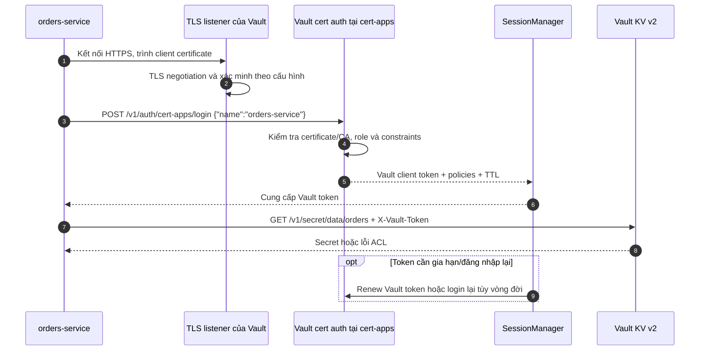

# Tên role chứng thư và auth mount tùy chỉnh trong Spring Vault

## 1. Bối cảnh: vì sao phải chỉ rõ role và mount?

Trong module **SPRING_VAULT**, ứng dụng Java dùng `VaultTemplate` để truy cập HashiCorp Vault: đọc KV secrets, gọi Transit encryption, xin chứng thư qua PKI và thực hiện các API khác dựa trên Vault policy. Ở chương **Chứng thư và tài khoản**, một phương thức xác thực quan trọng là **TLS client certificate authentication** (thường gọi là `cert` auth).

Giả sử ứng dụng `orders-service` có chứng thư X.509 riêng, muốn đăng nhập Vault và nhận token với quyền chỉ đọc `secret/data/orders`. Tổ chức có nhiều môi trường và chọn mount xác thực `cert-apps` thay vì mount mặc định `cert`. Khi đó có ba cái tên phải thống nhất:

- **Loại auth method**: `cert`, chỉ định plugin xác thực bằng client certificate.
- **Auth mount path**: `cert-apps`, đường dẫn thực tế của một instance auth method trong Vault.
- **Tên certificate role**: `orders-service`, bản ghi trusted certificate/CA và chính sách token thuộc **đúng mount đó**.

Yêu cầu đăng nhập nằm tại `POST /v1/auth/cert-apps/login`, kèm certificate trong phiên TLS và có thể gửi tên role `orders-service` trong JSON body. Kết quả đăng nhập là **Vault token**, dùng cho những lần gọi `VaultTemplate` sau đó.

Bài này giúp bạn:

1. Phân biệt **certificate auth role**, **auth mount**, **Vault policy**, **PKI issuance role** và **chứng thư X.509**.
2. Đăng ký role dưới custom auth mount và gọi đúng endpoint đăng nhập.
3. Cấu hình `ClientCertificateAuthentication` của Spring Vault với `.path(...)` và `.role(...)`, đồng thời cấu hình key store/trust store.
4. Phân biệt lỗi TLS, role mismatch, mount sai, token thiếu policy và chứng thư hết hạn/bị thu hồi.
5. Kiểm thử cấu hình với quyền tối thiểu, không làm lộ private key, certificate bundle hoặc Vault token.

**Lưu ý phạm vi:** bài tập trung vào **certificate auth method** và việc đặt tên role/mount. PKI secrets engine được giải thích để tránh nhầm với quá trình phát hành chứng thư; nó không tự thay thế bước xác thực của workload.

## 2. Các thuật ngữ dễ nhầm

| Khái niệm | Ví dụ | Thuộc đâu? | Chức năng |
| --- | --- | --- | --- |
| Auth method type | `cert` | Hệ thống Vault | Loại plugin kiểm tra TLS client certificate |
| Auth mount path | `cert-apps` | Mount xác thực cụ thể | Tiền tố endpoint `auth/cert-apps/...` |
| Certificate auth role | `orders-service` | `auth/cert-apps/certs/orders-service` | Chứng thư/CA tin cậy, điều kiện match và policy cho token được cấp |
| Vault ACL policy | `orders-kv-read` | Policy store Vault | Cho phép hành động trên path như `secret/data/orders` |
| Certificate/CA | Client certificate, private key, issuer CA | TLS/X.509 | Chứng minh quyền sở hữu khóa riêng và chuỗi tin cậy |
| PKI secrets engine mount | `pki-workloads` | Secrets engine | Phát hành/ký/thu hồi chứng thư qua `pki-workloads/...` |
| PKI issuance role | `orders-client` | `pki-workloads/roles/orders-client` | Quy định CN/SAN, TTL, key usages của chứng thư được phát hành |

Hai role **hoàn toàn khác chức năng**:

- `auth/cert-apps/certs/orders-service`: quyết định một **client certificate đã được trình bày** có được **đăng nhập Vault** và nhận token hay không.
- `pki-workloads/roles/orders-client`: quyết định một **request cấp hoặc ký chứng thư** có thỏa chính sách cấp phát PKI hay không.

Cùng từ "role" xuất hiện ở nhiều auth methods (AppRole, Kubernetes, JWT, Azure, AWS...), nhưng **không thể** lấy tên role của một backend đem dùng ở backend khác nếu chưa cấu hình tương ứng.

### Ví dụ đầy đủ về định danh

```text
Auth method type          = cert
Auth mount path           = cert-apps
Certificate auth role     = orders-service
Certificate role config   = auth/cert-apps/certs/orders-service
Certificate login URL     = /v1/auth/cert-apps/login
Vault token policy        = orders-kv-read

PKI secrets mount         = pki-workloads
PKI issuance role         = orders-client
PKI issuance URL          = /v1/pki-workloads/issue/orders-client
KV v2 mount               = secret
KV read URL               = /v1/secret/data/orders
```

**Custom mount không thay đổi loại plugin**: `vault auth enable -path=cert-apps cert` tạo một mount **type `cert`**, có tên đường dẫn **`cert-apps`**. Nó không tạo auth method mới có type `cert-apps`.

## 3. Luồng xác thực và đường đi của chứng thư



Có **hai lớp kiểm tra độc lập**:

1. **TLS/X.509 và cert auth**: server có tin cậy và nhận được client certificate? Cert auth role có chấp nhận chứng thư đó, các constraint như SAN/EKU/CRL/OCSP có đạt không?
2. **Vault ACL**: Vault token vừa được cấp có policy phù hợp để đọc `secret/data/orders`, dùng Transit hoặc xin chứng thư PKI không?

Trình client certificate khi thiết lập TLS không có nghĩa client đã được cấp Vault token. Bước `auth/cert-apps/login` mới phát hành token Vault. Đối với các request Vault sau đó, cấu hình HTTP client vẫn có thể tiếp tục trình client certificate ở lớp TLS; tại tầng Vault API, quyền truy cập được đánh giá theo Vault token.

## 4. Đặt tên auth mount tùy chỉnh trong Vault

### 4.1. Mount mặc định và mount tùy chỉnh

Nếu operator chạy:

```bash
vault auth enable cert
```

Auth method được mount tại `auth/cert/`. Để cô lập phạm vi của ứng dụng hoặc môi trường:

```bash
# Chạy bởi operator có quyền quản trị auth method.
vault auth enable -path=cert-apps cert

# Kiểm tra mount type và path thực tế.
vault auth list
```

Khi đã tồn tại mount `cert-apps/`, các đường dẫn sau mới có ý nghĩa:

| Thao tác | Đường dẫn API tại mount `cert-apps` |
| --- | --- |
| Đăng ký CA/leaf certificate và role | `POST /v1/auth/cert-apps/certs/orders-service` |
| Đọc lại role | `GET /v1/auth/cert-apps/certs/orders-service` |
| Liệt kê certificate roles | `LIST /v1/auth/cert-apps/certs` |
| Đăng nhập bằng client certificate | `POST /v1/auth/cert-apps/login` |

Trong Vault, cùng type `cert` có thể được mount nhiều lần (ví dụ `cert-apps`, `cert-ops`). Các mount có cấu hình trusted CA, role và policy riêng. Một role tên `orders-service` trong `cert-apps` không mặc nhiên tồn tại trong `cert-ops`.

**Không** tạo đường dẫn bằng cách lặp tiền tố: nếu path là `cert-apps` thì request đến `auth/cert-apps/login`, không phải `auth/auth/cert-apps/login` hoặc `auth/cert-apps/certs/orders-service/login`.

### 4.2. Những quy tắc đặt tên hữu ích

- Đặt mount theo **nhóm quản lý và phạm vi xác thực**, chẳng hạn `cert-apps`, `cert-partners` hoặc `cert-admins`. Tránh tên quá chung khi Vault có nhiều nhóm workload.
- Đặt role theo workload và tập certificate được tin cậy, như `orders-service` hoặc `billing-client`. Tên role cert thường được chuẩn hóa thành chữ thường; nên dùng chữ thường/kebab-case nhất quán.
- Viết rõ mount trong tài liệu vận hành, secret deployment, Helm values, Spring config, alert và runbook; thay mount path là **thay endpoint**.
- Chỉ tạo mount mới khi có lý do quản trị (tách trust anchors, revocation policy, ownership, auth role rules); không tạo một mount cho mỗi pod vì sẽ tăng chi phí quản lý.
- Với Vault Enterprise namespaces, path được giải quyết trong **đúng namespace**; dùng namespace và auth path đúng bên server/client, không giả định mọi môi trường cùng namespace.

## 5. Cấu hình certificate role dưới mount đó

### 5.1. Policy mẫu cho workload

Giả sử mount `secret` là **KV v2**, ứng dụng `orders-service` chỉ cần đọc key `orders`:

```hcl
# orders-kv-read.hcl
path "secret/data/orders" {
  capabilities = ["read"]
}
```

Operator cài policy vào Vault:

```bash
vault policy write orders-kv-read orders-kv-read.hcl
```

Role xác thực chỉ **gắn tên policy**; quyền thực tế được Vault kiểm tra khi từng API path được truy cập. Nếu sau này dịch vụ gọi `transit/encrypt/orders` hay `pki-workloads/issue/orders-client`, phải có policy với capabilities phù hợp riêng cho path đó.

### 5.2. Đăng ký trusted certificate hoặc CA

Role `orders-service` nằm dưới `auth/cert-apps/certs/orders-service`. Ví dụ role tin cậy một CA chuyên cấp certificate cho workload `orders-service`:

```bash
# client-issuing-ca.pem là CA xác thực chứng thư phía CLIENT.
# Nó không phải private key và không phải CA dùng để kiểm tra Vault server TLS.
vault write auth/cert-apps/certs/orders-service \
  certificate=@client-issuing-ca.pem \
  allowed_dns_sans="orders.internal.example" \
  token_policies="orders-kv-read" \
  token_ttl="30m" \
  token_max_ttl="4h"
```

**Giả định của ví dụ:** certificate thực được trình cho Vault có DNS SAN `orders.internal.example` và được CA trên ký hợp lệ; client certificate dùng cho TLS client authentication (Extended Key Usage `ClientAuth` hoặc `Any`) và chưa hết hạn/bị thu hồi.

| Trường | Ý nghĩa |
| --- | --- |
| `certificate` | PEM certificate của trusted CA hoặc certificate cụ thể dùng để match client |
| `allowed_dns_sans` | Ràng buộc DNS SAN hợp lệ, giảm nguy cơ các certificate khác cùng CA đăng nhập vào role |
| `allowed_common_names` | Tùy chọn ràng buộc Common Name; nên ưu tiên SAN thích hợp cho nhận dạng DNS |
| `required_extensions` | Có thể ràng buộc extension OID phục vụ thiết kế identity chuyên biệt |
| `token_policies` | Danh sách policy cấp cho Vault token khi role match |
| `token_ttl` và `token_max_ttl` | Giới hạn thời gian token theo auth role, còn chịu giới hạn Vault/mount hệ thống |

Nếu chỉ tin cậy CA mà không hạn chế CN/SAN/extension, một certificate khác cùng CA có thể match role. Khi các chứng thư cùng được cấp bởi một CA dùng chung, hãy thiết kế thêm constraint hoặc tách CA/mount theo mức độ tin cậy. Không đặt `allowed_dns_sans=*` hay policy wildcard cho môi trường thật chỉ để tránh lỗi đăng nhập.

**Xác minh sau ghi:**

```bash
vault read auth/cert-apps/certs/orders-service
vault list auth/cert-apps/certs
```

Đọc lại để xác nhận chứng thư/CA, allowed SAN, policy và TTL đúng dự định; đừng chỉ tin rằng lệnh `vault write` trả exit code 0 là toàn bộ cấu hình phù hợp.

### 5.3. Certificate của client, trust store và certificate của Vault server

Ba loại tài liệu TLS thường bị nhầm:

| Thành phần | Ai giữ? | Vai trò |
| --- | --- | --- |
| **Client certificate + private key** | Ứng dụng Java, trong keystore hoặc secret mount an toàn | Java chứng minh mình sở hữu private key tương ứng với certificate trình trong TLS |
| **Trusted client CA/certificate** | Vault cert auth role (hoặc cấu hình TLS listener liên quan) | Vault xác minh client certificate khi thực hiện cert authentication |
| **Vault server CA certificate** | Java truststore | Java xác minh endpoint HTTPS của Vault, ngăn giả mạo server |

Keystore phải chứa **private key** và chuỗi chứng thư cần thiết; một file `.crt` thuần không đủ để Java thực hiện client-auth TLS. Không gửi private key lên `auth/cert-apps/certs/orders-service`: role tin cậy certificate/CA công khai chứ không lưu private key của ứng dụng.

Vault listener phải hỗ trợ HTTPS và client certificates (ví dụ `tls_disable=false` và `tls_disable_client_certs=false`). Cấu hình `tls_require_and_verify_client_cert` hoặc reverse proxy phải được thiết kế theo mức độ bắt buộc mTLS cho các loại request đến listener.

### 5.4. Kiểm tra chứng thư bằng OpenSSL (không xuất private key)

```bash
# Xác minh thời hạn, Subject, SAN, EKU của client certificate:
openssl x509 -in orders-client.pem -noout \
  -subject -issuer -dates -ext subjectAltName -ext extendedKeyUsage

# Kiểm tra certificate được CA tin cậy ký:
openssl verify -CAfile client-issuing-ca.pem orders-client.pem
```

`openssl verify` là bước kiểm tra chuỗi và chữ ký; nó **không thay thế** role constraint, revocation hay quy tắc policy của Vault. Với nhiều intermediate CAs, cần kiểm tra đủ chain thực tế và cấu hình phù hợp trên Vault.

## 6. Đăng nhập với tên role rõ ràng

### 6.1. CLI với custom auth mount

Ví dụ workload có certificate thử nghiệm `orders-client.pem` và private key `orders-client.key`:

```bash
vault login \
  -method=cert \
  -path=cert-apps \
  -ca-cert=vault-server-ca.pem \
  -client-cert=orders-client.pem \
  -client-key=orders-client.key \
  -no-print \
  name=orders-service
```

Cần hiểu từng tham số:

- `-method=cert`: loại phương thức xác thực.
- `-path=cert-apps`: mount của phương thức trong Vault.
- `name=orders-service`: **tên certificate role**, không phải CN bắt buộc của X.509; role vẫn phải match certificate thực.
- `-ca-cert=vault-server-ca.pem`: CA để **client xác minh server Vault**.
- `-client-cert` và `-client-key`: chứng thư và khóa riêng dùng trong phiên TLS.
- `-no-print` tránh CLI in token; token helper theo cấu hình có thể vẫn lưu token sau login, vì vậy dùng máy thử nghiệm được kiểm soát và cleanup sau thực hành.

Để xác nhận login endpoint chính xác và chỉ xem metadata phi nhạy cảm:

```bash
curl --silent --show-error --fail \
  --cacert vault-server-ca.pem \
  --cert orders-client.pem \
  --key orders-client.key \
  --header 'Content-Type: application/json' \
  --request POST \
  --data '{"name":"orders-service"}' \
  'https://vault.example.internal:8200/v1/auth/cert-apps/login' \
  | jq '{policies: .auth.policies, ttl: .auth.lease_duration, renewable: .auth.renewable}'
```

Ví dụ không xuất `.auth.client_token`. Khi thực hành, các công cụ proxy/trace và HTTP debug cũng cần tránh ghi response chứa token.

### 6.2. Nếu bỏ tên role thì sao?

Vault cert auth có thể đăng nhập **không** gửi `name`. Khi đó method thử tìm role phù hợp trong các cấu hình certificate tin cậy của **mount đang được gọi**. Cách này có thể hữu ích khi vai trò và certificate đơn giản, nhưng **không nên dựa vào việc Vault chọn đúng role mong muốn** nếu nhiều role có CA/certificate chồng lấn và policy khác nhau.

Chỉ rõ `name=orders-service` giúp request xác thực được đánh giá dưới một role đã chọn, giảm tình huống khó debug. Tuy nhiên, tên role **không thay thế** việc trình certificate hợp lệ; kẻ tấn công biết role name nhưng không có private key/certificate được tin cậy vẫn không thể đăng nhập thành công.

## 7. Cấu hình Spring Vault core với role và auth mount tùy chỉnh

### 7.1. `ClientCertificateAuthenticationOptions`

Spring Vault cung cấp:

- `ClientCertificateAuthentication`: thực hiện login bằng TLS client certificate và trả Vault token.
- `ClientCertificateAuthenticationOptions.builder().path(...)`: chọn auth mount.
- `ClientCertificateAuthenticationOptions.builder().role(...)`: chọn certificate role; role là **tùy chọn**, nhưng nên chỉ rõ ở workload sản xuất.
- `SslConfiguration`: cung cấp keystore/truststore cho HTTP client thực hiện TLS.
- `SessionManager`: quản lý Vault token sau login để `VaultTemplate` tái sử dụng.

Hai dòng quyết định đúng bài học:

```java
ClientCertificateAuthenticationOptions options =
    ClientCertificateAuthenticationOptions.builder()
        .path("cert-apps")
        .role("orders-service")
        .build();
```

Đường dẫn truyền vào `path(...)` là **tên mount `cert-apps`**, không phải `auth/cert-apps` và không kèm `/login`. Không truyền đường dẫn role `auth/cert-apps/certs/orders-service` vào `path(...)`.

### 7.2. Ví dụ JavaConfig tự chứa

Ví dụ sau dùng API **Spring Vault 4.1.x** (constructor nhận `VaultClient`). Ứng dụng có hai file JKS trên filesystem riêng, và mật khẩu do hệ thống cấp an toàn qua biến môi trường. Khi dùng Spring Vault phiên bản cũ, kiểm tra constructor tương ứng (`RestOperations`/`RestClient`) trong Javadoc đúng version của dự án.

```java
import java.net.URI;

import org.springframework.context.annotation.Configuration;
import org.springframework.core.io.FileSystemResource;
import org.springframework.vault.authentication.ClientAuthentication;
import org.springframework.vault.authentication.ClientCertificateAuthentication;
import org.springframework.vault.authentication.ClientCertificateAuthenticationOptions;
import org.springframework.vault.client.VaultEndpoint;
import org.springframework.vault.config.AbstractVaultConfiguration;
import org.springframework.vault.support.SslConfiguration;

@Configuration
public class OrdersVaultConfiguration extends AbstractVaultConfiguration {

    @Override
    public VaultEndpoint vaultEndpoint() {
        return VaultEndpoint.from(
            URI.create("https://vault.example.internal:8200"));
    }

    @Override
    public SslConfiguration sslConfiguration() {
        // client.jks: private key + certificate chain của orders-service
        // vault-truststore.jks: CA kiểm tra server Vault
        return SslConfiguration.create(
            new FileSystemResource("/run/secrets/vault/client.jks"),
            requiredEnv("VAULT_KEYSTORE_PASSWORD").toCharArray(),
            new FileSystemResource("/run/secrets/vault/vault-truststore.jks"),
            requiredEnv("VAULT_TRUSTSTORE_PASSWORD").toCharArray()
        );
    }

    @Override
    public ClientAuthentication clientAuthentication() {
        ClientCertificateAuthenticationOptions options =
            ClientCertificateAuthenticationOptions.builder()
                .path("cert-apps")
                .role("orders-service")
                .build();

        // Spring Vault 4.1+: dùng VaultClient
        return new ClientCertificateAuthentication(options, vaultClient());
    }

    private static String requiredEnv(String name) {
        String value = System.getenv(name);
        if (value == null || value.isBlank()) {
            throw new IllegalStateException("Missing configuration: " + name);
        }
        return value;
    }
}
```

**Điều kiện để ví dụ hoạt động:**

1. File JKS tồn tại và JVM có quyền đọc; key entry khớp certificate thật và password đúng. Nếu private key có password/alias riêng, cấu hình `KeyConfiguration` phù hợp.
2. Spring Vault HTTP client thực sự áp dụng `SslConfiguration`. Với các bản hướng dẫn dùng `Apache Http Components` cho SSL tùy chỉnh, thêm HTTP client dependency đúng version tương thích/BOM (ví dụ Apache HttpClient 5 cho Spring Vault 4.x). Không chỉ cấu hình keystore rồi giả định mọi client backend đều dùng nó.
3. Server Vault dùng TLS certificate khớp hostname `vault.example.internal` và được tin cậy bởi `vault-truststore.jks`.
4. Vault có auth mount `cert-apps` và certificate role `orders-service`, certificate khớp constraints.
5. Auth role cấp policy phù hợp cho các API mà `VaultTemplate` thực sự gọi.

Các đường dẫn file và biến môi trường chỉ là ví dụ. Đối với production, nên dùng secret mount bảo vệ chặt quyền truy cập và cơ chế rotation thay vì đưa keystore/private key vào classpath hoặc commit vào Git.

### 7.3. Chứng minh `VaultTemplate` dùng token đã cấp

Sau khi xác thực xong, code nghiệp vụ chỉ cần `VaultOperations`:

```java
import org.springframework.stereotype.Service;
import org.springframework.vault.core.VaultOperations;
import org.springframework.vault.support.VaultResponse;

@Service
public class OrdersSecrets {

    private final VaultOperations vault;

    public OrdersSecrets(VaultOperations vault) {
        this.vault = vault;
    }

    public void verifyOrdersSecret() {
        // Giả sử secret là KV v2, mount 'secret', key 'orders'
        VaultResponse response = vault.read("secret/data/orders");

        if (response == null) {
            throw new IllegalStateException("Secret not found");
        }
        // Không ghi response hoặc Vault token vào log.
    }
}
```

- `ClientCertificateAuthentication.login()` phát hành Vault token qua `auth/cert-apps/login`.
- `SessionManager` tái sử dụng token và, nếu thích hợp, quản lý renew/re-login.
- `VaultTemplate` gọi `secret/data/orders` và được Vault kiểm tra dựa trên ACL policy.
- Mỗi lần đọc KV không có nghĩa phải có một lần cert login mới; song kết nối TLS riêng vẫn có thể thực hiện bắt tay TLS tương ứng với cấu hình client.

**Không dùng certificate role name để tự động lựa chọn PKI issue role**. Hai hệ thống cấp quyền độc lập với nhau.

### 7.4. Spring Cloud Vault dùng properties khác Spring Vault core

Nếu dự án dùng **Spring Cloud Vault** để lấy ConfigData hoặc bootstrap property sources, có thể cấu hình certificate auth bằng properties. Ví dụ cho dòng **Spring Cloud Vault 5.x** hỗ trợ `spring.cloud.vault.ssl.role`:

```yaml
spring:
  cloud:
    vault:
      uri: https://vault.example.internal:8200
      authentication: CERT
      ssl:
        key-store: file:/run/secrets/vault/client.jks
        key-store-password: ${VAULT_KEYSTORE_PASSWORD}
        key-store-type: JKS
        trust-store: file:/run/secrets/vault/vault-truststore.jks
        trust-store-password: ${VAULT_TRUSTSTORE_PASSWORD}
        trust-store-type: JKS
        cert-auth-path: cert-apps
        role: orders-service
```

**Version gate:** tài liệu Spring Cloud Vault liệt kê `spring.cloud.vault.ssl.role` từ **5.0**. Ở các release cũ không có property này, đừng giả định chỉ thêm `role` vào YAML là sẽ được sử dụng; cần nâng version phù hợp hoặc cấu hình xác thực bằng extension Java tương thích. `cert-auth-path` thuộc nhóm `ssl`, không phải `spring.cloud.vault.authentication.path`.

Spring Cloud Vault có thể cần đăng nhập **rất sớm trong lúc ứng dụng khởi động**. Khi sử dụng certificate ngắn hạn, đảm bảo keystore đã được mount và đọc được trước thời điểm bootstrap.

## 8. Phân biệt certificate auth role với PKI role

### 8.1. PKI issuance role là đối tượng khác

Vault PKI secrets engine có thể cấp certificate X.509 động theo chính sách của role. Ví dụ operator đã thiết lập CA/issuer tại secrets mount `pki-workloads` và tạo role:

```bash
vault secrets enable -path=pki-workloads pki

# Chỉ minh họa role; PKI engine cần issuer/CA được cấu hình
# trước khi có thể cấp chứng thư hợp lệ.
vault write pki-workloads/roles/orders-client \
  allowed_domains="internal.example" \
  allow_subdomains=true \
  client_flag=true \
  server_flag=false \
  max_ttl="24h"
```

Bây giờ workload **đã đăng nhập Vault bằng một auth method nào đó** và có policy ghi vào `pki-workloads/issue/orders-client` mới được phép xin certificate:

```bash
vault write pki-workloads/issue/orders-client \
  common_name="orders.internal.example" \
  ttl="1h"
```

Response từ `issue` có thể chứa **private key** cùng certificate bundle; phải bảo vệ nó như secret có độ nhạy cao. Nếu muốn Vault chỉ ký CSR và private key ở lại phía client, sử dụng `sign` endpoint và quy trình CSR tương ứng.

### 8.2. Từ Spring Vault gọi đúng PKI mount

Giả sử ứng dụng đã có Vault token với policy phù hợp, Spring Vault có thể gọi:

```java
import org.springframework.vault.core.VaultOperations;
import org.springframework.vault.support.VaultCertificateRequest;
import org.springframework.vault.support.VaultCertificateResponse;

// Dùng cho service đã được xác thực và cấp quyền issue PKI.
VaultCertificateRequest request =
    VaultCertificateRequest.create("orders.internal.example");

VaultCertificateResponse certificate =
    vaultOperations.opsForPki("pki-workloads")
        .issueCertificate("orders-client", request);

// Không log certificate bundle vì có thể chứa private key.
```

Ở đây:

- `"pki-workloads"` là **secrets engine mount** của `opsForPki(...)`.
- `"orders-client"` là **PKI issuance role** trong `issueCertificate(...)`.
- Không có giá trị nào là `cert-apps` hay `orders-service` của **certificate auth**.

Đây cũng là một bài toán bootstrap: nếu ứng dụng **chỉ** được đăng nhập Vault bằng một certificate mà nó chưa có, nó không thể tự gọi Vault PKI để xin certificate đầu tiên bằng cùng phương thức. Cần một đường cấp chứng thư ban đầu tin cậy (provisioning, Vault Agent, identity khác, control plane riêng...) rồi mới cấu hình keystore/cert auth. Về sau có thể tự động hóa rotation và cập nhật TLS client.

### 8.3. Bảng nhắc nhanh

| Tình huống | API/Vault path đúng | Java Spring Vault |
| --- | --- | --- |
| Dùng certificate hiện có để xin Vault token | `auth/cert-apps/login` | `ClientCertificateAuthenticationOptions.path("cert-apps").role("orders-service")` |
| Đọc cấu hình certificate auth role | `auth/cert-apps/certs/orders-service` | Gọi API quản trị, thường ngoài business app |
| Xin certificate mới từ PKI engine | `pki-workloads/issue/orders-client` | `vault.opsForPki("pki-workloads").issueCertificate("orders-client", request)` |
| Đọc secret KV v2 | `secret/data/orders` | `vault.read("secret/data/orders")` hoặc KV API |
| Gọi Transit encrypt | `transit/encrypt/orders` | `vault.opsForTransit()` khi có policy |

## 9. Một số tình huống role và mount không khớp

### 9.1. Chọn sai mount

Vault đang cấu hình `auth/cert-apps` nhưng Spring dùng `path("cert")`. Lúc này client có thể:

- Gặp lỗi `404` vì `auth/cert/login` không tồn tại.
- Hoặc đăng nhập **vào mount cert khác** nếu Vault đồng thời bật mount `auth/cert`, dẫn đến role/policy khác ngoài mong muốn.

Cần kiểm tra `vault auth list`, định danh namespace và đường dẫn trong request audit log. Không dựa vào suy luận "plugin type cert thì mount phải là cert".

### 9.2. Role name không khớp

Spring gửi `role("orders-service")` nhưng Vault chỉ có `auth/cert-apps/certs/orders-prod`, hoặc certificate match role khác. Vault sẽ không chấp nhận đăng nhập theo role được chỉ định.

Phương án xử lý: đọc lại `auth/cert-apps/certs` và role cụ thể; xác nhận tên, SAN/subject/issuer và credential TLS. **Đừng xóa tùy chọn role để lách lỗi** nếu mục đích là buộc service vào đúng identity/policy.

### 9.3. TLS thành công nhưng Vault login bị từ chối

TLS handshake thành công chỉ chứng minh hai bên thiết lập kết nối theo cấu hình TLS. Vault cert auth có thể từ chối vì:

- Certificate không được tin cậy trong **auth mount cụ thể**.
- Certificate thiếu hoặc sai EKU `ClientAuth` / `Any`.
- CN/SAN/extension không khớp role.
- Certificate hoặc issuer hết hạn, bị revoke, CRL/OCSP từ chối.
- Proxy/LB đã terminate TLS nhưng không chuyển thông tin client certificate qua cơ chế được Vault trust và cấu hình chính xác.

Cần phân biệt HTTP error từ `auth/cert-apps/login` với handshake error ở Java/SSL.

### 9.4. Login thành công nhưng KV/Transit/PKI trả 403

Khi đã nhận Vault token nhưng `VaultTemplate.read("secret/data/orders")` bị `403 permission denied`, hãy kiểm tra:

1. Role `orders-service` gắn đúng `token_policies` chưa.
2. Vault token hiện hành mang policy nào; phiên có dùng token stale hay không.
3. KV mount có thực sự là KV v2? Với KV v2, policy path thường là `secret/data/orders`, không phải `secret/orders`.
4. Policy có `read` trên đúng path hay không; Transit/PKI cần capability/path khác.
5. Request đang ở đúng Vault namespace và mount tương ứng không.

Tạo lại chứng thư client hoặc đổi role name **không tự tăng quyền của Vault token** nếu policy chưa được cấu hình đúng.

## 10. Token, chứng thư và thời hạn là các vòng đời riêng

| Đối tượng | Ví dụ thời gian | Vận hành |
| --- | --- | --- |
| Client X.509 certificate | Hiệu lực vài giờ/ngày/tháng tùy PKI | Phải gia hạn/cấp lại certificate trước `notAfter`, cập nhật TLS key material |
| Vault login token | TTL 30 phút, max TTL 4 giờ | Spring Vault có thể renew hoặc đăng nhập lại tùy `SessionManager`, renewability và auth role |
| TLS connection | Theo pool/keep-alive | Connection mới có thể trình certificate theo cấu hình TLS hiện tại |
| Secret động/PKI certificate lease | Theo engine và cấu hình | Quản lý vòng đời riêng; không tự được gia hạn chỉ vì Vault token được renew |

Ví dụ certificate có hiệu lực tới 18:00, Vault token cấp lúc 17:50 với TTL 30 phút:

- Các request dùng Vault token vẫn phụ thuộc TTL/revoke của token và ACL policy.
- Khi Spring Vault phải **đăng nhập lại** sau 18:00, certificate hết hạn có thể làm cert login thất bại.
- Để xoay vòng certificate đang nằm trong keystore, cần đảm bảo **HTTP client/SSL context sẽ nạp lại** key material mới. Thay file trên disk không đồng nghĩa mọi connection pool/SSL context tự động reload.
- Nếu CA hoặc cert role được rotate, lên kế hoạch giai đoạn overlap tin cậy và thu hồi bản cũ; không xóa CA cũ trước khi tất cả workload nhận certificate mới.
- Vault hỗ trợ kiểm tra thu hồi bằng CRL/OCSP theo cấu hình của cert auth method. Cần kiểm soát nguồn cập nhật và hành vi khi hệ thống revocation không sẵn sàng.

Quản lý certificate khác với quản lý **account/password** trong `userpass`: userpass dùng username/password để nhận token; cert auth dựa trên private key và trust chain. Cả hai đều tạo Vault token, nhưng nội dung credential và mount khác nhau (`auth/userpass/login/<username>` so với `auth/cert-apps/login`). Không lấy "username" trong userpass để gán vào `role(...)` của client certificate auth.

## 11. Checklist chẩn đoán theo tầng

| Triệu chứng | Tầng nghi vấn | Hướng xác minh |
| --- | --- | --- |
| `javax.net.ssl.SSLHandshakeException` | TLS client/server | Hostname/CA của Vault server, client key/cert, EKU, cấu hình listener, truststore |
| `keyStore password was incorrect` hoặc thiếu key entry | Java keystore | Kiểm tra path, type (JKS/PKCS12), password, alias, private key và quyền đọc |
| `POST /auth/cert-apps/login` trả 404 | Vault routing | `vault auth list`, namespace, `.path("cert-apps")` |
| Login 400/403 với role được chỉ định | Vault cert auth | `auth/cert-apps/certs/orders-service`, CA/leaf, SAN/CN, EKU, CRL/OCSP |
| Login được nhưng policy không đúng | Auth role/token | Kiểm tra `token_policies`, identity alias/mount, token lookup an toàn |
| Đọc KV 403 sau login | Vault ACL | `secret/data/orders` path và capabilities phù hợp với KV v2 |
| Ban đầu chạy được, sau rotation lỗi | Certificate/SSL context | Certificate mới có được nạp, CA/role có đổi, token có còn hiệu lực |
| Một môi trường chạy, môi trường khác lỗi | Cấu hình mount/namespace | So sánh `vault auth list`, tên role, truststore, Vault URL ở hai môi trường |

**Giám sát nên có:** số lần cert login và lỗi theo mount/role, token renewal failures, certificate expiry, TLS handshake errors, policy denials theo API path, CRL/OCSP status và biến động auth mount. Vault audit logging giúp phân biệt `auth/cert-apps/login` với `secret/data/orders`, nhưng không đưa private key, Vault token hoặc nội dung secrets vào metrics/log.

## 12. Thực hành có thể kiểm chứng

### Bài A — Thử đúng và sai mount

1. Tạo một Vault test cô lập và certificate client test do CA tin cậy ký.
2. Mount `cert` tại `cert-apps`, tạo role `orders-service` và policy `orders-kv-read` như ví dụ.
3. Login CLI với `-method=cert -path=cert-apps name=orders-service`, kiểm tra policy/TTL qua công cụ đã che token.
4. Đổi thành `-path=cert` và ghi nhận lỗi/role khác; khôi phục `cert-apps`.
5. Xác nhận auth type vẫn là `cert`, còn endpoint phụ thuộc mount.

**Kết quả mong đợi:** xác định được ba danh tính không thể hoán đổi: **type**, **mount**, **role**.

### Bài B — Thử role và policy

1. Dùng certificate có DNS SAN đúng với `allowed_dns_sans`: login role `orders-service` thành công.
2. Thử `name` khác không tồn tại hoặc certificate có SAN không khớp: login bị từ chối.
3. Khôi phục certificate/role hợp lệ và bỏ quyền đọc KV trong policy test: login vẫn có thể thành công nhưng KV bị `403`.
4. Khôi phục policy; bảo đảm không dùng root token để đánh giá quyền của workload.

**Kết quả mong đợi:** phân biệt **trust/role failure** và **Vault ACL failure**.

### Bài C — Thử Spring Vault và keystore

1. Đóng gói client key/certificate chain vào JKS hoặc PKCS12 đúng format, đặt keystore và truststore ở thư mục test an toàn.
2. Cấu hình Spring Vault với `.path("cert-apps")`, `.role("orders-service")` và `SslConfiguration`.
3. Gọi một phép đọc KV bằng `VaultOperations`. Quan sát audit log thấy cert login và API KV riêng.
4. Gọi nhiều lần bằng một bean `VaultTemplate` chung; so sánh số lần login với số lần KV read.
5. Thử key store không có private key, truststore không tin Vault server và auth path sai; ghi nhận lỗi thuộc tầng nào.
6. Thu hồi/cập nhật certificate test hoặc giả lập certificate hết hạn; quan sát thao tác re-login, không tác động certificate production.

**Kết quả mong đợi:** kiểm chứng Spring Vault gắn đúng custom auth mount/role, dùng lại token và có thông báo lỗi chẩn đoán được.

### Bài D — PKI role khác certificate auth role

1. Trên Vault test **đã cấu hình CA/issuer**, tạo PKI secrets mount `pki-workloads`, role `orders-client`.
2. Dùng Vault token có policy issue phù hợp, thực hiện `pki-workloads/issue/orders-client`.
3. Quan sát certificate bundle phát hành, bảo vệ private key; không in raw response.
4. So sánh với `auth/cert-apps/login`: endpoint, mục tiêu và dạng dữ liệu trả về khác nhau.
5. Nếu muốn dùng certificate mới để đăng nhập Vault, phải cấu hình cert role tin cậy CA/leaf tương ứng và nạp certificate/key vào TLS client.

**Kết quả mong đợi:** hiểu được vì sao **PKI role cấp chứng thư** và **cert auth role xác thực chứng thư** không thể thay nhau.

## 13. Câu hỏi tự đánh giá

1. Type `cert`, mount `cert-apps` và role `orders-service` khác nhau như thế nào?
2. Tại sao `POST /auth/cert-apps/login` không chứa tên role trong URL?
3. Khi bỏ `role(...)` trong Spring Vault, Vault cert auth sẽ xử lý như thế nào? Rủi ro nào tồn tại khi nhiều role cùng match certificate?
4. `.path("cert-apps")` và `.path("auth/cert-apps")` có cùng ý nghĩa không?
5. Vault server truststore, client keystore và trusted CA trong cert role có mục đích khác nhau ra sao?
6. Nếu TLS handshake thành công nhưng cert login trả 403, cần kiểm tra những constraint gì?
7. Nếu cert login thành công nhưng `secret/data/orders` trả 403, nên kiểm tra cert hay Vault policy trước?
8. `pki-workloads/issue/orders-client` có thể được gọi khi ứng dụng chưa có Vault token không?
9. Khi certificate trên disk được rotate, tại sao đôi khi phải nạp lại TLS client/connection pool?
10. Vì sao role gắn CA chung cần SAN/CN/extension constraints và quản lý thu hồi chứng thư?

## 14. Ghi nhớ và nguồn tham khảo

- **Role cert auth** là một cấu hình tin cậy certificate/CA dưới một **auth mount cụ thể**. **Mount path** xác định URL login; **role name** lựa chọn bản ghi cấu hình trong mount.
- `ClientCertificateAuthenticationOptions.path("cert-apps").role("orders-service")` liên kết Spring Vault với đúng role/mount. Keystore/truststore phải được áp dụng cho HTTP client thực hiện TLS.
- Sau login, `VaultTemplate` dùng Vault token theo ACL policy; không nhầm certificate auth với cấp chứng thư PKI hay với credential tài khoản `userpass`.
- PKI role điều khiển **phát hành chứng thư** tại secrets mount; cert auth role điều khiển **đăng nhập bằng chứng thư đã có** tại auth mount.
- Bảo vệ private key, đặt TTL và policy tối thiểu, giới hạn certificate subject/SAN, giám sát renew/rotation và lỗi xác thực theo từng tầng.

Tài liệu chính thức để kiểm tra API theo phiên bản:

- [Spring Vault — Authentication Methods: TLS Certificate](https://docs.spring.io/spring-vault/reference/vault/authentication.html)
- [Spring Vault — HTTP Client Support và SSL Configuration](https://docs.spring.io/spring-vault/reference/vault/client-support.html)
- [Spring Vault 4.1 — ClientCertificateAuthentication](https://docs.spring.io/spring-vault/reference/api/java/org/springframework/vault/authentication/ClientCertificateAuthentication.html)
- [Spring Vault 4.1 — ClientCertificateAuthenticationOptions](https://docs.spring.io/spring-vault/reference/api/java/org/springframework/vault/authentication/ClientCertificateAuthenticationOptions.html)
- [Spring Cloud Vault — Authentication và cert-auth-path/role](https://docs.spring.io/spring-cloud-vault/reference/authentication.html)
- [HashiCorp Vault — TLS Certificates Auth Method](https://developer.hashicorp.com/vault/docs/auth/cert)
- [HashiCorp Vault — Cert Auth API: role và login](https://developer.hashicorp.com/vault/api-docs/auth/cert)
- [HashiCorp Vault — Authentication Concept và custom mounts](https://developer.hashicorp.com/vault/docs/concepts/auth)
- [HashiCorp Vault — PKI Secrets Engine](https://developer.hashicorp.com/vault/docs/secrets/pki/setup)
