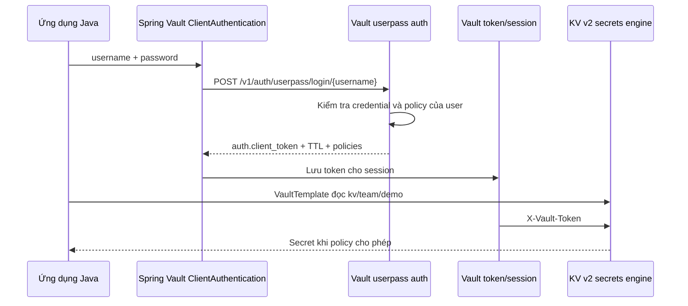
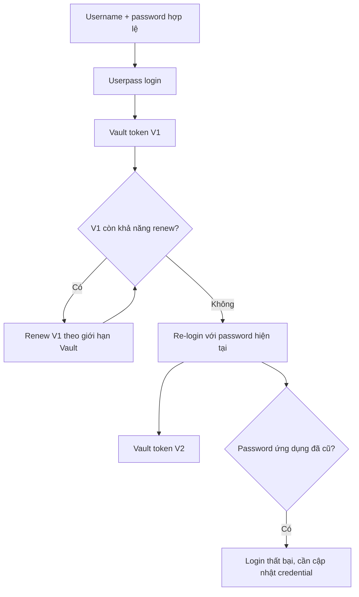

# UserPasswordAuthentication với userpass trong Spring Vault

## 1. Tổng quan: tài khoản userpass trong Spring Vault

**Spring Vault** là thư viện giúp ứng dụng Java gọi HashiCorp Vault qua `VaultTemplate` để đọc KV secrets, sử dụng Transit encryption, PKI và các secrets engine khác. Trước khi gọi những API này, ứng dụng phải xác thực và có **Vault token** với policy cho phép thao tác tương ứng.

Trong chương **Chứng thư và tài khoản**, chủ đề **UserPasswordAuthentication với userpass** giải thích cách sử dụng username/password để đăng nhập Vault và cách Spring Vault quản lý token được cấp sau khi login. `userpass` là phương thức xác thực có sẵn của Vault: tên người dùng và mật khẩu được quản lý **trong chính Vault**, khác với LDAP/SSO hoặc xác thực bằng chứng thư.

> **Lưu ý tên lớp:** Tiêu đề chủ đề ghi `UserPasswordAuthentication`. Trong Javadoc Spring Vault 3.2 và 4.x, tên lớp Java có thể import để sử dụng là **`UsernamePasswordAuthentication`** và lớp options là **`UsernamePasswordAuthenticationOptions`**. Tài liệu tham khảo Spring Vault đôi khi hiển thị dạng gọi `UserPasswordAuthentication` trong ví dụ; khi viết mã, hãy theo tên lớp tồn tại ở version thực tế. Các ví dụ của bài dùng `UsernamePasswordAuthentication`.

Mục tiêu sau bài học:

- Hiểu luồng `username + password → Vault userpass login → Vault token → VaultTemplate`.
- Bật `userpass`, tạo tài khoản, cấp chính sách đọc KV v2 với quyền tối thiểu.
- Cấu hình `UsernamePasswordAuthenticationOptions` và `UsernamePasswordAuthentication` trong ứng dụng Java.
- Phân biệt mật khẩu, token, TTL/renewal và lỗi phân quyền.
- Xử lý xoay vòng password, user lockout, lỗi 403 và giám sát.
- Biết khi nào nên chuyển sang Kubernetes/JWT, AppRole hoặc certificate authentication.

## 2. Phân biệt userpass, Vault token và policy



| Thành phần | Vai trò | Ví dụ |
| --- | --- | --- |
| **Auth method** `userpass` | Xác minh username/password và phát hành Vault token | `auth/userpass` |
| Username | Định danh tài khoản trong Vault userpass | `lab-reader` |
| Password | Credential dùng cho đăng nhập; phải được bảo vệ | Giá trị bí mật thử nghiệm |
| **Vault token** | Credential dùng cho **các request sau login** | `auth.client_token` |
| Vault policy | Quyền được gắn lên token và kiểm tra khi gọi API | `read` trên `kv/data/team/demo` |
| `VaultTemplate` | Client Java thao tác với KV, Transit, PKI qua token đã có | `opsForKeyValue("kv", KV_2)` |

Một lần đăng nhập thành công chỉ chứng minh Vault chấp nhận credential. Nó **không đồng nghĩa** token có quyền đọc mọi secret. Nếu policy không cấp `read` trên path KV v2, request đến KV vẫn nhận **403 permission denied** dù userpass login thành công.

### Đường dẫn xác thực khác đường dẫn secret

Giả sử:

- Auth mount: `userpass`.
- KV v2 secrets mount: `kv`.
- Secret path tương đối trong KV: `team/demo`.

Khi đó:

| Nghiệp vụ | Đường dẫn Vault HTTP API |
| --- | --- |
| Userpass login | `POST /v1/auth/userpass/login/lab-reader` |
| Quản trị userpass user | `POST /v1/auth/userpass/users/lab-reader` |
| Đọc KV v2 secret | `GET /v1/kv/data/team/demo` |
| Đọc metadata KV v2 | `GET /v1/kv/metadata/team/demo` |

Trong `UsernamePasswordAuthenticationOptions.path("userpass")`, tham số là **tên auth mount**, không phải `auth/userpass/login` và cũng không phải mount `kv`. Nếu người quản trị enable userpass ở `auth/human-login`, options phải dùng `path("human-login")`.

## 3. Phạm vi ứng dụng và lựa chọn cơ chế xác thực

`userpass` là phương thức đơn giản, thích hợp cho **người dùng tương tác, môi trường lab, công cụ nội bộ** hoặc hệ thống có quy trình quản trị mật khẩu rõ ràng. Nó không đồng bộ username/password từ hệ thống danh tính bên ngoài: tài khoản được quản trị qua API `auth/userpass/users/`.

| Tình huống | Phương thức cần cân nhắc | Lý do |
| --- | --- | --- |
| Nhà phát triển thử đăng nhập Vault | `userpass` | Minh họa login, token, policy, TTL rất rõ |
| Công cụ người dùng có quản lý tài khoản tại Vault | `userpass` | Có thể phù hợp nếu kiểm soát mật khẩu và audit tốt |
| Ứng dụng Java tự động chạy trên Kubernetes | Kubernetes auth / JWT auth | Dùng workload identity, tránh phân phối password cố định |
| Service backend trên máy chủ/CI | AppRole hoặc auth theo nền tảng | Phù hợp với danh tính của ứng dụng, có cơ chế cấp secret riêng |
| Tổ chức có LDAP/SSO | LDAP, OIDC/JWT... | Dùng nguồn danh tính tập trung |
| Workload có chứng thư TLS riêng | Vault cert auth | Xác thực dựa trên certificate/private key, khác userpass |
| Phát hành chứng thư ứng dụng | PKI secrets engine | Quản lý vòng đời certificate, không phải userpass login |

Với hệ thống production chạy nền, thường nên ưu tiên cơ chế **workload authentication** đã được hạ tầng hỗ trợ. Sử dụng password tĩnh lâu dài đặt ra trách nhiệm cấp phát, bảo quản, đổi và thu hồi credential.

## 4. Thực hành dựng môi trường Vault lab

Các lệnh sau chỉ dùng trên Vault thử nghiệm. Cần có Vault CLI kết nối đúng `VAULT_ADDR` và danh tính quản trị được phép enable auth method, tạo policy, tạo tài khoản và secret. Trước khi thao tác, kiểm tra liệu mount đã tồn tại để tránh xung đột.

### 4.1. Enable `userpass`

```bash
vault auth list

# Chỉ thực hiện nếu auth mount này chưa tồn tại.
vault auth enable userpass

vault auth list
```

Mount mặc định là `auth/userpass`. Có thể tạo mount khác bằng:

```bash
# Cú pháp tham khảo cho một môi trường lab riêng.
vault auth enable -path=human-login userpass
```

Trong các phần thực hành chính, ta tiếp tục sử dụng **mount mặc định** `userpass`. Không cần enable hai mount để hoàn thành bài.

### 4.2. Tạo KV v2 secret bằng dữ liệu giả

```bash
# Bỏ qua nếu kv/ đã tồn tại và là KV v2.
vault secrets enable -path=kv -version=2 kv

vault kv put -mount=kv team/demo greeting="hello-from-vault"
```

`vault kv put -mount=kv team/demo` ghi data vào Vault KV v2; endpoint API thực tế chứa `kv/data/team/demo`. Giá trị `greeting` là dữ liệu minh họa, không phải khóa API hay password thật.

### 4.3. Policy chỉ đọc một secret

Tạo file cấu hình chính sách `lab-reader.hcl`:

```hcl
path "kv/data/team/demo" {
  capabilities = ["read"]
}
```

Áp dụng bằng Vault CLI:

```bash
vault policy write lab-reader lab-reader.hcl
```

Trong KV v2, policy đọc dữ liệu phải trỏ vào `data/`. Đường dẫn `kv/team/demo` thiếu `data/` sẽ không khớp endpoint đọc thực tế. Policy trên **không** cấp quyền đọc mọi secret, cập nhật, xóa hoặc quản lý tài khoản.

### 4.4. Tạo tài khoản userpass

```bash
# LAB_PASSWORD phải là password demo đã được cấp qua kênh bảo vệ.
# Cú pháp minh họa; cách đưa password bằng command arguments
# có thể để lộ cho process inspection/audit shell, tránh ở production.
vault write auth/userpass/users/lab-reader \
  password="$LAB_PASSWORD" \
  token_policies="lab-reader" \
  token_ttl="15m" \
  token_max_ttl="1h"
```

Ý nghĩa:

- `password`: mật khẩu của tài khoản được quản lý trong userpass auth method.
- `token_policies`: danh sách policy sẽ gắn lên token khi login.
- `token_ttl`: TTL mong muốn của token cấp mới.
- `token_max_ttl`: giới hạn lifetime của token thông thường khi xem xét renewal.

Vault có thể giới hạn TTL thực tế dựa trên auth mount và server. Token tạo qua login còn có `renewable`/loại token và các giới hạn khác. Các tham số này **không** làm password tự hết hạn sau 15 phút.

Tùy Vault API, có thể cung cấp password hash chuẩn **bcrypt** bằng `password_hash` thay cho `password` khi tạo/cập nhật user; không được gửi đồng thời cả hai. Tài khoản userpass không tự tra cứu password từ LDAP/AD.

### 4.5. Kiểm tra login

```bash
# CLI hỏi password tương tác nếu không chỉ định password=...
vault login -method=userpass username=lab-reader
```

Đăng nhập hợp lệ sẽ nhận Vault token và hiển thị thông tin token/session. Không dán Vault token ra tài liệu, log hoặc ticket. Lưu ý `vault login` có thể ghi token vào token helper của CLI; khi kiểm tra quyền cần chắc chắn các lệnh tiếp theo đang dùng **token lab-reader**, không dùng token quản trị cũ.

## 5. HTTP API minh họa

### 5.1. Login với username/password

Đường dẫn API của Vault khi auth mount ở vị trí mặc định:

```http
POST /v1/auth/userpass/login/lab-reader
Content-Type: application/json

{
  "password": "<PASSWORD_FROM_SECURE_SOURCE>"
}
```

Endpoint **login** không yêu cầu sẵn header `X-Vault-Token`. Vault xác minh username và password nhận được, sau đó mới cấp token cho các request Vault tiếp theo.

Response rút gọn, đã che token:

```json
{
  "auth": {
    "client_token": "<REDACTED>",
    "token_type": "service",
    "policies": ["default", "lab-reader"],
    "metadata": {
      "username": "lab-reader"
    },
    "lease_duration": 900,
    "renewable": true
  }
}
```

| Field | Ý nghĩa |
| --- | --- |
| `auth.client_token` | Vault token được cấp, cần bảo vệ như secret |
| `auth.policies` | Các policy gắn với token |
| `auth.lease_duration` | TTL ban đầu của **Vault token**, tính bằng giây |
| `auth.renewable` | Token có thể được đề nghị renew nếu Vault cho phép |
| `auth.metadata.username` | Tài khoản liên quan đến lần xác thực |
| `auth.token_type` | Loại token, ảnh hưởng cách vận hành vòng đời |

Không lưu toàn bộ response auth trong application log. Với Vault thật, dùng HTTPS/TLS và kiểm tra chứng thư server. Không gửi password qua HTTP plaintext.

### 5.2. Endpoint quản lý tài khoản

| Hành động | API | Ai cần quyền? |
| --- | --- | --- |
| Tạo/cập nhật user | `POST /v1/auth/userpass/users/{username}` | Danh tính quản trị theo policy |
| Đổi password | `POST /v1/auth/userpass/users/{username}/password` | Danh tính có quyền cập nhật đường dẫn tương ứng |
| Đổi policies cho user | `POST /v1/auth/userpass/users/{username}/policies` | Danh tính được phép quản trị user |
| Xem thông tin user | `GET /v1/auth/userpass/users/{username}` | Danh tính có quyền đọc cấu hình |
| Xóa user | `DELETE /v1/auth/userpass/users/{username}` | Danh tính có quyền xóa cấu hình |
| Đăng nhập | `POST /v1/auth/userpass/login/{username}` | Người cung cấp credential hợp lệ |

**Đổi password và xóa user không nên được coi là bằng chứng mọi Vault token cấp trước đó đã bị thu hồi ngay.** Khi có sự cố credential, phải xử lý cả token đã phát hành, tuân theo phạm vi quyền revoke và kết quả audit.

Vault userpass chuyển tên tài khoản về chữ thường khi xử lý; tổ chức nên thống nhất username dạng chữ thường để tránh nhập nhằng.

## 6. Spring Vault: `UsernamePasswordAuthentication`

### 6.1. Các đối tượng quan trọng

`UsernamePasswordAuthentication` là một implementation của `ClientAuthentication`. Nó dùng `UsernamePasswordAuthenticationOptions` cùng Vault client để gọi endpoint login. Kết quả đăng nhập được xử lý bởi cơ chế session; `VaultTemplate` có thể sử dụng Vault token đó cho các request KV, Transit hoặc PKI.

| Thành phần | Trách nhiệm |
| --- | --- |
| `ClientAuthentication` | Cung cấp phương thức đăng nhập và nhận Vault token |
| `UsernamePasswordAuthenticationOptions` | Cấu hình mount path, username, password |
| `UsernamePasswordAuthentication` | Gọi userpass login |
| `SessionManager` | Cung cấp token đang có hiệu lực cho request |
| `LifecycleAwareSessionManager` | Có thể renew/re-login theo lifecycle của token |
| `VaultTemplate` | Client API để dùng token và thao tác secret engines |

### 6.2. Java configuration với API thực tế

Ví dụ dưới đây dùng `AbstractVaultConfiguration`, `VaultClient` và class thực tế của Spring Vault. Mật khẩu được lấy từ biến môi trường **chỉ để minh họa** việc cấu hình bên ngoài source code; production cần xem xét secret file/credential provider an toàn hơn.

```java
import java.net.URI;

import org.springframework.context.annotation.Configuration;
import org.springframework.vault.authentication.ClientAuthentication;
import org.springframework.vault.authentication.UsernamePasswordAuthentication;
import org.springframework.vault.authentication.UsernamePasswordAuthenticationOptions;
import org.springframework.vault.client.VaultEndpoint;
import org.springframework.vault.config.AbstractVaultConfiguration;

@Configuration
public class UserpassVaultConfig extends AbstractVaultConfiguration {

    @Override
    public VaultEndpoint vaultEndpoint() {
        return VaultEndpoint.from(
                URI.create(requiredEnv("VAULT_ADDR")));
    }

    @Override
    public ClientAuthentication clientAuthentication() {
        UsernamePasswordAuthenticationOptions options =
                UsernamePasswordAuthenticationOptions.builder()
                        .path("userpass")
                        .username(requiredEnv("VAULT_USERPASS_USERNAME"))
                        .password(requiredEnv("VAULT_USERPASS_PASSWORD"))
                        .build();

        return new UsernamePasswordAuthentication(options, vaultClient());
    }

    private static String requiredEnv(String key) {
        String value = System.getenv(key);
        if (value == null || value.isBlank()) {
            throw new IllegalStateException("Missing Vault config: " + key);
        }
        return value;
    }
}
```

Điểm cần nhớ:

1. `path("userpass")` chỉ định **auth mount**; không truyền `auth/userpass/login`.
2. `username` và `password` chỉ được dùng ở bước login; session manager sử dụng **Vault token** sau đó.
3. `vaultClient()` do cấu hình Spring Vault cung cấp; constructor có dạng `UsernamePasswordAuthentication(options, vaultClient())` trong API mới. Các version cũ có overload nhận `RestOperations`, còn từ Spring Vault 4.1 overload này bị deprecate.
4. `VaultEndpoint` cần dùng URL thực tế và TLS/CA hợp lệ. Chỉ chạy demo với cấu hình mạng lab; không tắt TLS verification để “sửa” lỗi handshake.
5. Nếu password thay đổi sau khi ứng dụng tạo bean, `UsernamePasswordAuthenticationOptions` trong ví dụ vẫn giữ **chuỗi password cũ**. Phải có cơ chế làm mới credential/bean hoặc restart có kiểm soát trước khi re-login.

Lỗi thường gặp là dùng tên lớp `UserPasswordAuthentication` như tiêu đề trong lệnh `import`. Khi build với Spring Vault hiện hành, hãy import `org.springframework.vault.authentication.UsernamePasswordAuthentication`. Đây cũng là lý do cần đối chiếu Javadoc đi cùng phiên bản dependency thực tế thay vì sao chép code từ bài blog.

### 6.3. Đọc KV v2 bằng `VaultTemplate`

Với policy `lab-reader` ở phần trước, có thể tạo service:

```java
import org.springframework.stereotype.Service;
import org.springframework.vault.core.VaultKeyValueOperations;
import org.springframework.vault.core.VaultKeyValueOperationsSupport.KeyValueBackend;
import org.springframework.vault.core.VaultTemplate;
import org.springframework.vault.support.VaultResponse;

@Service
public class LabSecretReader {

    private final VaultKeyValueOperations kv;

    public LabSecretReader(VaultTemplate vaultTemplate) {
        this.kv = vaultTemplate.opsForKeyValue("kv", KeyValueBackend.KV_2);
    }

    public String greeting() {
        VaultResponse result = kv.get("team/demo");

        if (result == null || result.getData() == null) {
            throw new IllegalStateException("Lab secret is unavailable");
        }

        Object greeting = result.getData().get("greeting");
        if (!(greeting instanceof String)) {
            throw new IllegalStateException("Invalid greeting field");
        }

        return (String) greeting;
    }
}
```

Code đọc KV không cần tự xây URL `/v1/kv/data/...` hoặc gửi username/password trong request. `opsForKeyValue("kv", KV_2)` xây đường dẫn KV v2 phù hợp; session manager cung cấp token. Thực hành chỉ đọc chuỗi `greeting` vô hại, không trả password/API key thật qua HTTP response hoặc log.

### 6.4. Khi dùng Spring Cloud Vault

Ứng dụng dùng **Spring Cloud Vault** có thể để framework cấu hình userpass từ properties, chẳng hạn:

```yaml
spring:
  cloud:
    vault:
      uri: https://vault.example.internal:8200
      authentication: USERPASS
      username: <username-from-secret-config>
      password: <password-from-secret-config>
```

Đây là cấu hình minh họa; Spring Cloud Vault cần dependency và tên property phù hợp với release của ứng dụng. Không trộn lẫn cấu hình auto-config và `ClientAuthentication` tùy chỉnh mà chưa xác định bean nào được sử dụng. Đừng commit username/password thật vào `application.yml`; ví dụ trên thể hiện vị trí cấu hình, không phải cơ chế lưu trữ secret an toàn.

## 7. Vòng đời Vault token, TTL và password rotation

Mật khẩu userpass và Vault token là hai loại credential riêng:

- **Mật khẩu**: dùng để xác thực mỗi khi login/re-login, tồn tại cho đến khi được đổi hoặc vô hiệu hóa.
- **Vault token**: phát hành sau khi login; có policy, TTL, loại token và khả năng gia hạn. Khi token còn hợp lệ, ứng dụng gọi Vault bằng token mà không phải gửi lại password cho mỗi lần đọc secret.



Giả sử `token_ttl=15m`, `token_max_ttl=1h` cho token thông thường, không cấu hình periodic token:

- Token mới được cấp với TTL theo role/account và các giới hạn của Vault.
- Nếu `renewable=true` và còn trong giới hạn, session manager có thể gia hạn token.
- Khi V1 không còn renew được hoặc hết lifetime, ứng dụng cần login mới để có V2.
- **Renewal** của Vault token không cần gửi lại username/password trong trường hợp thông thường; **re-login** cần password đang hợp lệ.

`LifecycleAwareSessionManager` hỗ trợ vòng đời trên nhưng không thể sửa password đã bị đổi trong Vault. Nếu ứng dụng chỉ đọc credential một lần khi startup, lần re-login sau khi mật khẩu bị rotate sẽ thất bại cho đến khi cấu hình được làm mới.

### Khi tài khoản hoặc mật khẩu bị lộ

Một token do userpass cấp có thời gian sống **độc lập** với việc người quản trị đổi password. Đổi password hoặc xóa user có thể chặn đăng nhập mới nhưng không bảo đảm mọi token được cấp trước đó bị revoke ngay. Quy trình ứng phó cần:

1. Xác định Vault token/accessor/phiên liên quan thông qua audit và cơ chế quản lý token.
2. Thu hồi token liên quan theo quyền, phạm vi và quy trình vận hành được phép.
3. Xoay vòng password, cập nhật cấu hình các client hợp lệ.
4. Kiểm tra những KV/Transit/PKI operations đã được token đó thực hiện.
5. Giảm quyền và TTL nếu phát hiện credential được dùng vượt phạm vi dự kiến.

Không gán root token cho Spring Vault để tránh lỗi 403; cần sửa policy theo quyền tối thiểu.

## 8. User lockout, lỗi đăng nhập và lỗi phân quyền

Vault có cơ chế khóa user tạm thời khi nhiều lần xác thực sai liên tiếp. Theo tài liệu HashiCorp, user lockout được hỗ trợ cho `userpass` từ Vault 1.13; một số giá trị mặc định là **5 lần sai**, **khóa 15 phút**, **reset bộ đếm sau 15 phút**, có thể điều chỉnh theo auth mount hoặc phiên bản.

Do đó, app không nên retry login với password sai theo vòng lặp nhanh và vô hạn. Khi có lỗi credential, cần backoff hợp lý, đánh dấu lỗi cấu hình và cảnh báo; tránh vô tình kích hoạt lockout.

| Triệu chứng | Nguyên nhân có thể | Kiểm tra/xử lý |
| --- | --- | --- |
| HTTP 403 ngay ở `/auth/userpass/login` | Password sai, user không tồn tại, user bị lockout | Đối chiếu user, password và audit; hạn chế retry |
| Login 404/unsupported path | `userpass` chưa enable hoặc `path` sai | Kiểm tra `vault auth list` |
| Login thành công, đọc KV trả 403 | Token thiếu `read` ở `kv/data/team/demo` | Xem token policies và HCL path KV v2 |
| Login thành công, đọc KV trả null/404 | Secret path sai, secret không tồn tại | Dùng Vault CLI trong lab kiểm tra secret/path |
| Java SSL handshake thất bại | Vault certificate không được tin cậy hoặc sai hostname | Sửa truststore/CA/endpoint, không bỏ kiểm tra TLS |
| App chạy lâu rồi login lại thất bại | Mật khẩu đã rotate, bean còn giữ password cũ | Nạp mới credential và kiểm tra re-login |
| Token hết TTL hoặc renewal thất bại | TTL/max TTL, token revoke, token không renewable | Lookup token, kiểm tra policy/session/renewal |
| Compile báo thiếu `UserPasswordAuthentication` | Dùng tên class từ tiêu đề thay vì Javadoc | Dùng `UsernamePasswordAuthentication` |
| Userpass login trả token nhưng không dùng được Transit/PKI | Token chỉ có policy đọc KV | Cấp policy chính xác theo endpoint Transit/PKI nếu nghiệp vụ cần |

Trong Java, có thể phân biệt `VaultLoginException` ở giai đoạn xác thực với các lỗi `VaultException`/HTTP khi đang gọi secrets engine. Khi ghi log cần sử dụng status, endpoint đã được kiểm soát, correlation ID và loại lỗi; không log password, raw token hay nội dung secret.

### 403 không phải lúc nào cũng do sai mật khẩu

Một phương pháp chẩn đoán:

- Nếu **`POST /auth/userpass/login/...`** trả 403: tập trung vào username, password, lockout và tình trạng auth method.
- Nếu login đã thành công nhưng **`GET /kv/data/...`** trả 403: tập trung vào Vault token, policy và path secrets engine.
- Nếu token dùng được trước đó nhưng các request mới bị từ chối: xem TTL, revoke, rotation và session manager.
- Nếu HTTPS handshake lỗi: kiểm tra TLS độc lập với username/password.

Dùng Vault audit device để hỗ trợ phân tích ai đăng nhập, thời gian và request path. Audit cấu hình đúng sẽ giúp giám sát mà không cần gửi password và token ra application log.

## 9. Kiểm thử tích hợp

Dùng Vault dev/test tách biệt production, secret `kv/team/demo` có dữ liệu giả, tài khoản `lab-reader` chỉ có policy `lab-reader`. Nên tạo môi trường độc lập cho các test liên quan xoay vòng password và lockout để tránh ảnh hưởng các test khác.

| Trường hợp | Thiết lập/hành động | Kỳ vọng |
| --- | --- | --- |
| Đăng nhập hợp lệ | Username/password đúng, auth mount đúng | Có Vault token, đọc `team/demo` thành công |
| Password sai | Gửi một lần password không đúng | Không có token mới |
| Sai user | Username không tồn tại | Login thất bại |
| Sai auth mount | `path("unknown")` | Vault báo không có endpoint phù hợp |
| Hạn chế policy | Token chỉ `read` một path, thử path khác | Login thành công; path ngoài phạm vi bị 403 |
| Sai KV backend | Chọn KV v1 khi engine thực tế KV v2 | Request lỗi/sai path; sửa sang `KeyValueBackend.KV_2` |
| Token TTL | Đăng nhập, theo dõi TTL/renewable | TTL phản ánh Vault; không bị chi phối bởi Java password |
| Token không renew được | Đặt max TTL thấp ở lab | Client cần login mới sau giới hạn |
| Đổi password | Rotate ở Vault, cập nhật client | Login với password mới được, password cũ bị từ chối |
| App giữ password cũ | Vault đã rotate, Java chưa reload credential | Re-login sau đó thất bại; có cảnh báo rõ |
| Kiểm tra SSL | Truststore không hợp lệ | Kết nối bị từ chối; sửa truststore thì kết nối được |
| Kiểm soát lockout | Số lần thử sai giới hạn trong lab | Không tạo retry vô hạn; có cảnh báo |

**Bài tập tự thực hành:**

1. Enable auth `userpass` và tạo một người dùng `lab-reader` trong Vault lab.
2. Viết policy chỉ đọc `kv/data/team/demo`; tạo secret thử nghiệm dưới KV v2.
3. Cấu hình `UsernamePasswordAuthenticationOptions.builder().path("userpass")` trong Java.
4. Sử dụng `VaultTemplate` đọc `greeting` và xác minh giá trị.
5. Cố ý thử đọc path khác và lý giải vì sao login đúng nhưng request KV trả 403.
6. Rotate password trong môi trường test và kiểm tra phiên đăng nhập sau khi token cũ không còn khả dụng.
7. So sánh userpass với Kubernetes/JWT auth cho một service Java chạy trong Pod.

## 10. Kiến thức cần nhớ

- `userpass` quản lý username/password trong Vault, dùng endpoint `auth/userpass/login/{username}` để phát hành token.
- Tên Java class chính xác theo Javadoc Spring Vault là **`UsernamePasswordAuthentication`** và **`UsernamePasswordAuthenticationOptions`**, dù tên bài dùng `UserPasswordAuthentication`.
- `VaultTemplate` gọi Vault bằng Vault token do session manager cung cấp. Username/password không được gửi kèm từng request KV.
- Auth mount và secrets mount tách biệt; quyền đọc KV v2 cần chính xác path `kv/data/...`.
- Mật khẩu không có `lease_duration` như Vault token; TTL, renewal, re-login và password rotation là các vòng đời cần theo dõi riêng.
- Không retry login liên tục khi password sai vì Vault có cơ chế user lockout.
- Với workload chạy tự động, nên đánh giá Kubernetes/JWT, AppRole hoặc certificate auth trước khi quyết định dùng mật khẩu tĩnh.

## Tài liệu tham khảo

- [HashiCorp Vault — Userpass auth method](https://developer.hashicorp.com/vault/docs/auth/userpass)
- [HashiCorp Vault — Userpass HTTP API](https://developer.hashicorp.com/vault/api-docs/auth/userpass)
- [HashiCorp Vault — Authentication concepts](https://developer.hashicorp.com/vault/docs/concepts/auth)
- [HashiCorp Vault — Tokens](https://developer.hashicorp.com/vault/docs/concepts/tokens)
- [Spring Vault — Authentication Methods](https://docs.spring.io/spring-vault/reference/vault/authentication.html)
- [Spring Vault — UsernamePasswordAuthentication API](https://docs.spring.io/spring-vault/reference/api/java/org/springframework/vault/authentication/UsernamePasswordAuthentication.html)
- [Spring Vault — UsernamePasswordAuthenticationOptions builder API](https://docs.spring.io/spring-vault/reference/api/java/org/springframework/vault/authentication/UsernamePasswordAuthenticationOptions.UsernamePasswordAuthenticationBuilder.html)
- [Spring Vault — VaultTemplate](https://docs.spring.io/spring-vault/reference/vault/imperative-template.html)
