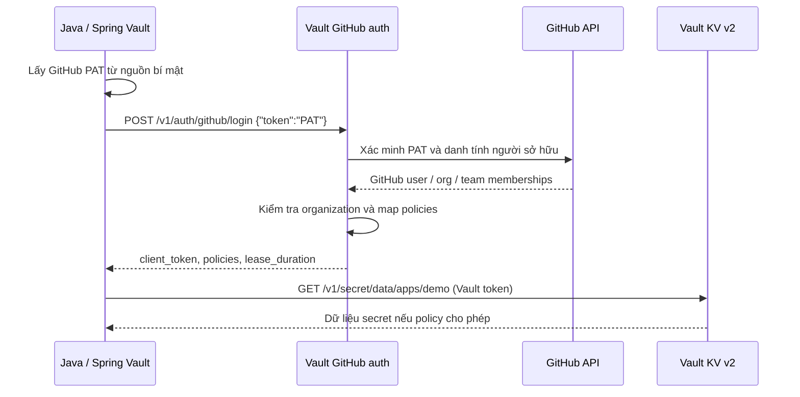

# GitHubAuthentication và token dùng để chứng minh danh tính

## 1. Bài toán: ứng dụng Java chứng minh danh tính với Vault bằng GitHub

Trong **Spring Vault**, lớp `GitHubAuthentication` hỗ trợ đăng nhập **HashiCorp Vault** bằng **GitHub personal access token (PAT)**. Vault hỏi GitHub để xác minh token thuộc về ai và người đó có thuộc GitHub organization đã được cấu hình hay không. Sau khi xác thực thành công, Vault phát hành **Vault client token** để `VaultTemplate` truy cập secrets engine theo policy được cấp.

Đây là một cách triển khai cơ chế **authentication (xác thực danh tính)** và **authorization (phân quyền)** dựa trên tài khoản GitHub. Trong chương **Chứng thư và tài khoản** của module **SPRING_VAULT**, bài học tập trung vào **tài khoản và token nhận dạng**. Phương thức GitHub auth **không sử dụng chứng thư X.509** như Vault TLS certificate auth; việc quản lý chứng thư cho kết nối HTTPS đến Vault là một yêu cầu bảo mật riêng.

Sau bài này, bạn sẽ:

- Phân biệt **GitHub PAT**, **Vault token** và token/lease của secrets engine.
- Nắm luồng `auth/github/login`, xác thực membership của organization và ánh xạ team/user thành policy.
- Cấu hình Vault GitHub auth và `GitHubAuthenticationOptions` trong ứng dụng Java sử dụng Spring Vault.
- Biết những rủi ro khi PAT bị lộ, hết hạn hoặc chưa được cấp quyền `read:org` / SSO.
- Thực hành đọc KV v2, xử lý token renewal, lỗi GitHub và kiểm thử tích hợp.

> **Phạm vi áp dụng:** GitHub auth được HashiCorp thiết kế chủ yếu cho **người vận hành và lập trình viên** đăng nhập Vault. Đối với workload Java chạy tự động lâu dài, cần đánh giá thêm Kubernetes auth, AppRole, JWT/OIDC, cloud identity hoặc Vault Agent. Việc đưa PAT cá nhân vào server thường kéo theo rủi ro quản trị và thu hồi.

## 2. Hai lớp token và hai hệ thống phân quyền

**GitHub PAT** là credential xác minh tài khoản GitHub; **Vault token** là credential truy cập tài nguyên Vault. Chúng có nhà phát hành, phạm vi quyền và vòng đời khác nhau.

| Tiêu chí | GitHub personal access token (PAT) | Vault client token |
| --- | --- | --- |
| Được tạo bởi | GitHub, theo tài khoản GitHub của con người | HashiCorp Vault sau login thành công |
| Gửi đến | Vault GitHub auth endpoint nhận PAT, sau đó Vault gọi GitHub API | Vault API qua header `X-Vault-Token` (Spring Vault tự quản lý) |
| Mục đích | Chứng minh GitHub username và membership của organization/team | Thực thi quyền trên KV, Transit, PKI và các Vault path khác |
| Phân quyền | GitHub token scope/permissions và quy tắc tổ chức | Vault ACL policy, token TTL và giới hạn token |
| Hết hạn/thu hồi | Theo chính sách GitHub hoặc người cấp token | Theo Vault token lease/TTL, revoke và policy của Vault |
| Nếu lộ | Có thể bị lợi dụng truy cập GitHub, đồng thời dùng để xin Vault token | Có thể trực tiếp truy cập Vault trong giới hạn policy, TTL |

**Không truyền Vault token vào field `token` của GitHub login.** Field đó chỉ nhận **GitHub access token**. Sau khi login, không tiếp tục gửi GitHub PAT để đọc secret; Spring Vault sử dụng Vault token do auth method trả về.

Ngoài ra, **lease của secret động** (ví dụ credential database hoặc chứng thư PKI) có vòng đời riêng; gia hạn Vault token không tự động kéo dài mọi lease mà ứng dụng đã nhận.

### 2.1. Cơ chế xác thực không đồng nghĩa được phép đọc secret

Một PAT hợp lệ từ thành viên organization có thể đăng nhập thành công nhưng chỉ nhận **policy mặc định** nếu chưa có mapping hoặc quyền bổ sung. Giấy phép đọc secret phải được cấp thông qua **Vault policy**. Quyền GitHub đọc repository, thuộc team hoặc có quyền admin trên GitHub **không tự biến thành quyền root trong Vault**.

### 2.2. Token không phải chứng thư

GitHub auth là một dạng xác thực bằng token người dùng, không phải mTLS certificate authentication. Ứng dụng vẫn cần **HTTPS và CA trust phù hợp** để giao tiếp với Vault; kết nối mã hóa chỉ bảo vệ PAT trong quá trình vận chuyển, không thay thế việc lưu giữ và xoay vòng token an toàn.

## 3. Luồng đăng nhập từ Java đến GitHub và Vault



Diễn giải từng bước:

1. Java nhận **GitHub PAT** qua nguồn cấu hình được bảo vệ, có thể là bộ cung cấp token do ứng dụng quản lý; không đặt PAT trong source code.
2. `GitHubAuthentication` POST đến auth mount của Vault, mặc định là `/v1/auth/github/login`, với payload chứa field `token`.
3. Vault gọi GitHub API để xác minh token và lấy thông tin người dùng, membership của organization/teams.
4. Vault đối chiếu **organization** đã cấu hình trên auth method, sau đó áp dụng mapping của team và user để gán policy.
5. Vault trả về một **Vault token** (có `client_token`, `policies`, `lease_duration`, `renewable` tùy cấu hình).
6. `VaultOperations` sử dụng Vault token để gọi KV v2 hoặc secrets engine khác theo policy.

**Vault không triển khai quy trình OAuth để tự cấp GitHub token cho người dùng.** Người dùng phải sở hữu một GitHub PAT hợp lệ được tạo/cấp phép ngoài Vault. Nếu GitHub không truy cập được hoặc từ chối token, Vault có thể không hoàn thành việc xác thực.

## 4. Loại token GitHub, scope và membership

### 4.1. PAT classic và quyền `read:org`

Theo tài liệu Vault GitHub auth, trường hợp chuẩn sử dụng **GitHub personal access token (classic)** với scope **`read:org`**. Scope cho phép Vault kiểm tra thành viên và team trong organization, không phải quyền đọc nội dung repository.

Cần bảo đảm:

1. Tài khoản GitHub thực sự là thành viên của **organization** Vault đã cấu hình, ví dụ `example-engineering`.
2. PAT còn hiệu lực và được GitHub cho phép sử dụng trong organization.
3. Với PAT classic, scope `read:org` được cấp; không thêm `repo`, `admin:org` hoặc quyền ghi không phục vụ mục tiêu.
4. Nếu GitHub Enterprise Cloud bật **SAML SSO**, PAT classic cần được **authorize for SSO** để truy cập thông tin organization.
5. Chính sách organization có thể hạn chế hoặc cấm PAT classic; khi đó cần cân nhắc phương án xác thực khác hoặc kiểm chứng rõ mức hỗ trợ của từng loại token.

**Fine-grained PAT:** GitHub khuyến nghị fine-grained token cho nhiều trường hợp vì scope hẹp. Tuy nhiên tài liệu Vault GitHub auth chưa mô tả rõ khả năng tương thích chính thức của mọi fine-grained PAT và quyền yêu cầu. Đừng mặc định rằng fine-grained PAT bất kỳ đều thay thế được PAT classic `read:org`; cần kiểm thử đúng tổ chức, quyền **Organization → Members**, SSO và phiên bản Vault, đồng thời đối chiếu tài liệu hỗ trợ của nhà cung cấp.

### 4.2. Những token thường bị nhầm

| Token | Có dùng để login Vault GitHub auth được không? | Giải thích |
| --- | --- | --- |
| PAT classic có `read:org`, hợp lệ với organization | **Có**, khi thỏa mọi chính sách thành viên và SSO | Phù hợp hướng dẫn chính thức của Vault. |
| PAT classic không có `read:org` | **Không đáp ứng cấu hình điển hình** | GitHub API không cung cấp đủ dữ liệu tổ chức/nhóm. |
| Fine-grained PAT | **Phải xác minh tương thích** | Quyền tổ chức và hành vi API thay đổi theo cấu hình/phiên bản. |
| Vault token | **Không** | Đây là kết quả xác thực Vault, không phải credential GitHub. |
| GitHub Actions `GITHUB_TOKEN` tự cấp | **Thông thường không** | Không có `read:org` cần thiết cho Vault GitHub auth; ưu tiên workflow OIDC/JWT để login Vault. |
| GitHub deploy key / SSH key | **Không** | Được dùng cho Git SSH/repository, không phải PAT để chứng minh tổ chức. |

### 4.3. Rủi ro đặc thù của GitHub auth

Một **PAT `read:org` bị đánh cắp từ dịch vụ bên thứ ba** có thể được dùng để đăng nhập Vault với danh tính người sở hữu nếu kẻ tấn công tiếp cận được Vault. Vì vậy không nên xem PAT là yếu tố nhận dạng dành riêng cho Vault. Bảo vệ credential tại nguồn, đặt TTL Vault ngắn hợp lý, giới hạn kết nối mạng tới Vault, bật audit logging và có quy trình thu hồi cả **GitHub PAT lẫn Vault token**.

Với một backend phục vụ 24/7, việc dùng tài khoản cá nhân làm identity của service gây phụ thuộc khi nhân viên nghỉ việc, tài khoản bị khóa hoặc PAT hết hạn. Chọn phương thức nhận dạng workload chuyên dụng nếu có thể.

## 5. Quản trị viên cấu hình Vault GitHub auth method

Các ví dụ sau dùng organization **`example-engineering`**, team **`platform-developers`** và KV v2 mount **`secret/`**, đều là dữ liệu minh họa. Cần có quyền quản trị Vault để thực hiện; giả định `VAULT_ADDR`, TLS trust và phiên đăng nhập của quản trị viên đã được cấu hình.

### 5.1. Enable và gắn organization

```bash
# Bật auth method tại mount mặc định auth/github/.
vault auth enable github

# Ràng buộc GitHub organization và giới hạn thời hạn Vault token.
vault write auth/github/config \
  organization=example-engineering \
  token_ttl=30m \
  token_max_ttl=2h

# Kiểm tra thông tin cấu hình (quyền quản trị).
vault read auth/github/config
```

`organization` là điều kiện bắt buộc. Với GitHub Enterprise Server, cần thêm `base_url` trỏ đến đúng GitHub API và `organization_id` theo hướng dẫn Vault; không coi tên organization hiển thị là đủ cho mọi Enterprise endpoint.

Vault cho phép mount auth tại path khác, ví dụ `vault auth enable -path=developer-github github`. Khi đó endpoint đổi thành `auth/developer-github/login`, và Spring Vault cần dùng đúng `.path("developer-github")`.

### 5.2. Tạo Vault policy theo phạm vi secret

```bash
# Policy đọc KV v2 của ứng dụng demo.
vault policy write developer-kv - <<'HCL'
path "secret/data/apps/demo/*" {
  capabilities = ["read"]
}
HCL
```

Ở KV v2, policy phải phù hợp API path thực tế có `data/`. Một policy đọc `secret/apps/demo/*` (thiếu `data/`) không cấp quyền đọc payload KV v2.

Có thể cấp thêm quyền `read` / `list` với `secret/metadata/apps/demo/*` cho công cụ quản trị nếu cần xem danh sách hoặc version, nhưng **không mở rộng quyền metadata cho app chỉ đọc một secret cụ thể**.

### 5.3. Ánh xạ team và user vào Vault policy

```bash
# Team slug của GitHub, không phải display name của team.
vault write auth/github/map/teams/platform-developers value=developer-kv

# Có thể thêm mapping user riêng khi cần.
# Chỉ ví dụ nếu tài khoản "alice-dev" thực sự thuộc organization.
vault write auth/github/map/users/alice-dev value=developer-kv

# Kiểm tra mapping.
vault read auth/github/map/teams/platform-developers
vault read auth/github/map/users/alice-dev
```

Một user thuộc nhiều team có thể nhận policy của các mapping phù hợp; user mapping có thể cấp thêm policy ngoài team mapping. **Không có role riêng cho mỗi lần GitHub login** như AppRole hoặc một số cloud auth methods: quyền được suy ra từ organization và **mapping user/team**.

Tên team trong `map/teams/<slug>` phải dùng **GitHub team slug** (chữ thường, dạng đường dẫn), không dùng tên hiển thị có khoảng trắng. Nếu GitHub user vẫn đăng nhập được nhưng thiếu quyền đọc secret, kiểm tra mapping trước khi đổ lỗi cho PAT.

### 5.4. Nguyên tắc phân quyền

| Lớp | Điều kiện | Quyền được quyết định tại đâu? |
| --- | --- | --- |
| GitHub | PAT hợp lệ, tổ chức/SSO cho phép, đủ scope | GitHub |
| Vault auth | Organization khớp và biết user/teams | `auth/github/config` cùng API GitHub |
| Vault policies | Team/user mapping và token policy cấu hình | `auth/github/map/teams/*`, `map/users/*`, `token_policies` |
| Secrets engine | Có `read` / `update` / `list` trên từng path | Vault ACL policy của token |
| Java app | Gọi đúng mount, path và xử lý lỗi | Spring Vault / mã ứng dụng |

Không cấp policy `root` cho team lập trình viên. Với ứng dụng demo chỉ cần đọc KV, dùng một policy `read` vào đúng namespace/app path.

## 6. Thử đăng nhập bằng Vault CLI và HTTP API

### 6.1. Cách CLI tránh lộ PAT qua tham số dòng lệnh

Sau khi tạo PAT classic với scope `read:org` và được SSO authorize nếu cần, chạy:

```bash
# CLI hiển thị prompt và ẩn PAT khi nhập; không đưa PAT vào command line.
vault login -method=github

# Sau khi login, kiểm tra policy của Vault token hiện tại.
vault token lookup

# Với KV v2 đã mount tại secret/ và có dữ liệu demo:
vault kv get -mount=secret apps/demo/config
```

Khi được hỏi, nhập **GitHub PAT**. Vault CLI lưu **Vault token mới** vào token helper của môi trường đang sử dụng. Lưu ý `VAULT_TOKEN` đặt sẵn có thể làm CLI ưu tiên token môi trường cho các lệnh kế tiếp, dẫn đến việc tưởng đang thử token mới nhưng thực tế đang dùng một danh tính khác.

Không chụp, gửi, lưu màn hình chứa Vault token hoặc PAT. Nếu cần kiểm tra trong CI, dùng fixture giả hoặc Vault thử nghiệm với credential được bảo vệ.

### 6.2. Payload HTTP và phản hồi

Endpoint mặc định của auth method là:

```http
POST /v1/auth/github/login
Content-Type: application/json

{
  "token": "<GITHUB_PAT_FROM_SECURE_PROVIDER>"
}
```

Ví dụ response **rút gọn, đã che credential**:

```json
{
  "auth": {
    "client_token": "<REDACTED_VAULT_TOKEN>",
    "policies": ["default", "developer-kv"],
    "metadata": {
      "username": "alice-dev",
      "org": "example-engineering"
    },
    "lease_duration": 1800,
    "renewable": true
  }
}
```

`client_token` là credential **Vault** dùng cho các request tiếp theo. `lease_duration` là TTL được cấp tại login, không phải thời hạn còn lại của GitHub PAT. `renewable` có thể khác tùy cấu hình; không nên hard-code giả định rằng mọi token GitHub auth đều gia hạn được.

## 7. Tích hợp `GitHubAuthentication` bằng Spring Vault

### 7.1. Cấu hình Java với `GitHubAuthenticationOptions`

Spring Vault 3.2+ cung cấp `org.springframework.vault.authentication.GitHubAuthentication` và `GitHubAuthenticationOptions`. Ví dụ này hướng đến API **Spring Vault 4.1.x**: constructor được khuyến nghị là `GitHubAuthentication(GitHubAuthenticationOptions, VaultClient)`.

**Đúng đối tượng builder:** dùng `GitHubAuthenticationOptions.builder()`, sau đó truyền options vào constructor của `GitHubAuthentication`. Không gọi `GitHubAuthentication.builder()`.

```java
import java.net.URI;

import org.springframework.context.annotation.Configuration;
import org.springframework.vault.authentication.ClientAuthentication;
import org.springframework.vault.authentication.GitHubAuthentication;
import org.springframework.vault.authentication.GitHubAuthenticationOptions;
import org.springframework.vault.client.VaultEndpoint;
import org.springframework.vault.config.AbstractVaultConfiguration;

@Configuration
public class GithubVaultConfiguration extends AbstractVaultConfiguration {

    @Override
    public VaultEndpoint vaultEndpoint() {
        // Thay bằng endpoint Vault và cấu hình trust store/TLS thực tế.
        return VaultEndpoint.from(
            URI.create("https://vault.internal.example:8200"));
    }

    @Override
    public ClientAuthentication clientAuthentication() {
        GitHubAuthenticationOptions options =
            GitHubAuthenticationOptions.builder()
                .path("github") // Auth mount tại auth/github/
                .tokenSupplier(() -> {
                    // Ví dụ tối giản: môi trường do secret manager cấp.
                    // Không hard-code PAT và không ghi token ra log.
                    String pat = System.getenv("VAULT_GITHUB_PAT");
                    if (pat == null || pat.isBlank()) {
                        throw new IllegalStateException(
                            "Missing GitHub PAT for Vault login");
                    }
                    return pat;
                })
                .build();

        return new GitHubAuthentication(options, vaultClient());
    }
}
```

Các lưu ý:

- `.token(String)` phù hợp token không đổi trong một lần khởi tạo ứng dụng; `.tokenSupplier(Supplier<String>)` cho phép lấy lại token mỗi lần cần login. Token supplier **không tự động làm mới PAT**: nguồn cung cấp phải thực hiện việc xoay vòng, kiểm tra expiration và cung cấp giá trị hợp lệ.
- Ví dụ trên dùng environment variable để bài dễ chạy. Trong hệ thống thật, biến môi trường cũng có rủi ro bị đọc bởi tiến trình có quyền; có thể sử dụng secret injection an toàn từ hệ thống triển khai. Không in PAT trong exception, metrics, tracing hay startup log.
- `vaultClient()` do `AbstractVaultConfiguration` cung cấp, dùng HTTP/TLS client đã cấu hình cho Vault. Luôn xác minh chứng thư Vault; không tắt TLS validation để chữa lỗi 403/SSL.
- Dùng một cơ chế cấu hình authentication được chọn cho ứng dụng. Khi dự án đã dùng Spring Cloud Vault auto-configuration, ưu tiên cấu hình tương ứng trong `application.yml` thay vì tạo thêm `ClientAuthentication` cạnh tranh.

### 7.2. Tùy chọn Spring Cloud Vault

Nếu dùng **Spring Cloud Vault** phiên bản hỗ trợ GitHub auth, có thể khai báo:

```yaml
spring:
  cloud:
    vault:
      uri: https://vault.internal.example:8200
      authentication: GITHUB
      github:
        token: ${VAULT_GITHUB_PAT}
        allow-cli-token: false
```

`allow-cli-token: false` tránh bất ngờ lấy PAT qua `gh auth token` của máy phát triển khi cấu hình chưa có token. Với bản Spring Cloud Vault hỗ trợ tùy chọn này, fallback CLI chỉ kích hoạt khi bật rõ ràng `allow-cli-token=true`. Khi dùng property placeholder như trên, triển khai cần cấp `VAULT_GITHUB_PAT` từ nguồn bảo vệ và không commit giá trị thật vào repository.

**Không nhầm GitHub PAT với token `GITHUB_TOKEN` của GitHub Actions.** Token tự động trong Actions không có `read:org` cần cho Vault GitHub auth; workflow nên cân nhắc đăng nhập Vault bằng GitHub Actions OIDC/JWT thay vì dùng PAT của một cá nhân.

### 7.3. Đọc KV v2 sau khi nhận Vault token

`GitHubAuthentication` chỉ chịu trách nhiệm đăng nhập. Từ đây mọi thao tác đọc secret đều dùng Vault token đã nhận qua `VaultOperations` (thường do `VaultTemplate` triển khai).

```java
import org.springframework.stereotype.Service;
import org.springframework.vault.core.VaultOperations;
import org.springframework.vault.core.VaultKeyValueOperations;
import org.springframework.vault.core.VaultKeyValueOperationsSupport.KeyValueBackend;
import org.springframework.vault.support.VaultResponse;

@Service
public class DemoSecretReader {

    private final VaultKeyValueOperations kv;

    public DemoSecretReader(VaultOperations vaultOperations) {
        this.kv = vaultOperations.opsForKeyValue(
            "secret", KeyValueBackend.KV_2);
    }

    public String serviceEndpoint() {
        VaultResponse response = kv.get("apps/demo/config");
        if (response == null || response.getData() == null) {
            throw new IllegalStateException("Secret is unavailable");
        }

        Object value = response.getData().get("endpoint");
        if (!(value instanceof String endpoint) || endpoint.isBlank()) {
            throw new IllegalStateException(
                "Field 'endpoint' is missing or invalid");
        }

        return endpoint;
    }
}
```

Khi dùng `opsForKeyValue("secret", KV_2)`, không đưa `data/` vào logic path; Spring Vault tự gọi HTTP `secret/data/apps/demo/config`. Nếu Java bị `403` ở đây mà GitHub login vẫn thành công, kiểm tra **Vault policy mapping**, không mặc định coi PAT sai.

## 8. Vòng đời token, thay đổi membership và thu hồi

Có ít nhất ba thay đổi cần quản lý riêng:

1. **GitHub PAT bị xoay vòng, hết hạn hoặc thu hồi:** lần login mới có thể bị từ chối. Cập nhật nguồn cấp PAT/supplier trước khi xác thực lại; token Vault được cấp trước đó không tự biến thành chính PAT mới.
2. **Vault client token hết TTL hoặc bị revoke:** Vault không chấp nhận request mới dùng token đó. `LifecycleAwareSessionManager` của Spring Vault có thể quản lý renew và re-login theo đặc tính token.
3. **User rời organization hoặc team, hoặc thay đổi policy:** các lần xác thực mới dùng membership hiện tại; tác động lên token Vault đã cấp còn phụ thuộc TTL, policy và cơ chế renew/revoke. Không xem việc xóa user khỏi GitHub là cách thu hồi tức thời mọi token Vault đã phát hành.

### 8.1. Vì sao cần TTL ngắn và thu hồi có chủ đích?

Nếu PAT bị lộ, kẻ tấn công có thể xin Vault token mới bằng quyền của user. Cần xử lý cả **GitHub PAT** và **Vault token** liên quan:

- Thu hồi hoặc thay PAT trên GitHub, kiểm tra audit và nguồn rò rỉ.
- Theo dấu và thu hồi những Vault token đã cấp có khả năng bị lạm dụng, ví dụ qua token accessor hoặc quy trình revoke path được quản trị phê duyệt.
- Đặt `token_ttl`, `token_max_ttl` và giới hạn truy cập mạng phù hợp; cân nhắc `token_bound_cidrs` nếu hạ tầng cho phép.
- Nếu chỉ đổi policy mapping GitHub mà không thu hồi token cũ, không nên giả định mọi token đã cấp lập tức mất quyền như mong muốn. Xác minh bằng request và quy trình incident response.

Tham số TTL cấu hình ở `auth/github/config` (hoặc tune trên auth mount) phải được tính đến cùng hệ thống token hiện có. Không cấp token vĩnh viễn cho workflow cá nhân chỉ để tránh viết xử lý refresh.

### 8.2. Quản lý token trong Java

| Vấn đề | Cách xử lý |
| --- | --- |
| PAT hết hạn | Nguồn cấp PAT cần rotation; supplier có thể đọc giá trị mới khi login lại. |
| Vault token có thể renew | Dùng session manager hỗ trợ renew với TTL cho phép. |
| Vault token không renew được/đạt max TTL | Login lại, đòi hỏi PAT còn hợp lệ. |
| GitHub API đang gián đoạn | Login mới thất bại; retry có giới hạn/backoff nếu lỗi tạm thời. |
| Token bị phát hiện lộ | Thu hồi PAT và Vault token liên quan, audit các lần login/đọc secret. |
| User chuyển team | Đánh giá ngay policy Vault đã cấp, TTL hiện tại và nhu cầu revoke. |

**Cảnh báo:** renewal đối với external auth có thể cần Vault truy vấn lại nhà cung cấp danh tính và từ chối nếu membership không còn hợp lệ; behavior cụ thể tùy phiên bản và cấu hình. Về mặt an toàn, luôn có phương án **revoke** các Vault token đã cấp khi quyền tổ chức thay đổi gấp.

## 9. Sự cố thường gặp và cách chẩn đoán

| Triệu chứng | Nguyên nhân khả dĩ | Cách xác định và xử lý |
| --- | --- | --- |
| GitHub login bị từ chối | PAT hết hạn, bị thu hồi, nhập sai, bị organization policy chặn | Xác minh trạng thái PAT bằng GitHub API ở môi trường an toàn; tạo lại hoặc cấp phép lại. |
| User có mặt trong org nhưng login không như mong đợi | PAT thiếu `read:org`, membership private, không có SSO authorization hoặc API không đủ quyền đọc | Kiểm tra scope và quyền tổ chức theo loại PAT; authorize SSO với PAT classic. |
| Đăng nhập được nhưng chỉ nhận `default` policy | Team chưa được map, sai slug, user không thuộc team, hoặc SSO khiến Vault không thấy team | Kiểm tra `map/teams`, `map/users`, membership và cấu hình org. |
| Vault trả lỗi khi xác thực qua GitHub | GitHub API timeout, rate limit hoặc vấn đề TLS/proxy | Kiểm tra kết nối **Vault server → GitHub API**, thời gian phản hồi, logs/audit đã che credential. |
| GitHub Enterprise không hoạt động | `base_url` / `organization_id` không đúng | Đối chiếu đường API thực tế và ID organization. |
| Login thành công nhưng KV trả `403` | Vault policy không có quyền trên `secret/data/...` | Kiểm tra token policies và path KV v2 đúng, sửa mapping/policy. |
| Java báo thiếu token | Chưa cấp `VAULT_GITHUB_PAT`, value rỗng hoặc supplier không đọc được nguồn bí mật | Kiểm tra secret injection; không đưa token vào log. |
| Chạy GitHub Actions và login thất bại | Dùng `GITHUB_TOKEN` tự cấp thay vì PAT có quyền org | Cân nhắc OIDC/JWT auth; không mở rộng quyền không hỗ trợ cho `GITHUB_TOKEN`. |
| Token đang dùng hết hạn | Vault token TTL/max TTL, renew không khả dụng, GitHub PAT hết hạn khi cần login mới | Kiểm tra `LifecycleAwareSessionManager`, auth mount TTL và nguồn PAT. |
| Java không kết nối Vault | Vault endpoint, TLS trust, DNS, firewall, proxy | Kiểm tra kết nối HTTPS và chứng thư, không tắt TLS verification. |

Khi kiểm tra response, phân biệt **lỗi xác thực** (không được cấp token) với **lỗi phân quyền** (đã cấp Vault token nhưng không truy cập secret). Không nên `catch (Exception)` rồi trả “secret not found”: thao tác này che lỗi 403, 5xx và timeout.

### GitHub API và thông tin quan sát

Vault cần gọi GitHub API. Nếu có sự cố network, GitHub rate limit hoặc SSO, mã Java có thể chỉ thấy lỗi đăng nhập. Hãy kết hợp thông tin từ Vault audit, Vault server logs và GitHub organization audit với quyền phù hợp; tránh đưa GitHub PAT, request body `auth/github/login` và Vault client token vào log.

## 10. Kịch bản thực hành và kiểm thử tích hợp

Sử dụng Vault và GitHub organization **thử nghiệm**; tạo KV v2 với dữ liệu giả, policy chỉ đọc, PAT hết hạn ngắn và team demo. Không commit PAT hoặc paste credential vào issue/CI log. Mỗi kịch bản phải xác minh **kết quả login** và **quyền đọc secret** riêng biệt.

| Ca | Điều kiện / hành động | Kết quả mong đợi |
| --- | --- | --- |
| A — Thành viên hợp lệ | PAT classic `read:org`, user thuộc organization + team mapped | Login thành công, Vault token có `developer-kv`. |
| B — Không thuộc organization | Dùng PAT của GitHub user khác org | Vault từ chối cấp Vault token. |
| C — Thiếu `read:org` | Dùng PAT thiếu scope để kiểm tra membership | Login/tra cứu membership không đủ quyền; không được cấp policy mong đợi. |
| D — Sai team slug | Map display name thay vì slug thực tế | Mapping không áp dụng; Vault token thiếu policy đội. |
| E — SSO chưa authorize | Tạo PAT classic nhưng chưa authorize cho organization SAML SSO | GitHub API không thể đọc org như yêu cầu; login hoặc mapping thất bại. |
| F — Token đúng, policy sai | Login thành công, không có `read` trên KV v2 path | KV GET trả `403`, lỗi authorization. |
| G — GitHub API mất kết nối | Giả lập timeout phía Vault → GitHub | Login mới lỗi; ứng dụng không tự động bỏ qua xác thực. |
| H — GitHub PAT hết hạn | Thu hồi PAT rồi thử đăng nhập lại | Login mới thất bại; cập nhật token nguồn trước khi retry. |
| I — Vault token hết hạn | Giảm TTL trong môi trường test | Renew hoặc re-login theo cấu hình; cần PAT hợp lệ khi login lại. |
| J — Mất quyền thành viên | Xóa user khỏi org/team, đánh giá token cũ và mới | Login mới và policy được kiểm tra lại; chủ động revoke token cũ khi cần thu hồi ngay. |
| K — Spring Cloud Vault | Cấp `VAULT_GITHUB_PAT` và cấu hình `authentication: GITHUB` | Ứng dụng nhận Vault token và đọc KV trong policy. |
| L — GitHub Actions | Dùng `GITHUB_TOKEN` mặc định | Không coi đó là PAT `read:org`; thử luồng OIDC/JWT thích hợp. |

**Unit test của Java:** giả lập `ClientAuthentication` hoặc HTTP request tới Vault để kiểm tra payload login, xử lý thiếu PAT, phản hồi lỗi, logic đọc KV và việc không xuất token vào log. Không thể chứng minh membership bằng một mock Vault trả token bất kỳ.

**Integration test:** dùng Vault thật và GitHub organization/team thử nghiệm (hoặc dịch vụ tương thích có thể tái tạo chính sách auth). Kiểm tra đúng mappings, SSO nếu có, network, TTL, logout/revoke và retry. Nếu chạy Vault trong Testcontainers, test trên môi trường cô lập nhưng vẫn cần **GitHub API thật hoặc mock được tích hợp đúng** mới xác minh được đường đi từ Vault sang GitHub.

## 11. Khi nào chọn GitHub authentication, khi nào chọn cơ chế khác?

| Tình huống | Khuyến nghị và lý do |
| --- | --- |
| Lập trình viên dùng Vault CLI để đọc secrets dev | GitHub auth tiện khi organization/team đã phản ánh quyền người dùng và policy Vault được giới hạn. |
| Công cụ nội bộ chạy theo tài khoản của người vận hành | Có thể sử dụng `GitHubAuthentication` nếu quản lý PAT, quyền, vòng đời và kiểm soát network phù hợp. |
| Backend Java tự chạy lâu dài trên Kubernetes | Ưu tiên Kubernetes auth hoặc workload identity phù hợp; giảm phụ thuộc PAT của cá nhân. |
| Java trên EC2/Azure/GCP | Cân nhắc cloud auth methods gắn với workload (AWS IAM, Azure, GCP). |
| Workflow GitHub Actions | Ưu tiên JWT/OIDC auth với GitHub Actions OIDC, giới hạn claim/audience và Vault policy. |
| Service có chứng thư client được quản lý | Vault cert auth có thể phù hợp; cần quản lý key/cert, CA và rotation. |
| Máy không có cloud identity, cần machine authentication | Có thể cân nhắc AppRole cùng phân phối/rotation SecretID an toàn. |

Chọn cơ chế theo **đối tượng chứng minh danh tính**: người dùng GitHub, workload Kubernetes/cloud hay một client nắm private key của chứng thư. Không sử dụng GitHub PAT chỉ vì source code nằm trong GitHub repository.

## 12. Câu hỏi tự kiểm tra

1. Tại sao `GitHubAuthentication` phải nhận GitHub PAT chứ không nhận Vault token?
2. Tại sao một user có quyền admin trong GitHub organization vẫn chưa chắc đọc được `secret/data/apps/demo/config`?
3. Mục đích của `read:org` là gì? Quyền `repo` có bắt buộc để Vault xác minh membership không?
4. Team `Platform Developers` có slug `platform-developers`: phải map team theo giá trị nào?
5. Một PAT hợp lệ, user thuộc org nhưng Java đọc KV v2 bị `403`: nên kiểm tra những lớp nào?
6. Khi user bị xóa khỏi GitHub team, tại sao cần cân nhắc thu hồi các Vault token đã cấp?
7. Vì sao `GITHUB_TOKEN` mặc định trong GitHub Actions khác với PAT dùng cho Vault GitHub auth?
8. Nếu một backend Java chạy 24/7, vì sao có thể ưu tiên auth của Kubernetes/cloud/JWT hơn PAT cá nhân?

**Điểm ghi nhớ:** `GitHubAuthentication` dùng **GitHub PAT để chứng minh danh tính với Vault**, Vault kiểm tra organization và gán policy theo mapping team/user rồi cấp **Vault token**. Các request KV, Transit hoặc PKI sau đó sử dụng **Vault token**; mức quyền thực tế do Vault ACL policy quyết định. Kiểm soát PAT, TTL, SSO, membership, network và thu hồi token là những phần bắt buộc của thiết kế an toàn.

## 13. Tài liệu tham khảo

- HashiCorp Vault, [GitHub auth method](https://developer.hashicorp.com/vault/docs/auth/github): xác thực bằng PAT, `read:org`, organization/team mapping, SSO và khuyến nghị dành cho người dùng.
- HashiCorp Vault, [GitHub auth HTTP API](https://developer.hashicorp.com/vault/api-docs/auth/github): `config`, `map/teams`, `map/users` và `login`.
- Spring Vault, [Authentication Methods — GitHub Authentication](https://docs.spring.io/spring-vault/reference/vault/authentication.html): `GitHubAuthentication` trong cấu hình Java.
- Spring Vault Javadoc, [GitHubAuthentication](https://docs.spring.io/spring-vault/reference/api/java/org/springframework/vault/authentication/GitHubAuthentication.html) và [GitHubAuthenticationOptions builder](https://docs.spring.io/spring-vault/reference/api/java/org/springframework/vault/authentication/GitHubAuthenticationOptions.GithubAuthenticationOptionsBuilder.html).
- Spring Cloud Vault, [Authentication methods — GitHub](https://docs.spring.io/spring-cloud-vault/reference/authentication.html): `authentication: GITHUB`, token và `allow-cli-token`.
- GitHub Docs, [Managing your personal access tokens](https://docs.github.com/en/authentication/keeping-your-account-and-data-secure/managing-your-personal-access-tokens): tạo PAT, hạn sử dụng và quyền.
- GitHub Docs, [Authorizing a personal access token for use with SSO](https://docs.github.com/en/enterprise-cloud@latest/authentication/authenticating-with-single-sign-on/authorizing-a-personal-access-token-for-use-with-single-sign-on): SAML SSO và PAT classic.
- HashiCorp Vault, [Authentication concepts](https://developer.hashicorp.com/vault/docs/concepts/auth): Vault token, lifecycle và mối quan hệ authentication/authorization.
