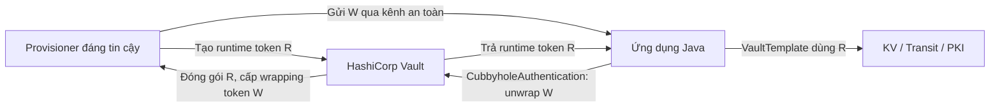
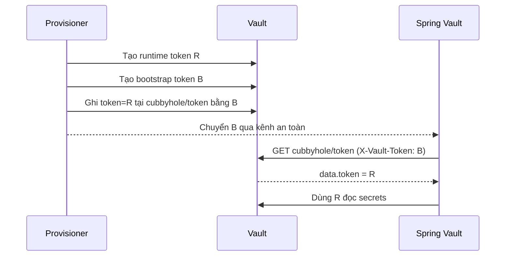
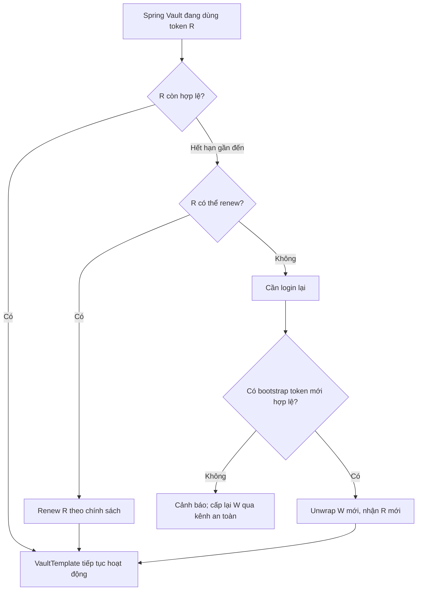

# CubbyholeAuthentication và token khởi tạo dùng cho việc nhận token khác

Một ứng dụng Java chạy với **Spring Vault** cần có cách lấy **Vault token đầu tiên** để gọi `VaultTemplate`. Khi không muốn cấp thẳng token vận hành cho máy chủ ứng dụng, một hệ thống triển khai có thể chỉ chuyển giao **token khởi tạo ngắn hạn**. Ứng dụng dùng token này nhận **token thứ hai** từ HashiCorp Vault rồi dùng token thứ hai để đọc KV secrets, gọi Transit encryption hoặc phát hành chứng thư PKI theo quyền được cấp.

Spring Vault cung cấp `CubbyholeAuthentication` cho kiểu chuyển giao này. Đây là một triển khai `ClientAuthentication` dựa trên Vault token và **cubbyhole**, vùng lưu trữ riêng gắn với từng Vault token. Có **hai cách** nhận token đích:

1. Dùng **response-wrapping token** một lần để **unwrap** phản hồi chứa token đích.
2. Dùng **bootstrap token** truy cập một path trong cubbyhole của chính token đó, nơi đã lưu sẵn token đích.

Điểm quan trọng của chương **Chứng thư và tài khoản** là hiểu **token nào dùng để khởi tạo, token nào dùng để vận hành, token nào hết hạn trước**, và vì sao cơ chế cấp token ảnh hưởng đến khởi động lại, renew/re-login và ứng phó khi lộ thông tin. Đây cũng là một phần trong toàn bộ chủ đề **SPRING_VAULT**: xác thực workload, chính sách phân quyền, vòng đời token/lease, xử lý lỗi, giám sát và kiểm thử tích hợp.

## 1. Mục tiêu

Sau bài học, bạn có thể:

- Giải thích vai trò của `CubbyholeAuthentication`, `CubbyholeAuthenticationOptions`, `VaultToken` và `SessionManager`.
- Phân biệt **bootstrap token**, **wrapping token**, **runtime/login token** và **token accessor**.
- Tạo một phản hồi cấp token có response wrapping, truyền wrapping token đến Spring Vault và dùng nó đúng một lần.
- Hiểu chế độ token được lưu tại `cubbyhole/token`, khác với cơ chế response wrapping.
- Cấu hình token lifecycle, nhận diện tình huống không thể re-login sau khi bootstrap token bị tiêu thụ.
- Xây dựng policy quyền tối thiểu, quy trình kiểm thử, giám sát và xử lý sự cố.

## 2. Các khái niệm nền tảng

### 2.1. Vault token và cubbyhole

Vault token là credential cho phép gọi các endpoint mà **ACL policies** của token cấp quyền. Nó có thể có TTL, khả năng renew, quan hệ parent–child, số lượt sử dụng giới hạn hoặc bị thu hồi.

**Cubbyhole secrets engine** là vùng lưu trữ riêng cho **từng token**. Hai token khác nhau không tự động nhìn thấy dữ liệu của nhau trong cubbyhole. Dữ liệu trong cubbyhole gắn với vòng đời token sở hữu; khi token bị thu hồi hoặc hết hiệu lực, dữ liệu đó không còn truy cập được. Không dùng cubbyhole như một KV database chia sẻ giữa các workload.

**Response wrapping** là cơ chế Vault chuyển một phản hồi nhạy cảm vào cubbyhole của **wrapping token ngắn hạn, dùng một lần**, rồi chỉ trả wrapping token cho phía tạo request. Bên nhận phải **unwrap** để lấy phản hồi thực.

### 2.2. Những tên gọi dễ nhầm

| Thuật ngữ | Ai có? | Dùng khi nào? | Quyền hoặc tuổi thọ |
| --- | --- | --- | --- |
| **Bootstrap token** | Client lúc khởi tạo | Chỉ để tìm và nhận token đích từ Vault | Nên ít quyền, ngắn hạn |
| **Response-wrapping token** | Hệ thống phân phối gửi cho client | Một lần gọi `sys/wrapping/unwrap` | Token bọc đặc biệt, TTL riêng, **single-use** |
| **Runtime/login token** | Spring Vault sau khi hoàn thành `login()` | Gọi KV, Transit, PKI và các API được phân quyền | TTL, renewability và ACL theo token thực |
| **Token accessor** | Hệ thống vận hành có quyền phù hợp | Lookup hoặc revoke gián tiếp theo accessor | **Không** phải bearer token dùng trực tiếp để đọc secrets |
| **Secret lease** | Vault cấp cùng dynamic secret | Gia hạn/thu hồi secret động | Khác vòng đời Vault login token |

Một bootstrap token trong chế độ **wrapped** chính là **wrapping token**. Trong chế độ **stored-token**, bootstrap token là một Vault token thông thường được cấp quyền truy cập **cubbyhole riêng của nó**. Cả hai cùng cho kết quả là token thứ hai, nhưng cơ chế đọc và tính một lần **không giống nhau**.

## 3. Tổng quan kiến trúc bootstrap hai token



Trong mô hình này:

- **Provisioner** có quyền phát hành token cho workload theo policy được thiết kế trước. Provisioner không cần chuyển token đích trực tiếp qua hệ thống giao nhận.
- **Ứng dụng** được đưa cho một token ngắn hạn `W`, bắt buộc dùng ngay trước khi hết TTL.
- **Vault** xác nhận wrapping token chưa bị tiêu thụ, giải bọc đúng một lần và trả phản hồi chứa runtime token `R`.
- **Spring Vault** dùng `R` để khởi tạo session; `VaultTemplate` nhận `R` thông qua session manager.

Đây là một **cách chuyển giao token an toàn hơn trong một số kiến trúc**, chứ không phải auth method kiểm tra AWS IAM, Kubernetes ServiceAccount hoặc certificate của client. Vault vẫn yêu cầu một bên có thẩm quyền cấp và phân phối bootstrap token đầu tiên.

## 4. Cách 1: nhận token bằng response wrapping

### 4.1. Provisioner tạo runtime token đã được wrap

Giả sử hệ thống ứng dụng `payment-service` cần đọc secret ở `secret/data/payment/runtime`. Quản trị viên chuẩn bị policy:

```hcl
# payment-runtime.hcl
path "secret/data/payment/runtime" {
  capabilities = ["read"]
}
```

Trong môi trường thử nghiệm, provisioner có quyền tạo token chạy:

```bash
vault policy write payment-runtime payment-runtime.hcl

# Chỉ trả về wrapping token W; token vận hành R nằm trong response bị wrap.
vault token create \
  -policy=payment-runtime \
  -ttl=1h \
  -renewable=true \
  -wrap-ttl=5m \
  -format=json
```

Đầu ra minh họa đã lược bỏ token thật:

```json
{
  "wrap_info": {
    "token": "<wrapping-token-W>",
    "ttl": 300,
    "creation_path": "auth/token/create",
    "creation_time": "2026-01-01T00:00:00Z"
  }
}
```

Trong trường hợp này:

- `-ttl=1h` thuộc **runtime token R** (giới hạn thực tế có thể bị policy/mount/max TTL điều chỉnh).
- `-wrap-ttl=5m` thuộc **wrapping token W**: ứng dụng phải nhận và unwrap trong thời gian ngắn này.
- Mỗi lần unwrap `W` thành công trả **phản hồi tạo token R**; `W` bị tiêu thụ và không thể sử dụng lần thứ hai.
- TTL của `R` bắt đầu theo thời điểm token được **tạo ở Vault**, không phải lúc Java process gọi `login()`.

**Tách trách nhiệm:** đầu ra chứa `W` chỉ được chuyển qua kênh đã xác thực và bảo vệ, có giới hạn người đọc. Không lưu vào Git, Docker image, ticket, log CI hoặc biến môi trường dùng chung nhiều workload.

### 4.2. Spring Vault dùng W để lấy R

Trong cấu hình Spring Vault, `CubbyholeAuthenticationOptions` nhận `initialToken` là `W` và gọi `wrapped()` để chọn cơ chế giải bọc.

```java
import org.springframework.context.annotation.Configuration;
import org.springframework.vault.authentication.ClientAuthentication;
import org.springframework.vault.authentication.CubbyholeAuthentication;
import org.springframework.vault.authentication.CubbyholeAuthenticationOptions;
import org.springframework.vault.support.VaultToken;
import org.springframework.vault.config.AbstractVaultConfiguration;

// Đoạn minh họa nằm trong cấu hình đã triển khai các method kết nối Vault
// (ví dụ vaultEndpoint()) theo AbstractVaultConfiguration.
@Configuration
class VaultBootstrapAuthenticationConfig extends AbstractVaultConfiguration {

    @Override
    public ClientAuthentication clientAuthentication() {
        String wrappingToken = System.getenv("VAULT_WRAPPING_TOKEN");
        if (wrappingToken == null || wrappingToken.isBlank()) {
            throw new IllegalStateException("Thiếu VAULT_WRAPPING_TOKEN");
        }

        CubbyholeAuthenticationOptions options =
                CubbyholeAuthenticationOptions.builder()
                        .initialToken(VaultToken.of(wrappingToken))
                        .wrapped()
                        .build();

        return new CubbyholeAuthentication(options, vaultClient());
    }

    // Các method cấu hình Vault endpoint/TLS cần được dự án bổ sung.
}
```

`CubbyholeAuthentication` triển khai `ClientAuthentication`. Khi `login()` được thực thi, thành phần này sử dụng token khởi tạo để **unwrap** và trả token đích cho cơ chế quản lý session của Spring Vault. Spring Vault hỗ trợ builder `wrapped()`, `initialToken(...)` và constructor `CubbyholeAuthentication(options, vaultClient())` theo tài liệu chính thức; hãy kiểm tra chữ ký của phiên bản dependency đang dùng.

**Lưu ý thiết kế:** đoạn class minh họa chưa phải ứng dụng có thể chạy độc lập; nó cần cấu hình Vault endpoint, TLS và các dependency `spring-vault-core`/Spring tương ứng. Không đưa token thật vào `VaultToken.of("...")` trong source.

### 4.3. API Vault phía dưới

Phép unwrap nên dùng endpoint được Vault hỗ trợ:

```http
POST /v1/sys/wrapping/unwrap
X-Vault-Token: <wrapping-token-W>
```

Vault dùng `W` để lấy response từ cubbyhole và tiêu thụ wrapping token. **Không dùng trực tiếp `GET /v1/cubbyhole/response`** cho response wrapping vì đây là cách cũ đã bị khuyến cáo thay thế bởi `sys/wrapping/unwrap`, vốn có kiểm tra/ghi audit phù hợp.

Không truyền `W` **đồng thời** vào `X-Vault-Token` và trường JSON `token` của cùng request unwrap: Vault cảnh báo rằng cách làm đó có thể khiến wrapping token bị tiêu thụ nhưng dữ liệu không được trả đúng.

### 4.4. Kiểm tra nguồn gốc trước khi unwrap

Response wrapping cung cấp thêm cơ chế phát hiện can thiệp:

1. Nếu chờ nhận `W` mà hệ thống phân phối không gửi, coi đây là bất thường cần điều tra.
2. Có thể gọi `sys/wrapping/lookup` để xem thời điểm tạo, TTL còn lại và **`creation_path`** mà không unwrap.
3. So sánh `creation_path` với endpoint được phép, ví dụ `auth/token/create`, để tránh nhận nhầm một response do nguồn khác tạo.
4. Chỉ sau khi kiểm tra nguồn gốc, mới unwrap một lần; nếu token đã bị dùng hoặc hết hạn, không bỏ qua lỗi.

Ví dụ:

```bash
# Không ghi wrapping token thật vào lệnh shell history.
# VAULT_WRAPPING_TOKEN được hệ thống phân phối qua kênh tin cậy.
VAULT_TOKEN="$VAULT_WRAPPING_TOKEN" vault write -force sys/wrapping/lookup
```

Ví dụ CLI lookup trên chỉ minh họa thao tác với token đã có; cú pháp request có thể thay đổi theo CLI/Vault version. **Không dùng lệnh `unwrap` ở ngoài ứng dụng rồi lại đưa cùng `W` cho Spring Vault**: wrapping token chỉ dùng một lần.

## 5. Cách 2: bootstrap token đọc token đã lưu ở cubbyhole

`CubbyholeAuthentication` cũng có chế độ **stored-token**. Provisioner tạo:

- Token **B**: bootstrap token thông thường, ngắn hạn/giới hạn lượt sử dụng.
- Token **R**: runtime token có policy cần thiết.
- Ghi một bản ghi `{"token":"<runtime-token-R>"}` vào **cubbyhole của B** tại `cubbyhole/token`.

Khi Java process có `B`, nó có thể đọc `cubbyhole/token` bằng `B` để lấy `R`:



Điểm then chốt: **cubbyhole thuộc token B**, nên provisioner phải ghi bằng chính `B` (hoặc quy trình Vault cho phép thực hiện tương đương). Không thể tạo bản ghi bằng token quản trị `P` rồi mặc nhiên cho `B` nhìn thấy vì mỗi token có cubbyhole riêng.

### 5.1. Ví dụ lệnh thử nghiệm

Tài liệu chính thức minh họa một bootstrap token orphan, không default policy, ít lượt sử dụng và một runtime token được tạo trước:

```bash
# Thực hiện trong môi trường thử nghiệm bằng tài khoản cấp token.
vault token create -policy=payment-runtime -ttl=1h
vault token create -orphan -no-default-policy -policy=none -ttl=10m -use-limit=3

# Sau khi cấp phát B và R, chuyển sang ngữ cảnh token B để ghi:
# VAULT_TOKEN=<bootstrap-token-B> vault write cubbyhole/token token=<runtime-token-R>
```

**Đây là mô tả thao tác cấp phát, không phải script production**: dòng cuối có placeholder, và giá trị token không được đưa vào command-line arguments vì có thể lộ qua history hoặc process inspection. Provisioner thực tế nên dùng client API/secret channel an toàn, giới hạn TTL/use-limit và ghi nhận audit. Lượt sử dụng `B` phải đủ cho **ghi chuẩn bị** và **đọc nhận token** (cũng như lookup nếu có), không được đặt quá thấp khiến ứng dụng hết lượt trước khi nhận `R`.

### 5.2. Spring Vault đọc path cubbyhole

Khi `B` đã được cấp:

```java
CubbyholeAuthenticationOptions options =
        CubbyholeAuthenticationOptions.builder()
                .initialToken(VaultToken.of(bootstrapToken))
                .path("cubbyhole/token")
                .build();

ClientAuthentication authentication =
        new CubbyholeAuthentication(options, vaultClient);
```

Trong đó `bootstrapToken` và `vaultClient` là các biến ứng dụng đã cấp qua cấu hình/DI, không phải tên API toàn cục. **Không gọi `wrapped()`** trong chế độ này; Spring Vault nhận token từ trường `data.token` của response thay vì tự unwrap một response đặc biệt.

### 5.3. So sánh hai cách nhận token

| Thuộc tính | **Response wrapping** | **Stored token trong cubbyhole** |
| --- | --- | --- |
| Initial token | `W`: wrapping token single-use | `B`: Vault token sở hữu cubbyhole |
| Spring options | `.initialToken(W).wrapped()` | `.initialToken(B).path("cubbyhole/token")` |
| Đường API | `POST sys/wrapping/unwrap` | Đọc `cubbyhole/token` |
| Dữ liệu lấy về | Phản hồi gốc của thao tác tạo token, có token R | Field `token` do provisioner lưu, chứa R |
| Sử dụng lại initial token | Không: unwrap thành công **tiêu thụ W** | Phụ thuộc TTL, use-limit, quyền và vòng đời của B |
| Tính chất bảo vệ | Một lần, TTL ngắn, kiểm tra `creation_path` | Cubbyhole riêng theo token B; provisioner quản lý dữ liệu trong đó |
| Trường hợp phù hợp | Phân phối token một lần cho app boot | Bootstrap token có quy trình nạp dữ liệu riêng và kiểm soát số lượt đọc |

Hai kiểu này **không nên trộn lẫn**. Một wrapping token do `vault token create -wrap-ttl=...` sinh ra không phải bootstrap token chứa sẵn một field `cubbyhole/token` tùy ý.

## 6. Spring Cloud Vault Config: chế độ CUBBYHOLE

Khi dự án dùng **Spring Cloud Vault**, có thể chọn chế độ xác thực bằng cấu hình:

```yaml
spring:
  cloud:
    vault:
      uri: https://vault.example.internal:8200
      authentication: CUBBYHOLE
      token: "<wrapping-token-W-duoc-inject-an-toan>"
```

Đây là **ví dụ cấu trúc**, token là placeholder và phải được inject tại runtime từ hệ thống phân phối tin cậy. Spring Cloud Vault sử dụng chế độ **response wrapping** cho `CUBBYHOLE`. Nếu cần **stored-token** với path tùy chỉnh, hãy dùng cấu hình `ClientAuthentication` của Spring Vault theo `CubbyholeAuthenticationOptions.path(...)`.

Giá trị `spring.cloud.vault.token` trong trường hợp này là **token khởi tạo W**, **không phải** token vận hành R; sau khi Spring Cloud Vault unwrap thành công, các request Vault tiếp theo sử dụng R.

Đừng nhầm `authentication: TOKEN` (dùng một token có sẵn trực tiếp) với `authentication: CUBBYHOLE` (đổi token khởi tạo lấy một token khác).

## 7. Tích hợp với VaultTemplate và chính sách tối thiểu

`CubbyholeAuthentication` chỉ giải quyết cách lấy **token vận hành R**; quyền gọi secrets engines phụ thuộc chính sách của R:

```hcl
path "secret/data/payment/runtime" {
  capabilities = ["read"]
}

path "transit/encrypt/payment-key" {
  capabilities = ["update"]
}

# Nếu workload còn phải xin chứng thư PKI, cấp riêng đúng issue role:
# path "pki/issue/payment-service" { capabilities = ["update"] }
```

Đừng cấp quyền `root` hoặc `sudo` cho runtime token chỉ để đọc một secret. Cũng không cần cấp cho wrapping token những quyền `secret/data/...`, `transit/...` hoặc `pki/...`: vai trò của wrapping token là **unwrap**, không thực thi nghiệp vụ.

Ví dụ service Java sau khi Spring Vault đã được cấu hình session:

```java
import org.springframework.vault.core.VaultOperations;
import org.springframework.vault.core.VaultKeyValueOperationsSupport;
import org.springframework.vault.support.VaultResponse;

public final class PaymentSecrets {
    private final VaultOperations vault;

    public PaymentSecrets(VaultOperations vault) {
        this.vault = vault;
    }

    public VaultResponse currentRuntimeConfig() {
        return vault.opsForKeyValue(
                "secret",
                VaultKeyValueOperationsSupport.KeyValueBackend.KV_2)
                .get("payment/runtime");
    }
}
```

`VaultTemplate`/`VaultOperations` thực hiện request với **token R do session manager đang giữ**, không trực tiếp gửi W hoặc B đi đọc KV. Kết quả `VaultResponse` có thể chứa secret; tránh in response ở log.

## 8. TTL, self-lookup, renew và re-login

### 8.1. Hai đồng hồ TTL độc lập

Giả sử provisioner tạo token R lúc 09:00 với TTL 60 phút, bọc phản hồi bằng W có TTL 5 phút:

| Thời điểm | W | R |
| --- | --- | --- |
| 09:00 | Mới tạo, còn 5 phút | Mới tạo, còn khoảng 60 phút |
| 09:04 | Gần hết TTL, vẫn chưa unwrap | Đã trôi qua 4 phút TTL của R |
| 09:04:30 | Unwrap thành công, W bị tiêu thụ | Còn khoảng 55 phút 30 giây, nếu không bị giới hạn khác |
| 09:05 | W không còn hợp lệ | R vẫn có thể dùng theo TTL/policy riêng |

**Unwrap không đặt lại TTL cho token R.** Nếu application khởi động sát khi W hết hạn, unwrap có thể thất bại dù R còn TTL. Nếu R đã hết hạn trước khi được unwrap, chỉ unwrap thành công cũng không làm R có hiệu lực trở lại.

### 8.2. Spring Vault cần biết TTL còn lại của R

Token lấy từ cubbyhole không nhất thiết kèm đủ thông tin `ttl`/`renewable`. `CubbyholeAuthentication` hỗ trợ **self-lookup** cho token đích để xác định thời gian còn lại và khả năng gia hạn (builder `selfLookup(boolean)`, mặc định bật). Các token có TTL bắt đầu đếm **khi tạo** nên self-lookup giúp tránh đánh giá sai vì thời gian nằm trong wrapping hoặc thời gian vận chuyển.

Không tùy ý tắt `selfLookup` chỉ để tránh một lỗi quyền, bởi session manager có thể thiếu thông tin để renew đúng cách. Với trường hợp token không có TTL, Spring Vault có hành vi riêng khi lookup; cần kiểm tra loại token và thông tin Vault trả về.

### 8.3. LifecycleAwareSessionManager và bootstrap một lần

Spring Vault `LifecycleAwareSessionManager` có thể **renew R** nếu R là token renewable và chính sách/giới hạn cho phép. Khi R đã hết hạn hoặc không thể renew nữa, session manager có thể gọi lại `ClientAuthentication.login()`.

Đây là rủi ro chính của **wrapped-token mode**: nếu gọi lại `CubbyholeAuthentication.login()` bằng W đã unwrap lần trước, Vault sẽ từ chối vì **W là single-use**. Vì vậy:

- Thiết kế cấp **W mới** kịp thời khi cần bootstrap lại; điều đó có thể yêu cầu app restart hoặc một cơ chế nạp credential bootstrap mới có chủ đích.
- Chọn TTL/max TTL/renewability của R đủ cho vòng đời workload, nhưng không biến R thành token dài hạn vô hạn chỉ để né re-login.
- Hoặc chọn auth method phù hợp hơn với workload chạy dài hạn (Kubernetes, AppRole, AWS IAM, certificate...) có thể **tự tạo token mới bằng credential có vòng đời quản lý riêng**.
- Không lặp vô hạn yêu cầu unwrap cùng W khi nó đã dùng hoặc hết hạn.



Lưu ý: sơ đồ trên là **chiến lược vận hành**. Việc đổi W mới ở runtime phụ thuộc cách ứng dụng cấu hình `ClientAuthentication`; không mặc định Spring Vault tự gọi provisioner tạo wrapping token mới.

### 8.4. Độc lập với secret lease

Runtime token R dùng để gọi Vault. Khi Vault phát hành **dynamic database credentials** hoặc **PKI certificate**, response có thể có **lease riêng** (với TTL/renew/revoke theo secrets engine). Gia hạn **R** không tự động gia hạn mọi **lease** của secrets động. Đây là hai vòng đời cần theo dõi riêng.

## 9. Quy trình cấp phát và kiểm tra nguồn gốc

Một quy trình triển khai hợp lý:

1. **Provisioner** xác định đúng workload, policy, token TTL và danh tính/môi trường nhận credential.
2. Tạo runtime token R theo ACL tối thiểu, wrap phản hồi ngay tại Vault và chỉ chuyển **W**.
3. Gắn W với **một lần boot** cụ thể; đặt TTL đủ cho thời gian vận chuyển nhưng ngắn hơn thời hạn thông thường của R.
4. Bên nhận xác minh **có W, chưa hết hạn, creation_path đúng dự kiến**. Một wrapper từ `sys/wrapping/wrap` hay path không mong muốn phải được kiểm tra kỹ.
5. Spring Vault dùng W để unwrap, nhận R và lập session, không phát tán R ra log.
6. Thu hồi token theo quy trình khi deployment kết thúc hoặc sự cố xảy ra. Nếu hệ thống giữ `wrapped_accessor`, nó có thể hữu ích cho quản trị mà không phải tiết lộ token ID của R.

Không chỉ dựa vào việc W là single-use để bảo đảm nguồn phân phối đáng tin cậy: kẻ tấn công có W trước ứng dụng có thể unwrap trước; ứng dụng sau đó sẽ gặp lỗi. Việc **phát hiện lỗi unwrap đã bị dùng** là một tín hiệu cần điều tra.

## 10. Lỗi thường gặp và hướng xử lý

| Dấu hiệu | Nguyên nhân có thể | Hướng xử lý |
| --- | --- | --- |
| `login()` báo unwrap token không hợp lệ | W đã dùng một lần hoặc đã hết TTL | Kiểm tra `sys/wrapping/lookup`, thời điểm cấp, audit; yêu cầu W mới, điều tra nếu bị dùng trước |
| App khởi động lại với cùng W thất bại | W single-use đã được tiêu thụ ở lần boot trước | Cấp bootstrap token **mới** cho lần boot mới |
| W còn hạn nhưng response không như kỳ vọng | Provisioner wrap nhầm endpoint hoặc payload | Xác minh `creation_path` trước unwrap, cấu hình provisioner |
| Self-lookup R thất bại | R bị thu hồi/hết hạn hoặc thiếu điều kiện để lookup | Kiểm tra TTL/revocation, cách cấp token, cấu hình `selfLookup` |
| Token R đọc KV bị 403 | Policy R không có `read` trên KV v2 `data/` đúng path | Kiểm tra ACL của R; không mở rộng quyền W |
| `VaultTemplate` thất bại sau vài giờ | R chạm max TTL, không thể renew và không có W mới | Thiết kế rotate/bootstrapping, cải thiện session monitoring |
| Stored mode không đọc được `cubbyhole/token` | Dữ liệu được ghi bằng token khác hoặc B hết TTL/use-limit | Kiểm tra token **sở hữu** cubbyhole và lượt sử dụng còn lại |
| Stored mode nhận response nhưng thiếu `token` | Provisioner ghi sai schema/path | Ghi lại đúng field `token` trong cubbyhole của B |
| Khác biệt giữa local và production | Vault URL/TLS, namespace, policy hoặc Spring Vault version khác | Kiểm tra config môi trường, request path và phiên bản thư viện |
| Lộ W trong log CI | Bootstrap token được in từ job cấp phát | Dừng phân phối, thu hồi/đổi token và điều tra audit, xoá nguồn lộ |

### Kiểm tra mà không làm lộ token

- Dùng log ở mức **loại lỗi, endpoint, request ID, timestamp, trạng thái**; không log giá trị `X-Vault-Token` hay JSON chứa secret.
- Theo dõi số lần **unwrap thành công/thất bại**, **token renew thất bại**, TTL còn lại, số lần **bootstrap lại** và số request KV bị 403.
- Phân biệt HTTP lỗi của **unwrap**, lỗi **self-lookup R** và lỗi **ACL của R**; ba vấn đề có nguyên nhân và quyền khác nhau.
- Vault audit log rất hữu ích để tìm token accessor, creation path và thời điểm thao tác nhưng bản thân audit cũng cần kiểm soát truy cập.

## 11. Kiểm thử tích hợp

Chạy các kịch bản sau trong **Vault test environment** với các token thử nghiệm, policy tối thiểu và secret không nhạy cảm. Có thể dùng Vault dev mode để học API, nhưng không dùng dev mode cho production.

| Ca | Chuẩn bị/thao tác | Kỳ vọng |
| --- | --- | --- |
| 1. Wrapped boot thành công | Tạo R, wrap lấy W, khởi động Spring Vault với W | `login()` lấy R, `VaultTemplate` đọc đúng KV |
| 2. Wrapped token single-use | Unwrap W thành công rồi thử lại W | Yêu cầu thứ hai bị từ chối |
| 3. Wrapped TTL hết hạn | Giữ W đến sau TTL | Không unwrap được, cần W mới |
| 4. creation_path bất thường | Dùng W từ endpoint khác | Lookup phát hiện path ngoài danh sách được phép trước unwrap |
| 5. Runtime token thiếu ACL | R không có `read` trên KV v2 | Login vẫn có thể thành công, KV request bị từ chối |
| 6. TTL của R chạy từ lúc cấp | Đợi vài phút rồi unwrap | Remaining TTL của R thấp hơn TTL ban đầu |
| 7. Renew R | R renewable và đủ điều kiện | Session renew thành công, không cần W mới |
| 8. Re-login sau max TTL | R không renew nữa, chỉ còn W đã dùng | Login mới thất bại, cần bootstrap mới |
| 9. Restart cùng W | Boot app lần nữa bằng W cũ | Không thể unwrap lại |
| 10. Stored-token boot | B sở hữu `cubbyhole/token` chứa R | `path("cubbyhole/token")` đọc R thành công |
| 11. Stored-token sai owner | Ghi token bằng cubbyhole của B1, đọc bằng B2 | B2 không thấy dữ liệu của B1 |
| 12. Stored-token giới hạn lượt dùng | B có TTL/use-limit chặt | Khi vượt giới hạn, đọc không thành công; không dùng lại B đã hết hiệu lực |
| 13. Token R bị revoke | Thu hồi R sau login | Request bằng R thất bại dù W trước đó hợp lệ |

Trong mỗi test, xác minh **token được dùng trên mỗi request**, trạng thái TTL/renewability, quyền và số lần unwrap. Test về replay và token hết hạn phải độc lập để không làm tiêu thụ token dùng cho ca khác.

## 12. Những lựa chọn kiến trúc nên cân nhắc

| Trường hợp | Cách phù hợp | Điều kiện đi kèm |
| --- | --- | --- |
| Cấp token cho một deployment mới, boot một lần | `CubbyholeAuthentication` với W từ response wrapping | Có provisioner và kênh giao token tin cậy |
| Đọc token R từ kho cubbyhole riêng của B | Stored-token mode | Provisioner ghi bằng B, quản lý TTL/use-limit |
| Ứng dụng sống dài, cần re-login tự động nhiều lần | Kubernetes/AppRole/IAM/cert auth tùy môi trường | Cơ chế xác thực có thể cấp token mới khi token cũ hết hạn |
| Đã có token vận hành từ cơ chế ngoài và có thể renew | `TokenAuthentication` | Không cần bootstrap hai token |
| Cấp một secret khác qua response wrapping | HTTP `sys/wrapping/unwrap` hoặc API phù hợp | `CubbyholeAuthentication` dành cho **nhận login token**, không xử lý mọi payload tùy ý |

Không nhầm **chuyển giao token bằng cubbyhole** với **xác thực tài khoản người dùng**: `CubbyholeAuthentication` là một kiểu **secure introduction** dựa trên token có sẵn. Chất lượng bảo vệ cuối cùng phụ thuộc vào bên cấp token, kênh giao W/B, policy của R và xử lý vòng đời session.

## 13. Câu hỏi tự kiểm tra

1. Nếu client chỉ nhận W, token nào được dùng trong lời gọi `VaultTemplate.opsForKeyValue(...)` sau login?
2. Vì sao không thể dùng W lần hai sau khi ứng dụng restart?
3. Trong stored-token mode, vì sao B2 không tự đọc được `cubbyhole/token` mà provisioner đã ghi bằng B1?
4. Với W TTL 5 phút và R TTL 1 giờ, unwrap ở phút thứ 4 có làm R có thêm một giờ mới không?
5. Khi R đến terminal TTL, `LifecycleAwareSessionManager` có thể tự tạo W mới không?
6. `wrapped_accessor` khác gì với token ID dùng cho request Vault?
7. Nếu unwrap thành công nhưng đọc secret KV trả 403, nên sửa policy của W hay R?

**Điểm cần nhớ:** `CubbyholeAuthentication` lấy **một token khởi tạo** để nhận **một Vault token thứ hai**. Chế độ `wrapped()` dùng **wrapping token một lần**; chế độ `path(...)` đọc **data.token trong cubbyhole của bootstrap token**. Sau bootstrap, ứng dụng sống bằng token đích R và các giới hạn TTL/renewability/ACL của chính nó. Thiết kế re-login và phân phối W/B mới là phần không thể thiếu để vận hành an toàn.

## Tài liệu tham khảo

- [Spring Vault – Authentication Methods: Cubbyhole authentication](https://docs.spring.io/spring-vault/reference/vault/authentication.html)
- [Spring Vault – CubbyholeAuthentication Javadoc](https://docs.spring.io/spring-vault/reference/api/java/org/springframework/vault/authentication/CubbyholeAuthentication.html)
- [Spring Vault – CubbyholeAuthenticationOptions Javadoc](https://docs.spring.io/spring-vault/reference/api/java/org/springframework/vault/authentication/CubbyholeAuthenticationOptions.html)
- [Spring Cloud Vault – Authentication Methods: CUBBYHOLE](https://docs.spring.io/spring-cloud-vault/reference/authentication.html)
- [HashiCorp Vault – Response wrapping](https://developer.hashicorp.com/vault/docs/concepts/response-wrapping)
- [HashiCorp Vault – HTTP API: sys/wrapping/unwrap](https://developer.hashicorp.com/vault/api-docs/system/wrapping-unwrap)
- [HashiCorp Vault – Cubbyhole secrets engine](https://developer.hashicorp.com/vault/docs/secrets/cubbyhole)
