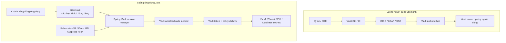
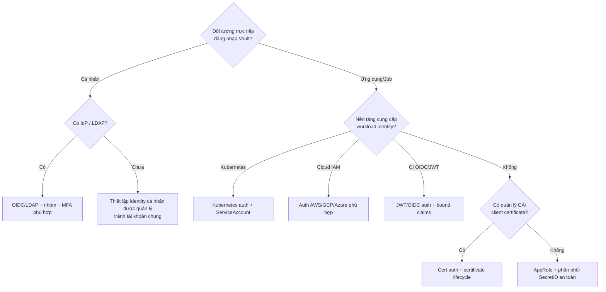
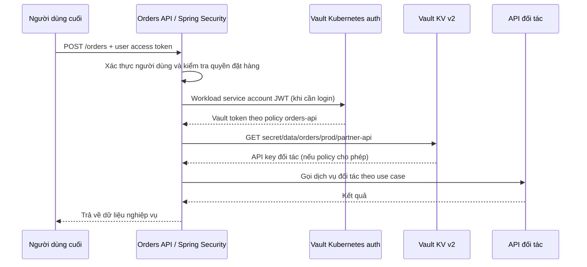

# Chọn xác thực theo người dùng hay theo danh tính dịch vụ

## 1. Vấn đề kiến trúc cần giải quyết

Trong chương **Chứng thư và tài khoản**, quyết định quan trọng khi dùng **Spring Vault** không chỉ là chọn phương thức đăng nhập HashiCorp Vault, mà là trả lời chính xác: **ai hoặc cái gì đang yêu cầu secret, thay mặt ai và quyền nào được phép sử dụng?**

Một lập trình viên đăng nhập Vault CLI để kiểm tra cấu hình và một ứng dụng Java chạy liên tục trên Kubernetes đều cần Vault token. Tuy nhiên, hai đối tượng có đặc tính hoàn toàn khác:

- **Người dùng (human identity)**: có cá nhân chịu trách nhiệm, tương tác trực tiếp, thuộc nhóm/quyền có thể thay đổi, thường xác thực bằng SSO, OIDC, LDAP và có thể cần MFA.
- **Danh tính dịch vụ (workload/machine identity)**: đại diện cho một ứng dụng, Job hoặc tiến trình; cần đăng nhập tự động khi khởi động, hoạt động không có người trực, tự làm mới token và bị giới hạn theo workload/môi trường.

Bài này hướng dẫn chọn và triển khai mô hình xác thực phù hợp cho ứng dụng Java dùng `VaultTemplate` / `VaultOperations`, KV secrets, Transit, PKI và secret động có lease. Đồng thời phân biệt **chứng thư TLS**, **chứng thư định danh client** và **chứng thư do Vault PKI cấp** để tránh ghép sai các cơ chế bảo mật.

Sau khi học, bạn có thể:

1. Chọn **OIDC/LDAP hoặc tương đương** cho người thao tác Vault và **Kubernetes/cloud IAM/AppRole/cert auth hoặc tương đương** cho workload.
2. Phân biệt xác thực giữa *người dùng → ứng dụng* và *ứng dụng → Vault*, thiết kế phân quyền không vượt phạm vi.
3. Ánh xạ một danh tính thành Vault auth role, token, identity/entity và policy có vòng đời hợp lý.
4. Cấu hình Spring Cloud Vault/Spring Vault cho ứng dụng Java, xác minh quyền KV v2 và xử lý token renewal.
5. Giải thích vì sao chứng thư/mật khẩu/API key là **phương tiện chứng minh danh tính**, chưa đủ để quyết định quyền.

## 2. Phân biệt các lớp danh tính và thông tin xác thực

Các thuật ngữ thường bị trộn lẫn:

| Khái niệm | Trả lời câu hỏi | Ví dụ |
|---|---|---|
| **Principal / identity** | Ai đang hành động? | Nhân viên `alice@company.example`; service account `orders-api` |
| **Credential** | Chứng minh danh tính bằng gì? | OIDC login, Kubernetes service account JWT, IAM-signed JWT, TLS client certificate, AppRole SecretID |
| **Authentication method** | Vault kiểm tra credential qua cơ chế nào? | `oidc`, `ldap`, `kubernetes`, `aws`, `gcp`, `approle`, `cert` |
| **Vault auth role/binding** | Danh tính nào phù hợp điều kiện đăng nhập? | Vault role chỉ chấp nhận Kubernetes SA `orders-api` trong namespace `payments` |
| **Vault token** | Kết quả phiên đăng nhập được dùng để gọi Vault | Token có TTL, policy và khả năng renew/revoke |
| **Vault policy** | Sau đăng nhập được làm gì? | Chỉ `read` một KV v2 path, chỉ `encrypt` bằng một Transit key |
| **Vault identity entity/alias** | Vault liên kết identity ở nhiều auth method ra sao? | Entity cá nhân có alias từ OIDC; entity workload có alias từ Kubernetes auth |

**Authentication** xác định và xác minh danh tính; **authorization** quyết định quyền. Một workload được Vault xác thực thành công vẫn phải bị từ chối khi đọc secret không thuộc policy.

Trong Vault, `auth/<mount>/login` thường trả về token gắn với policies, TTL và metadata. Ứng dụng dùng token đó cho các lời gọi sau. Không đưa credential gốc hoặc Vault token vào log, trace, URL, crash report hay response gửi cho người dùng cuối.

### Sơ đồ hai luồng thường gặp



Đường xác thực **khách hàng → `orders-api`** và đường xác thực **`orders-api` → Vault** không mặc nhiên phải dùng chung identity. Trong phần lớn backend, ứng dụng xác thực người dùng với IdP/API gateway, kiểm tra quyền nghiệp vụ, sau đó dùng **danh tính workload riêng** để gọi Vault.

## 3. Quy tắc chọn nhanh theo tình huống

**Câu hỏi đầu tiên:** *Ai trực tiếp khởi tạo một phiên Vault và có ai có thể tham gia tương tác lúc đăng nhập không?* Nếu là người đang làm việc qua CLI/UI, ưu tiên định danh cá nhân. Nếu là ứng dụng/job chạy tự động, ưu tiên định danh workload được máy chủ xác thực.

| Bối cảnh | Danh tính nên dùng | Auth method thường phù hợp | Lý do |
|---|---|---|---|
| Kỹ sư đăng nhập Vault CLI/UI | Cá nhân từ IdP | OIDC/SSO, LDAP | Audit theo người, quyền theo nhóm, kết thúc quyền khi nhân viên rời nhóm |
| SRE vận hành khẩn cấp | Cá nhân có quy trình nâng quyền | OIDC + kiểm soát truy cập đặc quyền | Truy vết và giới hạn thời gian quyền cao |
| Spring Boot chạy trên Kubernetes | Service account gắn Pod | Kubernetes auth | Có bằng chứng gắn với workload, không cần mật khẩu lưu trong image |
| Java service chạy trên AWS/GCP/Azure | Workload cloud identity | Auth tích hợp IAM/cloud provider tương ứng | Tránh phát hành credential tĩnh, giới hạn theo identity cloud |
| Batch/CI có OIDC workload token | Danh tính pipeline/job cụ thể | JWT/OIDC auth hoặc cơ chế cloud tương ứng | Ràng buộc repository, branch, environment, audience |
| JVM chạy trên VM/on-prem không có workload identity phù hợp | Danh tính dịch vụ riêng | AppRole, hoặc cert auth có quản lý vòng đời | Cho phép tự động đăng nhập nếu SecretID/khóa được phân phối an toàn |
| Agent hoặc ứng dụng có client certificate được quản lý | Danh tính dịch vụ ánh xạ chứng thư | Cert auth khi đáp ứng yêu cầu TLS và quản trị CA | Chứng minh quyền sở hữu private key, luân phiên/revoke chứng thư |
| Khách hàng cuối gọi API nghiệp vụ | Danh tính khách hàng của **ứng dụng** | OIDC/JWT ở API gateway/Spring Security | Ứng dụng quyết định quyền nghiệp vụ; thường không tạo Vault token cho từng khách hàng |

Không chọn `userpass` cho mọi tác nhân chỉ vì cấu hình dễ. Tài khoản Vault dùng chung trong nhiều microservice khiến khó tách quyền, thu hồi credential và xác định nguồn của sự kiện audit. Cũng không dùng token của kỹ sư làm credential chạy nền cho ứng dụng production.

### Cây quyết định



Đây là cách lọc lựa chọn ban đầu, không thay thế threat model. Quyết định cuối cùng còn phụ thuộc hỗ trợ của phiên bản Vault/Spring Vault, chính sách IAM và năng lực quản trị khóa/credential của tổ chức.

## 4. Xác thực theo người dùng: OIDC, LDAP và trách nhiệm cá nhân

Khi người dùng cần trực tiếp làm việc với Vault qua **CLI, UI hoặc một công cụ được ủy quyền**, mục tiêu là liên kết mỗi phiên với người thao tác và nhóm quyền của họ.

### 4.1. OIDC/SSO thường là lựa chọn ưu tiên

OIDC auth cho phép Vault dựa vào tổ chức quản lý danh tính tập trung. Một luồng điển hình:

1. Kỹ sư bắt đầu `vault login -method=oidc` hoặc đăng nhập từ Vault UI.
2. IdP xác thực cá nhân, có thể áp dụng MFA và kiểm tra chính sách truy cập.
3. Vault kiểm tra token/claims của IdP theo OIDC role được cấu hình và xác định alias/entity/group.
4. Vault cấp token với policies/TTL tương ứng; CLI/UI dùng token đó khi thao tác.

Ví dụ CLI minh họa:

```bash
# Role được người vận hành cấu hình trước tại auth mount oidc.
vault login -method=oidc role=developers
```

Trong sản phẩm thật, cần cấu hình chặt `bound_audiences`/issuer, callback/redirect URIs, claim ánh xạ username và groups cùng token TTL tùy môi trường. Không lấy tự do một claim như `role=admin` từ JWT chưa được xác minh làm quyền Vault.

Với CLI login tương tác, auth flow qua browser có thể yêu cầu redirect hoặc thiết bị theo cấu hình IdP. Token Vault sau khi login vẫn có thời hạn riêng; thoát khỏi ứng dụng hoặc IdP không đồng nghĩa mọi Vault token đã phát hành tự động bị revoke ngay, nên cần quy trình thu hồi/quản lý TTL.

### 4.2. LDAP và userpass dùng khi nào?

- **LDAP** phù hợp khi tổ chức đã vận hành directory tập trung, có cơ chế cấp/thu hồi tài khoản và group mapping. Cần áp dụng kết nối có bảo vệ, chính sách khóa tài khoản và MFA ở lớp hỗ trợ.
- **Userpass** xác thực bằng username/password do Vault quản lý; dễ cho lab, môi trường hẹp hoặc tình huống đặc thù nhưng đòi hỏi quản lý vòng đời mật khẩu. Không nên biến userpass thành một service account/password dùng chung giữa nhiều JVM.
- **Token trực tiếp** phù hợp với tác vụ đã có quy trình ủy quyền đặc biệt; token root/administrator không nên đặt vào biến môi trường hay image của ứng dụng production.

Người vận hành có thể cần quyền xem metadata, liệt kê một số đường dẫn, hoặc quyền bảo trì có thời hạn. Cần tách riêng **quyền đọc secret** và **quyền vận hành auth/policy/PKI** để tránh việc mọi kỹ sư đều có thể xem plaintext credentials production.

## 5. Xác thực theo danh tính dịch vụ: nên gắn với môi trường chạy

Workload cần khởi động và tự phục hồi mà không chờ người nhập OTP, mở browser hoặc đổi mật khẩu thủ công. Vì vậy, auth method nên dựa vào một bằng chứng mà nền tảng đã cấp cho **đúng workload** và có thể xác minh ở phía Vault.

### 5.1. Kubernetes authentication

Khi `orders-api` chạy trong namespace `payments`, Pod dùng Kubernetes service account `orders-api` và một projected service-account JWT phù hợp. Vault Kubernetes auth xác minh JWT và ràng buộc role với service account/namespace được phép.

Các điều kiện cần xác minh:

- Workload thật sự chạy dưới service account đúng; không dựa vào tên Deployment để suy identity.
- Vault đã cấu hình Kubernetes auth method, Kubernetes API/token reviewer hoặc phương thức xác minh phù hợp.
- Role chỉ cho phép service account `orders-api` trong namespace `payments`, cân nhắc `audience` có chủ đích và giới hạn Vault token TTL.
- Token được mount/cung cấp đúng nơi ứng dụng hoặc sidecar đọc; không copy token ra file trong repository.

Nếu dùng Kubernetes projected token có audience chuyên biệt cho Vault, phải cấu hình **cả** phía phát hành token lẫn Vault role tương thích. Không giả định token mặc định trên mọi cluster có đúng audience.

### 5.2. Cloud IAM và CI identity

Trên AWS/GCP/Azure, thường chọn auth method phù hợp với workload identity của nền tảng. Ví dụ, một service trên GCP có thể dùng GCP IAM auth để ký bằng service account, đăng nhập Vault rồi nhận Vault token. Trên AWS hoặc Azure, cơ chế chứng minh identity và binding role có chi tiết khác: **không áp dụng một mẫu sign-in cho mọi cloud**.

Với CI/CD có OIDC token phát hành cho pipeline, cấu hình Vault JWT/OIDC auth để kiểm tra issuer, audience và **bound claims** như repository, environment, branch hoặc workflow theo yêu cầu. Một pipeline phát hành artifact và một pipeline triển khai production nên có danh tính và quyền riêng. Tuyệt đối không đặt Vault token production tồn tại lâu trong CI variables khi có thể dùng identity được phát hành theo job.

### 5.3. AppRole trong môi trường không có identity nền tảng

AppRole dùng **RoleID** (định danh role) và **SecretID** (giá trị bí mật chứng minh quyền đăng nhập). Khi chọn AppRole, rủi ro chính là *bootstrap*: ứng dụng lấy SecretID ban đầu từ đâu?

Nên cung cấp SecretID qua kênh phân phối an toàn đã được ủy quyền, dùng giới hạn TTL/số lượt sử dụng, CIDR binding nếu phù hợp, response wrapping và cơ chế rotation/thu hồi. Nếu SecretID nằm cố định trong image, source code hoặc file cấu hình được chia sẻ rộng, AppRole chỉ thay thế một mật khẩu tĩnh bằng một bí mật tĩnh khác.

### 5.4. Certificate authentication

Vault cert auth có thể xác thực dịch vụ qua **TLS client certificate**. Cần kiểm tra CA được tin cậy, ràng buộc certificate với role/identity, private key protection và các điều kiện certificate (CN/SAN/subject hoặc extensions theo cấu hình).

Với chứng thư:

- Private key phải được bảo vệ và cấp riêng cho workload/instance theo mô hình tin cậy; tránh dùng cùng một cặp cert/key cho mọi service.
- Có kế hoạch cấp mới, gia hạn, rollover, revoke và xử lý certificate hết hạn.
- Xem xét hành vi TLS handshake khi dùng client certificate và cấu hình Vault listener/proxy, không tắt xác minh TLS để "đăng nhập cho dễ".
- Kiểm soát cert sau khi bị thu hồi; sự kiện revoke certificate không làm toàn bộ Vault token đã phát hành biến mất lập tức nếu không có cơ chế thu hồi token/TTL thích hợp.

Cert auth phù hợp khi tổ chức có nền tảng PKI/mTLS vững, nhưng không tự động là lựa chọn tốt hơn Kubernetes/cloud IAM. Nếu ứng dụng đã có workload identity bản địa, thêm khoá client private lâu dài có thể tăng gánh nặng quản trị.

## 6. Chứng thư không đồng nghĩa với tài khoản; Vault PKI không đồng nghĩa với cert auth

Trong bài toán **chứng thư và tài khoản**, cần phân biệt ba chức năng thường bị gọi chung là "dùng certificate để bảo mật".

| Cơ chế | Dùng cho mục tiêu nào? | Ví dụ |
|---|---|---|
| **Server TLS certificate** | Client kiểm tra máy chủ Vault và mã hóa đường truyền | `VaultTemplate` kết nối HTTPS tới `vault.internal.example`, kiểm tra CA/SAN |
| **Client TLS certificate + Vault cert auth** | Client chứng minh danh tính với Vault qua mTLS/certificate-based login | JVM có cert/key được role `cert` chấp nhận, nhận Vault token |
| **Vault PKI secrets engine** | Vault phát hành/quản lý vòng đời chứng thư X.509 cho workload hoặc hệ thống khác | Ứng dụng đã có Vault token gọi `pki/issue/service-role` để lấy cert có TTL |

**Thứ tự rất quan trọng:** khi ứng dụng gọi **Vault PKI** để xin chứng thư, ứng dụng **đã phải có** phương thức xác thực tới Vault (trừ khi có một quy trình bootstrap khác được thiết kế). Không thể chỉ nói "dùng PKI để lấy certificate, rồi dùng certificate ấy để đăng nhập Vault" mà bỏ qua câu hỏi lấy certificate đầu tiên bằng cách nào.

Tương tự, Vault Transit encryption là **dịch vụ mật mã được gọi sau khi đăng nhập**. Việc gọi `transit/encrypt/...` không phải phương thức xác thực người dùng hay workload. Chính sách Vault mới quyết định workload nào có thể gọi các endpoint PKI/Transit.

## 7. Thiết kế hai ranh giới khi Java API phục vụ người dùng cuối

Giả sử người dùng `customer-123` đăng nhập vào API đặt hàng bằng access token do IdP cung cấp. API cần API key đối tác lưu tại Vault. Có hai ranh giới riêng:



Ứng dụng **không gửi Vault token cho user**, không sử dụng user access token như Vault token và không để client tự quyết định Vault path. Một service có thể có Vault policy đọc secret sản xuất để làm việc của nó; điều đó **không cấp quyền cho mọi khách hàng** buộc service đọc/in/tiết lộ secret.

Kiểm tra **authorization nghiệp vụ** phải xảy ra trước thao tác nhạy cảm: người dùng chỉ được truy cập dữ liệu đơn hàng thuộc quyền của mình. Adapter Vault chỉ nên cung cấp phương thức nghiệp vụ hẹp như `PartnerCredentialsProvider.current()` hoặc `TransitProtectionService.encryptPaymentPayload(...)` thay vì `getSecret(pathFromRequest)`.

### Khi nào thật sự cần Vault identity theo từng người?

Chọn per-user Vault authentication/token khi **Vault trực tiếp thực thi phân quyền theo từng người** và có yêu cầu rõ ràng: ví dụ portal quản trị cho phép kỹ sư truy cập những Vault paths khác nhau theo nhóm, hoặc hệ thống điều khiển cho phép mỗi người được phát hành chứng thư theo quyền riêng.

Khi đó cần thiết kế liên kết OIDC/entity/group, TTL, token delegation, policy và audit theo từng người. Không lấy một token workload có quyền rộng rồi chỉ ghi `username` vào log để thay thế kiểm soát của Vault. Với ứng dụng web thông thường, phân quyền người dùng ở service và xác thực workload ở Vault vẫn là lựa chọn đơn giản và dễ kiểm soát hơn.

## 8. Ví dụ triển khai: Spring Boot trên Kubernetes

Mục tiêu: `orders-api` trong namespace `payments` cần đọc một secret KV v2 để gọi đối tác. Tất cả người dùng đăng nhập vào API thông qua ứng dụng; **Vault chỉ thấy danh tính workload** khi ứng dụng đọc secret.

### 8.1. Cấu hình phía Vault

Ví dụ người vận hành tạo policy:

```hcl
# orders-api-prod.hcl
path "secret/data/orders/prod/partner-api" {
  capabilities = ["read"]
}
```

Sau khi bảo đảm KV v2 đã mount tại `secret`, tạo policy và Kubernetes auth role:

```bash
# Các lệnh dưới đây chỉ dành cho người vận hành có quyền cấu hình Vault.
vault policy write orders-api-prod orders-api-prod.hcl

# Chạy một lần nếu chưa có mount auth/kubernetes.
vault auth enable -path=kubernetes kubernetes

# Giả định auth/kubernetes/config đã cấu hình đúng Kubernetes cluster.
vault write auth/kubernetes/role/orders-api \
  bound_service_account_names=orders-api \
  bound_service_account_namespaces=payments \
  token_policies=orders-api-prod \
  token_ttl=20m
```

Role trên chưa cấu hình claim `audience` tường minh; trong hệ thống cần audience binding, phải phát hành projected service-account token đúng audience và thêm cấu hình tương ứng cho role. Cũng phải định cấu hình Kubernetes auth backend (API endpoint, CA và cơ chế xác minh service-account token) theo môi trường thực tế trước khi đăng nhập.

### 8.2. Cấu hình Spring Cloud Vault

Trong môi trường dùng Spring Cloud Vault có hỗ trợ Kubernetes authentication, cấu hình minh họa:

```yaml
spring:
  cloud:
    vault:
      uri: https://vault.internal.example:8200
      authentication: KUBERNETES
      kubernetes:
        kubernetes-path: kubernetes
        role: orders-api
        service-account-token-file: /var/run/secrets/kubernetes.io/serviceaccount/token
```

Giá trị `service-account-token-file` phụ thuộc cách Kubernetes cấp token vào Pod. Nếu dùng projected token có path hoặc audience riêng, cấu hình file phù hợp thay vì giả định đường dẫn mặc định. Cấu hình TLS phải tin cậy CA của Vault; không vô hiệu hóa certificate verification.

Spring Cloud Vault tạo và quản lý kết nối Vault theo cơ chế auto-configuration tương thích phiên bản. Khi dùng Spring Vault thuần, có thể cấu hình `KubernetesAuthentication`, `ClientAuthentication`, `VaultTemplate` và `SessionManager` tương ứng. Không tự đăng nhập lại Vault bằng tay mỗi khi Java method được gọi.

### 8.3. Lớp truy cập secret trong Java

```java
import java.util.Map;

import org.springframework.stereotype.Component;
import org.springframework.vault.core.VaultOperations;
import org.springframework.vault.core.VaultKeyValueOperationsSupport.KeyValueBackend;
import org.springframework.vault.support.VaultResponse;

@Component
public final class VaultPartnerCredentialsProvider {
    private final VaultOperations vaultOperations;

    public VaultPartnerCredentialsProvider(VaultOperations vaultOperations) {
        this.vaultOperations = vaultOperations;
    }

    public String currentApiKey() {
        VaultResponse response = vaultOperations
                .opsForKeyValue("secret", KeyValueBackend.KV_2)
                .get("orders/prod/partner-api");

        Map<String, Object> data = response == null
                ? null : response.getData();
        if (data == null || !(data.get("apiKey") instanceof String)
                || ((String) data.get("apiKey")).isBlank()) {
            throw new IllegalStateException(
                    "Thiếu hoặc sai kiểu API key đối tác");
        }
        return (String) data.get("apiKey");
    }
}
```

Trong mã Java:

- `VaultOperations` không yêu cầu controller cung cấp Vault token; token được session manager cấp và gắn vào Vault request.
- Với KV v2, adapter nhận `mount="secret"` và logical path `orders/prod/partner-api`; **Vault policy** phải dùng API path `secret/data/orders/prod/partner-api`.
- Controller/use case nên kiểm tra quyền của người dùng trước khi gọi provider. Không để request chứa raw Vault path hoặc thông tin token.
- Giá trị trả về là bí mật; không in kết quả phương thức này vào log, exception, metric hoặc HTTP response.

Để tránh giữ plaintext secret lâu trong bộ nhớ, chỉ cache khi đã xác định SLA rotation, giới hạn TTL và hành vi khi refresh lỗi. Nếu phía Vault cấp **dynamic database credentials** kèm lease, cần cơ chế theo dõi renew/revoke và vòng đời connection pool, khác với KV v2 versioned secrets.

## 9. Tách policy của người và của ứng dụng

**Phân quyền tối thiểu** không chỉ giới hạn số lần đăng nhập mà còn giới hạn tài nguyên được dùng sau khi đăng nhập.

Ví dụ policy của workload `orders-api-prod` đã cho phép đúng một key. Đối với nhóm kỹ sư phát triển, có thể cung cấp policy **riêng** chỉ đọc dữ liệu *dev* và liệt kê metadata *dev*:

```hcl
# orders-dev-read.hcl (gắn với nhóm người dùng từ IdP)
path "secret/data/orders/dev/*" {
  capabilities = ["read"]
}

path "secret/metadata/orders/dev" {
  capabilities = ["list"]
}

path "secret/metadata/orders/dev/*" {
  capabilities = ["list"]
}
```

KV v2 phân biệt endpoint `data` và `metadata`: quyền `read` giá trị không tự tạo quyền `list` metadata. Chỉ cấp `list` khi có use case duyệt danh sách, và phải đánh giá rò rỉ tên path/metadata.

Quyền quản trị nên tách tiếp thành role cho rotation/PKI/Transit hoặc operator:

| Danh tính | Quyền điển hình | Những quyền không nên mặc định có |
|---|---|---|
| Kỹ sư phát triển | Đọc một số secret *dev*; metadata dev nếu cần | Đọc plaintext prod; sửa auth mount/policy |
| Kỹ sư on-call production | Quyền quan sát/khắc phục được cấp tạm theo quy trình | Token root thường trực; export toàn bộ KV prod |
| `orders-api` workload | `read` đúng API credential prod | `list`/`write`/`delete` hàng loạt; quản lý Vault roles |
| Service cấp chứng thư | `update` endpoint PKI issue theo role đã giới hạn | Sửa root CA, issuer hoặc Vault auth configuration |
| Service mã hóa dữ liệu | Quyền `update` endpoint Transit encrypt/decrypt cần thiết | `export`/`delete` các khóa mật mã |

Không gán hai loại identity vào **một token có policy hợp nhất** chỉ để tiện cấu hình. Nếu hai ứng dụng dùng chung service account, việc audit và thu hồi sẽ kém rõ ràng; cần tách identity theo ứng dụng, môi trường và mức nhạy cảm.

## 10. Vòng đời token, chứng thư, secret và khả năng phục hồi

Một lựa chọn auth method chỉ bền vững nếu có **vòng đời** rõ ràng:

| Loại credential hoặc phiên | Thời gian sống cần quản lý | Tình huống vận hành |
|---|---|---|
| OIDC/LDAP login của người | Session IdP và Vault token TTL riêng | Người rời nhóm, thu hồi quyền, nâng quyền tạm thời |
| Kubernetes/cloud workload identity | Thời hạn JWT/assertion/metadata credential theo nền tảng | Pod restart, token projection rotation, identity thay đổi |
| AppRole SecretID | TTL, số lần sử dụng và revoke | Rollout instance mới, lộ SecretID, bootstrap replacement |
| TLS client certificate | `notBefore`/`notAfter`, CA trust và revoke/rotation | Gia hạn trước hết hạn, rollover cert/key, sự cố CA |
| Vault token | TTL, renewability, explicit max TTL, revocation | Session renew/relogin, outage, quyền policy thay đổi |
| Dynamic DB secret | Lease TTL, renew/revoke | Thay credentials và connection pool trước hạn |
| KV v2 secret | Version và quy trình rotation; không mặc định có lease renew | Cache invalidation, chuyển sang key mới, thu hồi key cũ |

Phải phân biệt **TTL của bằng chứng đăng nhập** và **TTL của Vault token nhận được**. Ví dụ service-account JWT sắp hết hạn không nhất thiết khiến Vault token đã cấp hết hạn cùng lúc. Token Vault có thể renewable hoặc không; khả năng renew tùy token type, cấu hình role, chính sách và max TTL.

Đối với Spring Vault, sử dụng `SessionManager` và cơ chế nhận/gia hạn token phù hợp (ví dụ `LifecycleAwareSessionManager` ở ngữ cảnh tương thích) thay cho lưu một Vault token trong singleton lâu dài. Nếu service credential không thể refresh, readiness và thao tác dùng secret phải thể hiện lỗi có ý nghĩa; không dùng fallback credentials hardcode.

Khi rotate certificate dùng cho **cert auth**, có thể cần làm mới TLS client connection/SSL context để các kết nối mới trình certificate mới. Nếu certificate bị thu hồi, kiểm tra cả hành vi kết nối mới **và** Vault token còn sống từ phiên trước. Việc thu hồi cert và việc thu hồi Vault token là hai thao tác khác nhau.

Với hệ thống nhiều replicas, ưu tiên secret rotation có cửa sổ chồng lấn khóa cũ/mới khi downstream cho phép, sau đó chứng minh tất cả instances đã cập nhật trước khi thu hồi khóa cũ.

## 11. Kiểm thử và các lỗi thiết kế thường gặp

### Bộ kiểm thử tối thiểu

1. **Identity binding:** Pod `orders-api` đúng namespace nhận được Vault token; Pod với service account khác hoặc namespace khác đăng nhập thất bại.
2. **Authorization:** Workload đọc được `secret/data/orders/prod/partner-api` nhưng `403` khi đọc secret ngoài phạm vi hoặc ghi/xóa key.
3. **Người dùng:** Kỹ sư nhóm dev đăng nhập qua OIDC/LDAP, đọc được dev nhưng không đọc được prod; thay đổi group/role được phản ánh theo chính sách vòng đời token.
4. **Separation of duties:** Người dùng cuối không thể dùng JWT ứng dụng để gọi Vault trực tiếp và không được chọn đường dẫn Vault thông qua HTTP request.
5. **Độ bền:** Thử token hết hạn/revoke, Vault tạm mất kết nối, lỗi identity provider và giới hạn retry/relogin; kiểm tra không có cơn bão đăng nhập khi nhiều replicas cùng khởi động.
6. **Certificate lifecycle:** Nếu dùng cert auth, kiểm tra chứng thư hợp lệ, sai CA, hết hạn, bị revoke và rollover. Xác minh mTLS/TLS settings không bỏ qua kiểm tra certificate.
7. **Bảo mật log:** Không có Vault token, SecretID, client private key, signed JWT hay secret plaintext trong log, trace, message lỗi, metrics label.
8. **Lease/rotation:** Nếu dùng dynamic secrets, chứng minh rằng credential hết hạn không tiếp tục được sử dụng qua connection pool.

Các integration test dùng Vault và IdP/Kubernetes/GCP giả lập hoặc môi trường thử nghiệm thích hợp. Unit test của adapter Java với mock `VaultOperations` chỉ kiểm tra ánh xạ dữ liệu và xử lý lỗi; nó **không thể chứng minh** rằng Vault policies và auth role trong hạ tầng thật đã đúng.

### Mẫu lỗi cần tránh

| Sai lầm | Rủi ro | Thiết kế phù hợp |
|---|---|---|
| Đưa Vault token của lập trình viên vào config production | Khó truy vết workload, quyền bị phụ thuộc vòng đời nhân viên | Workload auth riêng cho service |
| Dùng một AppRole/SecretID cho tất cả microservices | Một lần rò rỉ ảnh hưởng nhiều ứng dụng; khó revoke một service | Mỗi service/môi trường một role và kênh bootstrap |
| Dùng service account cloud nhưng cấp role IAM toàn project | Workload được impersonate/ký cho account khác ngoài phạm vi | Bound service account cụ thể; IAM permission tối thiểu |
| Controller chuyển `X-Vault-Token` người dùng cuối vào `VaultTemplate` | Vượt ranh giới ủy quyền, rò rỉ token, khó audit | Xác thực khách hàng tại API; Vault token do workload quản lý |
| "Dùng TLS" rồi mặc định đó là Vault cert auth | Nhầm bảo vệ kết nối với xác thực danh tính client | Phân biệt server TLS, mTLS cert auth và PKI issuance |
| Không có kế hoạch làm mới certificate/SecretID/token | Ứng dụng ngừng hoạt động khi hết hạn, hoặc giữ credential cũ | Thiết kế TTL, renew/relogin, rotation và monitoring |
| Cho workload quyền `read` trên `secret/data/*` | Mở rộng khả năng lấy secrets không thuộc use case | Policy cố định theo key/role |
| Trao quyền PKI root CA cho app chỉ cần issue cert | Tăng mức thiệt hại khi service bị xâm nhập | Chỉ cấp `update` trên endpoint issue của role |

## 12. Bài tập thiết kế: chọn identity cho ba hệ thống

**Tình huống A — Portal của đội vận hành.** Nhân viên SRE muốn xem cấu hình dev và đôi khi phải kiểm tra prod theo yêu cầu khẩn cấp. Hãy chọn phương thức authentication, cơ chế nhóm/role và thời hạn quyền. Phác thảo cách audit nhận diện *cá nhân*, không sử dụng một token quản trị dùng chung. Giải thích vì sao ứng dụng portal có thể cần Vault identity theo người hoặc một mô hình ủy quyền rõ ràng.

**Tình huống B — Dịch vụ Java trên Kubernetes.** `orders-api` phục vụ hàng nghìn khách hàng, cần một API key đối tác trong Vault KV v2 và quyền `transit/encrypt/payment`. Hãy chọn identity cho khách hàng và identity cho Vault, viết hai policy hẹp, đề xuất token TTL/session manager và mô tả cách test quyền từ chối cho service account khác.

**Tình huống C — Batch job on-prem và chứng thư.** Một batch Java không chạy trên cloud/Kubernetes, được giao tự động xin chứng thư mTLS qua Vault PKI mỗi ngày. Hãy so sánh AppRole và cert auth cho **bước đăng nhập đầu tiên**, mô tả bootstrap, nơi giữ SecretID/private key, quy trình rotate và cách tránh vòng lặp "cần cert để login nhưng cần login để lấy cert".

### Checklist đánh giá một quyết định

Một phương án đạt yêu cầu phải trả lời được:

- **Principal là ai?** Cá nhân, ứng dụng, pipeline, Pod hay instance? Có thể truy vết riêng từng môi trường?
- **Bằng chứng ban đầu từ đâu?** IdP, projected token, IAM credential, SecretID hay private key? Ai được cấp và có thể thu hồi?
- **Vault kiểm tra và ràng buộc ra sao?** Auth mount/role, claims, audience, namespace, service account, CA hoặc policy của tổ chức?
- **Sau login được làm gì?** Policy chính xác cho KV/Transit/PKI; có kiểm thử từ chối?
- **Khi credential/token hết hạn hoặc bị lộ sẽ thế nào?** Rotation, renew, revoke, sự cố Vault/IdP và khả năng hồi phục?
- **Nếu ứng dụng phục vụ người dùng khác nhau, ai quyết định quyền của từng người?** Service hay Vault; ranh giới này có được kiểm thử không?

## 13. Tài liệu tham khảo chính thức

- [Spring Vault — Authentication methods](https://docs.spring.io/spring-vault/reference/vault/authentication.html): cách tạo `ClientAuthentication` và sử dụng Vault token qua session.
- [Spring Cloud Vault — Authentication](https://docs.spring.io/spring-cloud-vault/reference/authentication.html): cấu hình auth theo Kubernetes, AppRole, cloud/IAM trong Spring.
- [Vault — Identity secrets engine](https://developer.hashicorp.com/vault/docs/secrets/identity): entities, aliases, groups và mô hình Vault identity.
- [Vault — OIDC/JWT authentication](https://developer.hashicorp.com/vault/docs/auth/jwt): xác thực người dùng và workload JWT/OIDC.
- [Vault — Kubernetes authentication](https://developer.hashicorp.com/vault/docs/auth/kubernetes): binding service account, Kubernetes TokenReview và role.
- [Vault — AppRole authentication](https://developer.hashicorp.com/vault/docs/auth/approle): RoleID, SecretID, response wrapping và chính sách bootstrap.
- [Vault — TLS certificate authentication](https://developer.hashicorp.com/vault/docs/auth/cert): cấu hình client certificate và Vault cert auth.
- [Vault — PKI secrets engine](https://developer.hashicorp.com/vault/docs/secrets/pki): phát hành chứng thư khác với auth method.
- [Vault — Tokens](https://developer.hashicorp.com/vault/docs/concepts/tokens): Vault token TTL, renewal, token types và revocation.
- [Vault — KV secrets engine, version 2](https://developer.hashicorp.com/vault/docs/secrets/kv/kv-v2): `data`/`metadata` paths và phiên bản secret.
