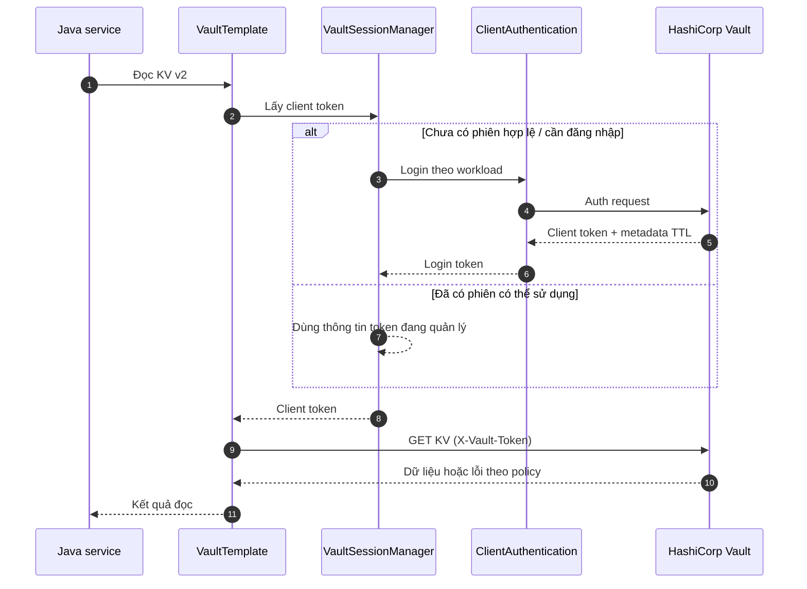
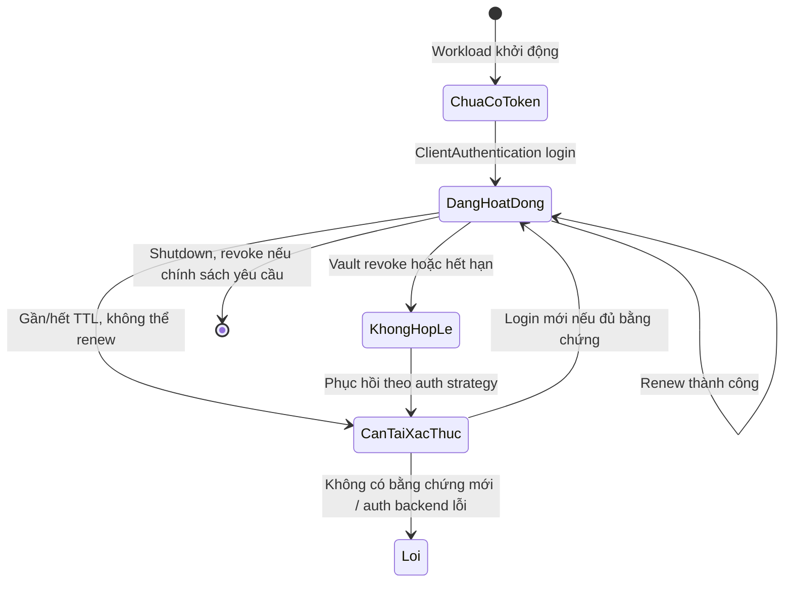

# SessionManager và lý do không đăng nhập lại cho từng lần đọc

## 1. Bối cảnh: một lần đọc secret cần những bước nào?

Khi một ứng dụng Java dùng **Spring Vault** để truy cập HashiCorp Vault, lệnh `VaultTemplate.read(...)` hoặc `VaultOperations.opsForKeyValue(...)` cần một **Vault client token** hợp lệ. Token đại diện cho danh tính của workload, mang policy quyết định API và đường dẫn nào được phép truy cập. Trừ một số endpoint đặc biệt như đăng nhập, Vault thường yêu cầu token ở header `X-Vault-Token`.

Ứng dụng có thể lấy token bằng Kubernetes auth, AppRole, AWS/GCP/Azure auth hoặc một phương thức được cấu hình sẵn. Đăng nhập thường có chi phí: lấy bằng chứng danh tính từ nền tảng, thực hiện HTTP request đến auth endpoint, kiểm tra role/policy và tạo token. Nếu làm các bước đó **mỗi lần đọc secret**, ứng dụng tạo thêm tải và gặp rủi ro lỗi xác thực không cần thiết.

Trong chương **Phiên và vòng đời token**, `VaultSessionManager` là cơ chế quản lý việc lấy token cho các thao tác Vault. Nó giúp tách hai nhiệm vụ:

- **ClientAuthentication:** biết *cách chứng minh danh tính và đăng nhập*.
- **VaultSessionManager:** biết *cách cung cấp token phiên để các thao tác Vault dùng*, và tùy implementation có thể quản lý gia hạn hoặc xác thực lại.

Các service nghiệp vụ chỉ nên phụ thuộc vào `VaultOperations`/`VaultTemplate`, tập trung vào KV secrets, Transit encryption hoặc PKI. Chúng không nên gọi đăng nhập thủ công trong từng phương thức đọc.

### Luồng xử lý có SessionManager



Sơ đồ mô tả *trách nhiệm logic*. Với implementation quản lý vòng đời, thao tác renew/re-auth có thể được lên lịch ở nền; với implementation đơn giản, token có thể chỉ được lấy một lần mà không được tự động gia hạn. Không suy từ việc dùng chung `VaultTemplate` rằng mọi token sẽ luôn được refresh.

## 2. Vì sao không login lại cho từng lần đọc?

Giả sử API nhận 100 request mỗi giây, mỗi request đọc cấu hình từ KV. Nếu một endpoint tự gọi auth login rồi đọc Vault, trong một phút nó có thể tạo đến **6.000 lần đăng nhập**, ngoài 6.000 lần đọc dữ liệu. Số lần đăng nhập thực tế còn phụ thuộc cache, luồng request và cách code được viết.

Tác hại thường gặp:

| Vấn đề | Đăng nhập mỗi lần đọc | Dùng SessionManager đúng vòng đời |
| --- | --- | --- |
| Độ trễ request | Mỗi lần thêm một hoặc nhiều HTTP/auth bước | Phần lớn các thao tác dùng token đã có |
| Tải lên Vault | Nhiều login, token, audit event và truy vấn kiểm tra identity | Tập trung login vào nhu cầu cấp/gia hạn/xác thực lại |
| Khi auth backend lỗi tạm thời | Có thể làm hỏng cả các lần đọc dù token cũ vẫn hợp lệ | Phiên còn hợp lệ có thể tiếp tục được sử dụng |
| Kiểm soát token | Nhiều token phân tán, khó revoke và theo dõi | Có một vòng đời rõ cho từng identity/session |
| Concurrency | Dễ tạo “cơn bão login” lúc traffic tăng | Implementation quản lý phiên có thể giảm xác thực trùng lặp |
| Thu hồi/quyền hạn | Token mới không giải quyết được policy sai | Xử lý riêng lỗi phiên, lỗi quyền và lỗi nghiệp vụ |

Ví dụ mã **không nên dùng**:

```java
// Anti-pattern: ví dụ ý tưởng, bỏ qua phần khởi tạo dependency.
public VaultResponse readConfig() {
    ClientAuthentication authentication = createAuthenticationForWorkload();
    VaultTemplate template = new VaultTemplate(vaultEndpoint, authentication);
    return template.read("secret/example");
}
```

Mỗi lần gọi dựng một template và một authentication object. Với các cấu hình authentication nhất định, điều này có thể kéo theo nhiều lần login. Đoạn code còn sử dụng `read` với đường dẫn Vault thô, không phân biệt KV v1/v2 và không xử lý kết quả null. Đây chỉ là ví dụ về **sai vòng đời**.

Hướng đúng là tạo/nhận một bean `VaultOperations` qua Spring context, để thành phần authentication/session được quản lý theo vòng đời ứng dụng. Việc dùng chung template **không đồng nghĩa cache secret**: mỗi `get(...)` vẫn có thể thực hiện request đọc KV, trong khi token dùng để xác thực request được tái sử dụng hoặc refresh theo chính sách phiên.

## 3. Các thành phần trong Spring Vault

| Thành phần | Vai trò | Có nên đặt trong service nghiệp vụ? |
| --- | --- | --- |
| `ClientAuthentication` | Thực hiện quá trình đăng nhập, lấy `LoginToken`/token từ auth method | Không; cấu hình ở tầng infrastructure |
| `VaultSessionManager` | Cung cấp token phiên cho `VaultTemplate` và quản lý trạng thái phiên theo implementation | Không; tiêm/cấu hình cùng Vault client |
| `SimpleSessionManager` | Cung cấp token thông qua authentication đơn giản; **không phải** giải pháp tự động gia hạn token dài hạn | Chỉ phù hợp khi vòng đời token được xử lý bên ngoài hoặc đặc thù sử dụng |
| `LifecycleAwareSessionManager` | Quản lý vòng đời phiên, hỗ trợ cơ chế renew/re-auth theo khả năng của token và auth method | Dùng ở tầng cấu hình, khi phù hợp với workload |
| `VaultTemplate` / `VaultOperations` | Thực hiện API KV, Transit, PKI, HTTP trên Vault bằng token được cung cấp | Tiêm và tái sử dụng trong service |
| `VaultKeyValueOperations` | API KV theo mount/version đã chọn | Có thể giữ làm dependency nếu mount/version cố định |

Những tên lớp này thuộc Spring Vault; cách framework khởi tạo bean mặc định phụ thuộc phiên bản, Spring Boot/Spring Cloud Vault integration và cấu hình hiện có. Không tự tạo thêm một session manager song song với bean framework đã quản lý nếu chưa hiểu rõ sự khác biệt.

### 3.1. ClientAuthentication không phải SessionManager

`ClientAuthentication` trả lời câu hỏi: **đăng nhập bằng chứng cứ gì?**

- Kubernetes auth: lấy service account JWT, đăng nhập với Vault Kubernetes role.
- AppRole: gửi `role_id`/`secret_id`.
- Cloud auth: dùng bằng chứng AWS IAM, GCP hoặc Azure được tạo từ danh tính workload.
- Token authentication: cung cấp token có sẵn, thích hợp cho các trường hợp đã được quản lý bên ngoài hoặc bài thử nghiệm.

`VaultSessionManager` trả lời câu hỏi: **một request cần token thì lấy từ đâu, token hiện tại còn dùng được không và xử lý vòng đời ra sao?** Với phiên có TTL, nó cần phối hợp với khả năng gia hạn hoặc xác thực lại. Session manager không tự cấp thêm quyền cho token: quyền đọc KV, Transit hoặc PKI vẫn do Vault policy quyết định.

### 3.2. SimpleSessionManager và LifecycleAwareSessionManager

**SimpleSessionManager** phù hợp với các luồng đơn giản và thường không triển khai cơ chế gia hạn/tái đăng nhập theo lịch. Nếu token ban đầu hết hạn hoặc bị revoke, việc giữ cùng một manager không tự biến token đó thành hợp lệ.

**LifecycleAwareSessionManager** dành cho luồng chạy lâu cần quản lý phiên tích cực hơn. Nó có thể sử dụng metadata TTL/renewable để lên lịch renew, và thực hiện login lại trong các tình huống được hỗ trợ. Hiệu quả phụ thuộc loại token, cách `ClientAuthentication` tạo bằng chứng và cài đặt Spring Vault cụ thể. Một token không renewable sẽ không thể gia hạn chỉ vì manager hỗ trợ renewal.

Không nên suy luận rằng mọi lỗi `403` sẽ được manager tự động retry và chữa khỏi. `403` có thể là **policy denial** dù token hoàn toàn hợp lệ. Nếu biến mọi lỗi quyền thành re-login, ứng dụng dễ tạo vòng lặp login vô ích và che giấu sai sót phân quyền.

### 3.3. Tính đồng thời và phạm vi tái sử dụng

Trong ứng dụng Spring, thường dùng một bean `VaultOperations` cho một danh tính/workload. Các request song song dùng lại client đã cấu hình và token phiên mà session manager cung cấp. Không lưu `VaultToken` vào biến toàn cục do code nghiệp vụ tự cập nhật, không thay đổi role, auth path, Vault namespace hoặc endpoint giữa các thread đang hoạt động.

Nếu một ứng dụng cần truy cập **hai Vault cluster** hoặc **hai danh tính độc lập với policy khác nhau**, hãy cấu hình các client/bean có định danh rõ ràng và tiêm bằng `@Qualifier`. Không đổi danh tính trên một template singleton theo từng request.

## 4. Hiểu đúng vòng đời token

Vault token không phải một chuỗi có hiệu lực mãi mãi. Các thuộc tính cần quan sát:

| Thuộc tính | Ý nghĩa |
| --- | --- |
| **TTL** | Khoảng thời gian token còn hiệu lực theo đánh giá của Vault |
| **Renewable** | Vault cho phép yêu cầu gia hạn token hay không |
| **Max TTL / explicit max TTL** | Giới hạn thời gian sống đối với các kiểu token/role có ràng buộc tương ứng |
| **Periodic token** | Có thể được gia hạn theo chu kỳ nếu đáp ứng policy và các giới hạn còn lại |
| **Revocation** | Token có thể bị vô hiệu hóa trước TTL; các token con/lease có thể chịu ảnh hưởng theo quan hệ của Vault |
| **Token policies** | Tập quyền cho các API và path; không thay đổi chỉ nhờ renew |

TTL là thuộc tính do **Vault server** quyết định và có thể chịu ảnh hưởng của auth mount, role, policy, token type và giới hạn của hệ thống. Không tin rằng cấu hình client `token_ttl=1h` bảo đảm token luôn sống chính xác một giờ.

### Sơ đồ trạng thái



Trạng thái trong sơ đồ là mô hình để thiết kế và kiểm thử, không phải máy trạng thái nội bộ chính xác của mọi phiên bản `LifecycleAwareSessionManager`.

### Renew khác re-auth thế nào?

- **Renew:** xin Vault gia hạn **token hiện tại** nếu token còn đủ điều kiện. Không dùng lại credentials đầu vào và cũng không tự nâng policy.
- **Re-auth:** dùng `ClientAuthentication` thực hiện **lần đăng nhập mới** để có token mới. Điều này cần bằng chứng danh tính vẫn hợp lệ.
- **Re-bootstrap:** nếu bằng chứng cũ không còn dùng được, workload phải nhận **bằng chứng mới** từ hệ thống cấp danh tính trước khi re-auth.

Ví dụ: AppRole có `secret_id_num_uses=1`. SecretID bị tiêu thụ ngay trong lần login đầu tiên. Khi token hết hạn vượt giới hạn renew, chỉ gọi lại AppRole login với cùng SecretID sẽ thất bại. Cần một **luồng cấp SecretID mới** hoặc khởi động lại workload với thông tin bootstrap hợp lệ. Session manager không tự trở thành issuer của SecretID.

Với Kubernetes auth, service account JWT có thể được rotate bởi nền tảng. Để đăng nhập lại được, authentication implementation phải đọc được JWT hiện hành theo cơ chế phiên bản hỗ trợ; nếu nó giữ bản JWT cũ đã hết hạn, re-auth cũng có thể thất bại.

Với AWS/GCP/Azure, SDK/metadata client cần có khả năng tạo **bằng chứng cloud identity mới**, và quyền cloud principal cũng phải còn hợp lệ. Refresh Vault token và refresh cloud credentials là hai việc liên quan nhưng không đồng nhất.

## 5. Cấu hình ứng dụng Spring dùng SessionManager do framework quản lý

Nếu ứng dụng đã dùng Spring Cloud Vault, thường nên để framework cấu hình Vault client và các thành phần phiên từ các property đã hỗ trợ. Ví dụ một workload chạy trong Kubernetes, với Vault auth mount mặc định `kubernetes`:

```yaml
spring:
  cloud:
    vault:
      uri: ${VAULT_URI}
      authentication: KUBERNETES
      kubernetes:
        role: order-service
        kubernetes-path: kubernetes

app:
  vault:
    kv-mount: kv
    secret-path: apps/order-service
```

`${VAULT_URI}` là biến cấu hình deployment, ví dụ `https://vault.example.internal:8200`, không phải một endpoint cố định trong mã nguồn. Phải cấu hình TLS trust hợp lệ, role binding phía Vault và service account JWT mà workload được phép dùng. Tên property/cơ chế bootstrap cũng cần được xác nhận với đúng phiên bản Spring Cloud Vault; khi ứng dụng lấy cấu hình Spring từ Vault Config Data có thể phải khai báo `spring.config.import`.

Khi framework quản lý phiên, các service nghiệp vụ không nên tự đăng ký thêm một `VaultTemplate` với token riêng. Một service Java đọc KV v2:

```java
import org.springframework.beans.factory.annotation.Value;
import org.springframework.stereotype.Service;
import org.springframework.vault.core.VaultKeyValueOperations;
import org.springframework.vault.core.VaultKeyValueOperationsSupport.KeyValueBackend;
import org.springframework.vault.core.VaultOperations;
import org.springframework.vault.support.VaultResponse;

@Service
public final class OrderConfigService {

    private final VaultKeyValueOperations kv;
    private final String path;

    public OrderConfigService(
            VaultOperations vault,
            @Value("${app.vault.kv-mount}") String mount,
            @Value("${app.vault.secret-path}") String path) {
        this.kv = vault.opsForKeyValue(mount, KeyValueBackend.KV_2);
        this.path = path;
    }

    public String requireFeatureMode() {
        VaultResponse response = kv.get(path);
        if (response == null || response.getData() == null) {
            throw new IllegalStateException("Vault configuration is unavailable");
        }

        Object rawValue = response.getData().get("featureMode");
        if (!(rawValue instanceof String)) {
            throw new IllegalStateException("Vault feature mode is invalid");
        }
        String mode = (String) rawValue;
        if (mode.isBlank()) {
            throw new IllegalStateException("Vault feature mode is blank");
        }
        return mode;
    }
}
```

Đoạn service này chỉ biết **KV mount, logical secret path và `VaultOperations`**. Nó không cần `role_id`, JWT, AWS credential, session token hay policy admin. Với KV v2, `opsForKeyValue(mount, KV_2)` nhận path logic `apps/order-service`; không chèn `data/` vào property `secret-path`.

Ví dụ trên không cache giá trị secret và không trả token ra log. Nếu key chứa thông tin bí mật, cần giới hạn thời gian lưu trong bộ nhớ và cách truyền giá trị vào phần nghiệp vụ.

### Khi dùng Spring Vault thuần

Nếu không dùng Spring Cloud Vault, có thể kế thừa `AbstractVaultConfiguration` để cung cấp `VaultEndpoint` và `ClientAuthentication`. Spring Vault tạo các thành phần vận hành phù hợp với cấu hình phiên bản đang dùng. Đối với vòng đời phức tạp, cấu hình session manager chuyên dụng thay vì mỗi service tự đăng nhập.

Ví dụ dưới đây dùng token tĩnh **chỉ để minh họa cấu hình**, không phải lựa chọn chuẩn để tự động refresh token production:

```java
import java.net.URI;

import org.springframework.context.annotation.Configuration;
import org.springframework.vault.authentication.ClientAuthentication;
import org.springframework.vault.authentication.TokenAuthentication;
import org.springframework.vault.client.VaultEndpoint;
import org.springframework.vault.config.AbstractVaultConfiguration;

@Configuration
public class VaultClientConfig extends AbstractVaultConfiguration {

    @Override
    public VaultEndpoint vaultEndpoint() {
        return VaultEndpoint.from(URI.create(require("VAULT_URI")));
    }

    @Override
    public ClientAuthentication clientAuthentication() {
        return new TokenAuthentication(require("VAULT_TOKEN"));
    }

    private static String require(String key) {
        String value = System.getenv(key);
        if (value == null || value.isBlank()) {
            throw new IllegalStateException(key + " is required");
        }
        return value;
    }
}
```

Với `TokenAuthentication`, khi token bị thu hồi hoặc hết hạn, cùng một chuỗi token không thể cung cấp danh tính mới. Nếu muốn quản lý phiên lâu dài, dùng một authentication method cho phép lấy lại bằng chứng hoặc có một hệ thống cấp token mới, đồng thời xác minh session manager được cấu hình đúng.

## 6. Các tình huống vận hành cần phân biệt

### 6.1. Token gần hết TTL và có thể renew

Một session manager có hỗ trợ vòng đời có thể lập lịch renew trước khi TTL về 0. Renewal thành công giúp các request tiếp theo tiếp tục dùng token. Thời điểm chính xác, thời gian dự phòng và phản ứng với lỗi renew tùy implementation/cấu hình; không nên dựa vào một mốc cố định tự suy đoán.

Nếu không renewable hoặc đã đạt giới hạn max TTL, Vault có thể từ chối gia hạn. Khi đó cần re-auth nếu phương thức đăng nhập còn khả dụng. Nếu re-auth không khả dụng, ứng dụng nên báo trạng thái suy giảm/thất bại có kiểm soát thay vì dùng token đã hết hạn hoặc liên tục thử login.

### 6.2. Token bị revoke trước thời hạn

Vault admin có thể revoke token, hoặc token bị vô hiệu hóa do chính sách/vòng đời parent token. Request dùng token cũ sẽ bị Vault từ chối. Cần xem lại audit và khả năng re-auth, đồng thời xử lý các request thất bại theo cơ chế lỗi của ứng dụng. Không mặc định mỗi `403` là token bị revoke.

### 6.3. Policy thiếu quyền

Token còn hiệu lực nhưng thiếu quyền đọc `kv/data/apps/order-service` vẫn khiến KV trả `403 permission denied`. Đăng nhập lại cùng role thường cấp token với policy tương tự và **không giải quyết nguyên nhân**. Cần so sánh policy thực tế, mount KV v1/v2, đường dẫn và capability của Vault role.

### 6.4. Auth backend tạm thời không sẵn sàng

Nếu token hiện tại còn hợp lệ, một ứng dụng được cấu hình đúng có thể vẫn đọc KV trong thời gian auth backend lỗi, miễn là các request KV và kết nối Vault vẫn hoạt động. Nhưng khi token hết hạn và cần re-auth, sự cố auth có thể làm gián đoạn dịch vụ. Nên đo tỷ lệ lỗi login/renew và có cảnh báo trước khi token hết hạn trên diện rộng.

### 6.5. Scale ngang và rolling deployment

Mỗi replica nên có danh tính và vòng đời phiên được kiểm soát. Khi 100 Pod khởi động đồng thời, có thể phát sinh lượng login cao ngay lúc bootstrap, kể cả khi từng Pod dùng SessionManager. Cân nhắc readiness, tốc độ rollout, TTL, rate limits và thời gian khởi tạo.

Không chia sẻ tùy tiện một token ứng dụng cho mọi replica chỉ để giảm login. Điều đó tăng phạm vi ảnh hưởng nếu một replica bị xâm nhập và làm phức tạp revoke. Có thể mỗi replica có token riêng nhưng dùng lại token đó trong các request của chính replica.

## 7. Session token và dynamic secret lease là hai vòng đời khác nhau

Giả sử ứng dụng đọc secret cấu hình tĩnh từ KV và đồng thời xin database credentials động từ Vault database engine.

| Đối tượng | Ai cấp? | Cần xử lý những gì? |
| --- | --- | --- |
| **Vault client token** | Auth method tại `auth/.../login` | Login, TTL, renew, re-auth, revoke |
| **KV secret value** | KV secrets engine | Rotation giá trị, cache nếu có, kiểm soát quyền đọc; thường không có lease renew theo cách dynamic credentials |
| **Dynamic database credentials** | Database secrets engine | Lease ID, TTL của credential, renew/revoke lease và thay credentials khi hết hạn |
| **PKI certificate** | PKI secrets engine | Thời hạn chứng chỉ, renewal/reissue theo policy, cập nhật keystore/TLS client |
| **Transit encryption result** | Transit secrets engine | Key version, ciphertext và quyền gọi API; không phải token phiên |

`VaultSessionManager` quản lý **token phiên** của Vault client. Nó **không tự động quản lý mọi lease** của các secrets mà ứng dụng đã lấy. Với dynamic secrets, Spring Vault có các thành phần hỗ trợ quản lý vòng đời secret/lease tùy phiên bản và cách dùng; một ứng dụng cũng có thể phải tự thiết kế rotation, thay thế connection pool và xử lý revoke.

Token còn sống không có nghĩa credential database hay chứng chỉ đã được cấp còn sống. Ngược lại, khi token bị revoke, quan hệ parent token/lease có thể ảnh hưởng đến các secret động tùy cách Vault cấp phát. Luôn kiểm tra lifecycle của từng loại dữ liệu được sử dụng.

## 8. Chẩn đoán lỗi phiên một cách có hệ thống

| Hiện tượng | Kiểm tra trước | Hành động |
| --- | --- | --- |
| Mỗi request đều phát sinh auth login | `VaultTemplate`/`VaultSessionManager` bị tạo trong request scope hoặc mỗi thao tác; custom auth gọi trực tiếp | Chuyển sang bean quản lý theo application context, kiểm tra lifecycle |
| Ứng dụng lỗi đúng sau một khoảng TTL | Token hết hạn, không renewable hoặc không re-auth được | Kiểm tra TTL/max TTL, session manager và credential bootstrap |
| Renew thất bại nhưng login mới thành công | Token đạt giới hạn renew hoặc bị revoke; auth method vẫn hợp lệ | Kiểm tra chiến lược re-auth và tác động lên request trong lúc chuyển phiên |
| AppRole re-auth thất bại | `secret_id_num_uses=1` hoặc SecretID hết hạn | Thiết kế cấp SecretID mới qua issuer/bootstrap |
| Kubernetes auth lỗi sau JWT rotation | Thành phần auth giữ JWT cũ hoặc role binding thay đổi | Xác minh cách đọc token file hiện hành và role Kubernetes |
| Vault trả `403` ngay cả với token mới | Policy/path/mount sai; IAM workload không nhất thiết là nguyên nhân | Kiểm tra Vault token policies và capability của operation |
| Nhiều replica đồng loạt lỗi khi deploy | Auth backend, network, rate limit hoặc identity provisioner quá tải | Giới hạn tốc độ rollout, quan sát login/renew và retry có backoff |
| Lỗi SSL/TLS hoặc timeout | Vault URI, trust, DNS/proxy hay HTTP client cấu hình sai | Sửa connectivity, CA trust và timeout; không xoay token vô ích |
| Metrics ghi lộ token | Instrumentation chụp header/body auth hoặc audit logs truy cập rộng | Redact `X-Vault-Token` và payload; giới hạn người có quyền xem logs |

Khi retry, phân loại lỗi trước: network timeout hoặc `5xx` tạm thời có thể phù hợp với backoff hữu hạn; `403` do policy sai thì cần sửa policy; token hết hạn cần session/auth strategy; secret path không tồn tại thì cần xử lý giá trị thiếu. Không retry vô hạn để tránh biến lỗi đơn lẻ thành auth storm.

## 9. Bảo mật và giám sát

### Bảo vệ token

- Không ghi `X-Vault-Token`, `client_token`, SecretID, JWT hoặc signed cloud request vào log, tracing span, exception, HTTP response và metric label.
- Không lưu root token trong image/container hoặc cấu hình được commit. Workload dùng policy tối thiểu, tách quyền KV, Transit và PKI theo nhu cầu.
- Dùng HTTPS và kiểm tra chứng chỉ Vault server. Không vô hiệu hóa TLS verification để “chữa” lỗi login.
- Hạn chế thời gian tồn tại credential bootstrap, bảo vệ đường refresh và revoke token không còn cần thiết khi phù hợp.
- Không expose session manager hay token supplier dưới endpoint debug của ứng dụng.

### Metrics hữu ích

Nên quan sát, ở mức không lộ bí mật:

- Tỷ lệ thành công/thất bại của **login**, **renew** và **re-auth**.
- Thời gian login, latency đọc KV, tỷ lệ `401/403/429/5xx` theo nhóm operation.
- Số phiên/token được tạo theo workload, số lần auth trên một đơn vị thời gian.
- Cảnh báo khi renew liên tiếp thất bại hoặc token gần hết hạn nhưng không tái xác thực được.
- Tỷ lệ request lỗi sau restart/scale và khi Vault/auth backend có sự cố.

Audit log phía Vault có thể giúp phân biệt login thành công, policy denial và revocation. Thiết kế quyền truy cập audit log phù hợp vì path và metadata có thể tiết lộ cấu trúc vận hành; không copy nội dung audit chứa dữ liệu nhạy cảm vào log ứng dụng.

## 10. Thực hành: chứng minh tái sử dụng phiên

Chuẩn bị Vault thử nghiệm cô lập với KV v2 mount `kv` và một auth method cho workload. Tạo policy chỉ đọc `kv/data/apps/order-service`, cấp role có TTL ngắn để quan sát. Không dùng root token làm danh tính ứng dụng trong bài kiểm thử phân quyền.

1. Tạo một ứng dụng Spring có `OrderConfigService` như ví dụ, tiêm `VaultOperations` từ container.
2. Gọi `requireFeatureMode()` nhiều lần liên tiếp và song song; xác minh các lần đọc KV thành công trong thời gian token còn hiệu lực.
3. Đo số lần **login** từ Vault audit/metric. Với một phiên dùng chung hợp lý, số login thường ít hơn rất nhiều so với số lần đọc KV. Không áp đặt kết quả “chính xác một login” vì renew, re-auth và bootstrap có thể xảy ra.
4. Giảm TTL trong môi trường thử nghiệm hoặc chờ đến gần hạn; quan sát việc renew nếu token được phép, và cách ứng dụng xử lý khi không thể renew.
5. Thu hồi token của phiên thử nghiệm bằng danh tính quản trị có quyền, quan sát HTTP error và đường re-auth nếu cấu hình hỗ trợ.
6. Thay policy để từ chối đọc một path KV, xác nhận login có thể thành công nhưng thao tác KV bị `403`; không coi re-login là cách sửa policy.
7. Khởi động nhiều instance và ghi nhận tải lên auth backend. Đảm bảo các instance không vô tình dùng chung token hoặc secret bootstrap một lần ngoài dự kiến.
8. Kiểm tra log và metric không chứa token, dữ liệu KV, JWT hay SecretID.

### Các kiểm thử nên có

**Unit test:** mock `VaultOperations`/`VaultKeyValueOperations` để kiểm tra service trả kết quả hoặc lỗi khi secret thiếu, sai kiểu, hoặc Vault trả ngoại lệ. Việc này không chứng minh session manager hoạt động đúng, nhưng tách được lỗi code nghiệp vụ.

**Integration test:** chạy Vault thử nghiệm (chẳng hạn Testcontainers) với auth method và role phù hợp. Dùng TTL ngắn, policy tối thiểu và quy trình revoke để kiểm tra renew/re-auth. Nếu xác thực bằng Kubernetes/AWS/GCP/Azure, cần mô phỏng hoặc cung cấp bằng chứng danh tính tương thích; mock metadata đơn thuần không chứng minh Vault xác minh được principal thật.

**Load test:** chạy đọc song song, so sánh tỷ lệ login/KV request giữa mô hình tạo client mỗi request và bean chung. Quan sát độ trễ, giới hạn connection và số login tăng đột biến khi app restart. Chỉ chạy kiểm thử tải trên môi trường được cấp phép.

## 11. Checklist thiết kế SessionManager

- Ứng dụng có **một cấu hình authentication/session rõ ràng** cho mỗi Vault identity; các service chỉ tiêm `VaultOperations`.
- Không login hoặc tạo `VaultTemplate` trong từng lần đọc KV/Transit/PKI.
- Hiểu implementation session manager đang dùng: simple hay lifecycle aware; không giả định tự renew nếu chưa cấu hình và xác minh.
- Nắm TTL, renewable, max TTL và điều kiện revoke thực tế của Vault role/token.
- Có đường **re-auth** với bằng chứng mới; đặc biệt chú ý AppRole SecretID một lần, Kubernetes JWT rotation và cloud credentials ngắn hạn.
- Phân biệt lỗi thiếu quyền `403`, lỗi token hết hạn, lỗi connectivity và secret không tồn tại.
- Theo dõi login/renew/re-auth, kiểm thử restart, scale, revoke và lỗi auth backend.
- Quản lý riêng **lease/TTL của dynamic secret**, chứng chỉ PKI và vòng đời cấu hình KV; session token không thay thế các cơ chế đó.
- Không để token/credential trong log, metrics, source code hoặc debug endpoint; bảo vệ TLS và giới hạn Vault policy.

**Ghi nhớ:** `VaultSessionManager` giữ vòng đời token của ứng dụng ở một nơi để `VaultTemplate` sử dụng nhất quán. **Đăng nhập là thao tác cấp danh tính**, còn **đọc secret là thao tác nghiệp vụ**. Tách hai việc này giúp giảm tải Vault, giới hạn phạm vi lỗi và khiến chiến lược renew, re-auth, revoke có thể quản lý và kiểm thử được.

