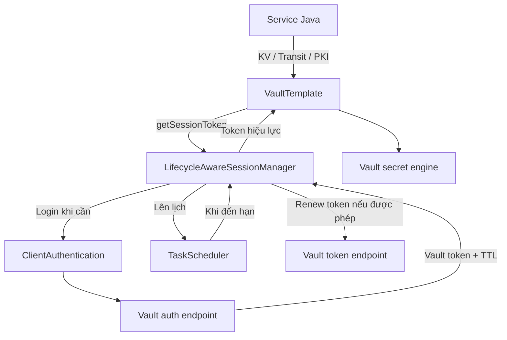
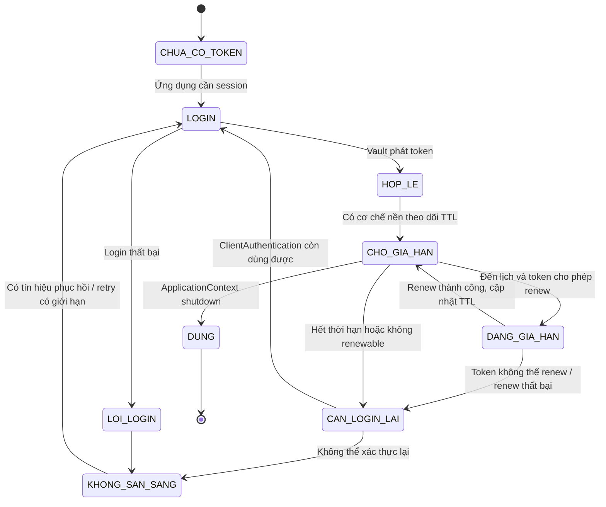

# LifecycleAwareSessionManager và lịch gia hạn nền

Trong **SPRING_VAULT**, ứng dụng Java truy cập HashiCorp Vault qua `VaultTemplate`/`VaultOperations` để đọc KV secrets, mã hóa hoặc giải mã bằng Transit và sử dụng PKI. Mỗi request cần một Vault token có hiệu lực và đủ policy. Nhưng token không tồn tại mãi: nó có TTL, có thể được gia hạn, bị revoke hoặc cần cấp lại qua phương thức xác thực theo workload. Một ứng dụng vẫn đang chạy và bean `VaultTemplate` vẫn tồn tại không có nghĩa token còn dùng được.

Bài thuộc chương **Phiên và vòng đời token**, tập trung vào **`LifecycleAwareSessionManager`** của Spring Vault và cách cơ chế này phối hợp với **`TaskScheduler`** để lên lịch xử lý token ở nền. Sau bài học, bạn có thể giải thích vòng đời một phiên Vault, phân biệt renew với login lại, đánh giá giới hạn TTL, cấu hình quyền sở hữu scheduler, xử lý lỗi và thiết kế kiểm thử tích hợp.

> Các class, khả năng gia hạn và thời điểm callback cụ thể có thể khác giữa các phiên bản Spring Vault. Ví dụ mô tả trách nhiệm và cách tổ chức thực tế; khi viết cấu hình sản xuất, đối chiếu constructor và auto-configuration của đúng phiên bản dependency đang dùng.

## 1. Các thành phần và trách nhiệm

| Thành phần | Trách nhiệm | Điều **không** nên mặc định |
| --- | --- | --- |
| `ClientAuthentication` | Lấy token từ Vault bằng phương thức xác thực đã chọn, như Kubernetes, AppRole, cloud IAM hoặc token đã cấp sẵn | Không phải mọi phương thức đều tự đổi credential ban đầu khi hết hạn |
| `SessionManager` | Cung cấp `VaultToken` cho các yêu cầu Vault; giao diện thường dùng là `getSessionToken()` | Không phải mọi implementation đều gia hạn token |
| `LifecycleAwareSessionManager` | Quản lý phiên có vòng đời, phối hợp login, gia hạn token hoặc xử lý phiên hết hiệu lực khi điều kiện cho phép | Không bảo đảm mọi token được Vault cho renew hay mọi lỗi đều tự phục hồi |
| `TaskScheduler` | Thực thi tác vụ theo lịch; được session manager dùng để xử lý mốc thời gian token | Scheduler sống không chứng minh tác vụ renew thành công |
| `VaultTemplate` / `VaultOperations` | Gọi Vault API cho KV/Transit/PKI bằng token được session manager cung cấp | Không là nơi duy nhất quyết định TTL, policy hoặc secret rotation |
| **Vault auth backend + token store** | Phát token, xác định `renewable`, TTL, max TTL và policy; có thể từ chối renew/revoke | Spring không thể ép Vault gia hạn một token không đủ điều kiện |
| `SecretLeaseContainer` (khi được cấu hình) | Theo dõi và xử lý lease của secret động riêng biệt | Không thay thế session manager trong việc quản lý Vault token |

Đường đi tổng quát:



**Điểm phân biệt:** token là kết quả xác thực và mang quyền truy cập Vault; secret động như database credential hay certificate PKI có **lease hoặc thời hạn riêng**. Gia hạn token không đồng nghĩa gia hạn mọi secret. Một token hợp lệ vẫn có thể bị từ chối đọc KV vì policy thiếu `read`.

## 2. Cách một token được cấp, sử dụng và kết thúc

Một Vault login response có thể chứa thông tin như:

```json
{
  "auth": {
    "client_token": "<redacted>",
    "accessor": "<redacted>",
    "policies": ["orders-read"],
    "lease_duration": 1800,
    "renewable": true,
    "token_type": "service"
  }
}
```

Ví dụ là **dữ liệu minh họa**, không phải response đầy đủ được bảo đảm cho mọi auth method. `lease_duration: 1800` thường biểu diễn thời hạn **1.800 giây tại thời điểm token được cấp**; thời hạn thực tế tiếp tục giảm theo thời gian. Token có thể có các giới hạn khác như maximum TTL, explicit maximum TTL, period, số lượt dùng hoặc ràng buộc từ auth mount/role.

Các trạng thái có ý nghĩa khi thiết kế:



Sơ đồ trình bày **những chuyển trạng thái cần xử lý** chứ không cam kết đây là trạng thái nội bộ hoặc tên callback của thư viện. Có thể có khoảng thời gian token vẫn hoạt động sau một lần renew thất bại; cũng có thể Vault đã revoke token và mọi request lập tức không còn hợp lệ.

### Login, renew và re-login khác nhau ra sao?

- **Login**: dùng bằng chứng ban đầu (JWT của Kubernetes, AppRole secret ID, cloud IAM proof…) tại auth endpoint; Vault cấp **token mới**, có thể có policy, TTL và metadata mới.
- **Renew**: đề nghị Vault kéo dài thời hạn của **token hiện tại**, trong giới hạn và điều kiện Vault cho phép; không tự đổi identity/policy, không vượt giới hạn max TTL.
- **Re-login**: thực hiện login lại để nhận token **khác** khi token cũ không dùng được hoặc không còn đủ điều kiện gia hạn. Thành công phụ thuộc nguồn credential ban đầu vẫn hợp lệ, role binding đúng và Vault có thể truy cập.
- **Revoke/expire**: token không còn dùng được; các yêu cầu tiếp theo có thể nhận lỗi xác thực. Revocation còn có thể ảnh hưởng đến secret/lease gắn với token theo cách Vault quản lý token và lease.

Ví dụ token dạng **batch** không có cùng khả năng lưu trạng thái/gia hạn như service token; không thể xây một hệ thống giả định mọi token đều có thể renew. Tương tự, một token được ứng dụng nhận từ bên ngoài và dùng bằng `TokenAuthentication` có cơ chế sở hữu khác với token do ứng dụng tự login. Cần kiểm tra hợp đồng của `ClientAuthentication` đang sử dụng và đặc tính token do Vault thực tế cấp.

## 3. LifecycleAwareSessionManager thực sự giải quyết bài toán nào?

`LifecycleAwareSessionManager` là implementation `SessionManager` có nhận thức về thời gian tồn tại của phiên. Khi client cần Vault token, nó có thể lấy token qua `ClientAuthentication` rồi theo dõi vòng đời của phiên đó. Khi token có khả năng renew và đủ dữ liệu thời hạn, session manager có thể tổ chức **tác vụ gia hạn theo lịch** qua `TaskScheduler`; khi không thể tiếp tục dùng token cũ, logic phiên phải xử lý tình trạng cần xác thực lại theo khả năng hỗ trợ của auth method và cấu hình.

Những lợi ích khi một session manager có owner chung được chia sẻ giữa các `VaultTemplate`/service:

1. Không yêu cầu từng service tự gọi `auth/token/renew-self`.
2. Không cần mỗi request đều login lại, giảm tải auth backend.
3. Việc cập nhật token gắn với một cơ chế quản lý phiên thay vì nhiều cache `static` rời rạc.
4. Có thể giữ lịch gia hạn tách khỏi đường request, giảm nguy cơ đợi sát thời điểm hết TTL.
5. Có điểm tập trung để xử lý startup failure, session expiry, shutdown và tín hiệu giám sát.

Tuy nhiên **không có cơ chế nền nào làm một token không-renewable trở thành renewable**, cũng không giải quyết được policy thiếu quyền, Vault seal hoặc Kubernetes JWT đã vô hiệu. Không nên diễn giải tên `LifecycleAware` là lời bảo đảm rằng ứng dụng sẽ tự phục hồi trong mọi loại sự cố.

### Khi nào vòng đời được kích hoạt?

Một lifecycle-aware session có thể **lấy token theo nhu cầu** khi `getSessionToken()` được gọi lần đầu; lập bean trong Spring context chưa nhất thiết tạo request login. Một số auto-configuration (đặc biệt khi Spring Cloud Vault cần nạp property sources) có thể xác thực **ngay giai đoạn bootstrap**, trước khi các bean nghiệp vụ được tạo. Vì vậy hãy kiểm tra luồng thực tế của dependency thay vì dựa vào giả định cố định “Spring khởi động xong rồi mới login”.

`VaultTemplate` dùng session manager mỗi khi thực hiện thao tác cần token. Nếu ứng dụng có các VaultTemplate sử dụng session manager **khác nhau**, chúng có thể login và renew độc lập, khiến trạng thái khó quan sát hơn. Cần thiết kế bean graph có một owner rõ ràng cho mỗi identity/role; chỉ dùng nhiều session manager khi các workload identity hoặc phạm vi quyền thực sự khác nhau.

## 4. Lịch gia hạn nền: mốc thời gian, deadline và scheduler

Giả sử Vault cấp token với TTL 30 phút và cho renew. Ứng dụng phải renew **trước** khi token hết hiệu lực. Để tránh sát hạn, scheduler cần có khoảng dự phòng cho độ trễ HTTP, GC pause, nghẽn executor và network jitter.

```mermaid
gantt
    title Ví dụ minh họa TTL 30 phút (không phải lịch mặc định Spring Vault)
    dateFormat  HH:mm
    axisFormat  %H:%M
    section Token
    Token cấp tại 10:00 :milestone, t0, 10:00, 0m
    TTL ban đầu      :active, ttl, 10:00, 30m
    Lịch renew sớm   :milestone, r1, 10:24, 0m
    Hạn TTL cũ       :milestone, exp, 10:30, 0m
```

Giả định renew thành công lúc 10:24, Vault trả TTL mới theo luật của token và role. Scheduler phải dùng dữ liệu vòng đời **mới** để đặt lịch tiếp theo. Thời điểm 10:24 ở sơ đồ chỉ minh họa cách chừa safety margin; **không phải công thức nội bộ mặc định** của `LifecycleAwareSessionManager`.

Các quy tắc thiết kế lịch:

- **Lập lịch theo TTL thực tế**: token 10 phút và token 24 giờ không thể dùng một chu kỳ cố định 30 phút.
- **Gia hạn trước deadline**: chừa ngưỡng an toàn đủ lớn so với thời gian request, độ trễ scheduler và dao động hạ tầng.
- **Không vượt max TTL**: Vault quyết định có thể renew thêm bao nhiêu; token đạt giới hạn phải có phương án re-login hợp lệ.
- **Retry có giới hạn**: khi network timeout hoặc Vault tạm lỗi, thử lại với backoff/jitter trong thời gian token còn hiệu lực; không tạo bão renew khi nhiều Pod cùng khởi động.
- **Phân loại lỗi**: sai role, JWT hết hiệu lực, token bị revoke và network outage có cách xử lý khác nhau. `403` tại secret engine có thể là thiếu ACL, không phải lỗi renew.
- **Không giữ khóa/chặn luồng request lâu**: các tác vụ renew tốn thời gian hoặc bị kẹt cần timeout, không để scheduler chung bị đói luồng.
- **Đóng scheduler đúng owner**: `ApplicationContext` quản lý executor sẽ đóng khi shutdown; đừng để background task tiếp tục dùng client đã bị hủy.

**Một scheduler chỉ là bộ thực thi thời điểm**, không quyết định token policy. Gia hạn vẫn là lời gọi đến Vault và có thể bị từ chối. Sự hiện diện của thread tên `vault-renew-...` không chứng minh token vừa được gia hạn; cần xem kết quả qua quan sát và kiểm thử.

## 5. Tổ chức các bean Spring: một owner cho session và lịch

Cấu hình thường có hai hướng:

- **Spring Vault core**: tự tạo thành phần xác thực và client bằng `AbstractVaultConfiguration` hoặc các bean theo phiên bản Spring Vault đang dùng; nếu cần `LifecycleAwareSessionManager` riêng, cần cấp đúng `ClientAuthentication`, `TaskScheduler` và REST operations mà manager sử dụng.
- **Spring Cloud Vault**: để auto-configuration tạo `SessionManager` và `VaultTemplate` dựa trên phương thức xác thực, sau đó kiểm tra bean cụ thể và hành vi token lifecycle. Việc tự đăng ký thêm bean `SessionManager` mà không kiểm tra auto-configuration có thể tạo trùng session.

Ví dụ tạo **scheduler dành riêng** cho token lifecycle:

```java
import org.springframework.context.annotation.Bean;
import org.springframework.context.annotation.Configuration;
import org.springframework.scheduling.concurrent.ThreadPoolTaskScheduler;

@Configuration
class VaultTaskSchedulerConfiguration {

    @Bean(name = "vaultSessionTaskScheduler")
    ThreadPoolTaskScheduler vaultSessionTaskScheduler() {
        ThreadPoolTaskScheduler scheduler = new ThreadPoolTaskScheduler();
        scheduler.setPoolSize(2);
        scheduler.setThreadNamePrefix("vault-session-");
        scheduler.setWaitForTasksToCompleteOnShutdown(false);
        return scheduler;
    }
}
```

Bean `ThreadPoolTaskScheduler` được Spring quản lý vòng đời. **Tạo bean này chưa tự động làm session manager dùng nó**: trong cấu hình Spring Vault core, phải truyền đúng scheduler khi dựng `LifecycleAwareSessionManager` theo API của phiên bản thư viện; trong auto-configuration, phải kiểm tra cơ chế chọn scheduler mà framework cung cấp. Nếu Spring Cloud Vault đã sở hữu session manager và scheduler, không đăng ký thêm cấu hình cạnh tranh chỉ vì muốn đổi prefix thread.

Sơ đồ wiring có chủ đích:

```text
ClientAuthentication ─┐
                       ├──> LifecycleAwareSessionManager ───> VaultTemplate
TaskScheduler ─────────┤                 │                         │
RestOperations ────────┘                 └─ scheduled renewals       └─ business services
```

Trong sơ đồ, `RestOperations` còn là phụ thuộc HTTP cho các thao tác cần thiết của phiên. Cấu hình endpoint, TLS và timeout cần nhất quán giữa client xác thực và client thao tác Vault. Nếu mỗi thành phần trỏ sang Vault namespace hoặc endpoint khác nhau, renew và operation có thể thất bại khó hiểu.

### Startup gate tối giản khi ứng dụng bắt buộc cần Vault

Để chủ động kiểm tra rằng session manager được cấu hình có thể cung cấp token trước khi Spring Boot báo sẵn sàng (theo chuỗi startup Boot thông thường), có thể dùng `ApplicationRunner`:

```java
import org.springframework.boot.ApplicationArguments;
import org.springframework.boot.ApplicationRunner;
import org.springframework.stereotype.Component;
import org.springframework.vault.authentication.SessionManager;

@Component
class VaultSessionStartupCheck implements ApplicationRunner {
    private final SessionManager sessions;

    VaultSessionStartupCheck(SessionManager sessions) {
        this.sessions = sessions;
    }

    @Override
    public void run(ApplicationArguments args) {
        // Có thể kích hoạt login nếu chưa có session.
        // Không in token ra log hoặc trả token về HTTP response.
        sessions.getSessionToken();
    }
}
```

Đây là **fail-fast check đơn giản**, không phải logic tự triển khai renewal. Nó chứng minh session manager có thể trả token tại thời điểm chạy; với `TokenAuthentication` chứa token tĩnh, việc trả token **chưa chắc** kiểm chứng token còn hợp lệ hoặc có capability trên KV/Transit/PKI. Muốn đánh giá sẵn sàng nghiệp vụ cần thêm một operation tối thiểu an toàn, chẳng hạn đọc đúng KV bắt buộc và xử lý `403`/`404` riêng biệt.

Nếu Spring Cloud Vault đã cần secret làm configuration property ở giai đoạn bootstrap `Environment`, lỗi xác thực có thể xảy ra **trước** `ApplicationRunner`. Khi đó phải dùng chiến lược fail-fast/retry của cơ chế config import và deployment, không trông đợi runner can thiệp vào context đã khởi tạo thất bại.

## 6. Một vòng đời mẫu với TTL, renew và re-login

Giả sử `orders-api` chạy trong Kubernetes:

- ServiceAccount JWT của Pod được dùng để login với Vault Kubernetes auth role `orders-api`.
- Vault trả service token ban đầu TTL 20 phút, `renewable=true`, policy chỉ cho đọc `secret/data/orders/config` và gọi `transit/encrypt/orders`.
- `VaultTemplate` dùng chung `LifecycleAwareSessionManager`.
- Hệ thống có yêu cầu không phục vụ request phụ thuộc Vault khi token không thể dùng được.

### Timeline minh họa

| Thời điểm | Sự kiện | Session manager / ứng dụng cần xử lý |
| --- | --- | --- |
| 09:00 | Request đầu tiên hoặc startup gate yêu cầu token | `ClientAuthentication` login, nhận token và TTL |
| 09:01 | Service đọc KV v2 | `VaultTemplate` lấy session token; Vault kiểm tra policy `read` |
| 09:15 | Tới lịch renew minh họa | Scheduler gọi quy trình renew; Vault cấp TTL mới nếu được phép |
| 09:35 | Token đạt max TTL và không thể tiếp tục renew | Cần login lại theo khả năng của auth method; không thể tự tăng max TTL |
| 09:36 | JWT workload đã được rotate | Cơ chế authentication cần dùng credential hiện hành; nếu còn giữ JWT hết hạn, re-login sẽ thất bại |
| 09:37 | Login lại thành công hoặc thất bại | Token mới được dùng nếu auth thành công; nếu không, chuyển trạng thái theo chính sách NOT_READY/fail-fast |
| 10:00 | Deployment graceful shutdown | Ngừng nhận request mới, dừng tác vụ scheduler do context sở hữu, đóng tài nguyên |

Các mốc 09:15 và 09:35 là **ví dụ giả định**, không phải scheduling algorithm cụ thể. TTL gia hạn thực tế phụ thuộc loại token, auth role và server configuration.

### Điều gì xảy ra nếu JWT ban đầu hết hạn?

Token Vault có thể còn hiệu lực trong lúc JWT dùng để login đã hết hạn; bởi vậy các request hiện tại vẫn có thể chạy cho đến khi Vault token bị revoke/hết TTL hoặc policy thay đổi. Khi cần login mới, authentication component phải có cách lấy JWT **đang còn hiệu lực**. Với Kubernetes projected ServiceAccount token, runtime có thể thay file token theo cơ chế rotation. Ứng dụng cần cấu hình đọc credential đúng nguồn phù hợp, không chụp một JWT vào chuỗi bất biến lúc startup rồi dùng vô hạn.

Không tự động suy từ “`LifecycleAwareSessionManager` đang chạy” rằng Spring sẽ sửa được mọi lỗi credential nguồn. Session manager quản lý phiên Vault; **nguồn bằng chứng workload** thuộc trách nhiệm riêng của authentication implementation và platform.

## 7. Khi gia hạn thất bại: phân loại và quyết định

| Triệu chứng | Khả năng nguyên nhân | Hành vi nên có |
| --- | --- | --- |
| `renewable=false` hoặc token batch | Token không hỗ trợ renew theo cách đang dùng | Dùng thời hạn token để lập kế hoạch login lại; không retry renew vô hạn |
| Renew bị từ chối ở giới hạn max TTL | Token đã đạt giới hạn Vault đặt ra | Chuẩn bị phiên đăng nhập mới nếu credential nguồn còn hợp lệ |
| `401`/`403` khi gọi token renew endpoint | Token đã mất hiệu lực, policy/hạn chế token hoặc auth path có vấn đề | Phân biệt với `403` trên KV/Transit; xác minh lại session/re-login theo cơ chế chuẩn |
| Timeout, DNS, Vault `5xx` hoặc `429` | Gián đoạn hạ tầng/tải có thể tạm thời | Retry có giới hạn với backoff/jitter, chừa TTL margin; alert nếu kéo dài |
| Re-login Kubernetes thất bại | ServiceAccount JWT sai audience, không đọc được token mới, Vault role không khớp | Kiểm tra nguồn identity, audience, role và auth mount |
| Re-login AppRole thất bại | `secret_id` bị revoke, hết TTL hoặc hết số lần dùng | Khắc phục provisioning; không tự cấp secret ID với quyền admin |
| Token vẫn hợp lệ nhưng đọc KV nhận `403` | Vault ACL thiếu `read` tại API path cần thiết | Sửa Vault policy/role; renew token không phải giải pháp |
| Token vẫn hợp lệ, database credential hết hạn | Secret lease độc lập đã hết TTL | Theo dõi/rotate credential và cập nhật connection pool; không chỉ renew token |

Đối với lỗi trong **tác vụ nền**, tuyệt đối không nuốt exception rồi giữ trạng thái `READY` vĩnh viễn. Cần một chính sách rõ: nếu phiên chưa được xác minh sau ngưỡng thời gian phù hợp thì readiness của các endpoint phụ thuộc Vault chuyển `DOWN` hoặc trả lỗi có kiểm soát, đồng thời ghi metric/alert. Phân loại lỗi mạng là tạm thời không có nghĩa tiếp tục dùng token đã hết hạn để phục vụ request.

### Retry có giới hạn và an toàn

Ví dụ chiến lược cho một **coordinator do ứng dụng sở hữu**: delay 250 ms, 500 ms, 1 s, 2 s… với jitter và cap 5 s; tổng deadline phục hồi 20 s. Đây chỉ là ví dụ điều phối khi không có cơ chế thư viện phù hợp, **không phải tham số mặc định** của `LifecycleAwareSessionManager`.

Nếu thư viện đã lên lịch renew/re-login, tránh viết scheduler thứ hai cùng điều khiển session token. Hai owner cùng gọi renew/revoke hoặc ghi đè token có thể tạo race condition. Hãy cấu hình timeout, authentication và scheduler ở lớp hỗ trợ chính thức; ứng dụng có thể quan sát lỗi và readiness mà không nhân đôi vòng đời session.

## 8. Token TTL, policy và lease là ba phạm vi khác nhau

Ba tình huống dưới đây minh họa vì sao gia hạn token không đủ để đảm bảo tác vụ nghiệp vụ tiếp tục hoạt động:

**KV v2:** ứng dụng đọc `secret/data/orders/config` bằng token có capability `read`. Renew token thành công nhưng quản trị viên sửa Vault policy bỏ `read` thì request sau có thể nhận `403`. Nội dung KV v2 không tự rotate chỉ vì token được renew.

**Transit:** ứng dụng gọi `POST /v1/transit/encrypt/orders` cần capability `update` trên `transit/encrypt/orders`. Session manager cấp token hợp lệ, nhưng thiếu capability tương ứng thì mã hóa vẫn bị từ chối. Không được chuyển sang lưu plaintext hoặc một khóa local không được quản lý như fallback.

**PKI và secret động:** một certificate được phát với TTL hoặc database credential có `lease_id`/TTL riêng. Gia hạn Vault token không tự gia hạn certificate hoặc credential. Nếu dùng `SecretLeaseContainer`, cần đăng ký và xử lý lease/rotation theo đúng API; connection pool và consumer của certificate cần cập nhật khi dữ liệu mới được cấp.

| Đối tượng | TTL/quyền do ai quyết định? | Owner vòng đời chính trong client |
| --- | --- | --- |
| Vault token | Vault auth method, token store, role, policy và giới hạn TTL | `SessionManager`/`LifecycleAwareSessionManager` khi cấu hình phù hợp |
| Dynamic secret lease | Vault secret engine, role và lease settings | `SecretLeaseContainer` hoặc quy trình lease/rotation của ứng dụng |
| KV static secret | KV engine, versioning và cập nhật từ hệ thống quản lý secret | Chính sách refresh/cache dữ liệu của ứng dụng |
| Transit operation | Vault token policy + Transit key/engine settings | Lời gọi `VaultTemplate`/Transit operations, theo quyền cụ thể |
| PKI certificate | PKI role/issuer, TTL chứng chỉ và cơ chế phân phối | Quy trình cấp mới/rotate cert, consumer TLS và hạ tầng |

## 9. Graceful shutdown và quyền sở hữu token

Khi Spring đóng `ApplicationContext`, các bean scheduler và session manager được container quản lý phải được đóng theo vòng đời tương ứng. Cần đảm bảo tác vụ đã lên lịch không tiếp tục gọi Vault trên HTTP client hoặc authentication component đã dừng. Với những bean có quan hệ dependency rõ ràng, Spring có thể phối hợp thứ tự stop/destroy; không nên suy đoán thứ tự của các bean độc lập.

**Revoke token lúc shutdown** cần đặc biệt thận trọng:

- Token được cấp **riêng cho workload instance** và chỉ instance đó dùng có thể có chính sách revoke phù hợp khi dừng bình thường, nếu session manager/ứng dụng hỗ trợ và owner rõ ràng.
- Token **được cấp sẵn và chia sẻ** có thể đang được nhiều process dùng; tự ý revoke khi một instance stop có thể làm hỏng các instance còn lại.
- Process có thể chết đột ngột (`SIGKILL`, node mất nguồn); `@PreDestroy` hoặc stop callback **không bảo đảm chạy**. Chính sách TTL, max TTL, role và Vault revoke phía server phải giữ an toàn ngay cả khi JVM mất hẳn.
- Không log Vault token, credential nguồn, token accessor không cần thiết hoặc toàn bộ auth response trong cleanup exception.

Không coi dừng scheduler là revoke token trên server: việc hủy scheduled task chỉ ngăn client tiếp tục quản lý phiên. Hành vi revoke thực tế phải được xác minh theo implementation, loại token và chính sách triển khai.

## 10. Quan sát lịch nền mà không tiết lộ thông tin nhạy cảm

Các tín hiệu có giá trị vận hành:

1. **Login**: số lần login thành công/thất bại, latency, auth method (`kubernetes`/`approle`/`aws`...), lý do lỗi đã phân loại.
2. **Renew**: số lần thử/số lần thành công, thời gian xử lý, lỗi do hết hạn hoặc mất kết nối, khoảng TTL còn lại ở mức metric tổng hợp.
3. **Re-login**: tần suất login mới, số lần nguồn workload identity không thể lấy lại credential.
4. **Session health**: lần cuối xác minh Vault token, tình trạng readiness, số request nhận `401`/`403` tại từng nhóm endpoint.
5. **Scheduler**: executor queue hoặc độ trễ so với lịch, task bị bỏ lỡ do pool nghẽn, shutdown có chờ job còn chạy hay không.
6. **Secret lease riêng**: số lease renew thất bại, thời hạn credential/certificate, độ trễ cập nhật consumer.

Một log an toàn có thể mang dạng:

```text
component=spring-vault
event=token_renewal_failed
auth_method=kubernetes
reason=network_timeout
attempt=2
readiness=NOT_READY
correlation_id=<request-id>
```

Đây là cấu trúc ví dụ, không phải output mặc định của Spring Vault. **Không** log `X-Vault-Token`, `client_token`, JWT, AppRole `secret_id`, private key hay giá trị KV. Đặt nhãn metric tránh cardinality cao: không chèn token, full secret path chứa ID khách hàng, JWT subject riêng tư hoặc raw exception message vào label.

Một session manager chạy “êm” có thể đang thiếu cơ chế ghi nhận renew failure. Nên kiểm tra các hook/event hoặc logging được phiên bản thư viện hỗ trợ, rồi thử tạo lỗi có chủ đích để xác minh metrics và alert thực sự phản ánh trạng thái.

## 11. Kiểm thử tích hợp vòng đời token

Kiểm thử unit riêng cho service bằng mock `VaultOperations` không chứng minh lịch renew hoạt động. Để đánh giá `LifecycleAwareSessionManager` cần Vault cô lập (Vault dev/Testcontainers hoặc môi trường integration test được quản lý), auth role/TTL phù hợp, đồng hồ và deadline kiểm thử ngắn, cùng kịch bản có thể quan sát được.

| Kịch bản | Thiết lập trong môi trường test | Điều cần xác nhận |
| --- | --- | --- |
| Login lần đầu | Cấp auth role và policy hẹp, chưa dùng session | `getSessionToken()` lấy token; request KV read được nếu capability đúng |
| Token renewable | Cấp service token test có TTL ngắn và cho renew | Có nỗ lực renew đúng thời hạn; request vẫn hoạt động sau TTL ban đầu nếu Vault thực sự gia hạn |
| Token non-renewable | Dùng token có `renewable=false` hoặc loại không hỗ trợ renew | Không giả định renew thành công; app xử lý re-login/hết hạn có kiểm soát |
| Đạt max TTL | Đặt TTL tối đa ngắn trong role test | Không vượt giới hạn Vault; theo dõi lần login mới hoặc lỗi session rõ ràng |
| Vault gián đoạn gần hạn | Chặn kết nối test trong một khoảng xác định | Retry không tràn, không báo READY khi token đã mất hiệu lực |
| Credential workload bị rotate | Thay JWT/credential test bằng giá trị hợp lệ mới | Re-login sử dụng nguồn mới nếu authentication implementation hỗ trợ |
| Cloud/role binding đổi | Sau login, thu hẹp Vault auth role test | Login mới thất bại đúng lớp auth; không tự nới quyền |
| Thiếu policy KV/Transit | Login thành công với policy không có capability tương ứng | `403` trên secret engine được phân loại là authorization, không phải renew |
| Lease secret hết TTL | Dùng credential động có lease test ngắn | Có quy trình lease/rotation riêng; token renew không làm credential cũ bất tử |
| Shutdown khi task đang đợi | Đóng Spring context khi scheduler có task | Không còn renew mới từ bean đã đóng; tài nguyên do app sở hữu dừng |

Khi kiểm thử, root token của Vault dev chỉ nên dùng để **dựng fixture**; workload test phải chạy bằng token hoặc auth role ít quyền. Dùng dữ liệu giả. Tránh dùng `Thread.sleep` kéo dài để “đợi token tự hết hạn” trong unit test; kiểm thử có thể quan sát sự kiện/HTTP call, dùng TTL ngắn và deadline rõ, còn integration test time-based cần cho phép dao động scheduler hợp lý.

### Phân biệt ba trường hợp bằng phép thử

- **Token còn hiệu lực, policy sai**: Vault login thành công, `VaultTemplate` gọi KV v2 `secret/data/orders/config` nhận `403`. Hãy kiểm tra policy và path.
- **Token hết hiệu lực, re-login thành công**: token cũ hết hạn, credential workload vẫn hợp lệ, session manager lấy token mới; kiểm tra nghiệp vụ khôi phục mà không cần restart.
- **Token hết hiệu lực, re-login thất bại**: credential workload đã hết hiệu lực hoặc Vault không sẵn sàng; readiness hay API phụ thuộc Vault phải báo lỗi, không tiếp tục giả định cached token dùng được.

Ba kịch bản có triệu chứng gần nhau với người dùng nhưng phải tạo ra chẩn đoán và hành vi vận hành khác nhau.

## 12. Checklist khi thiết kế

Trước khi đưa Spring Vault vào production, hãy xác minh các câu hỏi:

- Session manager nào thực sự được tạo bởi Spring: `SimpleSessionManager`, `LifecycleAwareSessionManager` hay implementation khác? `VaultTemplate` có dùng đúng bean đó không?
- Phương thức `ClientAuthentication` có thể **login lại** sau khi JWT/identity/secret ID ban đầu rotate hoặc hết hiệu lực không?
- Token Vault cấp có `renewable` không, TTL/`max_ttl`/period là bao nhiêu, lịch renew có khoảng dự phòng đủ lớn không?
- `TaskScheduler` nào chạy renew, ai quản lý lifecycle, pool có đủ tài nguyên, lỗi renew được quan sát ở đâu?
- Khi token không thể renew, có chính sách re-login và fallback an toàn nào? Khi không thể re-login, readiness và response API thay đổi thế nào?
- Chính sách Vault đã đủ quyền chính xác cho KV v2/Transit/PKI chưa? Có phân biệt được `403` ACL với lỗi session không?
- Các secret động có owner theo dõi lease riêng không? Connection pool hoặc TLS consumer cập nhật thế nào khi credential/cert rotate?
- Shutdown có dừng tác vụ nền và quản lý revoke theo ownership không, trong khi TTL phía Vault vẫn bảo vệ tình huống process chết đột ngột?

**Kết luận kỹ thuật:** `LifecycleAwareSessionManager` giúp Spring Vault phối hợp token và **lịch xử lý vòng đời ở nền**, nhưng Vault vẫn kiểm soát renewable, TTL và quyền truy cập; cloud/Kubernetes/AppRole vẫn kiểm soát danh tính dùng để login. Khi thiết kế đúng ranh giới trách nhiệm giữa **session manager, scheduler, authentication source, Vault policy và lease manager**, ứng dụng Java có thể truy cập KV, Transit, PKI ổn định mà không phụ thuộc vào một token được giả định sống mãi.

