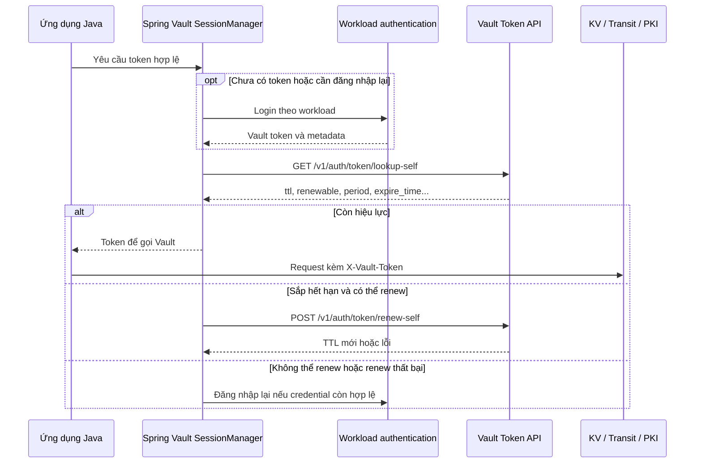
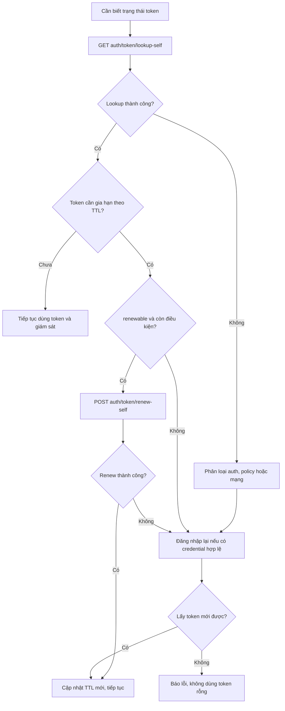

# Token lookup để xác định TTL còn lại và khả năng renew

## 1. Vì sao phải tra cứu token trước khi quyết định gia hạn?

Một ứng dụng Java dùng **Spring Vault** thường cần Vault token để `VaultTemplate` hoặc `ReactiveVaultTemplate` truy cập HashiCorp Vault: đọc KV secrets, gọi Transit encryption, yêu cầu chứng chỉ PKI, hoặc lấy dynamic secrets. Token có **thời hạn hiệu lực** và **quyền hạn** riêng. Nếu ứng dụng giả định token luôn dùng được, lời gọi Vault có thể thất bại đột ngột khi token hết hạn hoặc bị thu hồi. Nếu ứng dụng tự renew mọi token, nó cũng có thể thất bại với token không được phép gia hạn.

**Token lookup** là thao tác hỏi Vault về trạng thái của token hiện tại, đặc biệt là số giây TTL còn lại (`ttl`) và cờ `renewable`. Từ đó ứng dụng hoặc hệ thống vận hành có thêm dữ liệu để quyết định **tiếp tục dùng token**, **gia hạn token** hoặc **đăng nhập lại bằng danh tính workload**. Việc đưa ra quyết định còn phụ thuộc giới hạn TTL, loại token, chính sách và kết quả thực tế của lần renew.

Sau bài này, bạn có thể:

- Gọi `auth/token/lookup-self` bằng Vault HTTP API, Vault CLI và `VaultTemplate`.
- Đọc đúng `ttl`, `renewable`, `expire_time`, `period`, `creation_ttl` và `explicit_max_ttl` trong phản hồi lookup.
- Phân biệt **có khả năng renew** với **chắc chắn renew thành công**.
- Chọn giữa `auth/token/renew-self`, đăng nhập lại và cảnh báo hết hạn trong một ứng dụng Spring Vault.
- Thiết kế giám sát và kiểm thử tích hợp cho vòng đời token mà không làm lộ credential.

> Trong ví dụ, Vault đã bật TLS, có phương thức xác thực theo workload (như Kubernetes, AppRole hoặc cloud IAM), và ứng dụng đã nhận được token. Các TTL và role chỉ mang tính minh họa; giá trị thật phụ thuộc Vault server, auth method và policy.

## 2. Token lookup nằm ở đâu trong vòng đời phiên?

Spring Vault tách vai trò **xác thực** khỏi việc **sử dụng token**. `ClientAuthentication` có trách nhiệm lấy token qua phương thức xác thực được cấu hình; `SessionManager` cấp token cho các request của `VaultOperations`. Một session manager có khả năng quản lý vòng đời, chẳng hạn `LifecycleAwareSessionManager`, có thể theo dõi việc renew và đăng nhập lại theo cấu hình. Trong ứng dụng reactive, thành phần tương ứng là `ReactiveSessionManager` và implementation quản lý vòng đời reactive.



Sơ đồ thể hiện **logic quyết định** chứ không hàm ý `SessionManager` tự động gọi `lookup-self` trước từng request. Spring Vault có thể theo dõi TTL từ phản hồi đăng nhập/renew và tự lập lịch. Gọi lookup thủ công chỉ nên phục vụ chẩn đoán hoặc chức năng kiểm tra trạng thái có kiểm soát; gọi mỗi request sẽ tạo tải HTTP không cần thiết và có thể gặp race condition khi token thay đổi.

### Phân biệt ba thời hạn khác nhau

| Đối tượng | Ví dụ | Điều gì xảy ra khi hết hạn? |
| --- | --- | --- |
| **Vault client token** | Token tạo qua `auth/kubernetes/login` hoặc `auth/approle/login` | Request tới Vault bị từ chối; cần renew hoặc đăng nhập lại để lấy token mới. |
| **Credential đăng nhập** | Kubernetes service-account JWT, AppRole SecretID, cloud identity assertion | Có thể không còn đủ điều kiện để **lấy token mới**; không tự động hủy token đã được Vault cấp trước đó. |
| **Lease của dynamic secret** | Database credentials do `database/creds/...` cấp | Bí mật thuê có TTL/`lease_id` riêng; renew lease hoặc lấy bí mật mới, độc lập với token lookup. |

Đối với KV v2, `metadata.version` chỉ là phiên bản secret, không phải thời hạn Vault token hoặc lease.

## 3. API chuẩn để lookup token của chính ứng dụng

Để xem token đang dùng, gọi:

```http
GET /v1/auth/token/lookup-self HTTP/1.1
Host: vault.example.internal:8200
X-Vault-Token: <current-vault-token>
Accept: application/json
```

Vault kiểm tra token được gửi trong `X-Vault-Token`, rồi trả metadata của **chính token đó**. Không cần đưa token vào URL hoặc JSON payload. Quyền đối với endpoint có thể phụ thuộc policy; thông thường policy `default` cấp quyền self-lookup, nhưng token bị loại bỏ `default` policy cần được kiểm tra quyền riêng.

Phản hồi rút gọn (các số liệu giả lập):

```json
{
  "request_id": "example-request-id",
  "data": {
    "accessor": "example-accessor",
    "creation_time": 1795612020,
    "creation_ttl": 3600,
    "ttl": 420,
    "expire_time": "2026-11-25T14:07:00Z",
    "renewable": true,
    "explicit_max_ttl": 7200,
    "period": 0,
    "num_uses": 0,
    "type": "service",
    "path": "auth/approle/login",
    "policies": ["default", "payments-readonly"]
  }
}
```

Các giá trị điển hình cần hiểu:

| Trường trong `data` | Ý nghĩa | Cách dùng đúng |
| --- | --- | --- |
| `ttl` | TTL **còn lại tại thời điểm Vault xử lý lookup**, thường tính bằng giây. | Dùng đánh giá mức độ cấp bách; đây là giá trị giảm dần theo thời gian, không phải cấu hình TTL ban đầu. |
| `renewable` | Vault đánh dấu token hiện có tính chất có thể gia hạn. | Điều kiện cần cho hành động renew thông thường, **không phải cam kết renew sẽ thành công**. |
| `expire_time` | Thời điểm hết hạn khi Vault cung cấp trường này. | So sánh với thời gian server/UTC; dùng cùng `ttl` để phát hiện lệch đồng hồ hoặc dữ liệu cũ. |
| `creation_ttl` | TTL gán khi token được tạo. | Hữu ích để hiểu cấu hình ban đầu; không được coi là TTL còn lại. |
| `explicit_max_ttl` | Giới hạn TTL tuyệt đối được gán riêng cho token (nếu có). | Có thể chặn việc gia hạn khi chạm giới hạn, kể cả `renewable=true`. Giá trị `0` không có nghĩa token được renew vô hạn. |
| `period` | Chu kỳ của periodic token; thường `0` với token thường. | Token periodic đủ điều kiện có thể được reset TTL theo chu kỳ khi renew; vẫn chịu các giới hạn áp dụng. |
| `type` | Loại token, ví dụ `service` hoặc `batch`. | Batch token có hạn chế vòng đời, không dùng cơ chế renew service token như thông thường. |
| `num_uses` | Số lượt sử dụng còn áp dụng cho token hoặc giới hạn sử dụng theo response. | Không nhầm với `secret_id_num_uses` của AppRole; `0` thường biểu thị không giới hạn lượt. |
| `path`, `policies` | Nguồn cấp token và policy gắn với nó. | Giúp truy vết quyền, không tiết lộ credential trong log. |
| `accessor` | Định danh quản trị token, **không** dùng thay token để xác thực HTTP. | Chỉ dùng trong các tác vụ tra cứu/thu hồi đã được phân quyền; cần bảo vệ phù hợp. |

Không mặc định `ttl = 0` đồng nghĩa token vừa hết hạn trong **mọi** trường hợp: một số token không có TTL thông thường, chẳng hạn root token không có thời hạn, có thể được biểu diễn khác token định kỳ. Cần kết hợp `type`, nguồn cấp, `expire_time`, chính sách và trạng thái request. Token thực sự hết hạn hoặc đã revoke có thể không gọi lookup-self thành công nữa.

### Tra cứu bằng CLI hoặc curl

Vault CLI cung cấp cách nhanh nhất trong môi trường quản trị đã có token:

```bash
vault token lookup
```

Để chỉ in metadata phục vụ chẩn đoán, tránh hiển thị toàn bộ JSON có thể chứa token ID:

```bash
vault token lookup -format=json |
  jq '.data | {ttl, renewable, expire_time, creation_ttl, explicit_max_ttl, period, type}'
```

Hoặc dùng HTTP trực tiếp với token được tiêm qua secret store của môi trường kiểm thử:

```bash
curl --fail --silent --show-error \
  --header "X-Vault-Token: ${VAULT_TOKEN}" \
  "${VAULT_ADDR}/v1/auth/token/lookup-self" |
  jq '.data | {ttl, renewable, expire_time, period, explicit_max_ttl, type}'
```

Không đặt token thật trực tiếp vào command line, tài liệu, Git, issue tracker hoặc log CI. Đầu ra lookup đầy đủ có thể chứa `id`/`accessor` và metadata nhạy cảm; chỉ chọn các trường cần quan sát. `lookup-self` là endpoint tự tra cứu, trong khi lookup token bất kỳ (chẳng hạn `auth/token/lookup`) đòi hỏi quyền khác và thường không cần cho workload thông thường.

## 4. Cách quyết định token có cần và có thể renew hay không

Một quyết định an toàn cần nhiều điều kiện hơn `renewable == true`:

1. **Request lookup thành công:** token vẫn được Vault chấp nhận tại thời điểm lookup và có quyền lookup-self.
2. **TTL đủ thấp để cần hành động:** đánh giá `ttl` theo ngưỡng quản trị phù hợp latency, thời gian retry và khả năng đăng nhập lại.
3. **`renewable` đúng:** Vault cho biết token có đặc tính gia hạn; batch token hoặc token không renewable không nên gọi `renew-self` một cách mù quáng.
4. **Còn nằm trong giới hạn hiệu lực:** TTL tối đa của auth mount, token role, `explicit_max_ttl`, TTL của token cha và các giới hạn liên quan có thể khiến renew bị từ chối hoặc rút ngắn.
5. **Kết quả renew được xác nhận:** sau lệnh renew, phải đọc TTL/`renewable` trả về và xử lý trường hợp TTL nhỏ hơn yêu cầu hoặc gia hạn thất bại.

`ttl` là con số còn lại tính ở Vault server. Nếu lookup trả `ttl = 420`, vài giây sau nó đã thấp hơn 420. Không dựa vào một bản ghi lookup đã cache quá lâu để quyết định token vẫn còn hợp lệ; đồng thời không phát lookup liên tục khi nhiều request nghiệp vụ đồng thời.



### Các trường hợp cần đặc biệt lưu ý

| Trạng thái | Quyết định tham khảo | Lý do |
| --- | --- | --- |
| `ttl` còn dài, `renewable=true` | Giữ token và để cơ chế lifecycle quản lý. | Không cần gia hạn sau mỗi request. |
| `ttl` sắp hết, `renewable=true` | Thử renew theo lịch trước hạn; chuẩn bị phương án re-login. | Cờ renewable không vượt qua được max TTL hoặc điều kiện backend. |
| `ttl` sắp hết, `renewable=false` | Chuẩn bị đăng nhập lại bằng workload identity hoặc xoay token. | `renew-self` không làm cho token bất khả gia hạn trở nên gia hạn được. |
| `ttl` gần bằng 0, API lookup thất bại | Điều tra token hết hạn/revoke, quyền lookup, mạng. | Không đủ bằng chứng để suy ra một nguyên nhân duy nhất từ lỗi. |
| `period > 0` và renewable | Gia hạn periodic token đúng thời điểm, kiểm tra explicit max TTL. | Periodic token có thể kéo dài theo chu kỳ nhưng không bất tử. |
| `type=batch` | Lập kế hoạch cấp batch token mới theo cơ chế cấp phát phù hợp. | Batch token không hỗ trợ renew như service token. |
| Token lookup được nhưng KV trả `403` | Kiểm tra ACL trên KV path. | Khả năng đăng nhập và quyền đọc secrets engine là hai vấn đề khác nhau. |

## 5. Renew token bằng Vault HTTP API

Để gia hạn **chính token đang dùng**, Vault có endpoint:

```http
POST /v1/auth/token/renew-self HTTP/1.1
Host: vault.example.internal:8200
X-Vault-Token: <current-vault-token>
Content-Type: application/json

{"increment": "15m"}
```

`increment` là thời gian gia hạn **được đề nghị**, không phải TTL mới được bảo đảm. Vault có thể giới hạn theo policy, auth mount, TTL tối đa hoặc thời gian còn lại của chuỗi token; một số trường hợp sẽ báo không thể renew. Phản hồi renew token thường mang thông tin ở đối tượng `auth`, ví dụ `auth.lease_duration` và `auth.renewable`; không nhầm nó với `data.ttl` của `lookup-self`.

**Quy trình vận hành khuyến nghị:**

1. Dùng session manager có chức năng lifecycle khi Spring Vault được cấu hình tự xác thực.
2. Nếu thao tác thủ công trong môi trường kiểm thử, trước hết lấy metadata từ lookup để kiểm tra token còn dùng được, `renewable`, loại token và giới hạn hiển thị.
3. Thực hiện `renew-self` **một lần có kiểm soát** và đọc phản hồi; nếu Vault trả TTL ngắn hơn đề nghị thì tôn trọng TTL thực tế.
4. Khi renew không được, chuyển sang nhánh đăng nhập lại hoặc cảnh báo vận hành. Không lặp vô hạn `renew-self`, vì max TTL không biến mất sau retry.

Đối với **periodic token**, renew đúng lịch có thể đặt lại TTL theo chu kỳ. Nhưng token có `explicit_max_ttl` hoặc những ràng buộc thu hồi vẫn có thể hết hiệu lực. Với token thường, `renewable=true` không có nghĩa thời gian hiệu lực có thể được kéo dài mãi mãi.

## 6. Đọc token lookup trong Java qua `VaultTemplate`

Trong Spring Vault, một cách tối giản để xem metadata token đang dùng là gọi endpoint lookup-self qua `VaultOperations.read`. Ví dụ Java 17 trở lên:

```java
import java.time.Duration;
import java.util.Map;
import org.springframework.stereotype.Service;
import org.springframework.vault.core.VaultOperations;
import org.springframework.vault.support.VaultResponse;

@Service
public class VaultTokenInspector {
    private final VaultOperations vault;

    public VaultTokenInspector(VaultOperations vault) {
        this.vault = vault;
    }

    public TokenStatus lookupSelf() {
        // VaultOperations sử dụng token do SessionManager cung cấp.
        VaultResponse response = vault.read("auth/token/lookup-self");
        Map<String, Object> data = response == null ? null : response.getData();
        if (data == null) {
            throw new IllegalStateException("Vault không trả metadata token");
        }

        Object ttlField = data.get("ttl");
        Object renewableField = data.get("renewable");
        if (!(ttlField instanceof Number ttl)
                || !(renewableField instanceof Boolean renewable)) {
            throw new IllegalStateException("Response token lookup thiếu ttl/renewable");
        }

        return new TokenStatus(Duration.ofSeconds(ttl.longValue()), renewable);
    }

    public record TokenStatus(Duration ttlRemaining, boolean renewable) { }
}
```

Ví dụ này **chỉ đọc** metadata, không tự gia hạn token. Mọi lời gọi `read` đều cần một token được `VaultOperations` lấy qua session manager; nếu phiên không còn khả năng lấy token hợp lệ, lỗi xác thực có thể xảy ra trước hoặc trong lookup. Nếu session manager đã tự renew hay re-login trước đó, lookup trả **token hiện tại sau khi cập nhật**, không nhất thiết là token cũ đang khiến bạn nghi ngờ.

Tránh đưa `TokenStatus` ra một endpoint HTTP công khai; TTL/policy/token metadata có thể giúp kẻ tấn công suy đoán cấu hình bảo mật. Nếu chỉ cần giám sát, xuất metric đã được lọc và giới hạn quyền người xem. Khi dùng WebFlux, chọn `ReactiveVaultOperations` và reactive session manager phù hợp; không gọi `VaultOperations.read(...)` đồng bộ trực tiếp trên Netty event-loop.

### Có nên gọi renew bằng `vault.write(...)`?

Về mặt HTTP, `vault.write("auth/token/renew-self", Map.of("increment", "15m"))` ánh xạ đến `POST /v1/auth/token/renew-self`. Tuy nhiên, đối với ứng dụng có session manager quản lý token, renew thủ công có thể **xung đột lịch gia hạn và trạng thái token** do session manager đang giữ. Hãy để cơ chế lifecycle của Spring Vault phụ trách renew, hoặc thiết kế một chủ sở hữu rõ ràng cho việc gia hạn thay vì có nhiều nơi cùng can thiệp.

## 7. Liên hệ với `SessionManager` và xác thực theo workload

| Cơ chế | Ý nghĩa đối với lookup/renew | Rủi ro cấu hình |
| --- | --- | --- |
| `SimpleSessionManager` | Lấy và giữ token để sử dụng; không tự thực hiện vòng đời renew/re-login theo cách của lifecycle manager. | Token có thể hết hạn trong một tiến trình chạy lâu. |
| `LifecycleAwareSessionManager` | Theo dõi lifecycle token, lên lịch renew hoặc đăng nhập lại theo điều kiện. | Cần cấu hình client auth và quyền phù hợp; credential đăng nhập lại cũng phải còn hiệu lực. |
| `ReactiveLifecycleAwareSessionManager` | Tương đương định hướng reactive khi dùng `ReactiveVaultTemplate`. | Một auth mechanism/SDK có thể không hỗ trợ đầy đủ reactive flow; cần kiểm tra phiên bản. |
| Token tĩnh do cấu hình cung cấp | Dùng một token đã cấp sẵn, không nhất thiết có cơ chế tạo token thay thế. | Khi token hết hạn và không renew được, ứng dụng cần nguồn cấp mới từ bên ngoài. |

Đối với **Kubernetes authentication**, re-login phụ thuộc JWT/service account token mà workload lấy được lúc đó. Đối với **AppRole**, token có thể không renew được hoặc đã chạm giới hạn; nếu SecretID chỉ dùng một lượt hay đã hết TTL, re-login có thể thất bại dù token trước đó từng hoạt động. Với AWS/Azure/GCP auth, phiên mới phụ thuộc khả năng lấy bằng chứng danh tính cloud hiện tại. Do đó cần kiểm thử **cả renew lẫn re-login** theo cơ chế cụ thể.

Một sai lầm thường gặp là thấy lookup báo `renewable=true` rồi mặc định hệ thống luôn tự renew. Cờ Vault trả về chỉ là **khả năng của token**, trong khi hành động gia hạn phụ thuộc session manager, cấu hình ứng dụng, quyền, network và khả năng giao tiếp với Vault. Ngược lại, `renewable=false` không loại trừ việc ứng dụng lấy **token mới** qua authentication method, nếu còn credential đăng nhập hợp lệ.

## 8. Giám sát, xử lý lỗi và kiểm thử tích hợp

Các tín hiệu giám sát có ích gồm TTL còn lại theo nhóm workload, số lần renew thành công/thất bại, số lần re-login, thời gian đăng nhập, lỗi `401/403` tại token API và lỗi phân quyền `403` tại secrets engine. Nếu triển khai metric, nên dùng tên workload và nhóm lỗi; **không** dùng token ID, accessor, SecretID, JWT hay giá trị secret làm metric label.

| Triệu chứng | Diễn giải có thể có | Kiểm tra / xử lý |
| --- | --- | --- |
| Lookup-self trả `403` | Token không hợp lệ, thiếu quyền self-lookup hoặc chính sách khác. | Kiểm tra session, default policy, request path và audit log; tránh tự động diễn giải thành token hết hạn. |
| Lookup-self trả `401` hoặc lỗi xác thực | Token sai/thiếu/hết hạn hoặc bị revoke; cách Vault trả lỗi phụ thuộc ngữ cảnh. | Xác minh nguồn token, auth flow và thời điểm phát hành; thử re-login bằng credential hợp lệ. |
| `renewable=true` nhưng renew thất bại | Giới hạn max TTL, token cha, quyền, thu hồi hoặc lỗi hạ tầng. | Kiểm tra server response, `explicit_max_ttl`, auth mount, policy và log an toàn. |
| Renew thành công nhưng TTL thấp hơn yêu cầu | Vault áp dụng trần TTL hoặc điều kiện token. | Dùng TTL thực nhận và chuẩn bị re-login trước khi hết hạn. |
| KV/Transit/PKI trả `403` sau lookup thành công | Token hợp lệ nhưng policy thiếu capability trên path API. | Kiểm tra ACL cho `secret/data/...`, `transit/encrypt/...` hoặc `pki/issue/...`. |
| `ttl` có vẻ không khớp thời gian của máy | Lệch đồng hồ, kết quả lookup cũ hoặc đọc sai đơn vị. | Đồng bộ thời gian, xem `expire_time` và tính TTL theo giây từ response mới. |
| Hệ thống liên tục login khi nhiều request đến cùng lúc | Session cache/renew scheduling không đúng hoặc dùng client riêng cho mỗi request. | Dùng một session manager được cấu hình và tái sử dụng đúng; đo lưu lượng token API. |

Một bộ test tích hợp sử dụng Vault kiểm thử (và danh tính workload test) nên bao gồm:

| Test case | Chuẩn bị | Kỳ vọng |
| --- | --- | --- |
| Lookup token mới | Login với token có TTL xác định, quyền lookup-self. | `ttl > 0` với token có hạn, `renewable` và `type` khớp cấu hình. |
| TTL giảm dần | Lookup hai lần có khoảng thời gian phù hợp. | TTL sau không lớn hơn TTL trước nếu không có renew/re-login xen vào; chấp nhận sai số do thời gian. |
| Renew thành công | Token renewable, chưa chạm giới hạn; renew trước khi hết hạn. | Vault phản hồi TTL mới hợp lệ và token dùng được sau đó. |
| Token không renewable | Cấp token không cho phép renew; gọi renew trong môi trường test. | Renew bị từ chối; ứng dụng chuyển sang flow re-login/rotation đúng cách. |
| Đạt max TTL | Token có giới hạn TTL tuyệt đối ngắn. | Renew tiếp theo có thể bị từ chối hoặc giới hạn, không retry vô hạn. |
| Token bị revoke | Thu hồi token test rồi lookup lại. | Lookup thất bại; ứng dụng phát hiện và không dùng credential đã thu hồi. |
| Lỗi mạng khi renew | Mô phỏng Vault timeout/retry có giới hạn. | Session phục hồi khi có thể, nếu không báo lỗi rõ ràng; không làm lộ token. |
| AppRole SecretID đã hết lượt | Login lần đầu hợp lệ, SecretID một lượt, sau đó token không thể renew. | Re-login bằng SecretID cũ thất bại; yêu cầu cấp SecretID mới. |
| Token còn hiệu lực nhưng thiếu quyền KV | Dùng token có lookup-self, không có `read` trên KV path. | Lookup thành công; đọc KV bị `403`, xác định đây là vấn đề ACL. |

Với ứng dụng Spring WebFlux, kiểm tra thêm timeout và hoạt động renew/login mà không chặn event-loop; không dùng `.block()` tùy tiện để tra token. Đối với dynamic secret, nên có test lease riêng để kiểm tra `lease_id`, `lease_duration`, renew/revoke lease; **token lookup không thể thay thế lease lookup**.

## 9. Tình huống thực hành: TTL còn 90 giây, renewable=true

Service `payments-api` dùng Spring Vault, đăng nhập bằng AppRole và đọc `secret/data/payments/db` trên KV v2. Lúc 10:00, người vận hành gọi `auth/token/lookup-self` và thấy:

```json
{
  "data": {
    "ttl": 90,
    "renewable": true,
    "creation_ttl": 1800,
    "explicit_max_ttl": 3600,
    "period": 0,
    "type": "service",
    "path": "auth/approle/login"
  }
}
```

**Câu hỏi 1: Có chắc token renew thêm 30 phút được không?** Không. `renewable=true` chỉ cho biết token có thuộc tính có thể gia hạn; max TTL và các giới hạn của auth mount/role có thể khiến yêu cầu bị cắt ngắn hoặc bị từ chối.

**Câu hỏi 2: Có cần renew sau mỗi lần gọi KV không?** Không. Nếu đã dùng `LifecycleAwareSessionManager`, hãy kiểm tra cơ chế gia hạn hiện tại và quan sát kết quả. Nếu quản lý thủ công, nên có một bộ điều phối renew thống nhất, thực hiện trước hạn với khoảng dự phòng thích hợp.

**Câu hỏi 3: Nếu renew thất bại, có thể login lại bằng AppRole không?** Có thể, **nếu** RoleID/SecretID còn hợp lệ, SecretID chưa hết TTL/lượt và Vault role còn cho phép. Nếu SecretID đã dùng hết một lượt, cần cấp và phân phối SecretID mới.

**Câu hỏi 4: Token còn 90 giây có đảm bảo request PKI 2 phút sẽ thành công?** Không. Request có thể hoàn thành hoặc thất bại tùy thời điểm Vault xác thực và xử lý, chính sách và timeout. Không dùng TTL làm bảo đảm hoàn thành tác vụ; hãy thiết kế retry/idempotency và gia hạn trước khi bắt đầu các tác vụ dài.

## 10. Ghi nhớ khi triển khai

- **Lookup-self là quan sát tại một thời điểm:** `GET /v1/auth/token/lookup-self` trả `data.ttl` tính bằng giây và `data.renewable`; TTL có thể giảm ngay sau đó.
- **`renewable=true` không phải lời hứa gia hạn vô hạn:** phải xét max TTL, loại token và phản hồi thực tế của `renew-self`.
- **Ưu tiên quản lý token tập trung:** sử dụng lifecycle-aware session manager phù hợp với Spring Vault/Spring Cloud Vault; tránh tự renew trùng lặp từ nhiều lớp.
- **Renew token khác re-login và lease renewal:** workload credential quyết định khả năng lấy token mới; lease của dynamic secrets có vòng đời riêng.
- **Bảo vệ metadata và credential:** chỉ log thông tin phục vụ chẩn đoán đã lọc, không lộ token ID, accessor, SecretID hoặc bí mật nghiệp vụ.

Thực hành token lookup đúng cách giúp ứng dụng **SPRING_VAULT** nhìn rõ thời gian sống còn lại của Vault token, dự đoán khi nào cần renew hoặc xác thực lại, và duy trì khả năng truy cập KV, Transit, PKI an toàn. Kết hợp lookup với quản lý phiên, giám sát, xử lý lỗi và kiểm thử tích hợp là cách vận hành vòng đời token đáng tin cậy trong hệ thống Java.
