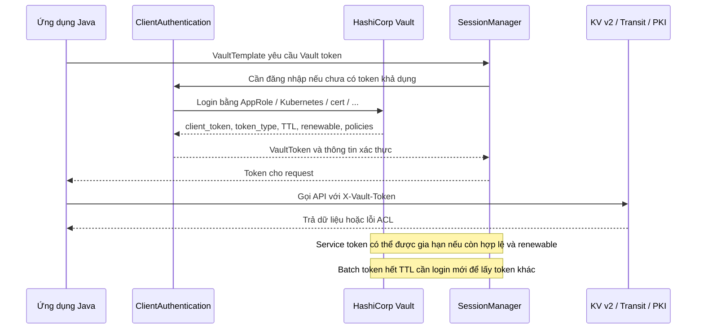
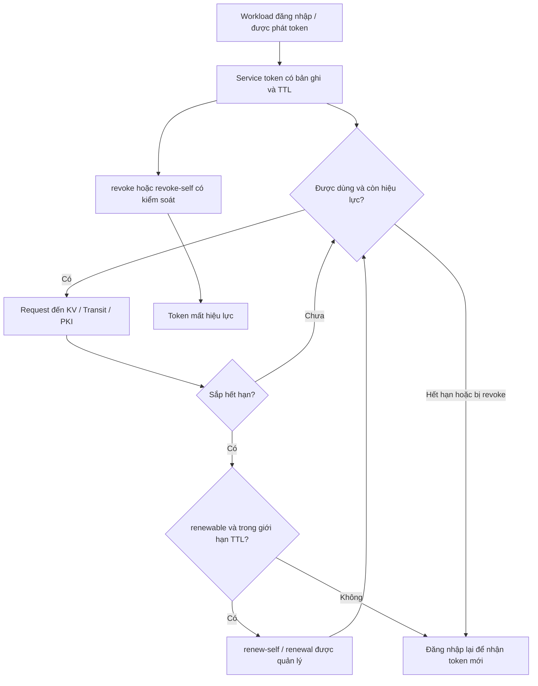
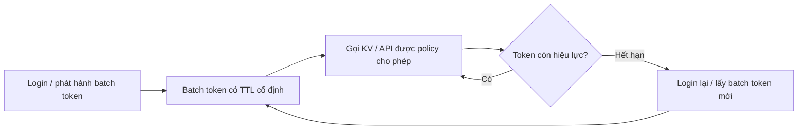

# Token dịch vụ, token batch và khả năng quản lý vòng đời trong Spring Vault

## 1. Tại sao phải phân biệt hai loại Vault token?

Khi một ứng dụng Java dùng **Spring Vault** và `VaultTemplate` để đọc bí mật KV, mã hóa bằng Transit hay yêu cầu chứng thư từ PKI, mỗi request được thực hiện theo quyền của một **Vault token**. Token có thể được cấp sau khi workload đăng nhập bằng Kubernetes Auth, AppRole, TLS Certificate Authentication hoặc một auth method khác. Trong một số tình huống kiểm thử, token cũng có thể được tạo trực tiếp từ **Token auth method**.

HashiCorp Vault có hai loại token chính:

- **Service token:** có trạng thái được Vault quản lý trong token store, phù hợp khi cần theo dõi, gia hạn, thu hồi và quản lý quan hệ cha–con của token.
- **Batch token:** mã token tự mang thông tin xác thực cần thiết dưới dạng dữ liệu được bảo vệ bằng mật mã, không tạo bản ghi token riêng trong token store. Loại này phù hợp với nhiều tác vụ ngắn hạn nhưng không hỗ trợ gia hạn hoặc thu hồi riêng từng token như service token.

Tên **service token** ở đây chỉ *loại token của Vault*, không đồng nghĩa “token dành riêng cho microservice”. Một microservice có thể dùng service token hoặc batch token; sự lựa chọn phải dựa trên khả năng quản lý vòng đời cần thiết.

Mục tiêu của bài thuộc chương **Phiên và vòng đời token**:

1. Nhận biết khác biệt giữa service token và batch token, đặc biệt ở `renew`, `revoke`, TTL, accessor và quan hệ cha–con.
2. Hiểu cách token được cấp, đưa vào session, sử dụng, hết hạn và bị thu hồi.
3. Cấu hình workload Java dùng **Spring Vault** để truy cập KV v2 theo chính sách ACL tối thiểu.
4. Kiểm thử hành vi khi token còn hạn, gần hết hạn, không thể gia hạn, bị thu hồi hoặc backend Vault gặp sự cố.
5. Chọn loại token phù hợp với nhu cầu gọi KV, Transit, PKI và quản lý lease, tránh giả định mọi loại token có cùng API vòng đời.

## 2. Token xuất hiện ở đâu trong luồng Spring Vault?



Các thành phần cần phân biệt:

| Thành phần | Nhiệm vụ | Không nên nhầm với |
|---|---|---|
| **Auth method** | Xác minh danh tính workload, có thể phát hành service/batch token theo cấu hình | Token đã cấp |
| `ClientAuthentication` | Thực thi quá trình login từ Java; ví dụ AppRole/Kubernetes/cert | Quyền đọc bí mật |
| `SessionManager` | Cấp token cho request; tùy triển khai có thể cache, gia hạn hoặc tái xác thực | Vault token store |
| **Vault token** | Đại diện cho phiên ủy quyền, mang policies và TTL | Credential dùng để login (SecretID, chứng thư, service account JWT…) |
| **ACL policy** | Quy định API/secret engine nào được truy cập | Token type |
| **Secret lease** | Thời hạn của secret động được Vault cấp | TTL của token đăng nhập |

**Đăng nhập thành công không có nghĩa request đọc được mọi secret**. Ví dụ, token có policy đọc `kv-lab/data/app/config` vẫn có thể bị từ chối tại `transit/decrypt/orders` hoặc `pki/issue/service`.

## 3. So sánh service token và batch token

| Tiêu chí | Service token | Batch token |
|---|---|---|
| Lưu trạng thái token ở Vault | Có bản ghi trong token store | Không tạo bản ghi token riêng; token tự mang dữ liệu xác thực đã bảo vệ |
| Tối ưu điển hình | Phiên cần quản lý vòng đời, hoạt động tương đối lâu | Lượng lớn token ngắn hạn, muốn giảm chi phí lưu trữ và tra cứu |
| TTL lúc cấp | Có | Có |
| Gia hạn bằng `renew` / `renew-self` | **Có thể**, nếu token còn hiệu lực, `renewable=true` và nằm trong giới hạn TTL | **Không** |
| Thu hồi đích danh token qua `revoke` | **Có** khi được phép | **Không** theo cơ chế thu hồi riêng từng token |
| Token accessor | Có, phục vụ lookup/revoke và vận hành | Không có accessor token store |
| Token con / cây cha–con | Hỗ trợ theo quyền và cách cấp token | Không hỗ trợ tạo token con theo cơ chế service token |
| Periodic token | Có thể cấu hình cho service token | Không hỗ trợ |
| Số lần sử dụng token (use limit) | Có thể giới hạn theo cấu hình | Không hỗ trợ cơ chế đếm lần dùng dựa trên token store |
| Cubbyhole cá nhân / tính năng cần trạng thái token | Hỗ trợ khi phù hợp | Không hỗ trợ các tính năng phụ thuộc bản ghi token |
| Cách xử lý khi đến hạn | Có thể renew hoặc đăng nhập lại nếu điều kiện cho phép | Đăng nhập lại/được cấp một token mới |

**Lưu ý về thu hồi batch token:** không có API để thu hồi *riêng lẻ* một batch token như service token. Một số thao tác ở mức **nguồn cấp/quan hệ cha hoặc backend** có thể ảnh hưởng đến tính hợp lệ của token tùy cách phát hành; không thiết kế cơ chế cắt quyền khẩn cấp bằng cách giả định có thể `vault token revoke <batch-token>` như service token. Nếu bắt buộc thu hồi đích danh ngay, hãy chọn **service token**.

Batch token không phải “token không có quyền” hay “token dùng một lần”: nó vẫn có policies và có thể được dùng nhiều request **trong thời hạn còn hiệu lực**, miễn là quyền của token cho phép. Khả năng lặp lại request khác với hỗ trợ giới hạn `num_uses`.

### 3.1. TTL, renewal và expiration khác nhau thế nào?

- **TTL (`ttl`):** thời gian token còn hợp lệ kể từ khi được cấp hoặc lần gia hạn thích hợp.
- **`renewable`:** token có thể xin gia hạn hay không. Một service token **không mặc nhiên luôn renewable**.
- **`max_ttl` / `explicit_max_ttl`:** các giới hạn áp dụng khi phát hành, gia hạn và theo cấu hình auth mount, role hoặc hệ thống. Renew không thể vượt những ràng buộc có hiệu lực.
- **Expiration:** khi token hết hạn, Vault không tiếp tục chấp nhận token đó. Ứng dụng cần token hợp lệ khác.
- **Reauthentication:** chạy lại auth flow của workload để nhận token mới. Đây là thao tác **khác** với gia hạn token hiện tại.

Với service token renewable, renewal thường kéo dài thời hạn hiệu lực của **chính token hiện tại**, không tạo token mới. Với batch token, đến hạn phải **được phát hành lại** (thông thường bằng cách workload đăng nhập lại qua auth method có hỗ trợ cấp batch token).

## 4. Vòng đời của từng loại token

### 4.1. Service token



Service token có thể được liên kết với **parent token** trừ khi phát hành dưới dạng orphan hoặc cơ chế auth cụ thể quy định khác. Quan hệ cha–con có thể ảnh hưởng đến hành vi thu hồi dây chuyền. Các token **periodic** cũng là service token, được gia hạn theo kỳ và vẫn chịu các giới hạn cấu hình liên quan. Cần kiểm tra cơ chế cấp token thực tế trước khi thiết kế chiến lược gia hạn.

Thao tác với **token accessor** giúp hệ thống vận hành xác định và thu hồi service token mà không phải giữ nguyên giá trị token bí mật. Accessor cũng phải được bảo vệ và chỉ được sử dụng trong phạm vi có quyền.

### 4.2. Batch token



Batch token **không thể gia hạn TTL của chính token đó**. Nếu workload phải thực hiện các request sau khi batch token hết hạn, nó cần khả năng **tái xác thực** hoặc nhận batch token mới từ hệ thống cấp phát. Một ứng dụng chỉ nhận một batch token tĩnh rồi chạy vô thời hạn sẽ gặp lỗi khi token hết hạn.

### 4.3. Vòng đời token khác vòng đời lease

Khi một ứng dụng gọi **database dynamic secrets**, PKI hoặc một secret engine có lease, Vault có thể trả `lease_id`, `lease_duration` và `renewable` cho **secret được cấp**. Những giá trị này không nhất thiết bằng TTL của token dùng để gọi API.

```text
Vault token (xác thực/ủy quyền)
  ├─ TTL và renewable của token
  ├─ policies quyết định quyền trên API
  └─ Request tạo/đọc secret
       └─ Secret lease riêng (nếu endpoint có lease)
            ├─ lease_id
            ├─ lease_duration
            └─ renewable của lease (tùy engine/role)
```

Service token có cơ chế quản lý và thu hồi gắn với token/lease phong phú hơn. Với batch token, các hoạt động tạo, gia hạn hoặc thu hồi secret động có thể bị giới hạn bởi **loại token, secret engine và chế độ lease**. Do đó, nếu workload cần quản lý lease hoặc thu hồi credential động, phải kiểm thử riêng hành vi **token + engine + policy** trước khi chuyển sang batch; không lấy việc đọc KV thành công làm bằng chứng mọi tính năng lease đều hỗ trợ.

## 5. Thực hành tạo hai loại token trên Vault thử nghiệm

Dùng Vault **dev/test riêng**, chính sách tối thiểu và secret giả. Ví dụ giả định một KV v2 mount tên `kv-lab` chưa tồn tại. Các lệnh tạo mount chỉ chạy một lần; không chạy trên mount production đang phục vụ workload.

```bash
# Chuẩn bị fixture với quyền quản trị Vault test.
vault secrets enable -path=kv-lab -version=2 kv
vault kv put -mount=kv-lab app/config feature=demo
```

Policy `token-lab-read.hcl`:

```hcl
path "kv-lab/data/app/config" {
  capabilities = ["read"]
}
```

```bash
vault policy write token-lab-read token-lab-read.hcl
```

Tạo token trực tiếp bằng CLI trong lab với token có quyền cấp token:

```bash
# Service token thử nghiệm; kết quả có giá trị token bí mật.
vault token create -type=service -policy=token-lab-read -ttl=15m

# Batch token thử nghiệm; kết quả cũng có giá trị token bí mật.
vault token create -type=batch -policy=token-lab-read -ttl=5m
```

**Không dán output token vào tài liệu hoặc log CI.** Dùng cơ chế nhận credential bảo mật trong test để gắn từng token vào request tương ứng. Trong một số môi trường, policy của token phát hành có thể được gộp thêm policy mặc định hoặc chịu giới hạn từ parent/auth method; kiểm tra các quyền thực tế thay vì giả định từ một flag CLI.

Với token cần xác thực, dùng `vault kv get`:

```bash
# Shell/runner được inject VAULT_TOKEN là token service hợp lệ.
vault kv get -mount=kv-lab app/config

# Thay bằng batch token ở một lần test khác, chạy lại lệnh tương tự.
vault kv get -mount=kv-lab app/config
```

Nếu cả hai token được cấp policy đọc KV, kết quả cùng trả `feature=demo`. Phép thử này chỉ chứng minh **quyền đọc secret**, chưa chứng minh sự khác biệt vòng đời.

### 5.1. Đối chiếu trực tiếp renewal

Với **service token** do runner inject, có quyền/đặc tính renewable:

```bash
vault token lookup
vault token renew
vault token lookup
```

Lệnh `vault token lookup` khi không truyền token khác sẽ kiểm tra token của phiên CLI hiện tại. Quan sát `type`, `ttl`, `renewable`, policy và accessor (nếu công cụ hiển thị) bằng phương án không log giá trị bí mật.

Nếu token được tạo với `renewable=false`, đã hết hạn hoặc vướng giới hạn max TTL, **renew có thể bị từ chối ngay cả khi đó là service token**. Với **batch token**, lệnh renewal không được hỗ trợ. Hãy tách test renewal khỏi test quyền đọc để tránh kết luận nhầm một lỗi ACL hoặc lỗi mạng là “token batch”.

### 5.2. Đối chiếu trực tiếp revocation

Với service token **chỉ dùng trong lab**, người quản trị có thể thu hồi:

```bash
# Chạy bằng chính token thử nghiệm để tự thu hồi:
vault token revoke -self
```

Kể từ lúc thu hồi thành công, request tiếp theo dùng token đó phải thất bại. Đừng chạy lệnh trên token quản trị hoặc token của workload production. Nếu cần giữ token quản trị để tiếp tục lab, thao tác thu hồi phải sử dụng đúng token thử nghiệm và policy tương ứng.

Với batch token, không có cơ chế thu hồi riêng từng token qua `revoke-self`/accessor như service token. Test nên xác nhận **không có khả năng quản lý vòng đời tương đương**, thay vì cố dùng một lệnh revoke rồi dựa hoàn toàn vào một mã lỗi HTTP. Với batch, TTL ngắn và quyền tối thiểu là hai lớp giảm rủi ro thiết yếu.

## 6. Các HTTP API liên quan tới vòng đời token

Những API dưới đây thường được sử dụng để kiểm tra service token. Tất cả ví dụ giả định TLS đã được xác minh và token được đưa vào header bằng cơ chế injection an toàn của workload.

| API | Phương thức | Mục đích | Lưu ý |
|---|---|---|---|
| `/v1/auth/token/lookup-self` | `GET` | Tra cứu thông tin token đang dùng | Hữu ích với service token, không log token hay phản hồi nhạy cảm |
| `/v1/auth/token/renew-self` | `POST` | Xin gia hạn token hiện hành | Chỉ có ý nghĩa với service token renewable |
| `/v1/auth/token/revoke-self` | `POST` | Thu hồi service token hiện hành | Thao tác phá hủy phiên; chỉ dùng có kiểm soát |
| `/v1/auth/token/lookup-accessor` | `POST` | Tra cứu qua accessor | Cần accessor + quyền phù hợp, không áp dụng để quản lý batch token riêng lẻ |
| `/v1/auth/token/revoke-accessor` | `POST` | Thu hồi token qua accessor | Chỉ dành cho service token khi đã cấp quyền |
| `/<secret-mount>/data/<key>` | `GET` | Đọc dữ liệu KV v2 | Thành công phụ thuộc ACL, không suy ra token renewable |

Ví dụ HTTP `renew-self` của service token:

```http
POST /v1/auth/token/renew-self
X-Vault-Token: <SERVICE_TOKEN>
Content-Type: application/json

{"increment": "5m"}
```

`increment` là **yêu cầu** gia hạn, không bảo đảm Vault cấp thêm đúng 5 phút. TTL thực tế bị giới hạn bởi cấu hình token, role, auth mount và hệ thống. Khi renew thành công, cần xem thời hạn mới từ phản hồi hoặc lookup; không suy đoán dựa trên số request thành công.

Ví dụ `revoke-self`:

```http
POST /v1/auth/token/revoke-self
X-Vault-Token: <SERVICE_TOKEN>
```

Việc tự thu hồi token đang được `VaultTemplate` sử dụng làm request tiếp theo thất bại trừ khi ứng dụng có **cơ chế lấy token mới**. Các token con/lease có thể bị tác động dây chuyền tùy cách cấp và quan hệ token; cần kiểm tra trước khi thu hồi token cha.

## 7. Cách Spring Vault quản lý token trong phiên

Trong Spring Vault, `VaultTemplate` cần một `SessionManager` cung cấp token cho mỗi request. Các thành phần thường gặp:

- `ClientAuthentication`: cách lấy token, ví dụ `AppRoleAuthentication`, Kubernetes authentication, `ClientCertificateAuthentication` hoặc `TokenAuthentication`.
- `SimpleSessionManager`: cách đơn giản để truy xuất/cache token cho các request; không tự triển khai đầy đủ chu kỳ renewal và revoke.
- `LifecycleAwareSessionManager`: quản lý vòng đời token ở mức cao hơn, bao gồm những hoạt động renewal/re-login thích hợp với `ClientAuthentication` và đặc tính token; phải kiểm tra cấu hình/phiên bản đang sử dụng.
- `VaultTemplate`: gọi API dữ liệu bằng token từ session, không tự quyết định service/batch token được cấp.

**Loại token do Vault phát hành quyết định những thao tác vòng đời Vault cho phép.** Dù ứng dụng tạo một `LifecycleAwareSessionManager`, nó không thể biến batch token thành renewable. Khi token không thể renew, đường khôi phục là **xác thực lại hoặc được cấp token khác**; điều này chỉ hoạt động khi workload còn credential hợp lệ và session/ứng dụng được cấu hình để lấy token mới.

### 7.1. Ví dụ Java đọc KV v2 qua một token được inject

Để minh họa sự độc lập của **quyền dữ liệu** và **token type**, ví dụ sau dùng `VaultTemplate` do Spring đã cấu hình. Token có thể là service/batch, miễn là session đang dùng token hợp lệ có quyền đọc đúng key:

```java
import java.util.Map;

import org.springframework.stereotype.Service;
import org.springframework.vault.core.VaultTemplate;
import org.springframework.vault.support.VaultResponse;

@Service
public class TokenLabKvReader {

    private final VaultTemplate vaultTemplate;

    public TokenLabKvReader(VaultTemplate vaultTemplate) {
        this.vaultTemplate = vaultTemplate;
    }

    public String readFeature() {
        VaultResponse response =
                vaultTemplate.read("kv-lab/data/app/config");

        if (response == null || response.getData() == null) {
            throw new IllegalStateException("KV data is missing");
        }

        // Với KV v2, response.data chứa một key "data" là map payload.
        Object raw = response.getData().get("data");
        if (!(raw instanceof Map<?, ?> payload)) {
            throw new IllegalStateException("Invalid KV v2 payload");
        }

        Object value = payload.get("feature");
        if (!(value instanceof String feature)) {
            throw new IllegalStateException("Feature missing");
        }

        return feature;
    }
}
```

Cấu hình Spring Vault sẽ cấp `VaultTemplate` và session phù hợp với auth method được chọn. Ví dụ không đặt token vào mã nguồn hoặc log, không chủ động renew, và không giả định secret engine tạo lease. Đối với mã nghiệp vụ thật, có thể chọn `opsForVersionedKeyValue(...)` để dùng API KV v2 ở mức cao.

### 7.2. `TokenAuthentication` dùng token có sẵn

Một workload có thể nhận **Vault token tĩnh** từ bên ngoài. Cách khởi tạo Spring Vault tương ứng dùng `TokenAuthentication`:

```java
import org.springframework.vault.authentication.ClientAuthentication;
import org.springframework.vault.authentication.TokenAuthentication;

public ClientAuthentication clientAuthentication() {
    String token = System.getenv("VAULT_TOKEN");
    if (token == null || token.isBlank()) {
        throw new IllegalStateException("VAULT_TOKEN is not provided");
    }
    return new TokenAuthentication(token);
}
```

`TokenAuthentication` **không phải phương thức đăng nhập lấy token mới từ Vault**; nó trả về token có sẵn được ứng dụng cấp. Nếu token đó là **batch token** hết TTL, không có credential AppRole/Kubernetes/cert bổ sung thì session không thể tự “login lại” để tạo token thay thế. Nếu đó là service token renewable, khả năng renewal cũng phụ thuộc session manager, token policy và hạn mức Vault.

Vì vậy, với ứng dụng chạy dài hạn, thường nên chọn **workload auth** và thiết kế rõ cơ chế re-login, thay vì giả định một biến môi trường `VAULT_TOKEN` sẽ có hiệu lực mãi mãi. Việc đổi biến môi trường hay file token **không tự bảo đảm** instance `TokenAuthentication` đã dựng được cập nhật.

### 7.3. Chạy với AppRole, Kubernetes hoặc cert auth

Khi workload đăng nhập bằng auth method thực sự, phía Vault quyết định token type dựa trên cấu hình role/mount. Một số role hỗ trợ tùy chọn `token_type` để yêu cầu service/batch. Hãy đối chiếu **auth method cụ thể và phiên bản Vault** khi chọn token type; không mặc định mọi role đều hỗ trợ cùng bộ tùy chọn.

Đối với ứng dụng dùng `LifecycleAwareSessionManager`, kiểm tra cụ thể:

1. Token trả về là `service` hay `batch`.
2. Nó có `renewable=true` hay không.
3. Khi gần hết TTL, session renew được hay cần đăng nhập lại.
4. Tại thời điểm re-login, credential khởi tạo có còn hợp lệ không (AppRole SecretID có thể hết số lần dùng/TTL; Kubernetes JWT hoặc chứng thư có thể đã rotate).
5. Request đang chạy và request mới có sử dụng token đúng phiên khi chuyển đổi hay không.

Nếu cần **thu hồi ngay một phiên cụ thể**, batch token không phải lựa chọn phù hợp. Nếu chỉ cần gọi API ngắn hạn với TTL nhỏ, workload có khả năng tự lấy token mới và không dùng tính năng yêu cầu trạng thái token, batch token đáng cân nhắc.

## 8. Thiết kế kiểm thử tích hợp: service vs batch

Tạo fixture token/secret trong Vault test độc lập, không dùng token root của ứng dụng production. Trong CI, inject credential trong bộ nhớ hoặc secure secret provider; **không in `client_token`, secret payload, token accessor, Authorization header** vào log.

| Mã test | Điều kiện | Kết quả cần xác nhận |
|---|---|---|
| S1 | Service token có `read` trên `kv-lab/data/app/config` | `VaultTemplate` đọc KV v2 thành công |
| S2 | Service token `renewable=true`, còn hợp lệ và trong giới hạn TTL | `renew-self` được chấp nhận, token vẫn dùng được |
| S3 | Service token không renewable hoặc đã chạm giới hạn | Renew bị từ chối; workload cần xác thực lại |
| S4 | Revoke service token test bằng `revoke-self` / accessor hợp lệ | Request dùng token cũ thất bại sau revoke |
| B1 | Batch token có cùng policy `read` | `VaultTemplate` đọc KV v2 thành công trong TTL |
| B2 | Batch token được đưa vào renewal path | Không thể renew; cần token mới |
| B3 | Batch token hết TTL | Request bị từ chối; re-login/token mới có thể tiếp tục truy cập |
| B4 | Thử quản lý qua accessor của batch token | Không có accessor service-token để lookup/revoke riêng lẻ |
| A1 | Token có quyền đọc KV nhưng không có quyền Transit | Đọc KV thành công; gọi `transit/decrypt` bị từ chối |
| A2 | Token đã xác thực nhưng policy không có `read` trên KV | KV đọc bị 403, khác lỗi token hết hạn |
| L1 | Workload đổi credential đăng nhập nhưng session giữ token cũ | KV vẫn có thể thành công; chưa đủ chứng minh đã re-login |
| L2 | Vault trả 5xx, timeout hoặc TLS lỗi lúc renewal/re-login | Phân biệt lỗi hạ tầng với token bị từ chối; retry có giới hạn |

Các bài test TTL có thể chậm và không ổn định nếu chỉ gọi `sleep` chờ hết hạn. Nên:

- Dùng token TTL ngắn **nhưng đủ lớn** để request không tự hết hạn giữa các bước test; khi cần kiểm tra hết hạn thì dùng thời gian chờ có giới hạn hoặc đồng hồ/fixture do môi trường test kiểm soát.
- Phân tách test renewal, revoke, expiry và ACL thành những case độc lập, mỗi case sở hữu token/role riêng.
- Đọc kết quả auth/token metadata tại phía có quyền thích hợp; không đưa thông tin nhạy cảm vào thông báo assertion.
- Kiểm tra **một request thực tế sau thay đổi**, vì trả kết quả tốt từ lần gọi trước không chứng minh phiên hiện tại còn hợp lệ.

### 8.1. Xác nhận quyền KV bằng Spring Test

Với JUnit 5 và Spring Test (`@SpringBootTest` hoặc `@SpringJUnitConfig`), dựng context chứa `TokenLabKvReader` và `VaultTemplate`, rồi kiểm tra `assertEquals("demo", reader.readFeature())`. Chạy riêng hai lượt inject `VAULT_TOKEN` của **service** và **batch** token có cùng policy; không để token xuất hiện trong báo cáo test. Kiểm thử renewal/revoke là các test độc lập và chỉ sử dụng fixture riêng.

### 8.2. Kiểm thử chống lỗi cho session lâu dài

Giả sử ứng dụng xử lý một job lâu hơn TTL batch token. Test cần bắt đầu từ credential login hợp lệ, lấy batch token lần 1, chờ/đưa nó đến hết TTL và xác minh:

- Request dùng token lần 1 bị Vault từ chối.
- Hệ thống re-login thực sự để nhận **token khác**.
- Request mới thành công bằng token lần 2, nếu credential và policy vẫn hợp lệ.
- Có giới hạn backoff và cơ chế báo lỗi khi auth backend mất kết nối; không lặp login vô hạn.
- Không đưa token cũ/mới vào metric, trace hoặc exception được log.

Với **service token**, kiểm thử tương ứng là renewal trước hạn, token hết giới hạn renewal cần re-login, thu hồi token giữa chừng và chuyển session an toàn. Không được dựa vào một request KV thành công để khẳng định đã thử renewal.

## 9. Lựa chọn token theo yêu cầu vận hành

| Kịch bản | Loại phù hợp để xem xét | Lý do |
|---|---|---|
| API server Java chạy lâu, cần gia hạn và thu hồi token khi sự cố | **Service token** | Có renewal, revocation, accessor và tracking |
| Worker/job ngắn hạn, volume lớn, được cấp token mới dễ dàng | **Batch token** | Nhẹ, giảm trạng thái token phải lưu tại Vault |
| Hệ thống bắt buộc kill riêng token khi phát hiện lộ thông tin | **Service token** | Có cơ chế revoke đích danh |
| Nghiệp vụ cần tracking token con hoặc cơ chế token lifecycle phức tạp | **Service token** | Hỗ trợ cây token và các thao tác trạng thái |
| Tác vụ chỉ đọc một KV secret trong vài phút | **Batch token** có thể phù hợp | Nếu ACL và cơ chế cấp lại token thỏa điều kiện |
| Ứng dụng cần dynamic secrets/lease renewal hoặc PKI có vòng đời phức tạp | **Đánh giá theo engine**, thường ưu tiên service | Cần kiểm chứng hỗ trợ lease/token và semantics thu hồi |
| Dịch vụ cần dùng Transit `encrypt`/`decrypt` liên tục | Tùy TTL, cơ chế cấp lại, yêu cầu thu hồi | Quyền Transit đến từ policy; token type quyết định lifecycle |

Không có quy tắc “batch luôn tốt hơn” hoặc “mọi workload Java phải dùng service token”. Chọn dựa vào thời gian chạy, yêu cầu kill/revoke, nguồn credential để login lại, chi phí tạo token, khả năng quan sát và đặc tính secret engine.

### 9.1. Bảo vệ token trong hệ thống thật

Token là **bearer credential**: ai có token hợp lệ có thể thực hiện các hành động mà policy của nó cho phép. Vì vậy cần:

- Dùng TLS, xác minh CA/hostname và tránh truyền token qua URL hay log.
- Không hard-code token trong Java/YAML version control; không lưu output CLI chứa token vào artifact.
- Dùng policy **least privilege** và TTL phù hợp; batch thường cần TTL ngắn do khó thu hồi riêng lẻ.
- Thiết kế cơ chế rotate/reauth cho credential khởi tạo workload, không chỉ xử lý token đã cấp.
- Chỉ cấp quyền `auth/token/lookup*`, `renew*`, `revoke*` ở đúng phạm vi vận hành cần thiết.
- Theo dõi thời hạn token và lỗi 403/5xx, nhưng không lưu raw token/accessor trong logs hoặc metrics.
- Nếu phát hiện lộ token, xử lý theo khả năng của loại token: service có thể revoke; batch cần giảm thời gian phơi nhiễm bằng TTL, quyền hẹp và các biện pháp quản trị nguồn cấp liên quan.

## 10. Lỗi thường gặp và cách tìm nguyên nhân

| Hiện tượng | Nguyên nhân có thể | Hướng xử lý |
|---|---|---|
| `renew-self` thất bại | Batch token, service không renewable, hết hạn hoặc chạm TTL limit | Kiểm tra loại token, `renewable`, cấu hình TTL; login lại khi cần |
| `revoke-self` không hỗ trợ trên token hiện tại | Batch token không có bản ghi revocation riêng | Không dựa vào revoke riêng lẻ; dùng TTL ngắn hoặc chuyển service token khi yêu cầu |
| Token mới dùng được nhưng KV trả 403 | Policy thiếu `read` hoặc ACL path sai | Kiểm tra `kv-lab/data/app/config`, token policies và namespace |
| Token cũ đọc KV được sau khi đổi credential AppRole/cert | Session đang cache token vẫn còn hạn | Kiểm tra request login mới và cách thay session |
| Service token bị revoke nhưng request retry vô hạn | Không tách được lỗi token không hợp lệ với lỗi mạng | Phân loại 403 và 5xx, re-login hữu hạn nếu có credential; fail fast khi cấu hình sai |
| Batch token hết hạn giữa job | Job dài hơn TTL, không có cơ chế cấp token mới | Thiết kế re-login tại điểm an toàn hoặc dùng service token |
| Renew token thành công nhưng secret động đã hết hạn | Token TTL khác lease TTL | Quản lý token lifecycle và lease lifecycle độc lập |
| Lookup batch token không có accessor | Batch token không tạo bản ghi token store | Không dựa vào accessor cho batch token |
| Log chứa token từ CLI hoặc phản hồi login | Tool/ứng dụng in raw auth response | Lọc trường nhạy cảm, thay fixture test và xử lý sự cố lộ credential |

Khi điều tra lỗi ở Java, xác định endpoint đang lỗi: **login**, **token renewal/revocation**, hay **API secret engine**. Cùng mã HTTP có thể có nhiều nguyên nhân; kết hợp loại token, TTL, ACL và thông tin lỗi đã được ẩn dữ liệu nhạy cảm.

## 11. Câu hỏi tự kiểm tra

**Câu 1.** Một batch token còn 2 phút TTL và đọc KV v2 thành công. Có thể dùng `auth/token/renew-self` để kéo dài thời gian sống lên 30 phút không?

**Đáp án:** Không. Batch token không hỗ trợ renewal. Workload cần nhận token mới qua phương thức xác thực/cấp phát được thiết kế cho nó.

**Câu 2.** Service token có `renewable=false`. Loại token này có thể renew chỉ vì nó là service token không?

**Đáp án:** Không. Loại service token hỗ trợ cơ chế renewal, nhưng **token cụ thể** còn phải renewable, còn hiệu lực và trong giới hạn TTL.

**Câu 3.** Workload đang giữ service token T1. Hệ thống thay SecretID AppRole, nhưng `VaultTemplate.read` vẫn thành công. Điều đó chứng minh T2 đã được phát hành chưa?

**Đáp án:** Chưa. Session có thể vẫn sử dụng T1. Phải quan sát một lần đăng nhập mới bằng credential hiện hành và request bằng token được cấp từ lần đăng nhập ấy.

**Câu 4.** Nếu cần thu hồi đích danh một token bị lộ ngay lập tức, nên ưu tiên loại nào?

**Đáp án:** Service token, vì hỗ trợ revoke theo token/accessor. Không thiết kế thu hồi riêng lẻ batch token theo cùng cách.

## 12. Tài liệu tham khảo và định hướng thực hành tiếp

- [HashiCorp Vault: Tokens – Service and batch tokens](https://developer.hashicorp.com/vault/docs/concepts/tokens)
- [HashiCorp Vault: Token auth method](https://developer.hashicorp.com/vault/docs/auth/token)
- [HashiCorp Vault API: Token](https://developer.hashicorp.com/vault/api-docs/auth/token)
- [HashiCorp Vault: Lease, renew and revoke](https://developer.hashicorp.com/vault/docs/concepts/lease)
- [Spring Vault Reference: Authentication](https://docs.spring.io/spring-vault/reference/vault/authentication.html)
- [Spring Vault Reference: Session management](https://docs.spring.io/spring-vault/reference/vault/session-management.html)

**Ghi nhớ:** service token phù hợp với phiên cần quản lý vòng đời bằng renewal/revocation và token store; batch token phù hợp với token có thời hạn ngắn, cấp phát số lượng lớn và ít yêu cầu state. Trong **Spring Vault**, `VaultTemplate` chỉ sử dụng token mà `SessionManager` cung cấp: cơ chế renewal, re-login và thu hồi cần được thiết kế theo **token type thực sự được Vault phát hành**, cùng ACL và vòng đời lease của secret engine.
