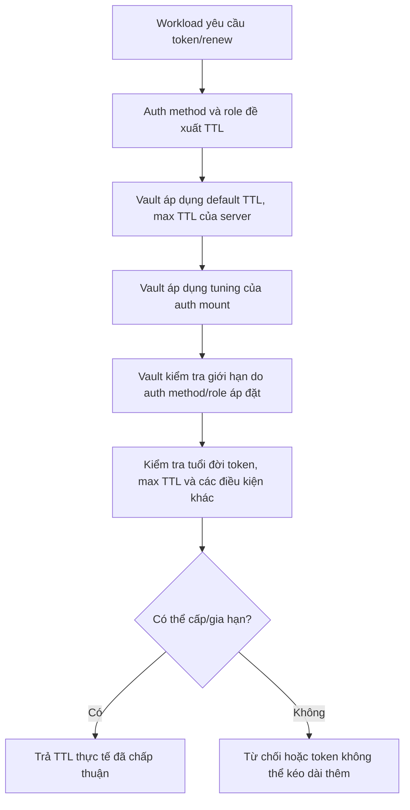

# Thời hạn, max TTL và giới hạn gia hạn do máy chủ quyết định

Khi ứng dụng Java truy cập **HashiCorp Vault** qua **Spring Vault**, token đăng nhập và credential động thường có **thời hạn sử dụng (Time To Live – TTL)**. Ứng dụng có thể xin Vault gia hạn token hoặc lease, nhưng **Vault mới là bên quyết định TTL được chấp thuận**. Vì vậy, yêu cầu “gia hạn thêm 1 giờ” không đồng nghĩa máy chủ luôn cấp thêm đúng 1 giờ, kể cả khi phản hồi ban đầu có `renewable: true`.

Bài học thuộc chương **Phiên và vòng đời token** của module **SPRING_VAULT**. Ta sẽ phân biệt TTL hiện tại, default TTL, max TTL, explicit max TTL và periodic token; xem các giới hạn do máy chủ áp đặt trong lúc cấp phát hoặc gia hạn; sau đó áp dụng với `VaultTemplate`, `LifecycleAwareSessionManager`, workload authentication và các trường hợp lỗi thực tế.

## 1. TTL thực tế là thời gian còn lại, không phải lời hứa gia hạn vô hạn

Vault dùng TTL để giới hạn thời gian token hoặc dynamic secret còn hiệu lực. Một token bình thường có thể được cấp TTL 30 phút; nếu không gia hạn kịp, token hết hạn và Vault có thể thu hồi token cùng những lease liên quan. Bị thu hồi khác với chỉ hết thời gian: người quản trị hoặc một thao tác hợp lệ có thể **revoke ngay** dù TTL vẫn còn.

Ví dụ một lần đăng nhập AppRole/Kubernetes có thể trả về:

```json
{
  "auth": {
    "client_token": "<REDACTED>",
    "policies": ["default", "payments-read"],
    "lease_duration": 1800,
    "renewable": true,
    "token_type": "service"
  },
  "data": null,
  "lease_id": "",
  "lease_duration": 0
}
```

Ý nghĩa:

- `auth.lease_duration = 1800`: TTL **token** vừa cấp là khoảng 1.800 giây, tức 30 phút, tính tại thời điểm phản hồi.
- `auth.renewable = true`: token có thể **được yêu cầu** gia hạn theo điều kiện; không có nghĩa được gia hạn mãi mãi.
- `auth.token_type = "service"`: service token có thể hỗ trợ renewal. Batch token không được gia hạn như service token.
- `lease_duration = 0` ở **gốc phản hồi** không phải TTL của token mới cấp; không nhầm với `auth.lease_duration`.

Sau 10 phút, thời gian còn lại của token không tự động vẫn là 30 phút. Tra cứu token tại thời điểm đó sẽ phản ánh TTL đã giảm, trừ khi token đã được gia hạn trong khoảng thời gian ấy.

### 1.1. Các khái niệm liên quan nhưng không giống nhau

| Khái niệm | Ý nghĩa | Cạm bẫy thường gặp |
| --- | --- | --- |
| **Current TTL** (`ttl` khi lookup) | Số giây token còn hợp lệ **ngay lúc tra cứu**. | Không lấy TTL lúc login làm TTL hiện tại. |
| **Default TTL** | TTL mặc định của hệ thống/mount khi yêu cầu không chỉ định giá trị phù hợp. | Không phải mức bảo đảm cho mọi auth role. |
| **Requested TTL / increment** | Thời hạn ứng dụng hoặc operator **đề nghị** cấp hay gia hạn. | Không buộc Vault chấp thuận đúng số đó. |
| **Maximum TTL (max TTL)** | Mức giới hạn do Vault tính từ cấu hình hệ thống, mount và auth method/role. | Với token thông thường, giới hạn **tổng tuổi đời token**, không tự làm mới mỗi lần renew. |
| **Explicit max TTL** | Giới hạn tuổi đời tuyệt đối ghi trực tiếp lên token. | Không thể vượt qua bằng renew; có hiệu lực cả với periodic token. |
| **Period** | Chu kỳ TTL của **periodic token**; mỗi lần renew hợp lệ reset TTL về chu kỳ. | Không nên hiểu periodic token được miễn mọi giới hạn khác. |
| **Renewable flag** | Cho biết đối tượng được đánh dấu có thể xin renewal. | Renewal còn phụ thuộc loại token, policy, thời điểm và max TTL. |

Vault có default `default_lease_ttl` và `max_lease_ttl` ở cấp server. Cấu hình mặc định thường là **768 giờ (32 ngày)**, nhưng triển khai thật có thể đổi các giá trị này, và từng auth/secrets mount có thể được chỉnh riêng. Không nên hardcode 32 ngày trong ứng dụng như một quy tắc bất biến.

## 2. Ai quyết định TTL? Các lớp cấu hình trên máy chủ Vault

Với **token thông thường** (không periodic và không có explicit max TTL), khi cấp token hay renew, Vault xem xét nhiều lớp cấu hình.



Các lớp cần phân biệt:

1. **Server:** cấu hình `default_lease_ttl`, `max_lease_ttl` trong Vault server config. Đây là cơ sở khi không có override phù hợp.
2. **Mount:** auth mount (như `auth/approle/`, `auth/kubernetes/`) có `default_lease_ttl` và `max_lease_ttl` riêng thông qua `vault auth tune`. Mount có thể override system max TTL; tùy giá trị, nó có thể ngắn hơn hoặc dài hơn system max.
3. **Auth method/role:** role đăng nhập có thể gợi ý TTL và max TTL nhỏ hơn giới hạn mount; ví dụ AppRole có `token_ttl` và `token_max_ttl`.
4. **Bản thân token:** token có thể mang `explicit_max_ttl`, `period`, loại token, giới hạn sử dụng, quan hệ cha–con và các ràng buộc khác.
5. **Tại thời điểm renew:** Vault so sánh thời gian token đã sống, các giới hạn hiện hành và yêu cầu `increment`; có thể cấp ít hơn hoặc từ chối.

**Điểm then chốt:** đối với token thường, **max TTL là giới hạn tổng tuổi đời tính từ khi token được tạo**, còn **TTL hiện tại là khoảng thời gian trước lần hết hạn kế tiếp**. Mỗi lần renew thường đặt lại khoảng thời gian hiệu lực còn lại theo quyết định của Vault, nhưng **không đặt lại mốc thời gian tạo token**.

### 2.1. Ví dụ AppRole có TTL mặc định 30 phút và max TTL 2 giờ

Giả sử operator có quyền quản trị và thao tác trên môi trường thử nghiệm:

```bash
# Xem cấu hình TTL của auth mount AppRole.
vault read sys/auth/approle/tune

# Đặt giới hạn TTL của mount trong lab.
vault auth tune -default-lease-ttl=30m -max-lease-ttl=2h approle/

# Định nghĩa role cấp service token với TTL đề xuất 30 phút
# và giới hạn tuổi đời tối đa 2 giờ.
vault write auth/approle/role/payments-service \
  token_policies="payments-read" \
  token_ttl="30m" \
  token_max_ttl="2h"

# Kiểm tra cấu hình role.
vault read auth/approle/role/payments-service
```

Các lệnh trên minh họa cấu hình của một auth mount đã được bật và policy `payments-read` đã tồn tại. Tên mount và quyền operator trong từng hệ thống có thể khác nhau. Nếu auth mount đã được dùng trong production, thay đổi TTL ảnh hưởng những token được cấp/gia hạn theo quy tắc của Vault; cần kiểm tra tác động trước khi chỉnh.

Từ cấu hình ví dụ, khi AppRole phát hành một **token thường** lúc 09:00, nó có thể được cấp TTL 30 phút và phải chịu giới hạn tổng tuổi đời 2 giờ, tức đến khoảng 11:00. Thực tế Vault sẽ tính theo toàn bộ cấu hình đang áp dụng; chỉ khi những giới hạn giả định không thay đổi ta mới dùng được mốc thời gian cố định này.

## 3. Ví dụ theo thời gian: vì sao yêu cầu 1 giờ chỉ được 20 phút?

Giả sử token thường được tạo vào **09:00**, ban đầu có TTL 30 phút, max TTL hiệu lực **2 giờ** và được phép renew. Hãy theo dõi các lần gia hạn trong môi trường mà cấu hình không đổi:

| Thời điểm | Tuổi đời token | Yêu cầu hoặc trạng thái | Kết quả Vault có thể cấp |
| --- | --- | --- | --- |
| **09:00** | 0 phút | Đăng nhập. TTL đề xuất 30 phút. | Token hết hạn khoảng 09:30 nếu không renew. |
| **09:20** | 20 phút | Xin renew với `increment=30m`. | Có thể cấp TTL khoảng 30 phút, hiệu lực đến 09:50. |
| **09:40** | 40 phút | Xin renew thêm 70 phút. | Có thể cấp TTL khoảng 70 phút, hiệu lực đến 10:50. |
| **10:40** | 100 phút | Xin renew thêm 60 phút. | **Chỉ còn tối đa khoảng 20 phút** trước max TTL 11:00. |
| **11:00** | 120 phút | Đã chạm giới hạn max TTL 2 giờ. | Không thể kéo dài thêm token thường theo giới hạn giả định. Workload cần token mới. |

Đây là timeline minh họa, không phải thuật toán chính xác cho mọi loại token. Các giới hạn của mount và auth method có thể thay đổi; một số auth method còn có ràng buộc riêng. **TTL Vault trả về sau mỗi lần renew mới là con số đáng tin để lập lịch vận hành**.

```text
Tạo token        Renew           Renew             Renew             Max TTL
09:00            09:20           09:40             10:40             11:00
  |----------------|---------------|-----------------|------------------|
  | TTL 30m        | TTL 30m       | TTL 70m         | Chỉ còn ~20m     |
  |                |               |                 |                  |
  +-------------------------- Tuổi đời tối đa 2 giờ --------------------+
```

Nếu ứng dụng lấy `increment=3600` (1 giờ) làm TTL thực tế ở lần renew 10:40, nó có thể cố dùng token sau 11:00 và nhận lỗi 403. Cách đúng là **đọc TTL được Vault cấp**, phát hiện thời gian còn lại quá ngắn và chuẩn bị **đăng nhập lại**.

### 3.1. Max TTL có thể được tính lại tại thời điểm renew

Theo cơ chế của Vault, **maximum TTL thông thường là giá trị hiệu lực được suy ra từ cấu hình hiện hành**, có thể thay đổi giữa các lần gia hạn. Việc sửa tuning của auth mount, policy cấp token hoặc cấu hình của auth role có thể ảnh hưởng kết quả renewal tiếp theo. Vì vậy, `token lookup` thường không đưa ra một trường `max_ttl` đơn giản, cố định cho mọi token; cần xem cấu hình phía server và kết quả renewal.

Không nên suy ra “max TTL còn lại” chỉ bằng `creation_ttl - age`: `creation_ttl` là TTL **lúc tạo**, không phải max TTL. Cũng không nên giả định `explicit_max_ttl = 0` đồng nghĩa không giới hạn; nó chỉ cho biết **không có explicit max TTL** được đặt trực tiếp.

## 4. Explicit max TTL: trần tuổi đời cứng của token

Trong một số trường hợp, operator hoặc auth method phát hành token với **`explicit_max_ttl`**. Đây là trần tuổi đời **tính từ thời điểm token được tạo**, không thể kéo dài bằng renewal, và **không tự thay đổi** khi chỉnh system/mount max TTL.

Ví dụ (chỉ dành cho người có quyền tạo token trong lab):

```bash
# Tạo service token với TTL ban đầu 20 phút,
# nhưng tuyệt đối không được sống hơn 1 giờ kể từ lúc tạo.
vault token create \
  -type=service \
  -ttl=20m \
  -explicit-max-ttl=1h \
  -policy=payments-read
```

Mô hình:

- Nếu token được tạo lúc 14:00, TTL ban đầu có thể là 20 phút.
- Mỗi lần renewal hợp lệ có thể gia hạn thời điểm hết hạn trước mắt.
- Dù renew bao nhiêu lần, token vẫn không được tiếp tục hoạt động sau giới hạn explicit max TTL là **15:00**.
- Khi gần 15:00, kết quả renew có thể trả TTL ngắn hơn yêu cầu; sau khi đạt trần, token không còn được gia hạn hợp lệ.

Không nên xem explicit max TTL như “cộng thêm 1 giờ sau mỗi lần renew”. Nó là **giới hạn cứng trên tổng tuổi đời**.

### 4.1. Phân biệt ba trường dễ gây nhầm trong lookup

Một kết quả tra cứu token có thể chứa:

```json
{
  "data": {
    "ttl": 720,
    "creation_ttl": 1200,
    "explicit_max_ttl": 3600,
    "renewable": true,
    "type": "service",
    "expire_time": "2026-11-25T09:12:00Z"
  }
}
```

| Trường | Ý nghĩa trong ví dụ |
| --- | --- |
| `ttl: 720` | Token hiện còn khoảng 12 phút **ở thời điểm lookup**. |
| `creation_ttl: 1200` | TTL ban đầu khi tạo token là 20 phút. |
| `explicit_max_ttl: 3600` | Tổng tuổi đời bị chặn ở 60 phút kể từ khi tạo. |
| `renewable: true` | Có thể đề nghị gia hạn khi token còn hợp lệ và các giới hạn cho phép. |
| `expire_time` | Thời điểm hết hạn **theo trạng thái hiện tại**; có thể thay đổi sau renewal nhưng không vượt trần explicit max TTL. |

Timestamp chỉ dùng để minh họa định dạng. Khi quan sát thật, các trường có thể khác tùy loại token và phiên bản API.

## 5. Periodic token: TTL được đặt lại theo chu kỳ, nhưng vẫn do Vault kiểm soát

**Periodic token** dành cho workload chạy dài hạn. Thay vì áp dụng giới hạn tổng tuổi đời thông thường, Vault cấp một **period** như `30m`. Mỗi lần gia hạn thành công **trước khi hết hạn**, TTL lại được đặt về period được cấu hình.

Giả sử Vault phát hành periodic token với `period = 30m`:

```text
09:00     Phát hành periodic token: TTL ~30m
09:20     Gia hạn thành công: TTL lại ~30m
09:40     Gia hạn thành công: TTL lại ~30m
...       Tiếp tục khi token còn hợp lệ và mỗi lần renew được chấp thuận
```

Nếu không có explicit max TTL, periodic token có thể được gia hạn liên tục qua thời gian dài, miễn là mọi điều kiện của Vault vẫn thỏa mãn. Tuy nhiên:

- **Nếu bỏ lỡ kỳ renewal và token hết hạn**, không thể “renew lại” token đã chết.
- **Nếu token bị thu hồi**, renewal không thể cứu token.
- **Nếu có `explicit_max_ttl`**, periodic token vẫn phải dừng khi chạm trần này.
- **Nếu token phụ thuộc token cha không còn hiệu lực**, token con có thể bị thu hồi theo quan hệ cha–con; periodic không miễn quy tắc này.
- **Nếu role/cấu hình/capability thay đổi**, lần renew tiếp theo có thể không còn được chấp nhận.

Ví dụ operator có quyền đặc biệt trong lab có thể tạo periodic token:

```bash
# Có thể yêu cầu root/sudo hoặc quyền phù hợp thông qua token role.
vault token create -period=30m -policy=payments-read
```

Trong vận hành thực tế, có thể dùng auth method như AppRole cấu hình phát hành periodic token thông qua role; cần thiết kế chính sách và quyền cẩn thận. Không tạo periodic token chỉ để bỏ qua quy định tuổi thọ credential của tổ chức.

| Loại token | Có thể renew? | Giới hạn tuổi đời |
| --- | --- | --- |
| Service token thường, `renewable=true` | Có thể xin renew. | Chịu max TTL hiệu lực từ hệ thống/mount/auth role. |
| Service token có explicit max TTL | Có thể xin renew nếu điều kiện hợp lệ. | **Không vượt** explicit max TTL. |
| Periodic service token | Có thể xin renew theo period. | Không chịu max TTL thông thường theo cách token thường, **nhưng vẫn chịu explicit max TTL nếu có**. |
| Batch token | Không được renew theo cơ chế service token. | Có TTL cố định; không có periodic renewal. |
| Root token không hết hạn | Không có TTL thông thường nếu được cấp loại không hết hạn. | Đây là trường hợp quản trị đặc biệt, không dùng để thiết kế phiên ứng dụng. |

## 6. Kiểm tra TTL hiện tại bằng CLI và HTTP API

Khi cần biết token **đang dùng** còn hạn bao lâu, dùng `auth/token/lookup-self`. Trong ví dụ CLI dưới đây, giả định `VAULT_ADDR` và `VAULT_TOKEN` đã được thiết lập bằng cơ chế an toàn, và token có quyền lookup-self.

```bash
# Kiểm tra thông tin token hiện tại (lệnh đầy đủ có thể chứa metadata).
vault token lookup

# Chỉ trích các thông số vòng đời cần giám sát, không in client token.
vault token lookup -format=json \
  | jq '.data | {ttl, creation_ttl, explicit_max_ttl, period, renewable, type, expire_time}'
```

API tương đương:

```http
GET /v1/auth/token/lookup-self
X-Vault-Token: <TOKEN_HIEN_TAI>
```

Các trường quan trọng:

| Trường trong `data` | Cách đọc |
| --- | --- |
| `ttl` | TTL còn lại tính bằng giây, giảm theo thời gian. |
| `renewable` | Token có khả năng xin gia hạn hay không. |
| `type` | `service` hay `batch`. |
| `creation_ttl` | TTL ban đầu của token; không phải max TTL. |
| `explicit_max_ttl` | Giới hạn tuổi đời cứng nếu được thiết lập. |
| `period` | Chu kỳ của periodic token nếu có. |
| `expire_time` | Mốc hết hạn hiện tại; thay đổi sau renew thành công. |
| `num_uses` | Nếu bị giới hạn lượt sử dụng, token có thể không còn hợp lệ trước khi TTL bằng 0. |

`renewable=true` không chứng minh token có quyền gọi `auth/token/renew-self`. Nếu policy chặn endpoint này hoặc token đã chạm trần, thao tác renew vẫn thất bại. Tương tự, lookup-self có thể trả 403 vì policy hoặc token không còn hợp lệ; ứng dụng phải xử lý lỗi thay vì lấy mặc định TTL bằng 0.

## 7. Yêu cầu renew: Vault có thể cấp ít hơn mức xin

Để gia hạn **chính token hiện tại**:

```http
POST /v1/auth/token/renew-self
X-Vault-Token: <TOKEN_HIEN_TAI>
Content-Type: application/json

{
  "increment": "30m"
}
```

Có thể thực hiện tương ứng bằng Vault CLI:

```bash
# Yêu cầu gia hạn 30 phút cho token đang dùng.
vault token renew -increment=30m

# Đọc lại TTL của token sau khi gia hạn, tránh in token.
vault token lookup -format=json | jq '.data | {ttl, expire_time, renewable}'
```

Phân biệt:

1. `increment` là **thời gian người gọi mong muốn**, không phải TTL được bảo đảm.
2. Vault xác định **TTL thực tế** dựa trên max TTL/period/explicit max TTL và điều kiện auth hiện hành.
3. Có thể nhận một TTL **ngắn hơn** `increment`, một cảnh báo hoặc một lỗi.
4. Sau renew, luôn dựa vào **TTL máy chủ trả về hoặc self-lookup mới** để lập kế hoạch tiếp tục.
5. Nếu TTL sau renew không còn tăng được hoặc gần chạm giới hạn, nên chuẩn bị **tái xác thực để có token mới** nếu auth method hỗ trợ.

Lỗi `403` có thể xảy ra do token không hợp lệ, thiếu quyền, vượt giới hạn hoặc đã bị revoke. Không retry vô hạn hay tự động tăng `increment` để tìm cách vượt trần TTL.

### 7.1. Quyền gọi endpoint renew

Một workload dùng token của mình để gia hạn thường cần capability `update` trên:

```hcl
path "auth/token/renew-self" {
  capabilities = ["update"]
}
```

Nhiều môi trường có thể cấp quyền này thông qua Vault `default` policy, nhưng không được giả định mọi deployment đều giữ nguyên default policy. Chỉ thêm chính sách này khi cần và sau khi đánh giá cơ chế session management.

**Lưu ý:** policy cho phép gọi `renew-self` không làm token bị đánh dấu `renewable=false` trở thành renewable. ACL permission, token type và TTL limit là những điều kiện **tách biệt**.

### 7.2. Quy tắc kiểm tra sau renew

Ứng dụng có thể dùng logic nghiệp vụ như:

```text
Nếu renew trả lỗi 403 hoặc token đã hết hạn:
    -> Không cố gọi renew liên tục bằng token cũ
    -> Kích hoạt cơ chế đăng nhập lại (nếu workload hỗ trợ)

Nếu renew thành công và TTL mới đủ cho chu kỳ tiếp theo:
    -> Lập lịch tiếp theo theo TTL mới và độ trễ dự phòng

Nếu renew thành công nhưng TTL mới quá ngắn hoặc không tăng:
    -> Dự kiến đã gần max TTL/explicit max TTL
    -> Chuẩn bị đăng nhập lại và thay token trước khi hết hạn

Nếu lỗi mạng/5xx:
    -> Retry giới hạn với backoff khi còn thời gian an toàn
    -> Quan sát trạng thái token và phân biệt lỗi tạm thời với bị từ chối
```

Không sử dụng lại token đã bị thu hồi. Thời điểm hết hạn được Vault tính theo máy chủ; ứng dụng nên có **safety margin** để bù độ trễ mạng, thời gian xử lý và sai lệch đồng hồ.

## 8. Spring Vault quản lý phiên khi max TTL đã chạm trần

Spring Vault cung cấp `ClientAuthentication` để lấy token qua workload authentication (AppRole, Kubernetes, AWS, GCP...), `SessionManager` để cung cấp token cho các lệnh `VaultTemplate` và `LifecycleAwareSessionManager` để theo dõi vòng đời token.

Với session manager hỗ trợ lifecycle:

- Khi chưa có token, session manager gọi `ClientAuthentication` để đăng nhập.
- Nếu nhận được `LoginToken` có TTL và renewable, Spring Vault dùng thông tin này để quản lý các lần gia hạn.
- Khi token không còn gia hạn được hoặc chạm giới hạn cuối, session manager có thể **đăng nhập lại** để lấy token mới nếu phương thức xác thực còn hoạt động.
- Với `TokenAuthentication` cấp một `VaultToken` chung, thông tin TTL/renewable có thể được lấy qua self-lookup khi được bật; token tĩnh không tự trở thành một cách đăng nhập có thể cấp lại token mới.
- Khi ứng dụng tắt, cơ chế quản lý phiên có các quy tắc revoke đối với token nhận từ login; behavior thực tế phụ thuộc loại token và cấu hình.

Bởi vậy, khi sử dụng Spring Vault, nên để một **cơ chế session management nhất quán** làm chủ việc renew/relogin. Tránh vừa để `LifecycleAwareSessionManager` tự gia hạn vừa gọi thủ công `auth/token/renew-self` từ nhiều luồng khác nhau: dữ liệu TTL mà các thành phần đang theo dõi có thể không còn đồng bộ.

### 8.1. Ví dụ Java: chỉ đọc trạng thái token, không tự renew

Đoạn Java dùng `VaultOperations` để kiểm tra TTL hiện tại của token mà Spring Vault đang sử dụng. Nó **không tiết lộ token** và có thể dùng khi xây dựng health check hoặc chẩn đoán tại runtime:

```java
import java.util.Map;

import org.springframework.vault.core.VaultOperations;
import org.springframework.vault.support.VaultResponse;

public final class VaultTokenTtlInspector {
    private final VaultOperations vault;

    public VaultTokenTtlInspector(VaultOperations vault) {
        this.vault = vault;
    }

    public TokenState lookupCurrentToken() {
        VaultResponse response = vault.read("auth/token/lookup-self");

        if (response == null || response.getData() == null) {
            throw new IllegalStateException("Vault không trả thông tin token");
        }

        Map<String, Object> data = response.getData();
        Object ttl = data.get("ttl");
        Object renewable = data.get("renewable");
        Object type = data.get("type");

        if (!(ttl instanceof Number)
                || !(renewable instanceof Boolean)
                || !(type instanceof String)) {
            throw new IllegalStateException("Phản hồi token lookup không hợp lệ");
        }

        return new TokenState(
                ((Number) ttl).longValue(),
                (Boolean) renewable,
                (String) type);
    }

    public record TokenState(long ttlSeconds, boolean renewable, String type) {
        public boolean canRequestRenew() {
            return ttlSeconds > 0 && renewable && "service".equals(type);
        }
    }
}
```

Một cách sử dụng:

```java
VaultTokenTtlInspector inspector = new VaultTokenTtlInspector(vaultTemplate);
VaultTokenTtlInspector.TokenState state = inspector.lookupCurrentToken();

System.out.printf("Token TTL=%d s, renewable=%s, type=%s%n",
        state.ttlSeconds(), state.renewable(), state.type());

if (state.ttlSeconds() < 120) {
    // Quan sát/cảnh báo: phiên đang gần hết hạn.
    // SessionManager mới là bên phụ trách renew hoặc đăng nhập lại.
}
```

`state.canRequestRenew()` chỉ phản ánh **điều kiện sơ bộ**: token còn TTL, được đánh dấu renewable và là service token. Nó không thể kiểm tra mọi max TTL hay policy phía server. Không dùng kết quả này làm bằng chứng rằng một lần renew chắc chắn thành công.

Nếu `lookup-self` bị Vault trả `403` hoặc kết nối thất bại, `vault.read(...)` có thể ném exception thay vì trả `VaultResponse` rỗng. Health check nên phân loại lỗi xác thực, quyền và lỗi mạng; không cho phép exception ghi ra bearer token hoặc toàn bộ body chứa secret.

### 8.2. Vì sao không dùng Java để hardcode “thời gian renew = TTL lúc login”?

Ví dụ code sau mang tư duy không đúng:

```java
// Sai về logic: TTL lúc login không phải thời gian còn lại mãi mãi.
long ttlFromFirstLogin = 1800L;
// Sau mỗi lần renew, không thể giả định vẫn được cấp 1800 giây.
```

Thay vì tự cache TTL cũ và tính vô hạn, hãy để session manager xử lý token và kiểm tra kết quả renewal. Với mã quản trị trực tiếp gọi API renew trong lab, phải đọc TTL của phản hồi hoặc tự lookup mới và cập nhật lịch theo kết quả thực tế.

Spring Vault đồng thời có `SecretLeaseContainer` để quản lý lease của **dynamic secrets**. Đây là vòng đời **khác** token session: token được gia hạn không có nghĩa lease credential database tự động được gia hạn; ngược lại, credential cũ có lease hợp lệ vẫn có thể bị thu hồi khi token cấp nó hết hạn.

## 9. Phân biệt giới hạn token và giới hạn lease của secret động

Khi đọc một database dynamic secret, Vault có thể trả:

```json
{
  "lease_id": "database/creds/reporting/abc123",
  "lease_duration": 900,
  "renewable": true,
  "data": {
    "username": "v-reporting-abc",
    "password": "<REDACTED>"
  },
  "auth": null
}
```

TTL `lease_duration = 900` ở **lớp ngoài** có nghĩa credential động có lease khoảng 15 phút. Nó không mô tả TTL hiện tại của Vault token đang được dùng để đọc credential.

| Đối tượng | Nơi đọc TTL | Cơ chế điều khiển | Lỗi do nhầm lẫn |
| --- | --- | --- | --- |
| Vault session token | `auth.lease_duration` khi login; `data.ttl` khi `lookup-self`. | `auth/token/renew-self` hoặc session manager. | Gia hạn token nhưng tưởng credential database sống lâu hơn. |
| Dynamic secret lease | `lease_duration`, `lease_id`, `renewable` của secret response. | `sys/leases/renew` hoặc `SecretLeaseContainer` tùy engine. | Gia hạn secret mà bỏ qua TTL token dùng để quản lý nó. |
| KV v1/v2 secret tĩnh | Thường không có lease động mang ID để renew. | Xoay vòng giá trị/phiên bản dữ liệu theo quy trình ứng dụng. | Gửi yêu cầu renew lease cho KV có `lease_id=""`. |
| Chứng chỉ PKI | Lease nếu được cấp, cùng thời hạn của chứng chỉ (`not_after`). | Quản lý cả lease và ngày hết hạn của chứng chỉ. | Chỉ xem TTL lease mà quên hạn X.509. |

Khi token sinh ra dynamic secret bị **revoke** hoặc **expire**, các lease liên kết với nó có thể bị thu hồi theo quan hệ phụ thuộc. Vì vậy, khi token gần chạm max TTL, ngoài việc re-login, ứng dụng còn cần tính đến connection pool hay các client đang dùng credential động được phát hành từ token cũ.

Thời hạn lease của secret engine cũng chịu default TTL, max TTL và tuning riêng, có thể khác auth mount cấp token. Không cộng hoặc đồng nhất hai giới hạn.

## 10. Kịch bản vận hành và bảng xử lý sự cố

| Triệu chứng | Khả năng nguyên nhân | Cách xử lý |
| --- | --- | --- |
| Xin gia hạn 60 phút nhưng TTL mới chỉ 10 phút | Token gần chạm max TTL hoặc explicit max TTL. | Dùng TTL mới, lập lịch re-login trước khi hết hạn. |
| Token báo `renewable=true` nhưng renew nhận 403 | Thiếu quyền `update` trên renew-self, token bị revoke hoặc không còn đáp ứng điều kiện. | Kiểm tra policy, loại token và trạng thái session; tránh retry mù. |
| Sau nhiều lần renew, TTL không tăng thêm | Chạm giới hạn tuổi đời token thường. | Đăng nhập lại qua workload identity/AppRole/Kubernetes. |
| Periodic token dừng hoạt động | Bỏ lỡ kỳ renew, bị revoke, token cha mất hiệu lực hoặc chạm explicit max TTL. | Phân loại nguyên nhân; cấp token mới theo quy trình hợp lệ. |
| Batch token không thể renew | Batch token không hỗ trợ renewal như service token. | Thiết kế cấp mới trước hạn hoặc chọn loại token thích hợp. |
| `lookup-self` có `explicit_max_ttl=0` | Không có giới hạn explicit gắn trực tiếp. | Vẫn phải xét max TTL của server/mount/auth role. |
| Token lookup có `ttl=300` dù `creation_ttl=3600` | Token đang còn 5 phút, TTL lúc tạo là 1 giờ. | Theo dõi `ttl` hiện tại; không hiểu `creation_ttl` là TTL còn lại. |
| Java vẫn dùng token cũ sau max TTL | SessionManager không được cấu hình đúng hoặc workload không thể re-login. | Kiểm tra ClientAuthentication, session lifecycle và quyền đăng nhập lại. |
| Đã renew token nhưng credential database hết hạn | Secret lease riêng đã hết hoặc bị revoke. | Theo dõi `SecretLeaseContainer` và thay credential/pool. |
| Đổi mount max TTL nhưng token chưa phản ánh ngay | Quy tắc và giới hạn được áp dụng khi token được cấp/gia hạn, theo trường hợp. | Xem lại cấu hình mount, kết quả renew thật và tài liệu của auth method. |

### 10.1. Những tín hiệu giám sát nên có

- Tỷ lệ **renew thành công / renew thất bại** theo auth method.
- TTL thực tế **sau** mỗi lần gia hạn và số lần TTL mới ngắn hơn mức yêu cầu.
- Số lần **re-login**, số lần phiên thất bại do hết hạn/revoke.
- Mã lỗi `403`, `429`, `5xx` và thời gian xử lý các endpoint `lookup-self`, `renew-self`, `login`.
- Lỗi lease động hết hạn, tác động lên kết nối database và bộ nhớ đệm secrets.

Chỉ ghi log metadata an toàn như tên phương thức xác thực, mã lỗi, TTL dưới dạng số, thời điểm sự kiện và `request_id` Vault nếu có. **Không log Vault token, token accessor, SecretID, JWT cloud, mật khẩu database hoặc toàn bộ JSON response**.

TTL quá dài có thể làm credential bị lộ có thể bị lạm dụng lâu hơn; TTL quá ngắn mà không có chiến lược renew/relogin lại tạo rủi ro gián đoạn dịch vụ. Chọn TTL theo yêu cầu bảo mật, thời gian phản ứng của ứng dụng và khả năng sẵn sàng của Vault.

## 11. Bài lab: chứng minh server áp trần TTL

Trong môi trường Vault **lab** (đã cấp các quyền cần thiết), triển khai bài kiểm thử sau. Dùng role test và token test; không chỉnh auth mount production chỉ để thử TTL.

1. Bật AppRole trên mount test, cấu hình mount `default_lease_ttl=10m` và `max_lease_ttl=1h`.
2. Tạo role test có `token_ttl=10m`, `token_max_ttl=1h` và policy chỉ đủ truy cập một secret test/đường dẫn `lookup-self`/`renew-self`.
3. Đăng nhập qua AppRole để lấy token; tra cứu `ttl`, `creation_ttl`, `explicit_max_ttl`, `renewable` và loại token.
4. Yêu cầu `renew-self` với `increment=1h` và ghi **TTL Vault thực cấp**. Tùy giới hạn và tuổi đời token, số này có thể ít hơn yêu cầu.
5. Lặp lại renew ở các mốc thích hợp, quan sát khi token tiến gần trần 1 giờ và lúc không thể kéo dài hơn.
6. Đăng nhập lại và xác nhận token mới có mốc tuổi đời mới; so sánh với việc renew token cũ.
7. Thử service token có `explicit_max_ttl=20m`; xác minh không thể kéo dài quá giới hạn cứng, kể cả khi mount có max TTL 1 giờ.
8. Nếu môi trường cho phép tạo periodic token, thử `period=5m` và kiểm tra renewal đặt lại TTL theo period; sau đó thử periodic token có explicit max TTL.
9. Ghi kết quả theo bảng thời gian, thu hồi token test và khôi phục cấu hình mount lab sau khi hoàn tất.

**Gợi ý bảng kết quả:**

| Token | Giờ tạo | Giờ renew | Increment xin | TTL Vault trả | Tuổi đời tại renew | Nhận xét |
| --- | --- | --- | --- | --- | --- | --- |
| Normal | 09:00 | 09:20 | 30m | ... | 20m | So với max TTL 1h |
| Normal | 09:00 | 09:50 | 60m | ... | 50m | Kiểm tra còn ~10m trước giới hạn |
| Explicit | 10:00 | 10:15 | 60m | ... | 15m | Không vượt trần 20m |
| Periodic | 11:00 | 11:03 | 5m | ... | 3m | TTL reset theo period |

Các dấu `...` ở cột kết quả phải được điền theo **phản hồi thực**, không tự mặc định server cấp đủ increment. Đừng để test chờ quá lâu hoặc thử vào cuối TTL trên môi trường thiếu độ chính xác thời gian; lấy mẫu thời gian và TTL thực tế để phân tích.

### 11.1. Câu hỏi tự kiểm tra

**Câu 1.** Token có `creation_ttl=1800`, `ttl=300`, `renewable=true`. Ứng dụng còn được dùng token thêm bao lâu nếu không renew?

**Trả lời:** Khoảng **300 giây ở thời điểm lookup**, không phải 1.800 giây. `creation_ttl` là TTL ban đầu.

**Câu 2.** Workload xin renew 1 giờ, Vault chỉ trả TTL 10 phút. Đó có phải lỗi bắt buộc của Vault?

**Trả lời:** Không. Vault có thể đã áp giới hạn max TTL/explicit max TTL hoặc hạn chế khác. Workload phải đọc TTL được cấp và chuẩn bị token mới nếu không thể renew đủ thời gian.

**Câu 3.** Token có `explicit_max_ttl=3600` và đã được tạo 55 phút trước. Một lần renew mới có thể làm token sống thêm 60 phút không?

**Trả lời:** Không. Explicit max TTL giới hạn tổng tuổi đời token ở 60 phút. Với giả định token còn hợp lệ và các giới hạn khác cho phép, khoảng còn tối đa chỉ **5 phút**.

**Câu 4.** Periodic token 30 phút có thể được gia hạn mãi không?

**Trả lời:** Chỉ khi token tiếp tục hợp lệ, các lần renew được chấp thuận trước khi hết hạn và không có explicit max TTL hoặc ràng buộc khác chặn vòng đời. Periodic token vẫn có thể bị revoke hoặc mất hiệu lực vì các nguyên nhân khác.

**Câu 5.** Vault token có TTL 1 giờ và database secret có lease 15 phút. Renew token có tự làm lease database thành 1 giờ không?

**Trả lời:** Không. Đó là hai vòng đời khác nhau. Credential database phải theo dõi lease riêng và có thể cần renew hoặc lấy credential mới; khi token bị revoke, các lease liên quan cũng có thể bị thu hồi.

## 12. Ghi nhớ và tài liệu tham khảo

- **`ttl`** là thời gian token **còn lại**, **`creation_ttl`** là TTL ban đầu, và **`explicit_max_ttl`** là giới hạn cứng nếu có.
- **Max TTL thông thường** phản ánh giới hạn do server/mount/auth role quyết định và giới hạn **tổng tuổi đời token thường**. Gia hạn không làm mới thời điểm token được tạo.
- **`increment` chỉ là yêu cầu**. Vault có quyền trả TTL thấp hơn. Phải dựa vào giá trị Vault thực chấp thuận sau mỗi renew.
- **Periodic token** có thể reset TTL về period mỗi lần renew, nhưng vẫn phải renew đúng hạn, không được revoke và vẫn chịu explicit max TTL nếu được đặt.
- **Spring Vault** có `LifecycleAwareSessionManager` giúp renew và re-login khi token chạm giới hạn; cần workload authentication hợp lệ để cấp token mới.
- **Token và dynamic secret lease** có vòng đời riêng; không dùng renewal của đối tượng này thay cho đối tượng kia.

Nguồn tài liệu gốc để tra cứu khi thay đổi cấu hình hoặc nâng cấp phiên bản:

1. [HashiCorp Vault – Tokens](https://developer.hashicorp.com/vault/docs/concepts/tokens): TTL, max TTL, periodic token, explicit max TTL và token types.
2. [HashiCorp Vault – Lease, Renew, Revoke](https://developer.hashicorp.com/vault/docs/concepts/lease): quan hệ lease, renewal và revocation.
3. [HashiCorp Vault – Tune lease TTL](https://developer.hashicorp.com/vault/docs/troubleshoot/tune-lease-ttl): default/max TTL ở auth mount và tuning.
4. [HashiCorp Vault – Token HTTP API](https://developer.hashicorp.com/vault/api-docs/auth/token): `lookup-self`, `renew-self` và trường request/response.
5. [Spring Vault – Authentication Methods](https://docs.spring.io/spring-vault/reference/vault/authentication.html): token lifecycle và `LifecycleAwareSessionManager`.

Hiểu rõ **TTL được cấp**, **trần tuổi đời**, **điều kiện renewal** và **quyền quyết định của Vault server** giúp ứng dụng Java chủ động đăng nhập lại trước khi phiên hết hạn, đồng thời không phụ thuộc vào giả định sai rằng token có thể được gia hạn vô hạn.
