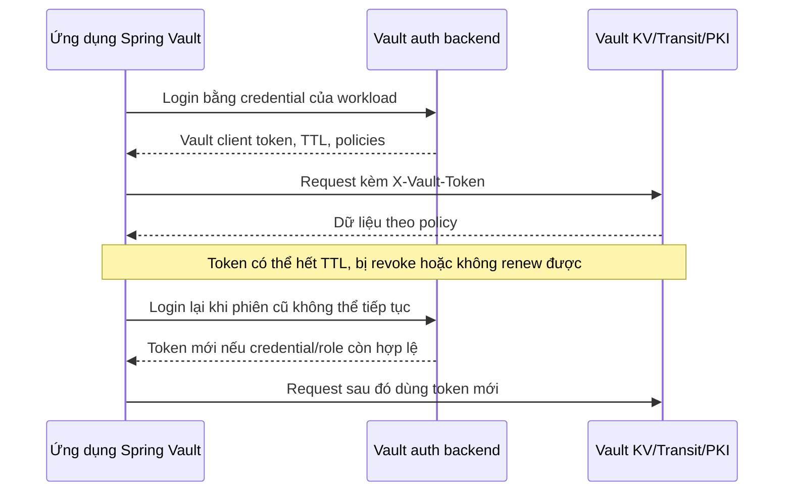
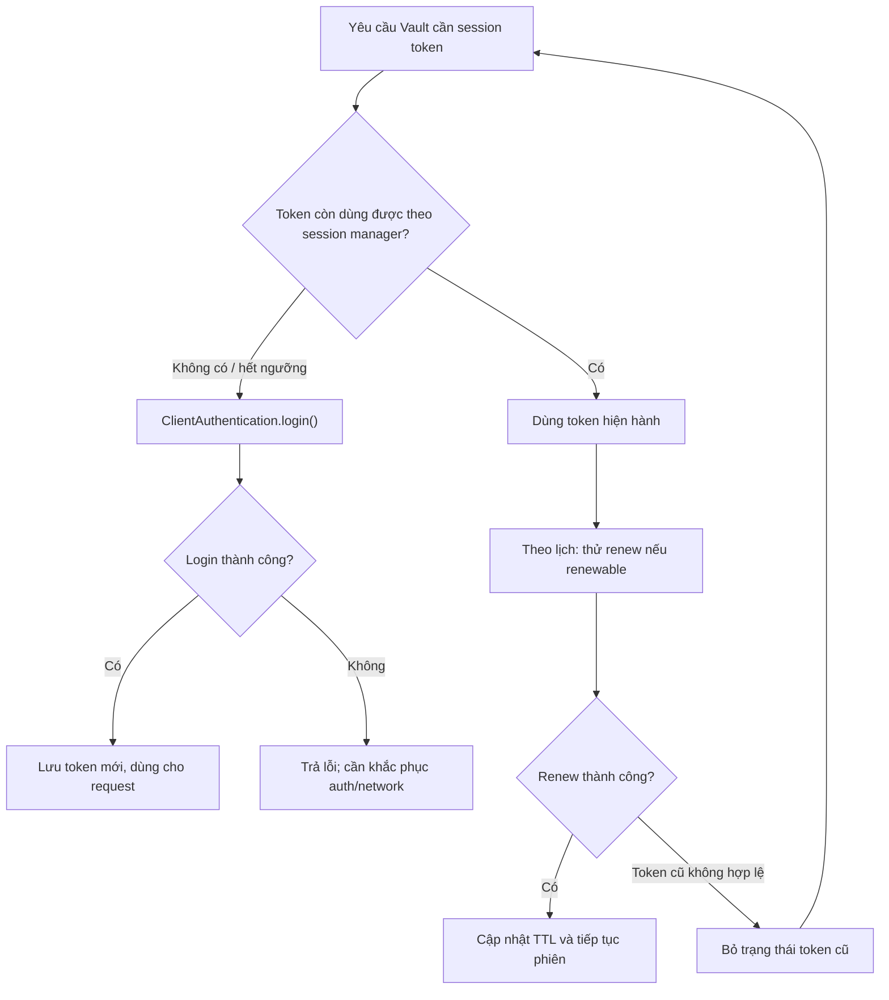

# Đăng nhập lại sau khi token không còn dùng được

Ứng dụng Java sử dụng Spring Vault không nên coi **Vault token** là một chuỗi cố định có thể dùng vô thời hạn. Token có thể hết TTL, chạm giới hạn thời gian sống tối đa, bị thu hồi hoặc không còn hợp lệ khi Vault thay đổi trạng thái. Khi đó, ứng dụng cần **đăng nhập lại bằng danh tính workload** để lấy token mới, nhưng chỉ khi nguồn danh tính gốc vẫn hợp lệ và được Vault chấp nhận.

Bài này thuộc chương **Phiên và vòng đời token** của module `SPRING_VAULT`. Trọng tâm là cách `VaultTemplate`, `ClientAuthentication`, `SessionManager` và đặc biệt `LifecycleAwareSessionManager` phối hợp để duy trì phiên khi truy cập KV secrets, Transit encryption hoặc PKI. Bài cũng phân biệt lỗi token không dùng được với lỗi **ACL policy**: cùng có thể trả HTTP `403`, nhưng cách xử lý khác nhau hoàn toàn.

## 1. Token không còn dùng được nghĩa là gì?

Sau khi workload xác thực thành công với Vault qua Kubernetes, AppRole, AWS IAM, TLS certificate hoặc phương thức khác, Vault trả một client token. Các lần gọi tiếp theo đưa token vào header `X-Vault-Token`.



Các khái niệm dễ nhầm:

| Khái niệm | Ý nghĩa | Hệ quả đối với đăng nhập lại |
| --- | --- | --- |
| **Token TTL** | Thời gian còn hiệu lực của Vault token | Khi hết hạn, không thể dùng token cũ; cần token mới |
| **Renewable** | Vault cho phép gia hạn token khi đáp ứng điều kiện | Có thể gia hạn trước khi hết TTL, không nhất thiết tạo token mới |
| **Max TTL / terminal TTL** | Giới hạn cuối cùng mà Vault có thể cho token tồn tại | Khi không thể gia hạn tiếp, phải đăng nhập lại nếu auth method cho phép |
| **Revocation** | Thu hồi token hoặc chuỗi token liên quan | Token cũ mất hiệu lực ngay, kể cả TTL còn dương |
| **Vault ACL policy** | Tập capability cho phép token gọi những đường dẫn nào | Token có thể còn hợp lệ nhưng bị `403 permission denied` với một path |
| **Dynamic secret lease** | TTL/lease ID của secret động, ví dụ database credentials | Vòng đời riêng; thay Vault token không tự kéo dài tuổi thọ secret đã cấp |
| **Credential dùng để login** | ServiceAccount JWT, IAM identity, AppRole secret ID, chứng thư client... | Muốn login lại phải có credential hiện còn hợp lệ và đủ quyền |

**Renew** và **re-login** là hai thao tác khác nhau. Gia hạn dùng token hiện tại và các endpoint token renewal; đăng nhập lại gọi auth backend (ví dụ `auth/kubernetes/login`) để xin một token khác.

Vault còn có **service token** và **batch token**. Service token có thể được renew nếu đáp ứng điều kiện và được quản lý/revoke theo cơ chế phù hợp; batch token không có khả năng renew như service token. Cần đối chiếu kiểu token thật thay vì chỉ dựa vào một trường `renewable` trong fixture hoặc giả định mọi phương thức authentication đều có cùng lifecycle.

## 2. Phân biệt `VaultToken`, `LoginToken` và `SessionManager`

Trong Spring Vault:

- `ClientAuthentication` thực hiện việc lấy token bằng một **phương thức xác thực**; tùy loại, kết quả có thể là `VaultToken` hoặc `LoginToken`.
- `VaultToken` đại diện cho giá trị token nhưng không nhất thiết chứa thông tin TTL/renewability.
- `LoginToken` có thêm thông tin vòng đời như TTL và khả năng renew.
- `SessionManager` cung cấp token hiện hành cho các request dùng `VaultTemplate`, quyết định cách giữ, lấy lại hoặc gia hạn token.

| Cách quản lý | Hành vi chính | Phù hợp khi nào? |
| --- | --- | --- |
| `SimpleSessionManager` | Nhận token từ `ClientAuthentication`, **không tự quản lý renewal/revocation** | Trường hợp đơn giản hoặc vòng đời do thành phần khác điều phối |
| `LifecycleAwareSessionManager` | Theo dõi TTL, lên lịch renew nếu có thể; khi cần thì login lại; quản lý revoke đối với `LoginToken` thích hợp lúc đóng phiên | Phần lớn ứng dụng chạy lâu dài cần khả năng phục hồi token |
| `ReactiveLifecycleAwareSessionManager` | Vai trò tương tự cho reactive APIs | Ứng dụng dùng `ReactiveVaultTemplate`/reactive authentication |

`LifecycleAwareSessionManager` nhận token lần đầu từ `ClientAuthentication`, đồng bộ các luồng cạnh tranh khi lấy token, và gia hạn theo lịch nếu token có TTL/renewability phù hợp. Khi renewal gặp lỗi phía client cho thấy token không còn hợp lệ, manager **loại bỏ trạng thái token cũ**, để lần lấy session token tiếp theo có thể login lại.

Với `TokenAuthentication` nhận một token tĩnh, việc gọi lại `login()` **chỉ trả lại cùng token đã cấu hình**. Nếu token tĩnh đó đã bị revoke, không có cơ chế nào tự suy ra một credential mới. Do đó, lựa chọn authentication theo workload quan trọng hơn việc chỉ bật scheduler.

Theo tài liệu Spring Vault, các auth method login tạo `LoginToken` sẽ để lifecycle manager xử lý token renew và revoke khi thích hợp. Ngược lại, `VaultToken` thuần túy có thể được tra cứu thông tin qua token self-lookup theo mặc định nhưng không được manager tự động revoke như `LoginToken`.

## 3. Chu trình bình thường: login → dùng → renew → re-login

Giả sử workload Kubernetes đăng nhập được vào Vault với token có TTL 60 giây:

```text
t=00s   Lần đầu cần secret -> POST auth/kubernetes/login -> token A (TTL 60s)
t=05s   GET secret/data/payments dùng token A
t=45s   Session manager lên lịch renew token A (tùy cấu hình)
t=45s   Nếu renew thành công -> tiếp tục dùng token A với TTL được gia hạn
...
t=n     Nếu token không còn có thể renew, manager cần login lại
t=n+    POST auth/kubernetes/login -> token B -> những request sau dùng token B
```

Mốc `45s` chỉ minh họa khi `refresh-before-expiry=15s`, không phải lịch cứng của Spring Vault. Thời điểm thực tế phụ thuộc cấu hình refresh trigger, TTL Vault trả về, thời gian trễ và mức TTL tối thiểu để coi token còn hợp lệ.

### Khi renewal thất bại



Không nên hiểu sơ đồ là **mọi** request `403` từ Vault đều kích hoạt lại nhánh login. Bộ quản lý token có thể biết renewal/self-lookup thất bại, nhưng khi **request nghiệp vụ** nhận `403`, ứng dụng phải phân loại lỗi trước khi quyết định. Việc tái xác thực tùy tiện có thể che giấu lỗi policy hoặc gây bão login.

### Một trường hợp quan trọng: token bị revoke từ bên ngoài

Nếu quản trị viên thu hồi token A trong khi TTL theo bộ nhớ ứng dụng vẫn còn, request KV tiếp theo có thể nhận `403` **trước khi scheduler thử renew**. Không nên khẳng định rằng `VaultTemplate` tự phát hiện và retry ngay mọi operation bằng token B. Khi manager nhận biết token đã mất hiệu lực qua renewal hoặc cơ chế kiểm tra tương ứng, lần lấy token sau mới có cơ sở login lại. Nếu ứng dụng cần phục hồi tức thời, phải thiết kế cơ chế phục hồi cấp cao, kiểm soát đồng thời, idempotency và giới hạn retry.

## 4. Cấu hình Spring Cloud Vault cho vòng đời phiên

Spring Cloud Vault bật quản lý session lifecycle mặc định ở các phiên bản công bố các property dưới đây. Cấu hình ví dụ cho workload chạy trong Kubernetes:

```yaml
spring:
  config:
    import: vault://
  cloud:
    vault:
      uri: https://vault.internal.example:8200
      authentication: KUBERNETES
      kubernetes:
        role: payments-reader
        kubernetes-path: kubernetes
        service-account-token-file: /var/run/secrets/kubernetes.io/serviceaccount/token
      session:
        lifecycle:
          enabled: true
          refresh-before-expiry: 15s
          expiry-threshold: 30s
```

Giải thích:

| Thuộc tính | Mục đích |
| --- | --- |
| `authentication: KUBERNETES` | Dùng JWT của Kubernetes workload để login Vault |
| `kubernetes.role` | Vault Kubernetes auth role tương ứng ServiceAccount/workload |
| `session.lifecycle.enabled` | Bật cơ chế quản lý token; nên giữ `true` cho dịch vụ chạy lâu |
| `refresh-before-expiry` | Khoảng thời gian trước lúc hết hạn để chủ động renew |
| `expiry-threshold` | Ngưỡng TTL tối thiểu để coi token còn có thể dùng; nên **lớn hơn** refresh-before-expiry |

Mặc định được tài liệu Spring Cloud Vault công bố là `enabled=true`, `refresh-before-expiry=5s` và `expiry-threshold=7s`. Giá trị `15s/30s` ở ví dụ là lựa chọn minh họa để ứng dụng có thêm biên độ khi mạng chậm; điều chỉnh theo TTL thật và độ trễ Vault. **Không có cấu hình nào bảo đảm token sống vượt quá giới hạn do Vault server áp đặt.**

Cấu hình này thuộc **Spring Cloud Vault**. Nếu ứng dụng chỉ dùng Spring Vault Core, cần tạo/wire `LifecycleAwareSessionManager` phù hợp; nếu kế thừa `AbstractVaultConfiguration`, Spring Vault thường đã cung cấp lifecycle manager mặc định. Hãy kiểm tra phiên bản dependency và bean thực tế để tránh hai bộ quản lý session độc lập.

## 5. Sử dụng `VaultTemplate` mà không tự giữ token

Trong ứng dụng Spring Boot đã cấu hình `VaultOperations` và authentication bằng Spring Vault/Spring Cloud Vault, service chỉ nên tập trung vào secret và quy tắc nghiệp vụ:

```java
import org.springframework.stereotype.Service;
import org.springframework.vault.core.VaultOperations;
import org.springframework.vault.core.VaultKeyValueOperationsSupport.KeyValueBackend;
import org.springframework.vault.support.VaultResponseSupport;

record PaymentCredentials(String username, String password) {}

@Service
class PaymentCredentialService {

    private final VaultOperations vault;

    PaymentCredentialService(VaultOperations vault) {
        this.vault = vault;
    }

    PaymentCredentials load() {
        VaultResponseSupport<PaymentCredentials> response = vault
                .opsForKeyValue("secret", KeyValueBackend.KV_2)
                .get("payments", PaymentCredentials.class);

        if (response == null || response.getData() == null) {
            throw new IllegalStateException("Required payment secret is absent");
        }
        PaymentCredentials credentials = response.getData();
        if (credentials.username() == null || credentials.password() == null) {
            throw new IllegalArgumentException("Payment secret is incomplete");
        }
        return credentials;
    }
}
```

Lớp trên yêu cầu Java 17+ và Jackson xử lý `record`. Ví dụ chỉ minh họa đọc KV v2 và validation; phần authentication/session management nằm trong cấu hình `VaultOperations` được inject. Khi session manager lấy token mới, các request sau dùng token hiện hành mà service không cần lưu `X-Vault-Token` trong biến hay cache riêng.

**Không giữ token trong static field hoặc gắn token vào một `RestTemplate` tự tạo** nếu mục tiêu là sử dụng vòng đời do Spring Vault quản lý. Nếu truyền token cũ ngoài `SessionManager`, việc login lại thành công vẫn không làm các request tự chế đó đổi token.

## 6. Khi nào đăng nhập lại thực sự hoạt động?

Lấy token mới chỉ thành công nếu **credential đầu vào của auth method vẫn còn dùng được**:

| Auth method | Nguồn danh tính dùng để login lại | Rủi ro cần kiểm tra |
| --- | --- | --- |
| Kubernetes | ServiceAccount JWT đúng mount/role/audience | JWT bị thay/xóa, ServiceAccount/namespace không còn khớp policy hoặc Vault auth role |
| AppRole | Role ID và Secret ID hợp lệ | Secret ID hết TTL hoặc hết số lần dùng; phải có cách cấp lại Secret ID |
| AWS IAM | AWS credentials/signature cho STS `GetCallerIdentity` | Workload mất IAM role, AWS credential provider không refresh, sai ARN binding |
| AWS EC2 | Identity document/PKCS#7 và nonce nếu role yêu cầu | Restart mất nonce, identity/EC2 binding không đúng |
| Azure / GCP | Managed identity/JWT hoặc credential API tương ứng | Mất kết nối metadata, role binding không khớp, identity token hết hạn |
| TLS certificate | Chứng thư client và private key được TLS client tải đúng | Chứng thư hết hạn/bị thu hồi, Vault cert role không còn tin cậy, SSLContext chưa reload |
| Static token | Chuỗi token cấu hình sẵn | **Không có phương thức tạo token mới** sau khi token nguồn mất hiệu lực |

Đối với Kubernetes, cần phân biệt **Vault token** và **ServiceAccount JWT**. Cơ chế làm mới JWT do Kubernetes thực hiện không đồng nghĩa Spring Vault luôn đọc lại nội dung file cho mọi lần login; kiểm tra cách auth client phiên bản bạn dùng nạp JWT và thử rotation thực tế.

Đối với AppRole, `secret_id_num_uses=1` có nghĩa là Secret ID có thể chỉ đăng nhập được một lần. Đăng nhập ban đầu thành công không bảo đảm lần login tiếp theo vẫn thành công. Nếu yêu cầu re-login, hãy thiết kế phương thức cấp lại Secret ID theo quy trình an toàn hoặc dùng workload identity phù hợp.

## 7. Phân biệt lỗi token với lỗi phân quyền

HashiCorp Vault thường dùng HTTP `403` trong nhiều tình huống:

```http
HTTP/1.1 403 Forbidden
Content-Type: application/json

{"errors":["invalid token","permission denied"]}
```

Phản hồi trên có thể cho thấy token bị revoke, hết hạn hoặc không hợp lệ. Trong khi đó:

```http
HTTP/1.1 403 Forbidden
Content-Type: application/json

{"errors":["permission denied"]}
```

Thông thường cho thấy token không có capability thích hợp đối với đường dẫn hoặc hành động. Không nên dùng **duy nhất mã HTTP** để phân biệt. Trên thực tế, ứng dụng cũng cần xem endpoint đang gọi, phản hồi lỗi được Vault cung cấp và trạng thái authentication gần nhất.

| Quan sát | Khả năng | Hành động phù hợp |
| --- | --- | --- |
| Renewal trả lỗi token hết hạn/bị revoke | Token phiên cũ không còn dùng được | Để lifecycle manager loại token cũ và thử login lại khi cần |
| KV v2 GET `secret/data/payments` trả `403 permission denied` | ACL policy thiếu quyền `read` | Kiểm tra policy, path KV v2 và mount; login lại không sửa được policy |
| `auth/kubernetes/login` trả `403` | Workload credential/role binding bị từ chối | Kiểm tra JWT, Vault auth role, namespace/SA/audience |
| `auth/approle/login` lỗi | Role ID/Secret ID sai, hết TTL/hết lần dùng | Sửa nguồn credential/cấp Secret ID mới theo quy trình |
| Vault trả `429` hoặc `5xx` | Rate limit hoặc lỗi dịch vụ/tạm thời | Retry có backoff, giới hạn số lần, cảnh báo khi kéo dài |
| Không kết nối được Vault | DNS, TLS, network, timeout | Điều tra hạ tầng; không kết luận token đã hết hạn |
| Token mới login thành công nhưng KV vẫn `403` | Role/policy/token type chưa phù hợp | Soát policy gắn với **token mới** |

Ngay cả khi một request nghiệp vụ nhận `403` do token vừa bị thu hồi, không nên viết interceptor thực hiện `login → retry` vô hạn cho tất cả `403`. Cách này có thể làm tăng tải Vault và gây lỗi nghiêm trọng với operation không idempotent, chẳng hạn ghi secret, xoay khóa Transit hoặc cấp chứng thư PKI.

## 8. Xử lý retry, đồng thời và thao tác có tác dụng phụ

Đối với API chỉ đọc, một lần thử lại có thể an toàn hơn sau khi đã có bằng chứng token cũ không hợp lệ và trạng thái session đã được làm mới. Nhưng cần phân biệt hai loại retry:

1. **Retry token renewal/login:** trách nhiệm ưu tiên của lifecycle manager và auth subsystem.
2. **Retry request nghiệp vụ:** trách nhiệm của tầng gọi Vault, phải có timeout, số lần thử tối đa và kiểm tra idempotency.

Không để 20 request song song đồng loạt gọi `auth/*/login` bằng credential của cùng workload. `LifecycleAwareSessionManager` đồng bộ hóa các request lấy token khi cần; dùng chung một session manager đúng phạm vi ứng dụng để giảm nguy cơ login storm. Nếu tự xây recovery ngoài Spring Vault, cần cơ chế single-flight hoặc khóa đồng bộ thích hợp và khả năng phân biệt lỗi token với lỗi ACL.

Với thao tác ghi dữ liệu:

- **KV v2 write:** nếu client mất phản hồi, chưa thể biết Vault đã ghi hay chưa; khi retry có thể tạo thêm một version hoặc ghi đè ngoài ý muốn. Dùng CAS phù hợp và xác minh version trước/sau khi thử lại.
- **Transit encrypt:** nhiều mode cho kết quả ciphertext khác nhau dù cùng plaintext, nên không dùng so sánh ciphertext để khẳng định một retry là phép toán y hệt.
- **PKI issue:** retry khi kết quả phát hành không rõ ràng có thể tạo nhiều chứng thư/serial. Cần idempotency cấp ứng dụng hoặc tra cứu kết quả trước khi issue lại.
- **Dynamic credentials:** việc nhận token mới không gia hạn lease của credential database đã phát trước đó. Quản lý lease riêng để tránh dùng credential bị thu hồi.

Nếu có nhu cầu thu hồi phiên chủ động (ví dụ đóng ứng dụng hoặc vận hành bảo mật), `LifecycleAwareSessionManager` có API `revoke()` ở các phiên bản tương ứng. **Không gọi revoke để chữa mọi lỗi 403**: nó có thể thu hồi một token còn hiệu lực và gây ảnh hưởng toàn bộ request đang dùng phiên đó.

## 9. Giám sát vòng đời token mà không làm lộ bí mật

Các sự kiện nên theo dõi gồm:

| Metric/log | Nội dung nên lưu | Không được lưu |
| --- | --- | --- |
| Số lần login và tỉ lệ thành công | Auth method, kết quả, môi trường, role đã được kiểm duyệt | Vault token, Secret ID, JWT, IAM signed request |
| Số lần renew và lỗi renew | Số lần, nguyên nhân lỗi đã phân loại, latency | Header `X-Vault-Token` |
| Lần re-login sau token expiry | Thời gian phục hồi, số lần thử, request chịu ảnh hưởng | Token cũ/mới, credential |
| Token TTL quan sát được | TTL còn lại theo bucket, threshold cảnh báo | Token value, raw auth response |
| KV/Transit/PKI error | HTTP status, Vault path đã được kiểm duyệt | Secret plaintext, private key, Transit input |

Spring Vault có `AuthenticationListener` và `AuthenticationErrorListener` để theo dõi login, renew hoặc revoke. Có thể gắn listener vào session manager theo API của phiên bản sử dụng, chỉ xuất metric đã loại bỏ bí mật. Sự kiện lỗi có thể phát ra từ luồng scheduler; đừng giả định tất cả callback nằm trên HTTP request thread.

Các báo động quan trọng:

- Re-login thất bại liên tiếp khiến ứng dụng không thể đọc secrets.
- TTL token còn quá thấp so với thời gian tối thiểu cho renew.
- Số lần login tăng đột ngột sau mỗi lần rollout hoặc khi Vault chập chờn.
- Truy cập KV nhận `403` liên tục **dù đăng nhập đã thành công**, dấu hiệu policy sai hoặc thay đổi quyền.
- Credential gốc (Kubernetes JWT, AppRole Secret ID, client certificate) sắp hết hạn hoặc không được cập nhật.

Tránh đặt token vào URL, query string, exception message, trace hoặc metrics labels. Chỉ in những metadata an toàn theo chính sách bảo mật của tổ chức.

## 10. Kiểm thử quá trình đăng nhập lại

Nên kết hợp **unit test** của lớp nghiệp vụ, **HTTP contract test** với server giả và **integration test** với Vault thử nghiệm. Mỗi loại trả lời câu hỏi khác nhau.

### 10.1. Mock chuỗi login và renewal

Server giả phải phân biệt endpoint auth với endpoint quản lý token và endpoint secret:

```text
POST /v1/auth/kubernetes/login   -> Vault token A, renewable=true, TTL=60s
GET  /v1/secret/data/payments   -> 200 khi X-Vault-Token=token-A
POST /v1/auth/token/renew-self  -> 403 invalid token
POST /v1/auth/kubernetes/login   -> Vault token B, renewable=true, TTL=60s
GET  /v1/secret/data/payments   -> 200 khi X-Vault-Token=token-B
```

Phản hồi login giả tối thiểu (thay `token-A` bằng `token-B` ở lần login tiếp theo):

```json
{
  "auth": {
    "client_token": "token-A-for-test",
    "policies": ["payments-read"],
    "lease_duration": 60,
    "renewable": true,
    "token_type": "service"
  }
}
```

Phản hồi renew bị từ chối:

```http
HTTP/1.1 403 Forbidden
Content-Type: application/json

{"errors":["invalid token","permission denied"]}
```

Các chuỗi trên chỉ là **fixture**, không phải token dùng trên Vault thật. Khi test dùng `LifecycleAwareSessionManager`, có thể cần scheduler/clock được điều khiển và thời gian thử nghiệm đủ để renewal chạy; chỉ đặt stub không đủ để khẳng định login lần hai đã xảy ra. Test phải xác minh số lần gọi, thứ tự request và token của request sau.

### 10.2. Ma trận các ca nên kiểm tra

| Case | Tiền điều kiện/giả lập | Kỳ vọng |
| --- | --- | --- |
| Login ban đầu | Chưa có session token | Tạo token A, truy cập KV thành công |
| Renew thành công | Token A renewable và còn quyền renew | Token A được gia hạn; không login lại không cần thiết |
| Hết max TTL hoặc renew bị từ chối | Lần renew không thể tiếp tục | Bỏ token A; lần lấy token thích hợp thực hiện login lấy token B |
| Token bị revoke từ bên ngoài | Token A mất hiệu lực trước lịch renew | Có thể thấy lỗi ở request đầu; không khẳng định auto-retry ngay mọi operation |
| Login lại thất bại | JWT/Secret ID/cert gốc không còn hợp lệ | Phát lỗi, metrics/cảnh báo; không tạo token giả |
| Thiếu quyền ACL | Token A còn hợp lệ, KV trả `403 permission denied` | Không login vô hạn; tìm policy/path sai |
| Vault timeout | Auth backend không phản hồi | Timeout hữu hạn, retry có backoff và giới hạn |
| Nhiều request đồng thời | Đồng loạt cần token mới | Không gây bão login; chỉ các request sau khi sẵn sàng dùng B |
| Shutdown | `LoginToken` service còn hiệu lực | Manager xử lý revoke thích hợp và đóng scheduler |
| Secret động | Dynamic credentials được cấp trước token B | Không mặc định giữ lease cũ còn hợp lệ sau revocation |

### 10.3. Ví dụ kiểm thử lớp nghiệp vụ không gắn với token thô

Đoạn sau chỉ chứng minh service xử lý kết quả Vault qua `VaultOperations`. Đây là **unit test**, không thay thế kiểm thử re-login ở `SessionManager`.

```java
import static org.junit.jupiter.api.Assertions.*;
import static org.mockito.Mockito.*;

import org.junit.jupiter.api.Test;
import org.springframework.vault.core.VaultOperations;
import org.springframework.vault.core.VaultKeyValueOperations;
import org.springframework.vault.core.VaultKeyValueOperationsSupport.KeyValueBackend;
import org.springframework.vault.support.VaultResponseSupport;

class PaymentCredentialServiceTest {
    @Test
    @SuppressWarnings("unchecked")
    void readsSecretThroughManagedVaultOperations() {
        VaultOperations vault = mock(VaultOperations.class);
        VaultKeyValueOperations kv = mock(VaultKeyValueOperations.class);
        VaultResponseSupport<PaymentCredentials> response =
                mock(VaultResponseSupport.class);
        when(vault.opsForKeyValue("secret", KeyValueBackend.KV_2)).thenReturn(kv);
        when(kv.get("payments", PaymentCredentials.class)).thenReturn(response);
        when(response.getData())
                .thenReturn(new PaymentCredentials("readonly", "fake-only"));

        PaymentCredentials result = new PaymentCredentialService(vault).load();

        assertEquals("readonly", result.username());
        verify(kv).get("payments", PaymentCredentials.class);
    }
}
```

Để chứng minh re-login, cần một test riêng tạo `ClientAuthentication`/session manager thực, server giả trả hai token khác nhau và kiểm tra header của request sau khi mô phỏng renewal failure. Không nên mock `getSessionToken()` luôn trả token B rồi tuyên bố đã thử được quy trình làm mới phiên.

### 10.4. Test với Vault thật trong môi trường cô lập

1. Khởi tạo Vault test instance và auth method dành riêng cho test; tạo policy `payments-read`.
2. Đăng nhập bằng workload credential thử nghiệm, gọi `VaultTemplate` đọc KV v2.
3. Thu hồi **token thử nghiệm**, xác minh request với token cũ bị từ chối.
4. Quan sát manager phản ứng ở thời điểm renewal/lần lấy token tiếp theo và kiểm tra login mới tạo token khác.
5. Thu hồi quyền role hoặc làm credential gốc không còn hiệu lực, xác nhận re-login thất bại có chủ đích.
6. Phục hồi role và xác minh hệ thống có thể lấy phiên hợp lệ; dọn token/secret/mount test.

Để test nhanh, có thể cấu hình TTL ngắn trong Vault test role, nhưng không dùng TTL cực thấp khiến scheduler và độ trễ CI chiếm phần lớn thời gian token. Với các test nhạy thời gian, ưu tiên clock/scheduler kiểm soát được hoặc giới hạn phù hợp để tránh flaky test.

## 11. Quy trình khoanh vùng khi ứng dụng không thể login lại

Khi phát hiện lỗi truy cập Vault sau một thời gian ứng dụng hoạt động:

1. **Xác định điểm lỗi:** request KV/Transit/PKI, token renewal hay endpoint auth login? Ghi lại path đã kiểm duyệt và mã lỗi.
2. **Kiểm tra trạng thái Vault:** kết nối TLS, network, readiness, rate limiting, lỗi 5xx; đừng mặc định là token hết hạn.
3. **Phân loại 403:** token invalid/revoked hay ACL `permission denied` cho path hợp lệ? Kiểm tra policy của token mới nếu re-login đã thành công.
4. **Xác minh auth credential gốc:** ServiceAccount JWT, IAM identity, AppRole Secret ID hoặc chứng thư client có còn dùng được không?
5. **Kiểm tra session manager:** lifecycle có bật, TTL/threshold hợp lý, scheduler hoạt động và toàn bộ Vault request đi qua cùng manager không?
6. **Kiểm tra hậu quả:** nếu credential/lease động đã được cấp, xem tài nguyên nào đã hết hạn/thu hồi và xử lý cấp lại theo contract.
7. **Khôi phục có giới hạn:** sửa role/credential/policy/network đúng nguyên nhân; cho đăng nhập lại và quan sát tỷ lệ thành công trước khi tăng tải.

Ví dụ nhầm lẫn thường gặp:

> Service đọc được `secret/data/payments` suốt 30 phút. Sau đó request trả `403`. Nhóm vận hành tăng tần suất login nhưng lỗi vẫn giữ nguyên. Kiểm tra cho thấy token mới vẫn hợp lệ, nhưng policy đã bị thay và bỏ capability `read` đối với path đó. Việc login lại không thể sửa quyền đã cấp; cần khôi phục policy hoặc điều chỉnh role theo quy định.

## 12. Bài thực hành

**Tình huống:** một ứng dụng Spring Boot chạy trên Kubernetes, dùng Spring Cloud Vault để lấy cấu hình KV v2 và thực hiện Transit encryption. Vault Kubernetes auth role cấp service token renewable TTL 60 giây. Sau khi chạy ổn định, một token bị revoke trong khi ứng dụng vẫn đang hoạt động.

1. Vẽ sơ đồ login ban đầu, renew thành công, renew thất bại và lần login lại; chỉ rõ điểm sinh token B.
2. Cấu hình `spring.cloud.vault.session.lifecycle` với `refresh-before-expiry=15s`, `expiry-threshold=30s`; giải thích vì sao hai ngưỡng này có thứ tự.
3. Dựng fake HTTP phản hồi `auth/kubernetes/login`, `auth/token/renew-self` và KV v2; xác nhận request sau khi session được thay mới sử dụng token B.
4. Tạo ba tình huống `403`: token bị revoke, auth login bị Vault từ chối và KV path không có capability `read`. Viết kỳ vọng khác nhau cho từng trường hợp.
5. Thu hồi token thử nghiệm trong Vault test instance; quan sát hành vi sau khi manager phát hiện token không hợp lệ. Giải thích vì sao lỗi ở một request nghiệp vụ có thể xuất hiện trước re-login.
6. Đặt `secret_id_num_uses=1` cho một AppRole test riêng và giải thích lý do workflow dùng AppRole có thể không login lại được nếu không cấp Secret ID mới.
7. Ghi metric số lần login, renew, re-login và lỗi, bảo đảm không in JWT, Vault token, password, Transit plaintext hay private key.

**Tiêu chí hoàn thành:** phân biệt được renew với re-login, nhận biết token hết hạn/revoked khác lỗi ACL, cấu hình đúng lifecycle manager, chứng minh request dùng token mới sau recovery và biết giới hạn của từng workload authentication method.

## Tài liệu tham khảo

- Spring Vault — [Authentication Methods và Token Lifecycle](https://docs.spring.io/spring-vault/reference/vault/authentication.html).
- Spring Vault — [`LifecycleAwareSessionManager` JavaDoc](https://docs.spring.io/spring-vault/reference/api/java/org/springframework/vault/authentication/LifecycleAwareSessionManager.html).
- Spring Vault — [`VaultTemplate` Session Management](https://docs.spring.io/spring-vault/reference/vault/imperative-template.html).
- Spring Cloud Vault — [Session Token Lifecycle Management](https://docs.spring.io/spring-cloud-vault/reference/advanced-topics.html).
- Spring Cloud Vault — [Application Properties](https://docs.spring.io/spring-cloud-vault/reference/appendix.html).
- HashiCorp Vault — [Tokens: TTL, service/batch token, invalid token và permission denied](https://developer.hashicorp.com/vault/docs/concepts/tokens).
- HashiCorp Vault — [Token Auth Method HTTP API](https://developer.hashicorp.com/vault/api-docs/auth/token).
