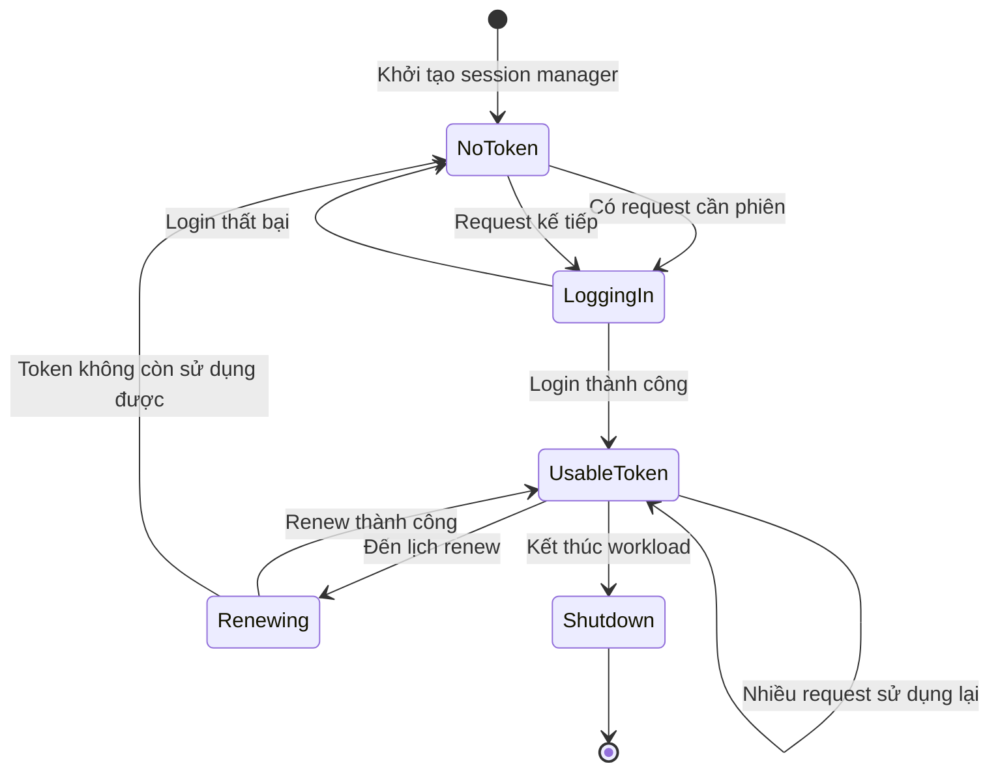
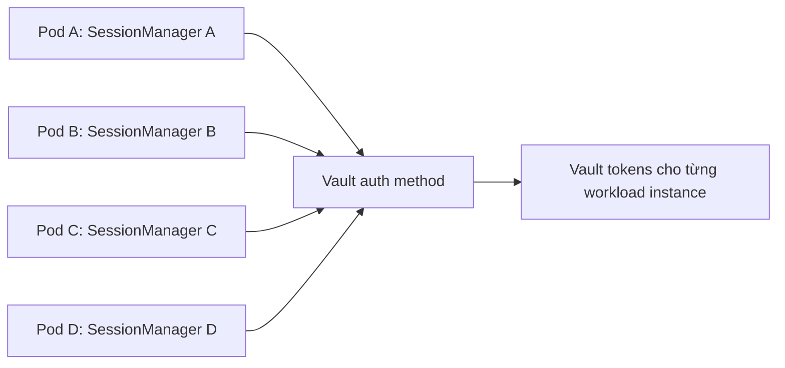

# Đồng bộ nhiều yêu cầu cùng cần một token mới trong Spring Vault

## 1. Bài toán khi nhiều yêu cầu đến cùng lúc

Một ứng dụng Java dùng **Spring Vault** thường xử lý nhiều HTTP request bằng các thread khác nhau. Mỗi request có thể gọi `VaultTemplate` để đọc KV secrets, thực hiện Transit encryption hoặc xin chứng thư PKI. Những thao tác này đều cần một **Vault token** hợp lệ để Vault kiểm tra ACL policy.

Điều gì xảy ra khi ứng dụng vừa khởi động, chưa có Vault token, nhưng **20 request đồng thời** đều cần đọc secret? Hoặc một token đã hết hạn và 20 request kế tiếp cùng lúc phát hiện phải lấy token mới?

Nếu mỗi request tự gọi auth endpoint, ứng dụng có thể tạo ra 20 lượt đăng nhập AppRole, Kubernetes hoặc cloud auth trong cùng một thời điểm. Hậu quả có thể gồm tăng độ trễ, quá tải auth backend, phát sinh nhiều token/lease và tạo một **login storm**. Nhiều luồng chờ cùng một tài nguyên chung còn có thể gây lỗi khó tái hiện nếu mã cache token không an toàn.

Trong chương **Phiên và vòng đời token** của module **SPRING_VAULT**, cơ chế cốt lõi để xử lý tình huống này là **`SessionManager`**. Bài học giúp bạn:

1. Hiểu cách các thread cùng dùng một `SessionManager` lấy và tái sử dụng token.
2. Phân biệt đồng bộ lượt **login** với việc thực thi các **request Vault** độc lập.
3. Nắm vai trò của `SimpleSessionManager` và `LifecycleAwareSessionManager` khi token chưa có, đang được renew, hết hạn hoặc bị thu hồi.
4. Hiểu phạm vi bảo đảm: **một session manager trong một JVM**, không tự động bao trùm nhiều bean, pod hay process.
5. Viết kiểm thử đồng thời và theo dõi login/renew bằng tín hiệu có thể quan sát mà không tiết lộ credential.

**Tình huống xuyên suốt:** `orders-service` là workload Java có quyền `read` trên `secret/data/orders`, quyền `update` trên `transit/encrypt/orders` và có thể xin chứng thư tại một PKI role được cấp phép. Các request nghiệp vụ có thể khác nhau, nhưng cùng sử dụng **danh tính và Vault token của workload** nếu cấu hình một session manager dùng chung.

## 2. Phân biệt các thành phần và các loại thao tác

| Thành phần | Trách nhiệm | Có nên được tạo mới trên mỗi HTTP request? |
| --- | --- | --- |
| `ClientAuthentication` | Lấy Vault token bằng AppRole/Kubernetes/AWS/Azure/certificate auth, hoặc trả về token tĩnh | Không; thường là cấu hình theo workload |
| `SessionManager` | Cấp token cho các lời gọi Vault, tái sử dụng và điều phối việc lấy token; tùy implementation quản lý renew | **Không**; chia sẻ theo phạm vi danh tính |
| `VaultTemplate` / `VaultOperations` | Dùng token đã cấp để gọi KV/Transit/PKI; Vault kiểm tra ACL mỗi lần | Không; thông thường dùng bean có phạm vi ứng dụng |
| Vault auth method | Xác thực credential và phát hành Vault token mới | Chỉ gọi khi cần login, không phải mỗi lần đọc secret |
| Vault KV / Transit / PKI API | Xử lý nghiệp vụ dưới Vault token hiện hành | Mỗi yêu cầu nghiệp vụ có thể thực hiện request riêng |

Ba thao tác sau khác bản chất:

- **Login:** gửi credential ban đầu đến `auth/<method>/login` và nhận **Vault token mới** với TTL, policies và tính renewable theo auth method/role. Ví dụ `POST /v1/auth/approle/login`.
- **Renew:** gửi yêu cầu như `auth/token/renew-self` để **gia hạn token hiện tại** nếu Vault cho phép. Renew thành công không đồng nghĩa token ID đổi.
- **Request nghiệp vụ:** dùng Vault token trong `X-Vault-Token` để đọc `secret/data/orders` hoặc gọi Transit/PKI. Đây không phải thao tác login.

Một lần `getSessionToken()` không nhất thiết tạo HTTP login: nếu phiên đã có token hợp lệ, session manager có thể trả về token hiện tại. Đặc biệt, `TokenAuthentication` chỉ cung cấp **token đã được tạo từ trước**; dù Java gọi phương thức `login()`, nó không tự phát hành token mới bằng AppRole/Kubernetes endpoint.

## 3. Hiện tượng "thundering herd" khi phiên chưa có token

Giả sử 4 thread trong cùng một process đi qua code nghiệp vụ gần như đồng thời:

```text
t = 00 ms   Thread A → VaultTemplate.read(...)
t = 01 ms   Thread B → VaultTemplate.read(...)
t = 02 ms   Thread C → VaultTemplate.read(...)
t = 03 ms   Thread D → VaultTemplate.read(...)
             Cả bốn đều cần một Vault token
```

**Cách cài đặt có lỗi:** mỗi request tự kiểm tra `cachedToken == null`, sau đó tất cả cùng gửi login vì chưa thread nào kịp lưu token. Với 20 request, có thể có 20 token mới. Nếu mã dùng một biến mutable chung không có đồng bộ/visibility, các thread thậm chí có thể thấy trạng thái cũ hoặc trạng thái đang cập nhật.

**Cách Spring Vault cung cấp:** các request dùng **cùng `SessionManager`**. Khi token chưa được lấy, session manager đồng bộ hóa thao tác nhận phiên để những thread cạnh tranh không cùng khởi tạo phiên độc lập. Sau khi một lượt lấy token thành công, những thread khác được cấp token từ trạng thái phiên vừa thiết lập, rồi tiếp tục thực hiện **request KV/Transit/PKI riêng của chúng**.

```mermaid
sequenceDiagram
    autonumber
    participant A as Request A
    participant B as Request B
    participant C as Request C
    participant SM as SessionManager chung
    participant Auth as Vault auth backend
    participant API as Vault KV/Transit/PKI

    par Gọi gần như đồng thời
        A->>SM: getSessionToken()
    and
        B->>SM: getSessionToken()
    and
        C->>SM: getSessionToken()
    end
    Note over SM: Chưa có token; điều phối truy cập cạnh tranh
    SM->>Auth: Một lượt login thành công
    Auth-->>SM: Vault token T1 + TTL + policies
    SM-->>A: T1
    SM-->>B: T1
    SM-->>C: T1
    par Request nghiệp vụ độc lập
        A->>API: KV read, token T1
    and
        B->>API: Transit encrypt, token T1
    and
        C->>API: PKI issue, token T1
    end
    API-->>A: Kết quả theo ACL
    API-->>B: Kết quả theo ACL
    API-->>C: Kết quả theo ACL
```

Sơ đồ minh họa **một lần đăng nhập thành công trong một session manager** khi cả ba thread cạnh tranh cho phiên đầu tiên. Nó không hứa mọi trường hợp đều đúng một HTTP call: một auth method có thể cần thêm request chuẩn bị, kiểm tra token hoặc lookup; nếu đăng nhập thất bại, các lần thử sau có thể tiếp tục và phát sinh thêm lượt login.

**Quan trọng:** session manager đồng bộ **việc lấy/thiết lập token**, không khóa nối tiếp toàn bộ các thao tác đọc KV, Transit, PKI. Các request tới Vault có thể chạy song song sau khi nhận token; vì vậy một Vault token dùng chung không tự động làm ứng dụng thành đơn luồng.

## 4. `SimpleSessionManager`: đồng bộ lần lấy token đầu tiên

`SimpleSessionManager` là implementation cơ bản của `SessionManager`. Theo Javadoc Spring Vault, nó dùng **synchronized login** để lấy Vault token và tái sử dụng token đó suốt thời gian sống của session manager.

### 4.1. Hành vi điển hình

| Trạng thái | `SimpleSessionManager.getSessionToken()` |
| --- | --- |
| Chưa có token | Gọi `ClientAuthentication.login()` và lưu token |
| Nhiều thread cùng cần token lúc đầu | Đồng bộ lượt login; khi thành công, dùng lại token đã lưu |
| Đã có token | Trả về token đã lưu, không đăng nhập lại mỗi lần |
| Token sắp hết TTL | **Không chủ động gia hạn** |
| Token hết hạn/bị revoke bên ngoài | **Không có cơ chế refresh hoặc re-login theo lifecycle**; có thể tiếp tục trả token cũ |
| Shutdown | Không có vòng đời renew/revoke như `LifecycleAwareSessionManager` |

Cơ chế đồng bộ hữu ích nhưng **không đủ** cho một workload chạy dài hạn với token ngắn hạn. Nếu token đã bị revoke, việc có cùng một token trên nhiều thread chỉ khiến nhiều request cùng bị Vault từ chối. Đồng bộ tốt không khắc phục được một token đã vô hiệu.

### 4.2. Ví dụ Java: một đợt login khi 24 thread cùng bắt đầu

Đoạn kiểm thử JUnit 5 bên dưới **không cần Vault thật**. Nó tạo một `ClientAuthentication` giả có bộ đếm; sleep ngắn trong fake login chỉ để tăng khả năng các thread cạnh tranh. Đây là kiểm thử hành vi đồng thời, không phải ví dụ xác thực production.

```java
import static org.junit.jupiter.api.Assertions.assertEquals;
import static org.junit.jupiter.api.Assertions.assertNotNull;

import java.util.ArrayList;
import java.util.List;
import java.util.concurrent.CountDownLatch;
import java.util.concurrent.ExecutorService;
import java.util.concurrent.Executors;
import java.util.concurrent.Future;
import java.util.concurrent.TimeUnit;
import java.util.concurrent.atomic.AtomicInteger;

import org.junit.jupiter.api.Test;
import org.springframework.vault.authentication.ClientAuthentication;
import org.springframework.vault.authentication.SimpleSessionManager;
import org.springframework.vault.support.VaultToken;

class SessionManagerConcurrencyTest {

    @Test
    void oneLoginIsSharedByConcurrentRequests() throws Exception {
        AtomicInteger loginCalls = new AtomicInteger();

        ClientAuthentication authentication = () -> {
            loginCalls.incrementAndGet();
            try {
                Thread.sleep(80); // chỉ làm chậm fake auth trong test
            } catch (InterruptedException ex) {
                Thread.currentThread().interrupt();
                throw new IllegalStateException(ex);
            }
            return VaultToken.of("synthetic-token-for-test-only");
        };

        SimpleSessionManager sessionManager =
                new SimpleSessionManager(authentication);

        int requests = 24;
        ExecutorService executor = Executors.newFixedThreadPool(requests);
        CountDownLatch start = new CountDownLatch(1);
        List<Future<VaultToken>> results = new ArrayList<>();

        try {
            for (int i = 0; i < requests; i++) {
                results.add(executor.submit(() -> {
                    start.await();
                    return sessionManager.getSessionToken();
                }));
            }

            start.countDown();

            for (Future<VaultToken> result : results) {
                assertNotNull(result.get(5, TimeUnit.SECONDS));
            }
            assertEquals(1, loginCalls.get());
        } finally {
            executor.shutdownNow();
        }
    }
}
```

**Điều kiểm thử chứng minh:** với một `SimpleSessionManager` dùng chung và `ClientAuthentication` trả token thành công, 24 lần đồng thời gọi `getSessionToken()` chỉ làm fake `login()` chạy một lần.

**Điều kiểm thử chưa chứng minh:** token từ Vault thật có policy phù hợp, khả năng renew, xử lý 403, hoạt động của 24 pod hoặc tác động của lỗi mạng. Đây là một test xác nhận tính đồng bộ **trong một instance session manager**.

## 5. `LifecycleAwareSessionManager`: đồng bộ login và quản lý vòng đời

`LifecycleAwareSessionManager` cũng đồng bộ các thread cùng lúc yêu cầu phiên, đồng thời bổ sung khả năng **theo dõi thời hạn token, renew bất đồng bộ và lấy token mới khi cần**. Nó được dùng theo mặc định khi cấu hình Spring Vault qua `AbstractVaultConfiguration`.

Theo Javadoc Spring Vault, implementation này:

- Đồng bộ các thread khi cần lấy token từ `ClientAuthentication`.
- Lên lịch **renew bất đồng bộ** cho token có thông tin lease duration/renewability. Javadoc hiện tại mô tả mốc làm mới mặc định khoảng **5 giây trước khi hết hạn**; đây là chi tiết implementation theo phiên bản, không phải SLA rằng mọi token luôn được renew đúng lúc.
- Nếu renew gặp lỗi phía client cho thấy token không còn hiệu lực/không thể renew, có thể **bỏ trạng thái token cũ** để lần cần token tiếp theo dẫn tới một lượt login mới.
- Công bố sự kiện xác thực qua `AuthenticationListener` và `AuthenticationErrorListener`, giúp ghi nhận việc login/renew hoặc lỗi ở mức phiên.
- Khi vòng đời kết thúc, có thể revoke **service `LoginToken`** do login-based authentication cấp, tùy token type và hợp đồng implementation.

### 5.1. Tình huống sát thời điểm hết hạn

Giả sử Vault cấp token `T1` lúc 10:00, TTL 30 phút. Tại 10:29:55, session manager cố renew trước khi token hết hạn.

**Trường hợp A — Renew thành công:** Vault trả TTL mới; token `T1` vẫn được sử dụng. Các request đồng thời tiếp tục lấy token được quản lý, không cần re-login.

**Trường hợp B — Renew không được phép hoặc thất bại:** session manager có thể loại bỏ trạng thái `T1`. Khi một request cần phiên mới, nó thực hiện login lấy `T2`, các request còn lại trong cùng manager có thể dùng `T2` sau khi login thành công.

**Trường hợp C — Token bị revoke đột ngột:** Vault có thể từ chối một request đã cầm `T1` ngay cả khi ở phía Java token vừa được xem là usable. Không có bộ nhớ đệm nào bảo đảm token không bị revoke **sau khi** được trả về. Cần chẩn đoán lỗi auth/token và áp dụng retry có kiểm soát.



Sơ đồ là **mô hình khái niệm**; không phải mô tả bytecode hoặc toàn bộ state machine nội bộ Spring Vault. Lịch renew, sự kiện và trạng thái thực tế cần đối chiếu phiên bản thư viện đang dùng.

### 5.2. Phân biệt `VaultToken` với `LoginToken`

- `LoginToken` là token có thông tin TTL/renewability từ một phương thức **login-based** như AppRole/Kubernetes. Nó giúp session manager lên lịch renew và có thể được revoke khi bean bị dispose, nếu là token type phù hợp.
- `VaultToken` chung, ví dụ từ `TokenAuthentication`, không tự chứa metadata lease. `LifecycleAwareSessionManager` có thể gọi `auth/token/lookup-self` để biết TTL và tính renewable rồi renew nếu phù hợp. Token tĩnh kiểu `VaultToken` **không bị session manager tự revoke khi shutdown**.
- Đừng nghĩ `TokenAuthentication.login()` tạo ra giá trị token mới: nó trả lại giá trị token bạn đã cấu hình. Nếu token bị revoke và nguồn cấu hình không được thay, tái gọi `login()` vẫn có thể trả **cùng token cũ**.

### 5.3. Giới hạn của bảo đảm đồng bộ

| Tình huống | Điều có thể kỳ vọng | Điều không nên kỳ vọng |
| --- | --- | --- |
| 30 thread cùng manager, lần login đầu thành công | Có điều phối login trong cùng instance | 30 request KV bị buộc chạy tuần tự |
| 30 thread cùng manager, login thất bại | Lỗi được trả/báo; có thể retry ở các lần yêu cầu sau | Chắc chắn chỉ có đúng một HTTP login **trong mọi tình huống lỗi** |
| Token renew thành công | Duy trì token đang dùng với TTL mới | Luôn nhận token ID mới |
| Token bị revoke giữa hai thời điểm | Lần kiểm tra tiếp theo có thể phát hiện và tổ chức login lại | Không bao giờ có request bị 403 hoặc dùng token stale |
| 10 session managers trong cùng JVM | Mỗi manager có vùng trạng thái riêng | Tự động gộp 10 manager thành một phiên |
| 10 pod Kubernetes | Mỗi process quản lý token riêng | Một lock Java điều phối được cả 10 pod |

Đồng bộ là giải pháp cho **tranh chấp tại nguồn cấp token**. Vẫn cần TTL hợp lý, bảo vệ credential ban đầu, giới hạn request, monitoring và policy chính xác.

## 6. Cấu hình Spring Vault để các request thực sự chia sẻ session

### 6.1. Bean `VaultTemplate` được quản lý chung

Với Spring Vault core, kế thừa `AbstractVaultConfiguration` giúp tạo thành phần Vault theo cơ chế Spring, có session manager quản lý vòng đời mặc định.

```java
import java.net.URI;

import org.springframework.context.annotation.Configuration;
import org.springframework.vault.authentication.ClientAuthentication;
import org.springframework.vault.authentication.TokenAuthentication;
import org.springframework.vault.client.VaultEndpoint;
import org.springframework.vault.config.AbstractVaultConfiguration;

@Configuration
public class VaultConfig extends AbstractVaultConfiguration {

    @Override
    public VaultEndpoint vaultEndpoint() {
        return VaultEndpoint.from(
            URI.create("https://vault.example.internal:8200"));
    }

    @Override
    public ClientAuthentication clientAuthentication() {
        String token = System.getenv("VAULT_TOKEN");
        if (token == null || token.isBlank()) {
            throw new IllegalStateException("Missing VAULT_TOKEN");
        }
        return new TokenAuthentication(token);
    }
}
```

**Giới hạn ví dụ:** `TokenAuthentication` chỉ lấy token tĩnh để minh họa phạm vi cấu hình. Nó không gửi HTTP login AppRole/Kubernetes. Trong production, workload chạy lâu nên cân nhắc identity-based auth (Kubernetes/AppRole/cloud auth phù hợp hạ tầng) và token lifecycle đúng yêu cầu. Nếu dùng token tĩnh phải có chính sách rotate và thu hồi tại nguồn, cùng khả năng cập nhật session an toàn.

Khi cấu hình login-based auth, vai trò của session manager vẫn giống nhau: nhận token từ `ClientAuthentication` một lần khi cần phiên, giữ dùng chung và quản lý renew/re-login theo thời hạn.

### 6.2. Nhiều service gọi cùng một `VaultOperations`

```java
import org.springframework.stereotype.Service;
import org.springframework.vault.core.VaultOperations;
import org.springframework.vault.support.VaultResponse;

@Service
public class OrdersSecretService {

    private final VaultOperations vault;

    public OrdersSecretService(VaultOperations vault) {
        this.vault = vault;
    }

    public VaultResponse readOrders() {
        // KV v2: mount = "secret", logical key = "orders".
        VaultResponse response = vault.read("secret/data/orders");
        if (response == null) {
            throw new IllegalStateException("Orders secret not found");
        }
        return response;
    }
}
```

Controller A, background job B và event consumer C đều có thể inject `OrdersSecretService` hoặc một `VaultOperations` bean chung. Spring Vault cung cấp token từ session manager liên kết với client. Chúng không cần tự gọi `ClientAuthentication.login()` trước mỗi thao tác.

**Không** tạo `new SimpleSessionManager(...)` trong mỗi lần gọi `readOrders()`, không tạo `VaultTemplate` mới trong filter/interceptor cho từng request, và không tự lưu token trong static variable. Các cách đó có thể phá vỡ phạm vi chia sẻ, làm trùng login và khó quản lý vòng đời.

### 6.3. Scope phải cùng với danh tính

Một session manager dùng chung hợp lý khi các request của workload **cùng danh tính, cùng Vault namespace và cùng phạm vi chính sách**.

Nếu ứng dụng có người dùng/tenant thật sự khác danh tính hoặc Vault policy, dùng một token quyền rộng rồi chia sẻ tùy tiện có thể gây leo thang quyền. Khi đó cần thiết kế phiên độc lập theo principal/tenant và khả năng revoke riêng. **Số lượng session manager hợp lý phụ thuộc mô hình identity**, không đơn thuần phụ thuộc số lượng endpoint.

## 7. Timeline minh họa: 100 request và một lần lấy token

Tưởng tượng `orders-service` có thread pool 100 thread; tất cả bắt đầu đọc KV sau khi triển khai:

| Thời điểm minh họa | Sự kiện | Kết quả với cùng `SessionManager` |
| --- | --- | --- |
| 09:00:00.000 | Worker A vào `getSessionToken()`; chưa có token | Bắt đầu lấy phiên/login |
| 09:00:00.002 | B–Z cũng vào `getSessionToken()` | Chờ/điều phối theo trạng thái phiên |
| 09:00:00.080 | Login thành công, nhận token `T1` | Lưu token cho phiên |
| 09:00:00.081 | Các thread tiếp tục lấy phiên | Sử dụng token `T1` |
| 09:00:00.082+ | Hàng chục request KV/Transit/PKI chạy | Vault thực thi và kiểm tra policy từng request |
| 09:25 | Token còn hạn nhưng đến lịch renew giả định | Gia hạn `T1` nếu renewable và Vault cho phép |
| 09:31 | Có request tiếp theo | Dùng token hiện hành theo trạng thái quản lý |

Các thời điểm chỉ là **giả định để giải thích**; Spring Vault không cam kết 80 ms login, không có bảo đảm 100% request cùng T1 trong mọi trường hợp có rotation/revoke, và Vault có thể limit request độc lập với session.

Từ góc nhìn hiệu năng, đồng bộ login làm **request đầu tiên ở trạng thái cold session chịu chi phí login**, còn các request kế tiếp trong cùng phiên tránh chi phí login lặp lại. Nếu auth backend chậm, các thread chờ token đầu tiên có thể tắc nghẽn; vẫn phải cấu hình timeout, capacity và thông báo lỗi rõ ràng. Đừng tăng thread pool vô hạn để "giải" thời gian đăng nhập.

## 8. Vì sao đồng bộ trong một process chưa đủ cho cả cụm?

Một ứng dụng có thể có 8 pod sau Kubernetes rolling deployment. Mỗi pod là một process Java với `SessionManager`, memory và lock riêng. Khi 8 pod khởi động cùng lúc:



Khả năng xuất hiện **8 login** ở cấp cụm là bình thường, dù trong mỗi pod có hàng chục thread được đồng bộ về một lần lấy phiên. Không có lock JVM nào tự động điều phối tất cả process.

Một số lựa chọn giảm tải auth backend khi scale lớn:

- Chia đều nhịp khởi động pod bằng chiến lược rollout, startup probes, readiness và giới hạn mức độ song song; tránh đồng thời tạo hàng nghìn process mới.
- Cấu hình Vault auth role/policy và TTL phù hợp. Tối ưu renew để hạn chế số lần phải re-login, nhưng tuân thủ max TTL và đặc tính identity.
- Dùng backoff có jitter cho lỗi mạng, quá tải hoặc tạm thời không sẵn sàng. Tránh retry vô hạn, đặc biệt với lỗi 400/403 do cấu hình/permission.
- Phân tích auth request rate theo **pod** và theo **Vault auth mount**, không chỉ tính tổng số `VaultTemplate.read(...)`.
- Khi cần HA, giám sát Vault backend, storage, quotas và dependencies của auth provider (Kubernetes TokenReview/cloud identity endpoints).

**Không nên giải quyết bằng cách phát một Vault token chung qua file chung, log hoặc cache phân tán cho mọi pod.** Cách này có thể đánh mất phân đoạn danh tính, truy vết và khả năng thu hồi theo workload. Nếu một kiến trúc chủ đích cần token dùng chung, phải đánh giá riêng trust boundary, vòng đời và quyền truy cập, không xem đây là mặc định.

## 9. Những điều xảy ra khi login thất bại

### 9.1. Nhiều thread gặp cùng một lỗi

Giả sử lần đầu login AppRole bị 403 do `role_id` hoặc `secret_id` không hợp lệ. Các thread chờ session manager có thể cùng quan sát lỗi hoặc trigger các lần thử tiếp theo theo thời điểm và trạng thái; **không có bảo đảm toàn cục chỉ một lần thử login bất kể thất bại**.

Không nên áp dụng một vòng retry vô hạn ở từng HTTP request:

```text
N request đến → không có token
      ↓
Auth 403 / Vault unavailable
      ↓
N request tự retry ngay lập tức × K lần
      ↓
Tăng tải, làm che nguyên nhân và kéo dài outage
```

Hướng xử lý là nhận dạng lỗi theo loại, giới hạn retry và bảo đảm fail-fast ở lỗi cấu hình. Một request cần token mới không có nghĩa auth provider sẽ luôn cấp được token.

### 9.2. Phân loại lỗi để có hành động phù hợp

| Triệu chứng | Phân tích trước | Hành động |
| --- | --- | --- |
| Login HTTP 400 | Sai payload, role, mount, credential format | Sửa cấu hình/role; không retry mù |
| Login HTTP 403 | Credential/identity không được phép hoặc auth role policy sai | Kiểm tra auth mount, policy, identity, audit log |
| Login 429 / backend throttling | Giới hạn tốc độ, thiếu năng lực xử lý | Backoff + jitter + giới hạn concurrency; rà soát capacity |
| Vault 5xx, TCP timeout, DNS/TLS lỗi | Vault/network/provider chưa sẵn sàng | Retry có giới hạn nếu phù hợp, đo timeout riêng |
| Login thành công, KV trả 403 | Token có thể hợp lệ nhưng ACL thiếu `read`, sai mount/path | Kiểm tra Vault policy; đăng nhập lại cùng role không tự thêm quyền |
| Token bị revoke sau khi trả cho thread | Race giữa phát hành và request API | Chấp nhận lỗi có thể xảy ra; quan sát, xử lý lại có kiểm soát nếu thao tác an toàn |
| Renew thất bại liên tục | TTL/max TTL, renewable, provider, policy, network | Đo các lần renew/re-login; xác định credential ban đầu còn dùng được không |
| Lỗi chỉ khi nhiều thread | Manager/HTTP client bị tạo mỗi request hoặc cache token tự viết | Kiểm tra bean scope, session manager identity và concurrency test |

Cẩn trọng khi retry **Transit encrypt** hay **PKI issuance**: có thể tạo kết quả mới hoặc cấp certificate mới; không nên tự lặp những thao tác có side effects nếu không có hợp đồng idempotency và kiểm soát tác động.

### 9.3. Timeout và backpressure

Một đăng nhập kéo dài 10 giây có thể khiến nhiều request đợi token, dẫn đến timeout ở lớp HTTP và hàng đợi tăng nhanh. Nên:

1. Đặt connect/read timeout hợp lý cho Vault client và provider auth.
2. Giới hạn lượng công việc đồng thời đòi token trong cold start; ưu tiên readiness rõ ràng.
3. Dùng bounded retry và backoff có jitter cho lỗi tạm thời.
4. Trả trạng thái lỗi phù hợp cho upstream; không làm request chờ vô hạn.
5. Theo dõi thời gian `getSessionToken()` trong tình huống cold session và thời gian thực hiện KV/Transit/PKI **riêng biệt**.

**Tránh log credential**: token, role secret ID, JWT, private key và dữ liệu secret không được ghi trong stacktrace mở rộng, header dump, trace span hoặc metric label.

## 10. "Tự khóa" ở lớp nghiệp vụ có cần thiết không?

Một thiết kế dễ thấy là:

```java
synchronized (lock) {
    return vaultOperations.read("secret/data/orders");
}
```

Trong workload dùng session manager đúng cách, đoạn này thường **không giúp giảm login** vì Spring Vault đã chịu trách nhiệm điều phối việc lấy token. Ngược lại, nó ép **mọi request KV** chạy lần lượt, tạo điểm nghẽn không cần thiết. Nếu còn logic khác cần khóa (ví dụ cập nhật trạng thái nghiệp vụ chung), khóa phải được thiết kế theo tính nhất quán của **dữ liệu nghiệp vụ**, không gắn tùy tiện vào yêu cầu lấy token.

Một đoạn pseudo-code diễn đạt **ý tưởng single-flight**, không phải source code Spring Vault:

```java
// PSEUDO-CODE: KHÔNG copy thành SessionManager production.
// Bỏ qua TTL, renew, revoke, error handling và nhiều chi tiết cạnh tranh.
VaultToken obtainToken() {
    VaultToken current = cachedToken;
    if (current != null) {
        return current;
    }

    synchronized (lock) {
        if (cachedToken == null) {
            cachedToken = clientAuthentication.login();
        }
        return cachedToken;
    }
}
```

Bản phác thảo chỉ minh họa hai nguyên lý: **kiểm tra lại trạng thái sau khi vào vùng đồng bộ** và **chia sẻ kết quả** cho nhiều luồng. Một session manager dùng thật còn phải xử lý thứ tự bộ nhớ Java, an toàn publication, renew, TTL, scheduling, lỗi, shutdown và nhiều trạng thái token khác. Hãy dùng implementation có sẵn của Spring Vault thay vì tự viết cache theo pseudo-code.

## 11. Kiểm thử tích hợp với Vault thật

Kiểm thử chỉ đếm `ClientAuthentication.login()` cho biết logic điều phối trong JVM, nhưng chưa kiểm chứng auth method và Vault policy thực sự. Nên có một bài integration test với Vault thử nghiệm và danh tính riêng.

### 11.1. Chuẩn bị

- Vault test cô lập có `AppRole` hoặc Kubernetes auth và role/policy chỉ cho phép hoạt động test.
- KV v2 ở mount `secret`, key `orders` đã có dữ liệu giả.
- `orders-service` chạy một `VaultTemplate`/`SessionManager` có scope rõ ràng, có thể bật metrics và Vault audit log đã che thông tin nhạy cảm.
- Token TTL ngắn nhưng đủ thời gian cho đợt concurrency; không dùng root token và không can thiệp token production.

### 11.2. Các ca kiểm thử có giá trị

| Ca | Thiết lập | Quan sát kỳ vọng |
| --- | --- | --- |
| Cold start | 30 thread đồng thời đọc KV bằng một manager | Auth login được điều phối trong một instance; nhiều request KV có thể cùng dùng Vault token đầu tiên |
| Warm session | Lặp 30 request ngay sau đợt đầu | Không có login mới cho từng request; số KV read tăng |
| Hai manager độc lập | Tạo hai bean manager riêng có cùng credential test | Mỗi manager có phiên riêng; đồng bộ của manager A không bảo vệ manager B |
| Token gần hết TTL | Dùng `LifecycleAwareSessionManager`, TTL test có thể renew | Quan sát `renew-self` hoặc re-login theo policy Vault |
| Token bị revoke | Operator revoke **chỉ token test** | Một số request có thể thất bại; phiên được xử lý theo lỗi lifecycle, cần login lại nếu auth còn hợp lệ |
| Auth backend không sẵn sàng | Giả lập lỗi mạng/HTTP tại test environment | Không có retry vô hạn, timeout có giới hạn, lỗi được báo rõ |
| ACL thiếu quyền | Đổi policy test để cấm `read` | Login có thể thành công nhưng KV trả `403`; không tự động được thêm quyền |
| Multi-instance | Khởi động 3 JVM/pod thử nghiệm | Có thể có ba login độc lập; xác minh không có kỳ vọng khóa toàn cụm |

**Cách đọc audit log:** phân biệt `auth/approle/login`, `auth/token/lookup-self`, `auth/token/renew-self` với `secret/data/orders`. Không so sánh tổng request Vault rồi suy ra tổng số login; token lookup/renew là endpoint quản lý phiên riêng.

### 11.3. Phép đo nên lưu

Ghi tổng số request, số manager, số lần login bắt đầu/thành công, số lần renew, số request gặp 403/429/5xx, p50/p95/p99 của **lần lấy token đầu tiên** và của API nghiệp vụ. Khi dùng trường token để phân nhóm ở test, chỉ dùng **token accessor hoặc identifier đã được ẩn/giới hạn theo chuẩn bảo mật**, không ghi raw Vault token ra log.

Đo bằng `AuthenticationListener` / `AuthenticationErrorListener` nếu phiên bản Spring Vault của dự án hỗ trợ, hoặc dùng telemetry an toàn ở tầng HTTP và Vault audit log. Sự kiện có thể được phát từ **request thread** hoặc **background renewal thread**, nên consumer của listener phải thread-safe và không thực hiện tác vụ blocking nặng.

## 12. Lưu ý riêng cho Spring Cloud Vault và reactive client

Nếu dùng **Spring Cloud Vault** để nạp ConfigData, session token có thể được lấy ở **bước khởi động cấu hình** trước khi endpoint ứng dụng nhận request. Khi đó bạn không thấy request nghiệp vụ đầu tiên là request gây login, nhưng bài toán điều phối concurrent token vẫn tồn tại trong lớp quản lý phiên. Có thể dùng session lifecycle do Spring Cloud Vault cung cấp; kiểm tra giá trị cấu hình `spring.cloud.vault.session.lifecycle.enabled` cho version dự án. Không tạo session manager độc lập mỗi nơi chỉ vì có nhiều property sources.

Nếu dùng **reactive API**, Spring Vault có `ReactiveLifecycleAwareSessionManager` để quản lý phiên reactive. Không copy `synchronized`/`Thread.sleep` vào Netty event loop hoặc chặn một `Mono` không cần thiết. Dùng thành phần session manager reactive được thiết kế cho concurrency và cancellation; các bảo đảm cụ thể của imperative manager không nên được suy diễn trực tiếp cho custom reactive pipeline. Với các publisher tạo mới `ClientAuthentication`/client khi subscribe, cần đánh giá scope và việc chia sẻ kết quả.

## 13. Những sai lầm thường gặp

| Sai lầm | Hệ quả | Cách đúng |
| --- | --- | --- |
| Tạo `VaultTemplate` và `SessionManager` trong từng request handler | Mỗi request có thể tạo phiên/login riêng | Inject bean dùng chung theo workload |
| Dùng `SimpleSessionManager` cho token ngắn hạn rồi cho rằng đã xử lý TTL | Token stale, request bị 403 sau expiry | Dùng cơ chế lifecycle phù hợp; theo dõi renew/re-login |
| Cho rằng renew thành công sẽ nhận token mới | Nhầm số token/logins và không hiểu TTL | Phân biệt renew **T1** với login lấy **T2** |
| Mỗi pod dùng chung raw Vault token trên cache toàn cụm | Rủi ro rò rỉ, thu hồi/truy vết khó | Quản lý danh tính và token theo instance |
| Thêm `synchronized` bao quanh toàn bộ `VaultTemplate.read` | Biến Vault I/O thành điểm nghẽn tuần tự | Để session manager điều phối token; chỉ khóa dữ liệu nghiệp vụ cần khóa |
| Retry 403 vô hạn | Tạo login storm; lỗi policy không biến mất | Chẩn đoán auth/ACL và retry có điều kiện |
| Ghi token vào log để chứng minh reuse | Lộ credential cho người đọc log | Đếm login/renew và dùng metadata an toàn |
| Tự viết cache token không quan tâm revoke/TTL | Race condition, token stale, không có renew lifecycle | Dùng implementation session manager có sẵn |

## 14. Checklist trước khi đưa lên môi trường thật

- [ ] Mỗi phạm vi identity/workload có `SessionManager` và `VaultTemplate` hợp lý, không tạo mới theo HTTP request.
- [ ] Biết auth method cấp `LoginToken` hay token tĩnh; biết cách nhận token mới khi token cũ không còn hiệu lực.
- [ ] Chọn lifecycle manager có khả năng renew/re-login cho workload dài hạn, hiểu giới hạn TTL, renewable và max TTL.
- [ ] Phân biệt thời điểm login, renew, lookup-self và request KV/Transit/PKI trên audit/metrics.
- [ ] Có timeout, retry giới hạn, backoff có jitter cho sự cố tạm thời và alert khi login/renew liên tục lỗi.
- [ ] Không đánh đồng JVM lock với điều phối token trên nhiều pod, không chia sẻ raw token ngoài trust boundary.
- [ ] Đã kiểm thử cold session concurrency, warm reuse, renewal/revoke và một lỗi network/auth.
- [ ] Vault policies cấp quyền tối thiểu cho từng mount/path; kiểm tra trường hợp login thành công nhưng nghiệp vụ nhận `permission denied`.
- [ ] Không log Vault token, JWT, SecretId hoặc KV secrets; audit log/metrics được phân quyền phù hợp.

## 15. Câu hỏi tự kiểm tra

1. Vì sao 100 lời gọi `VaultTemplate.read(...)` không nên tạo 100 HTTP login?
2. Vai trò của `ClientAuthentication` khác `SessionManager` ở điểm nào?
3. `SimpleSessionManager` đồng bộ được điều gì và thiếu gì khi token đã bị revoke?
4. Khi `LifecycleAwareSessionManager` renew thành công, có bắt buộc phải thay token ID không?
5. Vì sao một pod dùng 50 thread có thể chỉ cần một lượt lấy token đầu tiên, trong khi 5 pod vẫn có thể tạo 5 lượt login?
6. Khi login đầu tiên thất bại, vì sao không nên tuyên bố rằng Spring Vault bảo đảm toàn hệ thống chỉ có một lần HTTP login?
7. Nếu login thành công nhưng tất cả KV reads trả `403`, nên kiểm tra session manager hay Vault ACL policy trước?
8. Tại sao không nên `synchronized` toàn bộ thao tác Transit/PKI chỉ để hạn chế login?
9. Làm thế nào để test đồng thời mà không cần ghi raw token vào log hoặc dùng Vault production?
10. Khi nào retry request nghiệp vụ cần thận trọng với tính idempotent, đặc biệt ở Transit và PKI?

## 16. Ghi nhớ và tài liệu tham khảo

- **`SessionManager` là nơi điều phối việc lấy Vault token cho các lời gọi Spring Vault.** Cùng một manager giúp các thread dùng chung phiên, tránh nhân số lượt login chỉ vì nhiều request đến đồng thời.
- **`SimpleSessionManager` đồng bộ login lần đầu nhưng không quản lý refresh.** Với workload chạy lâu, `LifecycleAwareSessionManager` bổ sung renew và lấy phiên mới khi cần.
- Renew token, re-login và request nghiệp vụ là các hành động khác nhau. Không có bảo đảm rằng token vẫn hợp lệ sau khi thread cầm token, vì Vault có thể revoke token bất cứ lúc nào.
- Bảo đảm đồng bộ theo phạm vi **session manager trong một process**. Nhiều manager, pod hoặc VM vẫn có thể nhận các token riêng.
- Giữ cấu hình identity, TTL, Vault policy, timeout và telemetry đúng để xử lý các đợt concurrency một cách an toàn.

Nguồn kiểm tra thêm theo phiên bản Spring Vault đang sử dụng:

- [Spring Vault — Authentication Methods và Token Lifecycle](https://docs.spring.io/spring-vault/reference/vault/authentication.html)
- [Spring Vault API — SessionManager](https://docs.spring.io/spring-vault/reference/api/java/org/springframework/vault/authentication/SessionManager.html)
- [Spring Vault API — SimpleSessionManager](https://docs.spring.io/spring-vault/reference/api/java/org/springframework/vault/authentication/SimpleSessionManager.html)
- [Spring Vault API — LifecycleAwareSessionManager](https://docs.spring.io/spring-vault/reference/api/java/org/springframework/vault/authentication/LifecycleAwareSessionManager.html)
- [Spring Vault API — ReactiveLifecycleAwareSessionManager](https://docs.spring.io/spring-vault/reference/api/java/org/springframework/vault/authentication/ReactiveLifecycleAwareSessionManager.html)
- [HashiCorp Vault — Tokens và token types](https://developer.hashicorp.com/vault/docs/concepts/tokens)
- [HashiCorp Vault — Lease, Renew và Revoke](https://developer.hashicorp.com/vault/docs/concepts/lease)
