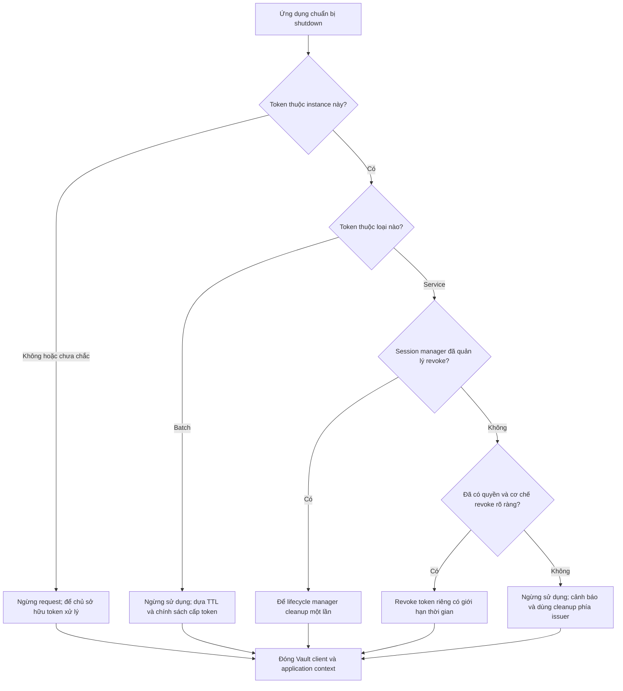
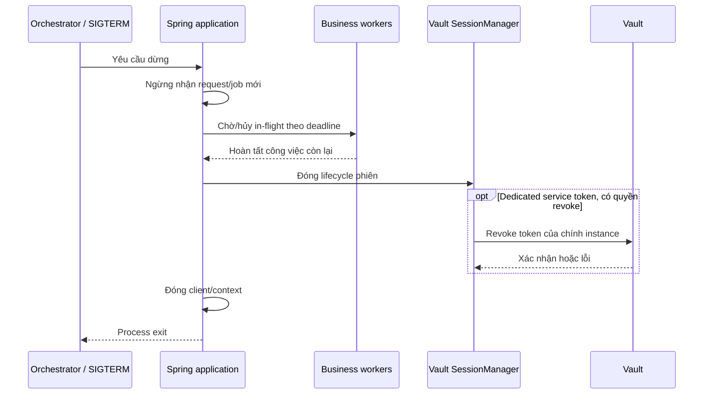

# Thu hồi token khi dừng ứng dụng theo loại token và cấu hình

## 1. Vì sao dừng tiến trình vẫn cần xét đến Vault token?

Trong hệ thống dùng **Spring Vault**, mỗi request từ `VaultTemplate`/`VaultOperations` tới HashiCorp Vault thường mang một **Vault client token**. Token xác định workload đang gọi API, được gắn với policy để đọc KV secrets, sử dụng Transit encryption, cấp chứng chỉ PKI hoặc truy cập những secrets engine khác.

Một tiến trình Java dừng hoạt động không đồng nghĩa Vault lập tức biết rằng token do nó sử dụng cần bị vô hiệu hóa. Nếu token là **service token** vẫn còn TTL, nó có thể tiếp tục được chấp nhận sau khi tiến trình dừng, trừ khi bị thu hồi hoặc hết hạn. Đây là một lý do để thiết kế **thu hồi khi shutdown** bên cạnh TTL ngắn, token policy tối thiểu và khả năng thu hồi từ bên ngoài.

Nhưng **không phải token nào cũng được ứng dụng quyền thu hồi**, và không phải loại token nào cũng có thao tác revoke riêng. Chẳng hạn:

- Token **do phiên Spring Vault tự đăng nhập tạo ra**, chỉ dùng cho instance đó, thường thích hợp để thu hồi khi ứng dụng dừng có kiểm soát.
- Token **được bên ngoài cấp và chia sẻ**, chẳng hạn token do Vault Agent hoặc một hệ thống cấp phiên quản lý, phải tuân theo quyền sở hữu của hệ thống đó. Ứng dụng tự revoke có thể làm ngừng nhiều workload khác.
- **Batch token** có đặc tính khác service token: không hỗ trợ gia hạn và thu hồi riêng từng token theo cách service token.
- **Dynamic secret lease** của database/PKI có vòng đời riêng; thu hồi client token có thể ảnh hưởng tới các lease liên quan nhưng không thay thế thiết kế xoay vòng secret.

Bài học thuộc chương **Phiên và vòng đời token**, tập trung vào quyết định **có nên revoke khi shutdown, ai thực hiện, theo API nào, và kiểm thử ra sao**. Các nguyên tắc áp dụng cho ứng dụng Java dùng `VaultTemplate`, bất kể workload đăng nhập bằng Kubernetes auth, AppRole hay cloud auth.

## 2. Phân biệt loại token, quyền sở hữu và nguồn cấp

Một token có thể được phân loại theo nhiều chiều độc lập. Đặc biệt, **service/batch** mô tả cơ chế của token, còn **orphan/child/periodic** mô tả quan hệ hoặc chính sách vòng đời. Không xem chúng là những loại loại trừ nhau.

| Thuộc tính | Ý nghĩa vận hành | Hệ quả khi ứng dụng dừng |
| --- | --- | --- |
| **Service token** | Token có trạng thái phía Vault, thường có accessor, có thể được renew/revoke nếu đủ điều kiện | Có thể thu hồi chủ động; trước tiên xác nhận token chỉ thuộc instance này |
| **Batch token** | Token nhẹ, không duy trì đầy đủ trạng thái như service token, không hỗ trợ renew và individual revoke | Dựa vào TTL ngắn và kiểm soát nguồn cấp; không giả định `revoke-self` có hiệu quả |
| **Periodic service token** | Token có chu kỳ gia hạn và có thể được renew theo chính sách; các giới hạn khác vẫn có thể áp dụng | Phải chấm dứt renewal; nếu sở hữu riêng, có thể revoke khi shutdown |
| **Child service token** | Token được tạo dưới một parent token | Revoke parent có thể ảnh hưởng các child token và lease liên quan; không tự revoke parent dùng chung |
| **Orphan service token** | Token không có quan hệ parent token để bị thu hồi dây chuyền theo parent | Vẫn phải quản lý TTL và revoke riêng nếu ứng dụng sở hữu |
| **Limited-use token** | Token có số lần sử dụng giới hạn | Đừng tiêu tốn lượt dùng cho các request phụ không cần thiết; vẫn áp dụng quy tắc loại token thực |
| **Root token** | Có quyền rất cao, phục vụ quản trị/khôi phục có kiểm soát | Không dùng làm token của ứng dụng nghiệp vụ |

**Hai câu hỏi khác nhau:** `Có thể thu hồi token không?` và `Ứng dụng có quyền thu hồi token này không?`. Một service token có thể thu hồi về mặt kỹ thuật nhưng vẫn không nên để consumer revoke nếu nó được chia sẻ hoặc hệ thống khác chịu trách nhiệm quản lý.

### 2.1. Service token

Service token thường hỗ trợ tra cứu qua token accessor, renew nếu renewable, và revoke chủ động. Khi Vault thu hồi một service token, các token con và lease liên quan có thể bị ảnh hưởng theo quan hệ của Vault. Điều này hữu ích khi loại bỏ quyền của một workload đã dừng, nhưng cũng nguy hiểm nếu token có phạm vi lớn hơn một instance.

Nếu một replica tự đăng nhập vào Vault bằng Kubernetes auth và nhận **client token riêng**, việc revoke token của chính replica đó khi shutdown thường phù hợp. Không được lấy nhầm token admin/parent hoặc token của replica khác để thu hồi.

### 2.2. Batch token

Batch token được tối ưu cho việc cấp và kiểm tra token nhẹ. Nó **không có cơ chế revoke từng token và renew theo cách service token**. Để giới hạn rủi ro sau khi ứng dụng dừng, cần dựa chủ yếu vào TTL ngắn, giới hạn quyền và chính sách quản trị nguồn phát hành; quan hệ với parent token có thể có tác động tùy cách phát hành, nhưng không dùng nó làm cơ chế dọn dẹp từng instance mặc định.

Nếu ứng dụng đặt lịch gọi `auth/token/revoke-self` cho batch token, lệnh không thể được xem là bằng chứng rằng batch token đã bị thu hồi. Cần chọn chiến lược dựa trên **token type thực sự**.

### 2.3. Periodic và orphan không thay thế quyết định sở hữu

Một **periodic token** có thể liên tục được gia hạn khi đáp ứng điều kiện. Vì vậy, ở shutdown phải chấm dứt cơ chế renew và nếu token là service token do ứng dụng sở hữu, có thể thực hiện revoke. Chỉ ngừng renew nghĩa là token vẫn còn dùng được tới lúc hết hạn.

Một **orphan token** không tự chết chỉ vì parent token trước đó bị thu hồi. Nếu được cấp riêng cho workload, phải có TTL, kế hoạch revoke và quyền quản trị rõ ràng. Đừng cấu hình orphan để giải quyết vấn đề shutdown nếu không có nhu cầu độc lập với parent.

## 3. Ai sở hữu token? Ma trận ra quyết định

Không suy ra quyền sở hữu token chỉ từ tên lớp `VaultToken`, từ biến môi trường `VAULT_TOKEN` hoặc từ việc token đang được gắn vào `VaultTemplate`. Phải biết **ai cấp, ai đang sử dụng, ai có thể bị ảnh hưởng khi revoke và ai được giao trách nhiệm quản lý**.

| Nguồn token / tình huống | Mô hình sở hữu thường gặp | Khi ứng dụng dừng |
| --- | --- | --- |
| `ClientAuthentication` tự login, nhận service token riêng cho instance | Phiên của ứng dụng; session manager có thể quản lý | Ngừng công việc, dùng cơ chế shutdown của session manager để revoke nếu hỗ trợ và phù hợp |
| Token riêng do một issuer cấp chỉ cho instance này, có hợp đồng ứng dụng được revoke | Ứng dụng/issuer cùng quản lý theo thỏa thuận | Có thể revoke token riêng, nhưng không đụng token issuer hay parent |
| `TokenAuthentication` dùng `VAULT_TOKEN` do operator cấp | Chưa rõ; token có thể dùng chung | Mặc định **không tự revoke**; cần thỏa thuận rõ ownership |
| Token được Vault Agent/sidecar sink cấp và agent làm chủ lifecycle | Agent/sidecar hoặc hệ thống cấp token | Phối hợp cơ chế cleanup của agent; tránh hai bên cùng thu hồi mù |
| Token dùng chung giữa nhiều replica | Sở hữu chung, có nhiều consumer | Một replica shutdown không được revoke token chung |
| Batch token của workload | Theo nguồn cấp; token không individual-revocable | Đảm bảo TTL và quyền tối thiểu; không ép gọi revoke-self |
| Token parent/admin dùng tạo token con | Hệ thống quản trị/issuer | Consumer không được revoke parent để dọn phiên con |

Trong production, ghi rõ một cấu hình hoặc hợp đồng như `OWNED_DEDICATED_SERVICE_TOKEN`, `EXTERNALLY_MANAGED_TOKEN`, `SHARED_TOKEN` hoặc `BATCH_TOKEN` ở lớp vận hành. Đây là **tên khái niệm do ứng dụng tự chọn**, không phải thuộc tính chuẩn của Spring Vault. Chỉ bật thủ tục cleanup thủ công nếu ownership đã được xác minh.

### Quy trình ra quyết định



Quy tắc tránh lỗi: **không gọi revoke theo cả hai đường tự động và thủ công trên cùng token** nếu chưa kiểm soát được thứ tự và tính idempotent. Một lần revoke thành công làm token không còn hợp lệ; lần revoke kế tiếp có thể thất bại hoặc kích hoạt thao tác xác thực không mong muốn trong lúc shutdown.

## 4. Spring Vault quản lý phiên như thế nào?

`VaultSessionManager` cung cấp token cho `VaultTemplate`. `ClientAuthentication` thực hiện login khi cần. Các implementation và cấu hình lifecycle có khả năng khác nhau:

| Thành phần | Vai trò | Liên hệ shutdown |
| --- | --- | --- |
| `ClientAuthentication` | Đổi bằng chứng workload lấy Vault token | Không nên bị gọi lại chỉ để shutdown |
| `SimpleSessionManager` | Cung cấp token với quản lý vòng đời đơn giản | Không giả định nó tự revoke hoặc tự renew token |
| `LifecycleAwareSessionManager` | Hỗ trợ theo dõi vòng đời token, renew và hoạt động cleanup theo implementation/cấu hình | Thường là vị trí tự nhiên để quản lý thu hồi token do phiên sở hữu |
| `VaultTemplate` / `VaultOperations` | Gọi KV/Transit/PKI bằng token từ session manager | Không nên tự tạo hoặc revoke token trong từng service nghiệp vụ |
| `TokenAuthentication` | Cung cấp token đã có từ trước | **Không khẳng định token thuộc ứng dụng**; đặc biệt tránh revoke shared token |

Với ứng dụng dùng **Spring Cloud Vault**, hãy kiểm tra cấu hình lifecycle/session do framework thực sự tạo ra. Với **Spring Vault thuần**, hãy kiểm tra session manager được đăng ký khi cấu hình `AbstractVaultConfiguration` hoặc custom bean. API, default, hook shutdown và các tùy chọn `revokeOnShutdown` có thể khác theo **phiên bản cụ thể**; không dựa vào tên lớp rồi khẳng định token đã được revoke.

Một lifecycle manager có thể thực hiện renew/re-auth khi token gần hết TTL, và cleanup khi Spring context dừng. Tuy nhiên, tính năng **tự động revoke** chỉ đáng tin khi:

1. Token do thành phần đó thực sự sở hữu và có thể revoke.
2. Token type phù hợp, auth/policy cho phép thao tác cần thiết.
3. Spring context dừng có kiểm soát để lifecycle callback được chạy.
4. Network tới Vault vẫn hoạt động khi cleanup diễn ra.
5. Không có component khác tiếp tục sử dụng token sau bước revoke.

Nếu thiếu một điều kiện, kế hoạch an toàn vẫn phải dựa trên TTL, policy và cơ chế revocation từ phía vận hành.

### 4.1. Ví dụ Spring Cloud Vault: quản lý token của workload

Ứng dụng chạy trong Kubernetes, nhận service account identity từ Pod và đăng nhập vào Vault:

```yaml
spring:
  cloud:
    vault:
      uri: ${VAULT_URI}
      authentication: KUBERNETES
      kubernetes:
        role: order-service
        kubernetes-path: kubernetes

app:
  vault:
    kv-mount: kv
    secret-path: apps/order-service
```

Đây là cấu hình minh họa **auth method**, chưa phải cấu hình bật/tắt revoke. Tên và hành vi các thuộc tính lifecycle phải được kiểm tra theo **đúng phiên bản Spring Cloud Vault đang dùng**. Với một số cấu hình nguồn Spring Config Data, dự án cũng cần khai báo `spring.config.import` tương thích.

Phía Vault, role có thể cấp **service token riêng**, policy tối thiểu, TTL và renewability phù hợp. Một instance dùng lại `VaultOperations` qua nhiều request; shutdown có thể nhờ lifecycle manager dọn dẹp token được tạo cho instance đó.

Nếu triển khai **nhiều replica** theo cùng role, mỗi replica thường login nhận token riêng. Thu hồi token riêng của replica đang dừng phải được tách khỏi việc thu hồi cả role, parent token hoặc policy của các replica đang chạy.

### 4.2. Token tĩnh là trường hợp cần xử lý khác

Ví dụ tối giản với Spring Vault thuần:

```java
import java.net.URI;
import org.springframework.context.annotation.Configuration;
import org.springframework.vault.authentication.ClientAuthentication;
import org.springframework.vault.authentication.TokenAuthentication;
import org.springframework.vault.client.VaultEndpoint;
import org.springframework.vault.config.AbstractVaultConfiguration;

@Configuration
public class VaultClientConfiguration extends AbstractVaultConfiguration {

    @Override
    public VaultEndpoint vaultEndpoint() {
        return VaultEndpoint.from(
                URI.create(System.getenv("VAULT_URI")));
    }

    @Override
    public ClientAuthentication clientAuthentication() {
        return new TokenAuthentication(System.getenv("VAULT_TOKEN"));
    }
}
```

Đoạn này chỉ minh họa cách cung cấp token qua môi trường; production cần validate cấu hình, TLS/trust và bảo vệ secret. `TokenAuthentication` có thể được dùng với token dành riêng hoặc token được cấp từ ngoài. **Không thể suy từ Java code mà biết có nên revoke khi shutdown hay không**. Nếu token được nhiều tiến trình cùng dùng, tự revoke khi một tiến trình dừng là hành vi sai.

Đặc biệt, khi `VAULT_TOKEN` được xoay vòng bởi Vault Agent hoặc hệ thống cấp khác, ứng dụng không nên tự nhận quyền sở hữu token đó. Nên quản lý lifecycle ở thành phần thực sự phát hành và thay thế token.

## 5. Thứ tự shutdown an toàn

Mục đích của một quy trình dừng có kiểm soát là để không request nào tiếp tục cố dùng token sau khi token đã bị thu hồi. Thứ tự hợp lý:

1. **Ngừng nhận công việc mới:** đánh dấu readiness không phục vụ request mới, tắt scheduler/consumer nhận job và điều phối rời khỏi load balancer.
2. **Xử lý công việc đang chạy:** chờ có giới hạn cho request in-flight hoàn tất, hoặc hủy có kiểm soát theo hợp đồng nghiệp vụ. Các thao tác PKI cấp chứng chỉ, Transit batch encryption và giao dịch DB cần cơ chế lỗi phù hợp.
3. **Xử lý các lease/credential riêng:** đóng kết nối đang sử dụng dynamic credentials và thực hiện cleanup theo lease manager nếu hệ thống đó sở hữu lease. Không giả định revoke token sẽ thay thế mọi thao tác đóng resource.
4. **Đóng phiên Vault:** ngừng renew/re-auth theo lịch; nếu token là dedicated service token do ứng dụng sở hữu, thực hiện revoke đúng một lần thông qua lifecycle manager hoặc thành phần cleanup.
5. **Đóng transport và Spring context:** kết thúc HTTP client/resource sau khi các thao tác cần token đã hoàn tất; ghi trạng thái shutdown an toàn mà không ghi token.



**Shutdown graceful không phải giao thức giao dịch phân tán.** Tiến trình có thể bị `SIGKILL`, OOM, mất mạng, mất điện hoặc hết termination grace period trước khi Vault nhận yêu cầu revoke. Vì thế **TTL ngắn hợp lý** và **khả năng thu hồi độc lập của operator/issuer** là tuyến kiểm soát bắt buộc.

Cũng không nên cho callback shutdown bị treo vô hạn chỉ vì Vault không phản hồi. Cleanup phải có HTTP timeout, giới hạn retry và deadline phù hợp với termination grace period của môi trường chạy.

## 6. Cách chủ động revoke service token

Vault có các API token khác nhau; quyền sử dụng và đối tượng bị thu hồi rất quan trọng.

| API / CLI | Dùng cho | Lưu ý |
| --- | --- | --- |
| `POST auth/token/revoke-self` / `vault token revoke -self` | Token của chính request hiện tại | Phù hợp với dedicated service token mà tiến trình được phép tự thu hồi |
| `POST auth/token/revoke` | Thu hồi token cụ thể bằng token có quyền quản trị tương ứng | Không dùng token admin trong service chỉ để dọn chính nó |
| `POST auth/token/revoke-accessor` | Thu hồi theo token accessor bằng danh tính có quyền | Hữu ích cho issuer/operator thu hồi token từ ngoài; accessor không phải token đăng nhập |
| Thu hồi parent token | Thu hồi token trong cây quan hệ của Vault | Có thể ảnh hưởng child tokens/leases; nguy hiểm nếu parent dùng chung |
| TTL / expiry | Token tự mất hiệu lực khi hết hạn theo điều kiện Vault | Là hàng rào khi shutdown không chạy hoặc với token không revoke riêng được |

### 6.1. Thực hành CLI trên Vault thử nghiệm

Ví dụ dành cho **một service token thử nghiệm chỉ dùng cho tiến trình hiện tại**:

```bash
# Chạy với danh tính Vault token riêng của workload,
# có quyền thao tác auth/token/revoke-self.
vault token lookup

# Khi đã ngừng mọi thao tác dùng token:
vault token revoke -self
```

Lệnh `vault token lookup` không cần in token bí mật ra màn hình; tuy nhiên metadata về token vẫn cần được bảo vệ. Sau lệnh revoke-self thành công, **các request sử dụng cùng token phải thất bại**. Không đặt bước này trong script dùng token root/admin hoặc token chia sẻ giữa các replica.

Nếu quản trị viên cần thu hồi token từ bên ngoài và đã lưu **accessor** trong hệ thống quản lý phiên, có thể dùng lệnh quản trị tương ứng:

```bash
# Chỉ thực hiện bằng danh tính admin/issuer được cấp quyền phù hợp.
vault token revoke -accessor "$TOKEN_ACCESSOR"
```

Accessor giúp định danh token để thao tác revoke mà không phải lưu giá trị token bí mật của consumer. Dù không dùng được như client token, accessor vẫn là dữ liệu vận hành cần hạn chế công bố và quyền revoke-accessor phải được kiểm soát.

### 6.2. Kiểm tra policy cho revoke-self

Token workload phải có quyền phù hợp nếu thiết kế yêu cầu nó tự revoke. Trong nhiều thiết lập Vault, policy mặc định cho phép token gọi một số endpoint quản lý chính nó. Nhưng nếu ứng dụng dùng `token_no_default_policy` hoặc policy tùy biến nghiêm ngặt, **không được giả định revoke-self chắc chắn được cho phép**.

Ví dụ minh họa một capability cần kiểm tra trong Vault policy:

```hcl
path "auth/token/revoke-self" {
  capabilities = ["update"]
}
```

Việc thêm capability này chỉ nên áp dụng cho dedicated service token **được phép tự thu hồi**, và cần kiểm thử trên auth mount/token type thực tế. Đừng cấp `update` cho `auth/token/revoke` hoặc `auth/token/create` chỉ để giải quyết shutdown; chúng có phạm vi quyền khác.

### 6.3. Ví dụ cleanup thủ công có điều kiện trong Spring

**Chỉ dùng khi** ứng dụng sở hữu một *dedicated service token* và không có lifecycle manager khác đã chịu trách nhiệm revoke token này. Với token được chia sẻ hoặc do Vault Agent quản lý, để tùy chọn này **tắt**.

```java
import java.util.Collections;
import java.util.concurrent.atomic.AtomicBoolean;

import jakarta.annotation.PreDestroy;
import org.springframework.beans.factory.annotation.Value;
import org.springframework.stereotype.Component;
import org.springframework.vault.core.VaultOperations;

@Component
public final class OwnedVaultTokenCleanup {

    private final VaultOperations vault;
    private final boolean revokeOwnedTokenOnShutdown;
    private final AtomicBoolean attempted = new AtomicBoolean();

    public OwnedVaultTokenCleanup(
            VaultOperations vault,
            @Value("${app.vault.revoke-owned-token-on-shutdown:false}") boolean enabled) {
        this.vault = vault;
        this.revokeOwnedTokenOnShutdown = enabled;
    }

    @PreDestroy
    public void closeOwnedSession() {
        if (!revokeOwnedTokenOnShutdown
                || !attempted.compareAndSet(false, true)) {
            return;
        }

        try {
            // Chỉ dùng token phiên của chính instance này.
            // Endpoint revoke-self có thể làm token mất hiệu lực ngay.
            vault.write("auth/token/revoke-self", Collections.emptyMap());
        } catch (RuntimeException failure) {
            // Ghi metric/log lỗi theo loại, KHÔNG in token,
            // request header hay toàn bộ payload.
            // Cleanup từ phía issuer/operator là đường phục hồi.
        }
    }
}
```

Property ví dụ:

```yaml
app:
  vault:
    revoke-owned-token-on-shutdown: false
```

Đây là **cơ chế opt-in tự định nghĩa của ứng dụng**, không phải property chuẩn của Spring Cloud Vault. Chỉ đổi sang `true` sau khi đã xác minh: token là service token dành riêng, endpoint tự revoke được phép, Spring chưa tự revoke, và thứ tự bean destruction vẫn giữ Vault transport/session hoạt động tới callback. Với Spring Boot 3, `jakarta.annotation.PreDestroy` phù hợp; các thế hệ Spring cũ có thể sử dụng namespace annotation khác.

Ví dụ cố ý không thực hiện retry vô hạn. Nếu revoke thất bại do mạng, app phải vẫn có thể shutdown. Thực tế cần log cảnh báo không chứa secret và gắn metric để operator xử lý; không được nuốt lỗi một cách im lặng như minh họa ngắn. **Ưu tiên** tận dụng cơ chế lifecycle tích hợp của Spring Vault nếu nó đã quản lý đúng token và hỗ trợ thu hồi theo phiên bản sử dụng.

Quan trọng: thứ tự `@PreDestroy` không thay thế việc ngừng web traffic và xử lý in-flight. Nếu request vẫn đến trong lúc callback revoke, một số request sẽ thất bại bất ngờ.

## 7. Lựa chọn theo loại token và cấu hình cụ thể

### 7.1. Kubernetes auth: service token riêng cho mỗi Pod

Thông thường mỗi Pod dùng Kubernetes service account JWT để login vào Vault và nhận token theo Vault role. Khi mỗi Pod nhận một **service token riêng**, có thể giao vòng đời token cho session manager. Khi Pod nhận SIGTERM, readiness và ứng dụng dừng graceful, session manager có thể revoke nếu cơ chế được bật/hỗ trợ.

Nhưng nếu Pod bị kill không có thời gian callback, token có thể tồn tại tới TTL. Hãy cấu hình Vault role với TTL phù hợp, giám sát số token active, giới hạn quyền và xác minh cách refresh JWT để re-auth.

Một Pod khác cùng Kubernetes role vẫn có token riêng; không revoke token của nó hoặc thay đổi cả role để chỉ dọn phiên hiện tại.

### 7.2. AppRole: không lẫn SecretID với client token

Trong AppRole, `role_id` và `secret_id` là **thông tin dùng để đăng nhập**, khác với `client_token` Vault trả về. Khi dừng ứng dụng:

- Có thể revoke **client token riêng** nếu token là service token do instance sở hữu.
- Không có nghĩa phải xóa cả AppRole role, revoke token issuer, hoặc vô hiệu mọi SecretID khác của hệ thống.
- Nếu SecretID dùng một lần, nó đã được tiêu thụ khi login; muốn re-auth cần cơ chế cấp SecretID mới.
- Nếu SecretID vẫn còn lượt dùng và hạn, việc revoke client token **không mặc nhiên thu hồi SecretID**. Chỉ issuer/admin mới nên quyết định hủy credential bootstrap còn tồn tại.

### 7.3. Cloud auth: AWS IAM, GCP, Azure

Khi dùng AWS/GCP/Azure auth, bằng chứng IAM/JWT/managed identity giúp lấy Vault token. Revoke token Vault của phiên ứng dụng **không revoke chính cloud principal**. Ngược lại, tắt workload IAM role hoặc cloud identity không luôn làm một Vault token đã cấp mất hiệu lực tức thì trước khi Vault revoke/TTL.

Khi ứng dụng dừng, xử lý Vault client token theo ownership, token type và policy. Việc thay đổi cloud IAM quyền, rotate credentials hoặc xóa workload identity thuộc quy trình khác. Không dùng quyền quản trị cloud để thay thế cleanup Vault token.

### 7.4. Vault Agent hoặc token injector

Vault Agent có thể chịu trách nhiệm tự xác thực, gia hạn và phân phối token tới workload. Khi đó Java app thường là **consumer**, không phải issuer/owner. Cần xem hợp đồng triển khai: agent có tự revoke không, chỉ dừng renew hay dùng TTL, và một token có được nhiều process chia sẻ không.

Nếu không biết, mặc định consumer ngừng sử dụng token và để thành phần agent/issuer quản lý revoke. Đừng kích hoạt `@PreDestroy` revoke-self chỉ vì token xuất hiện trong file sink hoặc biến môi trường.

### 7.5. Batch token

Không cấu hình callback revoke-self như thể batch token là service token. Kiểm soát lifetime ở nơi phát hành bằng TTL ngắn và policy tối thiểu. Nếu workload cần revocation chính xác tại thời điểm shutdown, cân nhắc có thật sự nên dùng batch token trong mô hình này hay chuyển sang dedicated service token theo nhu cầu bảo mật.

## 8. Các tình huống lỗi khi shutdown

| Hiện tượng | Nguyên nhân thường gặp | Cách xử lý |
| --- | --- | --- |
| Revoke-self trả `403` | Token không có quyền endpoint, token đã hết hạn hoặc policy không khớp | Kiểm tra capability, token type và trạng thái phiên; không thêm quyền admin rộng |
| Revoke-self thất bại trên batch token | Batch token không hỗ trợ individual revoke | Dùng TTL và chính sách phát hành; sửa quyết định loại token |
| Một replica shutdown, replica khác mất quyền | Hai replica chia sẻ token hoặc revoke parent token | Cấp dedicated token cho mỗi replica; điều chỉnh ownership và policy |
| Token còn hiệu lực sau ứng dụng dừng | Callback không chạy do kill/OOM; mất mạng; token managed bên ngoài | Dựa vào TTL, theo dõi bằng audit/accessor, cleanup từ operator/issuer |
| Shutdown treo lâu | HTTP timeout/retry cleanup quá dài, Vault không phản hồi | Đặt deadline và timeout; không chặn process vô hạn |
| Lỗi `403` sau khi dừng request mới | In-flight chưa kết thúc trước revoke | Quiesce/drain request và background job trước khi revoke |
| Vừa revoke vừa thấy re-auth/login | Session manager chưa dừng renew/re-auth hoặc cleanup trùng | Đảm bảo đúng ownership, shutdown order và một đường cleanup |
| Lease database hoặc chứng chỉ bị ảnh hưởng | Dynamic secret liên quan token bị revoke | Lập kế hoạch dừng pool/lease manager và rotation theo từng backend |
| Revocation “thành công” nhưng request vẫn chạy được | Đã revoke token khác, request đang dùng token mới hoặc proxy/identity khác | Kiểm tra accessor và danh tính phiên; xác minh server-side bằng token đã biết |

**Không log token để debug.** Khi cần đối soát, sử dụng accessor, metadata/audit đủ quyền trong môi trường an toàn, và hạn chế quyền xem. Log ứng dụng chỉ nên lưu mã lỗi, tên operation đã được làm sạch và trạng thái cleanup.

## 9. Kiểm thử tích hợp thu hồi token

Một bài thực hành đầy đủ cần chứng minh cả **đường thành công** và **đường không nên revoke**.

### 9.1. Chuẩn bị

Dùng một Vault thử nghiệm (có thể chạy bằng Testcontainers), bật KV v2 tại `kv/`, tạo policy chỉ đọc `kv/data/apps/order-service`. Cấu hình một auth method như AppRole hoặc Kubernetes; yêu cầu Vault cấp **service token riêng** cho mỗi instance. Chuẩn bị thông tin quản trị bên ngoài ứng dụng để xác minh trạng thái token, không đưa root token vào code production.

### 9.2. Thử các trường hợp

1. **Token do instance sở hữu:** khởi động app, login một lần qua auth method đã chọn, đọc secret bằng `VaultOperations`. Ghi lại accessor qua cơ chế quản trị kiểm soát.
2. **Dừng graceful:** dừng nhận request, kết thúc job rồi shutdown context. Xác nhận đường lifecycle hoặc cleanup đã gửi revoke-self nếu được bật và Vault đã chấp nhận.
3. **Xác minh từ Vault:** bằng công cụ quản trị có quyền, kiểm tra token/accessor sau shutdown; các request sử dụng token cũ phải bị từ chối. Không chỉ tin vào log “cleanup started”.
4. **Token được chia sẻ:** cấp một token chung cho hai client kiểm thử. Cấu hình consumer ở chế độ externally-managed; dừng một client và xác minh client còn lại vẫn có thể dùng token.
5. **Batch token:** cấp batch token có TTL ngắn. Dừng ứng dụng và xác nhận cơ chế cleanup không thực hiện individual revoke; token hết hạn theo chính sách.
6. **Mạng Vault bị ngắt:** dừng ứng dụng khi không thể tới Vault, xác nhận callback không làm tiến trình treo quá termination deadline và có cảnh báo. Sau đó thử dọn token bằng issuer/operator.
7. **Dừng đột ngột:** mô phỏng kill không graceful. Xác nhận không phụ thuộc vào `@PreDestroy` và TTL/monitoring bảo vệ được rủi ro còn lại.
8. **Hai replica có token riêng:** dừng một replica, kiểm tra token của replica kia vẫn hợp lệ và đọc KV được; nếu mất quyền, kiểm tra token sharing và quan hệ parent.

### 9.3. Phân loại test

- **Unit test:** kiểm tra decision policy: chỉ dedicated service token mới được đưa vào đường revoke, shared/batch/external không gọi revoke-self; callback không gọi lại nhiều lần.
- **Integration test:** Vault thật trong môi trường thử nghiệm chứng minh token bị revoke server-side và lease/token con nếu có hành vi mong đợi.
- **Lifecycle test:** khởi động và đóng Spring context với cấu hình thực, kiểm tra thứ tự shutdown, timeout, in-flight traffic và cơ chế session manager đã được bật thực tế.
- **Operational test:** Kubernetes rolling update/SIGTERM/SIGKILL, mất mạng và autoscaling; quan sát token còn hoạt động sau khi Pod biến mất và thời gian hết TTL.

Không dùng một `VaultTemplate` mock để tuyên bố Vault token thực sự đã bị thu hồi. Mock chỉ chứng minh Java đã gọi API; cần kiểm chứng phản hồi server và hiệu lực token trong integration test.

## 10. Checklist trước khi triển khai production

- Xác định **token type** (`service` hay `batch`), quan hệ parent/orphan và thuộc tính renewable/periodic.
- Ghi rõ **token owner**: Spring session manager, ứng dụng, Vault Agent, issuer hoặc hệ thống vận hành.
- Với dedicated service token, chọn **một** cơ chế revoke có kiểm thử: lifecycle manager hoặc cleanup thủ công; không thực hiện trùng.
- Với shared/external token, không cho từng replica revoke token chung. Tách token theo replica nếu cần revocation độc lập.
- Với batch token, dùng TTL và policy hạn chế; không hứa hẹn individual revoke.
- Đảm bảo request/job đã drain trước khi revoke và transport còn hoạt động trong cleanup.
- Giới hạn timeout, retry, termination grace; coi revoke khi shutdown là **best effort** vì crash và mất mạng có thể xảy ra.
- Áp dụng TLS, least privilege, không log token, giữ accessor và audit metadata trong kênh phù hợp.
- Thiết kế vòng đời dynamic secret lease và credential riêng; kiểm tra tác động khi revoke parent/service token.
- Kiểm thử cả graceful shutdown, force kill, 403, token hết hạn, shared token, batch token và nhiều replica.

**Ghi nhớ:** Thu hồi token khi ứng dụng dừng phải dựa trên **loại token, quyền sở hữu và cấu hình quản lý phiên**. Với một dedicated service token, có thể thu hồi an toàn sau khi ngừng công việc qua cơ chế Spring Vault phù hợp. Với batch token hoặc token do bên khác quản lý, cần dùng TTL và quy trình cấp/thu hồi ở đúng nơi. `VaultSessionManager` giúp tập trung vòng đời phiên, còn TTL và policy là lớp bảo vệ khi cleanup không kịp chạy.

