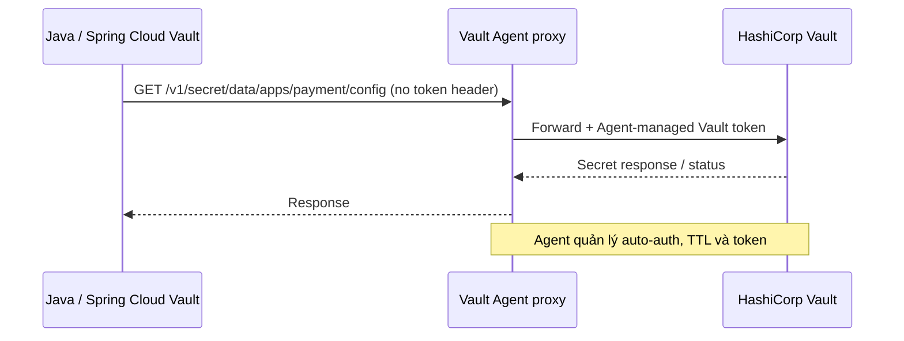

# Phân biệt token được client tạo ra với token được quản lý bên ngoài

## 1. Vấn đề và mục tiêu học tập

Trong **Spring Vault**, ứng dụng Java dùng **Vault token** để gửi yêu cầu có xác thực tới **HashiCorp Vault** qua `VaultTemplate` / `VaultOperations`. Tuy vậy, việc **có một token để sử dụng** và việc **chịu trách nhiệm quản lý vòng đời token** là hai vấn đề khác nhau.

Hai mô hình phổ biến:

- **Client chủ động đăng nhập:** Java gọi AppRole, Kubernetes, AWS IAM, JWT, certificate auth... Vault xác thực danh tính và **phát hành một token mới**. Spring Vault có thể quản lý renew, đăng nhập lại (re-login) và thu hồi token khi đóng phiên.
- **Token do bên ngoài quản lý:** Vault Agent, service broker, công cụ triển khai hoặc quản trị viên cấp một **Vault token đã có** cho Java, hoặc một local Vault Agent proxy tự gắn token vào request. Trách nhiệm rotation, renew và revoke có thể thuộc về thành phần bên ngoài.

Trong đề bài, “token được client tạo ra” có nghĩa là **token do Vault cấp sau khi client khởi tạo login**. **Bản thân Java không tự tạo một chuỗi ngẫu nhiên thành token Vault hợp lệ**: chỉ Vault server mới xác thực thông tin đăng nhập, phát hành token, gán policy và TTL.

Bài thuộc chương **Phiên và vòng đời token** của module **SPRING_VAULT**. Bạn sẽ học cách phân biệt **`VaultToken` / `LoginToken`**, **`SimpleSessionManager` / `LifecycleAwareSessionManager`** và chọn mô hình phù hợp khi đọc KV secrets, sử dụng Transit encryption, PKI hoặc secret có lease động.

**Kết quả mong đợi:** xác định ai cấp, ai renew, ai rotate, ai revoke token; cấu hình hai mô hình bằng Spring Vault; hiểu hành vi khi TTL hết hạn hoặc Java restart; thiết kế quan sát và kiểm thử tích hợp.

## 2. So sánh hai mô hình theo trách nhiệm

| Câu hỏi | Client khởi tạo login | Token do bên ngoài quản lý |
| --- | --- | --- |
| Ai **phát hành** token? | Vault khi client gọi auth login | Vault đã phát hành trước đó theo yêu cầu của broker/agent/operator |
| Java nhận gì? | Token từ response đăng nhập Vault | Chuỗi token được inject, hoặc không thấy token nếu dùng Agent proxy |
| `ClientAuthentication` thường dùng | `AppRoleAuthentication`, `KubernetesAuthentication`, `AwsIamAuthentication`... | `TokenAuthentication` đối với token tĩnh |
| Kiểu token Java thường nhận | `LoginToken` với TTL/renewability | `VaultToken` đóng gói chuỗi token, không chứa TTL |
| Ai renew? | `LifecycleAwareSessionManager` khi đủ điều kiện | Broker/agent; **hoặc** Spring Vault nếu chủ động bật và giao quyền |
| Khi token hết TTL | Login lại qua auth method nếu còn credentials hợp lệ | Nhận token mới từ nguồn ngoài; token tĩnh trong Java không tự đổi |
| Shutdown | Lifecycle manager có thể thu hồi `LoginToken` service còn dùng được | `VaultToken` được cấp sẵn không tự động bị revoke khi manager đóng |
| Rủi ro quản lý | Mất khả năng login lại; role/credentials hết hạn | Hai bên cùng renew/revoke; Java giữ token cũ sau rotation |
| Mô hình thường gặp | Dịch vụ tự xác thực theo workload | Broker cung cấp token; Vault Agent auto-auth |

Không có quy tắc “token từ bên ngoài thì Spring Vault **không bao giờ renew**”. Nếu Java dùng `LifecycleAwareSessionManager`, token ngoài có thể được self-lookup rồi renew. **Nguồn cấp token** và **chủ sở hữu vòng đời** là hai trục phải quyết định riêng.

### Sơ đồ luồng

```mermaid
flowchart TB
    subgraph A["Client chủ động đăng nhập"]
      A1["Java ClientAuthentication"] -->|"AppRole / IAM / JWT..."| A2["Vault auth login"]
      A2 -->|"LoginToken + TTL"| A3["LifecycleAwareSessionManager"]
      A3 -->|"Token cho request"| A4["VaultTemplate"]
      A3 -->|"Renew / re-login khi cần"| A2
    end
    subgraph B["Token ngoài: Java nhận trực tiếp"]
      B1["Broker / operator"] -->|"Vault token được cấp sẵn"| B2["TokenAuthentication"]
      B2 --> B3["SessionManager"]
      B3 --> B4["VaultTemplate"]
      B1 -->|"Renew / rotate / revoke"| B5["Vault Server"]
    end
    subgraph C["Vault Agent proxy"]
      C1["Java gọi local proxy không cần header token"] --> C2["Vault Agent"]
      C2 -->|"Agent auto-auth và chuyển tiếp"| C3["Vault Server"]
    end
```



## 3. `VaultToken`, `LoginToken` và service/batch token

### 3.1. `VaultToken` của Spring Vault

`org.springframework.vault.support.VaultToken` đóng gói **giá trị chuỗi token**. Đối tượng này không mang TTL, `renewable`, accessor hay thời điểm hết hạn. `TokenAuthentication` được thiết kế để lấy một token **có sẵn**, vì vậy `login()` của nó trả `VaultToken` mà **không đăng nhập để phát hành token mới**.

```java
import org.springframework.vault.authentication.ClientAuthentication;
import org.springframework.vault.authentication.TokenAuthentication;
import org.springframework.vault.support.VaultToken;

ClientAuthentication authentication =
    new TokenAuthentication(System.getenv("EXTERNAL_VAULT_TOKEN"));

VaultToken supplied = authentication.login();
// Đối tượng chứa token bên ngoài đã được cấp; không log supplied.getToken().
```

Trong thực tế phải kiểm tra biến môi trường không rỗng trước khi tạo `TokenAuthentication`. `login()` trong interface `ClientAuthentication` có thể **đăng nhập thật** hoặc **trả token đã cache/cấu hình**, tùy implementation; tên method không chứng minh có lệnh tạo token.

### 3.2. `LoginToken` của Spring Vault

`org.springframework.vault.support.LoginToken` mang theo metadata về token nhận qua login, bao gồm TTL và trạng thái renewable. Các auth method thực hiện đăng nhập vào Vault thường nhận thông tin này từ trường `auth` của response.

Ví dụ response đã che credential:

```json
{
  "auth": {
    "client_token": "<REDACTED>",
    "accessor": "<REDACTED>",
    "policies": ["default", "app-read"],
    "lease_duration": 1800,
    "renewable": true
  }
}
```

`lease_duration=1800` tương ứng khoảng 30 phút TTL ban đầu, **không bảo đảm sẽ renew vô hạn**. Token còn chịu các giới hạn TTL/max TTL, `explicit_max_ttl` nếu có, chính sách Vault và trạng thái auth method.

### 3.3. Không trộn kiểu Java với loại token của Vault server

| Khái niệm | Tầng | Ý nghĩa |
| --- | --- | --- |
| `VaultToken` | Kiểu Java | Chuỗi token để xác thực request, không có TTL/renewability. |
| `LoginToken` | Kiểu Java | Token có metadata lifecycle từ login. |
| **Service token** | Vault server | Có thể renew và revoke khi đủ điều kiện; có accessor, hỗ trợ child token. |
| **Batch token** | Vault server | Token nhẹ, TTL cố định, **không renew và không revoke thủ công** như service token. |

**`LoginToken` không đồng nghĩa “service token”**. Nếu server cấp batch token, việc Spring Vault biết TTL không làm batch token trở thành renewable. Ngược lại, một `VaultToken` được cấp ngoài vẫn có thể là **service token renewable**.

## 4. SessionManager và trách nhiệm vòng đời

`VaultTemplate` yêu cầu một `SessionManager` cung cấp token thông qua `getSessionToken()`. Nó tái sử dụng token cho nhiều request; tránh mỗi lần đọc KV lại gửi một login riêng.

### 4.1. `SimpleSessionManager`

`SimpleSessionManager` gọi `ClientAuthentication.login()` một lần theo nhu cầu, **cache token** và tái sử dụng. Nó:

- Không lên lịch `renew-self`.
- Không tự revoke token khi dừng.
- Không tự phát hiện token tĩnh đã được hệ thống ngoài thay thế.
- Không tự bảo đảm phục hồi nếu token bị revoke hoặc hết TTL trong khi Java vẫn chạy.

Phù hợp khi quản lý vòng đời thuộc về broker, **với điều kiện** có kế hoạch restart/reload hoặc thay session khi token bên ngoài đổi; cũng hữu ích cho tác vụ hữu hạn có token còn đủ hạn.

### 4.2. `LifecycleAwareSessionManager`

Đây là session manager **mặc định của `AbstractVaultConfiguration`**:

- Lấy token thông qua `ClientAuthentication` và quản lý session thread-safe.
- Lên lịch **renew** trước khi token hết hạn nếu token đủ điều kiện và có thông tin TTL.
- Có thể **đăng nhập lại** để nhận token khác khi token cũ không còn duy trì được.
- **Tự revoke `LoginToken` do nó quản lý khi kết thúc phiên**, trong điều kiện service token và request revoke thành công.
- Đối với `VaultToken` cấp sẵn, có thể gọi `auth/token/lookup-self` để lấy TTL/renewability (mặc định self-lookup bật) và **có thể renew**; **không tự revoke token này khi shutdown**.

Self-lookup sử dụng chính token để tra cứu Vault. Nếu bị từ chối vì ACL, Spring Vault có thể tiếp tục nhưng không có đủ thông tin để tự renew. Với token giới hạn số lần dùng, lookup cũng có thể tiêu thụ một lượt.

**Cần hiểu đúng re-login của token ngoài:** nếu `ClientAuthentication` là `new TokenAuthentication("token-cu")`, lần gọi `login()` tiếp theo sẽ vẫn nhận **`token-cu`**. Java không thể tự thay một token đã hết hạn nếu không có nguồn cấp token mới.

### 4.3. Ma trận hành vi

| Authentication | Session manager | Có token mới từ Vault khi login? | Renew | Revoke khi đóng |
| --- | --- | --- | --- | --- |
| AppRole/Kubernetes/IAM login | LifecycleAware | Có, khi login/re-login thành công | Có nếu server cho phép | `LoginToken` loại service do manager sở hữu |
| AppRole/Kubernetes/IAM login | Simple | Có ở lần login đầu | Không tự động | Không |
| `TokenAuthentication` | LifecycleAware | **Không**, dùng chuỗi cấu hình | Có thể renew sau self-lookup | Không tự revoke `VaultToken` |
| `TokenAuthentication` | Simple | **Không**, token tĩnh | Không | Không |
| Vault Agent proxy | Không cần `ClientAuthentication` trong Java | Agent xử lý | Agent xử lý | Theo Agent và Vault policy |

Không nên tự gọi `LifecycleAwareSessionManager.revoke()` trên token ngoài khi **chủ sở hữu broker vẫn cần token**. Việc không tự revoke trong shutdown khác với khả năng quản trị viên/chương trình gọi **revoke chủ động** qua API.

## 5. Mô hình A: Java tự đăng nhập AppRole

Ví dụ dùng **Spring Vault 4.1.x / Java 17+**. Ứng dụng nhận RoleId/SecretId từ môi trường triển khai, gọi AppRole login; **Vault** phát hành token theo role. `LifecycleAwareSessionManager` của Spring Vault sẽ quản lý phiên mặc định.

```java
import java.net.URI;

import org.springframework.context.annotation.Configuration;
import org.springframework.vault.authentication.AppRoleAuthentication;
import org.springframework.vault.authentication.AppRoleAuthenticationOptions;
import org.springframework.vault.authentication.AppRoleAuthenticationOptions.RoleId;
import org.springframework.vault.authentication.AppRoleAuthenticationOptions.SecretId;
import org.springframework.vault.authentication.ClientAuthentication;
import org.springframework.vault.client.VaultEndpoint;
import org.springframework.vault.config.AbstractVaultConfiguration;

@Configuration
public class AppRoleVaultConfig extends AbstractVaultConfiguration {

    @Override
    public VaultEndpoint vaultEndpoint() {
        return VaultEndpoint.from(
            URI.create("https://vault.internal.example:8200"));
    }

    @Override
    public ClientAuthentication clientAuthentication() {
        AppRoleAuthenticationOptions options =
            AppRoleAuthenticationOptions.builder()
                .roleId(RoleId.provided(required("VAULT_ROLE_ID")))
                .secretId(SecretId.provided(required("VAULT_SECRET_ID")))
                .build();

        return new AppRoleAuthentication(options, vaultClient());
    }

    private static String required(String name) {
        String value = System.getenv(name);
        if (value == null || value.isBlank()) {
            throw new IllegalStateException("Missing configuration: " + name);
        }
        return value;
    }
}
```

**Đường đi:** lần đầu `VaultTemplate` cần token → `AppRoleAuthentication.login()` → Vault `POST /v1/auth/approle/login` → nhận `LoginToken` → manager renew hoặc re-login theo TTL và quy định Vault.

**Rủi ro thực tế:** một SecretId với TTL/use-count ngắn có thể đủ để login lần đầu nhưng **không đủ cho lần re-login** sau vài giờ. Cần thiết kế nguồn cấp RoleId/SecretId, phương án wrapping/rotation hoặc chọn workload identity phù hợp. Không đặt RoleId/SecretId trong source code, log hay image.

### Spring Cloud Vault tương đương

```yaml
spring:
  cloud:
    vault:
      uri: https://vault.internal.example:8200
      authentication: APPROLE
      app-role:
        role-id: ${VAULT_ROLE_ID}
        secret-id: ${VAULT_SECRET_ID}
      session:
        lifecycle:
          enabled: true
          refresh-before-expiry: 10s
          expiry-threshold: 20s
```

`refresh-before-expiry` và `expiry-threshold` điều chỉnh thời điểm xử lý vòng đời. `expiry-threshold` nên lớn hơn `refresh-before-expiry`; cần điều chỉnh theo TTL và độ trễ thực tế. Spring Cloud Vault hỗ trợ lifecycle mặc định, nhưng cần kiểm tra đúng phiên bản/configuration của dự án.

## 6. Mô hình B: ứng dụng nhận Vault token do broker cấp sẵn

Giả sử broker cấp một **Vault service token** cho Java, chịu trách nhiệm renew/rotate/revoke. Java cần sử dụng nó mà không can thiệp ngoài phạm vi đã thỏa thuận.

### 6.1. `TokenAuthentication` + `SimpleSessionManager`

```java
import java.net.URI;

import org.springframework.context.annotation.Configuration;
import org.springframework.vault.authentication.ClientAuthentication;
import org.springframework.vault.authentication.SessionManager;
import org.springframework.vault.authentication.SimpleSessionManager;
import org.springframework.vault.authentication.TokenAuthentication;
import org.springframework.vault.client.VaultEndpoint;
import org.springframework.vault.config.AbstractVaultConfiguration;

@Configuration
public class ExternalTokenVaultConfig extends AbstractVaultConfiguration {

    @Override
    public VaultEndpoint vaultEndpoint() {
        return VaultEndpoint.from(
            URI.create("https://vault.internal.example:8200"));
    }

    @Override
    public ClientAuthentication clientAuthentication() {
        String token = System.getenv("EXTERNAL_VAULT_TOKEN");
        if (token == null || token.isBlank()) {
            throw new IllegalStateException("Missing external Vault token");
        }
        return new TokenAuthentication(token);
    }

    @Override
    public SessionManager sessionManager() {
        return new SimpleSessionManager(clientAuthentication());
    }
}
```

Hành vi:

1. `TokenAuthentication.login()` cung cấp **token đã có**; không gọi auth login để phát hành token khác.
2. `SimpleSessionManager` cache token, **không renew/revoke**.
3. Broker phải theo dõi thời hạn, cấp token thay thế và chủ động thu hồi khi thích hợp.
4. Java **không tự thấy giá trị mới** khi broker sửa biến môi trường hoặc file token. Cần restart/reload hoặc tự xây cơ chế cập nhật session an toàn.

Khi broker thường xuyên rotate token trong khi Java vẫn chạy, ví dụ `SimpleSessionManager` này **chưa đủ**. Cần tích hợp một nguồn token có khả năng cập nhật hoặc chuyển sang Vault Agent proxy.

### 6.2. Nếu dùng lifecycle manager với token đã cấp sẵn?

Chỉ override `clientAuthentication()` để trả `TokenAuthentication` nhưng **không đổi session manager mặc định** có thể khiến Spring Vault:

- Tra cứu `auth/token/lookup-self` để có TTL/renewability (self-lookup mặc định bật).
- Renew token ngoài nếu Vault cho phép; điều này có thể xung đột với broker.
- Khi token hết hạn, thử `login()` nhưng vẫn nhận token tĩnh cũ.
- Không tự thu hồi `VaultToken` khi kết thúc.

Có trường hợp tổ chức **chủ đích giao renew cho Spring Vault** dù token được tạo từ bên ngoài: điều đó hợp lệ nếu có cơ chế cấp lại token và ownership rõ ràng. Cần thống nhất renewal/revocation/rotation với broker để tránh một bên sử dụng token đã bị bên kia thu hồi.

### 6.3. Spring Cloud Vault với token ngoài

```yaml
spring:
  cloud:
    vault:
      uri: https://vault.internal.example:8200
      authentication: TOKEN
      token: ${EXTERNAL_VAULT_TOKEN}
      session:
        lifecycle:
          enabled: false
```

Tắt lifecycle khiến Java không tự quản lý renew như mặc định. **Không coi đây là cơ chế rotation**: nếu token hết TTL và ứng dụng không được cấp token mới, request Vault vẫn sẽ thất bại. Khi chỉ có token static, bật lifecycle cũng không bảo đảm Java tự xin được token mới.

## 7. Mô hình C: Vault Agent quản lý và chèn token

**Vault Agent Auto-Auth** có thể tự đăng nhập, duy trì token và làm **local HTTP proxy** cho ứng dụng. Nếu Agent được cấu hình để chèn `X-Vault-Token` khi chuyển tiếp, Java **không cần giữ chuỗi Vault token**.



Cấu hình Spring Cloud Vault minh họa:

```yaml
spring:
  cloud:
    vault:
      uri: http://127.0.0.1:8200
      authentication: NONE
```

Chỉ dùng `authentication: NONE` khi endpoint là **Vault Agent proxy** đã được cấu hình auto-auth, proxy listener và chèn token phù hợp. `127.0.0.1:8200` ở đây là listener local giới hạn truy cập; kết nối từ Agent tới Vault server vẫn phải xác minh TLS. Trỏ `NONE` trực tiếp tới Vault server có policy sẽ bị từ chối nếu request cần token.

**Chế độ Agent ghi token ra file khác với Agent proxy:** nếu Agent chỉ cập nhật file token, Java vẫn cần đọc file và thiết kế cách làm mới token trong session. Không phải tự động thay thế cơ chế client authentication chỉ vì file đã được cập nhật.

## 8. Renew, re-login, revoke và lease của secret

### 8.1. Renew có điều kiện

Vault token có `renewable=true` vẫn chịu điều kiện: token type, TTL, max TTL, explicit max TTL, token role, policy và trạng thái parent/child. Một **service token** thông thường có thể renew nếu chưa đến giới hạn; **batch token** không renew được. **Periodic token** có thể được renew theo chu kỳ nhưng vẫn chịu explicit max TTL khi đặt.

```text
Client login:
  login -> Vault cấp token -> dùng -> renew -> max TTL -> login lại -> token mới

External token:
  broker cấp token -> Java dùng -> broker renew/rotate -> Java nhận token mới
  (nếu Java giữ token tĩnh thì phải reload/restart hoặc đổi session)
```

Không nhầm **renew** (gia hạn token đang dùng) với **re-login** (Vault xác thực lại và cấp token khác). Để re-login thành công, auth method phải còn credentials/workload identity hợp lệ; với TokenAuthentication static, không có bước xin token mới.

### 8.2. Revoke ảnh hưởng đến tài nguyên

Revoke **service token** có thể làm ngừng truy cập, thu hồi child tokens và những lease secret động liên quan tùy quan hệ. Nếu hai Java pods chia sẻ cùng token, một pod tự revoke khi tắt có thể khiến pod còn lại mất quyền. Cấp token độc lập theo workload và quy định rõ owner để tránh ảnh hưởng chéo.

Phải phân biệt **Vault token TTL** với **secret lease** của Database/PKI:

- Token quyết định **quyền được gọi API Vault**.
- Lease của database credentials hoặc secret PKI được quản lý theo cơ chế secrets engine và lease API.
- Gia hạn Vault token **không tự động** gia hạn mọi secret lease. Revoke token có thể gián tiếp thu hồi lease liên quan.
- Transit encryption là API cryptographic service và không có lease của mỗi request giống dynamic database credential.

### 8.3. Các API cần nhận biết

| API Vault | Ý nghĩa | Người thực hiện điển hình |
| --- | --- | --- |
| `POST auth/approle/login` | Đăng nhập và nhận token mới | Java sử dụng AppRole auth |
| `GET auth/token/lookup-self` | Xem TTL/renewability hiện tại | Spring Vault lifecycle hoặc chủ sở hữu token |
| `POST auth/token/renew-self` | Gia hạn token hiện có | **Chủ sở hữu renew** đã được xác định |
| `POST auth/token/revoke-self` | Thu hồi token hiện tại | Chủ thể thực sự quản lý kết thúc phiên |
| `POST auth/token/revoke-accessor` | Thu hồi bằng accessor | Broker/admin có quyền phù hợp |
| `GET secret/data/apps/payment/config` | Đọc KV v2 với token | `VaultTemplate` / `VaultOperations` |

Không dùng root token trong mã ứng dụng để thực hiện self-renew; cấu hình token role và chính sách `default`/policy riêng cần cho phép các API cần thiết.

## 9. Ví dụ nghiệp vụ đọc KV v2 dùng chung

Dù chọn AppRole login hay external token, code business vẫn nhận cùng `VaultOperations`:

```java
import org.springframework.stereotype.Service;
import org.springframework.vault.core.VaultKeyValueOperations;
import org.springframework.vault.core.VaultKeyValueOperationsSupport.KeyValueBackend;
import org.springframework.vault.core.VaultOperations;
import org.springframework.vault.support.VaultResponse;

@Service
public class PaymentSettingsReader {

    private final VaultKeyValueOperations kv;

    public PaymentSettingsReader(VaultOperations vaultOperations) {
        this.kv = vaultOperations.opsForKeyValue(
            "secret", KeyValueBackend.KV_2);
    }

    public String endpoint() {
        VaultResponse response = kv.get("apps/payment/config");
        if (response == null || response.getData() == null) {
            throw new IllegalStateException("Payment config not found");
        }
        Object value = response.getData().get("endpoint");
        if (!(value instanceof String s) || s.isBlank()) {
            throw new IllegalStateException("Invalid endpoint field");
        }
        return s;
    }
}
```

Vault policy đọc tối thiểu:

```hcl
path "secret/data/apps/payment/config" {
  capabilities = ["read"]
}
```

Spring Vault thêm `data/` cho KV v2 khi dùng `opsForKeyValue("secret", KV_2)`. Nếu token bị revoke, hết TTL hoặc không có `read` trên path, Vault có thể trả `403`, **không thể coi đó là secret không tồn tại**.

## 10. Thực hành phân biệt hai mô hình bằng Vault CLI

Lệnh dưới đây chỉ chạy trên **Vault thử nghiệm**; các token được tạo là credential thật, không gửi stdout vào log hoặc commit.

```bash
# Admin định nghĩa policy đọc hẹp.
vault policy write app-read - <<'HCL'
path "secret/data/apps/payment/config" {
  capabilities = ["read"]
}
HCL

# Admin tạo một service token trước khi Java chạy.
vault token create \
  -type=service \
  -policy=app-read \
  -ttl=15m \
  -renewable=true

# Trong phiên CLI dùng token cần chẩn đoán (đã cấu hình an toàn):
vault token lookup
vault token renew

# So sánh: batch token không thể renew như service token.
vault token create \
  -type=batch \
  -policy=app-read \
  -ttl=15m
```

Dù lệnh `vault token create` chạy từ máy quản trị viên, **Vault server vẫn là bên cấp token**. Đối với Java nhận credential qua `EXTERNAL_VAULT_TOKEN` thì đó là **token ngoài**, khác với Vault token được tạo khi chính Java thực hiện AppRole login.

`vault token lookup` hoặc `vault token renew` sử dụng token hiện tại của CLI, có thể bị chi phối bởi `VAULT_TOKEN` và token helper. Cần xác minh đang dùng đúng token test; không vô tình renew/revoke token admin/root.

### Dữ liệu nên quan sát

```text
authentication_mode = APPROLE | EXTERNAL_TOKEN | AGENT_PROXY
token_source        = VAULT_LOGIN | BROKER | AGENT
session_manager     = LIFECYCLE_AWARE | SIMPLE | NONE
token_type          = service | batch | unknown
renewable           = true | false | unknown
remaining_ttl_s     = duration, nếu quyền cho phép
renew_success       = true | false
relogin_attempts    = counter
vault_http_status   = 200 | 403 | 429 | 5xx
```

Không log giá trị token, SecretId, private key PKI, dữ liệu KV hoặc chi tiết có thể tiết lộ credential. Accessor cũng nên được quản lý như dữ liệu vận hành nhạy cảm theo chính sách tổ chức.

## 11. Chẩn đoán sự cố theo mô hình token

| Triệu chứng | Nguyên nhân khả dĩ | Hướng xử lý |
| --- | --- | --- |
| AppRole login lỗi | RoleId/SecretId hết hạn, hết số lần dùng, sai auth mount hoặc role | Kiểm tra nguồn credential và auth policy; không log SecretId. |
| `403 invalid token` với external token | Broker chưa rotate, token bị revoke hoặc `SimpleSessionManager` còn cache token cũ | Nhận token mới rồi cập nhật/restart/reload session. |
| `403 permission denied` | Token còn hợp lệ nhưng thiếu Vault ACL, hoặc KV v2 path sai | Kiểm tra `secret/data/...` và token policies. |
| `lookup-self` bị từ chối | Thiếu quyền hoặc token không hợp lệ | Kiểm tra ACL và self-lookup; không mặc định biến token ngoài thành managed. |
| Renew bị từ chối | Token non-renewable/batch, đạt max TTL, mất parent hoặc bị thu hồi | Client-login: thử re-login; token ngoài: yêu cầu bên cấp phát thay. |
| Java restart nhận token mới | Login được tạo lại; phiên trước không còn hoặc chưa được revoke | Quan sát audit/TTL; không dựa hoàn toàn vào shutdown hook trong crash. |
| Một pod tắt làm pod khác lỗi | Các pod dùng chung token rồi bị revoke | Token riêng từng workload, hợp đồng revoke rõ ràng. |
| Vault timeout/`429`/`5xx` | Lỗi mạng, server hoặc hạn mức | Retry có backoff, giới hạn số lần; không xóa token tùy tiện. |
| Token renew thành công nhưng database secret hết hạn | Secret động có lease riêng | Quản lý lease của Database/PKI độc lập. |

Không `catch (Exception)` rồi trả về “secret not found”. Lỗi xác thực, quyền truy cập, thiếu secret và sự cố Vault phải được phân biệt để vận hành đúng.

## 12. Bài kiểm tra thực hành và tiêu chí xác minh

| Ca | Thiết lập/thao tác | Kỳ vọng |
| --- | --- | --- |
| A — Client login | Java AppRole + lifecycle, role hợp lệ | Vault cấp `LoginToken`; Java đọc KV theo policy. |
| B — Renew login token | Service token renewable, TTL ngắn | Spring Vault renew khi đủ điều kiện. |
| C — Re-login | Đạt max TTL, AppRole credentials vẫn hợp lệ | Java đăng nhập lại, nhận token mới. |
| D — Re-login lỗi | SecretId hết use-count | Java không thể cấp token khác, lỗi authentication rõ ràng. |
| E — External + Simple | Token được cấp từ broker, `SimpleSessionManager` | Không có renew/revoke tự động do Spring Vault. |
| F — External + Lifecycle | Token renewable, có quyền lookup-self | Có thể lookup/renew; **không revoke `VaultToken` lúc shutdown**. |
| G — Broker rotate | Broker thay token trong file/env giữa vòng đời ứng dụng | SessionManager tĩnh vẫn giữ token cũ tới khi được cập nhật. |
| H — Token bị revoke | Admin thu hồi token test | Request KV trả `403`; xác định chủ sở hữu thay token. |
| I — Batch token | Dùng batch token thử renew | Không được renew như service token. |
| J — Graceful shutdown | So sánh AppRole LoginToken và external VaultToken | Quan sát revoke login service token, không tự revoke token ngoài. |
| K — Vault Agent proxy | Agent auto-auth, Java `authentication: NONE` | Java không giữ Vault token; Agent chuyển tiếp request có credential. |
| L — Lease động | Tạo test database credential hoặc PKI secret | Lease độc lập với token renewal; kiểm tra vòng đời riêng. |

**Unit test:** giả lập `ClientAuthentication` và Vault request để quan sát số lần `login()`, cache của `SimpleSessionManager`, renew/revoke khi đủ điều kiện, cách xử lý token mới hoặc exception. Không dùng token thật trong fixture.

**Integration test:** Vault dev/Testcontainers cô lập, policy riêng và token TTL ngắn; kiểm tra token renewal, shutdown, restart, revoke, race giữa rotate và request, đường KV v2, cùng audit. Những hệ thống dùng Vault Agent cần kiểm thử Agent auto-auth/proxy thật thay vì chỉ mock Java.

## 13. Checklist vận hành và các lỗi tư duy cần tránh

- [ ] Biết **Vault server** là bên phát hành token; Java chỉ chủ động gửi login hoặc nhận token đã có.
- [ ] Xác định rõ **ai cấp, ai renew, ai rotate, ai revoke** với mỗi workload.
- [ ] Phân biệt `VaultToken` / `LoginToken` (Java) và service/batch token (Vault).
- [ ] Không cho hai thành phần độc lập cùng renew/revoke token mà thiếu hợp đồng phối hợp.
- [ ] Token ngoài + `TokenAuthentication` là giá trị **tĩnh**; có phương án cập nhật khi rotate.
- [ ] Kiểm tra self-lookup mặc định khi dùng `LifecycleAwareSessionManager` với token ngoài.
- [ ] Đặt TTL, max TTL, token policies và quyền `renew-self` theo nhu cầu thật.
- [ ] Không dùng chung token giữa pods nếu có thể; việc revoke có thể làm các pod mất quyền.
- [ ] Giám sát token và dynamic secret lease **riêng biệt**.
- [ ] Không log Vault token, RoleId/SecretId hoặc payload bí mật; dùng HTTPS và trust store hợp lệ.

Các ngộ nhận đáng tránh:

1. “`ClientAuthentication.login()` luôn tạo token mới” — **sai** với `TokenAuthentication`.
2. “Token ngoài không bao giờ được Spring Vault renew” — **sai** nếu dùng lifecycle manager và self-lookup thành công.
3. “`SimpleSessionManager` sẽ tự đọc lại token khi file đổi” — **sai**, nó cache token.
4. “`LoginToken` luôn là Vault service token” — **sai**, đó là một kiểu Java mô tả metadata login.
5. “Gia hạn Vault token cũng gia hạn chứng thư PKI và database credential” — **sai**, lease secret có vòng đời riêng.
6. “Revoke khi shutdown luôn thành công” — **không đảm bảo** khi tiến trình crash hoặc mạng lỗi; cần TTL và khả năng revoke server-side.

## 14. Câu hỏi tự kiểm tra

1. Java có thật sự “tạo” Vault token hay chỉ tạo ra yêu cầu đăng nhập? Ai phát hành token?
2. `TokenAuthentication.login()` có gọi `auth/approle/login` để nhận token mới không?
3. Nêu sự khác nhau giữa `VaultToken`, `LoginToken`, service token và batch token.
4. Vì sao token cấp sẵn vẫn có thể được `LifecycleAwareSessionManager` gia hạn?
5. Điều gì xảy ra nếu token tĩnh hết hạn mà manager cố đăng nhập lại?
6. Vì sao việc một pod revoke token dùng chung có thể làm các pod khác bị mất quyền?
7. Vai trò của Vault Agent proxy khác với Agent chỉ ghi token ra file như thế nào?
8. Vì sao phải giám sát TTL của Vault token và dynamic secret lease riêng?
9. Lỗi đọc KV v2 trả `403` có thể thuộc những nhóm nào?

**Ghi nhớ:** Phân biệt **nguồn cấp token** và **chủ sở hữu vòng đời token** trước khi chọn `SessionManager`. Login do Java khởi tạo có thể tạo `LoginToken` để Spring Vault renew/re-login/revoke theo phiên; token được cấp bên ngoài có thể được bọc bằng `VaultToken` và thường cần broker/agent quản lý rotation. Cả hai vẫn sử dụng `VaultTemplate` nhưng phải tuân thủ Vault ACL policy.

## Tài liệu tham khảo

- [Spring Vault — Authentication Methods: Token Authentication và Token Lifecycle](https://docs.spring.io/spring-vault/reference/vault/authentication.html): `VaultToken`, `LoginToken`, self-lookup, renew và revoke.
- [Spring Vault — VaultTemplate Session Management](https://docs.spring.io/spring-vault/reference/vault/imperative-template.html): `SimpleSessionManager` và `LifecycleAwareSessionManager`.
- [Spring Vault Javadoc — LifecycleAwareSessionManager](https://docs.spring.io/spring-vault/reference/api/java/org/springframework/vault/authentication/LifecycleAwareSessionManager.html): renew, re-login, revoke khi shutdown.
- [Spring Vault Javadoc — SimpleSessionManager](https://docs.spring.io/spring-vault/reference/api/java/org/springframework/vault/authentication/SimpleSessionManager.html): cache token.
- [Spring Vault Javadoc — TokenAuthentication](https://docs.spring.io/spring-vault/reference/api/java/org/springframework/vault/authentication/TokenAuthentication.html): static/external token.
- [Spring Vault Javadoc — LifecycleAwareSessionManagerSupport](https://docs.spring.io/spring-vault/reference/api/java/org/springframework/vault/authentication/LifecycleAwareSessionManagerSupport.html): self-lookup và `LeaseStrategy`.
- [Spring Cloud Vault — Authentication methods](https://docs.spring.io/spring-cloud-vault/reference/authentication.html): `TOKEN` và Vault Agent `NONE`.
- [Spring Cloud Vault — Session lifecycle](https://docs.spring.io/spring-cloud-vault/reference/advanced-topics.html): `spring.cloud.vault.session.lifecycle`.
- [HashiCorp Vault — Tokens](https://developer.hashicorp.com/vault/docs/concepts/tokens): token service/batch, TTL, renew, revoke và quan hệ cha-con.
- [HashiCorp Vault — Token API](https://developer.hashicorp.com/vault/api-docs/auth/token): `lookup-self`, `renew-self`, `revoke-self`, `revoke-accessor`.
- [HashiCorp Vault — Agent Auto-Auth](https://developer.hashicorp.com/vault/docs/agent-and-proxy/autoauth): Agent tự đăng nhập, quản lý credential và proxy.
