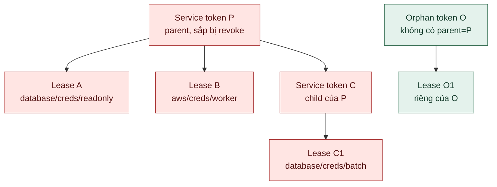
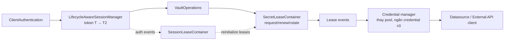
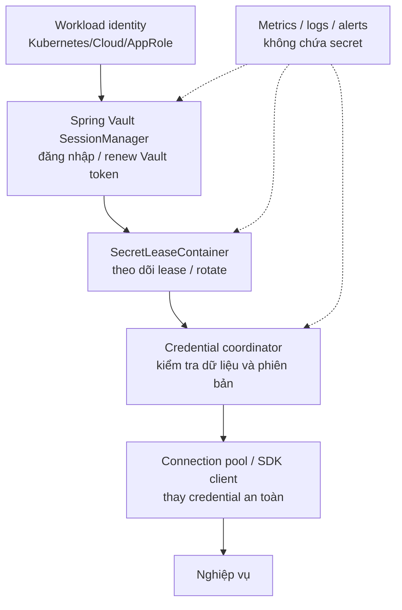

# Tác động của token bị thu hồi đến các lease đã tạo

## 1. Vấn đề: secret vẫn còn TTL nhưng token tạo ra nó đã bị thu hồi

Trong chương **Phiên và vòng đời token**, bài này giải thích quan hệ giữa **Vault token**, **lease của secret động** và hiệu ứng dây chuyền khi một token bị thu hồi (*revoked*) hoặc hết hạn. Đây là kiến thức cốt lõi khi ứng dụng Java dùng **Spring Vault** và `VaultTemplate` / `VaultOperations` để truy cập **HashiCorp Vault** bằng Kubernetes, cloud IAM, AppRole hoặc các phương thức xác thực workload khác.

Xét tình huống: ứng dụng `reporting-api` nhận Vault token có TTL 20 phút, sau đó đọc từ Vault Database secrets engine một tài khoản PostgreSQL động có lease TTL 60 phút. Sau 5 phút, đội vận hành thu hồi Vault token vì nghi ngờ rò rỉ.

**Điều gì xảy ra với tài khoản PostgreSQL vừa được phát hành?** Với **service token thông thường**, Vault gắn lease của secret động với token tạo ra nó. Khi token bị thu hồi, Vault cũng thực hiện thu hồi các lease liên quan, **kể cả khi TTL hiển thị trên lease vẫn còn**. Secret không được "bảo đảm sống đủ 60 phút" bất chấp trạng thái token. Đây chính là tác dụng bảo mật của quan hệ sở hữu token–lease.

Bài học giúp bạn:

1. Đọc đúng quan hệ token, child token, lease ID, TTL và cơ chế cascade revocation.
2. Phân biệt hậu quả với **dynamic database/AWS credentials**, KV v2, Transit và chứng thư PKI.
3. Hiểu vì sao **đăng nhập lại Spring Vault chỉ lấy token mới**; credential đã bị revoke không tự trở lại hiệu lực.
4. Thiết kế gia hạn phiên, quản lý lease, xoay vòng connection pool, giám sát và kiểm thử tích hợp.
5. Nhận biết ngoại lệ quan trọng của **orphan token**, **batch token** và thao tác revocation không thành công ở hệ thống đích.

## 2. Ba vòng đời khác nhau: token, lease và tài nguyên bên ngoài

### 2.1. Vault token

Vault token là thông tin xác thực cho phép client gửi yêu cầu tới Vault theo **policies**, với TTL, giới hạn thời gian sống và khả năng renew tùy loại token/role. Spring Vault nhận token thông qua `ClientAuthentication` và sử dụng nó trong `SessionManager` để gọi API.

Token có thể mất hiệu lực do:

- TTL kết thúc hoặc đạt giới hạn tối đa (*max TTL*), không còn khả năng renew.
- Người vận hành hoặc client gọi endpoint/CLI thu hồi token.
- Token cha bị thu hồi, kéo theo các child tokens bình thường.
- Token bị thu hồi trong phản ứng sự cố hoặc khi hủy một session/workload.

### 2.2. Lease của secret động

Khi client dùng token đọc một **secret động** (ví dụ `database/creds/reporting-readonly`), Vault phát hành credential và một **lease ID** có TTL, cờ `renewable` và quan hệ với token đã yêu cầu nó. Lease xác định thời điểm Vault có thể gia hạn hoặc thu hồi credential này; các thao tác quản lý lease đi qua `sys/leases` và những endpoint/CLI tương ứng.

Ví dụ hình dạng phản hồi (mọi giá trị là giả):

```json
{
  "lease_id": "database/creds/reporting-readonly/example-lease-id",
  "lease_duration": 3600,
  "renewable": true,
  "data": {
    "username": "v-reporting-example",
    "password": "<REDACTED>"
  }
}
```

`lease_id` là định danh để quản lý lease, **không phải Vault token**; `lease_duration` được tính bằng giây và `renewable=true` chỉ báo khả năng thử gia hạn theo chính sách backend. Giá trị TTL không đồng nghĩa với cam kết credential sẽ tồn tại bất kể token có bị revoke hay không.

### 2.3. Tài nguyên tại hệ thống đích

Vault Database secrets engine có thể tạo một user trong PostgreSQL; AWS secrets engine có thể tạo access key trong AWS. Những tài nguyên này nằm **ngoài Vault**. Khi Vault revoke lease, backend/plugin sẽ cố thực thi thao tác xóa hoặc vô hiệu hóa credential tương ứng tại hệ thống đích.

Do vậy phải phân biệt:

| Thực thể | Nơi quản lý | Điều gì xảy ra khi bị thu hồi? |
|---|---|---|
| Vault token | Vault token store / expiration manager | Token không còn dùng được để gọi Vault; thường trả lỗi token không hợp lệ hoặc `permission denied` |
| Dynamic-secret lease | Vault expiration/lease manager | Không thể tiếp tục renew; Vault gọi quy trình revoke của secrets engine |
| Credential thật ở PostgreSQL/AWS/... | Hệ thống đích, với Vault backend/plugin làm cầu nối | Có thể bị drop/disable/revoke; tốc độ và mức thành công phụ thuộc backend và hệ thống đích |
| Bản sao credential trong bộ nhớ Java | JVM/application | **Không tự biến mất**: phải xóa cache/thay cấu hình, chặn kết nối mới và xử lý session đang mở |

Vault chủ động quản lý quyền sử dụng và vòng đời của secret; nó không thể xóa mọi bản sao đã bị client sao chép sang log, cấu hình hay bộ nhớ, và không thể bảo đảm toàn bộ hệ thống bên ngoài hoàn tất thu hồi tức thì khi backend gặp lỗi.

## 3. Quy tắc trung tâm: token bị revoke sẽ kéo theo các lease liên quan

### 3.1. Service token và cây token

Với **service token** thông thường, các lease của secret động được theo dõi cùng token đã tạo ra chúng. Thu hồi token sẽ khởi động revocation các lease đó. Nếu token có **child tokens** bình thường, thu hồi token cha còn thu hồi các child tokens và lease của chúng. Đây là cơ chế ngăn một client tạo vô hạn token con để trốn việc bị thu hồi.



Khi revoke token P theo chế độ thông thường, **P, A, B, C và C1** thuộc phạm vi ảnh hưởng. **O/O1 không chịu ảnh hưởng chỉ vì P bị revoke** nếu O thực sự là orphan token độc lập và lease không thuộc cây P. Trong môi trường thực tế còn có các quan hệ token/lease khác; khi điều tra sự cố phải xác minh token nào tạo ra lease nào, tránh suy đoán chỉ từ tên ứng dụng.

Các thao tác thường gặp:

| Thao tác | Tác động điển hình |
|---|---|
| `vault token revoke <token>` | Revoke token đó và cây child tokens bình thường; cascade đến các lease liên quan |
| `vault token revoke -self` | Thu hồi token mà phiên CLI hiện tại đang dùng; gây cascade tương tự |
| `vault token revoke -accessor <accessor>` | Revoke token theo accessor có quyền tương ứng; không cần biết token value |
| `vault token revoke -mode=orphan <token>` | Revoke token đích nhưng biến các child tokens trực tiếp thành orphan để chúng tiếp tục tồn tại; lease thuộc chính token đích vẫn bị xử lý |
| `vault lease revoke <lease_id>` | Revoke **lease được chỉ định**, không mặc nhiên revoke Vault token sở hữu |
| `vault lease revoke -prefix database/creds/` | Revoke nhiều lease theo prefix, có thể tác động đến nhiều token/workloads; cần quyền vận hành và phạm vi chính xác |

**Lưu ý quan trọng:** `-mode=orphan` là thao tác vận hành đặc biệt, không phải cách mặc định để giữ credential của một app sống sau khi thu hồi token bị lộ. Orphan tokens có cây và vòng đời riêng; tổ chức phải cân nhắc việc mất liên kết revocation với token cha.

### 3.2. Batch tokens cần được hiểu riêng

Vault có **service token** và **batch token**. Batch token nhẹ hơn và có giới hạn tính năng: không tạo child tokens, không tự renew như service token và không có token accessor thông thường. Lease secret động do batch token tạo ra được ràng buộc theo **TTL còn lại của batch token**; khi batch token không phải orphan, lease được theo dõi bởi **parent**. Vì vậy:

- Revoke parent của batch token không-orphan sẽ khiến batch token không còn dùng được và ảnh hưởng lease theo cơ chế parent.
- Không nên áp một cách cơ học mã giả "revoke batch token theo accessor rồi duyệt lease của chính nó": batch token không có cùng khả năng revoke/accessor như service token.
- Nếu dùng orphan batch token, cần xét TTL và cơ chế theo dõi lease đặc thù, không suy luận quan hệ cha/con giống service token.

Trong ứng dụng Spring Vault cần quản lý session và dynamic credentials dài hạn, nên xác định **token type thực sự** do auth role cấp, thay vì cho rằng mọi token đều renewable và có quan hệ lease y hệt nhau.

## 4. Mốc thời gian: TTL của lease chưa hết vẫn có thể mất credential

Giả định Vault và backend hoạt động bình thường:

| Thời điểm | Sự kiện | Trạng thái |
|---|---|---|
| 10:00 | `reporting-api` login bằng workload identity, được token T (TTL 20 phút) | T hợp lệ |
| 10:02 | Dùng T đọc `database/creds/reporting-readonly`, nhận lease L (TTL 60 phút) | T hợp lệ; L hợp lệ; PostgreSQL user được cấp |
| 10:05 | Token T bị revoke do sự cố | T mất hiệu lực; Vault khởi động revoke lease L |
| Sau 10:05 | Database plugin thực thi revocation statements | Credential có thể bị vô hiệu hóa **trước 11:02**, dù TTL L lúc cấp là 60 phút |
| 10:06 | `reporting-api` login lại, nhận token T2 | T2 cho phép đọc secret mới nếu policy còn hợp lệ; **không hồi sinh L** |
| 10:07 | App xin credential L2 mới, cập nhật connection pool | Chỉ connection/credential mới đã kiểm chứng được dùng cho request mới |

```mermaid
sequenceDiagram
    participant App as Java application
    participant Vault as HashiCorp Vault
    participant DB as PostgreSQL
    participant Ops as Operator

    App->>Vault: Login → token T
    App->>Vault: Read database/creds/reporting-readonly (T)
    Vault->>DB: Tạo user động
    DB-->>Vault: User/password
    Vault-->>App: Credential + lease L (TTL 60m)
    Note over App: Pool giữ credential cũ
    Ops->>Vault: Revoke token T sau 3 phút
    Vault->>Vault: T vô hiệu; L bị chọn để revoke
    Vault->>DB: Revoke/delete user theo plugin
    Note over DB: Có thể mất thời gian / gặp lỗi
    App->>Vault: Dùng T cũ → invalid token / 403
    App->>Vault: Re-login bằng workload identity → T2
    App->>Vault: Xin dynamic secret mới → L2
    App->>DB: Chuyển pool sang credential mới
```

Không có bảo đảm rằng sự kiện thu hồi trên Vault và việc tất cả phiên kết nối database hiện hữu bị cắt diễn ra **đồng bộ tại đúng một mili giây**. Plugin thực hiện các statement do backend và cấu hình quyết định; một số DB có thể để session đang mở tiếp tục hoạt động, hoặc một lần revoke có thể thất bại vì mất kết nối. Khi xây dựng quy trình xử lý sự cố, phải kiểm tra trực tiếp trạng thái tài khoản, kết nối và lease thực tế.

## 5. Những lease và secret nào bị ảnh hưởng?

Không phải mọi thứ Vault trả về đều là secret có **dynamic lease** theo cùng nghĩa.

| Loại dữ liệu / Vault engine | Có lease động gắn với token phát hành? | Khi token đọc/gọi API bị revoke |
|---|---|---|
| **Database dynamic credentials** (`database/creds/...`) | **Có**: credential sinh động có lease ID và TTL | Lease bị revoke; Vault cố drop/disable user/password trong DB; connection pool phải thay |
| **AWS dynamic access keys** (`aws/creds/...`) | **Có** theo secrets engine và loại credential | Vault yêu cầu AWS revoke/delete credential; app phải thay key, đánh giá độ trễ và lỗi API |
| **KV v1/KV v2** (dữ liệu lưu trữ tĩnh, versioned KV) | **Không** tạo dynamic lease để revoke dữ liệu lưu trữ | Token mất quyền gọi Vault; giá trị KV vẫn tồn tại, bản sao đã đọc vẫn nằm ở client cho tới khi bị thay/xóa |
| **Transit encrypt/decrypt/sign** | Thao tác mật mã, **không** phát hành dynamic-secret lease cho ciphertext | Token cũ không gọi tiếp được Transit; ciphertext đã tạo không tự bị xóa/giải mã ngược; khóa Transit không tự bị hủy |
| **PKI certificate issuance** | Chứng thư PKI **thường không gắn lease theo cách này**; cơ chế certificate/TTL riêng | Revoke token **không tự động đồng nghĩa** revoke chứng thư đã phát hành; cần kiểm tra serial, CRL/OCSP hoặc `pki/revoke` tùy thiết kế |
| **Static database credentials** qua static role | Không đồng nhất với một dynamic DB user có lease phát hành per request | Việc thay/rotate credential phụ thuộc static role và lịch rotation; không suy từ quy tắc dynamic lease |

Với **KV**, có API hoặc response hiển thị trường giống `lease_duration` trong một số tình huống, nhưng Vault KV backend **không cấp dynamic lease** để bạn dùng `vault lease revoke` xóa một phiên bản secret. Không trộn lẫn `KV version`, `delete/destroy` và `lease revocation`.

Với **PKI**, phải phân biệt việc phát hành certificate, thời hạn X.509 `notAfter` và trạng thái CRL/OCSP. Quy trình revoke Vault token ngăn gọi API cấp chứng thư mới bằng token đó, còn certificate đã đưa sang một workload khác có thể tiếp tục được chấp nhận cho tới khi hết hạn hoặc bị revoke theo chính sách PKI. Đây là lý do tài liệu Spring Vault dùng `CertificateContainer` để theo dõi cấp lại/rotation certificate thay vì mặc định coi certificate như lease database.

**Kết luận thiết kế:** Không dùng một chức năng `invalidateAllSecretsWhenTokenRevoked()` chung cho tất cả engines. Cần biết loại tài nguyên và cơ chế revoke thật của từng engine.

## 6. Renew token không phải renew secret lease

Vault token và dynamic-secret lease có **hai TTL, hai khả năng renew và hai giới hạn tối đa**. Một token còn sống không đủ để khẳng định lease cũng còn sống; ngược lại, lease vừa được renew không thể "cứu" token cha đã bị thu hồi.

Ví dụ:

```text
Token T       : ttl=20m, renewable=true, max_ttl=2h
Secret lease L: ttl=30m, renewable=true, max_ttl=1h

10:00  token T login
10:02  lease L được tạo
10:15  renew token T   -> chỉ kéo dài hiệu lực T nếu được Vault cho phép
10:20  renew lease L  -> chỉ kéo dài hiệu lực L nếu được backend cho phép
10:25  revoke token T -> Vault bắt đầu revoke L dù vừa renew tại 10:20
```

Khi gọi API renew lease với `increment`, con số được yêu cầu là **thời gian còn lại kể từ hiện tại**, và Vault/backend có thể áp dụng ngưỡng ngắn hơn; luôn đọc TTL thực tế sau renew. Cơ chế renew token chịu quy tắc tương tự về policy, token type và max TTL nhưng là một thao tác khác.

Những suy luận sai thường gặp:

- "**Lease TTL 60 phút nên chắc chắn tồn tại 60 phút**": sai nếu token bị revoke sớm hoặc backend thực hiện revoke theo chính sách khác.
- "**Token đã renew nên lease cũng tự renew**": sai; cần chính sách và cơ chế quản lý lease riêng.
- "**Ứng dụng login lại thì user DB cũ lại dùng được**": sai; cần yêu cầu dynamic credentials mới.
- "**Đã nhận HTTP 200 từ Vault khi revoke thì mọi DB sessions chắc chắn bị hủy ngay**": không luôn đúng; phải kiểm tra trạng thái revoke ở hệ thống đích.
- "**Khởi động lại service sẽ tự phục hồi connection pool**": chỉ đúng nếu initialization, credential refresh và pool replacement được triển khai đầy đủ.

## 7. Spring Vault: quản lý phiên và quản lý secret lease là hai cơ chế phối hợp

### 7.1. Session/token lifecycle

Trong Spring Vault, `ClientAuthentication` đăng nhập để lấy Vault token. `LifecycleAwareSessionManager` có thể tự **renew token** và, khi không thể renew do terminal TTL, thực hiện **login mới** theo luồng hỗ trợ. Nó sử dụng token hiện hành khi `VaultTemplate` / `VaultOperations` gọi Vault. Điều này giúp giảm việc tự login trên từng request.

Tuy nhiên, **nhận được token T2 không làm lease L do token T phát hành trở lại hiệu lực**. Nếu trước đó service giữ username/password của dynamic DB credential, ứng dụng phải phối hợp đổi credential cùng tài nguyên đang sử dụng (datasource/pool, HTTP client, AWS client, v.v.).

Ngoài ra, với `LifecycleAwareSessionManager`, hành vi **revoke token khi shutdown** phụ thuộc loại token và cách authentication cung cấp token: các login-based `LoginToken` dạng service có thể được revoke, trong khi một token tĩnh được inject qua `TokenAuthentication` không có cùng ngữ nghĩa tự revoke. Vì vậy không nên khẳng định tất cả token Spring Vault đều bị revoke trong shutdown.

### 7.2. `SecretLeaseContainer` và `SessionLeaseContainer`

Spring Vault có `SecretLeaseContainer` để yêu cầu secret, theo dõi lease và lên lịch **renew/rotate**; `RequestedSecret` có hai kiểu chính:

| Kiểu | Hành vi kỳ vọng | Tình huống |
|---|---|---|
| `RequestedSecret.renewable(path)` hoặc `requestRenewableSecret(path)` | Renew lease hợp lệ cho tới khi không thể tiếp tục | Secret có thể giữ một credential trong khoảng thời gian cần thiết |
| `RequestedSecret.rotating(path)` hoặc `requestRotatingSecret(path)` | Renew khi còn có thể, và lấy credential/lease mới sau chu kỳ hết hạn phù hợp | Dynamic DB credentials cần được thay định kỳ |

Các sự kiện có ích bao gồm `SecretLeaseCreatedEvent`, `AfterSecretLeaseRenewedEvent`, `SecretLeaseRotatedEvent`, `SecretLeaseExpiredEvent`, `AfterSecretLeaseRevocationEvent` và `SecretLeaseErrorEvent`. Đăng ký listeners **trước khi container bắt đầu**, nếu không có thể bỏ lỡ sự kiện cấp secret ban đầu.

Trong các phiên bản Spring Vault có `SessionLeaseContainer`, cơ chế này có `AuthenticationListener` và `AuthenticationErrorListener` để liên kết các thay đổi phiên với secret lifecycle. Khi re-login thành công, có thể khởi động lại việc lấy dynamic secret của **phiên mới**. Kiểm tra cách nối listener với `SessionManager` trong phiên bản đang sử dụng; việc gắn listener không thay thế bước cập nhật pool/consumer trong ứng dụng.



**Quan trọng về độ trễ phát hiện:** Vault **không push một sự kiện revocation** trực tiếp tới mỗi JVM đang sử dụng lease. `SecretLeaseContainer` phát hiện thay đổi qua lịch TTL, renew, rotate và phản hồi của Vault; sự kiện `SecretLeaseExpiredEvent` có thể tới sau khi credential thực đã không còn dùng được. Khi cần đáp ứng nhanh với thu hồi cưỡng chế, application phải xử lý lỗi từ database/API, cho phép ngăn dùng credential cũ và có cơ chế chủ động làm mới.

### 7.3. Ví dụ Java quản lý lease trong một ứng dụng

Đoạn sau minh họa việc đăng ký dynamic secret và nhận sự kiện trong **Spring Vault**. Nó chưa phải implementation đầy đủ của connection-pool rotation; phần đó là trách nhiệm của ứng dụng.

```java
import org.springframework.scheduling.TaskScheduler;
import org.springframework.vault.core.VaultOperations;
import org.springframework.vault.core.lease.SecretLeaseContainer;
import org.springframework.vault.core.lease.domain.RequestedSecret;
import org.springframework.vault.core.lease.event.LeaseListenerAdapter;
import org.springframework.vault.core.lease.event.SecretLeaseCreatedEvent;
import org.springframework.vault.core.lease.event.SecretLeaseEvent;
import org.springframework.vault.core.lease.event.SecretLeaseExpiredEvent;

public final class DatabaseLeaseCoordinator {

    public static SecretLeaseContainer create(
            VaultOperations vaultOperations, TaskScheduler scheduler) {

        SecretLeaseContainer container =
                new SecretLeaseContainer(vaultOperations, scheduler);

        RequestedSecret requested = container.requestRotatingSecret(
                "database/creds/reporting-readonly");

        container.addLeaseListener(new LeaseListenerAdapter() {
            @Override
            public void onLeaseEvent(SecretLeaseEvent event) {
                if (!requested.equals(event.getSource())) {
                    return;
                }
                if (event instanceof SecretLeaseExpiredEvent) {
                    // Chặn cấp connection mới từ credential cũ,
                    // báo unhealthy nếu chưa có credential thay thế.
                } else if (event instanceof SecretLeaseCreatedEvent) {
                    // Trích xuất credential từ sự kiện theo API của
                    // phiên bản đang dùng; kiểm tra schema và xoay pool.
                }
            }
        });

        // Với Spring container thực tế, thường để framework
        // quản lý initialization/start/destroy và listener thứ tự.
        return container;
    }
}
```

Nếu `SecretLeaseContainer` được khai báo bean do Spring quản lý, hãy xác minh lifecycle thực tế (initialize/start/destroy) và tránh tạo thêm container chạy song song khi auto-configuration đã cung cấp sẵn. `AbstractVaultConfiguration` hoặc **Spring Cloud Vault** có thể tích hợp nhiều phần quản lý này tùy phiên bản và cách cấu hình.

Khi code nhận một credential mới, việc chỉ gọi `dataSource.setUsername(...)` chưa chắc đã thay được credentials mà **các connections đang hoạt động** sử dụng. Cần quy trình tạo/rotate pool có kiểm soát: chặn checkout credential cũ, thiết lập cấu hình mới, khởi tạo connections mới, chuyển lưu lượng và đóng/drain pool cũ theo đặc tính DB driver. Lưu ý những transaction đang mở và chính sách timeout/retry.

## 8. Tình huống mất kết nối: Vault đã revoke nhưng JVM chưa biết

Giả sử Vault token T bị operator revoke ở phía Vault, còn ứng dụng `orders-api` vẫn đang giữ credential dynamic DB trong RAM.

1. **Token T không còn được Vault chấp nhận.** Request mới tới Vault dùng T có thể trả `403` kèm `invalid token` hoặc `permission denied`. Nếu `SessionManager` có cơ chế re-login thì app có thể lấy T2.
2. **Lease L của DB user thuộc T bị thu hồi.** Vault bắt đầu chạy revocation logic của Database secrets engine; không cần chờ đến hết TTL trước đó.
3. **JVM chưa tự xóa password cũ.** Cache nội bộ và connection pool có thể tiếp tục dùng credential đã mất hiệu lực.
4. **New DB connections có thể thất bại.** Nếu database user đã bị drop/disabled, việc bắt đầu kết nối mới có thể lỗi authentication; một số connections đã mở có thể tiếp tục tùy database và revocation statements.
5. **Cần phối hợp khôi phục.** App phải nhận biết lỗi thuộc credential/lease, lấy credential mới với token T2, cập nhật pool rồi xác minh traffic đã phục hồi.

Lỗi login Vault và lỗi login PostgreSQL là **hai tín hiệu khác nhau**. Đừng chỉ retry Vault token và tuyên bố khắc phục xong khi ứng dụng vẫn đang dùng DB user bị revoke. Ngược lại, không tự động coi mọi lỗi PostgreSQL là token bị revoke vì DB outage, network và lỗi schema cũng có thể tạo triệu chứng tương tự.

Khi một request nghiệp vụ đang xử lý dở, cần chính sách riêng cho retry để tránh **lặp giao dịch** hoặc mất tính idempotency. Chỉ retry các thao tác có thể lặp an toàn hoặc có idempotency key/transaction boundary đúng.

## 9. Thực hành an toàn trong môi trường thử nghiệm

Mục tiêu lab là quan sát **token revoke → lease mất hiệu lực** mà không làm ảnh hưởng credentials production. Giả định người vận hành đã chuẩn bị Vault thử nghiệm, Database secrets engine ở mount `database`, role `reporting-readonly` và policy `demo-db-read` cho phép đọc riêng `database/creds/reporting-readonly`.

**Bước 1 — tạo service token tạm cho lab.** Trong shell có Vault CLI và đăng nhập bằng một token quản trị thử nghiệm:

```bash
# Dùng shell/session thử nghiệm an toàn, không bật shell tracing (set -x).
APP_TOKEN="$(vault token create \
  -policy=demo-db-read -ttl=10m -field=token)"
```

**Bước 2 — lấy một lease bằng token thử nghiệm.** Ví dụ cần `jq`; chỉ in lease ID, tránh in username/password:

```bash
LEASE_ID="$(VAULT_TOKEN="$APP_TOKEN" \
  vault read -format=json database/creds/reporting-readonly \
  | jq -r '.lease_id')"
```

Đây là `lease_id` của **dynamic secret**, không phải token ID. Chỉ thực hiện trong sandbox đã cấp quyền theo policy. Nếu backend hoặc role chưa được chuẩn bị, không tự động bật Database secrets engine trong môi trường thật chỉ để chạy ví dụ.

**Bước 3 — thu hồi token T.**

```bash
VAULT_TOKEN="$APP_TOKEN" vault token revoke -self
unset APP_TOKEN
```

**Bước 4 — xác minh bằng quyền vận hành của lab.**

```bash
# Dùng token của người vận hành thử nghiệm có quyền lookup leases.
vault lease lookup "$LEASE_ID"
```

Nếu lease đã bị xóa thành công, lookup sẽ báo không tìm thấy lease/không thể lookup; nếu còn trạng thái thất bại, cần kiểm tra Vault expiration/revocation diagnostics và database. Không giả định kết quả duy nhất dựa trên dòng `Success! Revoked token`. Đối chiếu trạng thái user thực tế trong database bằng tài khoản quản trị thử nghiệm; không in credential plaintext.

**Bước 5 — so sánh với trường hợp chỉ revoke lease:** Tạo lease L2 bằng token mới, chạy `vault lease revoke "$LEASE_ID_2"` với quyền vận hành. Kiểm tra rằng token tạo L2 vẫn có thể gọi các endpoint được policy cho phép; chỉ lease được chỉ định bị thu hồi. Dọn dẹp token/lease thử nghiệm sau khi hoàn thành.

### Những kết quả cần ghi nhận

| Trường hợp | Dự kiến quan sát |
|---|---|
| Revoke service token sở hữu lease | Token bị từ chối; lease động liên quan bị Vault xử lý revoke |
| Revoke riêng lease | Credential bị xử lý revoke; token sở hữu không mặc nhiên bị thu hồi |
| Re-login sau khi token cũ revoke | Có Vault token mới, nhưng lease/DB user cũ không tự phục hồi |
| Đọc KV v2 rồi revoke token | KV vẫn ở Vault; ứng dụng chỉ mất quyền đọc mới bằng token cũ |
| PKI cấp chứng thư rồi revoke token | Chứng thư đã cấp cần kiểm tra theo PKI certificate lifecycle, không suy rằng đã bị revoke |

## 10. Thiết kế ứng dụng resilient trước cascade revocation

Một hệ thống dùng dynamic credentials cần lập kế hoạch từ lúc **credential cấp mới** đến khi **phiên sở hữu bị thu hồi**, không chỉ xử lý 403 từ Vault.

### 10.1. Tách các trách nhiệm



| Thành phần | Trách nhiệm | Không nên đảm nhận |
|---|---|---|
| `ClientAuthentication` | Chứng minh workload identity, lấy Vault token | Cấp database username/password cho mọi use case |
| `SessionManager` | Theo dõi và sử dụng Vault token hợp lệ, renew/re-login | Tự thay mọi connection đã dùng DB credentials cũ |
| `SecretLeaseContainer` / lease coordinator | Theo dõi lease và tín hiệu renew/expire/rotate | Bảo đảm 100% các kết nối DB bên ngoài đã bị cắt |
| Credential/pool manager | Đưa credential mới vào consumer, dừng credential cũ, kiểm tra readiness | Log plaintext hoặc tự mở rộng quyền Vault |
| Vault policy và backend | Giới hạn quyền, tạo/revoke dynamic credentials | Điều khiển cache cục bộ JVM một cách tự động |

### 10.2. Chính sách xử lý sự kiện

- **Authentication failed:** Phân biệt workload identity mất quyền, token đã revoke, lỗi network hoặc chính sách; retry có giới hạn với backoff/jitter. Không dùng fallback root token hoặc credential hardcode.
- **Token được re-login:** Đánh dấu credential gắn với session trước là **cần xác minh/lấy lại**; đừng trả về cache dynamic-secret cũ nếu không còn chắc chắn hợp lệ.
- **Lease renew failed / expired:** Chặn cung cấp credential cũ cho kết nối mới, kích hoạt refresh/rotate có kiểm soát, phản ánh readiness của thành phần phụ thuộc.
- **Credential mới được cấp:** Validate schema, dùng pool/client mới, xác nhận kết nối thành công rồi mới chuyển traffic nếu kiến trúc cho phép.
- **Backend revocation fail:** Cảnh báo riêng cho đội vận hành, theo dõi irrevocable leases và trạng thái hệ thống đích; không báo "credential đã vô hiệu hóa thành công" chỉ vì token bị revoke.
- **Ứng dụng shutdown:** Xác định ai sở hữu token và lease, tránh nhiều instance cùng revoke credential dùng chung; với dynamic credentials per instance, shutdown có thể dẫn đến thu hồi token/lease như thiết kế.

Không bắt mọi lỗi vào `catch (Exception)` rồi liên tục xin secret mới. Một vòng lặp re-login/recreate-credential không giới hạn khi Vault gặp sự cố sẽ làm tăng tải Vault và có thể tạo rất nhiều DB users.

### 10.3. Token ngắn và lease dài: đánh đổi cần thiết kế

Không chọn token TTL 5 phút chỉ vì "càng ngắn càng tốt" khi ứng dụng sử dụng dynamic DB lease cần duy trì lâu. Một token quá ngắn, nếu liên tục chạm terminal TTL và phải re-login, có thể làm churn credentials, tái tạo nhiều pool và tăng xác suất gián đoạn.

Điều đó **không có nghĩa** phải cấp token thời hạn dài vô hạn. Thay vào đó:

1. Sử dụng workload authentication và Vault role có thể renew theo chính sách bảo mật.
2. Chọn token period/TTL/max TTL theo mô hình rủi ro và giới hạn hệ thống; hiểu rằng renewability không loại bỏ giới hạn tối đa.
3. Giữ secret lease TTL phù hợp với thời gian chuyển đổi credential và lịch refresh; phân biệt max lease TTL với token max TTL.
4. Kiểm thử tình huống **token bị thu hồi giữa chu kỳ**, ngay cả khi TTL còn nhiều.
5. Đảm bảo re-login và secret rotation không tạo khoảng trống quá dài cho request đang phục vụ.

## 11. Quan sát và xử lý sự cố

### Những tín hiệu nên theo dõi

| Tín hiệu | Câu hỏi vận hành |
|---|---|
| Vault login success/fail, renew/re-login count | Token có bị revoke, hết hạn hoặc không thể renew? |
| `invalid token`/`permission denied` theo use case | Lỗi authentication hay policy bị từ chối? |
| Lease created/renewed/expired/revoked/rotated | Có credential mới được cấp? Chu kỳ renew có bị gián đoạn? |
| Lease error/irrevocable lease | Vault có thực sự revoke được secret ở backend không? |
| DB authentication failures / connection pool rebuilds | JVM còn dùng credential đã bị thu hồi không? |
| Credential age, last successful refresh, pool generation | Ứng dụng đã chuyển hoàn toàn sang credential mới chưa? |
| Readiness và thời gian khôi phục sau revoke | Việc thu hồi có gây dừng dịch vụ kéo dài không? |

Không ghi **token value**, `SecretID`, password, signed JWT, private key hoặc toàn bộ response của Vault vào logs và trace. Lease ID, token accessor và đường dẫn engine cũng có thể cung cấp thông tin nội bộ; giới hạn quyền xem và cân nhắc che/băm có chủ đích trong telemetry. Chỉ dùng metric labels hữu hạn như `service=reporting-api`, `engine=database`, `result=revoked`; tránh đặt định danh có cardinality cao vào labels.

Khi Vault trả **403**, đọc thông điệp và ngữ cảnh an toàn: `invalid token` có thể phản ánh token đã mất hiệu lực; `permission denied` cũng có thể chỉ là policy không đủ quyền. Không coi mọi 403 là token bị revoke rồi thử re-login mãi. Cần đối chiếu token lookup (qua quyền được cấp), audit events, phiên đang dùng và policies có hiệu lực.

Trong sự cố revoke tại backend, HashiCorp Vault có khái niệm **irrevocable lease** khi không thể hoàn tất revoke; cần kiểm tra logs/metrics/CLI và xử lý ở hệ thống đích theo runbook được ủy quyền. Không dùng `-force` hoặc revoke hàng loạt thiếu cân nhắc chỉ để làm hết cảnh báo, vì có thể che giấu việc tài nguyên thực vẫn còn hiệu lực.

## 12. Kiểm thử tích hợp theo kịch bản

Unit test của Java adapter với mock `VaultOperations` chỉ xác nhận xử lý dữ liệu. Để chứng minh **token revoke làm ảnh hưởng lease**, phải kiểm thử với Vault và một backend có hỗ trợ dynamic credentials trong môi trường độc lập, ví dụ Vault thử nghiệm + PostgreSQL test.

### Bộ kịch bản

1. **Happy path:** Login bằng workload identity, lấy lease L, dùng credential DB kiểm tra truy cập được, sau đó renew theo policy nếu được hỗ trợ.
2. **Revoke token trước lease TTL:** Tạo L với TTL còn dài, revoke token T, xác nhận request Vault bằng T bị từ chối; chờ/kiểm tra kết quả xử lý L và database user. Không chỉ assert HTTP revoke success.
3. **Re-login:** Login thành T2; xác nhận T2 không làm L cũ sống lại; lấy lease L2 mới rồi thay connection pool thành công.
4. **Revoke riêng lease:** Revoke L2, xác nhận token T2 vẫn hợp lệ nếu không có nguyên nhân khác; credential L2 mất hiệu lực theo backend.
5. **Token parent/child:** Tạo child token có lease riêng, revoke parent; xác nhận child/lease bị ảnh hưởng. Với orphan scenario, xác nhận cây token thực sự được tách trước khi suy kết quả.
6. **Lease revocation thất bại:** Cô lập DB/network theo test design; theo dõi Vault error/irrevocable lease, readiness và quy trình manual cleanup, không làm trên production.
7. **KV và PKI ngoại lệ:** Đọc một KV value hoặc cấp chứng thư test rồi revoke token; xác minh KV value vẫn tồn tại và chứng thư cần quản lý theo vòng đời PKI.
8. **Nhiều replicas:** Revoke một token theo instance; xác nhận ứng dụng đó thay credential đúng cách, các instances độc lập không vô tình dùng chung token/lease hoặc bị kéo vào cùng cây token.

Với Spring Vault, cần kiểm tra listener lifecycle chạy đúng trình tự, nhận token change/re-login và credential rotation. Dùng môi trường test có TTL ngắn để chạy nhanh nhưng vẫn phải mô phỏng **revoke chủ động khi TTL chưa hết**, vì đây mới là điểm chính của bài.

### Tiêu chí PASS rõ ràng

- Token cũ không còn được Vault chấp nhận sau revoke.
- Lease L tương ứng được xử lý revoke; nếu thất bại có tín hiệu vận hành rõ ràng.
- Credential đã revoke không được dùng cho **kết nối mới**; connection pool được thay hoặc use case chuyển sang trạng thái lỗi an toàn.
- Token/session mới nhận secret mới; không tái sử dụng lease cũ.
- Không có plaintext secret, Vault token hay credential trong output của unit/integration test.

## 13. Bài tập vận dụng

**Tình huống A — Token hết hạn giữa phiên xử lý.** Một `invoice-service` tạo PostgreSQL dynamic credential L với TTL 45 phút bằng Vault token T có terminal TTL còn 7 phút. App chỉ renew lease L, không xử lý re-login. Hãy vẽ timeline và giải thích:

1. Điều gì xảy ra khi T chạm terminal TTL?
2. Vì sao lệnh renew lease L trước đó không bảo đảm L tồn tại thêm 45 phút?
3. `SessionManager` và `SecretLeaseContainer` cần phối hợp ra sao để tạo credential mới an toàn?

**Tình huống B — Thu hồi token vì rò rỉ.** Đội bảo mật revoke token của `payment-api`. Ứng dụng đã lấy một AWS access key động và một key cấu hình KV v2. Hãy chỉ ra tài nguyên nào Vault có thể revoke bằng lease, tài nguyên nào vẫn được lưu, client phải thay credential nào và vì sao không thể chỉ xóa cache Java rồi tuyên bố AWS key đã bị vô hiệu hóa.

**Tình huống C — Parent token và orphan.** Một dịch vụ điều phối cấp child service tokens cho ba Jobs; mỗi Job tạo một DB lease. Hãy so sánh kết quả khi revoke parent theo chế độ mặc định và theo `-mode=orphan`. Phân tích lợi ích và rủi ro khi tiếp tục để các child tokens hoạt động.

**Tình huống D — Chứng thư PKI.** Một client lấy chứng thư X.509 từ Vault PKI rồi bị revoke Vault login token. Hãy giải thích tại sao không thể dựa vào token revocation để kết luận chứng thư đã bị peer từ chối; nêu cách kiểm chứng serial/revocation status theo PKI.

Một phương án đúng phải tách rõ **khả năng gọi Vault bằng token**, **lease cấp dynamic credential**, **trạng thái credential tại hệ thống đích** và **bản sao credential đã nằm trong ứng dụng**.

## 14. Tài liệu tham khảo chính thức

- [HashiCorp Vault — Tokens](https://developer.hashicorp.com/vault/docs/concepts/tokens): token hierarchy, orphan, service/batch token, TTL và việc revoke lease khi token hết hạn.
- [HashiCorp Vault — Lease, Renew, and Revoke](https://developer.hashicorp.com/vault/docs/concepts/lease): lease ID, thời gian sống, renew, revoke, KV không cấp dynamic lease.
- [HashiCorp Vault — token revoke CLI](https://developer.hashicorp.com/vault/docs/commands/token/revoke): revoke token, accessor và `-mode=orphan`.
- [HashiCorp Vault — lease CLI](https://developer.hashicorp.com/vault/docs/commands/lease): lookup/renew/revoke lease.
- [HashiCorp Vault — Database dynamic credential leases tutorial](https://developer.hashicorp.com/vault/tutorials/db-credentials/manage-dynamic-leases): tác động revoke tới user ở database.
- [HashiCorp Vault — Troubleshoot irrevocable leases](https://developer.hashicorp.com/vault/tutorials/monitoring/troubleshoot-irrevocable-leases): trường hợp revoke backend không thành công.
- [Spring Vault — Authentication Methods, Token Lifecycle](https://docs.spring.io/spring-vault/reference/vault/authentication.html): `LifecycleAwareSessionManager`, session renewal/re-login.
- [Spring Vault — Credentials Rotation](https://docs.spring.io/spring-vault/reference/vault/credential-rotation.html): `SecretLeaseContainer`, `SessionLeaseContainer`, listener events, PKI certificate lifecycle.
- [Spring Vault — SecretLeaseContainer Javadoc](https://docs.spring.io/spring-vault/reference/api/java/org/springframework/vault/core/lease/SecretLeaseContainer.html): quản lý renewable/rotating lease và lifecycle.
- [HashiCorp Vault — PKI considerations](https://developer.hashicorp.com/vault/docs/secrets/pki/considerations): chứng thư và hành vi revoke khác lease thông thường.
