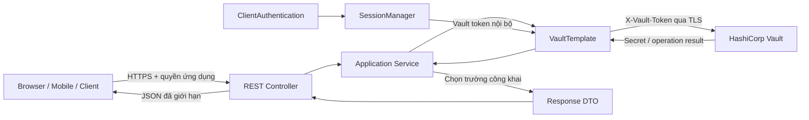
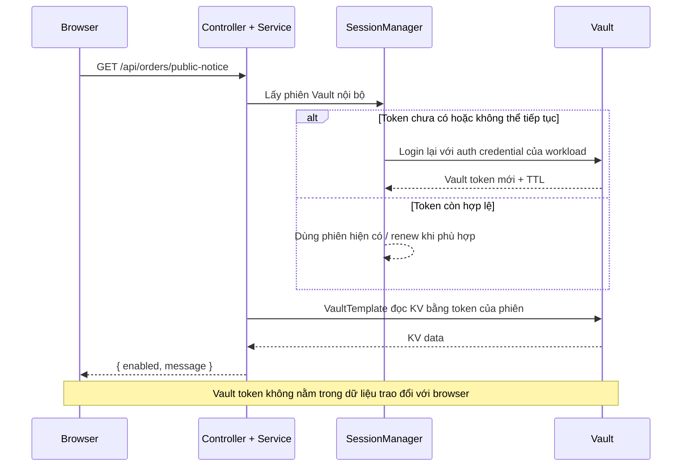

# Giữ thông tin token ngoài dữ liệu trả về cho người dùng

## 1. Mục tiêu và bối cảnh

Trong module **SPRING_VAULT**, ứng dụng Java dùng Spring Vault và `VaultTemplate` để truy cập HashiCorp Vault: đọc KV secrets, mã hóa qua Transit, sử dụng PKI hoặc tương tác với các secrets engine khác. Dù xác thực theo Kubernetes/JWT, AppRole, userpass hay cơ chế workload identity, sau đăng nhập ứng dụng thường nhận một **Vault token** để gọi Vault theo policy được cấp.

Bài thuộc chương **Phiên và vòng đời token** tập trung vào ranh giới bảo mật: **Vault token là thông tin nội bộ của backend, không phải dữ liệu nghiệp vụ cần trả cho người sử dụng ứng dụng**. Một endpoint HTTP có thể chỉ cần trả trạng thái chức năng, kết quả xử lý hoặc thông báo. Việc vô tình trả `auth.client_token`, `X-Vault-Token`, token accessor, metadata của phiên hay toàn bộ đối tượng Vault là nguy cơ lộ quyền truy cập Vault.

Sau bài học, bạn có thể:

1. Xác định thông tin phiên/token của Vault phải được giữ ở đâu trong ứng dụng Java.
2. Tách **xác thực với Vault** khỏi **xác thực người dùng gọi API của ứng dụng**.
3. Thiết kế DTO theo danh sách trường được phép để response không vô tình chứa token và các metadata nhạy cảm.
4. Xử lý thông báo lỗi, logging, HTTP header, tracing, monitoring mà không làm lộ credential.
5. Dùng `VaultTemplate`/`SessionManager` theo đúng vai trò trong vòng đời token, kể cả khi renew hoặc re-login.
6. Viết kiểm thử tích hợp kiểm tra **toàn bộ HTTP response thực tế**, thay vì chỉ nhìn dữ liệu giao diện hiển thị.
7. Ứng phó khi đã có token bị lộ và phân biệt việc thu hồi token với xoay vòng secret.

> **Nguyên tắc xuyên suốt:** Mọi token có khả năng gọi Vault phải được xem như credential. Chỉ đưa ra ngoài ranh giới tin cậy những trường dữ liệu đã được phê duyệt cho từng API. Kể cả endpoint dành cho admin cũng không mặc nhiên được trả Vault token của ứng dụng.

## 2. Phân loại dữ liệu: điều gì không được xuất hiện trong API response?

Một lần đăng nhập Vault có thể trả response giống ví dụ **giả lập** sau:

```json
{
  "auth": {
    "client_token": "<VAULT_TOKEN_REDACTED>",
    "accessor": "<TOKEN_ACCESSOR_REDACTED>",
    "policies": ["default", "orders-read"],
    "lease_duration": 1800,
    "renewable": true,
    "token_type": "service"
  }
}
```

Trong thực tế, token lookup còn có thể có `id`, `entity_id`, `creation_time`, `expire_time`, `path` và metadata liên quan đến danh tính. Một số secrets engine trả `lease_id`, `lease_duration` hoặc private keys/credentials riêng.

| Dữ liệu | Đặc điểm | Có nên trả cho người dùng API? |
| --- | --- | --- |
| `auth.client_token`, `X-Vault-Token`, giá trị `VaultToken` | **Bearer credential** có thể được dùng để gọi Vault | **Không**; tuyệt đối không đưa qua JSON, header, cookie, URL hay lỗi |
| `token_accessor`/`auth.accessor` | Định danh tham chiếu đến token; có thể dùng với API quản trị lookup/revoke theo quyền | **Không**; chỉ để hệ thống quản trị/audit có thẩm quyền xử lý |
| `auth.policies`, `entity_id`, `token_type`, `auth.metadata` | Thông tin định danh, quyền và cấu trúc xác thực nội bộ | Không đưa vào response nghiệp vụ thông thường |
| `auth.lease_duration`, `renewable`, `expire_time` | Thông tin vòng đời phiên Vault | Chỉ nên xuất ra telemetry nội bộ dạng đã chọn lọc, không trả mặc định |
| `lease_id` từ dynamic secret | Định danh lease của credential/secret động | Không xuất cho người dùng nghiệp vụ; quản lý trong lớp lease nội bộ |
| Giá trị KV secret, private key PKI, Transit key material | Bí mật nghiệp vụ hoặc khóa | Không trả trừ khi API có **nghiệp vụ cấp phát cụ thể**, đã được phê duyệt và bảo vệ |
| `request_id` của Vault | Định danh tương quan request, không tự nó là bearer token | Hạn chế lộ; ưu tiên dùng correlation ID riêng của ứng dụng |
| Trạng thái đơn hàng, thông báo hoặc feature flag được phép công bố | Dữ liệu nghiệp vụ đã xác thực quyền và kiểm tra độ nhạy cảm | Có, qua DTO đã định nghĩa |

**Token accessor không phải token để truy cập secret trực tiếp**, nhưng vẫn là metadata quản trị quan trọng: với quyền phù hợp, nó có thể được dùng trong các thao tác lookup/revoke. Do đó không đưa accessor vào response công khai hoặc log tùy tiện.

Một trường hợp khác là **response wrapping token** của Vault: đây cũng là một credential có thể dùng để unwrap dữ liệu theo chính sách và TTL. Nếu ứng dụng thiết kế quy trình giao secret bằng response wrapping, đó phải là một API riêng với threat model và quyền được duyệt. Không được vô tình trả wrapping token vì serialize nguyên response Vault.

### Đừng nhầm ba loại token

- **Vault token:** backend dùng để gọi HashiCorp Vault. Đây là đối tượng cần bảo vệ trong bài học.
- **Access token/JWT của người dùng ứng dụng:** có thể được trình duyệt hoặc mobile client gửi đến chính API của bạn. Quy tắc phát hành/trả token này thuộc hệ thống authentication của ứng dụng và cần chính sách riêng.
- **Token/JWT đầu vào để login Vault:** ví dụ Kubernetes ServiceAccount JWT hoặc AppRole `secret_id`; cũng phải giữ trong môi trường backend đáng tin cậy.

Dù chuỗi nào có tên là `token`, không được lấy `VaultToken` do backend dùng rồi gửi cho frontend để frontend tự gọi Vault. Điều đó phá vỡ ranh giới giữa ứng dụng và hệ thống quản lý bí mật.

## 3. Ranh giới kiến trúc: Vault là dịch vụ nội bộ của backend



Đây là hai vòng xác thực độc lập:

1. **Client → ứng dụng:** Spring Security hoặc cơ chế tương ứng xác thực người gọi, kiểm tra quyền thực hiện nghiệp vụ.
2. **Ứng dụng → Vault:** Spring Vault xác thực ứng dụng/workload và lấy Vault token. Token được `SessionManager` quản lý để `VaultTemplate` sử dụng.

`SessionManager` là interface do Spring Vault cung cấp để quản lý phiên Vault. `LifecycleAwareSessionManager` có thể gia hạn token và xử lý vòng đời phù hợp; `AbstractVaultConfiguration` thường thiết lập session manager có nhận biết lifecycle. Ứng dụng nghiệp vụ chỉ cần gọi API cấp cao của `VaultTemplate`, không cần lấy token ra từ session manager để tự đặt vào response.

Hai cách dùng cần phân biệt:

| Cách làm | Hệ quả |
| --- | --- |
| `VaultTemplate` đọc secret, service trích dữ liệu cần thiết và tạo DTO | Giữ ranh giới rõ ràng giữa dữ liệu nội bộ và dữ liệu trả client |
| Controller trả trực tiếp `VaultResponse`, `Map` gốc, auth response hoặc `VaultToken` | Có thể làm lộ metadata, dữ liệu bí mật hoặc thêm trường nhạy cảm khi backend thay đổi |
| Service trả `SessionManager.getSessionToken()` cho frontend | Frontend có thể sở hữu credential backend, xâm phạm nguyên tắc phân quyền |
| Controller tự gọi Vault HTTP endpoint rồi chuyển tiếp toàn bộ body và headers | Nguy cơ chuyển tiếp `auth`, `lease_id`, `client_token`, `X-Vault-*` và thông báo lỗi nội bộ |

**Không có lớp frontend nào có thể “ẩn” dữ liệu đã đến trình duyệt.** Nếu browser Network tab nhận JSON chứa token, việc không render field đó lên giao diện không giúp token được bảo vệ.

## 4. Mẫu response sai và đúng

Giả sử ứng dụng có endpoint `GET /api/orders/public-notice` để hiển thị thông báo bảo trì, trong khi KV v2 chứa đồng thời thông báo công khai và cấu hình nội bộ.

Dữ liệu nội bộ giả lập đọc từ Vault:

```json
{
  "enabled": true,
  "publicMessage": "Dịch vụ thanh toán bảo trì lúc 22:00",
  "paymentApiKey": "DEMO_SECRET_DO_NOT_EXPOSE",
  "privateCallbackUrl": "https://internal.example.invalid/callback"
}
```

### Không nên: chuyển nguyên dữ liệu Vault ra response

```java
@GetMapping("/api/orders/public-notice")
public VaultResponse unsafe(VaultTemplate vaultTemplate) {
    return vaultTemplate
            .opsForKeyValue("kv", KeyValueBackend.KV_2)
            .get("apps/orders-notice");
}
```

Đoạn ví dụ trên minh họa **lỗi thiết kế**, không nên sử dụng trong production. Nó trả toàn bộ `VaultResponse`, bao gồm secret data có cả `paymentApiKey` và bất kỳ field mới nào được thêm sau này. Kể cả khi response này **không chứa Vault token** theo mặc định, việc trả nguyên dữ liệu vẫn làm lộ secret của ứng dụng. Nếu code tương tự được dùng với response từ endpoint đăng nhập hoặc token lookup, nguy cơ còn nghiêm trọng hơn vì xuất hiện dữ liệu xác thực.

Cũng không nên dùng:

```java
// Ví dụ phản diện: tuyệt đối không trả token của Vault session.
@GetMapping("/api/debug/vault-token")
public String unsafeToken(SessionManager sessionManager) {
    return sessionManager.getSessionToken().getToken();
}
```

Không tạo endpoint debug như trên ở môi trường chạy thực tế. `VaultToken.getToken()` trả giá trị bearer token; người gọi nhận được nó có thể dùng trực tiếp với Vault theo quyền của token.

### Nên: định nghĩa response có các trường được phép

HTTP response mong đợi:

```json
{
  "enabled": true,
  "message": "Dịch vụ thanh toán bảo trì lúc 22:00"
}
```

Response này chỉ chứa hai thuộc tính cần hiển thị. Tên trường nội bộ, khóa API, session token, Vault policy và token TTL không xuất hiện. Cách triển khai DTO cho phép code review kiểm tra chính xác những gì được phép ra ngoài.

## 5. Cài đặt với `VaultTemplate` và DTO an toàn

Ví dụ dưới đây dùng **Java 17+**, Spring Boot và Spring Vault. Giả sử `VaultTemplate` đã được cấu hình xác thực workload (Kubernetes/JWT, AppRole hoặc cách phù hợp), backend KV v2 được mount tại `kv`, path `apps/orders-notice` tồn tại.

### 5.1. Policy Vault tối thiểu cho workload

```hcl
path "kv/data/apps/orders-notice" {
  capabilities = ["read"]
}
```

Policy này cho ứng dụng đọc đúng secret cần thiết. Nó không cho phép liệt kê toàn bộ Vault, quản lý token hoặc thay đổi dữ liệu. Nếu ứng dụng sử dụng Transit/PKI, cấp thêm quyền theo **endpoint nghiệp vụ cụ thể** thay vì gán policy quản trị rộng.

### 5.2. Chỉ định DTO công khai

```java
package example.orders.api;

// Response riêng dành cho HTTP client. Không có trường token, policy hay secret.
public record PublicNoticeResponse(
        boolean enabled,
        String message
) {}
```

Không khai báo `Map<String, Object>` hoặc `VaultResponse` làm public response type khi định nghĩa contract có thể biết trước. Record ở đây cố định danh sách field; thêm một trường mới đòi hỏi thay đổi code có chủ đích.

### 5.3. Service đọc KV và chọn trường

```java
package example.orders.service;

import java.util.Map;

import example.orders.api.PublicNoticeResponse;
import org.springframework.stereotype.Service;
import org.springframework.vault.core.VaultKeyValueOperations;
import org.springframework.vault.core.VaultKeyValueOperationsSupport.KeyValueBackend;
import org.springframework.vault.core.VaultOperations;
import org.springframework.vault.support.VaultResponse;

@Service
public class PublicNoticeService {

    private final VaultKeyValueOperations kv;

    public PublicNoticeService(VaultOperations vaultOperations) {
        // "kv" là mount KV v2; Spring Vault tự xây endpoint /data/...
        this.kv = vaultOperations.opsForKeyValue("kv", KeyValueBackend.KV_2);
    }

    public PublicNoticeResponse getCurrentNotice() {
        VaultResponse response = kv.get("apps/orders-notice");

        if (response == null || response.getData() == null) {
            throw new NoticeUnavailableException();
        }

        Map<String, Object> data = response.getData();
        Object enabled = data.get("enabled");
        Object publicMessage = data.get("publicMessage");

        if (!(enabled instanceof Boolean) || !(publicMessage instanceof String)) {
            throw new NoticeUnavailableException();
        }

        // Chỉ hai trường này được đi qua ranh giới API.
        return new PublicNoticeResponse((Boolean) enabled, (String) publicMessage);
    }
}
```

Định nghĩa exception nghiệp vụ tối giản:

```java
package example.orders.service;

public final class NoticeUnavailableException extends RuntimeException {
    public NoticeUnavailableException() {
        super("Public notice cannot be loaded");
    }
}
```

Service không gọi `getSessionToken()` hoặc đọc `auth.client_token`. `VaultOperations` được Spring Vault cấp cùng cấu hình session, và token chỉ được framework sử dụng cho request gửi đến Vault. Ngay cả khi secret chứa thêm field `paymentApiKey`, service **không đưa field đó vào DTO**.

Trong dự án có Spring Cloud Vault, cần bảo đảm bean `VaultOperations`/`VaultTemplate` đang dùng cùng cấu hình auth/session dự kiến. Không tự khởi tạo một `VaultTemplate` mới bằng token cố định, không lưu token vào đối tượng trả HTTP.

### 5.4. Controller chỉ trả DTO

```java
package example.orders.api;

import example.orders.service.PublicNoticeService;
import org.springframework.web.bind.annotation.GetMapping;
import org.springframework.web.bind.annotation.RequestMapping;
import org.springframework.web.bind.annotation.RestController;

@RestController
@RequestMapping("/api/orders")
public class PublicNoticeController {

    private final PublicNoticeService noticeService;

    public PublicNoticeController(PublicNoticeService noticeService) {
        this.noticeService = noticeService;
    }

    @GetMapping("/public-notice")
    public PublicNoticeResponse currentNotice() {
        return noticeService.getCurrentNotice();
    }
}
```

Tầng controller không biết tên Vault auth role, token, token accessor hay TTL. Nó chỉ biết contract dữ liệu nghiệp vụ. Đây là một cách thiết kế giúp giảm khả năng lộ token khi thay đổi cơ chế xác thực Vault trong tương lai.

Một DTO an toàn **không thay thế** xác thực và phân quyền ở API: endpoint nào dành cho khách hàng, quản trị viên hoặc người dùng nội bộ vẫn cần Spring Security/authorization riêng. Nếu dữ liệu từ Vault là một secret được phép cấp cho một client cụ thể, phải có thiết kế API cấp phát với kiểm soát quyền, thời hạn và audit; không thể xem việc trả secret là hành vi mặc định của DTO.

## 6. Không để token đi qua hệ thống log, lỗi và HTTP headers

Bảo vệ JSON response là bước cần thiết nhưng chưa đủ. Token có thể bị lộ qua nhiều đường khác:

| Điểm thoát dữ liệu | Sai sót thường thấy | Cách bảo vệ |
| --- | --- | --- |
| JSON response | Trả `VaultResponse`, `auth` hoặc serialize object chứa token | DTO danh sách trường cho phép; test raw response |
| Header HTTP | Sao chép toàn bộ Vault upstream headers ra downstream, gồm `X-Vault-Token` | Chỉ trả response header được định nghĩa; không forward header auth nội bộ |
| Cookie | Đặt Vault token làm session cookie cho browser | Dùng session/token của **ứng dụng**, Vault session chỉ ở backend |
| Query string/redirect URL | Đưa token vào `?token=...`, `Location` hoặc callback URL | Không gắn token vào URL; URL dễ bị lưu trong history và access logs |
| Exception message | Trả `exception.getMessage()` hoặc `toString()` từ Vault client | Dùng error code và thông điệp tĩnh; chi tiết được kiểm soát ở kênh nội bộ |
| Application logs | Log full request, response, auth headers, exception hoặc `VaultToken` | Redaction, structured logging với field allowlist, hạn chế mức DEBUG/TRACE |
| APM/tracing | Thu thập tự động request/response bodies, headers, URL | Loại `Authorization`, `X-Vault-Token`, `client_token` và secret fields |
| Metrics | Dùng token hoặc accessor làm label | Dùng số đếm, kết quả, loại auth/mount đã phân loại; tuyệt đối không dùng credential làm nhãn |
| Actuator/diagnostics | Expose `/env`, `/configprops`, heapdump, thread dump | Giới hạn endpoint, quyền, network và chính sách hiển thị giá trị |
| Crash dump/heap dump | Credential trong bộ nhớ vô tình nằm trong file chẩn đoán | Giới hạn quyền thu thập, nơi lưu và vòng đời file; kiểm soát truy cập nghiêm ngặt |

Dù Vault audit device thường HMAC các giá trị chuỗi nhạy cảm, **application log của Java không mặc nhiên nhận được lớp bảo vệ đó**. Không suy ra rằng log `VaultResponse` hay body HTTP của ứng dụng sẽ được Vault tự che đi.

### Ví dụ log cần tránh

```java
// SAI: log trực tiếp token và có thể làm lộ credential.
// logger.info("Vault token={}", sessionManager.getSessionToken().getToken());

// SAI: log raw response có thể chứa dữ liệu xác thực hoặc secret.
// logger.debug("Vault response={}", response);

// NÊN: chỉ ghi thông tin nghiệp vụ không nhạy cảm.
logger.info("Vault operation={}, result={}", "read-public-notice", "success");
```

Ngay cả log chỉ chứa `accessor` cũng cần thiết kế theo thẩm quyền vận hành, vì accessor có thể hỗ trợ các thao tác quản trị token. Không ghi accessor đầy đủ chỉ để “không ghi token gốc”.

## 7. Xử lý lỗi an toàn trong Spring Boot

Đây là một rủi ro thường bị bỏ sót:

```java
// SAI: có thể phát tán thông điệp và chi tiết hệ thống nội bộ.
return ResponseEntity.status(500)
        .body(Map.of("error", vaultException.getMessage()));
```

Một số exception mang theo đường dẫn nội bộ, metadata hoặc dữ liệu từ response upstream. Không được giả định mọi exception trong Spring Vault luôn an toàn để trả trực tiếp. Cần định nghĩa error contract đơn giản, không chứa token, password, private key hay thông điệp lỗi thô.

### Error handler minh họa

```java
package example.orders.api;

import example.orders.service.NoticeUnavailableException;
import org.springframework.http.HttpStatus;
import org.springframework.http.ResponseEntity;
import org.springframework.vault.VaultException;
import org.springframework.web.bind.annotation.ExceptionHandler;
import org.springframework.web.bind.annotation.RestControllerAdvice;

@RestControllerAdvice
public class SafeApiErrorHandler {

    record ApiError(String code, String message) {}

    @ExceptionHandler(NoticeUnavailableException.class)
    public ResponseEntity<ApiError> missingNotice() {
        return ResponseEntity.status(HttpStatus.SERVICE_UNAVAILABLE)
                .body(new ApiError(
                        "NOTICE_UNAVAILABLE",
                        "Tạm thời không tải được thông báo"));
    }

    @ExceptionHandler(VaultException.class)
    public ResponseEntity<ApiError> vaultFailure() {
        return ResponseEntity.status(HttpStatus.SERVICE_UNAVAILABLE)
                .body(new ApiError(
                        "BACKEND_TEMPORARILY_UNAVAILABLE",
                        "Dịch vụ tạm thời không khả dụng"));
    }
}
```

Ví dụ trên dùng cùng HTTP 503 để đơn giản hóa bài học. Trong sản phẩm thực, cần phân loại lỗi **tạm thời** (Vault unavailable, timeout) với lỗi **cấu hình/quyền nội bộ** (policy sai, auth role sai) để chọn mã HTTP, alert và retry phù hợp. Điều quan trọng là **không chuyển nguyên 403/500 hoặc body lỗi từ Vault ra ngoài**, vì người gọi frontend không được tự động nhận thông tin quyền Vault của backend.

Response an toàn:

```json
{
  "code": "BACKEND_TEMPORARILY_UNAVAILABLE",
  "message": "Dịch vụ tạm thời không khả dụng"
}
```

Có thể thêm `requestId` do **ứng dụng** sinh để đối chiếu log; nó không nên là Vault token/accessor. Với lỗi 403 của Vault, hãy kiểm tra log/audit nội bộ để phân biệt ACL và token hết hạn, không phản hồi chi tiết policy hoặc path quản trị cho client.

## 8. Đừng coi `@JsonIgnore` là tuyến phòng thủ duy nhất

Jackson hỗ trợ `@JsonIgnore` và các annotation hạn chế serialize. Tuy nhiên, chỉ dựa vào annotation trong object nội bộ có một số rủi ro:

- Một đồng đội có thể tạo DTO mới rồi quên annotation.
- Trả `Map` hoặc `JsonNode` có thể đi vòng qua annotation gắn trên class ban đầu.
- Object lồng nhau, exception body hoặc response của API khác vẫn có thể xuất hiện token.
- Việc vô tình đổi tên field hay thêm field từ thư viện có thể gây lộ dữ liệu mà không được review.

So sánh:

```java
// Rủi ro: public model chứa cả trường bảo mật rồi che bằng annotation.
class MixedResponse {
    public String notice;
    @com.fasterxml.jackson.annotation.JsonIgnore
    public String vaultToken;
}

// Tốt hơn: contract public không có chỗ chứa token.
record PublicNoticeResponse(boolean enabled, String message) {}
```

Trong thiết kế tốt, **sự tồn tại của token không thuộc mô hình public response ngay từ đầu**. Annotation có thể là biện pháp bổ sung cho những object nội bộ cần serialize ở ngữ cảnh khác, nhưng DTO theo trường được phép vẫn rõ ràng và dễ kiểm thử hơn.

Tương tự, cấu hình toàn cục bỏ field có tên `token` bằng regex không đáng tin cậy: có token với tên field khác và cũng có field nghiệp vụ tên `token` không liên quan đến Vault. Hãy phân loại dữ liệu ở nguồn và định nghĩa contract rõ ràng.

## 9. Vòng đời token vẫn diễn ra hoàn toàn trong backend

Điều quan trọng là **không cần tiết lộ Vault token cho client để token được gia hạn hoặc được thay mới**. Spring Vault có các thành phần:

- `ClientAuthentication`: đăng nhập Vault qua Kubernetes, JWT, AppRole, userpass... và nhận token.
- `SessionManager`: cung cấp token cho các request; `getSessionToken()` là phương thức nội bộ, không phải phương thức xây API response.
- `LifecycleAwareSessionManager`: quản lý token có nhận biết vòng đời, có thể lên lịch renewal khi token renewable và xử lý đăng nhập lại khi token không dùng được theo cấu hình.
- `VaultTemplate`: thực hiện thao tác KV/Transit/PKI bằng session nội bộ; controller chỉ nhận kết quả đã qua business service.



TTL của Vault token là một vấn đề vận hành **giữa ứng dụng và Vault**. Người dùng không cần biết `client_token` hoặc `renewable` để hiển thị thông báo. Nếu yêu cầu “phiên người dùng hết hạn” cần được trả về từ ứng dụng, đó phải là trạng thái của **phiên ứng dụng** do hệ thống authentication phía client quản lý; không được dùng TTL Vault token để suy ra thời hạn đăng nhập của người dùng.

### Các tình huống thay đổi vòng đời

| Tình huống | Xử lý nội bộ | HTTP response cho người dùng |
| --- | --- | --- |
| Vault token còn hiệu lực | `VaultTemplate` tiếp tục dùng session | DTO nghiệp vụ bình thường |
| Token gần hết TTL và renewable | `SessionManager` cố gắng renew theo cơ chế phù hợp | DTO nghiệp vụ nếu operation thành công |
| Token hết hạn/revoke, re-login được | Dùng `ClientAuthentication` đăng nhập lại | DTO nghiệp vụ sau khi phục hồi |
| Re-login thất bại hoặc Vault mất kết nối | Ghi nhận lỗi nội bộ, backoff theo loại lỗi, alert | Mã lỗi ứng dụng an toàn; không tiết lộ credential |
| Một secret lease cần renewal/revoke | Quản lý lease qua cơ chế Vault thích hợp | Chỉ trả trạng thái nghiệp vụ khi được phép |
| Token bị nghi lộ | Thu hồi/rotate/re-login theo incident process | Không bao giờ trả token mới qua response để “khắc phục” |

Không dùng token của một người dùng Vault duy nhất cho tất cả client mà không xác định cách phân quyền từng người dùng. Dù API response không rò token, backend vẫn phải áp dụng **authorization theo người gọi**, tránh một API có thể đọc secret thay mặt backend cho bất kỳ người nào không được phép.

## 10. Logging, Actuator, tracing và hạ tầng phụ trợ

### 10.1. Cấu hình Actuator có giới hạn

Với ứng dụng dùng Spring Boot Actuator, có thể bắt đầu bằng cấu hình minh họa:

```yaml
management:
  endpoints:
    web:
      exposure:
        include: health,info
  endpoint:
    env:
      show-values: never
    configprops:
      show-values: never
```

Cấu hình trên giúp hạn chế endpoint quản trị được public qua web và ẩn giá trị cấu hình nhạy cảm trong các endpoint tương ứng nếu được enable ở kênh khác. Trong production vẫn phải bảo vệ truy cập `health`/`info` theo độ nhạy cảm, cũng như chặn lộ dữ liệu qua heap dump, thread dump, logfile và cơ chế debug khác.

### 10.2. Quy tắc tracing và proxy

Nếu API đi qua gateway, reverse proxy, service mesh hoặc APM:

- Không ghi raw `Authorization`, `X-Vault-Token`, `X-Vault-Wrap-Token`, cookie, password, service account JWT.
- Không tự động capture request/response body chứa secret hoặc auth response Vault.
- Bảo vệ đường kết nối backend ↔ Vault bằng TLS, xác minh CA/hostname.
- Chỉ dùng nhãn metrics dạng `operation=kv_read`, `result=success`, `auth_method=kubernetes`, không dùng chuỗi credential hoặc accessor.
- Đặt cảnh báo dựa trên số lần login/renew/revoke thất bại, lỗi 403, latency và tính sẵn sàng; không cần đưa token vào dashboard.

Vault audit device ghi các sự kiện hoạt động phía Vault và theo mặc định HMAC phần lớn chuỗi nhạy cảm, nhưng chính sách audit vẫn cần bảo vệ quyền truy cập và cấu hình. Log do **Spring Boot, proxy, SDK hoặc APM** thu thập là những hệ thống khác; phải kiểm tra từng nơi.

### 10.3. Tránh tạo tuyến hỗ trợ vô tình làm lộ dữ liệu

Một số cách xử lý sự cố dễ gây hậu quả:

- Tạo `/debug/vault-login` trả nguyên response auth để “xem TTL”.
- Gửi `curl -v` chứa header token vào ticket hỗ trợ.
- In `Map` toàn bộ data khi gặp lỗi parse secret.
- Gắn token vào MDC/correlation ID để nối log.
- Dùng token làm Prometheus label vì dễ tìm kiếm request.
- Sao chép raw Vault HTTP response sang lỗi JSON để frontend tự xử lý.

Để kiểm tra TTL, dùng lookup/renewal telemetry ở hệ thống giám sát **nội bộ** với quyền thích hợp. Ví dụ CLI lab có thể chỉ trích các field không phải credential:

```bash
# Thực hiện trong môi trường lab với token đã được cấp an toàn.
# Không in trường id hoặc accessor, không lưu raw response.
vault token lookup -format=json |
  jq '.data | {ttl, renewable, creation_ttl, expire_time}'
```

Ngay cả giá trị TTL này không nhất thiết nên đưa cho client. API ứng dụng có thể cần một trạng thái khái quát như `available=true` nếu nghiệp vụ yêu cầu; không cần trình bày định danh token hoặc policy.

## 11. Kiểm thử chống rò rỉ token

Không chỉ unit test DTO. Cần kiểm thử tại **ranh giới HTTP**: toàn bộ status, headers, body và response khi có lỗi. Sử dụng Vault dev/Testcontainers hoặc giả lập Vault có kiểm soát, token **giả** để tránh làm lộ credential thật trong test output.

### Ma trận kiểm thử

| Kịch bản | Kỳ vọng |
| --- | --- |
| Đọc KV thành công, dữ liệu có thêm field `paymentApiKey` | HTTP JSON chỉ có `enabled` và `message` |
| Vault auth trả `client_token` và `accessor` giả | Không có giá trị này trong HTTP response của ứng dụng |
| Vault token được renew giữa hai request | Response hợp đồng nghiệp vụ vẫn giống nhau, không thêm metadata TTL |
| Vault token hết hạn và session re-login thành công | Trả DTO bình thường; không lộ token mới |
| Vault trả 403 do policy sai | Client nhận mã lỗi ứng dụng; không có raw Vault error/headers/token |
| Vault timeout/unavailable | Response lỗi đã sanitize, log/trace không có credential |
| Secret không tồn tại | Trả lỗi nghiệp vụ đúng contract, không chuyển nguyên data/metadata Vault |
| Thêm field secret vào KV v2 | Field mới không xuất hiện trong response JSON |
| Truy cập Actuator/log endpoints không được phép | Không thấy config, token, heap/log nhạy cảm |
| Nâng phiên bản Spring Vault/Jackson | Snapshot/schema test vẫn chỉ chấp nhận các field public |

### Ví dụ kiểm tra JSON ở mức HTTP

Khi thực hiện integration test với `MockMvc` hoặc gửi request vào ứng dụng test, hãy kiểm tra **body thực tế**:

```java
import static org.assertj.core.api.Assertions.assertThat;
import static org.springframework.test.web.servlet.request.MockMvcRequestBuilders.get;
import static org.springframework.test.web.servlet.result.MockMvcResultMatchers.status;

import java.util.Set;
import com.fasterxml.jackson.databind.JsonNode;
import com.fasterxml.jackson.databind.ObjectMapper;
import org.junit.jupiter.api.Test;
import org.springframework.beans.factory.annotation.Autowired;
import org.springframework.boot.test.autoconfigure.web.servlet.AutoConfigureMockMvc;
import org.springframework.boot.test.context.SpringBootTest;
import org.springframework.test.web.servlet.MockMvc;

@SpringBootTest
@AutoConfigureMockMvc
class PublicNoticeResponseIT {

    @Autowired MockMvc mockMvc;
    @Autowired ObjectMapper objectMapper;

    @Test
    void publicResponseOnlyHasApprovedFields() throws Exception {
        // Fixture Vault của bài test phải chứa dữ liệu hợp lệ và
        // giá trị giả ở các trường nội bộ như paymentApiKey.
        String json = mockMvc.perform(get("/api/orders/public-notice"))
                .andExpect(status().isOk())
                .andReturn()
                .getResponse()
                .getContentAsString();

        JsonNode payload = objectMapper.readTree(json);
        Set<String> fields = new java.util.HashSet<>();
        payload.fieldNames().forEachRemaining(fields::add);

        assertThat(fields).containsExactlyInAnyOrder("enabled", "message");
        assertThat(json).doesNotContain(
                "DEMO_SECRET_DO_NOT_EXPOSE",
                "client_token",
                "accessor",
                "lease_id",
                "paymentApiKey");
    }
}
```

Mẫu test trên giả định đã có fixture/integration test Vault tách biệt; nó không tự dựng Vault. Với test thật, nên **đưa sentinel giả duy nhất vào dữ liệu nguồn và auth response**, rồi xác minh sentinel không tồn tại trong response body, headers, error response và log được capture. Không coi việc field tên `token` không xuất hiện là đủ: token có thể bị in ra thành giá trị của field `message` hoặc lỗi.

Để kiểm tra HTTP headers, trong test có thể đọc `result.getResponse().getHeaderNames()` và kiểm tra allowlist; cần thử cả `2xx` lẫn `4xx/5xx`. Kiểm thử nên đo việc client thực sự nhận, không chỉ dựa vào annotation `@JsonIgnore` trong domain model.

### Kiểm thử không được gây lộ thật

- Chỉ dùng token test/fake trong fixture; tuyệt đối không commit live Vault token.
- Nếu cần Vault thật cho integration test, dùng instance cô lập, policy tối thiểu, TTL ngắn và cleanup token/lease.
- Với hệ thống log và APM, chạy test bằng sentinel có thể nhận biết để chứng minh redaction hoạt động mà không cần secret thật.
- Không in full HTTP request/response của Vault vào CI artifact hoặc log báo cáo.

## 12. Quy trình xử lý khi phát hiện đã trả nhầm Vault token

Giả sử một phiên bản API đã vô tình trả trường `auth.client_token` cho client. Coi token đó **có thể đã bị sao chép**, kể cả khi ứng dụng frontend chưa hiển thị.

1. **Ngăn lộ thêm:** dừng hoặc sửa endpoint, triển khai response DTO chỉ chứa trường công khai; tắt việc ghi/forward auth response trên đường ra ngoài.
2. **Xác định token và phạm vi quyền:** qua audit và nguồn quản trị đã được bảo vệ, xác minh Vault policy, token type, TTL và các hoạt động dùng token đã phát hành. Không dán token vào báo cáo sự cố.
3. **Thu hồi credential liên quan:** dùng Vault token revoke hoặc cơ chế quản trị theo accessor nếu thẩm quyền cho phép; đánh giá child tokens và dynamic secret leases có thể bị ảnh hưởng.
4. **Thay thế phiên hợp lệ:** cho workload đăng nhập lại bằng cơ chế auth an toàn, bảo đảm ứng dụng vẫn hoạt động và client không bao giờ nhận token mới.
5. **Xử lý dữ liệu phụ trợ:** đánh giá browser cache, proxy, CDN, API logs, traces, APM, screenshots, test artifact và ticket có thể đã lưu token; xóa/giới hạn truy cập theo quy trình tổ chức.
6. **Giám sát sau sự cố:** kiểm tra các yêu cầu Vault bất thường, quyền bị lợi dụng, endpoint đã dùng, khả năng cấp secret/dynamic credentials và độ bao phủ của alert.
7. **Bổ sung kiểm thử:** test sentinel, DTO schema, logging và error path để tránh lặp lại lỗi.

**Chỉ chờ TTL tự hết hạn thường không đủ** nếu token đã có khả năng được sử dụng trái phép trong cửa sổ còn hiệu lực. Đồng thời, revoke Vault token có thể làm mất hiệu lực các lease phụ thuộc và ảnh hưởng workload đang chạy; cần phối hợp với quy trình rotation và khả năng phục hồi ứng dụng.

## 13. Checklist review trước khi phát hành API

| Câu hỏi review | Dấu hiệu đạt |
| --- | --- |
| Controller có trả `VaultResponse`, `VaultToken` hoặc `Map` nội bộ không? | Không; chỉ trả DTO được duyệt |
| Dữ liệu mới trong KV có tự xuất hiện trong response không? | Không; DTO không thay đổi nếu không sửa code |
| Có đoạn nào gọi `getSessionToken().getToken()` để tạo response không? | Không |
| API có forward nguyên auth/error headers từ Vault không? | Không |
| Error handler có trả `Exception.getMessage()` trực tiếp không? | Không; dùng mã lỗi/thông điệp an toàn |
| Logs, traces, metrics có chứa token/accessor/password/secret data không? | Không; capture/redaction đã kiểm tra |
| API người dùng và Vault workload có quyền riêng không? | Có; API authorization và Vault ACL đều áp dụng |
| Renew/re-login có cần client nhận token không? | Không; session manager quản lý nội bộ |
| Integration test có dùng sentinel giả để tìm rò rỉ trong body/headers/error path không? | Có |
| Có quy trình revoke và kiểm tra audit khi token bị lộ không? | Có |

## 14. Tổng kết và bài tập

Các nguyên tắc cần ghi nhớ:

- **Vault token thuộc backend.** `SessionManager` và `VaultTemplate` quản lý việc dùng token, renewal và re-login; HTTP client của ứng dụng không cần biết token.
- Không chuyển nguyên `VaultResponse`, auth response, `VaultToken`, secret Map hoặc raw exception ra frontend.
- Trả dữ liệu bằng **DTO chỉ định trường được phép**. Mô hình public API không nên có field token ngay từ đầu.
- Token có thể rò qua **headers, error bodies, logs, traces, Actuator, heap dumps và CI artifacts** dù JSON thành công đã được bảo vệ.
- Token accessor, metadata phiên và `lease_id` cũng là dữ liệu vận hành nội bộ cần kiểm soát.
- Kiểm thử toàn bộ HTTP response và lỗi với **sentinel giả**; không dùng secret/token thật làm test fixture.
- Khi đã rò credential, phải đánh giá quyền truy cập, revoke/rotate có kiểm soát và xử lý bản sao ở các hệ thống phụ trợ.

**Bài tập thực hành:** Tạo một KV v2 secret thử nghiệm gồm `enabled`, `publicMessage` và một field riêng `paymentApiKey` chứa sentinel giả. Dùng `VaultTemplate` đọc secret; triển khai endpoint `GET /api/orders/public-notice` trả đúng hai trường public. Thử bổ sung vào KV một field tên `auth.client_token` có giá trị giả, xác minh endpoint không đổi. Tạo lỗi 403 hoặc timeout từ Vault dev, kiểm tra error response và captured logs. Sau cùng, giải thích vì sao cả Vault token lẫn trường secret mới không được “tự xuất hiện” trong response khi phát triển tính năng.

## Tài liệu tham khảo

- [Spring Vault — Introduction to VaultTemplate và Session Management](https://docs.spring.io/spring-vault/reference/vault/imperative-template.html)
- [Spring Vault — SessionManager API](https://docs.spring.io/spring-vault/docs/current/api/org/springframework/vault/authentication/SessionManager.html)
- [Spring Vault — LifecycleAwareSessionManager API](https://docs.spring.io/spring-vault/reference/api/java/org/springframework/vault/authentication/LifecycleAwareSessionManager.html)
- [Spring Vault — VaultKeyValueOperations API](https://docs.spring.io/spring-vault/reference/api/java/org/springframework/vault/core/VaultKeyValueOperations.html)
- [HashiCorp Vault — Token auth HTTP API](https://developer.hashicorp.com/vault/api-docs/auth/token)
- [HashiCorp Vault — Tokens and token lifecycle](https://developer.hashicorp.com/vault/docs/concepts/tokens)
- [HashiCorp Vault — Audit devices và bảo vệ dữ liệu nhạy cảm](https://developer.hashicorp.com/vault/docs/audit)
- [OWASP — API Excessive Data Exposure](https://owasp.github.io/www-project-web-security-testing-guide/latest/4-Web_Application_Security_Testing/12-API_Testing/03-Excessive_Data_Exposure)
