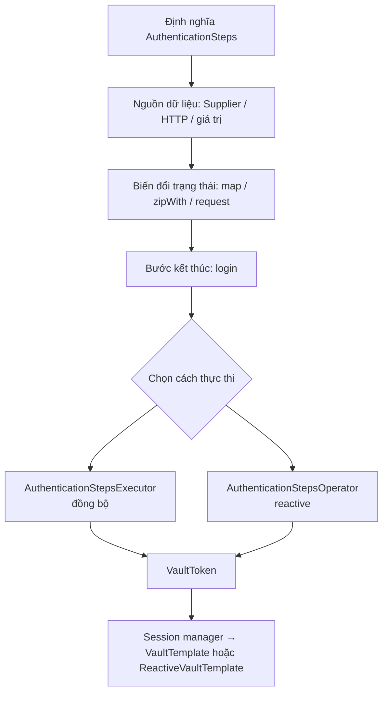
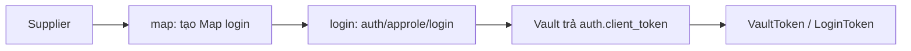
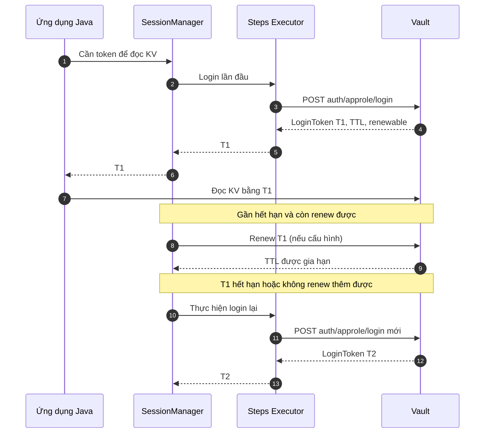

# Mô tả chuỗi xác thực độc lập với cách thực thi

Ứng dụng Java muốn truy cập HashiCorp Vault trước hết phải **lấy được Vault token**. Ví dụ, workload dùng AppRole cần lấy `role_id` và `secret_id`, tạo payload login rồi gửi `POST /v1/auth/approle/login`; workload chạy trên AWS EC2 có thể cần lấy identity document từ metadata service, chuyển đổi dữ liệu rồi đăng nhập tại `auth/aws/login`. Đó là **các bước của quy trình xác thực**. Việc chạy chúng bằng HTTP client đồng bộ hay theo mô hình reactive lại là một quyết định khác.

Trong Spring Vault, `AuthenticationSteps` cho phép **mô tả** các bước xác thực theo kiểu pipeline mà chưa thực hiện ngay các bước đó. Một executor có thể diễn giải pipeline để lấy token. Cùng một mô tả `AuthenticationSteps` có thể được thực thi bởi `AuthenticationStepsExecutor` trong chương trình đồng bộ hoặc `AuthenticationStepsOperator` trong chương trình reactive. Khả năng tách **mô tả quy trình** khỏi **mô hình thực thi** là trọng tâm của bài trong chương **Authentication Steps**.

Mục đích cuối cùng vẫn là một `VaultToken` dùng cho `VaultTemplate`/`VaultOperations` hoặc `ReactiveVaultTemplate`, tuân theo chính sách phân quyền, thời hạn token, cơ chế renew và xử lý lỗi của ứng dụng **SPRING_VAULT**. Chuỗi xác thực không tự cấp quyền đọc KV, mã hóa Transit hay phát hành PKI: quyền đó nằm ở **Vault policies** gắn với token sau khi login thành công.

## 1. Mục tiêu học tập

Sau bài này, bạn có thể:

1. Phân biệt `ClientAuthentication`, `AuthenticationSteps`, `AuthenticationStepsFactory`, các executor và session manager.
2. Mô tả pipeline có **nguồn dữ liệu → biến đổi trạng thái → thao tác login kết thúc** bằng API Spring Vault.
3. Giải thích vì sao `fromSupplier(...)` và HTTP request khai báo trong steps chưa chạy khi vừa dựng pipeline.
4. Dùng cùng `AuthenticationSteps` cho **synchronous** và **reactive** mà không nhân đôi logic tạo payload.
5. Biết khi nào dùng các factory có sẵn cho AppRole, AWS, Kubernetes hoặc Token, khi nào mới cần tự ghép steps.
6. Xác định vị trí xử lý lỗi, bảo mật credential, token TTL, renew/re-login và kiểm thử xác thực.

## 2. Vì sao cần Authentication Steps?

Một đối tượng `ClientAuthentication` truyền thống cung cấp phương thức `login()`, vừa biết **phải làm gì** vừa trực tiếp thực hiện lời gọi xác thực để trả về `VaultToken`.

Ví dụ một triển khai AppRole có thể lần lượt:

1. Đọc role ID và secret ID từ nguồn cung cấp;
2. Ghép JSON `{"role_id":"...","secret_id":"..."}`;
3. Gửi HTTP POST tới endpoint login;
4. Đọc token từ phản hồi Vault.

Cách triển khai gắn với client đồng bộ thuận tiện cho những chương trình chạy đồng bộ. Tuy nhiên khi xây dựng `ReactiveVaultTemplate`, không thể tùy tiện gọi blocking `login()` trên luồng xử lý reactive. Tách phần **khai báo chuỗi công việc** giúp Spring Vault dùng một logic xác thực chung ở nhiều runtime.



Sơ đồ này mô tả **hai đường thực thi có thể chọn**, không có nghĩa ứng dụng phải chạy đồng thời cả hai executor cho một lần login.

### Phân biệt các thành phần

| Thành phần Spring Vault | Trách nhiệm chính | Có trực tiếp thực thi login? |
| --- | --- | --- |
| `AuthenticationSteps` | Giữ **định nghĩa** pipeline xác thực | **Không** khi chỉ tạo đối tượng |
| `AuthenticationSteps.Node<T>` | Nút trung gian đại diện trạng thái kiểu `T` và toán tử tiếp theo | **Không** khi chỉ ghép |
| `AuthenticationStepsFactory` | Cung cấp `getAuthenticationSteps()` cho cơ chế auth cụ thể | Chỉ xây dựng mô tả |
| `AuthenticationStepsExecutor` | Diễn giải steps bằng client HTTP đồng bộ; triển khai `ClientAuthentication` | **Có**, khi gọi `login()` |
| `AuthenticationStepsOperator` | Diễn giải steps theo Reactor, trả `Mono<VaultToken>` | **Có** khi publisher được subscribe |
| `ClientAuthentication` | Contract đồng bộ để nhận token qua `login()` | Tùy implementation; thường có |
| `VaultToken` / `LoginToken` | Giá trị token; `LoginToken` chứa thêm TTL/renewability | Không |
| `SessionManager` | Cấp token cho request Vault; triển khai lifecycle có thể renew/re-login | Dùng cơ chế auth đã cấu hình |

Theo API Spring Vault, `AuthenticationSteps` và các executor đã có từ dòng Spring Vault 2.0. Tên constructor, HTTP client và một số toán tử phụ thuộc phiên bản; ví dụ trong bài ưu tiên API được mô tả rõ ở **Spring Vault 4.1.x** và đánh dấu nơi có khác biệt.

## 3. Một pipeline gồm những phần nào?

`AuthenticationSteps` thường có ba giai đoạn:

**Nguồn (source)** tạo trạng thái ban đầu. Nguồn có thể là giá trị có sẵn, `Supplier<T>` được gọi lúc chạy, hoặc kết quả của một HTTP request.

**Bước trung gian (intermediate steps)** dùng trạng thái hiện tại để biến đổi dữ liệu, ghép nhiều nguồn hoặc gọi thêm HTTP. Mỗi `Node<T>` mang kiểu dữ liệu hiện tại để compiler hỗ trợ kiểm tra kiểu khi tiếp tục ghép.

**Bước kết thúc (terminal step)** chuyển trạng thái thành `VaultToken` hoặc thực hiện login tại endpoint Vault, rồi tạo đối tượng `AuthenticationSteps` hoàn chỉnh.



**Ví dụ trạng thái qua các nút:**

| Nút | Kiểu trạng thái | Dữ liệu mẫu | Chức năng |
| --- | --- | --- | --- |
| Nguồn | `RoleCredentials` | `roleId`, `secretId` | Lấy credential từ môi trường tin cậy |
| `map` | `Map<String, String>` | Hai trường `role_id` và `secret_id` | Chuẩn hóa body theo Vault AppRole API |
| `login` | `VaultToken` | Token được Vault cấp, có TTL/policies | Kết thúc chuỗi xác thực |

Không nên xem các `Node` là trạng thái session lâu dài: **authentication state** chỉ là dữ liệu trung gian để tạo token, thường có thể chứa credential nhạy cảm.

## 4. Ví dụ tối thiểu: một token đã có sẵn

Nếu workload nhận sẵn một Vault token từ cơ chế phân phối an toàn và chỉ cần chuyển token đó cho hệ thống session:

```java
import org.springframework.vault.authentication.AuthenticationSteps;
import org.springframework.vault.support.VaultToken;

VaultToken token = VaultToken.of(existingTokenFromSecureSource);
AuthenticationSteps steps = AuthenticationSteps.just(token);
```

`existingTokenFromSecureSource` là biến do ứng dụng cấp; không viết token thật trong source code. Đây là **pipeline một bước**: không gọi endpoint login ở Vault và không cần tạo payload.

Thao tác `just(VaultToken)` đơn giản khác với việc gọi `POST /auth/.../login`. Token vẫn chịu thời hạn và quyền của chính nó. Nếu ứng dụng cần biết TTL/renewability để quản lý vòng đời, có thể dùng cơ chế **self-lookup** hoặc cấu hình `TokenAuthentication` phù hợp.

Một nguồn khác là `fromValue(value)`, nhưng phương thức này trả **`Node<T>`** để tiếp tục ghép và cần một bước kết thúc; nó không có ý nghĩa tự động login.

## 5. Ví dụ AppRole: mô tả trước, thực thi sau

AppRole giúp máy hoặc workload dùng `role_id` và `secret_id` để lấy Vault token. Bài học dùng AppRole vì dễ nhìn thấy **đúng ba giai đoạn** của pipeline.

Giả sử Vault đã có auth method ở `auth/approle/` và role tương ứng với policy tối thiểu. Yêu cầu login:

```http
POST /v1/auth/approle/login
Content-Type: application/json

{
  "role_id": "<role-id>",
  "secret_id": "<secret-id>"
}
```

### 5.1. Cách mô tả pipeline bằng `fromSupplier`

```java
import java.util.Map;
import java.util.function.Supplier;
import org.springframework.vault.authentication.AuthenticationSteps;

// Hàm này CHỈ xây dựng quy trình, chưa gửi request đến Vault.
static AuthenticationSteps appRoleSteps(
        Supplier<String> roleIdProvider,
        Supplier<String> secretIdProvider) {

    return AuthenticationSteps
            .fromSupplier(() -> Map.of(
                    "role_id", roleIdProvider.get(),
                    "secret_id", secretIdProvider.get()))
            .login("auth/{mount}/login", "approle");
}
```

Các điểm cần đọc chính xác:

1. `fromSupplier(...)` **đăng ký nguồn** `Supplier<Map<String, String>>`. Nội dung lambda sẽ thực thi **khi executor diễn giải steps**, không phải tại thời điểm gọi `appRoleSteps(...)`.
2. `Map.of(...)` tạo đúng body mà endpoint AppRole cần. Những giá trị truyền vào phải khác `null` và được lấy từ nguồn an toàn.
3. `login("auth/{mount}/login", "approle")` là **terminal operation**: Spring Vault dùng map hiện tại để POST vào Vault auth endpoint tương ứng.
4. Giá trị `"approle"` là **mount path của auth method**. Nếu Vault mount AppRole tại `auth/teams/approle/` thì URI đăng nhập phải đổi tương ứng; không mặc định tên role đồng nghĩa với tên mount.
5. Tham số template được xử lý theo quy tắc URL-encoding; không nối trực tiếp dữ liệu chưa tin cậy vào endpoint.

Khi dùng Spring Vault 4.1 trở lên có thể viết ngắn phần kết thúc:

```java
AuthenticationSteps steps = AuthenticationSteps
        .fromSupplier(() -> Map.of(
                "role_id", roleIdProvider.get(),
                "secret_id", secretIdProvider.get()))
        .loginAt("approle"); // Spring Vault 4.1+
```

`loginAt("approle")` suy ra đường dẫn `auth/approle/login`; nếu cần endpoint khác chuẩn, dùng `login(uriTemplate, uriVariables)`.

### 5.2. Viết rõ bước biến đổi `map`

Trong một dự án thực, nguồn credential có thể trả về object khác với HTTP payload:

```java
import java.util.Map;
import org.springframework.vault.authentication.AuthenticationSteps;

record AppRoleCredentials(String roleId, String secretId) {}

AuthenticationSteps steps = AuthenticationSteps
        .fromSupplier(() -> new AppRoleCredentials(
                roleIdProvider.get(),
                secretIdProvider.get()))
        .map(credentials -> Map.of(
                "role_id", credentials.roleId(),
                "secret_id", credentials.secretId()))
        .login("auth/{mount}/login", "approle");
```

Sau `fromSupplier(...)`, state có kiểu `AppRoleCredentials`; sau `map(...)`, state thành `Map<String, String>`. Đây là lợi ích của DSL có kiểu: code chỉ rõ **khi nào dữ liệu được chuyển thành request body**.

`record` yêu cầu Java 16+; với Java cũ hơn, thay bằng class/POJO tương đương. Đoạn code là phần chính của hàm đã có `roleIdProvider` và `secretIdProvider`, không phải một file Java chạy độc lập.

### 5.3. Thực thi đồng bộ

Khi đã có `AuthenticationSteps steps`:

```java
import org.springframework.vault.authentication.AuthenticationStepsExecutor;
import org.springframework.vault.client.VaultClient;
import org.springframework.vault.support.VaultToken;
import org.springframework.web.client.RestClient;

// Spring Vault 4.1+: VaultClient phụ trách HTTP đến Vault.
VaultClient vaultClient =
        VaultClient.create("https://vault.internal.example:8200");

// RestClient dành cho bước HTTP ngoài Vault nếu pipeline có dùng.
RestClient externalClient = RestClient.builder().build();

AuthenticationStepsExecutor executor =
        new AuthenticationStepsExecutor(steps, vaultClient, externalClient);

VaultToken token = executor.login();
// Không ghi token.getToken() ra log.
```

**Chỉ tại `executor.login()` pipeline mới được thực thi**: đọc credential từ supplier, tạo request body, gửi HTTP và lấy token. `AuthenticationStepsExecutor` triển khai `ClientAuthentication` nên có thể dùng thay một implementation `ClientAuthentication` đồng bộ trong cấu hình phù hợp.

Ví dụ `VaultClient.create(...)` minh họa cách truyền URL. Trong production phải cấu hình **TLS trust**, mTLS nếu cần, namespace (nếu sử dụng), timeout, retry có kiểm soát và endpoint chính xác. Không đưa thông tin nhạy cảm vào URL.

**Tương thích phiên bản:** Spring Vault 4.1 có constructor `AuthenticationStepsExecutor(steps, VaultClient, RestClient)`. Trong các bản cũ hơn có constructor với `RestOperations`, nhưng constructor đó đã bị đánh dấu deprecated trong API 4.1; không trộn các đoạn cấu hình từ hai thế hệ client nếu chưa kiểm tra phiên bản.

## 6. Cùng steps trong mô hình reactive

Một lý do thiết kế `AuthenticationSteps` là tái dùng mô tả authentication cho chương trình dùng Reactor và WebFlux.

```java
import org.springframework.vault.authentication.AuthenticationStepsOperator;
import org.springframework.vault.client.ReactiveVaultClient;
import org.springframework.vault.support.VaultToken;
import org.springframework.web.reactive.function.client.WebClient;
import reactor.core.publisher.Mono;

ReactiveVaultClient reactiveVaultClient =
        ReactiveVaultClient.create("https://vault.internal.example:8200");
WebClient externalWebClient = WebClient.builder().build();

AuthenticationStepsOperator operator =
        new AuthenticationStepsOperator(
                steps, reactiveVaultClient, externalWebClient);

Mono<VaultToken> tokenMono = operator.getVaultToken();
// Pipeline được kích hoạt khi subscriber đăng ký vào tokenMono.
```

`AuthenticationStepsOperator` triển khai contract `VaultTokenSupplier`. Nó không phải một `ClientAuthentication` blocking; phương thức `getVaultToken()` trả `Mono<VaultToken>`. Mô hình reactive thực hiện những HTTP request phù hợp bằng `ReactiveVaultClient`/`WebClient` và **hoãn thực thi cho đến khi có subscription**.

Với nguồn `Supplier` thông thường, implementation reactive có cơ chế xử lý để tránh chạy blocking logic trực tiếp trên event loop. Tuy nhiên, điều đó **không biến một supplier bất kỳ thành non-blocking về bản chất**. Nếu nguồn credential là file, metadata endpoint hoặc hệ thống I/O khác, nên dùng abstraction/request thích hợp và đánh giá độ trễ.

**Không** gọi `.block()` hoặc tự `.subscribe()` chỉ để lấy token trong mọi handler WebFlux. Trong ứng dụng thực, token supplier cần được tích hợp với cấu hình `ReactiveSessionManager` hoặc thành phần reactive Vault tương ứng để quản lý token và tránh phát sinh login mới theo từng request nghiệp vụ.

### So sánh một pipeline, hai executor

| Thuộc tính | `AuthenticationStepsExecutor` | `AuthenticationStepsOperator` |
| --- | --- | --- |
| API nhận token | `VaultToken login()` | `Mono<VaultToken> getVaultToken()` |
| Mô hình | Đồng bộ, gọi blocking tại điểm login | Reactive; HTTP non-blocking theo chuỗi Reactor |
| Contract | `ClientAuthentication` | `VaultTokenSupplier` |
| Client Vault | `VaultClient` (4.1) | `ReactiveVaultClient` (4.1) |
| HTTP ngoài Vault | `RestClient` | `WebClient` |
| Phù hợp | `VaultTemplate` và cấu hình đồng bộ | `ReactiveVaultTemplate` và cấu hình reactive |
| Vẫn dùng chung | **Cùng `AuthenticationSteps`** | **Cùng `AuthenticationSteps`** |

Không cần dựng hai bản DSL giống hệt nhau; thay đổi phần executor và session integration theo ứng dụng.

## 7. Các toán tử chính và ý nghĩa của chúng

Đây là các API quan trọng trên `AuthenticationSteps` và `AuthenticationSteps.Node<T>`:

| Nhóm | API | Vai trò |
| --- | --- | --- |
| Nguồn | `just(VaultToken)` | Pipeline đơn giản đã có token |
| Nguồn | `fromValue(value)` | Bắt đầu bằng giá trị có sẵn, trả `Node<T>` |
| Nguồn | `fromSupplier(supplier)` | Lấy dữ liệu khi executor chạy |
| Nguồn | `fromHttpRequest(request)` | Bắt đầu bằng HTTP request, ví dụ metadata bên ngoài Vault |
| Nguồn | `fromVaultRequest(request)` | Bắt đầu bằng request tới Vault |
| Trung gian | `map(function)` | Biến đổi state kiểu `T` sang `R` |
| Trung gian | `request(httpRequest)` | Dùng request để lấy thêm dữ liệu khi flow chạy |
| Trung gian | `zipWith(otherNode)` | Kết hợp hai nguồn thành `Pair<L, R>` |
| Trung gian | `onNext(consumer)` | Thực thi callback khi state đi qua nút |
| Kết thúc | `login(uriTemplate, vars...)` | POST state hiện tại đến endpoint Vault lấy token |
| Kết thúc | `loginAt(authMount)` | POST đến `auth/{mount}/login`, có từ 4.1 |
| Kết thúc | `login(mappingFunction)` | Chuyển state hiện tại thành `VaultToken` bằng function |
| Kết thúc | `login(httpRequest)` | Thực hiện request login được mô tả bởi `HttpRequest<VaultResponse>` |

**Phân biệt nguồn HTTP:**

- `fromHttpRequest(...)` mô tả một yêu cầu HTTP thông thường, ví dụ lấy identity material từ metadata service bên ngoài Vault.
- `fromVaultRequest(...)` mô tả yêu cầu tới Vault.
- Chúng vẫn là **mô tả**; HTTP client phù hợp được executor sử dụng khi chạy.

### Ví dụ xây dựng một HTTP source

```java
import org.springframework.vault.authentication.AuthenticationSteps;
import org.springframework.vault.authentication.AuthenticationSteps.HttpRequestBuilder;

AuthenticationSteps.HttpRequest<String> request =
        HttpRequestBuilder
                .get("https://identity.example.internal/workload-id")
                .as(String.class);

// Mô tả bước GET. Chưa có request mạng tại thời điểm này.
AuthenticationSteps.Node<String> identity =
        AuthenticationSteps.fromHttpRequest(request);
```

Đây chỉ là phần **nguồn** để minh họa `HttpRequestBuilder`; muốn tạo token cần các bước biến đổi phù hợp với auth method cụ thể và một terminal `login(...)`. URL phải đến hệ thống tin cậy và có kiểm soát; không đưa URL lấy trực tiếp từ input của người dùng vào request cấp credential.

`HttpRequestBuilder` có các phương thức như `get(...)`, `post(...)`, `put(...)`, `method(...)`, `with(HttpHeaders)`, `with(HttpEntity)` và `as(Class)`. Builder cho biết **cần request gì và mong nhận kiểu nào**; nó không phải HTTP client tự chạy. Header và body có chứa secret cần được xử lý như credential nhạy cảm.

### Khi nào dùng `zipWith`?

Ví dụ một luồng cần **role ID** từ nguồn A và **secret ID** từ nguồn B, có thể mô tả hai `Node`, ghép bằng `zipWith(...)`, rồi `map(...)` sang JSON body. Kết quả ghép có kiểu `AuthenticationSteps.Pair<L, R>`. Dùng `zipWith` khi thực sự có hai nhánh dữ liệu độc lập; với AppRole đơn giản từ hai nguồn cùng đồng bộ, một `Supplier` trả object chứa cả hai trường thường dễ đọc và kiểm soát hơn.

### Cảnh báo với `onNext`

`onNext(consumer)` dùng callback quan sát state khi luồng chạy. Không dùng nó để in `role_id`, `secret_id`, JWT, Vault token, certificate private key hoặc nội dung phản hồi nhạy cảm. Nếu cần log, chỉ ghi marker sự kiện đã qua bước nào và độ trễ tổng thể; tránh phụ thuộc side effect ở `onNext` để tạo credential.

## 8. Factory có sẵn: tránh phải viết lại mọi flow

Các implementation auth phổ biến của Spring Vault thường triển khai `AuthenticationStepsFactory` hoặc có phương thức tĩnh tạo `AuthenticationSteps`. Ví dụ:

```java
import org.springframework.vault.authentication.AppRoleAuthentication;
import org.springframework.vault.authentication.AppRoleAuthenticationOptions;
import org.springframework.vault.authentication.AuthenticationSteps;

// options phải được cấu hình roleId/secretId và auth mount.
AppRoleAuthenticationOptions options = configuredAppRoleOptions;

AuthenticationSteps steps =
        AppRoleAuthentication.createAuthenticationSteps(options);
```

`configuredAppRoleOptions` là biến từ cấu hình ứng dụng, không phải một API có sẵn. Khi dùng factory này, Spring Vault tự mô tả các bước đặc thù của AppRole mà không cần viết lại việc đọc/unwrap SecretId hoặc cấu trúc request theo các tùy chọn của nó.

Một đối tượng `AppRoleAuthentication` đã được cấu hình cũng có thể cung cấp steps qua `getAuthenticationSteps()`. Các cơ chế như `AwsEc2Authentication`, `AwsIamAuthentication`, `KubernetesAuthentication`, `CubbyholeAuthentication` và `TokenAuthentication` cũng thuộc nhóm hỗ trợ mô tả bước xác thực. **Mỗi cơ chế vẫn có nguồn credential, endpoint và điều kiện bảo mật riêng**.

### Tiêu chí chọn giải pháp

| Nhu cầu | Cách lựa chọn | Lý do |
| --- | --- | --- |
| Dùng Spring Vault đồng bộ và auth method hỗ trợ sẵn | `ClientAuthentication` có sẵn | Ít mã cấu hình, dễ triển khai |
| Dùng reactive nhưng muốn logic AppRole/Kubernetes/AWS như thư viện hỗ trợ | `AuthenticationStepsFactory` + `AuthenticationStepsOperator` | Tái dùng quy trình xác thực sẵn có |
| Xác thực qua nhiều nguồn hoặc cần chuẩn hóa payload trước login | Tự xây dựng `AuthenticationSteps` | Có thể ghép `Supplier`, HTTP và `map` |
| Đã có token cố định | `TokenAuthentication` hoặc `AuthenticationSteps.just(token)` | Không thực hiện request login không cần thiết |
| Workload chạy lâu, cần gia hạn hoặc đổi token | Kết hợp với session manager phù hợp | Steps không tự renew/revoke token |

Mục tiêu không phải thay thế mọi đối tượng `ClientAuthentication` bằng DSL, mà là **tái sử dụng phần mô tả khi cần nhiều mô hình thực thi**.

## 9. Ranh giới bảo mật: mô tả chuỗi không quyết định quyền

Một pipeline đăng nhập AppRole có thể thành công nhưng token mới không có quyền đọc `secret/data/payment/runtime`. Phân quyền Vault dựa vào **policy và role** chứ không dựa vào kiểu executor.

Ví dụ policy cho workload chỉ đọc một secret KV v2:

```hcl
path "secret/data/payment/runtime" {
  capabilities = ["read"]
}
```

Quản trị viên có thể cấu hình role:

```bash
# Minh họa, giả định auth/approle đã được enable và policy đã tồn tại.
vault write auth/approle/role/payment-service \
  token_policies=payment-read \
  token_ttl=30m \
  token_max_ttl=4h
```

Sau khi cấu hình AppRole, ứng dụng nhận `role_id` và `secret_id` qua cơ chế phân phối có kiểm soát. Không gắn các giá trị này vào source code, URL, Git, Docker image hoặc log.

### Chia tách quyền và thông tin

1. **Credential để login** (`role_id`/`secret_id`, JWT, IAM signature, PKCS#7...): chỉ đi trong phần chuẩn bị authentication và request login.
2. **Vault token**: chỉ dùng tại các request được cấp quyền; được session manager quản lý theo TTL.
3. **Vault policy**: áp quyền vào đường dẫn `secret/data/...`, `transit/encrypt/...`, `pki/issue/...` hoặc endpoint cụ thể.
4. **Secret lease**: vòng đời của dynamic secret, không phải một bước bên trong `AuthenticationSteps`.

Không sử dụng `onNext(...)`, exception message hoặc logger HTTP ở mức body để ghi lại state xác thực. Cẩn trọng với retry: một SecretId **use-limit = 1**, JWT hết hạn hoặc wrapping token đã tiêu thụ có thể không hợp lệ ở lần thử sau.

## 10. Định nghĩa và thực thi: những thời điểm dễ nhầm

| Sự kiện | Đã đọc credential? | Đã gửi HTTP login? |
| --- | --- | --- |
| `AuthenticationSteps.fromSupplier(supplier)` | Chưa gọi supplier | Chưa |
| `.map(...)` trong lúc dựng pipeline | Chưa áp dụng function | Chưa |
| `.login("auth/{mount}/login", "approle")` khi ghép chuỗi | Chưa | Chưa |
| `new AuthenticationStepsExecutor(...)` | Chưa vì chỉ tạo executor | Chưa |
| `executor.login()` | Có, nếu flow cần supplier | Có, nếu flow kết thúc bằng login endpoint |
| `operator.getVaultToken()` trả về `Mono` | Thường chưa chạy tới source | Chưa cho tới khi subscription |
| Subscription đến `Mono<VaultToken>` | Có, theo flow | Có, nếu flow yêu cầu request login |

**Ngoại lệ cần hiểu:** `AuthenticationSteps.just(token)` giữ một token đã có, không tạo HTTP login. Và nguồn `fromValue(value)` có thể đã được tính trước khi đưa vào pipeline: **tính toán xảy ra bên ngoài pipeline** không được tự động trì hoãn. Nếu muốn lấy credential mới theo từng lượt login, ưu tiên `fromSupplier(...)` thay vì tạo `fromValue(credentialĐãĐọc)` rồi tái sử dụng mãi.

Một cách sai:

```java
// SecretId chỉ được đọc MỘT lần tại thời điểm build steps.
String staleSecretId = secretIdProvider.get();
AuthenticationSteps steps = AuthenticationSteps
        .fromValue(Map.of("role_id", roleIdProvider.get(),
                          "secret_id", staleSecretId))
        .login("auth/{mount}/login", "approle");
```

Khi cần re-login sau nhiều giờ, `secret_id` này có thể đã bị rotate, hết TTL hoặc hết số lượt dùng. Thay bằng `fromSupplier(...)` để đọc lại nguồn credential **mỗi lần pipeline được diễn giải**; nguồn cung cấp phải chủ động quản lý việc rotate.

## 11. Token lifecycle và session manager

Kết quả của authentication là `VaultToken` hoặc `LoginToken`. `LoginToken` có thể cung cấp thông tin TTL và khả năng renew từ phản hồi Vault. Spring Vault quản lý chúng qua session manager, ví dụ `LifecycleAwareSessionManager` trong cấu hình đồng bộ.



**Steps chỉ nhận token, không tự giám sát TTL.** Cần kết nối executor/operator với session management của Spring Vault; vòng đời token và lịch chạy renew do session manager, role/token policy và cấu hình ứng dụng quyết định.

Khi flow bắt đầu từ một token có sẵn (token authentication), `VaultToken` có thể chưa chứa TTL/renewability. Spring Vault có cơ chế lookup token để biết thêm metadata khi cần. Với token login do Vault trả về, `LoginToken` thường mang thông tin này.

Nếu re-login sử dụng credential có giới hạn lượt dùng, cần thiết kế cơ chế cấp lại `secret_id`/JWT/wrapping token. Pipeline có thể chạy lại, nhưng **không thể tự khiến credential đã hết hạn trở nên hợp lệ**.

## 12. Xử lý lỗi đúng lớp

| Lỗi | Bước xảy ra | Cách xử lý |
| --- | --- | --- |
| Không đọc được file/env credential | `Supplier` / nguồn | Kiểm tra nguồn, quyền truy cập, cấu hình inject; không log giá trị |
| HTTP metadata trả 401/403/timeout | `fromHttpRequest` / `request` | Kiểm tra danh tính, endpoint, timeout, TLS và policy của hệ thống metadata |
| Payload sai key (`role_id`/`secret_id`) | `map` / chuẩn bị body | Kiểm tra mapping và schema auth method |
| Vault login 400 | `login(...)` | Kiểm tra JSON, mount path, trạng thái credential và thông báo Vault đã lọc nhạy cảm |
| Vault login 403 | `login(...)` | Kiểm tra token/role/auth mount, SecretId hết hạn, constraints hoặc Vault policy |
| TLS handshake thất bại | HTTP client | Cấu hình CA/truststore, chứng thư endpoint, mTLS và hostname |
| Login thành công nhưng KV 403 | **Sau** authentication | Kiểm tra ACL trên `secret/data/...`, độc lập với steps |
| Token hết hạn trong runtime | Session management | Theo dõi renew/re-login và nguồn credential mới |
| Reactive flow không chạy | Chưa có subscription | Tích hợp `Mono` với reactive session manager, không để publisher bị bỏ qua |
| Nhiều login bất thường | Session / retry | Kiểm tra lifecycle, retry policy và việc tạo executor mỗi request |

**Không retry mù mọi lỗi.** Với lỗi mạng tạm thời có thể retry có giới hạn, delay và backoff nếu request an toàn để lặp. Với SecretId một lần, JWT ngắn hạn, response wrapping hoặc AppRole secret bị rotate, cần **cấp credential mới và kiểm tra trạng thái**; lặp cùng request có thể gây thêm lỗi, thậm chí làm tiêu thụ credential hợp lệ.

Các HTTP client trong cùng pipeline có thể gọi **hai hệ thống khác nhau**: metadata provider và Vault. Cần phân biệt lỗi của từng hệ thống trong logs, metrics và trace; không đẩy credential từ hệ thống này sang hệ thống kia ngoài payload auth đã thiết kế.

## 13. Kiểm thử: xác minh định nghĩa flow và cách chạy

Để tránh test chỉ lặp lại implementation, đặt ra những hành vi có thể quan sát:

| Kịch bản | Thiết lập | Kỳ vọng |
| --- | --- | --- |
| Chỉ xây `AuthenticationSteps` | Dùng `Supplier` đếm số lần gọi | Chưa đọc credential, chưa gọi HTTP |
| Thực thi lần đầu | AppRole hợp lệ, Vault test role | Supplier chạy và token được cấp |
| Thực thi lại | Đổi SecretId ở nguồn rồi gọi login lần hai | Flow lấy credential mới nếu dùng `fromSupplier` |
| Mapping payload | Stub endpoint nhận JSON | Request có `role_id`/`secret_id` chính xác, không có field dư |
| URL auth mount | Mount AppRole ở path không mặc định | Request dùng mount được cấu hình |
| Token có sẵn | `AuthenticationSteps.just(token)` | Executor trả token, không gọi auth endpoint |
| Executor đồng bộ | Một flow AppRole, `AuthenticationStepsExecutor` | Nhận token qua `login()` |
| Operator reactive | Cùng flow, `AuthenticationStepsOperator` | Chưa có HTTP trước subscription; nhận token sau subscription |
| Lỗi metadata HTTP | Metadata endpoint trả lỗi | Không gửi request login với dữ liệu đầu vào chưa hợp lệ |
| Sai SecretId | Vault từ chối login | Lỗi được truyền ra; không tạo session giả |
| Token TTL thấp | Vault cấp token renewable ngắn hạn | Session renew đúng cách và login lại khi cần |
| Token không có quyền KV | Login thành công, policy thiếu read | API KV bị chặn, không thay đổi outcome login |
| Không rò rỉ credential | Bật logs đủ để kiểm chứng | Không có SecretId/Vault token trong log hoặc trace |

Với mã DSL thuần có thể dùng mock/stub supplier và HTTP client để quan sát **thứ tự bước và tính trì hoãn**. Sau đó thêm integration test với một **Vault thử nghiệm riêng** để kiểm chứng contract AppRole, TTL, lỗi và ACL thực tế. Không cần gọi AWS/PKI production chỉ để xác minh DSL.

### Ví dụ kiểm tra tính trì hoãn bằng pseudocode

```text
counter = 0
steps = fromSupplier(() => {
    counter += 1
    return appRolePayload()
}).login("auth/{mount}/login", "approle")

assert counter == 0              // Mới mô tả, chưa chạy
executor = createExecutor(steps)
assert counter == 0              // Mới tạo executor
executor.login()                 // Chạy flow với endpoint Vault test
assert counter == 1              // Đã đọc nguồn một lần
```

Đây là **pseudocode minh họa ý tưởng kiểm thử**, không phải cú pháp Java/JUnit đầy đủ. Kiểm thử thật nên dùng Vault test endpoint và không dùng credential có hiệu lực production.

## 14. Những nhầm lẫn thường gặp

**Nhầm 1 — “Đã tạo steps nghĩa là đã đăng nhập”.** Sai: `AuthenticationSteps` là mô tả; phải có executor và điểm thực thi phù hợp.

**Nhầm 2 — “Reactive executor chỉ là gọi blocking login trong Mono”.** Sai: `AuthenticationStepsOperator` có mô hình riêng với `ReactiveVaultClient`/`WebClient`, hoãn xử lý cho tới subscription; không nên bọc trực tiếp `executor.login()` blocking vào event loop.

**Nhầm 3 — “`map` luôn biến payload thành token”.** Sai: `map` chỉ chuyển kiểu của trạng thái hiện tại. Bước kết thúc `login(...)` hoặc một terminal tương ứng mới xác định đầu ra token.

**Nhầm 4 — “Bất kỳ auth method nào cũng cần tự viết HTTP login”.** Sai: Spring Vault đã có các factory/implementation cho AppRole, Kubernetes, AWS, Token và những cơ chế khác; dùng factory phù hợp giúp giảm lỗi.

**Nhầm 5 — “Dùng chung steps thì token TTL và ACL giống nhau”.** Sai: TTL và ACL do Vault role/policy, loại token và trạng thái runtime quyết định. Steps không thay thế quy tắc vận hành.

**Nhầm 6 — “Supplier luôn được gọi một lần duy nhất”.** Sai: supplier được gọi khi flow được diễn giải; ứng dụng có thể chạy lại flow ở những lần login sau. Nếu nguồn credential bị tiêu thụ một lần, thiết kế phải có cách cấp nguồn mới.

## 15. Chọn API theo bài toán

| Câu hỏi | Hướng đi |
| --- | --- |
| Tôi chỉ cần đọc secret với `VaultTemplate` và xác thực đồng bộ đã hỗ trợ sẵn? | Dùng implementation `ClientAuthentication` thích hợp, session manager quản lý token |
| Tôi cần mô tả một luồng auth và chạy trên cả sync/reactive? | Dùng `AuthenticationSteps` cùng `AuthenticationStepsExecutor` hoặc `AuthenticationStepsOperator` |
| Tôi cần thêm bước lấy token/JWT/metadata trước login? | Dùng `fromSupplier` hoặc `fromHttpRequest` và `map` để xây payload |
| Tôi muốn dùng AppRole mà không tự viết JSON login? | Dùng `AppRoleAuthentication.createAuthenticationSteps(options)` |
| Tôi đã có Vault token được cấp bên ngoài? | `AuthenticationSteps.just(token)` hoặc `TokenAuthentication` |
| Tôi muốn tự động gia hạn token, giám sát TTL, quản lý re-login? | Tích hợp `SessionManager`/`ReactiveSessionManager` thích hợp; không xử lý trong DSL |

**Nguyên tắc kết nối kiến trúc:** `AuthenticationSteps` trả lời **“cần những bước gì để có Vault token?”**; executor/operator trả lời **“những bước đó chạy bằng cách nào?”**; session manager trả lời **“token được tái sử dụng, renew hoặc cấp lại khi nào?”**. Tách ba trách nhiệm này giúp ứng dụng Java dùng Spring Vault dễ kiểm thử, dễ thay client HTTP và giảm nguy cơ xử lý credential thiếu nhất quán.

## 16. Câu hỏi tự đánh giá

1. Vì sao `AuthenticationSteps.fromSupplier(...)` phù hợp hơn `fromValue(...)` khi SecretId có thể bị rotate?
2. `AuthenticationStepsExecutor` và `AuthenticationStepsOperator` khác gì về contract và thời điểm thực thi?
3. Khi `.map(...)` trả `Map<String, String>`, HTTP login đã diễn ra chưa?
4. Trong mô hình AppRole, `role_id` và `secret_id` thuộc phần nào của pipeline? Token trả về thuộc phần nào?
5. Vì sao sau login thành công `VaultTemplate` vẫn có thể bị HTTP 403 khi đọc một KV v2 secret?
6. Nếu application dùng wrapping token một lần để cấp credential, vì sao tự retry pipeline sau restart có thể thất bại?
7. Những gì cần giữ nguyên để dùng một bản `AuthenticationSteps` cho cả đồng bộ và reactive? Những gì phải thay đổi?

## Tài liệu tham khảo

- [Spring Vault Reference — Authentication Methods và Authentication Steps](https://docs.spring.io/spring-vault/reference/vault/authentication.html)
- [Spring Vault Javadoc — AuthenticationSteps](https://docs.spring.io/spring-vault/reference/api/java/org/springframework/vault/authentication/AuthenticationSteps.html)
- [Spring Vault Javadoc — AuthenticationSteps.Node](https://docs.spring.io/spring-vault/reference/api/java/org/springframework/vault/authentication/AuthenticationSteps.Node.html)
- [Spring Vault Javadoc — AuthenticationStepsFactory](https://docs.spring.io/spring-vault/reference/api/java/org/springframework/vault/authentication/AuthenticationStepsFactory.html)
- [Spring Vault Javadoc — AuthenticationStepsExecutor](https://docs.spring.io/spring-vault/reference/api/java/org/springframework/vault/authentication/AuthenticationStepsExecutor.html)
- [Spring Vault Javadoc — AuthenticationStepsOperator](https://docs.spring.io/spring-vault/reference/api/java/org/springframework/vault/authentication/AuthenticationStepsOperator.html)
- [Spring Vault Javadoc — AuthenticationSteps.HttpRequestBuilder](https://docs.spring.io/spring-vault/reference/api/java/org/springframework/vault/authentication/AuthenticationSteps.HttpRequestBuilder.html)
- [Spring Vault Javadoc — AppRoleAuthentication](https://docs.spring.io/spring-vault/reference/api/java/org/springframework/vault/authentication/AppRoleAuthentication.html)
