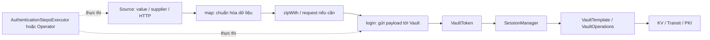

# AuthenticationSteps và các bước lấy, chuyển đổi, gửi dữ liệu

Trong **SPRING_VAULT**, một ứng dụng Java có thể dùng `VaultTemplate` để đọc KV secrets, gọi Transit encryption hoặc xin chứng chỉ PKI. Trước những thao tác này, client cần một **Vault token**. Với các phương thức xác thực theo workload như Kubernetes, AppRole, AWS IAM hoặc cloud identity, việc nhận token có thể gồm nhiều bước: **lấy thông tin xác thực ban đầu**, **chuyển đổi thành payload phù hợp**, **gửi yêu cầu login tới HashiCorp Vault** và **nhận token**.

`AuthenticationSteps` trong Spring Vault mô tả chuỗi công việc đó bằng một **DSL theo phong cách functional**. Điểm quan trọng là chuỗi bước chỉ mô tả *cần làm gì*; một executor mới thực sự chạy các bước. Bài thuộc chương **Authentication Steps**, tập trung vào cách biểu diễn nguồn dữ liệu, thao tác biến đổi và thao tác kết thúc đăng nhập, cách phối hợp với `ClientAuthentication`/`SessionManager`, cũng như lỗi thường gặp và chiến lược kiểm thử.

## 1. Từ luồng đăng nhập thủ công đến AuthenticationSteps

Hãy xét một workload dùng AppRole. Để login Vault, ứng dụng cần `role_id` và `secret_id`, chuyển hai giá trị thành JSON rồi gửi `POST` đến endpoint `auth/approle/login`. Một luồng khác, chẳng hạn AWS EC2, có thể cần lấy identity document/chữ ký từ dịch vụ metadata, chuẩn hóa nội dung trước khi gửi tới Vault.

Nếu mỗi auth method tự viết toàn bộ trình tự tải dữ liệu, tạo body và gọi HTTP, việc tái sử dụng bước chung khó hơn. `AuthenticationSteps` giải quyết bằng cách tách:

1. **Source (lấy dữ liệu):** giá trị có sẵn, supplier lấy credential tại thời điểm chạy, HTTP request tới nguồn bên ngoài hoặc Vault.
2. **Intermediate steps (chuyển đổi/kết hợp):** `map`, `zipWith`, `request` và callback trung gian để tạo trạng thái tiếp theo.
3. **Terminal step (hoàn thành xác thực):** `login(...)` gửi payload đăng nhập tới Vault, hoặc một cách kết thúc khác tạo ra `VaultToken`.
4. **Executor:** diễn giải chuỗi bước và thực hiện I/O theo mô hình đồng bộ hoặc reactive.



**Phân biệt cốt lõi:** `AuthenticationSteps` không phải nơi giữ token đang dùng cho mọi request. Nó mô tả cách **lấy token**. `SessionManager` quản lý việc cung cấp token cho các thao tác Vault và có thể phối hợp cơ chế gia hạn hoặc login lại tùy implementation. `VaultTemplate` thực hiện request nghiệp vụ bằng token do session manager cung cấp.

## 2. Ba khái niệm quan trọng trong DSL

| Khái niệm | Vai trò | Đầu vào và đầu ra |
| --- | --- | --- |
| `AuthenticationSteps` | Đại diện cho một luồng xác thực đã được mô tả đầy đủ | Khi thực thi, mục tiêu cuối cùng là một `VaultToken` |
| `AuthenticationSteps.Node<T>` | Một bước trung gian mang trạng thái có kiểu `T` | Có thể nối tiếp bằng biến đổi `T → R`, kết hợp dữ liệu hoặc yêu cầu HTTP |
| `AuthenticationSteps.HttpRequest<T>` | Mô tả request và kiểu dữ liệu phản hồi cần đọc | Được tạo bằng `HttpRequestBuilder`, rồi thực thi bởi client phù hợp |

Ví dụ `Node<String>` biểu thị dữ liệu hiện tại là chuỗi (một JWT, một tài liệu PKCS7 hoặc `secret_id`). Sau `map` tạo `Map<String, String>`, nút tiếp theo mang dữ liệu body cần gửi. Terminal `login` biến luồng đó thành một `AuthenticationSteps` hoàn chỉnh.

Các loại dữ liệu `T` là **trạng thái trong luồng xác thực**, không có nghĩa Spring Vault sẽ tự persist chúng. Tránh dùng `toString()`, log hoặc exception message chứa JWT, `secret_id`, nội dung credential hay Vault token.

### Mô tả khác với thực thi

```java
AuthenticationSteps steps = AuthenticationSteps
    .fromSupplier(() -> loadCredentialAtExecutionTime())
    .map(credential -> createLoginBody(credential))
    .login("auth/{mount}/login", "approle");
```

Đây là **mã minh họa cấu trúc**: `loadCredentialAtExecutionTime` và `createLoginBody` là hàm do ứng dụng cung cấp. Chỉ đến khi một executor diễn giải `steps`, supplier mới được gọi và request mới được gửi. Việc gọi `fromSupplier(...)` và `map(...)` đơn thuần không có nghĩa Vault đã được liên hệ.

Điều này đặc biệt hữu ích khi credential có thể bị rotate: mỗi **lần thực thi luồng login** có cơ hội lấy dữ liệu mới từ supplier, thay vì chụp giá trị một lần lúc tạo bean. Tuy nhiên, supplier phải tự bảo đảm đọc đúng nguồn, kiểm tra dữ liệu và xử lý race khi nguồn credential đang thay đổi.

## 3. Bước lấy dữ liệu: source của authentication flow

Spring Vault cung cấp nhiều entry point:

| API | Dữ liệu bắt đầu từ đâu? | Khi nên dùng |
| --- | --- | --- |
| `AuthenticationSteps.just(VaultToken)` | Vault token đã được cung cấp sẵn | Token-based auth đơn giản; không cần gửi login payload |
| `AuthenticationSteps.fromValue(value)` | Một giá trị cụ thể được đưa vào lúc xây DSL | Giá trị bất biến do caller cung cấp, hoặc fixture cho bài học/test |
| `AuthenticationSteps.fromSupplier(supplier)` | Hàm trả dữ liệu khi executor chạy | Đọc credential hiện hành từ nguồn an toàn, xây initial login state |
| `AuthenticationSteps.fromHttpRequest(request)` | HTTP endpoint bên ngoài Vault | Lấy instance identity/assertion từ dịch vụ metadata hoặc identity provider |
| `AuthenticationSteps.fromVaultRequest(request)` | HTTP request liên quan tới Vault | Lấy dữ liệu hỗ trợ xác thực từ Vault, ví dụ credential được unwrap hoặc pull theo cơ chế đã cấu hình |

`fromHttpRequest` và `fromVaultRequest` được phân biệt để executor dùng HTTP client thích hợp cho **nguồn bên ngoài** và **Vault**. Kết nối đến dịch vụ metadata có thể có hostname, header, TLS và timeout khác Vault. Không gửi Vault token sang endpoint bên ngoài, và không cấu hình cùng một client có interceptor chứa token cho mọi dịch vụ.

### 3.1. Source với token có sẵn

```java
import org.springframework.vault.authentication.AuthenticationSteps;
import org.springframework.vault.authentication.TokenAuthentication;
import org.springframework.vault.support.VaultToken;

VaultToken provided = VaultToken.of("test-token-placeholder");
AuthenticationSteps steps = AuthenticationSteps.just(provided);
```

Mã này chỉ minh họa hình dạng DSL; không được commit token thật trong mã nguồn. Trong production, dùng một cơ chế cung cấp token an toàn. `just(...)` không tự kiểm chứng token còn TTL, policy đúng hoặc không bị thu hồi. Việc có `VaultToken` cũng không mặc nhiên cung cấp metadata `renewable`/TTL như token nhận từ login.

### 3.2. Source với supplier

```java
import org.springframework.vault.authentication.AuthenticationSteps;

AuthenticationSteps.Node<String> currentSecretId =
    AuthenticationSteps.fromSupplier(() -> {
        String value = System.getenv("VAULT_SECRET_ID");
        if (value == null || value.isBlank()) {
            throw new IllegalStateException("Missing AppRole secret ID");
        }
        return value;
    });
```

Supplier là phần ứng dụng kiểm soát. Với AppRole `secret_id` được phân phối bằng response wrapping, bạn có thể cần một source đọc wrapping token rồi yêu cầu unwrap thay vì lấy plaintext từ environment. Với Kubernetes, nguồn dữ liệu thường là projected ServiceAccount JWT từ file; cần để ý rotation và quyền file. Khi một nguồn **không thể lấy credential ban đầu**, executor cần trả lỗi có thể chẩn đoán; không chuyển sang token admin để tiếp tục login.

### 3.3. Source với HTTP request

`HttpRequestBuilder` tạo đối tượng mô tả một request, ví dụ:

```java
import org.springframework.vault.authentication.AuthenticationSteps;
import org.springframework.vault.authentication.AuthenticationSteps.HttpRequestBuilder;

AuthenticationSteps.Node<String> signedIdentity =
    AuthenticationSteps.fromHttpRequest(
        HttpRequestBuilder
            .get("http://169.254.169.254/latest/dynamic/instance-identity/pkcs7")
            .as(String.class)
    );
```

Đường dẫn ví dụ thuộc EC2 instance metadata và mang ý nghĩa **lấy dữ liệu nguồn**, không phải gửi login tới Vault. Với môi trường sử dụng **IMDSv2**, trước request GET phải có cơ chế cấp session token metadata và header phù hợp; đoạn code tối giản trên **chưa bao gồm** bước đó nên không phải cấu hình AWS production hoàn chỉnh. Ứng dụng nên ưu tiên các `createAuthenticationSteps(...)` của auth method đã có khi phù hợp, vì những factory đó chứa xử lý đặc thù của nền tảng.

## 4. Bước chuyển đổi: map, zipWith và request

### 4.1. map chuyển đổi có kiểu

`map(Function<T, R>)` lấy trạng thái hiện tại và tạo trạng thái mới. Tình huống thường gặp: chuẩn hóa một tài liệu, trích claim có liên quan hoặc tạo payload gửi Vault.

```java
AuthenticationSteps steps = AuthenticationSteps
    .fromSupplier(() -> obtainSignedIdentity())
    .map(identity -> identity.replace("\r", ""))
    .map(identity -> java.util.Map.of(
        "pkcs7", identity,
        "nonce", "nonce-from-approved-source"
    ))
    .login("auth/{mount}/login", "aws");
```

`obtainSignedIdentity()` là hàm giả định của ứng dụng; `nonce` cũng phải lấy/tạo theo yêu cầu của AWS auth flow thực tế. `map` không được coi là nơi xác minh toàn bộ danh tính: Vault vẫn kiểm tra chữ ký và các ràng buộc của auth role. Ví dụ mô tả đường dữ liệu `String → String → Map`.

**Không biến đổi dữ liệu bảo mật tùy tiện.** Việc `trim()`, thay dòng mới, mã hóa Base64 hoặc tạo chữ ký phải tuân thủ format auth backend yêu cầu; sai một byte có thể khiến chữ ký không hợp lệ. Duy trì một phép kiểm thử với response thực tế của backend trước khi đưa lên production.

### 4.2. zipWith kết hợp hai nguồn

Với AppRole, `role_id` và `secret_id` có thể đến từ **hai nguồn khác nhau**. `zipWith` kết hợp hai node, cho ra `AuthenticationSteps.Pair<L, R>`; sau đó `map` tạo body login.

```java
import java.util.Map;
import org.springframework.vault.authentication.AuthenticationSteps;

AuthenticationSteps.Node<String> roleId =
    AuthenticationSteps.fromSupplier(() -> requiredEnv("VAULT_ROLE_ID"));

AuthenticationSteps.Node<String> secretId =
    AuthenticationSteps.fromSupplier(() -> requiredEnv("VAULT_SECRET_ID"));

AuthenticationSteps appRoleFlow = roleId
    .zipWith(secretId)
    .map(ids -> Map.of(
        "role_id", ids.getLeft(),
        "secret_id", ids.getRight()
    ))
    .login("auth/{mount}/login", "approle");
```

`requiredEnv` là helper tự triển khai và kiểm tra đầu vào. Trong đoạn này, `zipWith` **kết hợp kết quả**, không có bảo đảm tự động hóa việc cấp, xoay vòng hay quản lý `secret_id`. Không giả định hai nguồn được gọi song song trong mọi executor; mô hình đồng bộ/reactive quyết định chi tiết thực thi.

### 4.3. request và onNext

`Node.request(HttpRequest<R>)` bổ sung một yêu cầu HTTP tạo trạng thái `R` để xử lý tiếp. Nó hữu ích khi một bước cần lấy dữ liệu tiếp theo trước khi tạo login body. `Node.onNext(Consumer<T>)` thực hiện callback trên trạng thái hiện tại và có thể phục vụ quan sát.

Nhưng **không dùng**:

```java
// Ví dụ SAI: tiết lộ thông tin xác thực.
node.onNext(System.out::println);
```

Callback có thể chạy ở thời điểm thực thi và nhìn thấy payload chứa credential. Nếu cần quan sát, chỉ ghi nhận mã loại bước và kết quả thành công/thất bại ở lớp executor hoặc telemetry phù hợp, không ghi raw state. Sử dụng `request` phải phân biệt request đến Vault và endpoint bên ngoài, đồng thời cấu hình HTTPS, header, timeout và chuyển hướng HTTP an toàn.

## 5. Bước gửi dữ liệu: terminal login

Khi source và các bước biến đổi đã tạo dữ liệu login, terminal `login(...)` khép lại chuỗi và cho phép executor biến payload thành Vault token.

Ví dụ endpoint mặc định của AppRole:

```http
POST /v1/auth/approle/login HTTP/1.1
Host: vault.example.internal:8200
Content-Type: application/json

{
  "role_id": "example-role-id",
  "secret_id": "<redacted>"
}
```

Response login từ Vault có thể chứa phần `auth` với `client_token`, `policies`, `lease_duration` và `renewable`. Token cần được giữ trong cơ chế session, **không gửi về trình duyệt** hoặc log vào tracing.

Các dạng terminal đáng chú ý:

| Terminal | Ý nghĩa |
| --- | --- |
| `login("auth/{mount}/login", mount)` | Gửi trạng thái hiện tại làm payload POST tới URL đăng nhập Vault, có URI template |
| `loginAt(mount)` | Cách rút gọn cho mount xác thực theo đường `auth/{mount}/login`; chỉ có trong một số phiên bản mới như Spring Vault 4.1+ |
| `login(HttpRequest<VaultResponse>)` | Dùng HTTP request được mô tả riêng cho bước login đặc biệt |
| `login(Function<T, VaultToken>)` | Hoàn tất bằng hàm ánh xạ trạng thái thành token khi flow không cần POST login thông thường |

Trong ví dụ tương thích nhiều phiên bản Spring Vault, `.login("auth/{mount}/login", "approle")` giúp chỉ rõ endpoint. Không tự nối chuỗi URL từ credential hoặc dữ liệu người dùng; URI variables được xử lý theo cơ chế URI template và cần được kiểm tra path theo mount cấu hình thực tế.

## 6. Ví dụ Java hoàn chỉnh: lấy → chuyển đổi → gửi AppRole

Ví dụ dưới đây tự mô tả luồng AppRole, phù hợp để học DSL trên Java 17+. Những lớp Spring Vault cần thiết phải có trong dependency của dự án.

```java
import java.util.Map;
import org.springframework.vault.authentication.AuthenticationSteps;

public final class AppRoleStepsExample {

    private AppRoleStepsExample() {
    }

    private record AppRoleInput(String roleId, String secretId) {
    }

    private static String requiredEnv(String name) {
        String value = System.getenv(name);
        if (value == null || value.isBlank()) {
            throw new IllegalStateException("Missing credential source: " + name);
        }
        return value;
    }

    public static AuthenticationSteps create() {
        return AuthenticationSteps
            // Bước 1: lấy thông tin đầu vào khi flow được thực thi.
            .fromSupplier(() -> new AppRoleInput(
                requiredEnv("VAULT_ROLE_ID"),
                requiredEnv("VAULT_SECRET_ID")
            ))
            // Bước 2: đổi sang login body do Vault AppRole yêu cầu.
            .map(input -> Map.of(
                "role_id", input.roleId(),
                "secret_id", input.secretId()
            ))
            // Bước 3: POST payload và nhận Vault token qua executor.
            .login("auth/{mount}/login", "approle");
    }
}
```

**Điều kiện chạy:** Vault có auth backend được mount tại `approle`, AppRole `role_id`/`secret_id` hợp lệ và Vault role đã gắn policy tối thiểu. Ví dụ không tự cấp role ID hoặc secret ID. Với production, nên dùng `AppRoleAuthentication.createAuthenticationSteps(options)` nếu cơ chế tích hợp đáp ứng yêu cầu, nhất là khi `RoleId`/`SecretId` lấy qua pull hoặc response wrapping.

Một dấu hiệu dễ kiểm tra: `create()` chỉ **trả đối tượng mô tả flow**; việc đọc hai biến môi trường diễn ra khi executor thực thi supplier. Nếu bạn thay `fromSupplier` bằng `fromValue(new AppRoleInput(...))` thì `requiredEnv` chạy **ngay khi tạo flow**, dẫn đến hành vi khác khi credential rotate.

### Luồng dữ liệu qua các kiểu Java

| Mốc | Kiểu của state | Nội dung mô tả | I/O đã xảy ra? |
| --- | --- | --- | --- |
| Khởi tạo `AuthenticationSteps` | Chưa chạy source | Định nghĩa supplier, map, login | Chưa login, chưa đọc supplier |
| Source `fromSupplier` | `AppRoleInput` | `roleId` và `secretId` | Có, đọc từ nguồn credential |
| Intermediate `map` | `Map<String, String>` | Body login theo key `role_id`/`secret_id` | Chuyển đổi trong JVM |
| Terminal `login` | Response login và `VaultToken` | Vault xác minh AppRole và phát token | Có, HTTP POST tới Vault |
| Request nghiệp vụ về sau | Dữ liệu KV/Transit/PKI | Token được SessionManager cung cấp khi gọi Vault | HTTP riêng đến secret engine |

Luồng trên là từng **giai đoạn logic**. Tên lớp response và cách executor ánh xạ token phụ thuộc Spring Vault version; không cần tự parse raw `client_token` khi dùng executor có sẵn.

## 7. Ai thực thi AuthenticationSteps?

### 7.1. Synchronous: AuthenticationStepsExecutor

`AuthenticationStepsExecutor` là một implementation `ClientAuthentication` cho luồng đồng bộ. Nó nhận `AuthenticationSteps` và các HTTP client cần thiết rồi thực thi thông qua `login()`.

```java
import org.springframework.vault.authentication.AuthenticationSteps;
import org.springframework.vault.authentication.AuthenticationStepsExecutor;
import org.springframework.vault.support.VaultToken;

// Giả sử các client đã được cấu hình endpoint, TLS và timeout đúng.
// Spring Vault 4.1+ có constructor nhận VaultClient và RestClient.
AuthenticationSteps steps = AppRoleStepsExample.create();

AuthenticationStepsExecutor executor =
    new AuthenticationStepsExecutor(steps, vaultClient, restClient);

VaultToken token = executor.login();
// Không in hoặc log token.
```

`vaultClient` và `restClient` ở trên là những client **đã cấu hình trước** bởi ứng dụng; đoạn minh họa tập trung vào executor. Với các phiên bản khác, có thể dùng constructor nhận `RestClient` hoặc `RestOperations` theo API tương ứng; một số constructor cũ đã deprecated. Khi nâng phiên bản Spring Vault, hãy đối chiếu chữ ký constructor và cách cấu hình HTTP client chứ không đổi tên tùy đoán.

Để vận hành lâu dài, ứng dụng thường đưa `ClientAuthentication` này vào cơ chế `SessionManager` thích hợp rồi dùng `VaultTemplate`. Gọi `executor.login()` một lần **không tự lập lịch renew token hoặc lưu token cho các request về sau**. Cần chọn session manager theo TTL, loại auth và policy của workload.

### 7.2. Reactive: AuthenticationStepsOperator

`AuthenticationStepsOperator` dùng mô hình reactive, kết hợp `ReactiveVaultClient` và `WebClient` ở những phiên bản hỗ trợ. Nó trả về `Mono<VaultToken>`, và các thao tác thực tế được thực hiện khi chuỗi reactive được **subscribe**.

```java
import reactor.core.publisher.Mono;
import org.springframework.vault.authentication.AuthenticationSteps;
import org.springframework.vault.authentication.AuthenticationStepsOperator;
import org.springframework.vault.support.VaultToken;

// reactiveVaultClient và webClient đã được cấu hình phù hợp.
AuthenticationSteps steps = AppRoleStepsExample.create();

AuthenticationStepsOperator operator =
    new AuthenticationStepsOperator(steps, reactiveVaultClient, webClient);

Mono<VaultToken> tokenMono = operator.getVaultToken();
// Tích hợp tokenMono vào reactive authentication/session flow;
// không block() trên event-loop.
```

Trong mô hình reactive, một supplier blocking như đọc file bằng API chặn luồng cần được xử lý thích hợp. Operator có cơ chế bảo vệ với một số supplier, nhưng ứng dụng vẫn phải kiểm tra đặc tính I/O của nguồn credentials và không block event-loop bằng mã tùy biến. Không tự gọi `subscribe()` ở khắp nơi, tránh tạo nhiều lần login không được quản lý.

### 7.3. So sánh executor đồng bộ và reactive

| Điểm so sánh | `AuthenticationStepsExecutor` | `AuthenticationStepsOperator` |
| --- | --- | --- |
| Cơ chế | Đồng bộ/blocking theo API client | Reactive, trả `Mono<VaultToken>` |
| Entry point | `login()` | `getVaultToken()` |
| HTTP client | `VaultClient`/`RestClient` hoặc `RestOperations` tùy version | `ReactiveVaultClient`/`WebClient` |
| Khi chạy | Khi gọi `login()` | Khi có subscription |
| Tích hợp | `ClientAuthentication` và session manager đồng bộ | Reactive authentication/session flow |
| Rủi ro thiết kế | Chặn luồng khi nguồn và Vault chậm, nếu thiếu timeout | Supplier blocking trong reactive pipeline, subscription không được kiểm soát |

Hai executor **diễn giải cùng một định nghĩa flow** nhưng có mô hình thực thi khác nhau. Không mặc định logic callback có cùng thread, thứ tự timing hoặc khả năng retry nếu chưa kiểm thử.

## 8. AuthenticationStepsFactory và các flow có sẵn

Không phải lúc nào cũng cần tự soạn `AuthenticationSteps`. Nhiều authentication implementation của Spring Vault có `AuthenticationStepsFactory`, cung cấp `getAuthenticationSteps()` hoặc các hàm factory như `createAuthenticationSteps(options)`.

Ví dụ AppRole trong thư viện có thể xử lý các cách cung cấp `RoleId`/`SecretId` khác nhau:

- **Provided:** credential đã được phân phối hợp lệ.
- **Pull:** cần lấy role ID hoặc secret ID từ Vault bằng quyền cấp phát tương ứng.
- **Wrapped:** cần unwrap response-wrapping token để lấy credential, có TTL và giới hạn dùng riêng.

Với workload như Kubernetes, GCP hoặc AWS, flow có sẵn thường biết cách đọc assertion hoặc truy vấn identity endpoint theo quy tắc của nền tảng. Việc tự tạo `fromHttpRequest` cần tính đến HTTP headers, IAM signing, token audience, redirect và metadata service security. Đặc biệt, AWS IMDSv2 cần cơ chế session token; lấy URL metadata rồi gửi GET trần là một ví dụ **thiếu bước bắt buộc** trong những môi trường có IMDSv2.

**Tiêu chí chọn giải pháp:** nếu phương thức Spring Vault có sẵn hỗ trợ quy trình nhận credential của bạn, hãy dùng factory đó. Tự dựng DSL khi cần kết hợp bước riêng, nguồn credential đặc thù hoặc kiểm soát luồng mà implementation có sẵn chưa đáp ứng.

## 9. Quyền và token sau khi login

Flow login trả token không đồng nghĩa ứng dụng có quyền làm mọi việc. Vault auth role quyết định policy và giới hạn token được phát; Vault ACL thực sự đánh giá từng thao tác.

| Thao tác `VaultTemplate`/engine | Ví dụ endpoint Vault | Capability thường cần |
| --- | --- | --- |
| Đọc KV v2 tại mount `secret` | `secret/data/apps/orders` | `read` |
| Liệt kê key KV v2 | `secret/metadata/apps` | `list` |
| Transit encrypt bằng key `orders` | `transit/encrypt/orders` | `update` |
| Transit decrypt bằng key `orders` | `transit/decrypt/orders` | `update` |
| PKI issue với role `orders` | `pki/issue/orders` | `update` |

Một lần login thành công với token policy thiếu `read` có thể dẫn tới `403 permission denied` khi đọc KV. Đây là **lỗi authorization tại secret engine**, khác với lỗi source credential hoặc login endpoint. Trong thiết kế least privilege, chỉ cấp các capability cần thiết và phân biệt policy của các workload.

`AuthenticationSteps` không tự renew token sau login. Với ứng dụng chạy lâu dài, `LifecycleAwareSessionManager` hoặc cơ chế quản lý session phù hợp cần xét TTL, `renewable` và khả năng re-login khi token tới hạn. Token Vault, KV static secrets, credential database có lease và chứng chỉ PKI có vòng đời khác nhau; đừng coi việc tạo `AuthenticationSteps` là cơ chế rotate tất cả secret.

## 10. Xử lý lỗi theo vị trí bước bị hỏng

Một lỗi `401`/`403` chưa đủ để kết luận thiếu Vault policy: cần biết request thất bại ở **nguồn HTTP bên ngoài**, **Vault auth**, hay **Vault secret engine**.

| Pha | Biểu hiện | Nguyên nhân cần kiểm tra | Hành động |
| --- | --- | --- | --- |
| `fromSupplier` | `IllegalStateException`, file credential không đọc được | Env/mount thiếu, quyền file, JWT rotate, AppRole secret ID hết hạn | Kiểm tra nguồn credential, fail-fast hoặc retry có deadline |
| `fromHttpRequest` | HTTP `401`/`403` từ metadata/identity service | Workload identity/cloud permission, header hoặc audience sai | Sửa IAM/identity source, không cấp bừa Vault policy |
| `map` | Parse lỗi, key thiếu, sai format | Base64/PKCS7/JWT payload biến đổi sai | Kiểm tra input shape, không log raw credential |
| `login` | Vault auth endpoint trả `400`/`403` | Auth mount, role binding, credential hết hạn, token audience, namespace | Kiểm tra role/mount/identity, không thử root token |
| `login` | Timeout, Vault `5xx`, TLS handshake fail | Network, Vault unavailable, CA/hostname sai | Timeout, backoff/jitter cho lỗi tạm thời, không tắt xác minh TLS |
| Sau login | KV/Transit/PKI trả `403` | Token policy thiếu capability hoặc sai path | Đối chiếu Vault ACL và API endpoint thực tế |
| Sau login | Token hết TTL hoặc bị revoke | Session lifecycle hoặc không còn nguồn re-login | Quản lý token với `SessionManager`, giảm readiness khi cần |

### Retry phải ở đúng tầng

Nếu supplier gọi cloud metadata bị timeout, **retry toàn luồng** sẽ chạy lại source. Nếu đăng nhập AppRole dùng `secret_id` có giới hạn lượt dùng hoặc một bước unwrap được thiết kế dùng **một lần**, retry mù có thể thất bại vì credential đã bị tiêu thụ ở lần trước. Cần xác định idempotency và liệu nguồn có thể cấp credential **mới** hay không.

Với lỗi Vault policy `403` sau login, renew token hoặc retry `AuthenticationSteps` thường không giải quyết nguyên nhân. Với network outage, có thể thử lại với exponential backoff và jitter, nhưng phải có ngân sách thời gian rõ ràng, tránh bão login khi nhiều Pod khởi động cùng lúc. Chỉ có một owner chịu trách nhiệm retry/login/refresh theo thiết kế hệ thống.

## 11. Kiểm thử luồng AuthenticationSteps

Cần kiểm chứng **thứ tự thực thi, chuyển đổi body, request đúng endpoint, phản hồi token và phân loại lỗi**. Tách test unit cho supplier/map và test tích hợp cho executor với Vault cô lập.

| Kiểm thử | Cách tổ chức | Điều cần xác nhận |
| --- | --- | --- |
| Flow chỉ được mô tả | Tạo `AuthenticationSteps` với supplier tăng counter | Không chạy supplier ngay khi builder tạo flow |
| Source được gọi khi chạy | Executor thực thi với HTTP test double hoặc Vault lab | Supplier được gọi đúng trong lúc thực thi |
| Body AppRole đúng | Fake Vault auth endpoint ghi nhận request sau khi loại bỏ secret | `role_id`/`secret_id` nằm đúng trường, không có field thừa |
| Biến đổi `map` | Dùng input chứa xuống dòng/tài liệu mẫu | Kết quả chuẩn hóa chính xác định dạng backend yêu cầu |
| `zipWith` | Cấp hai nguồn giả | Tạo đúng pair và map payload, không trộn role ID/secret ID |
| Request từ HTTP bên ngoài | Mock metadata endpoint và Vault auth endpoint riêng | Không gửi Vault token ra metadata endpoint, timeout và URL đúng |
| Login thành công | Vault dev/Testcontainers với auth role test ít quyền | Executor trả `VaultToken`, request KV/Transit giới hạn hoạt động |
| Login bị từ chối | Credential sai hoặc Vault role binding sai | Exception rõ pha login, không log credential |
| Vault policy thiếu | Login vẫn thành công, KV read trả `403` | Phân loại lỗi ACL sau login, không coi supplier sai |
| Credential rotate | Thay nguồn trước lần login tiếp theo | `fromSupplier` lấy giá trị hiện hành tại lần thực thi mới |
| Timeout và shutdown | Cô lập Vault tạm ngắt mạng, đóng Spring context | Retry có giới hạn, thread/client được dừng, trạng thái ready chính xác |

Một test đơn vị minh họa bản chất lazy có thể viết bằng JUnit 5:

```java
import static org.junit.jupiter.api.Assertions.assertEquals;

import java.util.Map;
import java.util.concurrent.atomic.AtomicInteger;
import org.junit.jupiter.api.Test;
import org.springframework.vault.authentication.AuthenticationSteps;

class AuthenticationStepsDefinitionTest {

    @Test
    void buildingFlowDoesNotRunSupplier() {
        AtomicInteger calls = new AtomicInteger();

        AuthenticationSteps steps = AuthenticationSteps
            .fromSupplier(() -> {
                calls.incrementAndGet();
                return "test-secret-id";
            })
            .map(secretId -> Map.of(
                "role_id", "test-role-id",
                "secret_id", secretId
            ))
            .login("auth/{mount}/login", "approle");

        assertEquals(0, calls.get());
        // Chỉ khi executor chạy flow thì supplier mới được đánh giá.
    }
}
```

Test này chứng minh **quy tắc mô tả flow**, chưa kiểm thử gửi HTTP. Test tích hợp cần gọi executor thật với Vault test có auth backend/role đã chuẩn bị và đối chiếu request; không dùng root token để chạy business client. Trong môi trường test có dữ liệu giả, nên cấp policy đúng path và kiểm tra cả thành công lẫn trường hợp thiếu quyền.

## 12. Các lỗi thiết kế thường gặp

1. **Xây flow rồi cho rằng đã login:** `AuthenticationSteps` chỉ mô tả; cần executor.
2. **Dùng `fromValue` cho credential thường xuyên rotate:** dữ liệu bị giữ ở thời điểm tạo flow; dùng supplier hoặc factory phù hợp để lấy giá trị mới.
3. **Nhầm `fromHttpRequest` và `fromVaultRequest`:** có thể dùng sai client, base URL, token header hoặc TLS configuration.
4. **In state của `map`/`onNext`:** làm rò rỉ `secret_id`, JWT hoặc tài liệu nhận dạng.
5. **Gửi sai endpoint:** AppRole `auth/approle/login` khác Kubernetes `auth/kubernetes/login`; mount auth tùy hệ thống.
6. **Tự viết AWS/GCP/Azure flow mà bỏ bước nền tảng:** metadata token, claim, ký request hoặc audience có thể bắt buộc.
7. **Tạo lại executor hoặc login ở mỗi business request:** tăng tải Vault, nhân đôi token lifecycle; tích hợp với session manager khi phù hợp.
8. **Đồng nhất login thành công với được quyền đọc secret:** chính sách token vẫn cần capability cho từng path KV v2/Transit/PKI.
9. **Retry mọi lỗi không giới hạn:** có thể dùng lại credential một lần, làm cạn lease hoặc gây bão request auth.
10. **Dùng token trong exception/log:** rò rỉ bí mật nghiêm trọng; chỉ ghi event, pha lỗi, mã phản hồi và correlation ID.

## 13. Tự kiểm tra kiến thức

**Câu 1.** Gọi `AuthenticationSteps.fromSupplier(...).map(...).login(...)` có thực hiện request ngay không?  
**Trả lời:** Chưa. Đó là định nghĩa flow; executor mới thực thi.

**Câu 2.** Muốn ghép `role_id` và `secret_id` từ hai nguồn riêng, toán tử nào phù hợp?  
**Trả lời:** `zipWith` tạo cặp giá trị, sau đó `map` tạo JSON body AppRole.

**Câu 3.** `map` có trách nhiệm xác minh chữ ký JWT/PKCS7 không?  
**Trả lời:** Nó chỉ biến đổi dữ liệu trong client; xác minh danh tính thuộc cơ chế auth backend/Vault và các bước mật mã đặc thù nếu cần.

**Câu 4.** Sau `AuthenticationStepsExecutor.login()` thành công, Java service đọc KV v2 bị `403`. Có phải `fromSupplier` sai?  
**Trả lời:** Không thể kết luận vậy. Cần kiểm tra token policy, capability `read`, mount `secret` và API path `secret/data/...`.

**Câu 5.** Có thể dùng `AuthenticationStepsOperator` để gọi HTTP theo reactive và chờ token bằng `getVaultToken()` không?  
**Trả lời:** Có, phương thức trả `Mono<VaultToken>`; chuỗi được thực thi khi subscribe. Tránh `block()` trên event-loop.

**Câu 6.** Một AppRole `secret_id` bị thu hồi trong lúc ứng dụng đang chạy; chỉ cần `map` lại body là có thể login?  
**Trả lời:** Không. Ứng dụng phải nhận credential ban đầu hợp lệ từ nguồn được ủy quyền; việc biến đổi dữ liệu không khắc phục credential đã bị revoke.

Khi phân tách **lấy dữ liệu → chuyển đổi → gửi login → sử dụng token**, ta có thể xây dựng và kiểm thử xác thực Spring Vault rõ ràng hơn. `AuthenticationSteps` biểu diễn logic nhận token, executor thực thi logic đó, còn `SessionManager` và policy Vault bảo đảm phiên được sử dụng đúng trong vòng đời ứng dụng Java.

### Tài liệu tham khảo

- [Spring Vault – Authentication Methods / Authentication Steps](https://docs.spring.io/spring-vault/reference/vault/authentication.html)
- [Spring Vault API – AuthenticationSteps](https://docs.spring.io/spring-vault/reference/api/java/org/springframework/vault/authentication/AuthenticationSteps.html)
- [Spring Vault API – AuthenticationSteps.Node](https://docs.spring.io/spring-vault/reference/api/java/org/springframework/vault/authentication/AuthenticationSteps.Node.html)
- [Spring Vault API – AuthenticationStepsExecutor](https://docs.spring.io/spring-vault/reference/api/java/org/springframework/vault/authentication/AuthenticationStepsExecutor.html)

