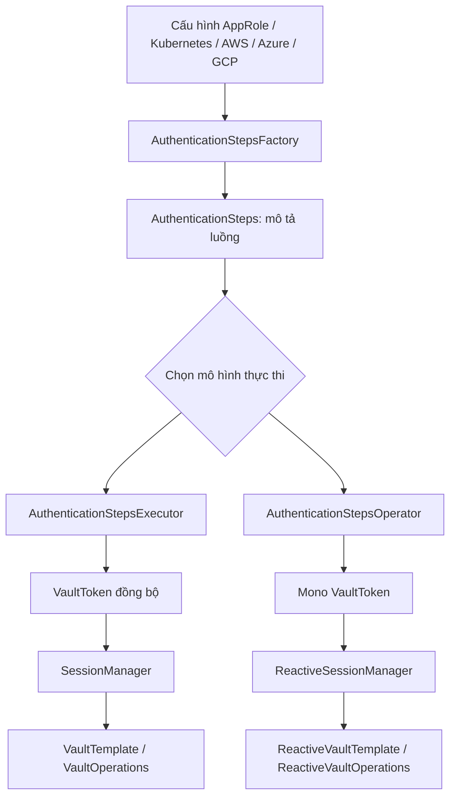
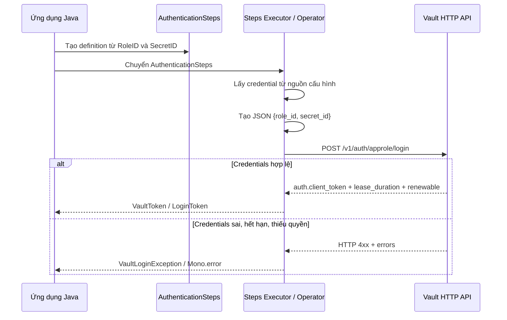
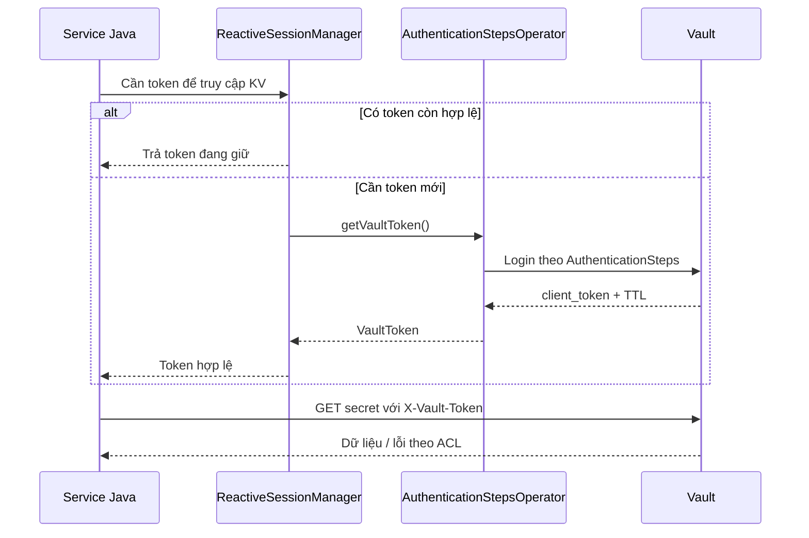

# AuthenticationStepsFactory ở các phương thức có hỗ trợ

## 1. Bài toán: cùng một cách đăng nhập Vault, nhiều mô hình thực thi

Trong **SPRING_VAULT**, ứng dụng Java phải lấy được Vault token trước khi `VaultTemplate` đọc KV secrets, mã hóa bằng Transit, gọi PKI hoặc sử dụng dynamic secrets có lease. Danh tính workload có thể đến từ Kubernetes Service Account, AppRole, AWS IAM, Azure Managed Identity hoặc các phương thức khác. Mỗi phương thức cần chuẩn bị một loại bằng chứng riêng rồi mới gọi HTTP API đăng nhập của HashiCorp Vault.

Với chương trình đồng bộ, một `ClientAuthentication` có thể thực hiện toàn bộ công việc rồi trả về `VaultToken`. Với chương trình WebFlux, ta cần biểu diễn những công việc ấy thành các bước có thể thực thi bằng HTTP client reactive. **`AuthenticationStepsFactory` là hợp đồng nối hai cách tiếp cận**: cung cấp mô tả `AuthenticationSteps` cho một cơ chế xác thực có hỗ trợ.

Sau bài này, người học có thể:

- Giải thích sự khác nhau giữa `ClientAuthentication.login()`, `AuthenticationStepsFactory.getAuthenticationSteps()` và executor thực thi các bước.
- Nhận diện các phương thức Spring Vault **có** triển khai `AuthenticationStepsFactory`, thay vì suy ra từ việc Vault server hỗ trợ một auth mount.
- Tạo luồng AppRole bằng API sẵn có; chạy luồng trong ứng dụng đồng bộ hoặc reactive.
- Biết khi nào nên dùng `AuthenticationStepsExecutor`, `AuthenticationStepsOperator` và session manager để quản lý token.
- Phân tích giới hạn của cloud identity providers, TLS, credential rotation và lỗi khi đăng nhập lại.

> **Phạm vi phiên bản:** Danh sách lớp được đối chiếu với Javadoc **Spring Vault 4.1.0**. API, constructor, danh sách implementation và mức hỗ trợ auto-configuration có thể thay đổi giữa các phiên bản Spring Vault/Spring Cloud Vault; cần đối chiếu dependency thực tế của dự án trước khi áp dụng.

## 2. Ba hợp đồng: xác thực, mô tả bước và thực thi

| Thành phần | Vai trò | Kết quả/kiểu trả về quan trọng |
| --- | --- | --- |
| `ClientAuthentication` | Chiến lược lấy token theo cách **đồng bộ**. | `VaultToken login()`; có thể trả `LoginToken` kèm TTL và khả năng renew. |
| `AuthenticationStepsFactory` | Cung cấp định nghĩa các bước cần chạy để đăng nhập. | `AuthenticationSteps getAuthenticationSteps()`. |
| `AuthenticationSteps` | Mô tả nguồn dữ liệu, bước chuyển đổi, request HTTP và bước login cuối cùng. | Đối tượng **mô tả luồng**; chưa tự đăng nhập chỉ vì đã tạo. |
| `AuthenticationStepsExecutor` | Thực thi `AuthenticationSteps` theo mô hình đồng bộ. | Triển khai `ClientAuthentication`; gọi `login()` để nhận `VaultToken`. |
| `AuthenticationStepsOperator` | Thực thi `AuthenticationSteps` theo mô hình reactive. | Triển khai `VaultTokenSupplier`; `getVaultToken()` trả `Mono<VaultToken>`. |
| `SessionManager` / `ReactiveSessionManager` | Giữ token, điều phối renew và re-login theo cấu hình. | Token dùng cho nhiều request `VaultTemplate` / `ReactiveVaultTemplate`. |

Giao diện `AuthenticationStepsFactory` có hợp đồng ngắn gọn:

```java
package org.springframework.vault.authentication;

@FunctionalInterface
public interface AuthenticationStepsFactory {
    AuthenticationSteps getAuthenticationSteps();
}
```

Đoạn trên minh họa **chữ ký giao diện**, không phải hướng dẫn tự tạo lại interface này trong dự án. Một implementation thường có cả `ClientAuthentication` và `AuthenticationStepsFactory`; nhờ đó cùng cách xác thực có thể dùng trong cấu hình imperative hoặc làm nguồn bước cho reactive authentication.



**Thời điểm gọi rất quan trọng:** `getAuthenticationSteps()` tạo định nghĩa một luồng; `AuthenticationStepsExecutor.login()` mới chạy luồng đồng bộ, còn `AuthenticationStepsOperator.getVaultToken()` mô tả luồng reactive được thực thi khi có subscription. Một `Mono` được tạo ra không đồng nghĩa Vault đã nhận request. Session manager có nhiệm vụ tránh việc đăng nhập lại sau **mỗi** request nghiệp vụ.

## 3. Những implementation có `AuthenticationStepsFactory`

Theo danh sách **All Known Implementing Classes** của `AuthenticationStepsFactory` trong Spring Vault 4.1.0, có **13 lớp**:

| Phương thức/nhóm | Lớp Spring Vault | Bằng chứng hoặc nguồn token | Endpoint Vault điển hình |
| --- | --- | --- | --- |
| Token sẵn có | `TokenAuthentication` | Vault token đã cấp từ trước; có thể self-lookup nếu được cấu hình. | Không nhất thiết login; có thể `auth/token/lookup-self`. |
| AppRole | `AppRoleAuthentication` | `role_id`, `secret_id` (nếu role yêu cầu), kể cả các chế độ lấy/unwrap phù hợp. | `POST /v1/auth/approle/login`. |
| Kubernetes | `KubernetesAuthentication` | Kubernetes Service Account JWT và Vault role. | `POST /v1/auth/kubernetes/login`. |
| JWT | `JwtAuthentication` | JWT và role liên kết trong Vault. | `POST /v1/auth/jwt/login`. |
| AWS EC2 | `AwsEc2Authentication` | PKCS#7 instance identity, nonce và EC2 instance metadata. | `POST /v1/auth/aws/login`. |
| AWS IAM | `AwsIamAuthentication` | Request AWS STS `GetCallerIdentity` đã ký bằng AWS SigV4. | `POST /v1/auth/aws/login`. |
| Azure MSI | `AzureMsiAuthentication` | Azure Managed Identity token và metadata của môi trường. | `POST /v1/auth/azure/login`. |
| GCP GCE | `GcpComputeAuthentication` | Identity JWT lấy từ GCE metadata service. | `POST /v1/auth/gcp/login`. |
| TLS certificate | `ClientCertificateAuthentication` | Chứng chỉ client và private key trong phiên TLS. | `POST /v1/auth/cert/login`. |
| Cubbyhole / response wrapping | `CubbyholeAuthentication` | Token khởi tạo để đọc/unwrap token thực. | `sys/wrapping/unwrap`, `cubbyhole/...` hoặc lookup tùy cấu hình. |
| GitHub | `GitHubAuthentication` | GitHub token được Vault xác minh theo auth role. | `POST /v1/auth/github/login`. |
| Username/password | `UsernamePasswordAuthentication` | Tài khoản và mật khẩu của `userpass` auth method. | `POST /v1/auth/userpass/login/{username}`. |
| PCF | `PcfAuthentication` | Chứng chỉ instance PCF và chữ ký; có thể cần BouncyCastle. | `POST /v1/auth/pcf/login` (nếu mount mặc định). |

Các `auth/<mount>` trong bảng là **ví dụ mặc định**. Vault cho phép mount phương thức xác thực ở đường dẫn khác, chẳng hạn `auth/team-k8s/`. Khi đó cả cấu hình Spring Vault lẫn ACL/role tại Vault phải tham chiếu đúng mount thực. Đừng lấy tên `KubernetesAuthentication` rồi mặc định mọi ứng dụng luôn có endpoint `auth/kubernetes/login`.

Đáng chú ý, **`GcpIamCredentialsAuthentication` có `ClientAuthentication` nhưng không nằm trong danh sách `AuthenticationStepsFactory`** ở Spring Vault 4.1.0. Cơ chế GCP IAM cần gọi Google IAM Credentials API để ký JWT và sử dụng API đồng bộ trong implementation hiện tại. Vault server vẫn có thể hỗ trợ GCP IAM login; giới hạn ở đây thuộc đường tích hợp reactive bằng `AuthenticationSteps` của client Java.

Không suy ra một cơ chế **không hỗ trợ Vault authentication** chỉ vì nó không có factory. Hãy phân biệt: Vault auth method có hoạt động; Spring Vault có class `ClientAuthentication`; class có triển khai `AuthenticationStepsFactory`; và Spring Cloud Vault auto-configuration có hỗ trợ cấu hình đó hay không. Đây là bốn câu hỏi khác nhau.

## 4. Một `AuthenticationSteps` mô tả những bước nào?

Luồng xác thực có thể được tạo từ một giá trị, một `Supplier`, hoặc một request HTTP; sau đó chuyển đổi dữ liệu và thực hiện bước login. Ví dụ logic của AppRole là:



Trong các ví dụ của Spring Vault, có thể khai báo luồng bằng các thao tác DSL như sau:

```java
AuthenticationSteps steps = AuthenticationSteps
    .fromSupplier(() -> Map.of(
        "role_id", roleId,
        "secret_id", secretId))
    .login("auth/{mount}/login", "approle");
```

Đây là **ví dụ tối giản để hiểu DSL**; `roleId`, `secretId` là biến được cấp từ nguồn bảo mật bên ngoài và không được hard-code. Cách này chỉ bao quát AppRole **push** với RoleID/SecretID đã có. Luồng thực tế có thể cần đọc credential từ file, lấy response wrapping token, unwrap, hoặc truy cập metadata service và ký payload trước khi login. Khi dùng một auth method phổ biến, nên ưu tiên `createAuthenticationSteps(...)` hoặc `getAuthenticationSteps()` của Spring Vault để tái sử dụng xử lý chuyên biệt đã được cài đặt.

Các thành phần của DSL có ý nghĩa:

| Khái niệm | Công việc |
| --- | --- |
| `AuthenticationSteps.just(VaultToken.of(...))` | Một luồng chỉ trả token đã có, không tự gọi endpoint login. |
| `fromSupplier(...)` | Lấy trạng thái đầu vào khi thực thi, ví dụ một `Map` credential. |
| `fromHttpRequest(...)` | Khai báo request tới nguồn thông tin ngoài như instance metadata service. |
| `map(...)` | Chuyển trạng thái, ví dụ xử lý identity document hoặc xây login JSON. |
| `login(...)`/`loginAt(...)` | Bước cuối gọi Vault auth path để lấy token. |

**Không coi DSL là trình thực thi:** việc gọi `.login(...)` trong lúc xây definition chưa tự thực hiện HTTP request. Executor/operator xử lý các bước; riêng operator phản ứng theo subscription. Người dùng không nên tự lưu `AuthenticationSteps` trong cache rồi tưởng rằng dữ liệu bên trong tự động được làm mới mọi lúc: phụ thuộc vào cách mỗi `Supplier`/HTTP step và credential source được khai báo.

## 5. Ví dụ Java: AppRole tạo `AuthenticationSteps` một lần rồi thực thi

Giả sử ứng dụng `payments-api` dùng AppRole tại auth mount `approle`, có `VAULT_ROLE_ID` và `VAULT_SECRET_ID` được phân phối bởi hệ thống triển khai. Cấu hình minh họa với Spring Vault 4.x:

```java
import org.springframework.vault.authentication.AppRoleAuthentication;
import org.springframework.vault.authentication.AppRoleAuthenticationOptions;
import org.springframework.vault.authentication.AppRoleAuthenticationOptions.RoleId;
import org.springframework.vault.authentication.AppRoleAuthenticationOptions.SecretId;
import org.springframework.vault.authentication.AuthenticationSteps;
import org.springframework.vault.authentication.AuthenticationStepsFactory;

String roleId = System.getenv("VAULT_ROLE_ID");
String secretId = System.getenv("VAULT_SECRET_ID");

if (roleId == null || roleId.isBlank()
        || secretId == null || secretId.isBlank()) {
    throw new IllegalStateException("AppRole credentials chưa được cấp");
}

AppRoleAuthenticationOptions options = AppRoleAuthenticationOptions.builder()
        .roleId(RoleId.provided(roleId))
        .secretId(SecretId.provided(secretId))
        .build();

AuthenticationStepsFactory factory =
        () -> AppRoleAuthentication.createAuthenticationSteps(options);

AuthenticationSteps steps = factory.getAuthenticationSteps();
```

`AuthenticationSteps` ở đoạn trên **mới là definition**. Nếu cần tích hợp một cấu hình imperative có `VaultClient` và `RestClient` đã khởi tạo đúng Vault URL, executor đồng bộ sẽ dùng:

```java
import org.springframework.vault.authentication.AuthenticationStepsExecutor;
import org.springframework.vault.support.VaultToken;

// vaultClient, restClient: các bean HTTP client đã cấu hình TLS/endpoint.
AuthenticationStepsExecutor executor =
        new AuthenticationStepsExecutor(steps, vaultClient, restClient);

VaultToken token = executor.login();
// Giao token cho cơ chế session thích hợp; không ghi token vào log.
```

Đối với **reactive** với `ReactiveVaultClient` và `WebClient` đã cấu hình đúng Vault endpoint, có thể biểu diễn tương đương:

```java
import org.springframework.vault.authentication.AuthenticationStepsOperator;
import org.springframework.vault.authentication.VaultTokenSupplier;
import org.springframework.vault.support.VaultToken;
import reactor.core.publisher.Mono;

VaultTokenSupplier tokenSupplier = new AuthenticationStepsOperator(
        steps, reactiveVaultClient, webClient);

Mono<VaultToken> tokenWhenSubscribed = tokenSupplier.getVaultToken();
// Spring Vault reactive session manager sẽ sử dụng token supplier này.
```

`reactiveVaultClient`, `webClient`, `vaultClient` và `restClient` ở các đoạn trên là **đối tượng do phần cấu hình kết nối cung cấp**, không phải biến Spring tự sinh trong mọi ứng dụng. Đối với Spring Vault 4.1, constructor ba tham số của `AuthenticationStepsExecutor`/`AuthenticationStepsOperator` dùng `VaultClient`/`ReactiveVaultClient` tương ứng; các phiên bản cũ có constructor khác. Trong ứng dụng Spring Cloud Vault dùng auto-configuration đầy đủ, thường không cần tự tạo lại tất cả các bean này.

Một sai lầm là gọi `executor.login()` ở mỗi business request. Token phải được tái sử dụng và quản lý vòng đời bởi `SessionManager`; nếu đăng nhập liên tục bằng AppRole, ứng dụng có thể làm hết lượt của SecretID hoặc tạo nhiều token hơn cần thiết.

## 6. Ánh xạ các `AuthenticationStepsFactory` đến Vault HTTP API

`AuthenticationStepsFactory` không thay đổi cơ chế kiểm tra danh tính của Vault. Nó chỉ mô tả cách Spring Vault lấy chứng cứ và gọi **đúng API path**. Bảng sau nhấn mạnh hai ví dụ workload phổ biến và khác biệt về payload:

| Thao tác | AppRole | Kubernetes |
| --- | --- | --- |
| Nguồn credential | RoleID/SecretID do hệ thống triển khai cấp. | Service Account JWT gắn vào workload. |
| Lệnh HTTP login | `POST /v1/auth/approle/login` | `POST /v1/auth/kubernetes/login` |
| Body tối giản | `{"role_id":"...","secret_id":"..."}` | `{"role":"payments","jwt":"..."}` |
| Spring implementation | `AppRoleAuthentication` | `KubernetesAuthentication` |
| Đăng nhập lại | Cần SecretID còn TTL và lượt dùng. | Cần JWT hiện còn hiệu lực/được refresh cùng role binding đúng. |

Phản hồi thành công của một login có thể có dạng:

```json
{
  "auth": {
    "client_token": "<redacted>",
    "accessor": "<redacted>",
    "lease_duration": 1800,
    "renewable": true,
    "policies": ["default", "payments-readonly"]
  }
}
```

`AuthenticationStepsExecutor` hoặc `AuthenticationStepsOperator` xử lý kết quả này thành token cho Spring Vault. `auth.lease_duration`/`auth.renewable` phản ánh **Vault client token**, không phải thời hạn lease của database dynamic secret hoặc TTL của SecretID. Nếu tiếp tục đọc KV v2 với `VaultTemplate`, request khác sẽ dùng `X-Vault-Token` để gọi `GET /v1/secret/data/payments/db`; quyền truy cập còn phụ thuộc policy trên chính endpoint KV.

Đối với AWS IAM, steps phải chuẩn bị STS `GetCallerIdentity` đã ký; với AWS EC2 cần instance identity metadata; với Azure MSI hoặc GCP GCE cần lấy identity token từ metadata service. Việc có factory giúp mô tả các bước này bằng một luồng nhất quán, nhưng không thay Vault role binding hoặc kiểm soát quyền của cloud identity.

## 7. Hỗ trợ reactive đến đâu và những giới hạn cần nhớ

Một class implement `AuthenticationStepsFactory` giúp `AuthenticationStepsOperator` thực thi flow trong Reactor, nhưng **không chứng minh tất cả credential provider đều không blocking**. Operator sử dụng `ReactiveVaultClient` cho Vault HTTP và `WebClient` cho HTTP ngoài; những `Supplier` thông thường có thể được offload sang scheduler. Tuy vậy, việc gọi SDK, ký dữ liệu, đọc credential từ provider riêng và refresh cloud token vẫn cần được đo, kiểm thử và giới hạn timeout.

Các ranh giới quan trọng:

- **GCP IAM:** `GcpIamCredentialsAuthentication` không có factory ở Spring Vault 4.1.0; không thể chỉ đổi `VaultTemplate` thành `ReactiveVaultTemplate` rồi kỳ vọng GCP IAM login tự reactive. Cần giải pháp đồng bộ tách khỏi Netty event-loop, auth method khác phù hợp, hoặc tích hợp được thiết kế/kiểm thử riêng.
- **TLS certificate auth:** steps có thể mô tả login nhưng HTTP client phải thực sự trình diện client certificate và private key. Chỉ thêm một JSON field không thay cho cấu hình mTLS.
- **AppRole:** push/pull/wrapped credentials tạo nhiều luồng khác nhau; hỗ trợ ở core library và mức hỗ trợ của Spring Cloud Vault auto-configuration có thể khác nhau theo version. Wrapped token có TTL/lượt unwrap riêng, SecretID có TTL/lượt login riêng.
- **TokenAuthentication:** factory có thể tạo flow từ token tĩnh. Điều này không đồng nghĩa hệ thống có phương thức **đăng nhập lại** nếu token ấy hết hạn; phải có nguồn token mới hoặc cơ chế renew phù hợp.
- **Kubernetes/JWT:** nguồn JWT, audience, issuer, role và khả năng refresh của workload quyết định việc re-login; factory không tự gia hạn token do Kubernetes hay identity provider cấp.
- **AWS/Azure/GCP compute:** metadata service có thể không truy cập được khi chạy local/CI, trong container hoặc do proxy/NAT; tách lỗi lấy identity khỏi lỗi Vault ACL và lỗi HTTP.

Để so sánh:

| Tình huống | Có `AuthenticationStepsFactory`? | Có thể kết luận gì? |
| --- | --- | --- |
| `AwsIamAuthentication` trong WebFlux | Có | Có đường triển khai reactive flow; còn phải kiểm tra AWS SDK/provider. |
| `GcpComputeAuthentication` chạy trên VM GCE | Có | Có flow reactive với GCE identity JWT; vẫn cần metadata và Vault role hợp lệ. |
| `GcpIamCredentialsAuthentication` | Không | Không hỗ trợ trực tiếp cơ chế `AuthenticationSteps` mặc định; xác thực đồng bộ vẫn là khả năng riêng. |
| `TokenAuthentication` | Có | Có flow trả token được cấp sẵn; không chứng minh token có thể renew/re-login. |
| `ClientCertificateAuthentication` | Có | Luồng mô tả được; TLS keystore và chứng chỉ phải cấu hình thực. |

## 8. Kết hợp với vòng đời token, policy và giám sát

Sau khi steps thực thi thành công, token cần được quản lý theo vòng đời phiên. `LifecycleAwareSessionManager` hoặc `ReactiveLifecycleAwareSessionManager` có thể lưu token, renew khi phù hợp và yêu cầu login mới khi token chạm giới hạn; hành vi chính xác phụ thuộc cấu hình và token loại nào. **`AuthenticationStepsFactory` không phải token cache, scheduler renew hay cơ chế quản lý secret lease.**



Trong vận hành, hãy phân biệt các trạng thái:

| Nơi lỗi xuất hiện | Ví dụ | Hướng điều tra |
| --- | --- | --- |
| Chuẩn bị credential cho steps | File JWT mất, cloud metadata không truy cập được, SecretID hết hạn. | Kiểm tra nguồn credential và môi trường workload. |
| Endpoint auth login | `403`, role binding không khớp, JWT sai audience. | Xác minh auth mount, payload, Vault role và audit log. |
| Sau login, khi gọi secrets engine | Token hợp lệ nhưng `403` tại `secret/data/...`, `transit/encrypt/...`. | Kiểm tra Vault policy/capability trên đúng API path. |
| Renew/re-login sau thời gian dài | Token đến max TTL, SecretID hết lượt, JWT bị rotate. | Kiểm tra session lifecycle và khả năng lấy danh tính mới. |
| Sự cố tạm thời | Timeout hoặc Vault `5xx`, cloud identity endpoint chậm. | Retry có giới hạn/backoff, đo latency và availability. |

Metric phù hợp gồm số lần đăng nhập, số lần đăng nhập lỗi theo **auth method**, thời gian chuẩn bị identity, latency HTTP tới Vault, số lỗi renew/re-login và tỷ lệ request secrets engine thất bại theo loại. Không ghi `VaultToken`, RoleID/SecretID, JWT, GitHub token, AWS signature hoặc private key vào log. Khi cần correlation, dùng request ID và metadata đã được kiểm soát, không dùng giá trị credential làm nhãn metric.

## 9. Kiểm thử thực tế cho từng nhóm factory

Một bài test đúng cần chứng minh **luồng definition → executor/operator → Vault token → secrets engine** hoạt động; chỉ test rằng object implements interface là chưa đủ. Dùng Vault riêng cho thử nghiệm, mock metadata service khi cần và role/policy có quyền tối thiểu.

| Trường hợp | Bài kiểm tra | Kỳ vọng |
| --- | --- | --- |
| AppRole push | `getAuthenticationSteps()` rồi login bằng RoleID/SecretID hợp lệ. | Nhận token; đọc được KV test theo policy. |
| AppRole SecretID hết lượt | Cho SecretID chỉ dùng một lần, sau đó buộc re-login. | Login sau thất bại có kiểm soát; không tạo vòng retry vô hạn. |
| Kubernetes | JWT và Vault role hợp lệ, sau đó thay JWT hết hạn/không đúng audience. | Phân biệt lỗi nguồn JWT và lỗi Vault role binding. |
| Token authentication | Tạo steps từ token tĩnh; test self-lookup và thu hồi token. | Phát hiện token hết hiệu lực; không ngộ nhận có re-login tự động. |
| AWS EC2/IAM | Metadata/SDK hợp lệ; sau đó mô phỏng timeout ở nguồn identity. | Steps xử lý được lỗi ngoài Vault, timeout có giới hạn. |
| Azure MSI/GCP GCE | Mock metadata identity và chạy tích hợp ở cloud test có danh tính thật. | Login đúng flow, chẩn đoán rõ lỗi metadata và Vault login. |
| GCP IAM | Kiểm tra class thiếu factory; chạy riêng đường đồng bộ nếu chọn sử dụng. | Không giả định mặc định có reactive operator cho class này. |
| TLS certificate | HTTP client có/không có client certificate hợp lệ. | Login chỉ thành công khi mTLS và role tại Vault khớp. |
| Token renewal | Dùng TTL ngắn, chờ renew/re-login từ session manager. | Có thể duy trì truy cập khi token còn được renew hoặc có credential login mới. |
| ACL KV/Transit/PKI | Đăng nhập thành công nhưng thiếu `read`/`update` tại endpoint. | Lỗi `403` được xác định tại secrets engine, không gán nhầm cho factory. |

Trong Reactor, `StepVerifier` có thể xác minh `Mono<VaultToken>` trả giá trị hoặc lỗi; công cụ phát hiện blocking và đo event-loop latency mới giúp đánh giá thêm khả năng vận hành non-blocking. Hãy test cả thời điểm **session phải tạo token mới**, vì lỗi metadata/SDK/SecretID thường không xuất hiện khi ứng dụng vẫn giữ token cũ hợp lệ.

## 10. Bài tập tình huống: chuyển AppRole từ MVC sang WebFlux

Service `payments-api` ban đầu dùng `AppRoleAuthentication.login()` cùng `VaultTemplate`. Sau khi chuyển controller sang WebFlux, nhóm phát triển thay `VaultTemplate` bằng `ReactiveVaultTemplate` nhưng vẫn gọi `login()` đồng bộ trong hàm `Mono.map(...)`, đồng thời đăng nhập lại cho mỗi request. Khi triển khai 6 replica với SecretID chỉ dùng 3 lượt, một số replica bắt đầu nhận lỗi AppRole.

**Cách giải quyết:**

1. Xác nhận Spring Vault version hỗ trợ `AppRoleAuthentication.createAuthenticationSteps(...)`; lấy đúng credentials từ secret distribution của workload.
2. Tạo `AuthenticationSteps`, chuyển cho `AuthenticationStepsOperator` và tích hợp `ReactiveLifecycleAwareSessionManager` thay vì gọi `ClientAuthentication.login()` ngay trong event-loop.
3. Phân phối SecretID phù hợp với số instance, restart, token max TTL và tình huống re-login. Không chia sẻ một SecretID ít lượt cho nhiều replica khi không có cơ chế cấp lại.
4. Kiểm thử `GET /v1/auth/token/lookup-self`/token renew, login mới và policy trên `secret/data/payments/db` một cách độc lập.
5. Kiểm tra lỗi AppRole và latency khi token cần thay mới, không chỉ kiểm tra đọc KV ngay sau khi service khởi động.

**Câu hỏi 1:** Vì sao `AppRoleAuthentication` implement `AuthenticationStepsFactory` mà chưa đủ để bảo đảm service WebFlux chạy non-blocking hoàn toàn? Vì các nguồn credential tùy biến, I/O ngoài Vault, scheduler và cách code dùng operator/session vẫn có thể gây blocking; tính reactive phải kiểm tra theo end-to-end flow.

**Câu hỏi 2:** Nếu một auth class chỉ implement `ClientAuthentication`, có thể ép thành `AuthenticationStepsFactory` bằng cast không? **Không.** Cần implementation thực sự cung cấp `getAuthenticationSteps()` hoặc thiết kế một integration phù hợp; cast sẽ lỗi khi class không triển khai interface.

**Câu hỏi 3:** `getAuthenticationSteps()` có tự sinh thêm một Vault token không? **Không.** Nó trả mô tả các bước; token chỉ xuất hiện khi một executor thực thi hoặc operator được subscribe thành công.

## 11. Nguyên tắc áp dụng và tài liệu tham khảo

- **Bắt đầu từ implementation cụ thể:** kiểm tra class có `AuthenticationStepsFactory` trong Javadoc của version đang chạy.
- **Tách definition và execution:** factory tạo `AuthenticationSteps`; executor/operator thực thi; session manager giữ và làm mới token.
- **Ưu tiên factory dựng sẵn:** có sẵn các thao tác AppRole, JWT, Kubernetes và cloud auth; chỉ tự viết DSL khi thực sự cần luồng riêng và đã kiểm tra bảo mật.
- **Đánh giá reactive toàn luồng:** factory không thay thế việc kiểm tra SDK, credential provider, nguồn identity và HTTP client TLS.
- **Phân biệt xác thực với phân quyền:** có token không có nghĩa được đọc KV, gọi Transit hoặc PKI; Vault ACL vẫn quyết định trên API path thực.

Tài liệu Spring để đối chiếu theo phiên bản:

- [Spring Vault — Authentication Methods và Authentication Steps](https://docs.spring.io/spring-vault/reference/vault/authentication.html).
- [Javadoc `AuthenticationStepsFactory` — Spring Vault 4.1.0](https://docs.spring.io/spring-vault/reference/api/java/org/springframework/vault/authentication/AuthenticationStepsFactory.html).
- [Javadoc `AuthenticationSteps` — Spring Vault 4.1.0](https://docs.spring.io/spring-vault/reference/api/java/org/springframework/vault/authentication/AuthenticationSteps.html).
- [Javadoc `AuthenticationStepsOperator` — Spring Vault 4.1.0](https://docs.spring.io/spring-vault/reference/api/java/org/springframework/vault/authentication/AuthenticationStepsOperator.html).
- [Spring Vault — Reactive Infrastructure](https://docs.spring.io/spring-vault/reference/vault/reactive-template.html).

Khi thiết kế SPRING_VAULT cho Java, hãy đi theo chuỗi **workload identity → factory tạo các bước → executor/operator thực thi → Vault token → session manager → VaultTemplate/ReactiveVaultTemplate → secrets engine**. Hiểu chính xác trách nhiệm của từng phần giúp ứng dụng xác thực đúng trong cả mô hình đồng bộ lẫn reactive, đồng thời dễ theo dõi lỗi, bảo vệ credentials và kiểm thử vòng đời token/lease.
