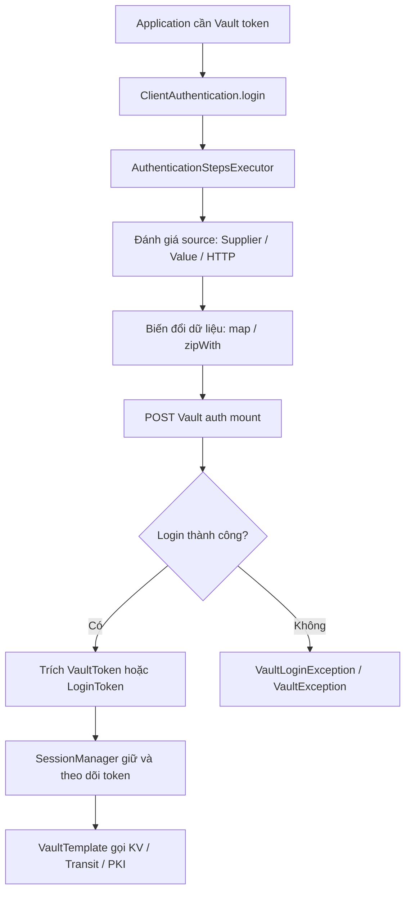
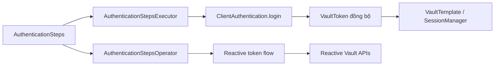

# AuthenticationStepsExecutor cho đăng nhập đồng bộ trong Spring Vault

Trong module **SPRING_VAULT**, ứng dụng Java cần xác thực với HashiCorp Vault trước khi có thể gọi `VaultTemplate` để đọc KV secrets, dùng Transit encryption, xin chứng chỉ PKI hoặc lấy dynamic credentials. Với luồng đăng nhập gồm nhiều thao tác, Spring Vault cho phép mô tả các bước bằng **`AuthenticationSteps`** rồi thực thi bằng **`AuthenticationStepsExecutor`**. Lớp executor này chạy **đồng bộ (synchronous)** và triển khai giao diện **`ClientAuthentication`**, vì vậy có thể tham gia cơ chế quản lý phiên hiện có của Spring Vault.

Bài này thuộc chương **Authentication Steps**, tập trung trả lời: `AuthenticationStepsExecutor` làm gì, các bước được chạy theo thứ tự nào, cách gọi `login()`, cách tích hợp với `SessionManager`, cách chọn API đúng phiên bản, và cách xử lý lỗi mà không làm lộ thông tin xác thực. Ví dụ sử dụng **AppRole** vì thể hiện rõ cả khâu tạo login payload và gửi request đến Vault; nguyên tắc tương tự còn áp dụng cho những cơ chế xác thực workload được Spring Vault hỗ trợ.

## 1. Vì sao có AuthenticationStepsExecutor?

Khi dùng API truyền thống, mỗi phương thức xác thực của Spring Vault (ví dụ `AppRoleAuthentication`, `KubernetesAuthentication`) trực tiếp triển khai `ClientAuthentication.login()`. Cách này thích hợp khi chỉ cần cấu hình một phương thức có sẵn.

Nhưng nhiều cơ chế xác thực có cùng chuỗi thao tác:

1. Lấy danh tính hoặc credential ban đầu từ môi trường, secret store hoặc nguồn HTTP.
2. Chuyển đổi dữ liệu thành payload mà endpoint login Vault mong đợi.
3. Gửi yêu cầu login tới đúng auth mount.
4. Nhận và giải mã phản hồi xác thực để lấy Vault token.
5. Đưa token sang session management để những lời gọi Vault tiếp theo sử dụng.

`AuthenticationSteps` diễn tả **luồng thao tác**, còn `AuthenticationStepsExecutor` **thực thi** luồng đó theo mô hình blocking HTTP. Điều này giúp tái sử dụng một định nghĩa luồng với các executor khác nhau, đồng thời hỗ trợ ghép các bước như lấy dữ liệu, `map` và login.

| Thành phần | Vai trò | Có thực hiện HTTP khi khởi tạo? |
| --- | --- | --- |
| `AuthenticationSteps` | Định nghĩa các bước xác thực theo kiểu functional pipeline. | **Không**; chỉ mô tả luồng. |
| `AuthenticationSteps.Node<T>` | Bước trung gian mang dữ liệu kiểu `T`, cho phép `map`, `request`, `zipWith`. | Chưa; chỉ được diễn giải khi executor chạy. |
| `AuthenticationStepsExecutor` | Interpreter chạy luồng **đồng bộ**, implements `ClientAuthentication`. | Chạy khi gọi `login()` hoặc khi session manager cần login. |
| `AuthenticationStepsOperator` | Executor tương ứng cho **reactive** flow. | Kích hoạt khi luồng reactive được subscribe. |
| `SessionManager` | Cấp token cho các lời gọi `VaultTemplate`, quản lý phiên theo implementation. | Có thể yêu cầu login/renew khi cần. |
| `VaultTemplate` | Gọi API KV, Transit, PKI và các secret engine bằng token hợp lệ. | Dùng cơ chế session đã cấu hình. |

**Điểm dễ nhầm:** một dòng mã `AuthenticationSteps.fromSupplier(...)` **chưa gọi** supplier hoặc gửi request. Khi `AuthenticationStepsExecutor.login()` chạy, executor mới đánh giá supplier, biến đổi trạng thái và thực hiện bước login cuối cùng. Vì vậy nếu có lỗi đọc credential, lỗi có thể xuất hiện **lúc login**, không phải lúc tạo object steps.

### 1.1. Sơ đồ hoạt động



Luồng này chỉ tạo **Vault client token**. Nó không tự cấp thêm ACL policy. Nếu token không có quyền `read` trên `secret/data/payments/config`, lời gọi đọc KV vẫn bị `403` dù executor đã login thành công.

## 2. Các API cốt lõi cần nhớ

### 2.1. Các nguồn tạo bước đầu tiên

`AuthenticationSteps` có nhiều cách tạo nguồn đầu vào:

| API | Dữ liệu đầu vào | Khi nên dùng |
| --- | --- | --- |
| `AuthenticationSteps.just(VaultToken.of(...))` | Token đã có. | Luồng một bước dùng token được cung cấp trước; không gọi login endpoint. |
| `AuthenticationSteps.fromValue(value)` | Giá trị có sẵn. | Giá trị không cần tải lại khi thực thi, ví dụ tham số đã chuẩn bị. |
| `AuthenticationSteps.fromSupplier(supplier)` | `Supplier<T>` tính giá trị khi luồng được thực thi. | Lấy role ID/secret ID mới từ nguồn bảo mật hoặc ghép payload cho mỗi lần login. |
| `AuthenticationSteps.fromHttpRequest(request)` | Kết quả của một request HTTP ngoài. | Lấy metadata, identity document hoặc credential từ một HTTP source tin cậy. |
| `AuthenticationSteps.fromVaultRequest(request)` | Kết quả của một request tới Vault. | Tra cứu dữ liệu phục vụ đăng nhập hoặc unwrap với token khởi tạo phù hợp. |

Không gọi `just(VaultToken.of(...))` với token lâu dài rồi kỳ vọng executor tự tạo token mới khi token này hết hạn. Luồng `just` chỉ cung cấp token hiện có; khả năng tái xác thực phụ thuộc cơ chế cấp lại credential bên ngoài.

### 2.2. Biến đổi và kết thúc luồng

Một pipeline có thể dùng:

- `map(Function<T,R>)`: chuyển dữ liệu hiện tại sang kiểu khác, ví dụ chuyển identity claim thành login payload.
- `zipWith(otherSteps)`: kết hợp hai nguồn độc lập, ví dụ role ID và secret ID.
- `request(HttpRequest<R>)`: lấy thông tin bổ sung qua HTTP trong quá trình xây dựng trạng thái.
- `onNext(Consumer<T>)`: chạy tác vụ phụ khi đi qua state. Tránh log dữ liệu nhạy cảm từ state.
- `login("auth/{mount}/login", mount)`: **bước cuối**, POST state hiện tại tới API login Vault.
- `loginAt(mount)`: shortcut tạo đường dẫn `auth/<mount>/login`; có từ **Spring Vault 4.1**.
- `login(Function<T, VaultToken>)`: bước cuối chuyển trạng thái thành token qua hàm tùy chỉnh khi có nhu cầu đặc biệt.

`login(...)` hoặc `loginAt(...)` khép lại phần định nghĩa pipeline và trả về `AuthenticationSteps`. Khi luồng đã đi qua terminal operation, không tiếp tục nối thêm `map` lên đối tượng `AuthenticationSteps` nữa.

### 2.3. Kết quả của executor

Theo Javadoc hiện hành:

```java
public class AuthenticationStepsExecutor implements ClientAuthentication {
    @Override
    public VaultToken login() throws VaultException {
        // Executor diễn giải các bước, gọi endpoint và lấy token.
    }
}
```

Đoạn trên chỉ minh họa **chữ ký phương thức**, không phải mã nguồn cài đặt. Trên thực tế:

- `VaultToken` là kiểu trả về chung của `ClientAuthentication.login()`.
- Khi Vault thực sự cấp token qua login, Spring Vault có thể biểu diễn token bằng `LoginToken` (subtype mang thông tin TTL/renewability).
- Khi dùng `AuthenticationSteps.just(VaultToken.of(...))`, kết quả là token đã cung cấp; không nhất thiết có dữ liệu thời hạn.
- Nếu Vault từ chối đăng nhập hoặc phản hồi không hợp lệ, executor có thể ném `VaultLoginException` hoặc `VaultException`. Mã gọi cần phân loại lỗi theo nguyên nhân, tránh log bearer token.

## 3. Ví dụ đầy đủ: đăng nhập AppRole đồng bộ

Ví dụ giả sử hệ thống Vault đã bật auth method AppRole tại mount `approle/`, có role ứng dụng với policy tối thiểu cho KV v2. AppRole login nhận hai giá trị:

```json
{
  "role_id": "<ROLE_ID>",
  "secret_id": "<SECRET_ID>"
}
```

Endpoint là:

```http
POST /v1/auth/approle/login
Content-Type: application/json

{
  "role_id": "<ROLE_ID>",
  "secret_id": "<SECRET_ID>"
}
```

**Không dùng root token** để đăng nhập AppRole. `role_id` định danh role, `secret_id` là credential cần bảo vệ như mật khẩu; lưu và phân phối bằng cơ chế secrets an toàn trong môi trường chạy, không hardcode hoặc commit vào Git.

### 3.1. Tạo AuthenticationSteps bằng Supplier

Mẫu dưới đây sử dụng API **Spring Vault 4.1+**. `VaultClient` dành cho yêu cầu đến Vault; `RestClient` có thể hỗ trợ các bước HTTP ngoài Vault trong luồng. Phần cấu hình endpoint, TLS, timeout và trust store cần chỉnh theo môi trường triển khai.

```java
import java.util.Map;
import java.util.function.Supplier;

import org.springframework.vault.authentication.AuthenticationSteps;
import org.springframework.vault.authentication.AuthenticationStepsExecutor;
import org.springframework.vault.authentication.ClientAuthentication;
import org.springframework.vault.client.VaultClient;
import org.springframework.vault.support.VaultToken;
import org.springframework.web.client.RestClient;

public final class AppRoleStepsFactory {

    private AppRoleStepsFactory() {
    }

    public static ClientAuthentication create(
            String vaultUrl,
            Supplier<String> roleIdSource,
            Supplier<String> secretIdSource) {

        AuthenticationSteps steps = AuthenticationSteps
                .fromSupplier(() -> Map.of(
                        "role_id", required(roleIdSource.get(), "role_id"),
                        "secret_id", required(secretIdSource.get(), "secret_id")))
                .login("auth/{mount}/login", "approle");

        // Dành cho HTTP đến Vault, với endpoint HTTPS hợp lệ.
        VaultClient vaultClient = VaultClient.create(vaultUrl);

        // Dành cho HTTP nguồn ngoài Vault; flow AppRole đơn giản
        // này chưa cần HTTP ngoài nhưng constructor 4.1 nhận cả client.
        RestClient externalRestClient = RestClient.create();

        return new AuthenticationStepsExecutor(
                steps, vaultClient, externalRestClient);
    }

    private static String required(String value, String name) {
        if (value == null || value.isBlank()) {
            // Chỉ nêu tên field; không ghi giá trị credential.
            throw new IllegalStateException("Thiếu thông tin " + name);
        }
        return value;
    }

    // Minh họa một lần login thủ công trong thử nghiệm.
    public static void example(String vaultUrl) {
        ClientAuthentication authentication = create(
                vaultUrl,
                () -> System.getenv("VAULT_ROLE_ID"),
                () -> System.getenv("VAULT_SECRET_ID"));

        VaultToken vaultToken = authentication.login();

        // Có token để gọi Vault nhưng tuyệt đối không in vaultToken.
        if (vaultToken == null) {
            throw new IllegalStateException("Không nhận được Vault token");
        }
    }
}
```

Điểm quan trọng của đoạn mã:

1. `fromSupplier(...)` chỉ **đăng ký** cách chuẩn bị payload. Mỗi khi executor thực thi login, supplier mới gọi hai nguồn credential.
2. `Map.of(...)` dùng đúng key `role_id` và `secret_id` theo Vault API; cả hai giá trị phải khác `null`.
3. `login("auth/{mount}/login", "approle")` tạo request POST tương ứng với auth mount `approle`. Nếu mount được đổi tên, phải dùng đúng tên mount.
4. `VaultClient.create(vaultUrl)` cấu hình endpoint Vault cho API mới. Trong production, phải bổ sung cấu hình TLS, namespace, proxy, timeout và trust store phù hợp; không dùng HTTP không mã hóa.
5. `AuthenticationStepsExecutor` trả về dưới kiểu `ClientAuthentication` vì chính lớp này triển khai giao diện ấy.
6. `authentication.login()` chạy đồng bộ; thread gọi phải đợi đến khi đăng nhập hoàn tất hoặc có lỗi. Với các API Java nghiệp vụ, nên để `SessionManager` gọi login thay vì gọi thủ công ở mọi request.

Cách sử dụng biến môi trường ở trên chỉ phục vụ minh họa luồng. Với workload production, nên dùng secret manager, workload identity, response wrapping hoặc cơ chế bảo mật phù hợp; biến môi trường vẫn có nguy cơ lộ nếu cấu hình và quyền truy cập host không chặt chẽ.

### 3.2. Diễn giải thứ tự chạy của ví dụ

```text
Tại thời điểm create(...):
    - Khai báo Supplier -> Map -> login("auth/{mount}/login", "approle")
    - Tạo VaultClient và RestClient
    - Tạo AuthenticationStepsExecutor
    - Chưa gửi request và chưa sinh token

Tại thời điểm executor.login():
    1. Gọi roleIdSource.get()
    2. Gọi secretIdSource.get()
    3. Kiểm tra input, tạo Map role_id/secret_id
    4. POST tới auth/approle/login
    5. Xử lý Vault response và lấy VaultToken / LoginToken
    6. Trả token hoặc ném exception
```

Vì supplier chạy lúc login, nếu `roleIdSource` đọc một nguồn động thì nó có thể lấy giá trị mới sau khi credential được xoay vòng. Nếu sử dụng `fromValue(...)` với một giá trị tĩnh, pipeline sẽ tái sử dụng giá trị đã được cung cấp ở lúc xây dựng.

**Lưu ý:** xây dựng lại object `AuthenticationSteps` cho mỗi request Vault là không cần thiết. Cơ chế xác thực được chạy theo vòng đời phiên, còn các lệnh đọc KV/Transit/PKI thường dùng lại token hiện hành thông qua session manager.

### 3.3. Dùng shortcut loginAt trên Spring Vault 4.1+

Nếu dùng phiên bản từ **4.1** và endpoint login có dạng chuẩn `auth/<mount>/login`, có thể thay dòng terminal bằng:

```java
AuthenticationSteps steps = AuthenticationSteps
        .fromSupplier(() -> Map.of(
                "role_id", roleIdSource.get(),
                "secret_id", secretIdSource.get()))
        .loginAt("approle");
```

`loginAt("approle")` và `login("auth/{mount}/login", "approle")` cùng hướng tới đường dẫn login AppRole chuẩn. Nếu auth method dùng endpoint không theo khuôn này, hãy dùng `login(uriTemplate, vars...)` thích hợp. Không nối tùy tiện `/v1` vào tên mount vì client phụ trách API prefix khi gọi Vault.

## 4. Tận dụng factory của phương thức xác thực có sẵn

Spring Vault đã có `AppRoleAuthentication.createAuthenticationSteps(options)`. Khi không cần tự tạo payload, sử dụng factory giúp tái sử dụng logic AppRole của framework, đặc biệt trong các tình huống lấy hoặc unwrap `RoleId`/`SecretId`.

Ví dụ:

```java
import org.springframework.vault.authentication.AppRoleAuthentication;
import org.springframework.vault.authentication.AppRoleAuthenticationOptions;
import org.springframework.vault.authentication.AppRoleAuthenticationOptions.RoleId;
import org.springframework.vault.authentication.AppRoleAuthenticationOptions.SecretId;
import org.springframework.vault.authentication.AuthenticationSteps;
import org.springframework.vault.authentication.AuthenticationStepsExecutor;
import org.springframework.vault.authentication.ClientAuthentication;
import org.springframework.vault.client.VaultClient;
import org.springframework.web.client.RestClient;

// roleId/secretId đến từ nguồn bí mật đã được cấu hình an toàn.
AppRoleAuthenticationOptions options = AppRoleAuthenticationOptions.builder()
        .roleId(RoleId.provided(roleId))
        .secretId(SecretId.provided(secretId))
        .build();

AuthenticationSteps steps =
        AppRoleAuthentication.createAuthenticationSteps(options);

VaultClient vaultClient = VaultClient.create(vaultUrl);
RestClient externalClient = RestClient.create();

ClientAuthentication authentication =
        new AuthenticationStepsExecutor(steps, vaultClient, externalClient);

// Trong môi trường lab, một lần login thủ công:
authentication.login();
```

Factory của AppRole có thể xử lý nhiều kiểu cung cấp credential hơn hai chuỗi đã chuẩn bị sẵn, như `SecretId.wrapped(...)` hoặc `SecretId.pull(...)` khi cấu hình đầy đủ. Trong các tình huống đó, executor có thể phải chạy thêm các request để unwrap/pull credential rồi mới gọi login.

| Cách tạo steps | Ưu điểm | Điểm cần lưu ý |
| --- | --- | --- |
| `fromSupplier(...).login(...)` tự xây | Dễ nhìn từng bước; phù hợp luồng tùy biến hoặc học tập. | Tự chịu trách nhiệm đặt đúng endpoint/payload và bảo vệ credential. |
| `AppRoleAuthentication.createAuthenticationSteps(options)` | Dùng lại logic AppRole của Spring Vault, gồm các mode cung cấp RoleId/SecretId. | Phải hiểu các tùy chọn của AppRole, token ban đầu nếu dùng pull/wrapped. |
| Dùng trực tiếp `new AppRoleAuthentication(options, vaultClient)` | Gọn nếu chỉ cần AppRole synchronous, không phải tự cấu hình executor. | Ít linh hoạt hơn khi muốn tái sử dụng một pipeline với reactive executor. |

Không nên tạo thêm logic unwrap hoặc pull thủ công chỉ để có “nhiều bước” khi factory đã hỗ trợ chức năng ấy.

## 5. Constructor thay đổi theo phiên bản Spring Vault

API của `AuthenticationStepsExecutor` thay đổi theo thời gian. Khi nâng cấp, cần đối chiếu Javadoc đúng version đang dùng trong dự án:

| Spring Vault | Constructor minh họa | Ghi chú |
| --- | --- | --- |
| **2.x–3.x** | `AuthenticationStepsExecutor(steps, RestOperations)` | API đồng bộ dựa trên Spring `RestOperations`, thường là `RestTemplate`. |
| **4.0** | `AuthenticationStepsExecutor(steps, RestClient)` | Hỗ trợ Spring Framework `RestClient`. |
| **4.1+** | `AuthenticationStepsExecutor(steps, VaultClient, RestClient)` | API tường minh cho Vault và HTTP ngoài Vault. Constructor `RestOperations` được đánh dấu deprecated từ 4.1. |

Ví dụ nếu dự án sử dụng **Spring Vault 3.x** và đã có `RestOperations` được cấu hình để gọi Vault (bao gồm base URL, HTTPS và client cần thiết), cách tạo executor là:

```java
// Chỉ dành cho Spring Vault 3.x hoặc nhánh hỗ trợ API cũ.
// restOperations phải được cấu hình đúng endpoint và message converters.
AuthenticationSteps steps = AppRoleAuthentication.createAuthenticationSteps(options);
ClientAuthentication authentication =
        new AuthenticationStepsExecutor(steps, restOperations);
```

Với 4.1+, dùng `VaultClient` cho yêu cầu Vault; `RestClient` cho HTTP ngoài Vault. Không trộn một constructor trong ví dụ của phiên bản khác rồi kết luận code sai khi IDE báo thiếu signature.

Với những luồng chỉ gọi Vault, truyền `RestClient.create()` làm client nguồn ngoài là đủ để trình bày khái niệm. Nếu có bước `fromHttpRequest(...)` truy cập identity endpoint, phải cấu hình `RestClient` riêng cho endpoint đó, gồm TLS, timeout, redirect policy và thông tin xác thực phù hợp. Không tự động gửi **Vault token** đến mọi HTTP endpoint ngoài Vault.

## 6. Cơ chế đồng bộ và sự khác biệt với reactive

`AuthenticationStepsExecutor.login()` là **lệnh đồng bộ**:

- Luồng gọi phương thức phải chờ việc đọc credential, các HTTP request và Vault login kết thúc.
- Khi có lỗi mạng, lỗi Vault hoặc lỗi lập trình ở supplier/map, exception được ném trên luồng gọi.
- Phù hợp ứng dụng dùng `VaultTemplate` đồng bộ, quy trình startup, batch job hoặc worker thread dành cho I/O blocking.
- Nếu dùng trong vòng event loop của Reactor/WebFlux, thao tác blocking có thể làm giảm khả năng phục vụ yêu cầu. Không gọi trực tiếp `login()` trên event loop.

Spring Vault cung cấp executor reactive `AuthenticationStepsOperator` dùng cùng mô hình `AuthenticationSteps`, nhưng trả token theo cơ chế reactive. Khi thực thi reactive, phải sử dụng client tương ứng và cấu hình đúng, thay vì ép một executor blocking hoạt động như non-blocking chỉ bằng cách gói kết quả trong `Mono.just(...)`.



**Không suy luận rằng mọi phương thức xác thực đều có đầy đủ AuthenticationSteps reactive.** Một số cơ chế dùng SDK riêng của cloud và có thể chỉ hỗ trợ xác thực đồng bộ trong các phiên bản Spring Vault nhất định. Cần kiểm tra tính năng theo auth method thực tế.

## 7. Tích hợp với SessionManager và VaultTemplate

Sau khi executor trả `VaultToken`, ứng dụng cần cơ chế gắn token với các lời gọi Vault. Spring Vault dùng `SessionManager` nhằm cung cấp token đang hợp lệ cho `VaultTemplate`.

Luồng chuẩn nên là:

```text
ClientAuthentication (AuthenticationStepsExecutor)
    |
    v
SessionManager quản lý Vault token
    |
    v
VaultTemplate đọc/ghi KV, Transit, PKI...
```

Ví dụ phương thức tạo `ClientAuthentication` cho cấu hình Spring Vault:

```java
// Trong cấu hình Spring Vault đã có vaultUrl, nguồn RoleId và SecretId.
// Ví dụ Spring Vault 4.1+.
@Override
public ClientAuthentication clientAuthentication() {
    return AppRoleStepsFactory.create(
            vaultUrl, roleIdSource, secretIdSource);
}
```

Đoạn này giả định cấu hình kế thừa/triển khai cơ chế configuration thích hợp và các field `vaultUrl`, `roleIdSource`, `secretIdSource` được khai báo. Phần tạo `VaultTemplate`/`SessionManager` sử dụng framework configuration tương ứng; đây là đoạn **tích hợp**, không phải một class Java độc lập đầy đủ.

Khi sử dụng `LifecycleAwareSessionManager`:

1. Lúc chưa có token, session manager gọi `ClientAuthentication.login()`; executor chạy pipeline.
2. Vault trả token kèm TTL và thuộc tính renewability (thường ở `LoginToken` khi đăng nhập qua auth method).
3. Session manager theo dõi TTL, có thể xin gia hạn token khi được phép.
4. Khi token chạm giới hạn gia hạn hoặc không còn dùng được, session manager có thể đăng nhập lại để lấy token mới nếu auth method vẫn cung cấp được credential hợp lệ.
5. `VaultTemplate` dùng token mà session manager cung cấp cho các request tương ứng.

Điều này giải thích vì sao **Supplier có thể được gọi lại** khi session manager phải đăng nhập mới. Tuy nhiên, renew token đang có **không đồng nghĩa** chạy lại pipeline login; session manager có thể gọi API renewal mà không yêu cầu AppRole login lại.

### 7.1. LoginToken so với VaultToken

| Loại | Thông tin và hành vi | Tác động thực tế |
| --- | --- | --- |
| `VaultToken` | Bao bọc giá trị token; chưa nhất thiết chứa TTL/renewable. | Ví dụ từ `AuthenticationSteps.just(...)` hoặc token được cung cấp sẵn. |
| `LoginToken` | Token phát hành qua login và có thông tin TTL/renewability. | Session manager có dữ liệu để lên lịch gia hạn hoặc đăng nhập lại. |

Nếu dùng một token được cấu hình sẵn, `LifecycleAwareSessionManager` có thể tra cứu thông tin TTL qua `lookup-self` tùy thiết lập và quyền token. **Token tĩnh** không tự trở thành credential có thể đăng nhập lại, nên khi token hết hạn vẫn cần quy trình xoay vòng hoặc phương thức workload authentication phù hợp.

Đừng lưu thủ công token vừa login vào biến static để chia sẻ giữa nhiều ứng dụng. Token là credential nhạy cảm, và việc quản lý vòng đời nằm ở lớp session.

## 8. Bảo mật khi thiết kế các bước xác thực

Một pipeline có thể đi qua nhiều giá trị trung gian: cloud JWT, role ID, secret ID, token khởi tạo dùng để unwrap, thông tin từ metadata endpoint. Cần bảo vệ chúng ở từng bước.

| Rủi ro | Cách phòng tránh |
| --- | --- |
| Log toàn bộ `Map` login payload trong `map` hoặc `onNext`. | Không log state chứa `secret_id`, JWT, bearer token hoặc HTTP headers. |
| Đọc role ID/secret ID từ file chứa secret được commit. | Dùng cơ chế phân phối bí mật phù hợp và quyền truy cập tối thiểu. |
| Dùng URL HTTP thay HTTPS. | Kiểm tra TLS và CA/trust store; không vô hiệu xác minh chứng chỉ. |
| Gửi Vault token sang HTTP endpoint ngoài khi dùng `fromHttpRequest`. | Dùng RestClient riêng, chỉ gắn thông tin xác thực cần thiết cho từng đích. |
| Hardcode Vault login mount hoặc namespace sai. | Cấu hình endpoint/mount/namespace rõ ràng và kiểm tra trước deploy. |
| Tạo lại token trên mọi lời gọi đọc secret. | Sử dụng `SessionManager` để quản lý phiên và tái đăng nhập khi cần. |
| Dùng token root để kiểm thử. | Tạo auth role và Vault policy tối thiểu đại diện workload thật. |
| Retry vô hạn khi bị từ chối 403. | Phân loại lỗi quyền/credential; chỉ retry có giới hạn khi lỗi tạm thời. |

Nếu Auth method yêu cầu response wrapping, cần đảm bảo wrapping token chỉ được **unwrap một lần** và bảo vệ không khác gì credential. Với AppRole pull mode, token dùng để lấy SecretID cũng phải được cấp quyền hẹp và không được ghi log.

## 9. Lỗi thường gặp và cách chẩn đoán

| Dấu hiệu | Nguyên nhân khả dĩ | Hướng xử lý |
| --- | --- | --- |
| `login()` trả 403 `permission denied` | Sai role ID/secret ID, role không hợp lệ, secret ID hết hạn, thiếu quyền trên bước pull/unwrap hoặc login path sai. | Phân biệt bước nào thất bại; kiểm tra auth mount và credential trong môi trường test. |
| `404` tại `auth/approle/login` | Auth method chưa bật ở mount đó hoặc path sai. | Kiểm tra auth mount thực, không ghép lặp `/v1`. |
| `login()` không chạy supplier như mong đợi | Chỉ mới tạo `AuthenticationSteps` hoặc gọi `fromValue` thay vì `fromSupplier`. | Xem lại thời điểm thực thi pipeline. |
| `Map.of(...)` ném `NullPointerException` | Một nguồn credential trả null. | Kiểm tra đầu vào và fail fast, không ghi giá trị null/secret vào lỗi. |
| `RestClient` không kết nối được Vault | Chưa cấu hình endpoint/base URL, DNS/TLS/proxy sai. | Dùng `VaultClient` phù hợp version và xác minh cấu hình mạng, CA. |
| IDE báo constructor không tồn tại | Dùng ví dụ 4.1 trong dự án 3.x, hoặc ngược lại. | Đối chiếu dependency/version và Javadoc constructor tương ứng. |
| Login thành công nhưng đọc KV bị 403 | Vault token thiếu `read` trên đường dẫn KV v2 thực. | Kiểm tra policy tại `secret/data/<path>` và capability của token. |
| Token hết hạn, session không login lại | `ClientAuthentication` không cung cấp credential còn hợp lệ hoặc session manager cấu hình sai. | Kiểm tra workload identity/AppRole SecretID rotation và token lifecycle. |
| 429/5xx/lỗi mạng | Vault quá tải hoặc phụ thuộc HTTP không sẵn sàng. | Timeout rõ ràng, retry giới hạn có backoff, giám sát. |

Spring Vault có thể ném `VaultLoginException`/`VaultException` trong các lỗi từ Vault. Ngoài ra supplier hoặc client HTTP có thể phát sinh runtime exception khác khi truy xuất metadata/credential. Không xử lý mọi exception bằng cách quay về root token hoặc dùng credential dự phòng quá rộng quyền.

### 9.1. Ví dụ xử lý lỗi ở cấp ứng dụng

```java
import org.springframework.vault.VaultException;
import org.springframework.vault.authentication.ClientAuthentication;

// auth là ClientAuthentication dùng AuthenticationStepsExecutor.
try {
    authentication.login();
} catch (VaultException ex) {
    // Ghi loại lỗi / request correlation theo chính sách observability.
    // Tránh log toàn bộ request body hoặc token.
    throw new IllegalStateException("Đăng nhập Vault thất bại", ex);
}
```

Ví dụ này minh họa xử lý ở điểm biên của luồng login thủ công. Ở production, nếu session manager quản lý login/re-login, nên xử lý và giám sát ở vòng đời phiên thay vì gọi `login()` độc lập trong mọi service method. Khi log exception từ thư viện HTTP, cần cấu hình redaction để không đưa secret vào log hoặc APM.

## 10. Kiểm thử tích hợp có ý nghĩa

Dùng Vault trong môi trường thử nghiệm (Vault dev cô lập hoặc Testcontainers) với AppRole riêng và policy chỉ cho đọc một secret. Không dùng root token làm credential cho luồng xác thực của ứng dụng.

Bộ kiểm thử nên tập trung vào **hành vi**:

1. **Login thành công:** tạo `AuthenticationSteps` với role ID và secret ID đúng; `executor.login()` trả về một token hợp lệ. Không in token.
2. **Sai SecretID:** nguồn supplier trả secret ID không hợp lệ; login thất bại với lỗi phù hợp và không trả token.
3. **Sai mount:** thay `approle` bằng mount không tồn tại; yêu cầu login thất bại, qua đó chứng minh đường dẫn là một phần quan trọng của flow.
4. **Supplier thực thi khi login:** dùng supplier có bộ đếm trong test; chỉ tạo steps/executor chưa gọi supplier; sau khi `login()` được thực thi thì bộ đếm tăng. Không cần kiểm tra số request nội bộ không liên quan.
5. **Quyền tối thiểu:** token login thành công đọc được `secret/data/payments/config` nếu policy cho phép; gọi endpoint không được cấp quyền trả 403.
6. **Tái đăng nhập:** cho token TTL ngắn, cấu hình session manager và kiểm tra hệ thống có thể lấy token mới khi cần theo auth method, thay vì chỉ sửa tay một biến string token.
7. **Lỗi mạng/timeout:** thử Vault không sẵn sàng và kiểm tra ứng dụng phát hiện lỗi xác thực, xử lý có giới hạn, không rò rỉ credential.

### 10.1. Bảng đầu vào/kỳ vọng

| Trường hợp | Role ID | Secret ID | Endpoint | Kết quả mong đợi |
| --- | --- | --- | --- | --- |
| Hợp lệ | Đúng | Đúng | `auth/approle/login` | Login thành công, có Vault token. |
| Secret ID sai | Đúng | Sai | `auth/approle/login` | Login bị từ chối. |
| Mount sai | Đúng | Đúng | `auth/not-configured/login` | Endpoint lỗi 404 hoặc lỗi phù hợp. |
| Không có secret ID khi role yêu cầu | Đúng | Trống/null | `auth/approle/login` | Fail fast hoặc Vault từ chối theo thiết kế. |
| Token có policy read-only | Đúng | Đúng | Login đúng | Read KV được phép, update KV bị từ chối. |
| Vault timeout | Đúng | Đúng | Login đúng nhưng Vault không phản hồi | Login lỗi với timeout; không tự bỏ qua xác thực. |

Trong bài lab nên thu hồi token và SecretID test sau khi dùng. Nếu dùng token renewal, phân biệt test **login pipeline** với test **renewal của session manager**, vì renewal không bắt buộc gọi lại supplier.

## 11. Bài tập tự kiểm tra

**Câu 1.** Một ứng dụng gọi `AuthenticationSteps.fromSupplier(...)` rồi lập tức kiểm tra log và không thấy HTTP request. Có phải pipeline không chạy đúng?

**Đáp án:** Không. Mới khai báo luồng; supplier và HTTP chỉ chạy khi executor thực thi, ví dụ `AuthenticationStepsExecutor.login()`.

**Câu 2.** Có `AuthenticationSteps` AppRole rồi muốn dùng đồng bộ trong `VaultTemplate`. Cần chọn executor nào?

**Đáp án:** `AuthenticationStepsExecutor`, vì nó triển khai `ClientAuthentication`. Dùng kết quả như một `ClientAuthentication` trong session configuration phù hợp, để `VaultTemplate` nhận Vault token do session manager quản lý.

**Câu 3.** `login()` trả `VaultToken`. Có thể đưa nội dung token vào log để debug không?

**Đáp án:** Không. Đây là bearer credential. Chỉ nên log trạng thái thành công/thất bại, loại phương thức xác thực, thời lượng và mã lỗi đã lọc an toàn.

**Câu 4.** Dự án đang dùng Spring Vault 3.2 nhưng IDE không tìm thấy constructor `AuthenticationStepsExecutor(steps, vaultClient, restClient)`. Sửa thế nào?

**Đáp án:** Constructor ba tham số này xuất hiện ở Spring Vault 4.1. Trên 3.x dùng constructor với `RestOperations` đã được cấu hình đúng; hoặc nâng cấp dependency có kiểm thử tương thích.

**Câu 5.** Workload có `ClientAuthentication` hoạt động và login thành công, nhưng token không đọc được KV v2. Có phải executor chưa thực hiện xong login?

**Đáp án:** Không nhất thiết. Vault token có thể đã được cấp nhưng ACL policy thiếu capability `read` trên `secret/data/<path>`. Cần kiểm tra policy và đường dẫn API thực.

**Câu 6.** Tại sao dùng `fromSupplier` thay cho `fromValue` khi secret ID xoay vòng liên tục?

**Đáp án:** Supplier được đánh giá khi login nên có thể lấy secret ID hiện hành từ nguồn phù hợp. `fromValue` chứa giá trị đã chuẩn bị từ lúc tạo flow, có nguy cơ dùng credential cũ nếu pipeline được tái sử dụng. Tuy nhiên vẫn phải đảm bảo supplier thực sự tải giá trị mới và không cache sai.

**Câu 7.** Khi session manager renew Vault token, nó có nhất thiết gọi lại `AuthenticationStepsExecutor.login()` không?

**Đáp án:** Không. Renew của token hiện hành và login để lấy token mới là hai thao tác khác nhau. Executor được gọi khi cần **đăng nhập**, không phải cho mọi lần renewal.

## 12. Những điểm cần ghi nhớ

- `AuthenticationSteps` **mô tả** luồng xác thực; `AuthenticationStepsExecutor` **chạy** luồng đồng bộ khi gọi `login()`.
- Executor triển khai `ClientAuthentication` và trả `VaultToken`. Các login-based auth thường cung cấp `LoginToken` có TTL và renewable để quản lý phiên.
- `fromSupplier` cho dữ liệu được lấy lúc thực thi; `map` biến đổi state; `login("auth/{mount}/login", mount)` thực hiện POST tới Vault. Từ 4.1 có `loginAt(mount)`.
- Với Spring Vault 4.1+, constructor được khuyến nghị là `AuthenticationStepsExecutor(steps, vaultClient, restClient)`; dự án 2.x–3.x dùng API `RestOperations` tương ứng.
- `SessionManager` giúp sử dụng token ổn định và xử lý vòng đời. Không gọi login thủ công mỗi lần cần đọc secret.
- Luồng đồng bộ có I/O blocking; ứng dụng reactive cần executor/cơ chế reactive phù hợp.
- Giữ bí mật RoleId/SecretID, JWT, token và HTTP headers; cấp Vault ACL tối thiểu và kiểm thử bằng workload token thật.

Tài liệu chính thức để đối chiếu API theo phiên bản:

1. [Spring Vault – Authentication Methods và Authentication Steps](https://docs.spring.io/spring-vault/reference/vault/authentication.html).
2. [Spring Vault – AuthenticationStepsExecutor Javadoc](https://docs.spring.io/spring-vault/reference/api/java/org/springframework/vault/authentication/AuthenticationStepsExecutor.html).
3. [Spring Vault – AuthenticationSteps Javadoc](https://docs.spring.io/spring-vault/reference/api/java/org/springframework/vault/authentication/AuthenticationSteps.html).
4. [Spring Vault – AuthenticationSteps.Node Javadoc](https://docs.spring.io/spring-vault/reference/api/java/org/springframework/vault/authentication/AuthenticationSteps.Node.html).
5. [Spring Vault – AppRoleAuthentication Javadoc](https://docs.spring.io/spring-vault/reference/api/java/org/springframework/vault/authentication/AppRoleAuthentication.html).
6. [HashiCorp Vault – AppRole auth method](https://developer.hashicorp.com/vault/docs/auth/approle).

Khi tách biệt rõ **định nghĩa pipeline**, **executor chạy login** và **session manager quản lý token**, ứng dụng Java có thể duy trì luồng xác thực đồng bộ có cấu trúc, dễ kiểm thử và đủ linh hoạt cho các phương thức xác thực workload của Vault.
