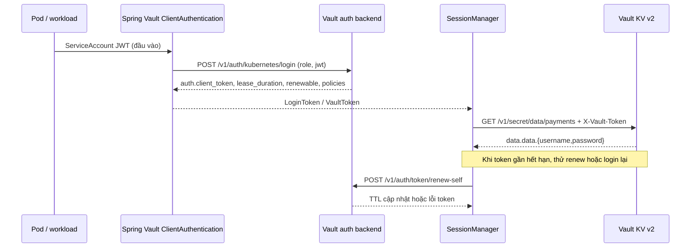

# Truyền dữ liệu và đường dẫn giữa các bước

Trong Spring Vault, quá trình xác thực không kết thúc ở việc gửi một mật khẩu hay token tới HashiCorp Vault. Ứng dụng phải lấy **bằng chứng danh tính của workload**, truyền đúng dữ liệu tới **đường dẫn đăng nhập của auth method**, nhận **Vault client token**, rồi đưa token đó vào các yêu cầu đọc KV secrets, mã hóa Transit hoặc cấp chứng thư PKI. Những dữ liệu và đường dẫn này thuộc các bước khác nhau; nhầm chúng với nhau là nguyên nhân phổ biến gây lỗi `403`, `404` hoặc gửi bí mật tới sai endpoint.

Bài thuộc chương **Authentication Steps**, trong module `SPRING_VAULT`. Mục tiêu là theo dõi chính xác **dữ liệu nào đi qua bước nào**, **URL nào được gọi**, **Spring Vault giữ token ra sao**, cùng cách phân biệt lỗi authentication, authorization và lỗi dữ liệu nghiệp vụ. Ví dụ chính dùng Kubernetes workload identity và KV v2; AppRole, AWS, TLS certificate, Transit và PKI được đối chiếu để tránh áp dụng sai đường dẫn.

## 1. Nhìn tổng thể: từ danh tính workload đến tài nguyên Vault

Luồng tiêu biểu có sáu chặng:



Sơ đồ biểu diễn trách nhiệm logic; trong ứng dụng thực tế `VaultTemplate` gửi request thông qua HTTP client có gắn token mà `SessionManager` cung cấp. `SessionManager` không phải proxy HTTP đứng giữa Vault và ứng dụng.

| Bước | Thành phần chịu trách nhiệm | Đầu vào | Đầu ra chuyển sang bước sau |
| --- | --- | --- | --- |
| 1. Thu thập danh tính | Kubernetes, AWS SDK, AppRole secret source, TLS keystore… | Cấu hình runtime và danh tính workload | JWT, credential, chứng thư hoặc dữ liệu ký |
| 2. Tạo request login | `ClientAuthentication` | Role, auth mount và bằng chứng danh tính | HTTP request tới `auth/<mount>/login` |
| 3. Vault xác thực | Vault auth backend | Login request + cấu hình role | `auth.client_token`, TTL, renewable, policies |
| 4. Duy trì session | `SessionManager` | `LoginToken`/`VaultToken` | Token hiện hành để gọi Vault |
| 5. Gọi nghiệp vụ | `VaultTemplate`, `VaultOperations` | Token + mount/path + request data | KV secret, Transit result, PKI certificate… |
| 6. Gia hạn/đăng nhập lại | Lifecycle manager và auth client | Trạng thái TTL, token renewal, credential gốc | Token tiếp tục hợp lệ hoặc token mới |

**Hai hợp đồng độc lập** cùng tham gia: Vault xác thực *workload là ai* ở bước 2–3; policy của token quyết định *workload được làm gì* ở bước 5. Login thành công không bảo đảm quyền đọc mọi secret.

## 2. Ba lớp đường dẫn cần phân biệt

Đường dẫn Vault thường có dạng HTTP `/v1/<route>`. Trong đó:

1. **Địa chỉ máy chủ**: ví dụ `https://vault.example.internal:8200`, được tạo từ `spring.cloud.vault.uri` hoặc `VaultEndpoint`.
2. **Auth mount path**: tên gắn với một phương thức xác thực, ví dụ `kubernetes` hoặc `approle-team`; client ghép thành `/v1/auth/kubernetes/login` hoặc `/v1/auth/approle-team/login`.
3. **Secrets engine mount path**: ví dụ `secret`, `transit`, `pki_int`; path sau mount phụ thuộc API từng engine.

| Phạm vi | Ví dụ HTTP path | Giá trị nghiệp vụ | Ý nghĩa |
| --- | --- | --- | --- |
| Kubernetes auth login | `POST /v1/auth/kubernetes/login` | Role `payments-reader` | Đăng nhập bằng ServiceAccount JWT |
| AppRole auth login | `POST /v1/auth/approle-team/login` | `role_id` và `secret_id` | Đăng nhập bằng AppRole |
| Cert auth login | `POST /v1/auth/cert/login` | Tên cert role tùy chọn; chứng thư nằm trong TLS handshake | Vault kiểm tra TLS client identity |
| Token renewal | `POST /v1/auth/token/renew-self` | Vault token hiện tại | Xin gia hạn token nếu được phép |
| Token lookup | `GET /v1/auth/token/lookup-self` | Vault token hiện tại | Xem metadata token hiện hành |
| KV v2 read | `GET /v1/secret/data/payments` | Tên logical key `payments` | Đọc secret thuộc mount `secret` |
| KV v2 metadata | `GET /v1/secret/metadata/payments` | Tên key `payments` | Xem version/metadata, yêu cầu policy riêng |
| Transit encrypt | `POST /v1/transit/encrypt/orders` | Plaintext Base64 trong request | Nhận ciphertext do Transit trả |
| PKI issue | `POST /v1/pki_int/issue/short-lived` | CN, SAN hoặc tham số role cho phép | Cấp chứng thư theo PKI role |

Từ `kubernetes`, `approle-team`, `secret`, `transit`, `pki_int` trong bảng là **mount name có thể thay đổi**. Vault không bắt buộc mọi tổ chức dùng tên mặc định. Các tên `payments-reader`, `payments`, `orders` và `short-lived` là những loại định danh khác nhau: **auth role**, **secret key**, **Transit key** và **PKI role**. Không dùng chúng thay thế cho nhau.

Ví dụ quản trị viên mount Kubernetes auth tại `auth/k8s-prod` thì client phải đăng nhập `/v1/auth/k8s-prod/login`. Tên role `payments-reader` nằm trong JSON body, **không** biến thành `/v1/auth/k8s-prod/payments-reader/login`.

## 3. Bước 1: lấy bằng chứng danh tính mà không làm lộ bí mật

Ứng dụng chạy trong Kubernetes thường có ServiceAccount JWT tại đường dẫn được runtime mount, chẳng hạn:

```text
/var/run/secrets/kubernetes.io/serviceaccount/token
```

Đây là **đường dẫn file bên trong container**, không phải URL của Vault và cũng không phải đường dẫn lưu secret trong KV. Client đọc JWT bằng cơ chế authentication của Spring Vault. Bản JWT thực tế chứa dữ liệu nhạy cảm và có thể hết hạn hoặc được kubelet thay mới; không đưa nó vào config được commit hoặc log.

Các auth method khác thu thập dữ liệu khác nhau:

| Auth method | Dữ liệu gốc cần truyền | Nguồn điển hình | Lưu ý |
| --- | --- | --- | --- |
| Kubernetes | JWT, tên Vault auth role | Projected ServiceAccount token + cấu hình role | Role của Vault ràng buộc ServiceAccount/namespace/audience |
| AppRole | `role_id`, `secret_id` | Secret provisioning an toàn | Secret ID có TTL và số lần dùng riêng |
| AWS-IAM | Yêu cầu STS `GetCallerIdentity` có chữ ký SigV4 | IAM credentials qua AWS credential provider | Có thể dùng IMDS trên EC2; không gửi access key thô vào login JSON |
| AWS-EC2 | EC2 PKCS#7 instance identity và nonce | EC2 metadata service | IMDSv2 cần metadata session token riêng, không phải Vault token |
| Azure MSI / GCP | Managed identity token hoặc identity JWT theo giao thức provider | Metadata endpoint hoặc IAM credentials API | Đường dẫn/token không giống AWS hoặc Kubernetes |
| TLS certificate | Chứng thư client và private key ở TLS client; cert role tùy chọn | Keystore/SSLContext | Private key **không** nằm trong body login |

Thư viện và HTTP client phải hỗ trợ đúng phương thức theo phiên bản. Không tự suy đoán một khóa cấu hình Spring Cloud Vault từ tên Java builder API: hãy đối chiếu tài liệu của đúng nhánh phụ thuộc.

## 4. Bước 2: ghép đường dẫn login và body chính xác

Đối với Kubernetes auth được mount tại `kubernetes`, Spring Vault tạo request có nội dung tương tự:

```http
POST /v1/auth/kubernetes/login HTTP/1.1
Host: vault.example.internal:8200
Content-Type: application/json

{
  "role": "payments-reader",
  "jwt": "<SERVICE_ACCOUNT_JWT>"
}
```

Giá trị `jwt` là bằng chứng danh tính đầu vào; `role` là tên role **trên Vault server**. Vault sẽ kiểm tra JWT và các điều kiện role. Request đăng nhập thường **chưa có Vault token** trong `X-Vault-Token`, vì mục đích của nó chính là xin token đầu tiên.

Trong AppRole, body thay đổi hoàn toàn:

```http
POST /v1/auth/approle-team/login HTTP/1.1
Host: vault.example.internal:8200
Content-Type: application/json

{
  "role_id": "<ROLE_ID>",
  "secret_id": "<SECRET_ID>"
}
```

Các chuỗi `<...>` là placeholder, không phải credential hợp lệ. Cùng một service có thể đổi từ Kubernetes sang AppRole bằng cách thay `ClientAuthentication` và role provisioning; `VaultTemplate` phía nghiệp vụ vẫn làm việc với **Vault token** sau đăng nhập. Không tự gửi cả JWT Kubernetes, `role_id` lẫn `secret_id` trong một login body; mỗi backend có hợp đồng riêng.

Đường dẫn cấp role có thể khác đường dẫn đăng nhập:

```text
# Người quản trị cấu hình role AppRole:
auth/approle-team/role/orders

# Workload đăng nhập qua AppRole:
auth/approle-team/login

# Workload gửi role_id / secret_id trong JSON body, không gửi "orders" trong URL.
```

Nếu Vault dùng namespace (Vault Enterprise/HCP Vault Dedicated trong cấu hình liên quan), client có thể cần header `X-Vault-Namespace`; namespace là **ranh giới định tuyến** tách với auth mount, không nên tự nối tùy ý vào role hoặc secret path.

## 5. Bước 3: đọc phản hồi login và chuyển token cho session

Khi credential và role hợp lệ, Vault có thể phản hồi JSON như sau:

```json
{
  "request_id": "request-id-for-test-only",
  "auth": {
    "client_token": "vault-token-for-test-only",
    "accessor": "accessor-for-test-only",
    "policies": ["default", "payments-read"],
    "token_policies": ["default", "payments-read"],
    "lease_duration": 1800,
    "renewable": true,
    "token_type": "service"
  }
}
```

`auth.client_token` mới là token dùng cho request tiếp theo. `auth.accessor` là mã tham chiếu token để quản trị/thu hồi khi được phép; nó **không** thay thế `X-Vault-Token`. `lease_duration` ở `auth` mô tả TTL token đăng nhập; nó khác `lease_duration` của secret động ở phản hồi từ secrets engine.

Spring Vault bao gói token qua `ClientAuthentication` và `SessionManager`, thường dùng `LoginToken` có metadata TTL/renewability. `LifecycleAwareSessionManager` có thể chủ động gia hạn hoặc đăng nhập lại tùy loại token, điều kiện renewal và credential đầu vào. Ở tầng ứng dụng, không cần parse `auth.client_token` thủ công rồi gắn token vào một `RestTemplate` tự tạo nếu đang sử dụng `VaultTemplate` được cấu hình sẵn.

**Thứ tự chuyển giao cần nhớ:** credential gốc → login request → `auth.client_token` → session manager → header `X-Vault-Token` của các request Vault tiếp theo. Role, token và secret payload không có cùng mức độ bảo mật hoặc thời gian sống.

## 6. Bước 4: từ session token đến đường dẫn KV v2

Sau khi có token hợp lệ, request đọc secret `payments` thuộc KV v2 mount `secret` có dạng:

```http
GET /v1/secret/data/payments HTTP/1.1
Host: vault.example.internal:8200
X-Vault-Token: vault-token-for-test-only
```

Phản hồi giả tối thiểu:

```json
{
  "data": {
    "data": {
      "username": "demo_reader",
      "password": "fake-value-only"
    },
    "metadata": {
      "version": 4
    }
  }
}
```

Hai tầng `data` là đặc điểm của KV v2: `data.data` chứa nội dung secret, còn `data.metadata` chứa metadata version. Trong **Spring Vault Core**, dùng `VaultKeyValueOperations` để xử lý việc ghép đường dẫn:

```java
import org.springframework.vault.core.VaultKeyValueOperations;
import org.springframework.vault.core.VaultOperations;
import org.springframework.vault.core.VaultKeyValueOperationsSupport.KeyValueBackend;
import org.springframework.vault.support.VaultResponseSupport;

record PaymentSettings(String username, String password) {}

class PaymentSettingsService {
    private final VaultKeyValueOperations kv;

    PaymentSettingsService(VaultOperations vault) {
        this.kv = vault.opsForKeyValue("secret", KeyValueBackend.KV_2);
    }

    PaymentSettings load() {
        VaultResponseSupport<PaymentSettings> response =
                kv.get("payments", PaymentSettings.class);

        if (response == null || response.getData() == null) {
            throw new IllegalStateException("Payment secret is missing");
        }
        PaymentSettings settings = response.getData();
        if (settings.username() == null || settings.username().isBlank()
                || settings.password() == null || settings.password().isBlank()) {
            throw new IllegalArgumentException("Payment secret is incomplete");
        }
        return settings;
    }
}
```

Ví dụ yêu cầu Java 17+ và hỗ trợ ánh xạ `record` trong môi trường Jackson. Khi dùng `opsForKeyValue("secret", KV_2)`, `get("payments")` tương ứng API `/v1/secret/data/payments`; **không** truyền `"secret/data/payments"` làm key vì có nguy cơ nhân đôi mount và `data`. Đối với KV v1, endpoint và envelope JSON khác, nên cần chọn `KeyValueBackend.KV_1` nếu mount thực sự là v1.

Trong production, đừng ghi dữ liệu `password`, token, raw response hoặc JWT vào log. Nếu secret không tồn tại, kiểm tra hành vi null/404 của phiên bản Spring Vault thay vì biến mọi lỗi đọc thành `null`.

## 7. Cấu hình rõ auth mount và KV mount trong Spring Cloud Vault

Ví dụ dưới đây dành cho ứng dụng Spring Boot/Spring Cloud Vault dùng Kubernetes auth và muốn lấy cấu hình KV v2:

```yaml
spring:
  config:
    import: vault://
  cloud:
    vault:
      uri: https://vault.example.internal:8200
      authentication: KUBERNETES
      kubernetes:
        role: payments-reader
        kubernetes-path: k8s-prod
        service-account-token-file: /var/run/secrets/kubernetes.io/serviceaccount/token
      kv:
        enabled: true
        backend: secret
        backend-version: 2
        application-name: payments-service
```

Ý nghĩa ánh xạ:

| Property | Ảnh hưởng lên dữ liệu hoặc path |
| --- | --- |
| `uri` | Base URL Vault cho mọi request |
| `authentication` | Chọn logic `ClientAuthentication`; ở đây Kubernetes |
| `kubernetes.role` | Giá trị JSON `role` trong login request |
| `kubernetes.kubernetes-path` | Auth mount, tạo URL `/v1/auth/k8s-prod/login` |
| `kubernetes.service-account-token-file` | Nơi client đọc JWT, **không** phải mount Vault |
| `kv.backend` | Secrets engine mount `secret` |
| `kv.backend-version` | Chỉ ra KV v2 để client tạo đường dẫn `/data/` đúng API |
| `kv.application-name` | Tên ngữ cảnh cấu hình dùng khi Spring Cloud Vault tự tạo property sources |

Trong Spring Cloud Vault Config Data, `spring.config.import: vault://` yêu cầu nạp các property source từ Vault theo cấu hình. Việc tự dùng `VaultTemplate` để đọc key `payments` là một luồng khác: property source cho application context có thể dùng các path theo application name, default context và active profiles. **Không mặc định** rằng `kv.application-name: payments-service` luôn đọc `secret/data/payments`; thông thường nó liên quan tới context `payments-service` và biến thể theo profile. Cần xác định chính xác path được truy cập từ loại API đang dùng.

Nếu mount auth thực tế là `kubernetes`, thay `kubernetes-path` cho khớp. Nếu mount secret là `finance`, đổi `kv.backend` hoặc đối số `opsForKeyValue` tương ứng. Thay tên role **không** tự đổi mount; thay tên mount **không** tự cấp policy.

Đối với dự án chỉ dùng Spring Vault Core, các bean `ClientAuthentication`, `SessionManager`, `VaultTemplate` phải được cấu hình bằng đúng endpoint/path theo API của phiên bản đã resolve. Các property phía trên là API cấu hình của **Spring Cloud Vault** và không tự động có tác dụng nếu ứng dụng không dùng integration đó.

## 8. Chuỗi path thay đổi thế nào khi dùng Transit hoặc PKI?

Sau login, phần **`X-Vault-Token`** vẫn tương tự; chỉ secrets engine path và payload đổi theo engine.

### Transit encryption

```http
POST /v1/transit/encrypt/orders HTTP/1.1
Host: vault.example.internal:8200
X-Vault-Token: vault-token-for-test-only
Content-Type: application/json

{"plaintext":"cGF5bG9hZC1mb3ItdGVzdA=="}
```

```json
{"data":{"ciphertext":"vault:v1:FAKE_CIPHERTEXT"}}
```

`orders` là **Transit key name**, không phải auth role, KV key hay AppRole. Plaintext gửi vào Transit encrypt thường được Base64-encode theo API; `ciphertext` trả về có prefix `vault:v1:` theo phiên bản khóa. Transit không phải “lưu ciphertext vào KV” trừ khi ứng dụng tự quyết định lưu nó.

### PKI cấp chứng thư

```http
POST /v1/pki_int/issue/short-lived HTTP/1.1
Host: vault.example.internal:8200
X-Vault-Token: vault-token-for-test-only
Content-Type: application/json

{"common_name":"payments.internal.example","ttl":"1h"}
```

Phản hồi PKI có thể chứa `data.certificate`, `data.issuing_ca`, `data.ca_chain`, `data.serial_number` và private key nếu chọn kiểu API issue tạo khóa trên Vault. Đây là **dữ liệu cực kỳ nhạy cảm**: không log private key hay phản hồi đầy đủ. Cấu hình policy cần quyền gọi path `pki_int/issue/short-lived`; quyền login ở `auth/k8s-prod/login` không tự cấp quyền issue PKI.

### Dynamic secrets và lease

Database secrets engine có thể trả `lease_id`, `lease_duration`, `renewable` ở **cấp ngoài** response cùng credential nằm trong `data`. Lease của secret động và TTL của Vault client token là hai vòng đời riêng. Đổi token đăng nhập thành công **không** bảo đảm database credential đã cấp được gia hạn hoặc vẫn dùng được.

## 9. Phần nào đi qua login, phần nào đi qua session manager?

Một cách rà soát đơn giản là phân loại dữ liệu theo thời điểm:

| Thời điểm | Dữ liệu có mặt | Nơi gửi hoặc lưu | Quy tắc |
| --- | --- | --- | --- |
| Trước login | JWT, role ID/Secret ID, IAM signed request hoặc client certificate | Auth client → auth endpoint hoặc TLS handshake | Không in bí mật; TLS bắt buộc trong production |
| Trong login | `role`, `jwt`, `role_id`, `secret_id`... theo auth method | JSON body hoặc chứng thư ở TLS layer | Mỗi auth backend có schema riêng |
| Sau login | `auth.client_token`, TTL, renewable, policies | `SessionManager` | Token không nên tự copy vào static cache |
| Trong request nghiệp vụ | `X-Vault-Token`, endpoint và payload riêng từng engine | `VaultTemplate` → Vault | Policy quyết định path/capability |
| Renewal | Token hiện tại và metadata TTL | `auth/token/renew-self` | Chỉ thành công khi token đủ điều kiện gia hạn |
| Re-login | Credential gốc còn hợp lệ | `auth/<mount>/login` | Có thể tạo token mới; không dùng token cũ làm credential mặc định |

Với `LifecycleAwareSessionManager`, token renewable có thể được renew theo lịch. Nếu token không còn dùng được và auth method cho phép, lần lấy token mới có thể tiến hành login lại. **Không giả định mọi HTTP `403` từ KV sẽ tự động re-login và retry**: có thể đơn giản là policy thiếu quyền, hoặc một token bị revoke trước khi manager phát hiện qua renewal.

Mặt khác, một token được cấu hình tĩnh qua `TokenAuthentication` không có nguồn credential để tạo token khác: gọi lại `login()` vẫn chỉ nhận token đã cung cấp. Re-login thực sự cần phương thức xác thực workload có khả năng xin token mới.

## 10. Phân loại lỗi theo bước và path

Đừng chỉ đọc mã HTTP mà bỏ qua **URL nào vừa trả lỗi**:

| Nơi xảy ra | Dấu hiệu thường gặp | Cách chẩn đoán |
| --- | --- | --- |
| File JWT/credential | Không đọc được file, credential hết hạn, permission denied của OS | Kiểm tra volume mount, quyền đọc, cơ chế rotation và source credential |
| `/v1/auth/k8s-prod/login` | `400`/`403` | Role không tồn tại/không khớp JWT, auth mount sai, Vault auth plugin từ chối |
| `/v1/auth/k8s-prod/login` | `404` | Auth mount/path có thể sai hoặc chưa được bật; soát mount path thật |
| `/v1/secret/data/payments` | `404` | Key/version không tồn tại, mount hoặc đường dẫn KV v2 sai |
| `/v1/secret/data/payments` | `403` | Token còn hợp lệ nhưng không đủ `read`, hoặc token đã hết hiệu lực; phân loại thêm |
| `/v1/auth/token/renew-self` | `403` | Token không còn đủ điều kiện renew hoặc bị revoke |
| Bất kỳ endpoint HTTPS | TLS certificate/hostname error | Kiểm tra truststore, certificate chain, SAN và endpoint URL |
| `/v1/transit/encrypt/orders` | `403`/`404` | Transit policy, key name hoặc engine mount không đúng |
| `/v1/pki_int/issue/short-lived` | `403`/`400` | Quyền policy hoặc thuộc tính chứng thư không đáp ứng PKI role |

Một lỗi phổ biến là có policy:

```hcl
path "secret/payments" {
  capabilities = ["read"]
}
```

trong khi request thực tế tới KV v2:

```text
GET /v1/secret/data/payments
```

Đối với KV v2, policy cho thao tác đọc dữ liệu thường cần đường dẫn chứa `data/`:

```hcl
path "secret/data/payments" {
  capabilities = ["read"]
}
```

Không sửa lỗi `403` bằng cách cho workload policy rộng `secret/*` hoặc tự động re-login nhiều lần. Hãy xác định chính xác endpoint, capability và auth role đang được cấp.

## 11. Kiểm thử luồng truyền dữ liệu bằng phản hồi tối thiểu

Để kiểm tra một **HTTP contract test** của Spring Vault, có thể dựng fake Vault server và kiểm tra request theo thứ tự. Ví dụ kịch bản:

```text
1. POST /v1/auth/k8s-prod/login
   request: {"role":"payments-reader","jwt":"fake-jwt-for-test"}
   response: 200 {"auth":{"client_token":"token-a","lease_duration":3600,"renewable":true}}

2. GET /v1/secret/data/payments
   header: X-Vault-Token: token-a
   response: 200 {"data":{"data":{"username":"demo","password":"fake-only"},"metadata":{"version":1}}}

3. POST /v1/auth/token/renew-self  [nếu tình huống test yêu cầu renewal]
   header: X-Vault-Token: token-a
   response: 200 {"auth":{"client_token":"token-a","lease_duration":3600,"renewable":true}}
```

Trong kịch bản thử nghiệm, cấu hình metadata endpoint/JWT source theo phương thức mock thích hợp với Spring Vault phiên bản đang dùng; `fake-jwt-for-test` không hợp lệ với auth backend thật. Nếu dùng WireMock cho Vault, **nhớ xác minh cả URL, HTTP method, JSON body, header và thứ tự**; chỉ mock service trả `VaultResponse` không chứng minh rằng login đã truyền đúng role/path.

Ma trận kiểm thử:

| Case | Dữ liệu thay đổi | Điều cần khẳng định |
| --- | --- | --- |
| Login Kubernetes thành công | JWT giả + role đúng | Client gửi `POST /auth/k8s-prod/login`, token được đưa tới request tiếp |
| Auth mount đổi tên | `k8s-prod` → `k8s-stage` | URL login đổi đúng; role không bị thêm vào URL |
| Role không khớp | `payments-reader` → role bị từ chối | Không có KV request sau login thất bại |
| JWT không có hoặc file thiếu | Path ServiceAccount sai | Không gửi request với JWT rỗng hoặc in JWT ra log |
| KV backend thay đổi | `secret` → `finance` | URL KV đổi tương ứng, login mount giữ nguyên |
| KV v1/v2 | Thay backend-version | Client dùng đúng `/data/` với v2 và đúng response envelope |
| Vault token hết hiệu lực | Stub renew lỗi và login lại | Request sau dùng token mới khi session manager xác thực lại thành công |
| ACL thiếu quyền | KV trả `403` | Không retry login vô hạn; phân loại policy/path |
| Transit/PKI | Đổi endpoint và payload | Cùng token nhưng quyền và cấu trúc data riêng từng engine |
| Nhiều request đồng thời | Nhiều thao tác cùng cần session | Không vô tình tạo nhiều auth flow hoặc sử dụng token rò rỉ từ cache riêng |

Để có **integration test** đúng nghĩa, chạy Vault test instance với Kubernetes auth được cấu hình hợp lệ hoặc dùng một auth method test tương ứng, gán policy tối thiểu, tạo KV mount và xác minh chuỗi login → đọc secret → renew/re-login → đọc lại. Mock HTTP không thể chứng minh JWT được Vault chấp nhận hay policy thực sự được thực thi.

## 12. Gợi ý chẩn đoán mà vẫn bảo vệ bí mật

Khi cần tìm nguyên nhân luồng xác thực bị ngắt, log có cấu trúc có thể ghi:

```text
auth_method=kubernetes
auth_mount=k8s-prod
auth_role=payments-reader
stage=auth.login
http_status=403
outcome=denied
correlation_id=<NON_SECRET_ID>
```

Những trường này chỉ mang tính định hướng; ngay cả role hoặc namespace cũng có thể được xem là dữ liệu nhạy cảm theo chính sách tổ chức. **Không** ghi `jwt`, `secret_id`, IAM signed request, `X-Vault-Token`, private key, raw auth JSON hoặc nội dung secret. Với request lỗi, dùng mã trạng thái, stage, path đã được kiểm duyệt và thời gian để chẩn đoán.

Một trace tốt nên cho thấy các bước **credential load → login endpoint → token issuance → secret endpoint → renew/re-login**, nhưng không cần hiển thị giá trị credential. Trong công cụ giám sát, không gắn token hay Secret ID làm nhãn metric vì vừa rò rỉ dữ liệu vừa tạo độ phân mảnh số liệu rất lớn.

## 13. Bài thực hành

**Bối cảnh:** service `payments-service` chạy trên Kubernetes, Vault auth mount tên `k8s-prod`, role `payments-reader`, KV v2 mount `secret`, key `payments`; service cũng cần Transit encrypt với key `orders`.

1. Vẽ sơ đồ các bước từ file ServiceAccount JWT đến `VaultTemplate`; ghi ở mỗi mũi tên dữ liệu được chuyển và thành phần giữ dữ liệu.
2. Viết body login Kubernetes; chỉ ra vì sao `role` nằm trong JSON mà `k8s-prod` nằm trong URL.
3. Cấu hình Spring Cloud Vault gồm `uri`, `authentication`, `kubernetes.role`, `kubernetes.kubernetes-path`, `kv.backend` và `kv.backend-version`.
4. Dùng `VaultOperations.opsForKeyValue("secret", KV_2).get("payments")`, viết chính xác HTTP path tương ứng và tạo phản hồi JSON `data.data` tối thiểu.
5. Đưa thêm request Transit `/v1/transit/encrypt/orders`; chỉ ra dữ liệu nào dùng lại từ bước xác thực và dữ liệu nào thay đổi.
6. Thử tình huống login `403`, KV `403`, KV `404` và token renewal `403`; xác định bước và nguyên nhân cần kiểm tra cho từng lỗi.
7. Mô phỏng token A hết hiệu lực, xác thực lại lấy token B rồi quan sát request tiếp theo có sử dụng token B không, đồng thời kiểm tra không lộ token/JWT trong log.

**Tiêu chí hoàn thành:** học viên phân biệt được file path, auth mount, secrets engine mount, role và secret key; nêu đúng request/response của từng bước; hiểu `SessionManager` truyền token cho `VaultTemplate` như thế nào; và khoanh vùng được lỗi authentication so với lỗi policy hoặc dữ liệu.

## Tài liệu tham khảo

- [Spring Vault — Authentication](https://docs.spring.io/spring-vault/reference/vault/authentication.html)
- [Spring Vault — VaultTemplate](https://docs.spring.io/spring-vault/reference/vault/imperative-template.html)
- [Spring Cloud Vault — Authentication](https://docs.spring.io/spring-cloud-vault/reference/authentication.html)
- [Spring Cloud Vault — KV Backend](https://docs.spring.io/spring-cloud-vault/reference/secret-backends.html)
- [HashiCorp Vault — Kubernetes Auth API](https://developer.hashicorp.com/vault/api-docs/auth/kubernetes)
- [HashiCorp Vault — AppRole Auth API](https://developer.hashicorp.com/vault/api-docs/auth/approle)
- [HashiCorp Vault — KV v2 API](https://developer.hashicorp.com/vault/api-docs/secret/kv/kv-v2)
- [HashiCorp Vault — Token Auth API](https://developer.hashicorp.com/vault/api-docs/auth/token)
