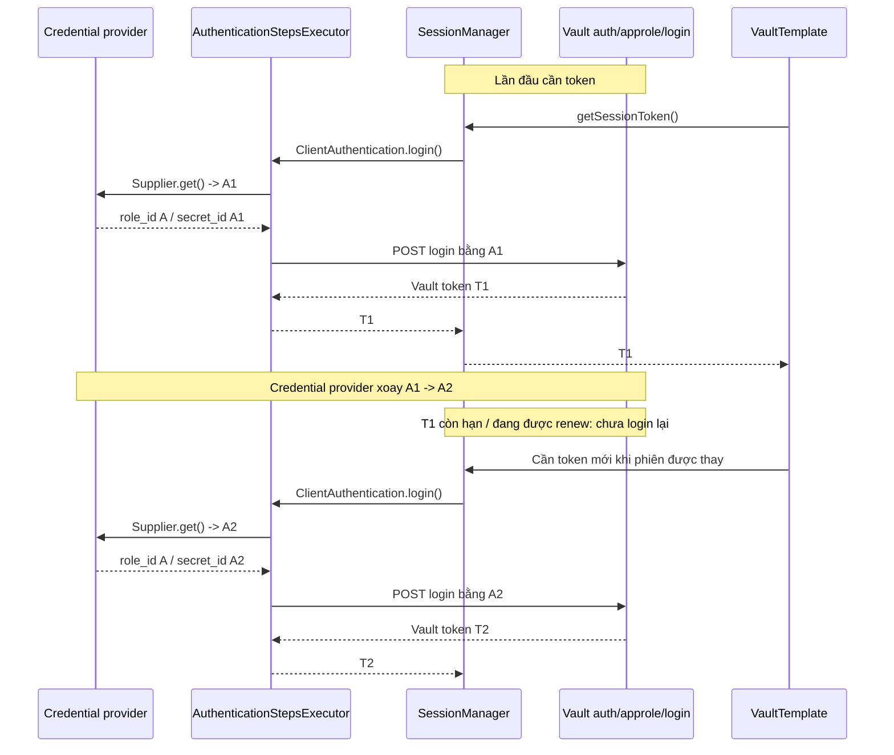

# Lấy thông tin xác thực mới qua supplier khi đăng nhập lại

## 1. Bài toán trong Authentication Steps

Một ứng dụng Java dùng **Spring Vault** để gọi HashiCorp Vault qua `VaultTemplate` thường không giữ Vault token vĩnh viễn. Ứng dụng đăng nhập bằng danh tính workload (AppRole, Kubernetes JWT, chứng thư, hoặc phương thức khác), nhận token có thời hạn, rồi dùng token đó để đọc KV secrets, gọi Transit encryption hay yêu cầu chứng thư PKI theo ACL.

Giả sử `order-service` dùng AppRole. Lúc khởi động, ứng dụng có `role_id=A` và `secret_id=A1`. Vài giờ sau, hệ thống phân phối credential thay SecretID thành `A2`. Khi Vault token cũ không còn dùng được và Spring Vault cần **đăng nhập lại**, request phải mang **SecretID mới**, không phải giá trị `A1` đã bị giữ trong bộ nhớ từ lúc dựng bean.

Đó là mục tiêu của **`AuthenticationSteps.fromSupplier(...)`**: mô tả nguồn sinh dữ liệu đầu vào để mỗi lần *thực thi lại luồng login*, Spring Vault có thể lấy trạng thái xác thực hiện hành.

Sau bài này, bạn sẽ biết:

- Phân biệt **đọc credential một lần lúc startup**, **đọc mới qua `Supplier` lúc login**, **gia hạn token** và **đăng nhập lại**.
- Sử dụng `AuthenticationSteps`, `AuthenticationStepsExecutor`, `ClientAuthentication` và `SessionManager` đúng vai trò.
- Cài đặt supplier lấy **đồng bộ một cặp** `role_id`/`secret_id`, phù hợp với rotation của workload.
- Thiết kế AppRole login có quyền tối thiểu, kiểm thử login A → rotation → login B và các lỗi có thể xảy ra.
- Quan sát quá trình re-login mà không log SecretID, token hoặc dữ liệu KV.

**Phạm vi mã Java:** ví dụ dùng các API của **Spring Vault 4.1.x**, đặc biệt `AuthenticationSteps.Node.loginAt(...)` và `AuthenticationStepsExecutor(..., VaultClient, RestClient)`. Với phiên bản cũ hơn, cần đối chiếu chữ ký API; ví dụ `.login("auth/{mount}/login", "approle")` có thể thay `.loginAt("approle")` trong phiên bản chưa có phương thức mới.

## 2. Phân biệt bốn thời điểm trong vòng đời xác thực

| Sự kiện | Spring Vault làm gì? | Supplier credential có được gọi? |
|---|---|---|
| **Dựng bean** | Tạo cấu hình, `AuthenticationSteps`, executor và session | Không nhất thiết. Chỉ tạo đối tượng `Supplier` chưa buộc đọc credential |
| **Login lần đầu** | `ClientAuthentication.login()` thực thi luồng, gửi dữ liệu đến Vault, nhận token | **Có**, khi luồng `fromSupplier` được executor chạy |
| **Renew token** | Session cố gia hạn chính token hiện tại nếu token còn khả năng renew | **Không**, vì không tạo login mới |
| **Re-login** | Session hoặc tác vụ vận hành yêu cầu một lần `login()` mới để nhận token khác | **Có**, supplier được đánh giá lại trong lần chạy luồng mới |

Từ đây có ba kết luận quan trọng.

Thứ nhất, **đổi nội dung file hoặc secret provider không tự kích hoạt re-login**. Nếu token cũ vẫn hợp lệ, `VaultTemplate` có thể tiếp tục dùng token đó. Thứ hai, supplier cho phép đọc mới **khi có login mới**, chứ không mặc định đọc credential trên từng request KV/Transit/PKI. Thứ ba, **renewal** và **re-login** có khác biệt: renewal tiếp tục dùng token cũ, trong khi re-login phát hành token khác theo quyền của danh tính hiện hành.

Nếu chương trình khởi tạo bằng:

```java
String secretId = credentialProvider.readSecretId(); // Chỉ đọc một lần.
Supplier<String> frozen = () -> secretId;            // Vẫn trả giá trị cũ.
```

thì việc dùng `Supplier` không giải quyết rotation. Cần đọc nguồn **bên trong lời gọi supplier**:

```java
Supplier<String> dynamic = credentialProvider::readSecretId;
```

Tuy nhiên với AppRole, tốt nhất supplier lấy **cả RoleID và SecretID như một snapshot nhất quán**; không đọc hai file/nguồn độc lập trong những thời điểm có thể khác nhau.

## 3. Authentication Steps, executor và session liên kết thế nào?



**`AuthenticationSteps`** mô tả các bước tạo dữ liệu đầu vào, biến đổi dữ liệu và thực hiện đăng nhập. **`AuthenticationStepsExecutor`** thực thi chúng theo mô hình đồng bộ và là một `ClientAuthentication`. **`SessionManager`** quyết định lúc nào gọi `login()`, cache token, có gia hạn hoặc tái xác thực hay không. **`VaultTemplate`** lấy token từ session rồi thực hiện API dữ liệu.

Trong Spring Vault, `LifecycleAwareSessionManager` có cơ chế theo dõi TTL, gia hạn token thích hợp và đăng nhập lại khi cần; `SimpleSessionManager` là lựa chọn đơn giản, không quản lý đầy đủ vòng đời renewal/revocation. Luồng kết hợp của dự án cần dùng **đúng một session manager** sở hữu token đang được `VaultTemplate` sử dụng.

| Thành phần | Câu hỏi cần trả lời |
|---|---|
| `Supplier<AppRoleCredentials>` | Lấy cặp credential mới từ đâu? Có trả snapshot cùng phiên bản không? |
| `AuthenticationSteps.fromSupplier` | Khi thực thi lần login này, lấy gì làm body? |
| `.loginAt("approle")` | Gửi body đến endpoint `auth/approle/login` nào? |
| `AuthenticationStepsExecutor` | Ai thực thi luồng và trả Vault token? |
| `LifecycleAwareSessionManager` | Khi nào dùng, renew, bỏ và xin token mới? |
| `VaultTemplate` | Token đang dùng có policy cho thao tác KV/Transit/PKI nào? |

## 4. Thiết kế credential supplier an toàn

### 4.1. Đọc cặp credential như một snapshot

Một nguồn credential có thể là secret volume được cập nhật nguyên tử, bộ phân phối credential của nền tảng hoặc service nội bộ đủ tin cậy. Dữ liệu đầu ra phải được kiểm tra trước khi gửi lên Vault.

```java
public record AppRoleCredentials(String roleId, String secretId) {

    public AppRoleCredentials {
        if (roleId == null || roleId.isBlank()) {
            throw new IllegalArgumentException("Missing AppRole role_id");
        }
        if (secretId == null || secretId.isBlank()) {
            throw new IllegalArgumentException("Missing AppRole secret_id");
        }
    }
}
```

Ví dụ kho credential thay thế snapshot nguyên khối bằng `AtomicReference`, thích hợp để **kiểm thử rotation** và minh họa tính nhất quán:

```java
import java.util.Objects;
import java.util.concurrent.atomic.AtomicReference;
import java.util.function.Supplier;

public final class RotatingCredentials implements Supplier<AppRoleCredentials> {

    private final AtomicReference<AppRoleCredentials> active;

    public RotatingCredentials(AppRoleCredentials initial) {
        active = new AtomicReference<>(Objects.requireNonNull(initial));
    }

    @Override
    public AppRoleCredentials get() {
        // Mỗi lần login lấy một snapshot của cả role_id/secret_id.
        return active.get();
    }

    public void replace(AppRoleCredentials next) {
        active.set(Objects.requireNonNull(next));
    }
}
```

Trong hệ thống thực, **bộ phận phân phối** credential chịu trách nhiệm gọi `replace(...)` sau khi xác minh cặp mới đã sẵn sàng. Nếu muốn đọc trực tiếp từ mounted secret, nhà cung cấp phải bảo đảm hai giá trị cùng một phiên bản. Chỉ dùng hai `Supplier<String>` độc lập có thể khiến một lần login nhận `role_id` mới với `secret_id` cũ trong thời điểm luân chuyển.

**Bảo mật:** `role_id` không phải mật khẩu, nhưng vẫn là dữ liệu định danh nhạy cảm theo chính sách tổ chức. `secret_id` là credential bí mật; không in cả record bằng `toString()`, không cho xuất hiện trong exception, trace, HTTP log hoặc dump cấu hình. Với production, nên dùng một kiểu credential không lộ dữ liệu qua `toString()`; record ở đây chỉ để làm rõ bài học.

### 4.2. Tránh vòng phụ thuộc khởi tạo

Nếu supplier cần đọc credential mới từ **một secret engine khác trong Vault**, mà lại dùng **chính `VaultTemplate` đang chờ token** để đọc, ứng dụng có thể tạo vòng lặp: cần token để lấy SecretID, nhưng cần SecretID để lấy token. Có thể giải quyết bằng một kênh phân phối độc lập, cơ chế secure introduction (response wrapping, token khởi tạo riêng, Kubernetes identity) hoặc auth method phù hợp workload.

Không tự động truy xuất SecretID bằng quyền quản trị Vault từ một app bình thường. Role phụ trách phát hành SecretID cần được phân quyền và giám sát riêng.

## 5. Xây dựng `AuthenticationSteps.fromSupplier` cho AppRole

Ví dụ dưới đây sử dụng endpoint AppRole mount mặc định `approle`. Nếu hệ thống mount AppRole tại tên khác, thay cả cấu hình mount và policy cho đúng.

```java
import java.util.Map;
import java.util.Objects;
import java.util.function.Supplier;

import org.springframework.vault.authentication.AuthenticationSteps;
import org.springframework.vault.authentication.AuthenticationStepsExecutor;
import org.springframework.vault.authentication.ClientAuthentication;
import org.springframework.vault.client.VaultClient;
import org.springframework.web.client.RestClient;

public final class SupplierAppRoleAuth {

    private SupplierAppRoleAuth() {
    }

    public static ClientAuthentication create(
            Supplier<AppRoleCredentials> credentials,
            VaultClient vaultClient,
            RestClient restClient) {

        Objects.requireNonNull(credentials);
        Objects.requireNonNull(vaultClient);
        Objects.requireNonNull(restClient);

        AuthenticationSteps steps = AuthenticationSteps
                .fromSupplier(() -> {
                    AppRoleCredentials latest =
                            Objects.requireNonNull(credentials.get(),
                                    "AppRole credential snapshot unavailable");

                    // Trả về một body nhất quán cho mỗi lần login.
                    return Map.of(
                            "role_id", latest.roleId(),
                            "secret_id", latest.secretId());
                })
                .loginAt("approle");

        return new AuthenticationStepsExecutor(
                steps, vaultClient, restClient);
    }
}
```

`VaultClient` và `RestClient` ở đây là **các client đã được cấu hình** với đúng Vault endpoint, TLS trust, timeout và yêu cầu bảo mật. Đặc biệt `RestClient` dùng cho các bước HTTP khác trong flow cần được cấu hình URL gốc phù hợp; không tạo một `RestClient` mặc định rồi mong nó tự biết địa chỉ Vault. Cấu hình client phụ thuộc phiên bản và cách triển khai Spring Vault của ứng dụng.

Khi executor chạy, nó đánh giá `fromSupplier(...)`, gửi body như sau lên `POST /v1/auth/approle/login`, nhận token và trả cho session manager:

```json
{
  "role_id": "<ROLE_ID_HIEN_HANH>",
  "secret_id": "<SECRET_ID_HIEN_HANH>"
}
```

Body này **được tạo lúc login**. Không tạo trước body dưới dạng một `Map` bất biến lưu trong bean nếu cần rotation. Ngoài ra, `AuthenticationSteps.fromValue(Map.of(...))` dùng một giá trị đã có sẵn, nên không thay thế được ý định “lấy mới ở mỗi lần login”.

### 5.1. Khác biệt giữa `fromSupplier` và `fromValue`

```java
// Snapshot được tạo lúc khởi tạo luồng: không tự cập nhật sau rotation.
AuthenticationSteps oldSteps =
        AuthenticationSteps.fromValue(
                Map.of("role_id", "example-old-role",
                       "secret_id", "example-old-secret"))
                .loginAt("approle");

// Supplier sẽ được gọi khi executor chạy luồng login.
AuthenticationSteps newSteps =
        AuthenticationSteps.fromSupplier(() -> {
                    AppRoleCredentials current = rotatingCredentials.get();
                    return Map.of(
                            "role_id", current.roleId(),
                            "secret_id", current.secretId());
                })
                .loginAt("approle");
```

Các giá trị `example-old-*` chỉ là **placeholder** để thấy khác biệt; không đưa credential thật vào source. Trong đoạn `newSteps`, biến `rotatingCredentials` được khởi tạo bằng lớp ở mục 4. Bản thân `fromSupplier` không tự chạy nền, theo dõi file, lắng nghe event hay tạo token mới.

### 5.2. Một lần login để chứng minh supplier lấy dữ liệu mới

Trong **môi trường kiểm thử cô lập**, có thể gọi trực tiếp cùng đối tượng `ClientAuthentication` hai lần (mỗi lần gọi `login()` là một lần xác thực riêng):

```java
// Các client được cấu hình sẵn cho Vault test.
RotatingCredentials rotating = new RotatingCredentials(credentialsA);
ClientAuthentication authentication =
        SupplierAppRoleAuth.create(rotating, vaultClient, restClient);

authentication.login(); // Dùng role_id/secret_id từ credentialsA.
rotating.replace(credentialsB);
authentication.login(); // Dùng role_id/secret_id từ credentialsB.
```

Đây là cách **kiểm tra hành vi của supplier và auth executor**. Hai lệnh `login()` có thể tạo hai token khác nhau; ví dụ không in chúng ra. Trong ứng dụng đang chạy, không tự tạo thêm login ngoài `SessionManager` rồi kỳ vọng `VaultTemplate` tự chuyển sang token mới đó. Phải để session quản lý việc lấy token hoặc thay session một cách chủ động, an toàn.

## 6. Cấu hình Vault thử nghiệm với AppRole và KV v2

Để kiểm thử, cần một Vault **dev/test riêng**, có auth method `approle`, KV v2 `kv-e2e` và policy cho đúng một secret. Chỉ chạy lệnh bật mount **nếu mount chưa tồn tại**.

```bash
vault auth enable approle
vault secrets enable -path=kv-e2e -version=2 kv

vault kv put -mount=kv-e2e app/config feature=on
```

Nội dung policy `e2e-kv-read.hcl`:

```hcl
path "kv-e2e/data/app/config" {
  capabilities = ["read"]
}
```

```bash
vault policy write e2e-kv-read e2e-kv-read.hcl
```

Tạo role chỉ dùng trong lab với token service có TTL hữu hạn:

```bash
vault write auth/approle/role/e2e-supplier \
  token_policies=e2e-kv-read \
  bind_secret_id=true \
  secret_id_num_uses=1 \
  secret_id_ttl=30m \
  token_type=service \
  token_ttl=2m \
  token_max_ttl=10m
```

Lấy RoleID và cấp **hai SecretID khác nhau** cho hai lượt login kiểm thử (đầu ra phải được bảo vệ):

```bash
vault read -field=role_id auth/approle/role/e2e-supplier/role-id

# Chạy lệnh cấp SecretID hai lần; phân phối kết quả riêng cho A và B.
vault write -f -field=secret_id auth/approle/role/e2e-supplier/secret-id
vault write -f -field=secret_id auth/approle/role/e2e-supplier/secret-id
```

Với `secret_id_num_uses=1`, mỗi SecretID chỉ được dùng cho **một login thành công**. Nếu ứng dụng tiếp tục login bằng A sau khi A đã dùng hết, Vault có thể trả lỗi xác thực. Đây là một phép thử hữu ích chứng minh B thật sự được cấp cho lần login thứ hai.

Đường dẫn `kv-e2e/data/app/config` thuộc API KV v2. Token được cấp phải có `read` trên đường dẫn này; xác thực thành công **không tự động cấp** quyền Transit, PKI hoặc đọc tất cả KV.

**Tách trách nhiệm:** automation quản trị lab được phép tạo role/cấp SecretID; workload Java chỉ nhận đúng credential đã phát hành. Không cấp quyền `auth/approle/role/*/secret-id` cho workload theo cách mặc định.

## 7. Token renewal, session và thời điểm re-login thật sự

`LifecycleAwareSessionManager` của Spring Vault theo dõi trạng thái token và có thể tự gia hạn service token khi `renewable=true` và còn trong giới hạn. Khi token không còn dùng được hoặc không thể tiếp tục renewal, một lần xác thực mới có thể xảy ra; lúc đó executor chạy supplier.

Ví dụ thời gian minh họa:

| Thời điểm | Credential source | Vault token hiện tại | Hành vi |
|---|---|---|---|
| 09:00 | SecretID A | Chưa có | `login()` đọc A, phát token T1 |
| 09:05 | SecretID A | T1 còn hạn | Request KV dùng T1, không cần đọc A lần nữa |
| 09:10 | SecretID B | T1 còn hạn | Token có thể vẫn được dùng/renew; B chưa chắc đã được đọc |
| 09:20 | SecretID B | T1 hết khả năng tiếp tục dùng | Re-login đọc B và lấy token T2 |
| 09:21 | SecretID B | T2 hợp lệ | Request KV theo policy của T2 |

Mốc giờ chỉ nhằm diễn giải, không khẳng định scheduler của Spring Vault thực hiện ở đúng phút cụ thể. Quyết định login lại phụ thuộc cấu hình phiên, trạng thái token và xử lý lỗi của `SessionManager`.

### 7.1. Nếu cần chuyển sang credential mới ngay

Có hai hướng triển khai cần định nghĩa rõ:

1. **Để session tự re-login khi cần:** phù hợp với rotation có **giai đoạn chồng lấp** A/B; nguồn credential B sẵn sàng trước khi token hiện tại hết hạn. Kiểm thử TTL, renewal và thời điểm login theo cấu hình thực.
2. **Thay phiên có kiểm soát:** dựng authentication/session mới từ provider hiện hành, xác minh phiên mới truy cập KV được, rồi chuyển các request mới sang client mới; hủy/thu hồi phiên cũ theo chính sách. Phải đồng bộ thay thế client và tránh huỷ token khi còn request đang dùng.

Không dùng thao tác **xóa token hoặc ép revoke bừa bãi** trên Vault production chỉ để kiểm tra supplier. Khi cần test forced re-login, sử dụng token và role cô lập trong Vault test.

### 7.2. Batch token và token tĩnh có tác động khác

Batch token không gia hạn được; session cần cơ chế lấy token mới trước/sau hết hạn. `TokenAuthentication` chỉ cung cấp token có sẵn, **không phải luồng login lấy AppRole credential mới**. Nếu ứng dụng chỉ giữ một token tĩnh mà không có auth method cấp lại, việc thêm supplier AppRole vào lớp không được session sử dụng sẽ không giúp khôi phục xác thực.

Nếu workload dùng Kubernetes JWT hoặc cert auth, nguyên tắc vẫn giống nhau: nguồn credential phải đọc được giá trị hiện hành **khi có login mới**, và transport/auth method tương ứng phải nạp đúng credential mới. Với TLS client certificate, thay file keystore còn cần tái cấu hình SSL context/client nếu HTTP client đang giữ chứng thư cũ.

## 8. Xử lý lỗi ở supplier và luồng login

| Hiện tượng | Nguyên nhân thường gặp | Hướng xử lý |
|---|---|---|
| Supplier trả `null`, RoleID/SecretID rỗng | Provider chưa cập nhật, đọc file lỗi hoặc bị xóa | Từ chối login sớm bằng lỗi đã lọc bí mật; kiểm tra phân phối credential |
| RoleID mới đi cùng SecretID cũ | Đọc nhiều nguồn không nhất quán khi rotate | Dùng một snapshot nguyên tử hoặc một phiên bản credential duy nhất |
| Login đầu thành công, login sau trả 403 | SecretID hết TTL/uses, đã revoke hoặc không thuộc role | Kiểm tra vòng đời SecretID và thời điểm `get()`; cấp mới trong test |
| Đổi SecretID nhưng chỉ thấy renew T1 | Chưa có re-login; token cũ vẫn renewable | Kiểm tra sự kiện login mới, không suy từ request KV |
| Login bằng B thành công nhưng KV trả 403 | B thuộc role/policy không có `read` cho key | Kiểm tra ACL `kv-e2e/data/app/config` và namespace/mount |
| Supplier cần Vault token mà session đang xin | Vòng phụ thuộc khởi tạo credential | Thiết kế kênh secure introduction độc lập |
| Provider bị 5xx, timeout, TLS sai | Sự cố phân phối credential | Retry/backoff có giới hạn; giữ lỗi rõ ràng, không log secret |
| Login đồng thời nhiều thread | Nhiều request xin token đúng thời điểm expiry | Để session đồng bộ login; nhà cung cấp phải thread-safe |
| SecretID `num_uses=1` tiêu thụ nhưng response login mất | Login lại cùng SecretID có thể thất bại | Quy trình cấp SecretID mới sau sự cố; không retry vô hạn với giá trị cũ |

Supplier không nên nuốt lỗi rồi **fallback vô thời hạn về SecretID cũ**. Nếu nguồn hiện hành không khả dụng, cần phân loại lỗi tạm thời/không thể khôi phục và có chính sách giới hạn retry phù hợp. Nếu áp dụng cache credential để tăng độ sẵn sàng, phải có TTL, nguồn gốc và cơ chế hết hiệu lực rõ ràng.

### 8.1. Không log dữ liệu nhạy cảm

Một `record` Java mặc định có `toString()` in các field; vì thế **không log cả `AppRoleCredentials`**, `Map` login hay exception mang request body. `role_id` và nhất là `secret_id` phải được truyền qua kênh bảo mật, với quyền đọc file/token hạn chế. Vault token từ `auth/approle/login` cũng là bearer secret.

Quan sát nên ghi `login_attempt`, `login_success`, thời lượng, loại lỗi, tên auth method, phiên bản rollout **không nhạy cảm** của nguồn credential và trạng thái token ở mức tổng quát. Không ghi giá trị SecretID, RoleID, token, accessor hay payload KV vào log/metric/tracing.

## 9. Kiểm thử tích hợp: chứng minh supplier thực sự lấy B

Thiết kế test trên Vault test với hai SecretID A/B được phát hành riêng và policy đọc KV v2. Để giảm nhiễu, nên tách kiểm thử supplier **trực tiếp qua executor** khỏi kiểm thử **vòng đời session**.

### 9.1. Kiểm thử executor có hai lần login

1. Cấp RoleID và SecretID A, SecretID B (mỗi SecretID một lần sử dụng); đặt snapshot A vào `RotatingCredentials`.
2. Tạo `AuthenticationSteps` với `fromSupplier(rotating::get)` và executor chỉ **một lần**.
3. Gọi `authentication.login()` lần một; xác nhận Vault cấp token và token này đọc được `kv-e2e/data/app/config`.
4. Thay snapshot A bằng B, giữ **nguyên executor/AuthenticationSteps**.
5. Gọi `authentication.login()` lần hai; xác nhận Vault cấp token khác hợp lệ và có quyền đọc KV. Không in token.
6. Với fixture riêng, thử login lại bằng A đã dùng hết; Vault phải từ chối. Kết quả này giúp phát hiện supplier vẫn giữ A.
7. Kiểm tra audit event của Vault test (đã lọc thông tin) hoặc bộ đếm gọi provider để xác nhận **mỗi lần login** có một lần lấy credential hiện hành.

Không tạo một executor mới từ B để thay cho bước 4–5 nếu mục tiêu là chứng minh **chính supplier của executor cũ** đã đọc giá trị mới; tạo mới executor sẽ không phân biệt được supplier động với giá trị được đóng băng lúc khởi tạo.

### 9.2. Kiểm thử `VaultTemplate` và session

Với một phiên có `LifecycleAwareSessionManager`, xác minh thêm:

- Sau login đầu, nhiều request `VaultTemplate.read(...)` có thể dùng cùng token T1: supplier **không nhất thiết được gọi mỗi request**.
- Nếu T1 được renew, supplier không cần đọc lại SecretID; điều này là hành vi đúng.
- Khi session thực sự tạo token mới, phải có sự kiện login mới; supplier trả SecretID mới và token T2 đọc được KV.
- Nếu SecretID B bị thu hồi/hết hạn, login mới thất bại; ứng dụng phân loại lỗi xác thực thay vì trả dữ liệu cũ như thể request thành công.
- Nếu ACL của role B bị thu hẹp, login vẫn có thể thành công nhưng `VaultTemplate.read` bị từ chối; lỗi xác thực khác lỗi phân quyền.
- Khi Vault mất kết nối, session không được quay vòng login vô hạn và không tiết lộ credential trong retry logs.

### 9.3. Ma trận kiểm thử cô đọng

| Case | Trạng thái | Kỳ vọng |
|---|---|---|
| S1 | Supplier A, login lần đầu | Token T1 dùng KV thành công |
| S2 | Supplier B, thực thi **cùng executor** lần nữa | Token T2 dùng KV thành công, B đã được đọc |
| S3 | Supplier vẫn A đã tiêu thụ `num_uses=1` | Login mới thất bại |
| S4 | Supplier trả snapshot rỗng | Fail trước khi gọi login endpoint |
| S5 | Token T1 còn hạn dù provider đã có B | Request dùng T1 thành công nhưng **chưa chứng minh** re-login |
| S6 | T1 được renew | Không có yêu cầu đọc credential mới |
| S7 | Session thật sự re-login sau rotate | Supplier cung cấp B; token mới được dùng |
| S8 | B hợp lệ nhưng policy thiếu KV read | Login thành công, KV 403 |
| S9 | Supplier/ Vault timeout | Có retry/backoff giới hạn, không log bí mật |

Không viết test cần `sleep` rất lâu chỉ để chờ TTL nếu test harness có thể chủ động tạo session mới trên môi trường cô lập. Trường hợp nghiệm thu **lifecycle thực tế** vẫn cần một bài test riêng với TTL ngắn và các điều kiện scheduler được xác minh.

## 10. Thiết kế vận hành khi credential xoay vòng

Một quy trình rotation ổn định có thể đi theo trình tự:

1. **Phát hành credential mới B** từ nguồn có thẩm quyền và kiểm tra B dùng được ở môi trường/role phù hợp.
2. **Phân phối B nguyên tử** đến workload hoặc đưa B vào kho credential có version; chỉ công bố version mới sau khi cả RoleID và SecretID đã sẵn sàng.
3. **Đảm bảo executor đọc mới ở lần login sau**: supplier trỏ vào provider hiện hành, không đóng băng bản A tại startup.
4. **Cho phép giai đoạn chồng lấp** B và A đủ lâu để request đang dùng token T1 hoàn tất; chọn thời điểm chuyển session theo yêu cầu nghiệp vụ.
5. **Quan sát login bằng B** và request kiểm thử quyền tối thiểu; kiểm tra cả Vault auth event và hành vi KV.
6. **Thu hồi SecretID A khi phù hợp**; hiểu rằng việc thu hồi SecretID không nhất thiết thu hồi những Vault token đã được cấp trước đó. Token cũ có vòng đời revoke/TTL riêng.
7. **Dọn dữ liệu tạm** và kiểm tra logs/metrics không chứa SecretID/token. Cập nhật runbook xử lý trường hợp credential mới không hợp lệ.

Với Kubernetes JWT, chứng thư hoặc IAM credentials, nhà cung cấp credential có thể là kênh khác với AppRole; nguyên lý **read-current-at-login** vẫn áp dụng nhưng bước tạo payload và API đăng nhập phải theo đúng auth method. Chỉ chọn supplier dạng AppRole khi workload thực sự dùng AppRole.

**Khi nào không nên tự viết Authentication Steps?** Nếu cấu hình push/pull/wrapped của `AppRoleAuthentication` sẵn có đáp ứng quy trình cấp phát và rotation, hãy dùng triển khai đó. `AuthenticationSteps.fromSupplier` hữu ích khi bạn cần một luồng **tùy biến rõ ràng** để lấy dữ liệu hiện hành, kết hợp nhiều nguồn, hoặc muốn kiểm thử chính xác thời điểm đọc credential.

## 11. Câu hỏi tự kiểm tra

**Câu 1.** Một bean giữ `String secretId` lấy lúc startup. Code đổi thành `Supplier<String> supplier = () -> secretId`. Có đọc được SecretID mới khi re-login không?

**Trả lời:** Không. Lambda vẫn trả giá trị `secretId` đã lấy trước đó. Cần gọi lại credential provider bên trong supplier, hoặc supplier đọc một snapshot cập nhật nguyên tử.

**Câu 2.** SecretID B đã thay A trong provider nhưng `VaultTemplate.read` vẫn dùng T1. Đó có phải bug của `fromSupplier`?

**Trả lời:** Chưa chắc. Session có thể giữ/renew T1 vì chưa cần login mới. `fromSupplier` chỉ chạy khi executor thực hiện lại luồng login.

**Câu 3.** Tại sao nên lấy `role_id` và `secret_id` dưới dạng cùng một record/snapshot?

**Trả lời:** Tránh đọc một giá trị trước rotation và giá trị còn lại sau rotation, dẫn tới cặp credential không khớp nhau.

**Câu 4.** Nếu lần login thứ hai bằng B thành công nhưng đọc KV trả 403, cần điều tra ở đâu?

**Trả lời:** Kiểm tra Vault token policy và ACL path KV v2 `kv-e2e/data/app/config`. Login AppRole đúng không đồng nghĩa đủ quyền đọc secret.

**Câu 5.** Có thể dùng `fromSupplier` để tự gia hạn token hay tự làm mới chứng thư TLS đã được HTTP client cache không?

**Trả lời:** Không. Token renewal do session/token lifecycle quản lý; thay TLS certificate có thể cần xây lại SSL context và client. Supplier chỉ đóng vai trò cung cấp dữ liệu đầu vào khi bước của luồng xác thực được thực thi.

## 12. Tài liệu tham khảo

- [Spring Vault Reference – Authentication Methods và Authentication Steps](https://docs.spring.io/spring-vault/reference/vault/authentication.html)
- [Spring Vault API – AuthenticationSteps](https://docs.spring.io/spring-vault/reference/api/java/org/springframework/vault/authentication/AuthenticationSteps.html)
- [Spring Vault API – AuthenticationSteps.Node](https://docs.spring.io/spring-vault/reference/api/java/org/springframework/vault/authentication/AuthenticationSteps.Node.html)
- [Spring Vault API – AuthenticationStepsExecutor](https://docs.spring.io/spring-vault/reference/api/java/org/springframework/vault/authentication/AuthenticationStepsExecutor.html)
- [Spring Vault API – LifecycleAwareSessionManager](https://docs.spring.io/spring-vault/reference/api/java/org/springframework/vault/authentication/LifecycleAwareSessionManager.html)
- [HashiCorp Vault – AppRole auth method](https://developer.hashicorp.com/vault/docs/auth/approle)

**Ghi nhớ:** `AuthenticationSteps.fromSupplier` cho phép **lấy credential hiện hành tại thời điểm thực thi một lần login**. Nó không tự quyết định **khi nào** login lại. Muốn rotation có hiệu lực an toàn trong Spring Vault, phải phối hợp supplier lấy snapshot mới, executor tạo Vault token, session quản lý vòng đời token và kiểm thử request thật bằng `VaultTemplate`.
