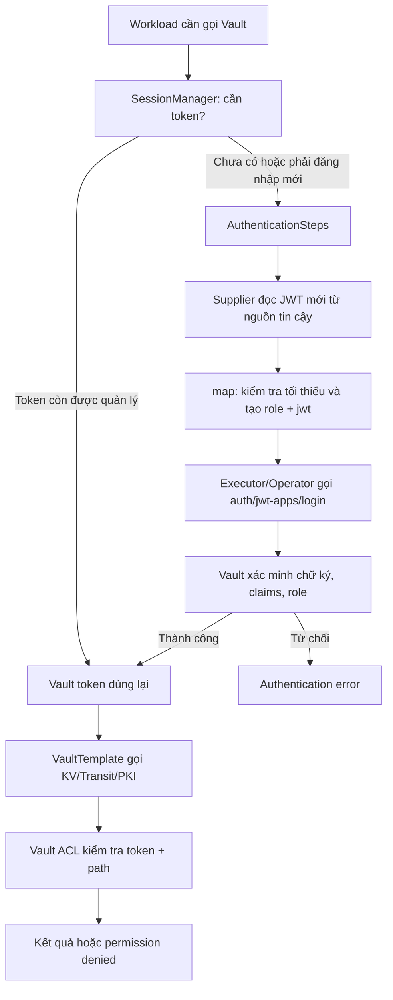

# Tùy chỉnh chuỗi đăng nhập mà vẫn giữ ranh giới trách nhiệm trong Spring Vault

## 1. Bài toán: cần thêm bước vào đăng nhập, nhưng ai chịu trách nhiệm phần nào?

Trong ứng dụng Java sử dụng **Spring Vault**, một workload muốn đọc KV secrets, gọi Transit encryption hoặc xin chứng thư qua PKI phải được HashiCorp Vault xác thực trước. Thông thường, một implementation có sẵn như `KubernetesAuthentication`, `AppRoleAuthentication` hoặc `JwtAuthentication` đã đủ để lấy **Vault token**.

Tuy nhiên, có những quy trình doanh nghiệp cần thêm bước trước khi gọi Vault: đọc JWT mới từ file do nền tảng mount, xin chứng cứ định danh từ một metadata endpoint tin cậy, kiểm tra định dạng credential, kết hợp một vài trường cấu hình thành login body hoặc đăng nhập vào một **auth mount tùy chỉnh**. Nếu đặt hết các hành động ấy vào controller, `VaultTemplate` hoặc một interceptor tự viết, rất dễ trộn trách nhiệm và gây lỗi khó bảo trì.

Spring Vault có DSL **`AuthenticationSteps`** để **mô tả chuỗi bước lấy token**. Luồng này sau đó được thực thi bởi `AuthenticationStepsExecutor` (imperative) hoặc `AuthenticationStepsOperator` (reactive). `SessionManager` quản lý **Vault token sau đăng nhập**, còn `VaultTemplate` thực hiện các thao tác secrets bằng token đó.

Bài thuộc chương **Authentication Steps** của module **SPRING_VAULT**. Mục tiêu là biết **tùy chỉnh thứ tự các bước login** trong ranh giới trách nhiệm của từng thành phần, đồng thời giữ chính sách xác thực, vòng đời token, lỗi và kiểm thử có thể kiểm soát.

Sau khi học, bạn có thể:

1. Phân tách **lấy credential**, **biến đổi login payload**, **gọi Vault auth endpoint**, **quản lý phiên** và **gọi KV/Transit/PKI**.
2. Dùng các điểm mở rộng `AuthenticationSteps.fromSupplier(...)`, `.map(...)`, `.loginAt(...)` hoặc `.login(...)` đúng ngữ cảnh.
3. Chọn `AuthenticationStepsExecutor` và `AuthenticationStepsOperator` theo mô hình đồng bộ hoặc reactive.
4. Giữ custom flow không làm lộ credential, không bỏ qua Vault role bindings và không tạo vòng lặp login cho mỗi request.
5. Thiết kế kiểm thử tại từng ranh giới thay vì kiểm tra mọi thứ qua một bài test end-to-end duy nhất.

## 2. Năm ranh giới trách nhiệm bắt buộc rõ ràng

| Lớp hoặc thành phần | Trách nhiệm chính | Việc không nên giao cho nó |
| --- | --- | --- |
| **Nguồn credential** | Đọc JWT, Kubernetes service account token, AppRole role ID/secret ID hoặc dữ liệu định danh theo workload | Cấp Vault ACL, ghi Vault token ra log hoặc tự quản lý token TTL |
| **`AuthenticationSteps` / `AuthenticationStepsFactory`** | Mô tả nguồn đầu vào, các bước biến đổi, và yêu cầu login ở cuối luồng | Tự gửi request nghiệp vụ KV/Transit/PKI; cache/revoke Vault token bằng mã tùy tiện |
| **`AuthenticationStepsExecutor` / `AuthenticationStepsOperator`** | Diễn giải và thực thi luồng đã khai báo qua HTTP client tương ứng | Tự quyết định policy của workload hoặc sinh credential gốc ngoài hợp đồng luồng |
| **`SessionManager`** | Cung cấp Vault token cho client; dùng lại, renew/re-login theo implementation | Tự tạo quyền mới vượt Vault policy hoặc xác minh JWT thay Vault |
| **`VaultTemplate` / `VaultOperations`** | Gọi API KV, Transit, PKI bằng Vault token đã được cấp | Lưu mật khẩu/JWT, tự thực hiện logic login và tự làm mới token từng request |

**Vault server vẫn là bên quyết định cuối cùng** về chữ ký JWT, role/bound claims, TTL, token policies và quyền ACL của từng API path. Kiểm tra đầu vào trong Java là để phát hiện cấu hình sai sớm; nó không có giá trị thay thế bước xác minh tin cậy phía Vault.

### Một luồng chuẩn trong ví dụ JWT workload



Sơ đồ có hai điểm cần phân biệt. `AuthenticationSteps` **chỉ mô tả** các bước; khi `SessionManager` cần login, executor mới thực thi. Sau khi token đã được cấp, một lần đọc secret **không tương đương** một lần thực thi lại toàn bộ luồng login.

## 3. Vì sao không chỉ tự viết `ClientAuthentication`?

`ClientAuthentication` có hợp đồng tối giản: `VaultToken login()`. Một implementation tự viết có thể đọc credential, dựng JSON, gửi HTTP và trích token. Phương án đó khả thi nhưng gắn chặt việc **mô tả quy trình** với việc **chạy quy trình**.

`AuthenticationSteps` tách hai phần:

- **Định nghĩa:** dữ liệu đầu vào đến từ đâu, qua những phép biến đổi nào, endpoint cuối là gì.
- **Thực thi:** đồng bộ qua `AuthenticationStepsExecutor` hoặc bất đồng bộ/reactive qua `AuthenticationStepsOperator`.

Khi nhiều cách xác thực cần mô hình đọc HTTP metadata, nạp tài liệu định danh, map sang payload và login, DSL cho phép dùng cùng tư duy tổ hợp. Phần lớn auth method có sẵn của Spring Vault cũng triển khai `AuthenticationStepsFactory` để mô tả luồng của chúng.

### Các API trong DSL

| API | Ý nghĩa | Lưu ý |
| --- | --- | --- |
| `AuthenticationSteps.just(VaultToken.of(...))` | Một luồng chỉ trả token đã có | Không tạo Vault token mới qua auth login |
| `AuthenticationSteps.fromValue(value)` | Bắt đầu từ một giá trị có sẵn | Dữ liệu đã được lấy tại thời điểm tạo định nghĩa |
| `AuthenticationSteps.fromSupplier(supplier)` | Lấy dữ liệu từ `Supplier` lúc luồng được thực thi | Thích hợp để đọc credential có thể được rotate |
| `AuthenticationSteps.fromHttpRequest(request)` | Bắt đầu bằng HTTP request đến một nguồn đầu vào | Cần endpoint tin cậy, TLS, timeout và giới hạn SSRF |
| `AuthenticationSteps.fromVaultRequest(request)` | Bắt đầu từ một request đến Vault | Dùng khi workflow xác thực cần Vault request; không dùng cho KV business logic |
| `.map(transformer)` | Biến đổi trạng thái đầu vào thành trạng thái kế tiếp | Tránh side effect; không log JWT/SecretId |
| `.zipWith(other)` | Kết hợp hai nguồn/bước thành cặp giá trị | Chỉ dùng khi thực sự cần hai nguồn; phải xử lý lỗi của cả hai |
| `.onNext(consumer)` | Callback khi có trạng thái đi qua | Không in payload nhạy cảm hoặc biến callback thành nơi làm business I/O |
| `.loginAt(authMount)` | POST trạng thái hiện tại đến `auth/<mount>/login` | Có từ Spring Vault 4.1; truyền tên mount, ví dụ `jwt-apps` |
| `.login(uriTemplate, vars...)` | POST đến endpoint login chỉ định | Phù hợp khi cần chỉ rõ đường dẫn hoặc dùng version cũ |
| `.login(mappingFunction)` | Kết thúc luồng bằng một phép biến đổi thành `VaultToken` | Không tự suy ra là có HTTP login tới Vault |

`.loginAt(...)` và `.login(...)` là **terminal operations**: chúng kết thúc phần xây dựng định nghĩa luồng. Không thể tiếp tục chèn tùy ý các bước `.map(...)` bên sau như khi đang giữ `Node<T>`.

### Định nghĩa luồng khác với thực thi luồng

```java
AuthenticationSteps steps = AuthenticationSteps
    .fromSupplier(jwtSource)
    .map(jwt -> Map.of("role", "orders-service", "jwt", jwt))
    .loginAt("jwt-apps");

// Đến đây mới có ĐỊNH NGHĨA quy trình.
// Chưa có yêu cầu HTTP login do riêng đoạn tạo steps thực hiện.
```

Khi executor/operator diễn giải `steps`, `Supplier` và các phép biến đổi mới chạy. Điều này quan trọng với credential được nền tảng rotate: **không đọc JWT tại lúc tạo bean rồi giữ bất biến mãi**, trừ khi thiết kế của bạn cố ý dùng credential cố định với vòng đời rõ ràng.

## 4. Ví dụ thực tế: thêm bước đọc JWT trước khi login

Giả sử workload `orders-service` chạy trên một nền tảng cấp JWT qua file có quyền đọc hạn chế. Vault đã bật JWT auth method tại mount `jwt-apps` và có role `orders-service`. Ứng dụng cần:

1. Lấy JWT *mới nhất có sẵn* từ nguồn được cấu hình.
2. Xác nhận đầu vào tồn tại/không rỗng, chuẩn hóa ký tự xuống dòng ngoài cùng.
3. Ghép payload `{"role": "...", "jwt": "..."}`.
4. POST đến `auth/jwt-apps/login`.
5. Trả Vault token cho `SessionManager`; không cài cache token trong custom steps.

### 4.1. Định nghĩa `AuthenticationStepsFactory` có thể tái sử dụng

Ví dụ dùng Spring Vault **4.1.x**, Java 17+. Đoạn dưới tạo **một class riêng**:

```java
import java.util.Map;
import java.util.Objects;
import java.util.function.Supplier;

import org.springframework.vault.authentication.AuthenticationSteps;
import org.springframework.vault.authentication.AuthenticationStepsFactory;

public final class WorkloadJwtSteps implements AuthenticationStepsFactory {

    private final Supplier<String> jwtSource;
    private final String authMount;
    private final String vaultRole;

    public WorkloadJwtSteps(
            Supplier<String> jwtSource,
            String authMount,
            String vaultRole) {

        this.jwtSource = Objects.requireNonNull(jwtSource, "jwtSource");
        this.authMount = Objects.requireNonNull(authMount, "authMount");
        this.vaultRole = Objects.requireNonNull(vaultRole, "vaultRole");
    }

    @Override
    public AuthenticationSteps getAuthenticationSteps() {
        return AuthenticationSteps
            .fromSupplier(jwtSource)
            .map(jwt -> {
                if (jwt == null || jwt.isBlank()) {
                    throw new IllegalStateException(
                        "Workload identity token is missing");
                }
                // Không in jwt, không giải mã claim thành log.
                return Map.of(
                    "role", vaultRole,
                    "jwt", jwt.trim()
                );
            })
            .loginAt(authMount);
    }
}
```

**Ranh giới được bảo toàn:** `WorkloadJwtSteps` không biết KV path, không có `VaultTemplate` và không quyết định TTL/policy. Nó chỉ tạo login payload và mô tả endpoint của auth method. Nếu cần validation nghiêm ngặt hơn, hãy kiểm tra rỗng/định dạng và giới hạn dữ liệu, không tự thay thế việc Vault xác minh chữ ký, audience, issuer hoặc bound claims.

Tên `authMount` phải đến từ cấu hình đáng tin cậy, không phải một trường trong HTTP request của người dùng cuối. Với `.loginAt("jwt-apps")`, đường dẫn do Spring Vault suy ra là `auth/jwt-apps/login`. **Không truyền** `auth/jwt-apps/login` làm tên mount.

### 4.2. Kết nối steps với `AbstractVaultConfiguration`

Ví dụ Spring Vault core:

```java
import java.io.IOException;
import java.io.UncheckedIOException;
import java.net.URI;
import java.nio.charset.StandardCharsets;
import java.nio.file.Files;
import java.nio.file.Path;

import org.springframework.context.annotation.Configuration;
import org.springframework.vault.authentication.AuthenticationStepsFactory;
import org.springframework.vault.authentication.AuthenticationStepsExecutor;
import org.springframework.vault.authentication.ClientAuthentication;
import org.springframework.vault.client.VaultEndpoint;
import org.springframework.vault.config.AbstractVaultConfiguration;
import org.springframework.web.client.RestClient;

@Configuration
public class OrdersVaultConfiguration extends AbstractVaultConfiguration {

    @Override
    public VaultEndpoint vaultEndpoint() {
        return VaultEndpoint.from(
            URI.create("https://vault.example.internal:8200"));
    }

    @Override
    public ClientAuthentication clientAuthentication() {
        AuthenticationStepsFactory factory = new WorkloadJwtSteps(
            this::readWorkloadJwt,
            "jwt-apps",
            "orders-service"
        );

        // Trong ví dụ này không có bước HTTP ngoài Vault.
        // RestClient phụ trợ chỉ được truyền cho contract của executor.
        RestClient auxiliaryHttp = RestClient.create();

        // vaultClient() lấy cấu hình Vault từ AbstractVaultConfiguration.
        return new AuthenticationStepsExecutor(
            factory.getAuthenticationSteps(),
            vaultClient(),
            auxiliaryHttp
        );
    }

    private String readWorkloadJwt() {
        Path file = Path.of("/var/run/secrets/workload/identity.jwt");
        try {
            return Files.readString(file, StandardCharsets.UTF_8);
        } catch (IOException ex) {
            // Thông báo an toàn, không đính nội dung JWT.
            throw new UncheckedIOException(
                "Cannot read workload identity source", ex);
        }
    }
}
```

Trong ví dụ trên:

- `WorkloadJwtSteps` **khai báo** chuỗi login.
- `AuthenticationStepsExecutor` triển khai giao diện `ClientAuthentication`, nên có thể được trả về từ `clientAuthentication()`.
- `vaultClient()` chịu trách nhiệm request đến Vault. `RestClient` phụ trợ sẽ dùng cho các bước HTTP ngoài Vault nếu luồng có khai báo; nếu thực sự dùng HTTP bên ngoài, phải cấu hình TLS, timeout, proxy và allowlist của endpoint thay vì để mặc định.
- `AbstractVaultConfiguration` xây dựng `SessionManager` và `VaultTemplate` theo cơ chế Spring Vault. `LifecycleAwareSessionManager` được dùng mặc định để quản lý vòng đời token.
- File JWT được đọc lúc quy trình cần đăng nhập. Nếu file được rotate trước lần login kế tiếp, `Supplier` có cơ hội đọc JWT mới; điều này **không đồng nghĩa** Java tự động login lại chỉ vì nội dung file thay đổi.

Đoạn Java là ví dụ cấu trúc để giảng giải Spring Vault 4.1.x; cần điều chỉnh dependency, SSL, endpoint, secret volume và nguồn JWT cho môi trường thật. Không đặt private key/JWT trong source code, classpath công khai hoặc artifact build.

### 4.3. Gọi KV, Transit hoặc PKI ở lớp nghiệp vụ

```java
import org.springframework.stereotype.Service;
import org.springframework.vault.core.VaultOperations;
import org.springframework.vault.support.VaultResponse;

@Service
public class OrdersSecretReader {

    private final VaultOperations vault;

    public OrdersSecretReader(VaultOperations vault) {
        this.vault = vault;
    }

    public void verifyAccess() {
        // KV v2: mount "secret", key "orders".
        VaultResponse value = vault.read("secret/data/orders");
        if (value == null) {
            throw new IllegalStateException("Orders secret is not present");
        }
        // Không ghi secret hoặc Vault token vào log.
    }
}
```

`OrdersSecretReader` không biết JWT đến từ file nào hay login đã qua mấy bước. Đổi nguồn JWT hoặc đổi tên auth mount **không đòi sửa code đọc KV**. Ngược lại, đổi policy/secret path của KV **không đòi viết lại AuthenticationSteps**.

Các thao tác Transit và PKI cũng theo nguyên tắc đó: `VaultOperations` hoặc `VaultTemplate` dùng **Vault token hiện hành**; Vault quyết định quyền qua policy path riêng cho `transit/encrypt/...` và `pki/issue/...`.

## 5. Cấu hình HashiCorp Vault cần đi đôi với luồng Java

Một login payload chuẩn không đủ nếu Vault chưa có auth mount và role phù hợp. Với ví dụ JWT, một Vault test có thể có:

```bash
# Chỉ operator được cấp quyền cấu hình auth method thực hiện.
vault auth enable -path=jwt-apps jwt

# Ví dụ sử dụng JWKS của issuer nội bộ tin cậy.
vault write auth/jwt-apps/config \
  jwks_url="https://issuer.example.internal/.well-known/jwks.json" \
  bound_issuer="https://issuer.example.internal"

# Policy KV v2 tối thiểu.
vault policy write orders-kv-read orders-kv-read.hcl

# Role chỉ nhận JWT có issuer/audience/subject phù hợp.
vault write auth/jwt-apps/role/orders-service \
  role_type="jwt" \
  user_claim="sub" \
  bound_subject="orders-service" \
  bound_audiences="vault" \
  token_policies="orders-kv-read" \
  token_ttl="30m"
```

Nội dung `orders-kv-read.hcl`:

```hcl
path "secret/data/orders" {
  capabilities = ["read"]
}
```

Các giá trị `issuer`, `subject`, `audience`, JWKS URL và token TTL trên chỉ mang tính minh họa. Workload phải có JWT được **issuer thực** ký, có claim khớp cấu hình role. Đặc biệt, với Vault JWT auth hiện đại, nếu JWT có claim `aud` thì cấu hình `bound_audiences` của role phải khớp ít nhất một audience trong token.

**Trách nhiệm cuối cùng của Vault:** xác minh chữ ký, issuer/audience, expiry, role bound claims và cấp Vault token mang `token_policies`. Việc Java thêm bước `map(...)` hoặc gọi `loginAt(...)` không thể bỏ qua ràng buộc đó.

Nếu tổ chức dùng AppRole/Kubernetes thay vì JWT, thường nên bắt đầu từ implementation và `AuthenticationStepsFactory` có sẵn. Chỉ viết custom flow khi cần khác biệt thực sự về nguồn credential hoặc cách tổ hợp các bước.

## 6. Cách thiết kế chuỗi tùy chỉnh theo từng loại nguồn dữ liệu

### 6.1. Token tĩnh có sẵn

```java
AuthenticationSteps steps =
    AuthenticationSteps.just(VaultToken.of("<TOKEN_FROM_SECURE_SOURCE>"));
```

Ví dụ là cú pháp minh họa; không đặt literal token thật trong chương trình. Đây là **luồng không gửi HTTP login đến Vault**. Token tĩnh cần cơ chế rotation an toàn, tự theo dõi TTL/renewability và xử lý khi bị thu hồi. Nếu dùng `LifecycleAwareSessionManager`, hành vi lookup/renew phụ thuộc loại token và cấu hình. Không dùng `just(...)` để mô phỏng một JWT login-based flow.

### 6.2. Credential được rotate qua file/secret volume

Nên đọc credential bằng `fromSupplier(...)` tại lần thực thi login:

```java
AuthenticationSteps steps = AuthenticationSteps
    .fromSupplier(workloadCredentialSupplier)
    .map(credential -> Map.of(
        "role", "orders-service",
        "jwt", credential.trim()))
    .loginAt("jwt-apps");
```

Phần `Supplier` không nên tạo thread riêng, vòng retry vô hạn hoặc tự đưa credential vào cache static. Nó phải có hành vi lỗi rõ ràng khi file thiếu, không đọc được, bị rotate trong quá trình truy cập hoặc dữ liệu không hợp lệ. Với reactive code, hãy đánh giá loại supplier và khả năng chặn I/O trước khi dùng trong event loop.

### 6.3. Credential đến từ HTTP metadata endpoint

DSL cho phép sử dụng `AuthenticationSteps.HttpRequestBuilder`:

```java
import org.springframework.vault.authentication.AuthenticationSteps;
import org.springframework.vault.authentication.AuthenticationSteps.HttpRequestBuilder;

AuthenticationSteps steps = AuthenticationSteps
    .fromHttpRequest(
        HttpRequestBuilder
            .get("https://identity.example.internal/workload/assertion")
            .as(String.class))
    .map(assertion -> Map.of(
        "role", "orders-service",
        "jwt", assertion))
    .loginAt("jwt-apps");
```

Đây là ví dụ cấu trúc. Một metadata endpoint thực có thể yêu cầu header xác thực, payload JSON cụ thể hoặc proof từ môi trường cloud; **không** chỉ việc có URL là có credential hợp lệ. Cần dùng HTTPS cho endpoint ngoài VM link-local chuyên dụng, cấu hình CA/timeout, giới hạn redirect và hostname, và tuyệt đối không nhận URL từ đầu vào tùy ý của người dùng.

Phân biệt rõ:

- HTTP đến **nguồn credential** do executor/operator xử lý bằng client phụ trợ.
- HTTP đến **Vault auth backend** do `loginAt(...)`/`login(...)` và Vault client thực hiện.
- HTTP đến **KV/Transit/PKI** sau xác thực do `VaultTemplate`/`VaultOperations` thực hiện.

Không gọi `VaultTemplate.read("secret/...")` ngay trong `.map(...)` để "xác thực thêm". Điều đó tạo vòng phụ thuộc: muốn đọc secret cần token, trong khi custom flow đang cố lấy token.

### 6.4. Kết hợp nhiều nguồn

`.zipWith(...)` hữu ích nếu auth scheme thực sự cần hai nguồn riêng biệt như chứng cứ từ metadata và một nonce được cấp từ nơi tin cậy. Tuy nhiên, nó làm tăng số điểm lỗi và nguy cơ lộ dữ liệu. Dùng `.map(...)` để kết hợp thành payload cuối; không giả định thứ tự hoặc mức độ song song giữa các nguồn luôn giống nhau ở executor imperative và operator reactive.

Ví dụ sơ đồ ý tưởng:

```text
Source A: thông tin workload
                           ─┐
                            ├─ zipWith → map → payload → Vault login
Source B: chứng cứ định danh ┘
```

Nếu hai nguồn phải có ràng buộc cryptographic với nhau, việc ghép chuỗi Java **không đủ**; giao thức của identity provider và Vault auth method phải hỗ trợ, kiểm tra đúng proof.

## 7. Chọn executor imperative hoặc operator reactive

| Khía cạnh | `AuthenticationStepsExecutor` | `AuthenticationStepsOperator` |
| --- | --- | --- |
| Kiểu thực thi | Đồng bộ, phù hợp code imperative | Reactive, trả về `Mono<VaultToken>` |
| Hợp đồng tích hợp | Triển khai `ClientAuthentication` | Triển khai `VaultTokenSupplier` |
| HTTP đến Vault | `VaultClient` (API 4.1) | `ReactiveVaultClient` (API 4.1) |
| HTTP ngoài Vault | `RestClient` | `WebClient` |
| Kích hoạt các bước | Khi gọi `login()` | Khi publisher được subscribe |
| Quản lý phiên | Gắn với `SessionManager` | Gắn với cơ chế cung cấp/cache/lifecycle token reactive |
| Mục đích | App Java/Spring MVC, tác vụ đồng bộ | WebFlux/reactive pipelines |

### 7.1. Imperative

```java
AuthenticationSteps steps = new WorkloadJwtSteps(
    jwtSource, "jwt-apps", "orders-service")
    .getAuthenticationSteps();

AuthenticationStepsExecutor executor =
    new AuthenticationStepsExecutor(steps, vaultClient, restClient);

// Demo: chủ động gọi login() sẽ lấy Vault token.
// Ứng dụng thật thường giao executor cho SessionManager.
VaultToken token = executor.login();
```

Các biến `jwtSource`, `vaultClient`, `restClient` là phụ thuộc phải được cấu hình; mã minh họa cách ghép API, không phải một main class độc lập. Khi tích hợp `SessionManager`, **đừng tự gọi `executor.login()` cho mọi request nghiệp vụ**.

### 7.2. Reactive

```java
AuthenticationSteps steps = new WorkloadJwtSteps(
    jwtSource, "jwt-apps", "orders-service")
    .getAuthenticationSteps();

AuthenticationStepsOperator operator =
    new AuthenticationStepsOperator(
        steps, reactiveVaultClient, webClient);

Mono<VaultToken> tokenOnceSubscribed = operator.getVaultToken();
```

`operator.getVaultToken()` mô tả một luồng reactive; **subscription** mới kích hoạt các bước. Nếu nhiều subscriber cùng tự subscribe mà không có lớp quản lý session/cache, các lần login có thể được thực hiện độc lập. Nên dùng cơ chế token supplier/session lifecycle do Spring Vault reactive cung cấp (chẳng hạn `AbstractReactiveVaultConfiguration` và các thành phần liên quan), thay vì tự tạo operator cho mỗi subscriber.

Không chặn Reactor/Netty event loop bằng `Thread.sleep` hoặc `.block()` tùy tiện. Nếu nguồn credential chỉ có API blocking, cân nhắc khả năng offload có sẵn hoặc cung cấp nguồn I/O reactive phù hợp và test mức độ chịu tải.

### 7.3. Khác biệt phiên bản cần kiểm tra

Trong Spring Vault 4.1, `.loginAt("jwt-apps")` tự dựng `auth/jwt-apps/login`, và constructor `AuthenticationStepsExecutor(AuthenticationSteps, VaultClient, RestClient)` là phương án mới. Trên một số bản cũ, dùng đường dẫn:

```java
AuthenticationSteps steps = AuthenticationSteps
    .fromSupplier(jwtSource)
    .map(jwt -> Map.of("role", "orders-service", "jwt", jwt))
    .login("auth/{mount}/login", "jwt-apps");
```

Dù hướng tiếp cận tương tự, không nên trộn constructor, `VaultClient` và WebClient API từ các major/minor release khác nhau. Hãy kiểm tra dependency BOM và Javadoc của đúng Spring Vault/Spring Cloud Vault đang chạy.

## 8. Ranh giới giữa custom login và vòng đời token

Tùy chỉnh chuỗi bước **không đồng nghĩa** phải thay `SessionManager`. Khi login thành công, Vault trả token với thông tin policies, TTL và renewability theo auth method/role. Spring Vault quản lý kết quả đó bằng session manager thích hợp.

| Tình huống | Thành phần chịu trách nhiệm |
| --- | --- |
| Lấy JWT trước login | `Supplier` / HTTP source trong `AuthenticationSteps` |
| Tạo login body và endpoint | `.map(...)`, `.loginAt(...)` |
| Kiểm tra chữ ký JWT, role constraints | Vault auth method |
| Giữ Vault token cho nhiều `VaultTemplate` requests | `SessionManager` |
| Renew token khi TTL giảm | `LifecycleAwareSessionManager` khi đủ điều kiện |
| Re-login khi cần token mới | Session manager gọi lại `ClientAuthentication`/executor |
| Đọc KV sau đăng nhập | `VaultOperations` và Vault ACL |
| Gia hạn secret lease động | Lease-specific logic/container, không phải bản thân bước login |

Ví dụ lúc 09:00 ứng dụng chạy `WorkloadJwtSteps` và được cấp Vault token `T1` TTL 30 phút. Lúc 09:10 và 09:20 ứng dụng đọc KV bằng `T1`. Nếu token renewable và manager thực hiện renew trước khi hết hạn, **không cần chạy lại bước đọc JWT** chỉ vì có một lần renew token. Nếu token hết hạn hoặc bị revoke và manager cần login mới, `Supplier` sẽ được gọi lại để lấy JWT còn hợp lệ.

**Điểm cẩn trọng:** đổi nội dung JWT file không mặc nhiên làm `SessionManager` bỏ một Vault token vẫn đang dùng. Nếu hệ thống cần thu hồi phiên ngay khi workload identity thay đổi, hãy thiết kế chính sách revoke, rotation, restart hoặc lifecycle rõ ràng. Đừng tự sửa token cache hoặc gọi login thừa từ controller.

## 9. Những cách tùy chỉnh gây lỗi ranh giới

### 9.1. Gắn logic xác thực vào `VaultTemplate`

Sai ý tưởng: mỗi lần `vaultTemplate.read(...)` thì trước đó gọi HTTP tới identity provider, rồi tự ghi header `X-Vault-Token`.

Hậu quả: login tăng theo số request, mất khả năng tái sử dụng token, khó renew/revoke đúng cách, khó test lỗi của auth riêng với lỗi KV. Cần tách bước lấy token vào `ClientAuthentication`/`AuthenticationSteps` và để session manager quản lý.

### 9.2. Bỏ Vault role binding khi thêm bước Java

Một bước `.map(...)` kiểm tra `role.equals("orders-service")` chỉ là kiểm tra giá trị trong ứng dụng. Nó không thay thế `bound_subject`, `bound_audiences`, `bound_claims`, policy và chữ ký do Vault/issuer kiểm tra. Mã Java trong workload **không phải điểm thực thi chính sách tin cậy** nếu workload có thể bị thay đổi.

### 9.3. Cho tất cả lỗi 403 fallback sang token quyền rộng hơn

Ví dụ một luồng thất bại với JWT role `orders-service` rồi tự dùng root token từ biến môi trường để "khôi phục". Đây là hành vi **vượt ranh giới quyền**: lỗi xác thực hoặc ACL cần được phân tích, không tự động đổi danh tính với quyền rộng hơn.

Nếu tổ chức thật sự có hai phương thức auth dự phòng, quyết định đó cần role/policy đã phê duyệt, cùng hoặc hẹp hơn quyền mong muốn, điều kiện chuyển đổi cụ thể, audit và thời gian sống phù hợp. Không coi fallback quyền cao là lỗi HTTP cần retry.

### 9.4. Đưa side effect vào `map(...)` hoặc `onNext(...)`

Bước biến đổi nên xác định và giới hạn:

- Không gửi JWT lên hệ thống analytics, log hoặc exception message.
- Không phát hành certificate, ghi database hoặc thực hiện side effect nghiệp vụ.
- Không tự tạo worker thread/timer/background renewal trong `map(...)`.
- Không gọi một API Vault cần chính Vault token đang được xin.
- Không che mọi exception thành `null` rồi vẫn tiếp tục login.

`onNext(...)` chỉ nên dùng cho quan sát an toàn như **tăng counter không nhãn nhạy cảm**; token và login body tuyệt đối không xuất hiện trong log.

### 9.5. Tạo custom flow mới mỗi lần có HTTP request

Nếu tạo cả `AuthenticationStepsExecutor` và `SessionManager` mới cho từng controller request, mỗi request có thể dẫn tới một login mới. Giữ các thành phần theo phạm vi workload/application và thread-safe như các implementation của Spring Vault. Số lượng session manager cần phản ánh **số lượng danh tính**, không phải số endpoint.

## 10. Xử lý lỗi theo đúng vị trí phát sinh

| Giai đoạn | Ví dụ lỗi | Cách chẩn đoán và xử lý |
| --- | --- | --- |
| Nguồn credential | JWT file chưa mount, permission denied, file rỗng | Kiểm tra secret volume/readiness, quyền file, đường dẫn và thời điểm rotate; không log nội dung |
| HTTP metadata | Timeout, TLS/CA sai, 429 hoặc 5xx | Cấu hình client, connect/read timeout, allowlist, backoff có giới hạn |
| Biến đổi payload | Sai role name, map thiếu trường `jwt`, dữ liệu null | Test unit cho `Supplier`/`map`; fail sớm với thông báo không chứa credential |
| Vault login routing | HTTP 404 trên `auth/jwt-apps/login` | Kiểm tra `vault auth list`, mount, namespace, đường dẫn API |
| Vault auth reject | 400/403: JWT hết hạn, issuer/audience sai, role constraints không khớp | Kiểm tra JWKS, claims, Vault role và audit log; không retry vô hạn |
| Vault token renew | Token không renewable hoặc đã vượt max TTL | Đo TTL/renew; cho phép re-login nếu nguồn credential vẫn hợp lệ |
| KV/Transit/PKI | Login thành công nhưng API 403 | Kiểm tra Vault ACL policy **đúng API path**, không chỉnh JWT một cách mù quáng |
| Transport | SSLHandshakeException, DNS, timeout, Vault 5xx | Kiểm tra Vault endpoint/TLS/timeout/capacity, phân biệt với auth reject |

### Nên đặt retry ở đâu?

- **Nguồn credential**: xử lý retry/backoff đối với lỗi tạm thời nếu nguồn có hợp đồng cho phép; lỗi file/credential thiếu cố định nên fail rõ ràng.
- **Bước Vault auth login**: chỉ retry có giới hạn đối với lỗi mạng/5xx/429 phù hợp; không retry vòng lặp nhanh với 400/403 do định danh hoặc role mismatch.
- **`SessionManager`**: quản lý token/re-login theo vòng đời; không thay bằng retry login tại từng endpoint.
- **Request nghiệp vụ**: xử lý riêng theo tính idempotent. Đặc biệt, tự động retry PKI issue có thể phát hành thêm chứng thư; Transit operations cần xét nonce/response handling của giao thức cụ thể.

Cần đặt timeout và giới hạn concurrency để tránh nhiều request đợi cùng một đợt login khi Vault hoặc identity provider gặp sự cố. Đồng bộ cấp token trong một JVM không có nghĩa số lần login toàn cụm chỉ bằng một.

## 11. Quan sát và giám sát luồng tùy chỉnh

Một hệ thống đủ quan sát nên trả lời được ba câu hỏi:

1. **Lấy credential có thành công không?** Nguồn file, metadata hoặc provider nào lỗi; thời gian chờ là bao nhiêu?
2. **Đăng nhập Vault có thành công không?** Auth mount/role nào, bao nhiêu lần login, lỗi 400/403/429/5xx và thời gian phản hồi?
3. **Dùng Vault token có thành công không?** TTL/renew/re-login, các API KV/Transit/PKI nào bị từ chối do policy?

Một ví dụ biểu diễn telemetry không chứa secrets:

```text
identity_source_reads_total{source="workload-file", outcome="success"} 12
vault_auth_attempts_total{method="jwt", mount="jwt-apps", result="success"} 3
vault_auth_attempts_total{method="jwt", mount="jwt-apps", result="denied"} 1
vault_token_renew_failures_total{reason="non_renewable"} 0
vault_requests_total{engine="kv", code="403"} 2
```

Đây là **ví dụ metric names do dự án tự thiết kế**, không phải tên metric mặc định Spring Vault tự xuất. Nên dùng Vault audit logs và các `AuthenticationListener`/`AuthenticationErrorListener` có sẵn ở tầng session manager khi phù hợp. Chỉ dùng các nhãn ổn định như auth method, mount/role được kiểm soát; không dùng token/JWT/SecretId hoặc giá trị claim cá nhân làm label.

Nếu cần log callback `onNext(...)`, chỉ ghi một sự kiện cố định như `"workload credential prepared"`, không stringify `Map.of("jwt", ...)`. Khi có exception, tránh đính payload vào message, stacktrace hoặc HTTP client logging.

## 12. Thiết kế kiểm thử từng ranh giới

### 12.1. Unit test `AuthenticationStepsFactory`

Các ca tối thiểu:

1. `jwtSource` trả JWT không rỗng → luồng tạo payload có `role` và `jwt` chính xác.
2. `jwtSource` trả `null` hoặc chuỗi trắng → thất bại trước khi gọi Vault login.
3. Tạo `getAuthenticationSteps()` nhưng **chưa chạy executor** → không được đọc file/JWT sớm.
4. Lần login thứ hai sau khi thay nội dung nguồn credential → `Supplier` được gọi lại và lấy giá trị mới.
5. Role/mount là cấu hình do operator quản lý → không đến từ input của người dùng cuối.

Có thể test từng phần chuẩn bị credential và tạo payload bằng Java thuần, không cần Vault thật. Phần xác nhận **executor diễn giải đúng bước và gửi HTTP** nên dùng mock HTTP transport; đừng giả định chỉ gọi `getAuthenticationSteps()` là đã kích hoạt login.

### 12.2. Component test với mock Vault auth endpoint

Dùng một HTTP test server hoặc mock adapter phù hợp với phiên bản Spring Vault:

| Dữ liệu thử | Kết quả cần quan sát |
| --- | --- |
| `POST /v1/auth/jwt-apps/login`, payload `role+jwt` đúng | Executor tạo request đúng một lần cho một login được kích hoạt |
| Auth response chứa `auth.client_token` và lease metadata hợp lệ | Nhận Vault token trong session manager |
| Auth response 400/403 | Login báo lỗi, không chuyển thành một Vault token giả |
| Endpoint `auth/jwt-apps/login` không tồn tại | Không âm thầm chuyển sang auth mount khác |
| Nguồn JWT throw exception | Không gọi Vault login, lỗi được truyền lên không lộ credential |

Đối với API `AuthenticationStepsOperator`, test với `StepVerifier` và test publisher subscription; tránh khẳng định định nghĩa flow tự chạy trước khi subscribe.

### 12.3. Integration test với HashiCorp Vault

Chuẩn bị Vault test hoặc Testcontainers Vault, một JWT issuer test có JWKS phù hợp và role đã tạo. Kiểm tra:

- JWT ký đúng, issuer/audience/subject khớp → login thành công, đọc KV giả được policy cho phép.
- JWT hết hạn hoặc sửa chữ ký → Vault từ chối login.
- Thay bound audience/subject ở role → login thất bại dù payload phía Java có cùng cấu trúc.
- Login thành công nhưng policy không có `read` trên `secret/data/orders` → API KV trả 403.
- Hai lần đọc KV cùng `VaultTemplate` → không nhất thiết gọi login hai lần.
- Token tới giới hạn TTL → quan sát renew hoặc re-login tùy token/manager.
- Nhiều thread cùng yêu cầu token mới → session manager chia sẻ phiên trong một instance; các pod/process khác vẫn có phiên riêng.

**Giới hạn của mock test:** nó không chứng minh Vault thực đã kiểm tra chữ ký hay policy; chỉ integration test với Vault/issuer thật trong môi trường cô lập mới đánh giá được các điều kiện đó. Không cần sử dụng root token trong ứng dụng đang được kiểm thử.

## 13. Khi nào dùng implementation sẵn có, khi nào viết custom steps?

| Nhu cầu | Lựa chọn phù hợp | Lý do |
| --- | --- | --- |
| Kubernetes ServiceAccount JWT theo quy ước thông thường | `KubernetesAuthentication` | Đã hỗ trợ role, JWT source và Vault login |
| AppRole role ID/secret ID theo nguồn chuẩn | `AppRoleAuthentication` | Tránh tự viết luồng nhận credential và HTTP login |
| JWT auth có tùy chọn sẵn đủ đáp ứng | `JwtAuthentication` | Role/path/supplier và logic sẵn có dễ bảo trì hơn |
| Token có sẵn, không có HTTP login | `TokenAuthentication` hoặc `AuthenticationSteps.just(...)` | Không cần tự tạo workflow phát hành token |
| JWT phải đọc từ một nguồn đã chuẩn hóa riêng và cần thêm transform bắt buộc | `AuthenticationSteps` + executor/operator | Cho phép mô tả đúng các bước, dùng cả imperative/reactive theo cấu hình |
| Nhiều request muốn tái sử dụng token | `SessionManager` / reactive token supplier | Đây là bài toán vòng đời phiên, không phải bước biến đổi credential |
| Tạo policy mới hoặc thêm quyền KV | Vault operator và policy-as-code | Không thuộc trách nhiệm của Java login pipeline |

Hãy ưu tiên các implementation đã được Spring Vault kiểm thử cho phương thức phổ biến. Custom flow đáng dùng khi nó **thêm một thao tác credential hợp lệ, xác định và kiểm thử được** mà API có sẵn không đáp ứng.

## 14. Bài thực hành theo tình huống

### Bài A — Thay nguồn JWT mà không sửa lớp nghiệp vụ

1. Tạo file JWT thử nghiệm có nội dung giả (cho unit test) và `Supplier` đọc file khi được gọi.
2. Dựng `WorkloadJwtSteps` với role `orders-service` và mount `jwt-apps`.
3. Test lần đọc nguồn thứ nhất; thay file; thực thi lần login mô phỏng thứ hai và xác nhận supplier lấy giá trị mới.
4. Giữ nguyên `OrdersSecretReader`; kiểm tra lớp này vẫn chỉ gọi `VaultOperations`.
5. Ghi rõ vì sao JWT giả chỉ dùng cho unit test, không đủ đăng nhập Vault thật.

**Kết quả:** thay đổi nguồn credential không làm đổi logic KV hay vòng đời token.

### Bài B — Thay auth mount và phát hiện cấu hình sai

1. Trên Vault test, mount JWT auth tại `jwt-apps` và tạo role test.
2. Cấu hình Java `.loginAt("jwt-apps")`; đọc audit log xác nhận endpoint.
3. Đổi tạm thành `.loginAt("jwt-missing")`; ghi nhận 404 từ Vault.
4. Khôi phục mount và thay `bound_subject` sai; quan sát 403 dù đường dẫn login đúng.
5. So sánh lỗi routing với lỗi Vault auth binding.

**Kết quả:** phân biệt endpoint do Java quyết định với policy/ràng buộc do Vault quyết định.

### Bài C — Bảo đảm không lộ JWT trong telemetry

1. Đặt một JWT **giả** có marker dễ nhận biết trong unit test.
2. Cho `Supplier`/`map` chạy thành công rồi mô phỏng lỗi Vault auth.
3. Kiểm tra logs, metrics labels và exception messages không chứa marker.
4. Chỉ cho phép đếm attempt/result và latency ở mỗi bước.
5. Tắt hoặc giới hạn HTTP wire logging có thể chứa request body/token.

**Kết quả:** có telemetry đủ chẩn đoán nhưng không để credential thành dữ liệu quan sát công khai.

### Bài D — Lifecycle và concurrent login

1. Cho 25 thread cùng gọi Vault thông qua **một** `SessionManager`/`VaultTemplate` trên môi trường test.
2. Phân biệt số login với số request KV; quan sát một phiên được dùng lại khi login đầu tiên thành công.
3. Thử token gần hết TTL để quan sát renew/re-login.
4. Tạo hai manager độc lập (chỉ trên test) và thấy mỗi manager có trạng thái token riêng.
5. Mô phỏng 403 do policy sau login; không thêm fallback sang token đặc quyền.

**Kết quả:** hiểu được custom authentication flow phục vụ **lần lấy token**, còn session manager điều phối reuse và token lifecycle.

## 15. Những câu hỏi tự đánh giá

1. `AuthenticationSteps` khác `AuthenticationStepsExecutor` như thế nào?
2. Vì sao nên dùng `fromSupplier(...)` để đọc credential cần rotation, thay vì `fromValue(...)`?
3. Trong ví dụ, ai có quyền quyết định token có policy `orders-kv-read`: `.map(...)`, executor hay Vault?
4. `.loginAt("jwt-apps")` gọi endpoint nào? Vì sao `.loginAt("auth/jwt-apps/login")` sai?
5. Điều gì kích hoạt execution của `AuthenticationStepsOperator.getVaultToken()`?
6. Vì sao không gọi `VaultTemplate` để đọc secret trong bước `.map(...)` đang chuẩn bị login?
7. Khi lỗi 403 ở `auth/jwt-apps/login`, cần kiểm tra gì khác so với 403 ở `secret/data/orders`?
8. Vì sao một `AuthenticationSteps` được xây dựng một lần vẫn có thể dùng JWT mới ở những lần login tiếp theo?
9. Vì sao custom steps không nên tự renew/revoke Vault token hay tạo timer riêng?
10. Khi nào nên dùng `JwtAuthentication` dựng sẵn và khi nào custom flow là hợp lý?
11. Vì sao `onNext(...)` không phải nơi thích hợp để log toàn bộ payload?
12. Khi có 10 pod, một session manager trong mỗi pod có làm số lần login toàn cụm bằng 1 không?

## 16. Checklist áp dụng vào môi trường thực tế

- [ ] Custom step thực sự cần thiết; đã kiểm tra implementation sẵn có của Spring Vault.
- [ ] Có ranh giới rõ: credential source → payload transform → Vault login → session → KV/Transit/PKI.
- [ ] Endpoint/mount/role từ cấu hình tin cậy, không nhận tùy tiện từ end-user.
- [ ] Credential được đọc ở thời điểm phù hợp, có thể rotate; không hardcode JWT/SecretId/token.
- [ ] Vault role xác minh chữ ký/audience/issuer/subject/claims và cấp policy tối thiểu.
- [ ] Dùng executor/operator đúng phiên bản Spring Vault và mô hình imperative/reactive.
- [ ] Có `SessionManager` hoặc reactive lifecycle/token supplier dùng chung theo danh tính.
- [ ] HTTP client bên ngoài có TLS, timeout, kiểm soát redirect/proxy và allowlist.
- [ ] Retry giới hạn, fail-fast với auth 400/403, không fallback tự động sang danh tính quyền rộng.
- [ ] Unit/component/integration test phân biệt lỗi credential, login, renew và Vault ACL.
- [ ] Logs/metrics không chứa JWT, Vault token, secret, private key hoặc HTTP body nhạy cảm.

## 17. Ghi nhớ và tài liệu tham khảo

**Điểm cần nhớ:** `AuthenticationSteps` mô tả **cách tạo một lượt đăng nhập Vault** bằng các bước có thể tổ hợp. `AuthenticationStepsExecutor` và `AuthenticationStepsOperator` thực thi định nghĩa đó. `SessionManager` cung cấp và duy trì Vault token cho những lời gọi `VaultTemplate`. Vault vẫn là nơi xác minh identity và quyết định policy. Giữ đúng ranh giới này giúp thay đổi nguồn credential hoặc login flow mà không làm hỏng logic nghiệp vụ, bảo mật hay vòng đời phiên.

Nguồn chính thức để kiểm tra API theo phiên bản:

- [Spring Vault — Authentication Methods và Authentication Steps](https://docs.spring.io/spring-vault/reference/vault/authentication.html)
- [Spring Vault API — AuthenticationSteps](https://docs.spring.io/spring-vault/reference/api/java/org/springframework/vault/authentication/AuthenticationSteps.html)
- [Spring Vault API — AuthenticationSteps.Node](https://docs.spring.io/spring-vault/reference/api/java/org/springframework/vault/authentication/AuthenticationSteps.Node.html)
- [Spring Vault API — AuthenticationStepsFactory](https://docs.spring.io/spring-vault/reference/api/java/org/springframework/vault/authentication/AuthenticationStepsFactory.html)
- [Spring Vault API — AuthenticationStepsExecutor](https://docs.spring.io/spring-vault/reference/api/java/org/springframework/vault/authentication/AuthenticationStepsExecutor.html)
- [Spring Vault API — AuthenticationStepsOperator](https://docs.spring.io/spring-vault/reference/api/java/org/springframework/vault/authentication/AuthenticationStepsOperator.html)
- [Spring Vault — Vault Client Access](https://docs.spring.io/spring-vault/reference/vault/vault-client.html)
- [HashiCorp Vault — JWT authentication method](https://developer.hashicorp.com/vault/docs/auth/jwt)
- [HashiCorp Vault — JWT auth HTTP API](https://developer.hashicorp.com/vault/api-docs/auth/jwt)
- [HashiCorp Vault — Tokens và token lifecycle](https://developer.hashicorp.com/vault/docs/concepts/tokens)
