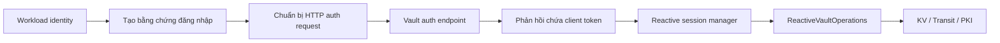
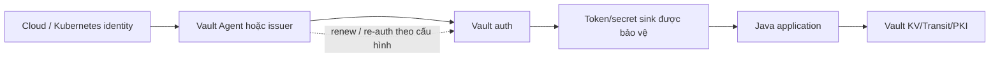
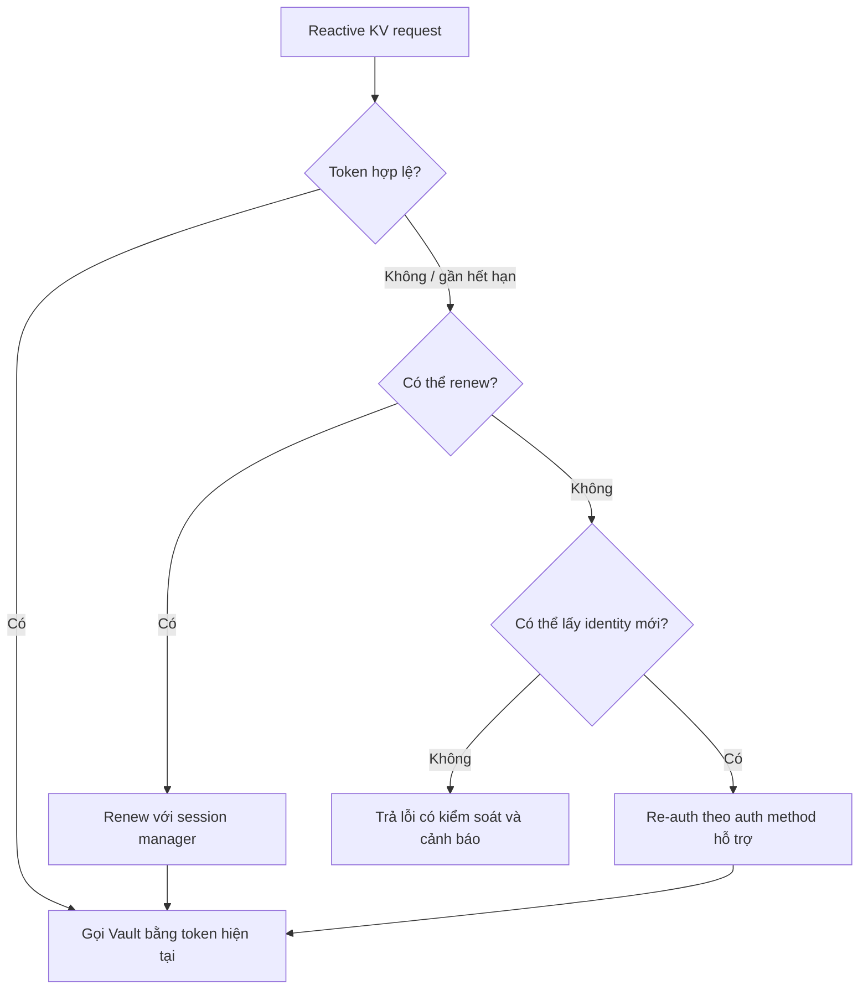

# Phương thức xác thực không hỗ trợ chuỗi không chặn

## 1. Vấn đề trong ứng dụng Spring Vault dùng Reactive

Một ứng dụng Java có thể dùng **Spring Vault** để đọc KV secrets, gọi Transit encryption hoặc sử dụng PKI bằng `VaultTemplate` (đồng bộ) hay `ReactiveVaultOperations`/`ReactiveVaultTemplate` (reactive). Các thao tác Vault được xác thực bằng **Vault client token**, thường được cấp sau khi ứng dụng chứng minh danh tính workload qua Kubernetes, AppRole, cloud IAM hoặc cơ chế khác.

Trong mô hình đồng bộ, một thành phần triển khai `ClientAuthentication` có thể thực hiện login rồi trả token cho client. Trong mô hình reactive, cả **đường lấy token** cũng cần phù hợp với yêu cầu không chặn. Spring Vault sử dụng khái niệm **Authentication Steps** để mô tả một quy trình đăng nhập thành các bước mà cơ chế thực thi reactive có thể điều phối.

Vấn đề xuất hiện khi phương thức xác thực hiện có **chỉ hỗ trợ luồng đồng bộ**, hoặc các bước của nó không thể được biểu diễn bằng cơ chế Authentication Steps mà phiên bản Spring Vault đang sử dụng. Khi đó, không thể giả định rằng chỉ cần chuyển `VaultTemplate` sang `ReactiveVaultTemplate` là toàn bộ chuỗi từ lấy danh tính, đăng nhập đến đọc secret đã thành non-blocking.

> Mục tiêu của bài này là nhận diện giới hạn, lựa chọn phương án triển khai an toàn và duy trì chính sách token/lease. Khả năng hỗ trợ cụ thể của từng auth method phụ thuộc vào **phiên bản Spring Vault, Spring Cloud Vault và implementation** đang sử dụng; không kết luận một loại như AWS, Kubernetes hoặc AppRole luôn được/không được hỗ trợ reactive ở mọi phiên bản.

### Tình huống thực tế

Giả sử `order-service` chạy Spring WebFlux, phải đọc secret từ KV v2 trước khi ký một giao dịch hoặc gọi Transit. Một thư viện xác thực workload do hệ thống cũ cung cấp có phương thức:

```java
public interface LegacyVaultIdentityProvider {

    // Phương thức đồng bộ; có thể gọi HTTP, metadata service hoặc đọc file.
    String loginAndGetToken();
}
```

Nếu đưa trực tiếp `loginAndGetToken()` vào event-loop của WebFlux, request khác có thể bị ảnh hưởng khi bước đăng nhập mất nhiều thời gian. Vấn đề còn rõ hơn khi token hết hạn: nhiều request đồng thời có thể cùng kích hoạt hoạt động đăng nhập mới.

Việc tách **đăng nhập** ra khỏi **đọc secret** bằng session manager làm giảm nhu cầu login lặp, nhưng **không tự biến một phương thức login đồng bộ thành non-blocking**.

## 2. Các thành phần cần phân biệt

| Thành phần | Trách nhiệm | Điều cần lưu ý khi dùng Reactive |
| --- | --- | --- |
| `ClientAuthentication` | Cung cấp cơ chế login kiểu đồng bộ, trả token theo contract của Spring Vault | Không đủ để suy rằng implementation đó dùng được trực tiếp trên event-loop |
| `AuthenticationSteps` | Biểu diễn những bước cần thiết trong quá trình xác thực | Cần các bước được hỗ trợ và được thực thi phù hợp với reactive runtime |
| `AuthenticationStepsFactory` | Tạo mô tả chuỗi bước xác thực cho một phương thức | Phải có implementation phù hợp với auth method và bản thư viện |
| Session manager reactive | Cung cấp token cho reactive Vault client và quản lý vòng đời theo cấu hình | Login, renewal hoặc re-auth cũng cần tránh chặn event-loop |
| `ReactiveVaultOperations` | Giao diện gọi API Vault theo kiểu Publisher/`Mono` | Không giải quyết thay vấn đề auth method không hỗ trợ |
| `VaultOperations` | Giao diện gọi API Vault kiểu đồng bộ | Có thể dùng tại ranh giới blocking riêng khi cần phương án chuyển tiếp |

**Authentication Steps không phải Vault policy** và cũng không phải các “bước xác thực” được cấu hình trực tiếp trong Vault server. Đây là khái niệm phía Spring Vault client giúp tổ chức một chuỗi hành động như tạo request, lấy/biến đổi phản hồi và đưa ra token.

Ví dụ khái niệm về chuỗi xác thực:



Mỗi phần của sơ đồ phải có cách thực thi hợp lệ. Nếu bước B đòi hỏi một SDK chỉ cung cấp HTTP đồng bộ, bước đó sẽ chặn thread khi được gọi trực tiếp. Nếu factory không biết biểu diễn một bước challenge/response đặc thù, quy trình có thể không được hỗ trợ dù phần truy cập KV phía sau đã reactive.

## 3. Thế nào là “không hỗ trợ chuỗi không chặn”?

Cần tách bốn trường hợp vì cách xử lý khác nhau:

| Trường hợp | Dấu hiệu thường thấy | Ý nghĩa |
| --- | --- | --- |
| **Không có Authentication Steps factory phù hợp** | Phiên bản thư viện chỉ công bố authentication đồng bộ cho cơ chế đang dùng | Không thể chọn implementation reactive tương ứng chỉ bằng một property |
| **Có factory nhưng bước chuẩn bị bị blocking** | Gọi SDK metadata, HTTP sync, truy cập file chậm hoặc tác vụ ký nặng trong luồng reactive | Có nguy cơ chặn event-loop; cần thay implementation hoặc cô lập bước blocking |
| **Bước xác thực có protocol không được biểu diễn** | Cơ chế custom yêu cầu nhiều lượt challenge/response, callback hoặc xác thực ngoài quy trình được hỗ trợ | Cần adapter mới hoặc kiến trúc xác thực khác |
| **Factory phù hợp nhưng login lỗi** | Vault trả 400/403, role/path sai, JWT hết hạn hoặc TLS lỗi | Đây là lỗi cấu hình/quyền/kết nối; không được vội kết luận thiếu hỗ trợ non-blocking |

Điểm phân biệt quan trọng: **phương thức xác thực không hỗ trợ Authentication Steps** khác với **phương thức có Authentication Steps nhưng đang dùng sai**. Một exception được ném trong quá trình khởi tạo có thể chỉ ra factory chưa hỗ trợ; một phản hồi `permission denied` từ Vault thường chỉ ra ràng buộc auth role hoặc policy không khớp.

### 3.1. Đăng nhập gồm cả bước trước khi gọi Vault

Một số phương thức xác thực chỉ cần gửi một request tới `auth/.../login` với bằng chứng có sẵn. Các phương thức khác cần lấy JWT mới, gọi cloud metadata service, ký request bằng AWS Signature V4, sử dụng IAM Credentials API hoặc liên hệ một hệ thống cấp danh tính nội bộ.

Từng hành động đó đều nằm trong **đường đăng nhập**, dù nhìn từ service nghiệp vụ chỉ có một lời gọi đọc secret. Khi thiết kế reactive, phải khảo sát cả phần lấy chứng cứ từ nền tảng và phần gửi request tới Vault.

### 3.2. Non-blocking không đồng nghĩa “chạy trên thread khác”

Một đoạn code có dạng `Mono.fromCallable(...)` chưa tự trở thành non-blocking. Callable vẫn là code đồng bộ khi thực thi. Chỉ khi được lên lịch trên một executor thích hợp, nó mới không chặn event-loop; số lượng thread và request đang chờ vẫn cần kiểm soát.

Tương tự, `publishOn(...)` hay `subscribeOn(...)` không làm HTTP client đồng bộ trở thành HTTP client bất đồng bộ. Chúng chỉ thay đổi bối cảnh thực thi. Nếu có thể, ưu tiên một implementation xác thực thật sự hỗ trợ quy trình reactive.

## 4. Quy trình xác định giới hạn trước khi chọn giải pháp

Để tránh sửa sai lớp, hãy đi từ phiên bản tới quyền Vault:

1. **Xác định stack:** Spring Boot, Spring Vault, Spring Cloud Vault, WebFlux/Reactor và các SDK cloud thực tế. Khả năng auth reactive có thể thay đổi giữa các release.
2. **Xác định nguồn token:** ứng dụng tự login qua AppRole/Kubernetes/cloud, nhận token từ Vault Agent, hay dùng token tĩnh bên ngoài? Kiểm tra ai quản lý renewal và revoke.
3. **Đối chiếu API được hỗ trợ:** auth method có factory/implementation cung cấp Authentication Steps cho reactive client trong bản đang dùng không? Nó có đòi hỏi thêm SDK hoặc dependency runtime không?
4. **Xem bước nào chặn:** lấy workload identity, đọc file, gọi metadata/cloud SDK, ký payload, trao đổi với auth endpoint, xử lý token hoặc renewal.
5. **Xác minh Vault:** auth mount path, role, binding principal/JWT, namespace, TLS và token policy. Login thất bại do 403 không chứng minh lỗi reactive.
6. **Kiểm tra vòng đời:** token có TTL bao lâu, renewable hay không, cần re-auth thế nào, và bằng chứng mới có thể lấy được ở lần sau không?
7. **Chọn cấu trúc phù hợp:** native reactive authentication, tách nguồn cấp token ra ngoài, hoặc cô lập toàn bộ client đồng bộ.

Không nên sửa bằng cách gọi thẳng `.block()` bên trong handler WebFlux, hoặc cấp cho ứng dụng một root token để tránh phải login. Cả hai đều tạo vấn đề mới: chặn luồng request và mở rộng quyền không cần thiết.

## 5. Các phương án xử lý khi authentication không hỗ trợ reactive

### Phương án A — Dùng auth implementation có Authentication Steps phù hợp

Đây thường là lựa chọn tốt khi Spring Vault ở phiên bản đang dùng có hỗ trợ trực tiếp. Thực hiện:

- Chọn auth method tương thích với **danh tính workload thật**, không chọn chỉ vì dễ cấu hình.
- Cung cấp đúng role, auth mount, namespace và thông tin bootstrap theo property/API của phiên bản.
- Đăng ký reactive session/authentication thông qua cơ chế mà framework cung cấp; quản lý bean theo vòng đời ứng dụng.
- Kiểm tra login, renew/re-auth và các lỗi từ Vault bằng kiểm thử tích hợp.

Ví dụ: nếu workload đã được cấp Kubernetes service account JWT và phiên bản Spring Vault hỗ trợ luồng Authentication Steps cần dùng, có thể dùng auth Kubernetes với policy Vault tối thiểu. Không suy rằng mọi triển khai Kubernetes đều giống nhau: cách đọc token file hiện hành và rotation JWT vẫn cần kiểm tra.

### Phương án B — Đưa nhiệm vụ cấp token ra thành phần riêng

Một **Vault Agent**, sidecar hoặc dịch vụ cấp danh tính có thể xử lý đăng nhập, refresh/renew và phân phối token tới workload theo kênh bảo mật. Java app nhận token từ cơ chế đó và dùng Vault client theo hợp đồng rõ ràng.



Điểm cần thiết kế:

- **Token rotation:** ứng dụng phải nhận được token mới theo cách mà client/session manager thực sự hỗ trợ; chỉ ghi lại file sink không bảo đảm một `TokenAuthentication` đang giữ chuỗi cũ sẽ tự cập nhật.
- **Ownership:** agent/issuer chịu trách nhiệm quản lý token theo hợp đồng. Ứng dụng không tự revoke token chung hoặc token do agent quản lý khi một instance dừng.
- **Quyền đọc token:** hạn chế file/socket/sink và không để token trong log, source repository hoặc image.
- **Sẵn sàng:** xác định khi agent không cấp/renew được token thì ứng dụng sẽ từ chối request, tái thử có giới hạn hay yêu cầu rollout.

Phương án này đặc biệt hữu ích khi SDK của auth method chỉ hỗ trợ blocking hoặc cần giao tiếp với hệ thống cấp danh tính nằm ngoài phạm vi Java app. Đổi lại, vận hành thêm một thành phần cấp token và phải kiểm thử handoff khi rotate.

### Phương án C — Giữ phần Vault đồng bộ và cô lập ranh giới blocking

Khi chưa thể dùng native reactive authentication, một lựa chọn chuyển tiếp là dùng **Spring Vault đồng bộ** ở một lớp hạ tầng riêng. Handler reactive chỉ gọi adapter, adapter đưa toàn bộ thao tác đồng bộ sang scheduler chuyên dụng có giới hạn.

Ví dụ Spring WebFlux gọi service `VaultOperations` đồng bộ qua Reactor:

```java
import java.util.Map;

import org.springframework.stereotype.Service;
import org.springframework.vault.core.VaultOperations;
import org.springframework.vault.support.VaultResponse;

import reactor.core.publisher.Mono;
import reactor.core.scheduler.Schedulers;

@Service
public final class BlockingVaultAdapter {

    private final VaultOperations vault;

    public BlockingVaultAdapter(VaultOperations vault) {
        this.vault = vault;
    }

    public Mono<String> loadRegion() {
        return Mono.fromCallable(() -> {
            // Kể cả login/re-auth nếu client cần đều thực hiện
            // trong ngữ cảnh blocking này, ngoài Netty event-loop.
            VaultResponse response =
                    vault.read("kv/data/apps/order-service");

            if (response == null || response.getData() == null) {
                throw new IllegalStateException(
                        "Vault configuration is unavailable");
            }

            Object raw = response.getData().get("data");
            if (!(raw instanceof Map<?, ?> secret)) {
                throw new IllegalStateException(
                        "KV v2 data structure is invalid");
            }

            Object region = secret.get("region");
            if (!(region instanceof String value) || value.isBlank()) {
                throw new IllegalStateException(
                        "Required region is missing");
            }

            return value;
        }).subscribeOn(Schedulers.boundedElastic());
    }
}
```

Trong ví dụ, `kv` là KV v2 mount, còn `apps/order-service` là logical secret path. Khi gọi API HTTP thô `VaultOperations.read(...)`, đường dẫn phải là `kv/data/apps/order-service`; policy Vault của workload cũng cần quyền đọc tại đó. Với API `opsForKeyValue("kv", KV_2)`, phần `data/` được thư viện xử lý và ứng dụng dùng logical path.

**Giới hạn của phương án C:** nó giữ event-loop không bị chặn bởi lời gọi Vault, nhưng vẫn tiêu tốn blocking threads. Phải có timeout HTTP, giới hạn concurrency/backpressure, chính sách retry và đo tải. Nếu hàng nghìn request cùng chờ login hoặc đọc Vault, `boundedElastic` không phải phép màu giải quyết vấn đề. Có thể cân nhắc scheduler riêng với giới hạn rõ khi yêu cầu tải cao.

Cách này cũng **không phải một phiên reactive thuần**. Tránh ghép tùy tiện `ReactiveVaultTemplate` với một provider đồng bộ không có Authentication Steps, vì các thành phần có thể không chia sẻ token/session đúng vòng đời.

## 6. Code nghiệp vụ của ReactiveVaultOperations khi auth đã tương thích

Khi đã có một bean `ReactiveVaultOperations` được cấu hình đúng, service nghiệp vụ nên chỉ thao tác dữ liệu và xử lý kết quả:

```java
import java.util.Map;

import org.springframework.stereotype.Service;
import org.springframework.vault.core.ReactiveVaultOperations;
import org.springframework.vault.support.VaultResponse;

import reactor.core.publisher.Mono;

@Service
public final class ReactiveOrderSettings {

    private final ReactiveVaultOperations vault;

    public ReactiveOrderSettings(ReactiveVaultOperations vault) {
        this.vault = vault;
    }

    public Mono<String> loadRegion() {
        return vault.read("kv/data/apps/order-service")
                .switchIfEmpty(Mono.error(
                        new IllegalStateException(
                                "Vault configuration is missing")))
                .map(this::extractRegion);
    }

    private String extractRegion(VaultResponse response) {
        Map<String, Object> envelope = response.getData();
        if (envelope == null) {
            throw new IllegalStateException("Vault response is empty");
        }

        Object nested = envelope.get("data");
        if (!(nested instanceof Map<?, ?> secret)) {
            throw new IllegalStateException("KV v2 payload is invalid");
        }

        Object region = secret.get("region");
        if (!(region instanceof String value) || value.isBlank()) {
            throw new IllegalStateException("Required region is missing");
        }

        return value;
    }
}
```

Service không trực tiếp biết `role_id`/`secret_id`, service account JWT, AWS credential, Vault client token hay cấu hình Authentication Steps. Auth path và role do phần hạ tầng xác định; Vault policy giới hạn quyền được cấp. Khi ứng dụng đổi auth method hoặc chuyển token issuance cho Vault Agent, nghiệp vụ đọc secret không phải viết lại nếu interface Vault vẫn phù hợp.

Điểm cần kiểm tra độc lập là **lifecycle của bean reactive auth/session**. Một `Mono` trả dữ liệu đúng không đủ chứng minh login non-blocking; có thể một phần custom authentication trước đó vẫn chạy blocking khi khởi tạo hoặc renew.

## 7. Bẫy khi tự “bọc” một phương thức đồng bộ bằng Reactor

### 7.1. Gọi `block()` trên event-loop

Ví dụ sai:

```java
// Không làm việc này trong WebFlux handler.
public Mono<String> handler() {
    String token = legacyIdentityProvider.loginAndGetToken();
    return reactiveVault.read("kv/data/apps/order-service")
            .map(response -> token); // Còn vô tình làm lộ token!
}
```

Đoạn này có hai lỗi: gọi đăng nhập đồng bộ trên luồng xử lý request, và vô tình đưa token vào payload trả về. Việc bọc sau đó bằng `Mono` không sửa được lỗi đã xảy ra trước khi Publisher được tạo.

Nếu code cũ bắt buộc dùng blocking, hãy cô lập **toàn bộ tác vụ blocking** trong adapter có scheduler, timeout và giới hạn concurrency; không trả token vào response.

### 7.2. Dùng `subscribe()` để tự đăng nhập bên trong service

Một lời gọi `subscribe()` tự phát làm khó kiểm soát thời điểm hoàn thành, lỗi và hủy tác vụ. Nếu đọc KV chạy trước khi login xong, ứng dụng có thể gửi request chưa có token. Nếu login lỗi mà luồng công việc đã được coi là thành công, rất khó retry hoặc quan sát trạng thái.

Trong Reactor, nên trả về Publisher và để framework quản lý subscription, hoặc dùng session manager mà Spring Vault hỗ trợ. Không lưu token vào trường mutable toàn cục chỉ để chờ login async.

### 7.3. Cache token vô hạn bằng `Mono.cache()`

Cache Publisher mang token mà không quan tâm TTL/renew/revoke sẽ giữ một token cũ quá lâu. Khi Vault thu hồi token, lần đọc tiếp theo có thể bị từ chối dù cache vẫn phát ra giá trị đã lưu.

Quản lý token thuộc về session manager hoặc issuer. Nếu ứng dụng tự triển khai session cache, phải có cơ chế hết hạn, làm mới đồng bộ giữa các request, chống auth storm và bảo đảm không đưa token ra khỏi lớp hạ tầng.

### 7.4. Cấu hình sai auth path/role rồi đổ lỗi cho Reactive

Auth method là `aws` nhưng mount thật là `aws-production` thì login có thể trả lỗi vì gọi nhầm endpoint. Với AppRole, `role_id`/`secret_id` không hợp lệ sẽ thất bại dù implementation reactive đúng. Với Kubernetes auth, service account JWT hoặc Vault role binding sai cũng không được sửa bằng thay scheduler.

Phải xác định lỗi xảy ra ở **chọn implementation**, **lấy bằng chứng**, **gọi login**, **cấp token**, hay **truy cập secret**.

## 8. Vòng đời token, re-auth và lease trong mô hình reactive

Reactive không thay đổi quy tắc quyền và thời hạn của Vault token:

| Vấn đề | Trách nhiệm thực tế |
| --- | --- |
| **Token TTL/renewable** | Vault định nghĩa thời hạn và quyền gia hạn theo token type/auth role/policy |
| **Renew/re-auth** | Session manager hoặc issuer phải có cơ chế gia hạn hay lấy token mới khi cần |
| **AppRole SecretID dùng một lần** | Không re-login được bằng SecretID đã tiêu thụ; cần issuer cấp credential mới |
| **Cloud/Kubernetes identity rotation** | Authentication phải lấy được JWT/credentials hiện hành, không giữ mãi bản hết hạn |
| **Revocation** | Tuân theo token owner và token type; không revoke token chia sẻ bừa bãi |
| **Dynamic secret lease** | Lease của database credentials/chứng chỉ cần quản lý riêng, không tự được renew bởi session token manager |
| **Transit encryption** | Dùng token có quyền tại đúng path Transit; key version và ciphertext khác lifecycle token |

Ví dụ, ứng dụng có thể đăng nhập thành công lúc 09:00, token TTL 30 phút, nhưng đến 09:30 cần re-auth. Nếu factory Authentication Steps chỉ xử lý được login đầu tiên bằng credentials cũ, toàn bộ flow sẽ lỗi dù request KV đã được lập trình theo `Mono`. Hãy kiểm tra chu kỳ hoạt động dài hơn token TTL trong integration test, không chỉ kiểm thử vài giây sau khi khởi động.

Nếu token bị revoke trước thời hạn, các request đang dùng token đó có thể thất bại. Ứng dụng cần phân biệt lỗi xác thực với `403 permission denied` do policy thiếu quyền; không nên login lại vô hạn cho mọi lỗi `403`.

### Luồng phản ứng khi không thể renew



Sơ đồ chỉ mô tả **chính sách vận hành**. Không phải lời hứa rằng mọi `ReactiveVaultSessionManager` hay implementation cụ thể đều tự áp dụng chính xác thuật toán trên.

## 9. Chẩn đoán lỗi và quan sát

| Hiện tượng | Có thể do | Hướng giải quyết |
| --- | --- | --- |
| Reactive client không khởi tạo được authentication | Không có Authentication Steps implementation tương thích | Kiểm tra phiên bản/API; chọn native provider khác hoặc chuyển auth ra ngoài |
| `UnsupportedOperationException` hoặc lỗi khi tạo steps | Implementation không hỗ trợ hoặc bị dùng sai | Đọc stack trace và contract của method; xác nhận trường hợp thiếu hỗ trợ |
| Netty event-loop bị treo khi token refresh | Cloud SDK, custom provider hoặc metadata request đang blocking | Đo blocking call; dùng implementation reactive hoặc adapter bounded |
| Login trả `403` | Vault role/binding/SecretID/JWT sai | Kiểm tra auth mount, Vault role, policy, identity và claims |
| Login thành công nhưng KV trả `403` | Policy token không cho phép KV v2 path | Kiểm tra path `kv/data/...` và capabilities; login mới không tự cấp thêm quyền |
| Lỗi ngay sau khi token TTL hết | Không renew/re-auth được, credential bootstrap cũ | Kiểm tra session lifecycle và khả năng lấy identity mới |
| Quá nhiều login cùng lúc | Cấp token theo mỗi request, nhiều subscription/instance khởi động đồng loạt | Tái sử dụng session, điều tiết concurrency và rollout |
| `ClassNotFoundException` ở phần auth | Thiếu SDK/module runtime hoặc xung đột version | Kiểm tra dependency tree, BOM và bản tài liệu tương ứng |
| Chỉ môi trường production lỗi | Khác cloud principal, namespace, auth path, TLS hoặc network | Đối chiếu cấu hình môi trường; không hard-code token để “chữa” |

Nên đo **login latency, số lần login/renew/re-auth, thời gian phản hồi KV, tỷ lệ lỗi theo auth method và Vault endpoint, số blocking threads đang dùng**. Không ghi token, SecretID, JWT, signed cloud request hoặc giá trị KV vào log/metric label. Các thông tin như auth mount và role có thể lộ kiến trúc, cần giới hạn ở kênh quan sát nội bộ.

## 10. Bài thực hành: so sánh native reactive và phương án cô lập blocking

Dùng một HashiCorp Vault thử nghiệm có KV v2 tại mount `kv`, secret `apps/order-service` chứa trường `region`. Tạo policy chỉ có quyền đọc `kv/data/apps/order-service` và một auth role của workload. Không dùng root token làm định danh ứng dụng khi kiểm thử policy.

1. **Khảo sát implementation:** ghi rõ phiên bản Spring Vault/Spring Cloud Vault và auth method đã chọn. Xác nhận cơ chế đó có Authentication Steps factory phù hợp hay không; kiểm tra yêu cầu SDK.
2. **Thử native reactive:** nếu được hỗ trợ, cấu hình `ReactiveVaultOperations` và gọi `loadRegion()` của `ReactiveOrderSettings`. Xác nhận dữ liệu KV đúng và token có policy tối thiểu.
3. **Mô phỏng auth provider chỉ blocking:** dùng một identity provider đồng bộ có độ trễ được kiểm soát trong môi trường test. Đo ảnh hưởng khi gọi trực tiếp từ luồng request và xác nhận vấn đề trước khi sửa.
4. **Cô lập blocking:** dùng `BlockingVaultAdapter` với `boundedElastic` và timeout. So sánh event-loop responsiveness, độ trễ, số thread và throughput; nhận biết giới hạn của giải pháp chuyển tiếp.
5. **Kiểm tra re-auth:** cho token hết hạn hoặc revoke trên Vault thử nghiệm; xác nhận luồng phục hồi thực sự có thể nhận bằng chứng mới. Với AppRole SecretID một lần, đòi hỏi issuer cấp lại SecretID.
6. **Thử role/path sai:** nhập auth mount không tồn tại, sau đó role không khớp danh tính. Ghi nhận lỗi đăng nhập và phân biệt với lỗi implementation reactive.
7. **Thử thiếu quyền:** giữ login hợp lệ nhưng bỏ quyền đọc `kv/data/apps/order-service`; xác nhận thao tác KV thất bại do policy.
8. **Giám sát:** kiểm tra log/metric không lộ token hay secret, không có vòng lặp retry vô hạn và số lần đăng nhập không tăng bằng số lần đọc KV.

### Bộ kiểm thử nên xây dựng

**Unit test:** sử dụng `StepVerifier` để kiểm tra Publisher trả giá trị, trả lỗi hoặc hoàn tất rỗng đúng hợp đồng. Mock response KV để xác minh xử lý dữ liệu thiếu mà không cần quyền Vault thật.

**Integration test:** dùng Vault cô lập qua Testcontainers hoặc môi trường tương đương; cấu hình auth mount, token TTL và policy thực. Kiểm tra login, re-auth, policy denial và xử lý sau revocation. Nếu cloud auth cần bằng chứng AWS/GCP/Azure thực, mock metadata ở unit test chưa đủ chứng minh Vault đã xác minh principal.

**Concurrency test:** gửi nhiều request song song lúc chưa có token và lúc token cần refresh, quan sát login storm, event-loop stalls và giới hạn blocking executor.

**Operational test:** trong môi trường tương đương production, kiểm tra TLS, timeout, SDK credential rotation, restart/scale và trạng thái sẵn sàng khi auth backend không hoạt động.

## 11. Checklist trước khi đưa vào production

- Ghi rõ auth method, Vault role, auth mount, workload identity và phiên bản Spring Vault/Spring Cloud Vault.
- Chỉ sử dụng native reactive auth khi phiên bản thư viện có Authentication Steps phù hợp; xác minh cả bước lấy/ký bằng chứng.
- Nếu dùng blocking SDK, tách vào boundary có scheduler, timeout và giới hạn concurrency; hiểu rằng đây là phương án chuyển tiếp.
- Không gọi `.block()` trên Netty event-loop và không tự `subscribe()` để cập nhật token trong biến dùng chung.
- Quản lý Vault client token bằng session manager/issuer đúng quyền sở hữu; không cache vô hạn token mà bỏ qua TTL.
- Có đường renew/re-auth và lấy credentials mới cho AppRole, Kubernetes hoặc cloud identity khi cần.
- Kiểm thử KV secrets, quyền Transit/PKI theo chính sách riêng; theo dõi lease của dynamic secrets độc lập với token session.
- Phân biệt lỗi thiếu hỗ trợ Authentication Steps, lỗi role/path/permission, lỗi SDK và lỗi network.
- Không log token, JWT, SecretID hoặc nội dung Vault response có dữ liệu nhạy cảm.
- Kiểm tra với Vault thật trong môi trường test, bao gồm token expiration, revoke, load đồng thời và shutdown.

**Ghi nhớ:** Một phương thức xác thực **không hỗ trợ chuỗi không chặn** cần được xử lý ở tầng **authentication/session**, nơi cấp và làm mới Vault token. `ReactiveVaultOperations` không thể tự sửa một login implementation đồng bộ. Hãy chọn factory Authentication Steps được hỗ trợ, tách issuer/token management ra ngoài hoặc cô lập toàn bộ client đồng bộ; đồng thời giữ quyền Vault tối thiểu, kiểm soát token/lease và kiểm thử vòng đời trong điều kiện vận hành thực tế.

