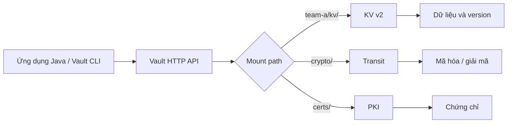

# Secrets engine và vị trí gắn kết (mount path) trong HashiCorp Vault

Trong HashiCorp Vault, **secrets engine** là thành phần cung cấp một nhóm chức năng liên quan đến bí mật: lưu và đọc dữ liệu, cấp thông tin đăng nhập có thời hạn, mã hóa dữ liệu, phát hành chứng chỉ... Mỗi engine được **gắn (mount)** vào một đường dẫn riêng trong Vault. Đường dẫn đó là **mount path**: điểm bắt đầu mà ứng dụng hoặc lệnh CLI sử dụng để gọi engine.

Đây là kiến thức nền tảng khi sử dụng **Spring Vault**: muốn `VaultTemplate` đọc đúng bí mật, ứng dụng phải biết engine nào đang được bật, engine được gắn ở đâu, phiên bản API nào được sử dụng và token có quyền gì trên đường dẫn tương ứng.

## 1. Mục tiêu học tập

Sau bài này, bạn có thể:

- Phân biệt **loại secrets engine**, **mount path** và **đường dẫn của tài nguyên bên trong engine**.
- Liệt kê, bật và sử dụng một engine tại mount path do mình chọn.
- Giải thích tại sao KV v1 và KV v2 có đường dẫn HTTP API khác nhau dù cùng lưu dữ liệu dạng key–value.
- Liên hệ mount path với Vault policy và cách Spring Vault gọi `VaultTemplate`.
- Nhận diện những nhầm lẫn thường dẫn đến lỗi `403`, `404` hoặc đọc nhầm engine.

## 2. Secrets engine thực sự là gì?

Vault cung cấp nhiều secrets engine, mỗi loại có giao diện API và quy tắc vòng đời riêng:

| Engine | Công dụng điển hình | Tài nguyên thường gặp |
|---|---|---|
| **KV (Key/Value)** | Lưu bí mật do ứng dụng hoặc người vận hành cung cấp | Đường dẫn dữ liệu, phiên bản, metadata |
| **Database** | Cấp tài khoản cơ sở dữ liệu động theo role | `creds/<role>`, lease của credential |
| **Transit** | Mã hóa/giải mã, ký hoặc kiểm tra chữ ký mà không trả khóa mã hóa cho ứng dụng | `keys/<key>`, `encrypt/<key>`, `decrypt/<key>` |
| **PKI** | Cấp và quản lý chứng chỉ X.509 | `issue/<role>`, CA, CRL |
| **Cloud credentials** | Cấp thông tin xác thực hoặc quyền truy cập nhà cung cấp đám mây theo cấu hình | Role, credentials, lease tùy engine |

**Secrets engine không đồng nghĩa với kho chứa một tập tin.** Nó là một dịch vụ có các API và quy tắc kiểm soát truy cập. KV chủ yếu quản lý dữ liệu tĩnh, trong khi một số engine như Database có thể **tạo bí mật động** và phát hành lease để thu hồi khi hết hạn.

Một Vault có thể bật **nhiều instance của cùng một loại engine**. Chẳng hạn, cả `team-a/kv/` và `team-b/kv/` đều có thể là KV v2, nhưng dữ liệu và cấu hình của hai mount được tách biệt.

### Secrets engine khác authentication method

Authentication method (ví dụ AppRole, Kubernetes, JWT) giúp workload **đăng nhập và nhận token**. Secrets engine sử dụng token đó để **thực hiện thao tác trên bí mật**. Phân biệt hai loại mount:

| Loại mount | Ví dụ đường dẫn | Chức năng |
|---|---|---|
| Auth method | `auth/kubernetes/`, `auth/approle/` | Xác thực workload, phát hành token |
| Secrets engine | `team-a/kv/`, `crypto/`, `pki/` | Lưu, cấp phát hoặc xử lý bí mật |

Token được phát hành sau xác thực vẫn phải có **policy cho phép** truy cập từng API của secrets engine. Đăng nhập thành công không tự động cho phép đọc mọi bí mật.

## 3. Mount path: tiền tố định tuyến API

Khi bật một secrets engine, Vault đăng ký nó dưới một **đường dẫn gắn kết duy nhất**. Chẳng hạn:

```text
Mount path: team-a/kv/
Engine:     kv, version 2
Secret:     apps/catalog

Đường dẫn logic của secret = mount path + đường dẫn bên trong engine
                         = team-a/kv/ + apps/catalog
```

Mount path **không phải** đường dẫn thư mục trong hệ điều hành và cũng **không phải** URL của máy chủ Vault. Đó là tiền tố bên trong không gian API của Vault. Địa chỉ máy chủ có thể là `https://vault.example.internal:8200`, còn đường dẫn API thường bắt đầu bằng `/v1/`.

Vault xác định engine từ mount path, sau đó chuyển phần đường dẫn còn lại cho engine xử lý:



**Ví dụ:** `crypto/` là mount path của Transit, còn `encrypt/payment-key` là hành động và khóa bên trong engine. Hai phần kết hợp thành `crypto/encrypt/payment-key`.

Một số lưu ý về mount path:

1. Tên như `secret/`, `kv/`, `crypto/` chỉ là **quy ước**, không phải tên bắt buộc. Không nên mặc định mọi môi trường đều có mount `secret/`.
2. Mount path có thể gồm nhiều đoạn, ví dụ `apps/prod/kv/`; không được chồng lấn với mount đã tồn tại theo cách gây xung đột định tuyến.
3. Đổi tên, tắt hoặc thay thế một mount tác động đến các URL API, policy và ứng dụng phụ thuộc vào nó; cần quản lý như thay đổi hạ tầng có rủi ro.
4. Trong môi trường dùng Vault namespaces, mount path được phân giải **trong namespace được chọn**. Namespace và mount path là hai khái niệm khác nhau.

## 4. Kiểm tra và bật một secrets engine

Thực hành sau giả định bạn có Vault CLI, một Vault thử nghiệm đang chạy và token đủ quyền quản trị mount. **Không chạy thao tác bật/tắt engine trên môi trường dùng chung hoặc production khi chưa có quy trình thay đổi.**

Kiểm tra trạng thái Vault và những engine hiện có:

```bash
vault status
vault secrets list
vault secrets list -detailed
```

`vault secrets list` hiển thị mount path và loại engine, còn `-detailed` cung cấp thêm thông tin cấu hình. Với KV, phần cấu hình có thể cho biết `version=2`.

Bật một KV v2 tại mount path do nhóm lựa chọn:

```bash
vault secrets enable -path=team-a/kv -version=2 kv
```

Ở đây:

- `kv` cuối lệnh là **loại engine**.
- `-path=team-a/kv` là **mount path**, nơi Vault nhận các yêu cầu dành cho instance này.
- `-version=2` chọn KV **v2**, hỗ trợ version/metadata và các thao tác soft delete, undelete, destroy.

Có thể bật một instance Transit độc lập:

```bash
vault secrets enable -path=crypto transit
```

Lúc này `team-a/kv/` và `crypto/` là hai mount khác nhau, phục vụ mục đích khác nhau. Nếu mount đã tồn tại, hãy kiểm tra loại và cấu hình trước khi thay đổi; không bật lại cùng đường dẫn.

Lệnh `vault secrets disable <mount>` **vô hiệu hóa mount và có thể khiến dữ liệu do engine quản lý không còn truy cập được**. Không sử dụng lệnh này như một thao tác dọn dẹp thông thường trên môi trường đang có dữ liệu cần giữ.

## 5. Đường dẫn KV v1 và KV v2

Đây là điểm dễ nhầm nhất khi ứng dụng Java truy cập Vault.

### 5.1. KV v1

KV v1 cung cấp các thao tác đọc, ghi, xóa đơn giản. Nếu mount tại `legacy/` và secret có đường dẫn logic `apps/catalog`, API đọc là:

```http
GET /v1/legacy/apps/catalog
```

KV v1 không cung cấp cơ chế quản lý các **phiên bản secret** như KV v2.

### 5.2. KV v2

KV v2 có thêm lớp API để phân biệt dữ liệu, metadata và thao tác với phiên bản:

| Mục đích | Đường dẫn API dưới mount `team-a/kv/` | Ghi chú |
|---|---|---|
| Đọc/ghi dữ liệu | `team-a/kv/data/apps/catalog` | API có phân đoạn `data/` |
| Xem metadata hoặc liệt kê key | `team-a/kv/metadata/apps/catalog` hoặc tiền tố tương ứng | Quyền metadata và quyền đọc data độc lập |
| Soft delete phiên bản | `team-a/kv/delete/apps/catalog` | Có thể khôi phục nếu chưa destroy |
| Khôi phục phiên bản | `team-a/kv/undelete/apps/catalog` | Phụ thuộc phiên bản còn tồn tại |
| Xóa vĩnh viễn phiên bản | `team-a/kv/destroy/apps/catalog` | Không thể khôi phục phiên bản đã destroy |

Đối với KV v2:

```http
GET /v1/team-a/kv/data/apps/catalog
```

Đối với API đọc dữ liệu KV v2, body phản hồi có lớp `data` chứa dữ liệu secret và lớp `metadata` mô tả phiên bản:

```json
{
  "data": {
    "data": {
      "username": "demo-user",
      "password": "EXAMPLE_ONLY"
    },
    "metadata": {
      "version": 1
    }
  }
}
```

Đoạn trên chỉ minh họa các field liên quan; phản hồi thực tế có thêm metadata và các trường bao ngoài khác.

Sử dụng Vault CLI theo đường dẫn logic, để CLI xử lý cách gọi API theo phiên bản KV:

```bash
vault kv put -mount=team-a/kv apps/catalog username=demo-user password=EXAMPLE_ONLY
vault kv get -mount=team-a/kv apps/catalog
vault kv metadata get -mount=team-a/kv apps/catalog
```

Giá trị `EXAMPLE_ONLY` là dữ liệu giả dùng trong môi trường thử nghiệm. Không nhập bí mật thực vào lệnh có thể lưu lại trong lịch sử shell hoặc bản ghi thao tác; với dữ liệu thực, dùng phương thức nạp bí mật an toàn được tổ chức phê duyệt.

**Phân biệt hai cách gọi:** CLI `vault kv get -mount=team-a/kv apps/catalog` nhận đường dẫn logic `apps/catalog`. Ngược lại, HTTP API thuần của KV v2 cần phân đoạn `data/` trong URL. Nếu tự thêm `data/` khi một thư viện đã xử lý KV v2, yêu cầu có thể đọc **sai tên secret** hoặc trả `404`.

## 6. Mount path liên quan trực tiếp đến policy

Vault đánh giá quyền trên **đường dẫn API thực**, không chỉ trên tên secret nhìn thấy trong CLI. Vì vậy KV v2 cần policy phù hợp với `data/` và `metadata/`.

Ví dụ policy chỉ cho phép đọc secret của ứng dụng Catalog:

```hcl
path "team-a/kv/data/apps/catalog" {
  capabilities = ["read"]
}
```

Nếu cần cho phép **liệt kê** các key trong nhóm `apps/`, cấp quyền riêng cho API metadata tương ứng:

```hcl
path "team-a/kv/metadata/apps" {
  capabilities = ["list"]
}

path "team-a/kv/metadata/apps/*" {
  capabilities = ["list"]
}
```

Quyền `read` trên `data/apps/catalog` không đồng nghĩa có quyền `list` các key khác; tương tự, quyền `list` metadata không tự cho phép đọc giá trị secret. Trên đường dẫn KV v2, các thao tác `put`, xóa, khôi phục và destroy có yêu cầu capability khác nhau: `create`/`update`, `delete` hoặc `update` tùy API cụ thể.

Kiểm tra capability mà token hiện tại có trên đường dẫn cần dùng:

```bash
vault token capabilities team-a/kv/data/apps/catalog
vault token capabilities team-a/kv/metadata/apps
```

Trong thực tế, token của Spring Vault thường đến từ cơ chế xác thực workload như Kubernetes hoặc AppRole. Luồng hợp lý là:

1. Workload xác thực, Vault phát hành token với policy đã gán.
2. `VaultTemplate` gửi token khi gọi API tại mount path.
3. Vault kiểm tra policy cho **đúng endpoint** rồi mới cho engine thực hiện thao tác.

Chọn quyền tối thiểu theo nhu cầu sử dụng: dịch vụ chỉ cần đọc cấu hình thì không nên có quyền `destroy`, `delete` hoặc quản trị `sys/mounts`.

## 7. Tích hợp mount path với Spring Vault

**Spring Vault** là thư viện Java cung cấp `VaultTemplate` và các operations để làm việc với Vault API. Trong ví dụ bên dưới, Vault đã có KV v2 tại `team-a/kv/` và secret logic `apps/catalog`.

### 7.1. Cấu hình client tối giản cho môi trường thử nghiệm

```java
import java.net.URI;

import org.springframework.context.annotation.Configuration;
import org.springframework.vault.authentication.ClientAuthentication;
import org.springframework.vault.authentication.TokenAuthentication;
import org.springframework.vault.client.VaultEndpoint;
import org.springframework.vault.config.AbstractVaultConfiguration;

@Configuration
public class DemoVaultConfig extends AbstractVaultConfiguration {

    @Override
    public VaultEndpoint vaultEndpoint() {
        return VaultEndpoint.from(URI.create("http://127.0.0.1:8200"));
    }

    @Override
    public ClientAuthentication clientAuthentication() {
        String token = System.getenv("VAULT_TOKEN");
        if (token == null || token.isBlank()) {
            throw new IllegalStateException("Thiếu VAULT_TOKEN cho môi trường demo");
        }
        return new TokenAuthentication(token);
    }
}
```

Ví dụ sử dụng token có sẵn để dễ quan sát quan hệ giữa client, policy và mount path. **Trong production**, ứng dụng nên tích hợp xác thực phù hợp với workload, có TLS, cơ chế quản lý token/lease và chính sách phân quyền tối thiểu; không đưa token vào mã nguồn hoặc file cấu hình được commit.

### 7.2. Đọc KV v2 bằng operations chuyên biệt

```java
import org.springframework.stereotype.Service;
import org.springframework.vault.core.VaultKeyValueOperations;
import org.springframework.vault.core.VaultKeyValueOperationsSupport.KeyValueBackend;
import org.springframework.vault.core.VaultTemplate;
import org.springframework.vault.support.VaultResponse;

@Service
public class CatalogSecretReader {

    private final VaultKeyValueOperations kv;

    public CatalogSecretReader(VaultTemplate vaultTemplate) {
        this.kv = vaultTemplate.opsForKeyValue("team-a/kv", KeyValueBackend.KV_2);
    }

    public String readUsername() {
        VaultResponse response = kv.get("apps/catalog");
        if (response == null || response.getData() == null) {
            throw new IllegalStateException("Không tìm thấy secret apps/catalog");
        }

        Object username = response.getData().get("username");
        if (!(username instanceof String)) {
            throw new IllegalStateException("Secret thiếu trường username hợp lệ");
        }
        return (String) username;
    }
}
```

Giải thích ba phần cần khớp nhau:

| Thành phần | Giá trị trong ví dụ | Ý nghĩa |
|---|---|---|
| Vault server | `http://127.0.0.1:8200` | Địa chỉ dịch vụ Vault trong môi trường demo |
| Mount path | `team-a/kv` | Truyền cho `opsForKeyValue(...)` |
| Secret path | `apps/catalog` | Truyền cho `get(...)`, tương đối so với mount |

`KeyValueBackend.KV_2` cho Spring Vault biết cần sử dụng API KV v2. Operations này xử lý phân đoạn `data/` và bóc lớp response tương ứng, vì vậy ứng dụng **không** truyền `team-a/kv/data/apps/catalog` vào `kv.get(...)`.

Với KV v1, sử dụng `KeyValueBackend.KV_1` và mount tương ứng. Không thể khắc phục khác biệt KV v1/v2 chỉ bằng việc đổi tên mount path.

### 7.3. Khi gọi API qua `VaultTemplate.read(...)`

Các thao tác mức thấp như `VaultTemplate.read(String path)` làm việc với **đường dẫn API** do bạn cung cấp. Vì vậy, nếu đọc KV v2 bằng API mức thấp, đường dẫn sẽ là:

```java
VaultResponse raw = vaultTemplate.read("team-a/kv/data/apps/catalog");
```

Phản hồi mức thấp có lớp `data` lồng nhau theo cấu trúc HTTP API của KV v2. Với ứng dụng cần đọc/ghi KV thông thường, `opsForKeyValue` là lựa chọn rõ nghĩa hơn và giúp tránh tự ghép sai đường dẫn.

**Phân biệt Spring Vault với Spring Cloud Vault:** Spring Cloud Vault có cơ chế tự tải cấu hình vào Spring Environment. Bài này dùng trực tiếp Spring Vault và `VaultTemplate`; chỉ cấu hình `spring.cloud.vault.*` không tự động thay thế cho thiết lập một client Spring Vault độc lập.

## 8. Mount path của Transit, PKI và secrets động

Quy tắc mount path còn áp dụng cho engine khác, nhưng phần đường dẫn **sau mount** do từng engine quy định.

| Engine được mount | API mẫu (không gồm `/v1/`) | Ý nghĩa |
|---|---|---|
| Transit ở `crypto/` | `crypto/encrypt/payment-key` | Mã hóa bằng khóa `payment-key` được Vault quản lý |
| Transit ở `crypto/` | `crypto/decrypt/payment-key` | Giải mã ciphertext hợp lệ của khóa |
| PKI ở `certs/` | `certs/issue/service-role` | Yêu cầu phát hành chứng chỉ theo role |
| Database ở `db/` | `db/creds/reporting` | Yêu cầu credential động theo role `reporting` |

Ví dụ, một policy chỉ cho phép ứng dụng dùng thao tác mã hóa Transit:

```hcl
path "crypto/encrypt/payment-key" {
  capabilities = ["update"]
}
```

Quyền thực hiện `encrypt` không tự đồng nghĩa với quyền `decrypt`, quản lý key hoặc cấp certificate. Với PKI và Database, role của engine định nghĩa loại chứng chỉ hoặc tài khoản có thể cấp; policy vẫn quyết định client được gọi API nào.

Các engine phát hành bí mật động thường trả thêm **lease ID**, thời hạn (**TTL**) và thông tin có thể gia hạn/thu hồi. Ngược lại, **secret KV v2 không tự trở thành credential có lease chỉ vì token đọc nó có TTL**. Phải phân biệt:

- **Token TTL:** thời hạn token xác thực của workload.
- **Secret lease TTL:** thời hạn một secret động do engine phát hành; có thể cần gia hạn hoặc revoke.
- **KV version:** phiên bản nội dung của một key trong KV v2; không phải lease.

Phân biệt này giúp tránh lỗi thiết kế như tưởng rằng token hết hạn sẽ tự xóa mật khẩu tĩnh đã đọc khỏi bộ nhớ ứng dụng.

## 9. Tổ chức mount path trong một hệ thống nhiều dịch vụ

Một sơ đồ mang tính minh họa:

```text
Vault namespace / môi trường đã chọn
├── platform/kv/         (KV v2: bí mật dùng chung có giới hạn)
├── catalog/kv/          (KV v2: cấu hình bí mật của Catalog)
├── billing/kv/          (KV v2: cấu hình bí mật của Billing)
├── crypto/              (Transit: khóa mã hóa qua API)
├── certs/               (PKI: chứng chỉ dịch vụ)
└── db/                  (Database: credential động)
```

Cấu trúc thực tế phải đi theo ranh giới sở hữu, môi trường và policy của tổ chức. Một số nguyên tắc:

1. **Tên mount có chủ đích.** Ví dụ `catalog/kv/` cho biết đơn vị sở hữu; ứng dụng vẫn phải lấy mount path từ cấu hình triển khai thay vì hardcode khắp mã nguồn.
2. **Tách quyền theo workload.** Token của Catalog không nên có quyền đọc bí mật Billing chỉ vì cùng Vault server.
3. **Không nhầm namespace, mount và secret key.** Đây là ba tầng tổ chức khác nhau; một đường dẫn giống nhau ở namespace khác có thể trỏ đến dữ liệu khác.
4. **Kiểm soát thay đổi mount.** Khi chuyển từ `secret/` sang `catalog/kv/`, cần cập nhật đồng bộ policy, cấu hình ứng dụng, thao tác vận hành và kiểm thử.
5. **Theo dõi truy cập mà không lộ bí mật.** Audit log, metric lỗi và cảnh báo nên phản ánh đường dẫn API, trạng thái phản hồi và danh tính phù hợp; tránh ghi token, plaintext hay toàn bộ response chứa secret.

## 10. Gỡ lỗi sai mount path và quyền truy cập

| Triệu chứng | Nguyên nhân cần kiểm tra | Hướng xử lý |
|---|---|---|
| `404` khi đọc KV | Mount không tồn tại, tên key sai, dùng API KV v1 cho KV v2, hoặc version đã bị xóa | Xem `vault secrets list -detailed`; kiểm tra mount, version và key; thử `vault kv get -mount=...` |
| `403` permission denied | Token thiếu capability trên đường dẫn API thực | Kiểm tra policy, `vault token capabilities` và đường dẫn `data/`/`metadata/` |
| Đọc được secret nhưng không liệt kê được | Có quyền `read` trên `data/` nhưng thiếu `list` trên `metadata/` | Cấp quyền `list` đúng phạm vi cần dùng |
| Lệnh KV CLI chạy nhưng `VaultTemplate.read(...)` không có dữ liệu mong đợi | CLI tự chuyển đường dẫn KV v2, còn API mức thấp yêu cầu đường dẫn đầy đủ | Dùng `opsForKeyValue` đúng backend hoặc dùng `/data/` khi gọi API mức thấp |
| Cùng key nhưng hai môi trường trả dữ liệu khác nhau | Nhầm Vault server, namespace hoặc mount path | Kiểm tra endpoint, namespace và cấu hình deploy của workload |
| Token hợp lệ nhưng không dùng được Transit/PKI | Policy chỉ cấp quyền trên KV hoặc cấp sai endpoint engine | Kiểm tra quyền trên `encrypt/`, `decrypt/`, `issue/`... theo API thực |

**Trình tự chẩn đoán ngắn:** (1) xác nhận Vault server và namespace, (2) xác nhận mount path và loại/phiên bản engine, (3) xác nhận đường dẫn tài nguyên, (4) kiểm tra capability token trên đường dẫn API, (5) xác nhận thư viện đang dùng API đúng loại. Khi đã kiểm tra đủ, mới xem log hoặc audit event đã được lọc dữ liệu nhạy cảm để tìm nguyên nhân sâu hơn.

## 11. Thực hành có kiểm chứng

Trong Vault **thử nghiệm** với token phù hợp:

1. Chạy `vault secrets list -detailed`; chọn mount KV v2 sẵn có hoặc bật `lab/kv` bằng `vault secrets enable -path=lab/kv -version=2 kv`.
2. Ghi dữ liệu mẫu: `vault kv put -mount=lab/kv demo/service username=lab-user`.
3. Đọc lại: `vault kv get -mount=lab/kv demo/service`. Xác nhận CLI hiển thị giá trị `lab-user` và metadata của version.
4. Dự đoán endpoint HTTP đúng: `GET /v1/lab/kv/data/demo/service`. Giải thích tại sao `GET /v1/lab/kv/demo/service` không phải endpoint đọc dữ liệu KV v2.
5. Tạo policy chỉ đọc `lab/kv/data/demo/service`, gắn vào token thử nghiệm có quyền giới hạn rồi kiểm tra đọc thành công nhưng không có quyền ghi hoặc đọc key khác.
6. Trong Spring Vault, cấu hình `opsForKeyValue("lab/kv", KeyValueBackend.KV_2)` và gọi `get("demo/service")`. Xác nhận kết quả ứng với bước 3; thử sai backend trong **môi trường lab** để quan sát khác biệt đường dẫn.

Kết quả đạt yêu cầu là bạn xác định đúng **engine**, **mount path**, **secret path**, **API path** và **capability** cho từng thao tác, đồng thời giải thích được vai trò của `VaultTemplate` trong việc gọi API tương ứng.

## 12. Ghi nhớ

**Secrets engine quyết định thao tác nào có thể thực hiện; mount path quyết định gọi instance nào; đường dẫn phía sau mount xác định tài nguyên hoặc hành động cụ thể.** Vault policy áp dụng lên đường dẫn API và token của workload, còn Spring Vault giúp ứng dụng Java gọi API theo cơ chế phù hợp với engine. Với KV v2, luôn nhớ sự khác biệt giữa **secret path logic** (`apps/catalog`) và **API path** (`team-a/kv/data/apps/catalog`).
