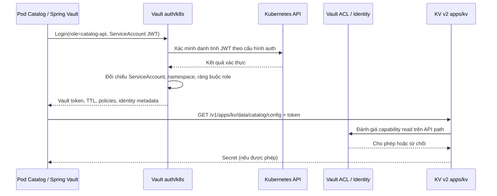
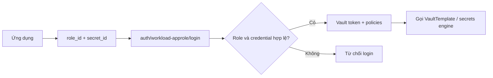
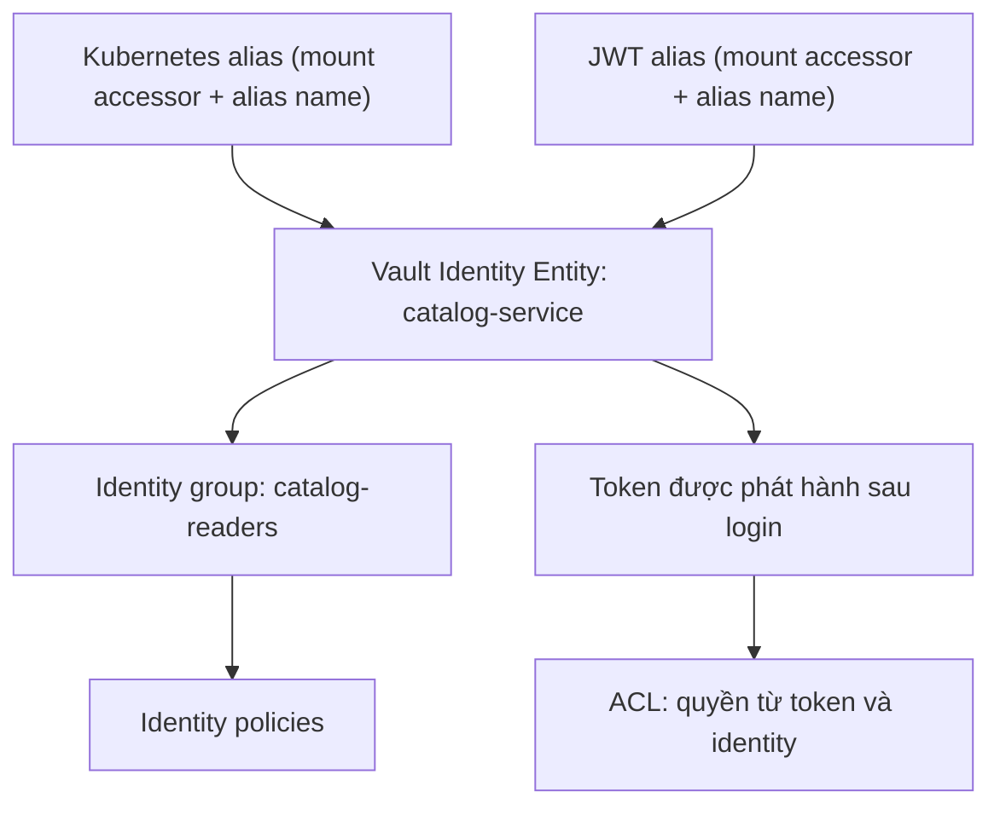

# Auth method, role và quan hệ với danh tính ứng dụng trong HashiCorp Vault

Một ứng dụng Java muốn đọc bí mật từ HashiCorp Vault cần chứng minh **nó là workload nào** trước khi được cấp quyền truy cập. Vault thực hiện bước này thông qua **authentication method (auth method)**. Mỗi phương thức có thể định nghĩa **role** để ràng buộc danh tính từ môi trường chạy với chính sách cấp token. Sau khi xác thực, ứng dụng dùng **Vault token** để gọi các secrets engine, chẳng hạn KV, Transit hoặc PKI.

Trong **Spring Vault**, việc này liên quan trực tiếp đến cơ chế `ClientAuthentication`, quản lý phiên/token và `VaultTemplate`. Hiểu đúng mối quan hệ giữa auth method, role, danh tính, token và policy giúp tránh hai lỗi phổ biến: workload đăng nhập được nhưng không đọc được secret, hoặc role bị cấu hình quá rộng nên workload có quyền vượt nhu cầu.

## 1. Mục tiêu học tập

Sau bài học, bạn có thể:

- Phân biệt auth method, **auth mount path**, auth role, Vault Identity entity/alias, token và ACL policy.
- Giải thích Vault đối chiếu danh tính ứng dụng từ Kubernetes, AppRole hoặc JWT với điều kiện của role như thế nào.
- Đọc được quy trình xác thực của workload từ yêu cầu login đến lúc `VaultTemplate` truy cập secrets engine.
- Viết một ví dụ policy chỉ đọc KV v2 và liên kết policy đó với role xác thực.
- Hiểu vì sao vòng đời token khác vòng đời lease của secret động, và xác định nơi kiểm tra khi gặp lỗi `403`.

## 2. Những khái niệm phải tách biệt

| Khái niệm | Vai trò | Ví dụ |
|---|---|---|
| **Auth method** | Cơ chế kiểm chứng thông tin đăng nhập/danh tính | Kubernetes, AppRole, JWT, AWS, TLS |
| **Auth mount path** | Đường dẫn nơi một instance auth method được bật | `auth/k8s/`, `auth/workload-approle/` |
| **Auth role** | Tập điều kiện chấp nhận workload và tham số token cấp ra, thuộc một auth mount cụ thể | `auth/k8s/role/catalog-api` |
| **External identity** | Danh tính đến từ môi trường/nhà cung cấp nhận dạng | Kubernetes ServiceAccount, JWT subject, AWS role |
| **Identity entity/alias** | Mô hình danh tính nội bộ giúp Vault gắn một hay nhiều danh tính đăng nhập với một thực thể | Entity ID, alias theo auth mount |
| **Vault token** | Bằng chứng phiên đã xác thực, gửi cùng yêu cầu API | Token có TTL và các policy áp dụng |
| **ACL policy** | Định nghĩa hành động được phép trên các đường dẫn Vault | `read` tại `apps/kv/data/catalog/config` |
| **Secrets engine** | Thành phần thực thi thao tác với bí mật | KV v2 tại `apps/kv/`, Transit tại `crypto/` |

**Auth method trả lời “workload chứng minh danh tính bằng cách nào?”; role trả lời “danh tính nào được chấp nhận theo điều kiện gì?”; policy trả lời “sau khi có token, workload làm được gì?”.**

Một role xác thực **không phải** secret, không phải token và không phải policy. Role có thể tham chiếu tới các policy để Vault gắn quyền khi phát hành token. Tùy auth method, role còn chứa những điều kiện riêng như namespace, ServiceAccount, claim JWT, giới hạn CIDR hoặc vòng đời token.

### Auth mount và secrets mount là hai loại đường dẫn khác nhau

```text
auth/k8s/                           <- auth mount (Kubernetes)
auth/k8s/role/catalog-api           <- role cấu hình cách đăng nhập
auth/k8s/login                      <- endpoint đăng nhập

apps/kv/                            <- secrets engine mount (KV v2)
apps/kv/data/catalog/config         <- endpoint đọc dữ liệu KV v2
```

Vault có thể chạy nhiều instance của cùng loại auth method, chẳng hạn `auth/k8s-dev/` và `auth/k8s-prod/`. Role tên `catalog-api` trên hai mount đó là **hai role khác nhau** với cấu hình và quyền có thể hoàn toàn khác nhau. Đừng suy quyền từ tên role khi chưa xác nhận auth mount.

## 3. Luồng đăng nhập của một workload

Giả sử dịch vụ Catalog chạy trong Kubernetes, sử dụng ServiceAccount `catalog-api` thuộc namespace `apps`. Vault được cấu hình auth Kubernetes tại `auth/k8s/`; role `catalog-api` chỉ cho phép danh tính này đăng nhập.



Các bước quan trọng:

1. Workload nhận một **bằng chứng danh tính** từ môi trường chạy, ví dụ Kubernetes ServiceAccount JWT. Đây **chưa phải** Vault token.
2. Workload gửi bằng chứng đó tới endpoint đăng nhập của **đúng auth mount** và chỉ định role.
3. Vault xác minh thông tin theo auth method, sau đó kiểm tra ràng buộc của role. Nếu thất bại, Vault không cấp token.
4. Nếu thành công, Vault phát hành **Vault token** với thời hạn và quyền được xác định từ role, policy và cấu hình danh tính liên quan.
5. Ứng dụng dùng token gọi API secrets engine. Vault đánh giá **đường dẫn API và capability** tại thời điểm thao tác; đăng nhập thành công không bảo đảm mọi request được phép.

Lưu ý: mô hình kiểm chứng JWT cụ thể phụ thuộc cấu hình plugin và phiên bản Vault/Kubernetes. Sơ đồ thể hiện trách nhiệm logic; không phải mọi plugin đều gọi trực tiếp Kubernetes API cho từng request theo cùng một cách.

## 4. Những auth method phổ biến cho ứng dụng Java

| Auth method | Workload chứng minh danh tính bằng | Cách role ràng buộc danh tính | Khi nào phù hợp |
|---|---|---|---|
| **Kubernetes** | ServiceAccount JWT của Pod | Tên ServiceAccount, namespace và các điều kiện cấu hình | Ứng dụng chạy trên Kubernetes |
| **AppRole** | `role_id` và thường là `secret_id` | Cặp thông tin AppRole, giới hạn sử dụng/thời hạn và điều kiện bổ sung | Workload tự vận hành, batch job, môi trường chưa có danh tính nền tảng phù hợp |
| **JWT** | JWT do một nhà phát hành tin cậy ký | Issuer, audience, claims và kiểu role | CI/CD, workload có OIDC/JWT được cấp sẵn |
| **AWS** | Chữ ký request hoặc thông tin xác thực AWS phù hợp loại login | IAM principal/role hoặc điều kiện hạ tầng | Workload trên AWS |
| **TLS certificate** | Chứng chỉ client trong quá trình TLS | Chứng chỉ/CA được tin cậy và ràng buộc certificate role | Workload có hệ thống quản trị mTLS |
| **Token** | Vault token có sẵn | Không có bước kiểm tra auth role mới ở mỗi request | Thử nghiệm hoặc tích hợp được chủ đích cấp token sẵn |

Không có auth method nào tự động phù hợp cho mọi hệ thống. Ưu tiên phương thức tận dụng danh tính workload có sẵn trong nền tảng, tránh tạo thêm credential dài hạn phải phân phối thủ công. Với Spring Vault, nhiệm vụ của cơ chế xác thực là cung cấp token hợp lệ cho session; phần đọc KV/Transit/PKI có thể tiếp tục dùng `VaultTemplate`.

### 4.1. Kubernetes auth: danh tính gắn với Pod

Một Pod thường sử dụng ServiceAccount do cấu hình Kubernetes chỉ định. Khi auth Kubernetes được thiết lập, Vault có thể kiểm tra JWT của ServiceAccount và so sánh danh tính đó với role:

```text
Pod catalog-api
  namespace: apps
  serviceAccountName: catalog-api
       |
       | ServiceAccount JWT
       v
POST /v1/auth/k8s/login
  role: catalog-api
       |
       v
Role auth/k8s/role/catalog-api
  bound_service_account_names: catalog-api
  bound_service_account_namespaces: apps
  token_policies: catalog-read
       |
       v
Vault token dành cho ứng dụng Catalog
```

**Tên role không bắt buộc trùng tên ServiceAccount.** Ở đây chúng giống nhau để dễ quan sát; quan hệ bảo mật nằm ở các trường `bound_service_account_*` và điều kiện xác thực, không nằm ở sự giống nhau của chuỗi tên.

Một role cho phép mọi ServiceAccount hoặc mọi namespace sẽ có phạm vi tin cậy lớn hơn role chỉ định rõ workload. Trong môi trường nhiều tenant, nên ràng buộc cụ thể và cân nhắc audience của JWT, cấu hình Kubernetes auth và thời hạn token.

### 4.2. AppRole: danh tính ứng dụng dùng credential có kiểm soát

AppRole thường dùng hai giá trị:

- `role_id`: định danh role; **không nên xem là bí mật chính** và không tự cho phép login trong cấu hình có yêu cầu Secret ID.
- `secret_id`: bằng chứng bổ sung, phải xử lý như một **secret**; có thể đặt TTL, giới hạn số lần dùng và biện pháp phân phối an toàn.



Role AppRole không có cùng ý nghĩa với Kubernetes ServiceAccount. Nó là một **hồ sơ xác thực do Vault quản lý**, dùng credential mà workload phải nhận qua kênh cung cấp an toàn. Khi triển khai thực tế, nên hạn chế cách tạo/phân phối `secret_id`, áp dụng thời hạn và số lần sử dụng phù hợp, tránh ghi vào log hoặc đưa vào repository.

### 4.3. JWT auth: danh tính dựa trên claims

Với JWT auth, role có thể quy định `bound_audiences`, `bound_claims`, `user_claim` và các điều kiện khác. Ví dụ JWT có `sub=ci-catalog` **chưa đủ** để được đăng nhập: Vault còn phải kiểm tra chữ ký, issuer, audience, thời gian hiệu lực và các ràng buộc role được cấu hình.

Đừng nhầm **JWT của nhà cung cấp danh tính** với **Vault token** được trả sau login. Một JWT hợp lệ về chữ ký vẫn có thể bị từ chối vì không đúng audience hoặc claim yêu cầu.

## 5. Auth role là gì và không phải là gì?

Role là cấu hình **thuộc về một auth mount**. Đường dẫn role có dạng khác nhau tùy backend; ví dụ:

```text
auth/k8s/role/catalog-api             # Kubernetes auth role
auth/workload-approle/role/catalog-api # AppRole auth role
```

Trong cả hai ví dụ, tên role là `catalog-api`, nhưng điều kiện login, credential đầu vào và token được cấp có thể khác nhau.

Role thường kiểm soát hai nhóm yếu tố:

1. **Ai được đăng nhập:** binding với Kubernetes ServiceAccount, JWT claims, `role_id`/`secret_id`, IAM principal hoặc thuộc tính riêng của auth method.
2. **Token nào được cấp:** tập policy, TTL/max TTL, token type và các ràng buộc hỗ trợ như CIDR tùy auth method.

Không được đánh đồng auth role với những role nằm **bên trong secrets engine**:

| Đường dẫn | Loại role | Tác dụng |
|---|---|---|
| `auth/k8s/role/catalog-api` | Auth role | Cho phép một workload Kubernetes đăng nhập và nhận token |
| `auth/workload-approle/role/catalog-api` | Auth role | Định nghĩa cơ chế login AppRole và token phát hành |
| `database/roles/reporting` | Database secrets role | Định nghĩa cách cấp credential database |
| `certs/roles/service` | PKI secrets role | Quy định điều kiện phát hành chứng chỉ |

Workload có thể **đăng nhập bằng auth role** rồi sử dụng token gọi **database role** để nhận credential hoặc gọi **PKI role** để nhận chứng chỉ. Hai loại role phục vụ hai giai đoạn khác nhau.

## 6. Vault Identity: entity, alias và nhóm quyền

Vault có mô hình **Identity** nhằm biểu diễn một thực thể logic (người dùng hoặc workload) độc lập hơn với cơ chế đăng nhập. Các thành phần chính:

| Thành phần | Ý nghĩa |
|---|---|
| **Entity** | Danh tính chuẩn tắc bên trong Vault, có entity ID và có thể gắn metadata/policy |
| **Entity alias** | Danh tính được một auth method nhận diện; gắn với **mount accessor** của auth mount và tên alias tương ứng |
| **Group** | Tập các entity/nhóm, dùng để quản lý quyền theo tập hợp |
| **Group alias** | Liên kết nhóm bên ngoài từ identity provider với nhóm tương ứng của Vault, khi được cấu hình |
| **Identity policy** | Policy có thể gắn với entity/group và cùng tham gia đánh giá quyền của token |

Ví dụ một dịch vụ có thể đăng nhập bằng Kubernetes tại `auth/k8s/` khi chạy trên cluster và qua JWT auth tại `auth/ci-jwt/` trong pipeline. Nếu tổ chức **chủ động ánh xạ** cả hai identity alias về cùng một entity, Vault có thể coi chúng là cùng thực thể logic phục vụ quản lý identity.



**Không được hợp nhất hai danh tính chỉ vì cùng tên chuỗi `catalog-api`.** Alias còn phụ thuộc auth mount accessor và quy tắc lấy tên của auth method. Việc gộp sai identity có thể khiến một workload thừa hưởng quyền của workload khác. Tùy phương thức/cấu hình, Vault có thể tự tạo entity/alias khi login hoặc quản trị viên có thể quản lý việc ánh xạ; cần kiểm tra Identity thực tế thay vì giả định.

### Token policies và identity policies

Các policy trên Vault token có thể đến từ nhiều nguồn. Để diễn giải quyền thực tế, cần phân biệt:

- **Token policies:** policy được gắn vào token khi phát hành, thường đến từ cấu hình role hoặc các quy tắc phát hành token.
- **Identity policies:** policy gắn với entity hoặc identity group liên quan đến danh tính của token.
- **Capabilities thực tế:** quyền cho một API path được Vault quyết định sau khi áp dụng toàn bộ policy và các cơ chế kiểm soát liên quan. Trong ACL, `deny` có hiệu lực phủ định các quyền được cấp khác.

Vì vậy, đọc riêng phần `token_policies` của một auth role **chưa đủ** để kết luận mọi quyền mà một workload có sau đăng nhập. Cần kiểm tra token/identity và khả năng truy cập cụ thể.

## 7. Từ xác thực đến phân quyền: ví dụ KV v2 của Catalog

Giả sử Vault đã có mount **KV v2** ở `apps/kv/`, trong đó secret của Catalog nằm tại đường dẫn logic `catalog/config`. API đọc secret tương ứng là `apps/kv/data/catalog/config`.

### 7.1. Tạo ACL policy giới hạn quyền đọc

Nội dung policy tên `catalog-read`:

```hcl
path "apps/kv/data/catalog/config" {
  capabilities = ["read"]
}
```

Lưu policy từ file HCL bằng tài khoản quản trị được cấp phép:

```bash
vault policy write catalog-read catalog-read.hcl
```

Lệnh giả định nội dung HCL ở trên đã được lưu tại `catalog-read.hcl` trong môi trường lab. Với KV v2, đường dẫn của policy cần có đoạn **`data/`** cho thao tác đọc/ghi dữ liệu. Quyền `read` trên secret này không tự cho phép `list` các key, ghi đè dữ liệu hoặc đọc secret khác.

### 7.2. Cấu hình role Kubernetes

Ví dụ bên dưới chỉ áp dụng cho **Vault lab** có quyền quản trị auth method:

```bash
# Bật auth Kubernetes tại mount tùy chọn khi mount này chưa tồn tại.
vault auth enable -path=k8s kubernetes

# Sau khi quản trị viên đã cấu hình auth/k8s/config để xác minh JWT:
vault write auth/k8s/role/catalog-api \
    bound_service_account_names="catalog-api" \
    bound_service_account_namespaces="apps" \
    token_policies="catalog-read" \
    token_ttl="30m"
```

Các giá trị trong ví dụ có ý nghĩa:

| Cấu hình | Ý nghĩa |
|---|---|
| `auth/k8s/` | Auth mount được lựa chọn, khác với tên loại `kubernetes` |
| `catalog-api` sau `/role/` | Tên auth role cho request login |
| `bound_service_account_names` | Chỉ chấp nhận ServiceAccount phù hợp |
| `bound_service_account_namespaces` | Chỉ chấp nhận namespace phù hợp |
| `token_policies` | Policy gắn vào token do role cấp |
| `token_ttl` | Thời gian sống được yêu cầu cho token; còn chịu giới hạn hệ thống |

Chỉ bật auth mount và tạo role **chưa đủ** để login Kubernetes thành công. `auth/k8s/config` phải được cấu hình đúng Kubernetes API/issuer/CA và cơ chế token reviewer hoặc phương án xác minh phù hợp. Ngoài ra, các thông số như audience JWT phải tương thích cấu hình deployment.

Đọc lại cấu hình role và mount:

```bash
vault auth list -detailed
vault read auth/k8s/role/catalog-api
```

### 7.3. Request login và token trả về

Workload gửi request logic sau, với JWT lấy từ cơ chế cấp danh tính của Kubernetes:

```http
POST /v1/auth/k8s/login
Content-Type: application/json

{
  "role": "catalog-api",
  "jwt": "<SERVICE_ACCOUNT_JWT>"
}
```

Phản hồi minh họa phần `auth` của Vault:

```json
{
  "auth": {
    "client_token": "<VAULT_TOKEN>",
    "policies": ["default", "catalog-read"],
    "lease_duration": 1800,
    "renewable": true,
    "entity_id": "<ENTITY_ID>"
  }
}
```

Các giá trị `<...>` là placeholder, còn `renewable`, danh sách policy và thời hạn trong phản hồi thực tế phụ thuộc cấu hình. Trường `client_token` là **bí mật cần bảo vệ**; không ghi request JWT hoặc token trả về vào log. Token được dùng trong các request sau, thường ở header `X-Vault-Token`.

Sau login:

```http
GET /v1/apps/kv/data/catalog/config
X-Vault-Token: <VAULT_TOKEN>
```

Vault đánh giá capability `read` trên đường dẫn `apps/kv/data/catalog/config`. Nếu cùng token gọi `apps/kv/data/billing/config` nhưng không có quyền thì Vault sẽ từ chối, dù token vẫn hợp lệ và chưa hết hạn.

### 7.4. Ví dụ AppRole với cùng policy

Một workload không chạy Kubernetes có thể dùng AppRole với chính sách đọc Catalog tương tự:

```bash
vault auth enable -path=workload-approle approle

vault write auth/workload-approle/role/catalog-api \
    token_policies="catalog-read" \
    token_ttl="30m" \
    secret_id_ttl="10m" \
    secret_id_num_uses=1
```

Tùy cơ chế phát hành được cấu hình, client nhận `role_id` và `secret_id` qua kênh an toàn để gọi:

```http
POST /v1/auth/workload-approle/login
Content-Type: application/json

{
  "role_id": "<ROLE_ID>",
  "secret_id": "<SECRET_ID>"
}
```

Role này thuộc `auth/workload-approle/`, không liên quan trực tiếp tới role cùng tên ở `auth/k8s/`. Hai auth method chỉ chia sẻ **ACL policy `catalog-read`** theo cấu hình của ví dụ. Không in `secret_id` hoặc JWT thật trong shell history, log, ticket, màn hình chia sẻ hay mã nguồn.

## 8. Spring Vault đặt auth method và role ở đâu?

Trong ứng dụng Java sử dụng Spring Vault, có thể hình dung các trách nhiệm như sau:

```text
Thông tin xác thực từ môi trường
  ├── Kubernetes ServiceAccount JWT
  ├── AppRole role_id + secret_id
  └── JWT/OIDC hoặc phương thức hỗ trợ khác
            |
            v
ClientAuthentication + cấu hình auth mount / role
            |
            v
SessionManager (quản lý Vault token/phiên)
            |
            v
VaultTemplate
            |
            +--> KV v2: apps/kv/data/catalog/config
            +--> Transit: crypto/encrypt/...
            +--> PKI: certs/issue/...
```

`ClientAuthentication` là abstraction xác thực mà Spring Vault sử dụng để đăng nhập theo phương thức đã cấu hình. Session manager cung cấp token cho các request của `VaultTemplate`; cách cache, gia hạn hoặc lấy token mới phụ thuộc implementation và cấu hình lifecycle. `VaultTemplate` tập trung vào thao tác với Vault API, **không quyết định auth role nào được Vault chấp nhận**.

Mã Java dưới đây cho thấy phần nghiệp vụ đọc KV sau khi bean `VaultTemplate` đã được cấu hình với xác thực workload phù hợp:

```java
import org.springframework.stereotype.Service;
import org.springframework.vault.core.VaultKeyValueOperations;
import org.springframework.vault.core.VaultKeyValueOperationsSupport.KeyValueBackend;
import org.springframework.vault.core.VaultTemplate;
import org.springframework.vault.support.VaultResponse;

@Service
public class CatalogSecretReader {

    private final VaultKeyValueOperations kv;

    public CatalogSecretReader(VaultTemplate vaultTemplate) {
        this.kv = vaultTemplate.opsForKeyValue("apps/kv", KeyValueBackend.KV_2);
    }

    public String readUsername() {
        VaultResponse secret = kv.get("catalog/config");
        if (secret == null || secret.getData() == null) {
            throw new IllegalStateException("Không tìm thấy Vault secret Catalog");
        }
        Object username = secret.getData().get("username");
        if (!(username instanceof String)) {
            throw new IllegalStateException("Thiếu username hợp lệ");
        }
        return (String) username;
    }
}
```

Trong ví dụ này, **`apps/kv` là secrets engine mount**, hoàn toàn khác với **`auth/k8s` là auth mount**. Thao tác `get("catalog/config")` dùng đường dẫn logic tương đối với mount KV v2; Spring Vault xử lý lớp API `data/`. Đoạn Java không cần biết ServiceAccount JWT hoặc Secret ID; thông tin đó thuộc cấu hình kết nối và xác thực.

Với ứng dụng triển khai lâu dài, nên có cơ chế quản lý phiên token tương thích với auth method, thỏa điều kiện TLS, cung cấp credential thông qua nền tảng và tránh sử dụng root token hoặc hardcode token. Spring Vault có cơ chế lifecycle session và hỗ trợ quản lý secret lease, nhưng **gia hạn token** và **gia hạn lease của credential động** là hai trách nhiệm khác nhau.

## 9. Token, TTL, lease và danh tính: khác nhau ở đâu?

Đăng nhập thường trả về một Vault token có TTL và các thông tin như policies, entity ID hoặc tính renewable. Những trường này có vai trò khác nhau:

| Thuộc tính | Nội dung |
|---|---|
| **Token TTL** | Token còn có thể được dùng trong khoảng thời gian nào; chịu ràng buộc TTL/max TTL, loại token và cấu hình hệ thống |
| **Token renewability** | Token có thể được gia hạn theo cơ chế phù hợp hay không; không phải mọi token đều renewable |
| **Token revocation** | Vô hiệu hóa token và có thể ảnh hưởng tới những lease liên quan theo cơ chế Vault |
| **Entity ID / alias** | Liên hệ token với danh tính được nhận diện ở Vault |
| **Secret lease TTL** | Thời hạn sử dụng credential động do secrets engine cấp; độc lập về mặt khái niệm với token TTL |
| **KV v2 version** | Số phiên bản của dữ liệu key–value; không phải thời hạn phiên/token hoặc secret lease |

Ví dụ, token của Catalog có TTL 30 phút nhưng mật khẩu tĩnh đọc từ KV không tự bị đổi hay xóa khi token hết hạn. Với credential Database động, lease do Database engine phát hành có thể hết hạn hoặc bị thu hồi theo chính sách riêng. Ứng dụng phải xử lý cả hai vòng đời nếu sử dụng đồng thời token và bí mật động.

Khi token hết hạn, request tới secrets engine có thể thất bại vì không còn xác thực hợp lệ. Điều đó khác với trường hợp token vẫn hợp lệ nhưng thiếu policy trên một API path. Cả hai tình huống đều có thể biểu hiện thành lỗi truy cập và cần được chẩn đoán theo thứ tự.

## 10. Kiểm tra quyền và chẩn đoán lỗi

Trong môi trường kiểm thử, sử dụng token của **workload đang gặp lỗi**, hoặc một token thử nghiệm có điều kiện tương đương, để quan sát kết quả. Tránh dùng admin/root token nhằm chứng minh ứng dụng có quyền vì quyền của admin khác quyền của workload.

```bash
# Kiểm tra mount auth hiện tại và cấu hình role (cần quyền đọc phù hợp).
vault auth list -detailed
vault read auth/k8s/role/catalog-api

# Kiểm tra thông tin của chính token hiện tại.
vault token lookup

# Hỏi quyền thực tế trên đường dẫn đọc KV v2.
vault token capabilities apps/kv/data/catalog/config
vault token capabilities apps/kv/data/billing/config
```

| Triệu chứng | Cần kiểm tra trước | Hướng xử lý |
|---|---|---|
| `404` tại endpoint login | Sai auth mount: ứng dụng gọi `auth/kubernetes/login` nhưng plugin được mount tại `auth/k8s/` | Đối chiếu `vault auth list` và cấu hình path của client |
| `403` hoặc bị từ chối **khi login** | JWT/credential không hợp lệ, ServiceAccount/namespace không khớp role, JWT issuer/audience không đúng, cấu hình xác minh auth chưa hoàn chỉnh | Kiểm tra auth plugin, role binding, token nền tảng và audit đã lọc dữ liệu nhạy cảm |
| Login thành công nhưng `403` khi đọc KV | Token thiếu `read` trên API path thực của KV v2 | Đối chiếu `vault token capabilities`, ACL policy và `data/` |
| Đọc được Catalog nhưng không truy cập Billing | Policy giới hạn đúng phạm vi | Đây có thể là kết quả bảo mật mong muốn; không mở rộng quyền nếu ứng dụng không cần |
| Token đọc được trước đó nhưng request sau lỗi | Token hết hạn/bị revoke hoặc session không gia hạn/lấy token mới | Kiểm tra TTL, renewability, session manager và cơ chế đăng nhập lại |
| Cùng tên role nhưng quyền khác nhau | Role nằm ở các auth mount/namespace khác nhau, hoặc identity group/policy khác | Xác minh mount path, namespace, token policies, identity policies |
| Token có vẻ thừa quyền | Token nhận thêm policy từ identity/group hoặc role rộng | Kiểm tra cả token và Identity, giảm quyền tại nguồn cấp |

Các lỗi xảy ra ở **bước login** và ở **bước gọi secrets engine** phải được tách riêng. Đăng nhập là việc xác thực workload; yêu cầu đọc secret là việc xác thực **và** phân quyền trên endpoint cụ thể.

## 11. Thực hành: từ ServiceAccount đến quyền đọc KV

Thực hiện trong Vault/Kubernetes **lab được cấp phép**, với secret giả. Cần có auth Kubernetes đã được cấu hình xác minh JWT và một KV v2 mount `apps/kv/`. Không cần tạo credential thật.

1. **Xác định hai mount:** dùng `vault auth list` để tìm auth mount và `vault secrets list` để tìm secrets engine mount. Ghi rõ đường dẫn `auth/k8s/` và `apps/kv/` khác nhau như thế nào.
2. **Tạo policy giới hạn:** thêm `catalog-read` với `read` tại `apps/kv/data/catalog/config`. Ghi dữ liệu giả cho key `catalog/config` bằng token lab có quyền ghi.
3. **Tạo role phù hợp:** cấu hình `auth/k8s/role/catalog-api` với `bound_service_account_names=catalog-api`, `bound_service_account_namespaces=apps` và `token_policies=catalog-read`.
4. **Thử login hợp lệ:** từ Pod có ServiceAccount/namespace đúng, thực hiện đăng nhập qua client Spring Vault hoặc cơ chế test được phê duyệt. Ghi nhận kết quả login, TTL và các policy **mà không tiết lộ token/JWT**.
5. **Kiểm thử quyền:** dùng `VaultTemplate` hoặc CLI với token của workload để đọc `catalog/config`; thử đọc một key không được cấp phép và xác nhận thao tác bị từ chối.
6. **Thử điều kiện role không khớp:** dùng danh tính lab khác tên ServiceAccount hoặc namespace rồi thử login. Phân biệt lỗi trước khi cấp token với lỗi thiếu policy sau login.
7. **Quan sát vòng đời:** kiểm tra TTL và cơ chế session khi token gần hết hạn; bảo đảm ứng dụng có cách gia hạn/đăng nhập lại tương thích với môi trường.

Kết quả đạt yêu cầu khi bạn có thể chỉ ra đầy đủ chuỗi **ServiceAccount JWT → auth mount → auth role → Vault token → ACL policy → KV v2 path** và giải thích vì sao một workload có thể đăng nhập thành công nhưng vẫn không có quyền đọc một secret cụ thể.

## 12. Tóm lược

- **Auth method** xác minh bằng chứng danh tính của workload; **auth mount path** xác định instance xác thực.
- **Auth role** thuộc một auth mount, kiểm soát điều kiện login và các thuộc tính token được phát hành; role cùng tên ở mount khác không mặc nhiên là một.
- **Identity entity/alias** giúp biểu diễn danh tính logic và có thể bổ sung policy qua entity hoặc group; việc ánh xạ danh tính phải dựa vào auth mount accessor và cơ chế identity.
- **Vault token** là kết quả của đăng nhập; **ACL policy** xác định capability trên đường dẫn API thực của secrets engine.
- **Spring Vault** sử dụng `ClientAuthentication` và quản lý session để cấp token cho `VaultTemplate`; phần mã nghiệp vụ chỉ cần biết mount của secrets engine và secret path phù hợp.

Nguyên tắc cốt lõi: **xác thực đúng danh tính mới là điều kiện đầu vào; quyền đọc/ghi dữ liệu luôn cần policy phù hợp trên API path cụ thể**. Với dịch vụ Java dùng Spring Vault, cấu hình đúng auth method, role, identity và vòng đời token quan trọng không kém việc gọi đúng `VaultTemplate`.
