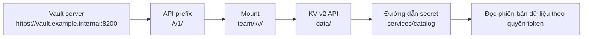

# Đường dẫn logic, tiền tố API và đường dẫn tương đối trong HashiCorp Vault

Khi một ứng dụng Java truy cập HashiCorp Vault, cùng một bí mật có thể xuất hiện dưới nhiều cách viết đường dẫn: đường dẫn logic mà nhóm phát triển đặt tên, URL HTTP có `/v1/`, đường dẫn dưới mount của KV v2 có thêm `data/`, đường dẫn trong ACL policy và đối số `get(...)` của Spring Vault. Nếu ghép các phần này không đúng, ứng dụng có thể nhận `404`, `403` hoặc gọi tới một tài nguyên khác với dự định.

Bài học thuộc phần **Nền tảng Vault** của **Spring Vault**. Trọng tâm là xác định rõ **phần nào của đường dẫn thuộc về máy chủ, API, secrets engine, secret và thư viện client**. Từ đó, bạn có thể dùng `VaultTemplate` chính xác, cấu hình quyền truy cập tối thiểu cho workload và chuẩn bị cho các phần tiếp theo về KV secrets, vòng đời token/lease, Transit encryption, PKI và kiểm thử tích hợp.

## 1. Mục tiêu học tập

Sau bài này, bạn có thể:

- Phân biệt **Vault server URL**, **API prefix `/v1/`**, **mount path**, **đường dẫn thao tác của engine** và **đường dẫn tương đối của tài nguyên**.
- Chuyển đổi một secret path giữa cách ghi trong Vault CLI, HTTP API, ACL policy và Spring Vault.
- Hiểu vì sao KV v1 và KV v2 dùng API path khác nhau dù tên secret logic giống nhau.
- Biết khi nào phải truyền `data/` hay `metadata/`, và khi nào thư viện đã tự thêm chúng.
- Chẩn đoán lỗi thường gặp do ghép sai prefix, trùng mount, nhầm namespace hoặc thiếu quyền trên đường dẫn API.

## 2. Bản đồ một đường dẫn Vault

Giả sử hệ thống có Vault tại `https://vault.example.internal:8200`, secrets engine **KV v2** được mount tại `team/kv/`, và secret phục vụ ứng dụng Catalog nằm ở `services/catalog`.

```text
Vault server URL:            https://vault.example.internal:8200
HTTP API version prefix:     /v1/
Secrets engine mount path:   team/kv/
KV v2 operation segment:     data/
Secret relative path:        services/catalog
                             -----------------------------------------
HTTP request path:           /v1/team/kv/data/services/catalog
Full request URL:            https://vault.example.internal:8200/v1/team/kv/data/services/catalog
```

Nhìn theo từng tầng:



Với thao tác đọc dữ liệu KV v2, có thể mô tả công thức khái niệm:

```text
HTTP URL = Vault server URL + /v1/ + mount path + data/ + secret relative path
```

**Đây không phải công thức áp dụng nguyên xi cho mọi secrets engine.** Phân đoạn `data/` thuộc riêng API KV v2. Transit có các thao tác như `encrypt/`, PKI có `issue/`, còn một số engine dùng đường dẫn khác. Ngoài ra, đường dẫn trên không tự quyết định quyền: Vault còn phải xác thực token và kiểm tra policy.

### Bảng thuật ngữ

| Thành phần | Ví dụ | Ai quyết định? | Vai trò |
|---|---|---|---|
| Vault server URL | `https://vault.example.internal:8200` | Triển khai hạ tầng | Máy chủ và cổng mà client kết nối |
| HTTP API prefix | `/v1/` | Giao diện API của Vault | Tiền tố của các endpoint HTTP |
| Mount path | `team/kv/` | Người quản trị khi bật engine | Định tuyến yêu cầu tới instance secrets engine |
| Engine API segment | `data/`, `metadata/` | API của engine, với KV v2 | Chọn loại thao tác đối với engine |
| Secret relative path | `services/catalog` | Nhóm sở hữu secret | Tên tài nguyên bên trong mount |
| API path đầy đủ | `team/kv/data/services/catalog` | Kết hợp mount và endpoint | Đường dẫn Vault xử lý sau tiền tố `/v1/` |
| ACL policy path | `team/kv/data/services/catalog` | Policy người quản trị khai báo | Đường dẫn được xét khi đánh giá capability |

Trong một số tài liệu về Vault, cụm **logical path** có thể chỉ *toàn bộ đường dẫn logic bên trong Vault* như `team/kv/data/services/catalog`, tức phần sau `/v1/`. Trong ngữ cảnh CLI hoặc API đọc KV, người học lại thường gọi `services/catalog` là *logical secret path* — tên secret tương đối với mount. Vì thuật ngữ được dùng ở nhiều tầng, trong bài này ta sẽ ghi cụ thể **API path** hoặc **secret relative path** mỗi khi cần tránh nhầm lẫn.

## 3. API prefix `/v1/`: có mặt ở URL HTTP nhưng không được nhân đôi

HashiCorp Vault cung cấp HTTP API với tiền tố `/v1/`. Ví dụ request đọc KV v2:

```http
GET /v1/team/kv/data/services/catalog
X-Vault-Token: <VAULT_TOKEN>
```

Địa chỉ máy chủ là phần trước `/v1/`; tiền tố `/v1/` do HTTP API sử dụng. Trong trường hợp phổ biến, cấu hình client chỉ đặt URL cơ sở:

```text
https://vault.example.internal:8200
```

Sau đó client hoặc thư viện Vault chịu trách nhiệm tạo URL endpoint.

**Không thêm thủ công `/v1/` vào đối số `VaultTemplate.read(...)` hoặc `VaultTemplate.write(...)`.** Những API này nhận đường dẫn Vault để client xây request; `VaultTemplate` đã xử lý tiền tố HTTP API. Truyền cả `v1/team/kv/... ` vào phương thức có thể khiến client gọi nhầm `/v1/v1/team/kv/...`.

```java
// Đúng với VaultTemplate API mức thấp:
VaultResponse raw = vaultTemplate.read("team/kv/data/services/catalog");

// Sai cách ghép: /v1/ là tiền tố HTTP do Vault client quản lý.
// vaultTemplate.read("v1/team/kv/data/services/catalog");
```

Ngược lại, nếu bạn tự gửi HTTP request bằng một công cụ như `curl`, bạn phải dùng URL có `/v1/`:

```bash
curl --silent --show-error \
  --header "X-Vault-Token: $VAULT_TOKEN" \
  "$VAULT_ADDR/v1/team/kv/data/services/catalog"
```

Trong lệnh này, `VAULT_ADDR` nên có dạng `https://vault.example.internal:8200` và **không có `/v1` ở cuối**. Ví dụ dùng biến môi trường để minh họa; không in giá trị token ra log hay tài liệu.

## 4. Mount path và đường dẫn tương đối: ranh giới trách nhiệm

**Mount path** xác định instance secrets engine; **relative path** xác định tài nguyên hoặc thao tác trong engine đó. Chẳng hạn, một Vault có thể bật hai KV v2 riêng biệt:

```text
catalog/kv/             (KV v2)
  └── apps/config

billing/kv/             (KV v2)
  └── apps/config
```

Hai secret cùng có relative path `apps/config`, nhưng dữ liệu và policy có thể khác hoàn toàn vì chúng thuộc **hai mount khác nhau**. Một relative path tự thân **không đủ** để xác định secret trên toàn Vault.

Ví dụ cấu hình phía ứng dụng:

| Ứng dụng | Mount path | Secret relative path | Đường dẫn HTTP đọc KV v2 |
|---|---|---|---|
| Catalog | `catalog/kv` | `apps/config` | `/v1/catalog/kv/data/apps/config` |
| Billing | `billing/kv` | `apps/config` | `/v1/billing/kv/data/apps/config` |

Mount path có thể gồm nhiều segment, ví dụ `platform/prod/kv/`; dấu gạch chéo trong mount không mặc định có nghĩa là thư mục hệ điều hành. Khi quản trị viên đăng ký mount, Vault dùng tiền tố đó để định tuyến API.

### Đừng dựa vào tên mặc định

Những tên như `secret/`, `kv/`, `transit/`, `pki/` chỉ là lựa chọn cấu hình. Không có bảo đảm rằng KV v2 luôn nằm tại `secret/` hoặc Transit luôn nằm tại `transit/`.

Trong lab có quyền phù hợp, kiểm tra mount bằng:

```bash
vault secrets list
vault secrets list -detailed
```

Kết quả giúp xác minh *mount path*, loại engine và, với KV, cấu hình phiên bản. Một đường dẫn có tên `kv/` cũng không đủ để khẳng định nó là KV v2 nếu chưa kiểm tra cấu hình.

## 5. KV v1 và KV v2: cùng tên secret nhưng API khác nhau

Giả sử secret relative path là `apps/catalog`. Hai engine KV có cách ánh xạ API khác nhau.

### 5.1. KV v1: API đi thẳng tới secret

Nếu engine KV **v1** mount tại `legacy/`, API đọc như sau:

```http
GET /v1/legacy/apps/catalog
```

Sơ đồ thành phần:

```text
 /v1/  +  legacy/  +  apps/catalog
 prefix   mount      relative path
```

### 5.2. KV v2: có các segment điều khiển thao tác

Nếu KV **v2** mount tại `team/kv/`, API đọc dữ liệu:

```http
GET /v1/team/kv/data/apps/catalog
```

Những segment phổ biến trong API KV v2:

| Tác vụ | API path dưới mount `team/kv/` | Phương thức HTTP điển hình |
|---|---|---|
| Đọc phiên bản secret | `team/kv/data/apps/catalog` | `GET` |
| Ghi dữ liệu phiên bản mới | `team/kv/data/apps/catalog` | `POST` hoặc `PATCH` tùy khả năng/cách cập nhật |
| Xem metadata của secret | `team/kv/metadata/apps/catalog` | `GET` |
| Liệt kê secret dưới `apps/` | `team/kv/metadata/apps` | `LIST` hoặc `GET ?list=true` |
| Xóa mềm phiên bản cụ thể | `team/kv/delete/apps/catalog` | `POST` |
| Khôi phục phiên bản chưa bị destroy | `team/kv/undelete/apps/catalog` | `POST` |
| Xóa vĩnh viễn các phiên bản chọn | `team/kv/destroy/apps/catalog` | `POST` |

Trong KV v2, `data/`, `metadata/`, `delete/`, `undelete/` và `destroy/` là **segment do API của engine quy định**. Chúng không phải các phần mà ứng dụng tự thêm vào tên secret logic.

Đọc một phiên bản cụ thể dùng query parameter:

```http
GET /v1/team/kv/data/apps/catalog?version=2
```

`version=2` ở đây là **phiên bản nội dung KV** của key, không phải `/v1/` trong HTTP API prefix. Dù là KV v2, endpoint HTTP của Vault vẫn nằm dưới `/v1/`. Cần phân biệt hai số phiên bản thuộc hai khái niệm khác nhau.

### 5.3. Vì sao CLI nhìn ngắn hơn HTTP API?

Vault CLI cung cấp các lệnh `vault kv` ở mức tác vụ:

```bash
vault kv put -mount=team/kv apps/catalog username=demo
vault kv get -mount=team/kv apps/catalog
vault kv metadata get -mount=team/kv apps/catalog
vault kv list -mount=team/kv apps
```

Trong những lệnh này:

- `team/kv` là mount path.
- `apps/catalog` hoặc `apps` là đường dẫn **tương đối** được chỉ định trong mount.
- CLI dựa vào loại/phiên bản của KV backend để gọi endpoint đúng, trong đó KV v2 có `data/` và `metadata/` ở API bên dưới.

Không lấy nguyên chuỗi `apps/catalog` từ lệnh CLI rồi gắn trực tiếp sau `/v1/team/kv/` khi dùng HTTP KV v2. Ngược lại, khi gọi API mức cao đã hiểu KV v2, không tự chèn `data/` vào tên secret.

## 6. So sánh cùng một thao tác trên năm giao diện

Với KV v2 tại `team/kv/`, secret `apps/catalog`, thao tác **đọc dữ liệu** được biểu diễn như sau:

| Giao diện | Cách viết | Có `/v1/`? | Ai thêm `data/`? |
|---|---|---|---|
| HTTP API | `GET /v1/team/kv/data/apps/catalog` | Có | Người gọi API HTTP |
| Vault CLI | `vault kv get -mount=team/kv apps/catalog` | Không hiển thị | CLI |
| ACL policy | `path "team/kv/data/apps/catalog"` | Không | Người viết policy |
| `VaultTemplate.read(...)` | `read("team/kv/data/apps/catalog")` | Không | Lập trình viên |
| `VaultTemplate.opsForKeyValue(..., KV_2)` | `get("apps/catalog")` với mount `team/kv` | Không | Spring Vault |

**Kết luận thực hành:** Trước khi sử dụng một đường dẫn, hãy xác định **API nhận mount path hay nhận relative path**, và **đường dẫn thao tác `data/` đã được thư viện xử lý chưa**. Không có quy tắc “cứ thêm `data/`” dùng được cho mọi API.

## 7. Spring Vault: phương thức nào nhận đường dẫn kiểu nào?

`VaultTemplate` là client trung tâm của Spring Vault. Cùng một secret có thể được truy cập bằng API mức thấp hoặc API chuyên biệt cho KV.

### 7.1. `VaultTemplate.read(...)`: cần API path bên trong Vault

Với `read(String path)`, client xây HTTP request từ path mà bạn cung cấp. Đường dẫn truyền vào **không có host, port hoặc tiền tố `/v1/`**:

```java
import org.springframework.vault.core.VaultTemplate;
import org.springframework.vault.support.VaultResponse;

public class RawKvReader {

    private final VaultTemplate vaultTemplate;

    public RawKvReader(VaultTemplate vaultTemplate) {
        this.vaultTemplate = vaultTemplate;
    }

    public VaultResponse readRaw() {
        return vaultTemplate.read("team/kv/data/apps/catalog");
    }
}
```

Đối với KV v2, phản hồi HTTP có lớp `data` chứa *secret data* và *metadata phiên bản*. Ví dụ phản hồi được lược bớt trường:

```json
{
  "data": {
    "data": {
      "username": "demo"
    },
    "metadata": {
      "version": 1
    }
  }
}
```

Khi đọc mức thấp, `VaultResponse.getData()` cho bạn dữ liệu ở lớp `data` ngoài; trường `data` lồng trong đó chứa các cặp key/value của secret. Đối với dữ liệu KV thông thường, việc tự xử lý lớp response này dễ gây nhầm lẫn.

### 7.2. `opsForKeyValue(..., KV_2)`: dùng secret relative path

Spring Vault có API chuyên biệt cho KV và hỗ trợ phân biệt phiên bản backend:

```java
import org.springframework.stereotype.Service;
import org.springframework.vault.core.VaultKeyValueOperations;
import org.springframework.vault.core.VaultKeyValueOperationsSupport.KeyValueBackend;
import org.springframework.vault.core.VaultTemplate;
import org.springframework.vault.support.VaultResponse;

@Service
public class CatalogCredentialReader {

    private final VaultKeyValueOperations kv;

    public CatalogCredentialReader(VaultTemplate vaultTemplate) {
        // Mount path của KV v2, không có /v1/ hoặc /data/.
        this.kv = vaultTemplate.opsForKeyValue("team/kv", KeyValueBackend.KV_2);
    }

    public String readUsername() {
        // Relative path bên trong mount, không có tên mount.
        VaultResponse response = kv.get("apps/catalog");
        if (response == null || response.getData() == null) {
            throw new IllegalStateException("Không tìm thấy secret apps/catalog");
        }

        Object username = response.getData().get("username");
        if (!(username instanceof String)) {
            throw new IllegalStateException("Secret không có username hợp lệ");
        }
        return (String) username;
    }
}
```

Phần quan trọng của ví dụ:

1. `opsForKeyValue("team/kv", KeyValueBackend.KV_2)` định danh **mount** và **loại API KV**.
2. `kv.get("apps/catalog")` nhận **secret relative path**.
3. Spring Vault tạo endpoint KV v2 tương ứng, gọi Vault API và trả về `VaultResponse` có dữ liệu key/value đã được diễn giải theo operations chuyên biệt.

Không gọi `kv.get("team/kv/data/apps/catalog")`: như vậy bạn đã đưa cả mount và segment API vào vị trí chỉ dành cho relative path. Nó có thể khiến client truy cập sai secret hoặc trả lỗi.

Với KV v1:

```java
VaultKeyValueOperations legacy =
        vaultTemplate.opsForKeyValue("legacy", KeyValueBackend.KV_1);

VaultResponse data = legacy.get("apps/catalog");
```

Đường dẫn tương đối vẫn là `apps/catalog`, nhưng operations KV v1 sử dụng API thích hợp mà không có segment `data/`.

### 7.3. Địa chỉ Vault và xác thực là cấu hình độc lập

Giả sử `VaultTemplate` được cấp một `VaultEndpoint` trỏ tới `https://vault.example.internal:8200` và một cơ chế `ClientAuthentication` phù hợp workload. **Endpoint xác định Vault server**; **authentication xác định cách nhận token**; **opsForKeyValue xác định engine mount**; còn `get(...)` xác định secret.

```text
VaultEndpoint           -> https://vault.example.internal:8200
ClientAuthentication    -> Kubernetes / AppRole / JWT / phương thức phù hợp
Session/Token           -> token dùng cho request
KV operations mount     -> team/kv (KV v2)
get(relativePath)       -> apps/catalog
Vault HTTP request      -> GET /v1/team/kv/data/apps/catalog
```

Không nên gắn `/v1/`, `team/kv/` hoặc `data/` vào Vault server URL để “tiện sử dụng”. Làm vậy trộn lẫn các lớp cấu hình, khiến code khó đổi mount hoặc đổi giữa KV v1 và v2.

## 8. ACL policy xét đường dẫn API, không xét tên ngắn của CLI

Vault ACL policy khai báo path **không có prefix `/v1/`**. Với ví dụ `team/kv/` là KV v2:

```hcl
path "team/kv/data/apps/catalog" {
  capabilities = ["read"]
}
```

Nếu ứng dụng còn cần liệt kê key dưới `apps/`, policy phải bổ sung quyền ở endpoint metadata phù hợp:

```hcl
path "team/kv/metadata/apps" {
  capabilities = ["list"]
}
```

Vì KV v2 tách API dữ liệu và metadata, quyền `read` tại `team/kv/data/apps/catalog` **không tự cấp** quyền `list` tại `team/kv/metadata/apps`.

Kiểm tra capability cho token thực tế của workload:

```bash
vault token capabilities team/kv/data/apps/catalog
vault token capabilities team/kv/metadata/apps
```

Đừng viết policy đọc KV v2 như sau:

```hcl
# Sai cho thao tác đọc dữ liệu KV v2: thiếu data/.
# path "team/kv/apps/catalog" { capabilities = ["read"] }

# Sai: /v1/ không phải là phần của ACL path.
# path "v1/team/kv/data/apps/catalog" { capabilities = ["read"] }
```

Ngay cả khi token đăng nhập thành công bằng Kubernetes hoặc AppRole, Vault vẫn đánh giá quyền trên endpoint thực được yêu cầu. Đường dẫn code, API path và policy cần khớp để áp dụng nguyên tắc **least privilege**.

## 9. Auth method, Transit, PKI: cùng `/v1/`, khác đường dẫn thao tác

Những khái niệm về server URL, `/v1/` và mount còn áp dụng cho các API khác. Phần nằm **sau mount** là hợp đồng của từng engine hoặc auth method:

| Thành phần | Mount path ví dụ | Endpoint logic (không có `/v1/`) | HTTP path |
|---|---|---|---|
| Kubernetes auth | `auth/k8s/` | `auth/k8s/login` | `/v1/auth/k8s/login` |
| AppRole auth | `auth/approle/` | `auth/approle/login` | `/v1/auth/approle/login` |
| Transit | `crypto/` | `crypto/encrypt/payment-key` | `/v1/crypto/encrypt/payment-key` |
| PKI | `certs/` | `certs/issue/service-role` | `/v1/certs/issue/service-role` |
| Database | `database/` | `database/creds/reporting` | `/v1/database/creds/reporting` |
| KV v2 | `team/kv/` | `team/kv/data/apps/catalog` | `/v1/team/kv/data/apps/catalog` |

Auth method được quản lý như một **auth mount**, thường nằm dưới `auth/`, còn secrets engine dùng mount riêng. Trong Vault, `auth/k8s/login` nghĩa là **đường dẫn của một endpoint login**, không phải một secret có tên `login`.

### Ví dụ Transit

Transit mount tại `crypto/`, key tên `payment-key`. API để mã hóa dùng endpoint:

```http
POST /v1/crypto/encrypt/payment-key
Content-Type: application/json
X-Vault-Token: <VAULT_TOKEN>

{
  "plaintext": "SGVsbG8="
}
```

`plaintext` trong ví dụ là chuỗi base64 của nội dung minh họa. Transit xử lý mã hóa bằng khóa lưu trong Vault; đường dẫn `encrypt/payment-key` mô tả **thao tác + tên khóa**, không phải relative path của KV. Policy thường yêu cầu capability `update` trên `crypto/encrypt/payment-key`. Đổi mount từ `crypto/` sang `security/crypto/` sẽ đổi prefix endpoint và path policy tương ứng.

### Ví dụ PKI

PKI mount tại `certs/` có thể phát hành chứng chỉ theo role `service-role` qua endpoint `certs/issue/service-role`. Đây là **API phát hành chứng chỉ**; không được suy luận rằng `issue/` là một thư mục chứa secret KV. Tùy phiên bản và cấu hình engine, role/endpoint còn có các điều kiện về tên miền, TTL và chính sách phát hành.

## 10. Namespace và context: cùng path nhưng có thể không cùng dữ liệu

Trong bản Vault có hỗ trợ **namespaces**, client có thể chọn namespace qua cấu hình hoặc header `X-Vault-Namespace`. Mount path được phân giải **trong namespace hiện hành**, vì vậy hai namespace có thể có cùng tên mount và cùng relative path nhưng dữ liệu khác nhau.

```text
Namespace: team-a/
  team/kv/data/apps/catalog  -> secret của team-a

Namespace: team-b/
  team/kv/data/apps/catalog  -> secret của team-b
```

Namespace không phải API prefix `/v1/`, cũng không phải relative path `apps/catalog`. Không “sửa” đường dẫn secret bằng cách tự thêm namespace vào đối số `kv.get(...)` khi client đã cấu hình namespace. Trước khi kết luận “đọc sai secret”, hãy kiểm tra đồng thời Vault server, namespace, mount path và secret relative path.

Với hệ thống nhiều môi trường, phải kiểm tra cả **profile triển khai** và quyền của token. Cùng một path có thể dẫn tới các instance khác nhau giữa dev, staging và production.

## 11. Chuẩn hóa đường dẫn trong ứng dụng Java

Một thiết kế dễ bảo trì là cấu hình mount path theo môi trường và giữ tên secret tương đối trong mã nghiệp vụ hoặc cấu hình có kiểm soát:

```yaml
# File cấu hình ví dụ của ứng dụng; không chứa token hoặc mật khẩu.
app:
  vault:
    kv-mount: team/kv
    catalog-secret: apps/catalog
```

Khi dùng Spring Vault trực tiếp, ứng dụng lấy hai giá trị này để tạo KV operations theo backend đã xác minh. Nên định nghĩa rõ hợp đồng cấu hình:

- `kv-mount` nhận **mount path**, ví dụ `team/kv`; không có `/v1/` hoặc `data/`.
- `catalog-secret` nhận **relative path bên trong mount**, ví dụ `apps/catalog`; không lặp lại `team/kv`.
- Phiên bản KV backend được xác định từ cấu hình/hạ tầng, ví dụ `KV_2`; không suy ra từ tên `kv`.

### Các quy tắc hạn chế lỗi ghép đường dẫn

1. **Đừng ghép URL thủ công** bằng nhiều chuỗi cấu hình nếu thư viện đã cung cấp operations cho engine. Hãy để thư viện đảm nhận `/v1/` và segment đặc thù của API.
2. **Chọn một chuẩn dấu `/`** cho cấu hình mount và secret path, ví dụ không có dấu `/` mở đầu và không có dấu `/` kết thúc đối với key thông thường; kiểm tra dữ liệu đầu vào trước khi dùng.
3. **Không chấp nhận đường dẫn tùy ý từ người dùng cuối** để gọi Vault nếu ứng dụng được thiết kế chỉ đọc một nhóm secret cố định. Ghép path từ dữ liệu không tin cậy có thể làm mở rộng phạm vi tài nguyên được truy vấn.
4. **Không tự giải mã hoặc nối các segment tùy tiện.** Ký tự đặc biệt như `?`, `#`, `%` hoặc dấu cách có ý nghĩa trong URL. Khi cần encode, sử dụng API của thư viện/HTTP client theo đúng hợp đồng endpoint thay vì tự thay chuỗi.
5. **Kiểm tra case và tên key thực tế.** Đừng giả định rằng `Apps/Catalog` và `apps/catalog` là cùng một secret.
6. **Tách cấu hình xác thực và truy cập dữ liệu.** Auth mount `auth/k8s/` dùng ở bước login; KV mount `team/kv/` dùng ở bước đọc dữ liệu. Đổi auth method không tự đổi đường dẫn secret.

## 12. Chẩn đoán lỗi đường dẫn theo lớp

| Triệu chứng | Lớp cần kiểm tra | Ví dụ nguyên nhân | Cách xác minh |
|---|---|---|---|
| `404` khi gọi HTTP | Server/API prefix | URL chứa `/v1/v1/` hoặc thiếu `/v1/` | Kiểm tra URL cuối cùng mà HTTP client gửi |
| `404` ở KV v2 | Engine API path | Gọi `team/kv/apps/catalog` thay vì `team/kv/data/apps/catalog` | So sánh với API path KV v2; dùng `vault kv get -mount=...` |
| `404` hoặc không tìm thấy dữ liệu | Mount/relative path | Lặp `team/kv` trong `kv.get(...)` hoặc key đặt ở mount khác | Kiểm tra `vault secrets list -detailed` và giá trị cấu hình |
| `403` permission denied | ACL policy/token | Policy ghi `team/kv/apps/catalog` thay vì `team/kv/data/apps/catalog` | `vault token capabilities team/kv/data/apps/catalog` |
| Đọc được nhưng không `list` | API KV v2 metadata | Token có `read` trên `data/` nhưng thiếu `list` trên `metadata/` | Kiểm tra `team/kv/metadata/apps` |
| CLI đọc được, Java không đọc được | Mức trừu tượng của client | CLI tự xử lý KV v2, còn `VaultTemplate.read(...)` cần API path | So sánh `vault kv get` và `opsForKeyValue(..., KV_2)` |
| Cùng path nhưng khác nội dung | Môi trường hoặc namespace | Sai Vault server/namespace | Đối chiếu endpoint, namespace, mount và token |
| `403` ở endpoint login | Auth mount hoặc role/danh tính | Gọi sai `auth/k8s/login`, role không khớp JWT | `vault auth list -detailed`, xem auth role và audit phù hợp |

Khi gỡ lỗi, tách lần lượt các câu hỏi:

1. **Server:** client đang gọi Vault instance nào?
2. **Namespace:** request thuộc namespace nào (nếu tính năng được sử dụng)?
3. **Prefix:** HTTP client có tạo đúng `/v1/` chưa?
4. **Mount:** engine hoặc auth method được mount tại path nào, thuộc loại gì?
5. **API:** endpoint của engine yêu cầu segment nào (`data/`, `metadata/`, `encrypt/`...)?
6. **Relative path:** tài nguyên bên trong mount có đúng tên?
7. **Policy:** token có capability cần thiết trên API path thực hay không?

Để tránh lộ bí mật, khi ghi nhận sự cố chỉ lưu loại request, path phù hợp với chính sách audit và mã trạng thái; không đưa `X-Vault-Token`, secret plaintext hoặc toàn bộ response vào log ứng dụng.

## 13. Thực hành: đổi giữa CLI, HTTP, policy và Spring Vault

Chỉ thực hiện trong **Vault lab** với token và quyền phù hợp. Có thể sử dụng một mount KV v2 đã có sẵn hoặc tạo mới `lab/kv/` khi được phép:

```bash
vault secrets enable -path=lab/kv -version=2 kv
vault kv put -mount=lab/kv apps/catalog username=lab-user
vault kv get -mount=lab/kv apps/catalog
vault kv metadata get -mount=lab/kv apps/catalog
```

Nếu mount `lab/kv/` đã tồn tại, **không chạy lại lệnh enable**; thay vào đó kiểm tra cấu hình/phiên bản trước khi dùng.

Sau khi ghi dữ liệu mẫu, hãy tự xác định:

| Câu hỏi | Đáp án mong đợi |
|---|---|
| Secrets engine mount path là gì? | `lab/kv` |
| Relative path của secret? | `apps/catalog` |
| HTTP URL path để đọc KV v2? | `/v1/lab/kv/data/apps/catalog` |
| Path trong policy cho quyền đọc? | `lab/kv/data/apps/catalog` |
| Đối số mount cho Spring Vault KV v2? | `opsForKeyValue("lab/kv", KeyValueBackend.KV_2)` |
| Đối số cho phương thức `get(...)`? | `get("apps/catalog")` |
| Path nếu dùng `VaultTemplate.read(...)` trực tiếp? | `lab/kv/data/apps/catalog` |
| Path để liệt kê key trong `apps/` ở KV v2? | `lab/kv/metadata/apps` với capability `list` |

Thử kiểm tra capability ở đúng đường dẫn:

```bash
vault token capabilities lab/kv/data/apps/catalog
vault token capabilities lab/kv/metadata/apps
```

Sau đó tạo một token lab có policy chỉ đọc `lab/kv/data/apps/catalog`, xác minh token này đọc được secret bằng CLI hoặc Spring Vault nhưng không có quyền ghi hay đọc một secret không được cấp phép. Nếu kiểm thử `VaultTemplate.read(...)`, hãy quan sát lớp `data` lồng trong phản hồi KV v2; nếu dùng `opsForKeyValue(..., KV_2)`, kiểm tra map dữ liệu của secret.

### Tự kiểm tra nhanh

1. **KV v2** tại `secret/`, key `payment/api-key`: `/v1/secret/payment/api-key` có phải endpoint HTTP đọc đúng không? **Không**. Endpoint là `/v1/secret/data/payment/api-key`.
2. Trong `opsForKeyValue("secret", KV_2)`, nên gọi `get("data/payment/api-key")` hay `get("payment/api-key")`? **Cách thứ hai**; Spring Vault tự xử lý segment `data/`.
3. Policy ghi `path "v1/secret/data/payment/api-key"` có chính xác không? **Không**. Policy dùng path `secret/data/payment/api-key`, không có tiền tố HTTP API.
4. Cùng `apps/config` ở hai mount `catalog/kv/` và `billing/kv/` có chắc là một secret không? **Không**. Mount path là một phần danh tính đường dẫn.

## 14. Ghi nhớ

**Hãy xác định tầng đường dẫn trước khi viết code hoặc policy: Vault server → `/v1/` của HTTP API → mount path → endpoint đặc thù của engine → relative path của tài nguyên.** `/v1/` thuộc URL HTTP; `data/` thuộc KV v2 API; `team/kv/` là mount; `apps/catalog` là secret relative path.

Spring Vault giúp ứng dụng Java tránh lỗi ghép path: `VaultTemplate.read(...)` nhận API path không có `/v1/`, còn `opsForKeyValue(..., KeyValueBackend.KV_2).get(...)` nhận secret relative path và tự xử lý endpoint KV v2. ACL policy phải cấp capability trên **API path thực**. Tách bạch các tầng này là cơ sở để truy cập bí mật an toàn, thay đổi cấu hình theo môi trường và chẩn đoán lỗi Vault chính xác.
