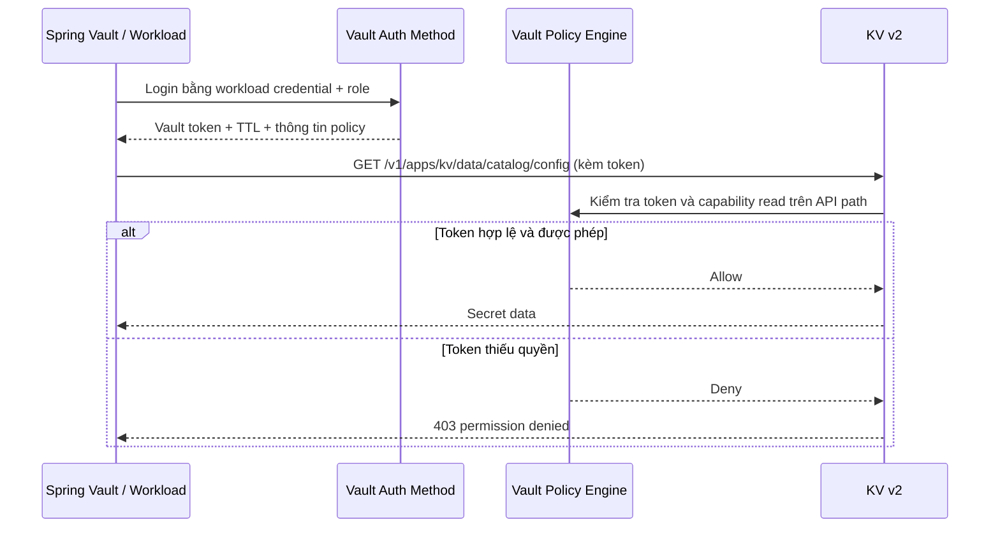
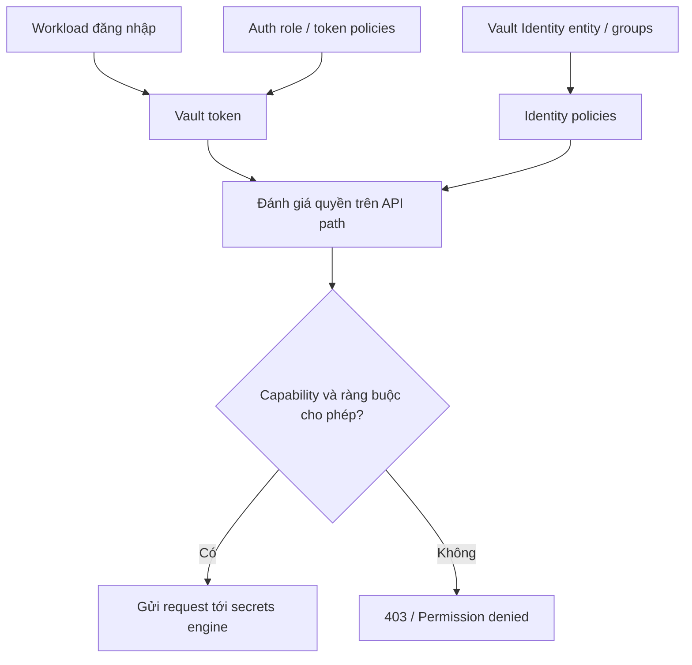
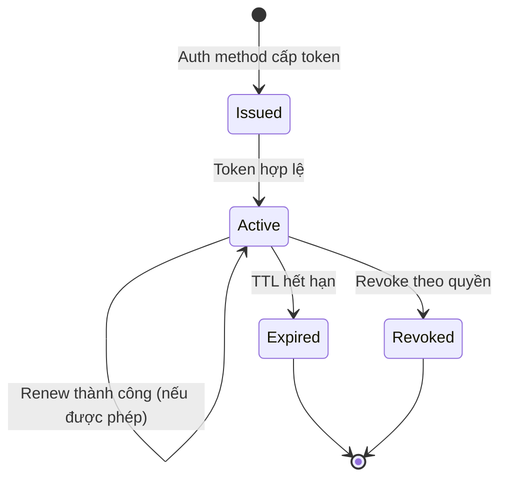

# Token, policy và các quyền được cấp trong HashiCorp Vault

Một ứng dụng Java sử dụng **Spring Vault** có thể đăng nhập HashiCorp Vault thành công nhưng vẫn nhận `403 permission denied` khi đọc secret. Điều này thường không có gì mâu thuẫn: **token** chứng minh phiên truy cập được Vault chấp nhận, còn **policy** quyết định token đó được thực hiện thao tác nào trên đường dẫn API nào. Để chẩn đoán và thiết kế đúng, cần hiểu token được cấp ra sao, policy có những capability nào, Vault kết hợp quyền như thế nào và token tồn tại bao lâu.

Bài học thuộc chương **Nền tảng Vault**, tập trung vào **token, policy và các quyền được cấp**. Kiến thức này là cơ sở cho các phần thực hành Spring Vault với `VaultTemplate`, xác thực workload (Kubernetes, AppRole, JWT), KV secrets, Transit encryption, PKI, vòng đời token/lease, giám sát và kiểm thử tích hợp.

## 1. Kết quả mong đợi

Sau bài này, bạn có thể:

1. Phân biệt **Vault token**, **ACL policy**, **capability**, **auth role** và **Vault Identity policy**.
2. Hiểu cách Vault sử dụng token và policy ở mỗi request đến secrets engine.
3. Viết policy theo nguyên tắc **quyền tối thiểu** cho KV v2, Transit và PKI.
4. Phân biệt `read`, `list`, `create`, `update`, `patch`, `delete`, `sudo` và `deny`.
5. Nhận diện token TTL, khả năng gia hạn, thu hồi và những khác biệt cơ bản giữa service token, batch token và secret lease.
6. Dùng Vault CLI và Spring Vault để kiểm chứng quyền trên **đường dẫn API thực**.

## 2. Ba câu hỏi: ai đăng nhập, dùng bằng chứng gì, được làm gì?

Hãy tưởng tượng dịch vụ `catalog-api` chạy trên Kubernetes cần đọc `apps/kv/data/catalog/config`.

- **Auth method và auth role:** kiểm chứng danh tính Kubernetes ServiceAccount (hoặc AppRole/JWT), xác định điều kiện đăng nhập và tham số phát hành token.
- **Vault token:** kết quả của bước xác thực, được ứng dụng trình cho Vault trong các request tiếp theo.
- **Policy và capability:** cho phép hoặc từ chối thao tác cụ thể như `read` trên `apps/kv/data/catalog/config`.



**Điểm mấu chốt:** token hợp lệ không có nghĩa là token có toàn quyền. Một token có thể đọc cấu hình Catalog nhưng không được đọc Billing, ghi KV, xóa phiên bản secret hay sử dụng khóa Transit.

## 3. Vault token là gì?

Vault token là một **bearer credential**: ai sở hữu chuỗi token hợp lệ có thể thực hiện các thao tác mà token được phép, trong thời gian token còn hiệu lực và theo các ràng buộc áp dụng. Vì vậy token phải được bảo vệ như bí mật.

Ở HTTP API, token thường được gửi qua header:

```http
GET /v1/apps/kv/data/catalog/config
X-Vault-Token: <VAULT_TOKEN>
```

`<VAULT_TOKEN>` là placeholder để minh họa, **không phải token thực**. Không in token vào console, log, exception, URL, kho mã nguồn, báo cáo CI hay tài liệu học tập.

Token thường gắn với các thông tin:

| Thông tin | Ý nghĩa |
|---|---|
| **Token ID** | Credential bí mật được trình với API |
| **Accessor** | Định danh tham chiếu để quản trị/tra cứu/thu hồi theo quyền thích hợp; không dùng thay token để gọi API |
| **Token policies** | Tên policy được gắn trực tiếp vào token |
| **Identity policies** | Policy từ entity và group liên quan đến danh tính Vault (nếu có) |
| **TTL** | Thời gian còn hiệu lực tại thời điểm kiểm tra |
| **Renewable** | Token có thể được gia hạn theo các điều kiện Vault hay không |
| **Type** | Loại token như service hoặc batch, ảnh hưởng tới lifecycle và tính năng |
| **Entity ID** | Tham chiếu tới danh tính logic trong Vault, nếu token có liên kết Identity |
| **Orphan/parent** | Quan hệ với token cha, có thể ảnh hưởng tới thu hồi |
| **Các ràng buộc khác** | Ví dụ thời hạn tối đa, số lần sử dụng, giới hạn địa chỉ IP, tùy cách phát hành |

### Token do ai cấp?

Các workload thường không tự tạo token tùy ý. Chúng đăng nhập thông qua auth method đã cấu hình:

```text
Kubernetes ServiceAccount JWT / AppRole / OIDC JWT / ...
                          |
                          v
               Vault auth method + role
                          |
                          v
               Vault token đã được cấp
                          |
                          v
            VaultTemplate gọi secrets engine
```

Auth role thường cấu hình những trường như `token_policies`, `token_ttl`, `token_max_ttl`, tùy auth method. Role **không phải** ACL policy: role quyết định *ai có thể nhận token và token được cấp theo điều kiện gì*; policy quyết định *token có capability nào trên path nào*. Một số quyền có thể đến từ Vault Identity ngoài token policies.

## 4. ACL policy: mô tả quyền bằng path và capability

Vault ACL policy thường dùng **HCL**. Cấu trúc cơ bản:

```hcl
path "apps/kv/data/catalog/config" {
  capabilities = ["read"]
}
```

Ý nghĩa: token chịu tác động của policy này có khả năng `read` trên **đúng API path** `apps/kv/data/catalog/config`, trừ khi có ràng buộc khác hoặc một chính sách `deny` áp dụng. Policy **không tự cấp token**; token phải được phát hành với policy tương ứng hoặc có quyền tương ứng qua Identity.

### Những capability thường gặp

| Capability | Ý nghĩa khái quát | Tình huống điển hình |
|---|---|---|
| `create` | Tạo tài nguyên/dữ liệu mới theo semantics endpoint | Ghi secret mới tại KV |
| `read` | Đọc dữ liệu từ endpoint | `GET` secret KV, xem metadata |
| `update` | Cập nhật hoặc gọi thao tác ghi của endpoint | Ghi KV, gọi Transit encrypt, yêu cầu PKI issue |
| `patch` | Cập nhật một phần khi API hỗ trợ PATCH | KV v2 patch |
| `delete` | Gọi thao tác xóa theo endpoint | Xóa secret/metadata ở API tương ứng |
| `list` | Liệt kê tên tài nguyên dưới prefix | Liệt kê tên key KV v2 qua `metadata/` |
| `sudo` | Capability đặc biệt cho một số endpoint được bảo vệ như root | Một số thao tác quản trị Vault |
| `deny` | Từ chối truy cập tường minh | Chặn một path nhạy cảm ngay cả khi policy khác cấp quyền |

**Capability không luôn trùng với HTTP method.** Chẳng hạn Transit `POST /encrypt/<key>` thường đòi `update`; KV v2 ghi `POST /data/<path>` có thể cần `create` hoặc `update` tùy đang tạo hay thay đổi dữ liệu; KV v2 soft-delete phiên bản qua endpoint `delete/` dùng semantics khác thao tác HTTP `DELETE`. Hãy kiểm tra hợp đồng API của engine, không suy quyền chỉ bằng nhìn động từ HTTP.

Vault ACL không có capability tổng quát tên `write`. Thay vì viết `capabilities = ["write"]`, phải cấp chính xác `create`, `update`, `patch` hoặc capability khác theo endpoint.

### Quyền không có trong policy có được mặc định cho phép không?

**Không.** Vault dùng mô hình **mặc định từ chối**. Với một path và thao tác, nếu không có policy nào cấp capability cần thiết thì yêu cầu bị từ chối. Khi nhiều policy cấp quyền, các capability phù hợp có thể được kết hợp; **`deny` tường minh thắng các quyền cấp khác** trên path áp dụng. Các quy tắc chọn stanza có wildcard và mức độ đặc hiệu cũng tham gia quyết định quyền thực tế.

Ví dụ:

```hcl
path "apps/kv/data/catalog/*" {
  capabilities = ["read"]
}

path "apps/kv/data/catalog/payments" {
  capabilities = ["deny"]
}
```

Policy trên minh họa ý tưởng cho phép đọc một nhóm secret nhưng chặn secret nhạy cảm `payments` (theo quy tắc khớp path của Vault). Đối với triển khai thật, nên kiểm chứng capability trên từng endpoint sau khi áp dụng nhiều policy và wildcard để bảo đảm kết quả đúng dự kiến.

## 5. Đường dẫn policy phải khớp API của secrets engine

Đường dẫn trong ACL **không chứa prefix HTTP `/v1/`**. Với KV v2 mount tại `apps/kv/`, secret logic `catalog/config`, endpoint đọc là:

```http
GET /v1/apps/kv/data/catalog/config
```

Policy đúng:

```hcl
path "apps/kv/data/catalog/config" {
  capabilities = ["read"]
}
```

Những cách viết sai:

```hcl
# Sai: thiếu đoạn /data/ của KV v2.
# path "apps/kv/catalog/config" { capabilities = ["read"] }

# Sai: /v1/ là prefix của HTTP API, không thuộc ACL path.
# path "v1/apps/kv/data/catalog/config" { capabilities = ["read"] }
```

### Data và metadata ở KV v2 cần quyền riêng

KV v2 phân biệt endpoint lưu dữ liệu với endpoint quản lý metadata:

| Mục tiêu | API path dưới mount `apps/kv/` | Capability mẫu |
|---|---|---|
| Đọc giá trị của secret | `apps/kv/data/catalog/config` | `read` |
| Ghi secret mới | `apps/kv/data/catalog/config` | `create` |
| Ghi phiên bản tiếp theo | `apps/kv/data/catalog/config` | `update` |
| Đọc thông tin version/metadata | `apps/kv/metadata/catalog/config` | `read` |
| Liệt kê tên key trong `catalog/` | `apps/kv/metadata/catalog` | `list` |
| Xóa mềm các version được chỉ định | `apps/kv/delete/catalog/config` | `update` |
| Khôi phục version | `apps/kv/undelete/catalog/config` | `update` |
| Hủy vĩnh viễn version | `apps/kv/destroy/catalog/config` | `update` |

Đối với thao tác xóa phiên bản hiện tại qua `DELETE /data/<path>` hoặc xóa metadata qua `DELETE /metadata/<path>`, capability liên quan là `delete` trên endpoint được gọi. Điều này khác với `POST /delete/<path>` dùng `update`.

Ví dụ policy cho ứng dụng chỉ đọc **một** secret:

```hcl
path "apps/kv/data/catalog/config" {
  capabilities = ["read"]
}
```

Nếu một công cụ quản trị thực sự cần liệt kê khóa dưới `catalog/`, có thể cấp bổ sung:

```hcl
path "apps/kv/metadata/catalog" {
  capabilities = ["list"]
}
```

Quyền `list` không có nghĩa được đọc giá trị secret. Tuy nhiên, việc liệt kê có thể làm lộ **tên key** mà ứng dụng không cần biết. Trong KV, không nên kỳ vọng kết quả `list` tự động ẩn từng tên key không có quyền `read`; hãy hạn chế cả scope liệt kê.

## 6. Token policies, identity policies và policy `default`

Một token có thể nhận các quyền từ nhiều nguồn:

1. **Token policies:** các policy được gắn lúc phát hành token, chẳng hạn thông qua `token_policies` của auth role.
2. **Identity policies:** policy gắn với Vault Identity entity hoặc nhóm (group) liên quan, nếu Identity được cấu hình.
3. **Các cơ chế kiểm soát bổ sung:** ví dụ namespace và các ràng buộc token; tùy môi trường có thể còn có Sentinel/EGP/RGP hoặc cơ chế quản trị khác.



Ví dụ role Kubernetes có `token_policies=["catalog-read"]`, còn Vault Identity group của workload có `identity_policies=["catalog-metrics"]`. Các quyền thực tế phải được phân tích dựa trên cả token và Identity, không chỉ xem một trường của role.

### `default` và `root` có giống policy thường không?

- Policy tên **`default`** thường được gắn vào token khi tạo, trừ khi cách phát hành được cấu hình để loại bỏ. Nó thường cung cấp một số endpoint tự phục vụ phù hợp phiên/token, **không có nghĩa** mọi token được đọc toàn bộ secrets.
- Policy **`root`** là quyền quản trị đặc biệt, vượt xa nhu cầu của workload thông thường. Không dùng root token để chạy Spring Vault trong production hoặc để kiểm chứng một policy quyền tối thiểu.
- Token chỉ có `default` thường không được đọc secret ứng dụng nếu không có quyền tương ứng.

Policy có thể được điều chỉnh trong quá trình vận hành; đánh giá quyền dựa trên trạng thái hiện hành của token, Identity và policy áp dụng. Vì vậy, một token còn TTL vẫn có thể mất quyền đối với path nếu cấu hình cấp quyền thay đổi.

## 7. Nguyên tắc least privilege qua ba ví dụ

### 7.1. Chỉ đọc secret của Catalog

```hcl
# catalog-read.hcl
path "apps/kv/data/catalog/config" {
  capabilities = ["read"]
}
```

Token với quyền này không mặc nhiên:

- Đọc `apps/kv/data/billing/config`.
- Liệt kê `apps/kv/metadata/catalog`.
- Ghi/xóa secret Catalog.
- Quản trị secrets engine hay auth method.

Nếu Catalog cần nhiều key nhưng số lượng có thể biết trước, nên cân nhắc các path cụ thể thay vì mở `apps/kv/data/*` cho toàn bộ hệ thống.

### 7.2. Chỉ mã hóa bằng một khóa Transit

Giả sử Transit mount tại `crypto/`, key tên `payment-key`. Policy chỉ cho phép gọi thao tác mã hóa:

```hcl
# encrypt-only.hcl
path "crypto/encrypt/payment-key" {
  capabilities = ["update"]
}
```

Đây là quyền cho **endpoint Transit `encrypt/`**, không cho phép gọi `crypto/decrypt/payment-key` hay quản lý khóa `crypto/keys/payment-key`. Client gửi plaintext dưới dạng base64 theo API Transit, Vault thực hiện thao tác bằng khóa được quản lý bên trong engine.

### 7.3. Chỉ cấp chứng chỉ qua một PKI role

Giả sử PKI mount tại `certs/`, role phát hành tên `service-client`:

```hcl
# pki-issue.hcl
path "certs/issue/service-client" {
  capabilities = ["update"]
}
```

Capability cho endpoint `issue/` cho phép **yêu cầu phát hành** theo ràng buộc PKI role; nó không tự cấp quyền cấu hình CA hoặc phát hành bất kỳ tên miền nào. Cần cấu hình PKI role giới hạn SAN, domain, TTL và các thuộc tính khác theo yêu cầu hệ thống.

**Phân biệt “auth role” và “secrets role”:** workload có thể đăng nhập theo auth role Kubernetes `catalog-api`, rồi dùng token gọi PKI role `service-client`. Hai role này khác mục đích; ACL kiểm soát quyền gọi endpoint PKI.

## 8. Xác minh policy và capability bằng Vault CLI

Các lệnh bên dưới chỉ dành cho **Vault lab** có quyền phù hợp. Chúng không tạo secret thật và không yêu cầu đưa credential thực vào tài liệu.

### 8.1. Tải policy

Giả sử bạn đã lưu đoạn HCL của mục 7.1 trong file `catalog-read.hcl`. Quản trị viên có quyền thao tác policy có thể:

```bash
vault policy write catalog-read catalog-read.hcl
vault policy read catalog-read
vault policy list
```

`vault policy write` tạo hoặc cập nhật policy mang tên `catalog-read`. Đây là thao tác quản trị có thể ảnh hưởng tới token đang sử dụng policy đó; trong production, hãy đưa thay đổi qua quy trình review/triển khai đã được phê duyệt.

### 8.2. Kiểm tra quyền của token hiện tại

```bash
vault token lookup
vault token capabilities apps/kv/data/catalog/config
vault token capabilities apps/kv/data/billing/config
vault token capabilities apps/kv/metadata/catalog
```

`vault token lookup` giúp xem thông tin TTL, token policies, identity policies (nếu có) và thuộc tính liên quan của phiên hiện tại. `vault token capabilities <path>` giúp trả lời câu hỏi quan trọng hơn: **token đang có capability gì trên path đó?**

Một kết quả mong đợi với token chỉ có quyền Catalog:

```text
apps/kv/data/catalog/config   -> read
apps/kv/data/billing/config   -> deny
apps/kv/metadata/catalog      -> deny
```

Đây là **kết quả kỳ vọng** nếu token không có policy bổ sung. Quyền thực tế còn chịu ảnh hưởng của `default`, Identity và các policy/ràng buộc khác. Khi kiểm tra, không dùng root token, vì kết quả của root không phản ánh quyền ứng dụng.

### 8.3. Tạo token thử nghiệm (khi đã được phép)

Với một phiên quản trị **trong lab** có quyền phát hành token:

```bash
vault token create -policy=catalog-read -ttl=30m -display-name=catalog-lab
```

Lệnh trên **có thể hiển thị token mới trong stdout**. Đừng chụp hoặc dán đầu ra chứa token vào báo cáo. Một số cơ chế phát hành token có thể tự gắn thêm `default` và chịu giới hạn quyền, TTL hoặc cấu hình khác. Token được tạo từ token cha có thể chịu quan hệ parent/child trừ khi có cấu hình tạo orphan.

Khi dùng token này để thực hành, chỉ nhập/lưu vào cơ chế bảo mật của môi trường thử nghiệm; không đưa vào mã nguồn. Cuối bài, thu hồi token theo quy trình phù hợp để tránh credential thử nghiệm còn hiệu lực ngoài ý muốn.

## 9. Vòng đời token: TTL, renew và revoke

**TTL (time to live)** giới hạn thời gian sử dụng token. Token có TTL không có nghĩa mọi token tự gia hạn được; khả năng gia hạn phụ thuộc loại token và cách cấu hình.



| Trạng thái/thuộc tính | Ý nghĩa đối với ứng dụng |
|---|---|
| **Được cấp** | Nhận token sau login và thông tin như `lease_duration`, `renewable` |
| **Đang hiệu lực** | Có thể dùng token; mỗi thao tác vẫn phải qua ACL policy |
| **Renewable** | Có thể gọi cơ chế renew theo điều kiện TTL/max TTL và quyền; không bảo đảm gia hạn vô hạn |
| **Expired** | Không còn sử dụng token để gọi Vault API |
| **Revoked** | Vault vô hiệu hóa token trước hạn; có thể ảnh hưởng tới child token và lease liên quan |
| **Orphan token** | Không gắn vào parent theo quan hệ thông thường; cơ chế thu hồi theo cây token khác |

### Service token và batch token

| Đặc điểm | Service token | Batch token |
|---|---|---|
| Cơ chế | Token có trạng thái để Vault quản lý phiên | Token nhẹ, tối ưu cấp phát ở quy mô lớn |
| Gia hạn | Có thể gia hạn nếu loại/cấu hình cho phép | Không gia hạn |
| Thu hồi từng token | Hỗ trợ cơ chế thu hồi phù hợp | Không hỗ trợ thu hồi riêng từng batch token theo cùng cách service token |
| Thời hạn | TTL và giới hạn theo cấu hình | Thường là token thời hạn ngắn; hết hạn tự mất hiệu lực |
| Trường hợp dùng | Workload cần quản lý phiên và gia hạn | Job ngắn hạn, yêu cầu xác thực khối lượng lớn phù hợp hạn chế của batch token |

Không nên chọn batch token chỉ để “nhanh hơn” khi ứng dụng cần vòng đời gia hạn, quản lý lease hay tính năng token mà batch token không hỗ trợ.

### Token TTL khác secret lease TTL

Giả sử Catalog dùng token TTL 30 phút để yêu cầu Database secrets engine cấp credential động có lease TTL 10 phút:

- **Token TTL 30 phút** giới hạn thời gian token còn dùng để gọi Vault API, nếu không renew.
- **Secret lease TTL 10 phút** mô tả thời hạn credential động do Database engine cấp và cách thu hồi/gia hạn.
- **KV v2 version** là số phiên bản dữ liệu tĩnh, không phải thời hạn token hoặc lease.

Vì vậy, token hết hạn **không tự động thay đổi mật khẩu tĩnh** đã đọc từ KV hoặc xóa giá trị bí mật đang nằm trong bộ nhớ ứng dụng. Ngược lại, revoke token có thể ảnh hưởng tới lease gắn với token theo cơ chế Vault, nên cần thiết kế rõ kỳ vọng về credential động.

## 10. Spring Vault dùng token và policy như thế nào?

Spring Vault cung cấp các thành phần ở những tầng riêng:

| Thành phần | Nhiệm vụ |
|---|---|
| `ClientAuthentication` | Đăng nhập theo phương thức và credential đã cấu hình |
| Session manager | Cung cấp token cho request, có thể quản lý refresh/renew theo implementation |
| `VaultTemplate` | Gọi Vault API bằng phiên/token hiện có |
| `VaultKeyValueOperations` | Dùng API KV v1/v2 đúng dạng và ánh xạ dữ liệu |
| Vault server | Xác thực token, đánh giá policy/capability, thực thi engine |

Không có cơ chế “policy Spring Vault” tự thay thế ACL Vault. `VaultTemplate` chỉ có thể thực hiện những thao tác token thực sự được phép.

### Ví dụ Java đọc một secret KV v2

Giả sử ứng dụng đã cấu hình `VaultTemplate` thông qua xác thực workload (Kubernetes/AppRole/JWT phù hợp), có mount KV v2 `apps/kv/` và token được gắn policy `catalog-read`:

```java
import org.springframework.stereotype.Service;
import org.springframework.vault.core.VaultKeyValueOperations;
import org.springframework.vault.core.VaultKeyValueOperationsSupport.KeyValueBackend;
import org.springframework.vault.core.VaultTemplate;
import org.springframework.vault.support.VaultResponse;

@Service
public class CatalogConfigReader {

    private final VaultKeyValueOperations kv;

    public CatalogConfigReader(VaultTemplate vaultTemplate) {
        this.kv = vaultTemplate.opsForKeyValue("apps/kv", KeyValueBackend.KV_2);
    }

    public String readDatabaseUsername() {
        VaultResponse response = kv.get("catalog/config");
        if (response == null || response.getData() == null) {
            throw new IllegalStateException("Không có secret catalog/config");
        }
        Object value = response.getData().get("dbUsername");
        if (!(value instanceof String)) {
            throw new IllegalStateException("Secret thiếu dbUsername hợp lệ");
        }
        return (String) value;
    }
}
```

Ứng dụng không cần nối `/v1/` hoặc `data/` vào `kv.get(...)`: `opsForKeyValue("apps/kv", KeyValueBackend.KV_2)` đã xác định mount và phiên bản API. Tuy nhiên policy phải cấp `read` trên endpoint **`apps/kv/data/catalog/config`**. Nếu token thiếu quyền, Java vẫn nhận lỗi truy cập dù mount và relative path đúng.

Ví dụ này chỉ thể hiện phần đọc dữ liệu; cấu hình `VaultTemplate`, kết nối TLS và lifecycle token cần triển khai riêng cho nền tảng chạy. Không hardcode root token hoặc token dài hạn để vượt qua lỗi `403`.

### Tự động quản lý token có làm thay đổi quyền không?

Không. Việc Spring Vault dùng session manager để lấy token mới, cache phiên hoặc gia hạn token giúp ứng dụng duy trì **tính hợp lệ của phiên**, nhưng quyền vẫn do Vault quyết định. Nếu token mới được phát hành từ role có policy khác, quyền ứng dụng cũng có thể thay đổi. Khi triển khai cần kiểm thử hành vi sau login lại/renew cũng như việc đọc secret.

## 11. Chẩn đoán lỗi: xác thực, phân quyền hay đường dẫn?

| Triệu chứng | Khả năng gây lỗi | Kiểm tra phù hợp |
|---|---|---|
| Đăng nhập bị từ chối | Workload JWT/AppRole credential sai, role binding không khớp | Auth mount, auth role, issuer/audience, ServiceAccount/namespace |
| Token bị từ chối vì không còn hợp lệ | TTL hết, token đã revoke, token không được renew | `vault token lookup` khi còn quyền, log session manager và cơ chế tái đăng nhập |
| Login thành công nhưng KV trả `403` | Thiếu `read` trên `apps/kv/data/catalog/config` | `vault token capabilities apps/kv/data/catalog/config` với token workload |
| Đọc được giá trị nhưng `list` thất bại | Thiếu `list` trên `apps/kv/metadata/catalog` | Tách policy data và metadata |
| KV trả `404` | Secret không có, mount sai hoặc dùng URL KV v1 cho KV v2 | `vault secrets list -detailed`, path/mount, version dữ liệu |
| Transit encrypt bị `403` | Có quyền đọc KV nhưng thiếu `update` trên `crypto/encrypt/<key>` | Kiểm tra ACL endpoint Transit |
| Token có quyền ngoài dự kiến | Token policies hoặc identity policies rộng, wildcard/role không chặt | `vault token lookup`, entity/group policies, capability từng path |
| Root token hoạt động nhưng token workload lỗi | Root có quyền khác biệt | Kiểm chứng bằng đúng token của ứng dụng; sửa policy/role tối thiểu |

Trình tự xử lý nên là:

1. **Xác minh đăng nhập:** auth method, auth mount và role có đúng không?
2. **Xác minh token:** token còn TTL, chưa revoke và có thông tin policy phù hợp?
3. **Xác minh API path:** đã dùng đúng mount, `data/` hay `metadata/`, tên secret và namespace?
4. **Xác minh capability:** token của workload có quyền cần thiết trên endpoint đó?
5. **Kiểm tra log/audit đã làm sạch:** dùng trạng thái HTTP, loại request, path và thông tin định danh không nhạy cảm để phân biệt nguyên nhân.

Không nên mặc định mọi lỗi `403` là “policy sai”: một phiên xác thực hết hạn, một request login sai, một điều kiện truy cập khác hoặc cấu hình xác thực cũng có thể bị từ chối. Tương tự, `404` có thể do cấu hình đường dẫn hoặc secret chưa tồn tại; cần kiểm tra bằng quyền và ngữ cảnh thích hợp.

## 12. Thực hành: cấp ít quyền và chứng minh bằng kết quả

Thực hành trên Vault **thử nghiệm** đã bật KV v2 tại `lab/kv/`, có token quản trị hợp lệ và dữ liệu **giả**. Không chạy thao tác này trên production hoặc đưa token/secret thực vào câu lệnh có thể lưu lại trong lịch sử shell.

### Bước 1: tạo dữ liệu mẫu

```bash
# Chỉ chạy nếu lab/kv chưa tồn tại và có quyền bật engine.
vault secrets enable -path=lab/kv -version=2 kv

vault kv put -mount=lab/kv catalog/config dbUsername=lab-user
vault kv get -mount=lab/kv catalog/config
```

Nếu mount đã tồn tại, bỏ qua lệnh enable và kiểm tra `vault secrets list -detailed` để xác nhận đó là KV v2.

### Bước 2: định nghĩa policy chỉ đọc

Tạo file `catalog-lab-read.hcl` **trong môi trường thực hành** với nội dung:

```hcl
path "lab/kv/data/catalog/config" {
  capabilities = ["read"]
}
```

Từ phiên quản trị lab có quyền policy, nạp cấu hình:

```bash
vault policy write catalog-lab-read catalog-lab-read.hcl
```

### Bước 3: cấp token thử nghiệm với policy này

Sử dụng cách phát hành token được môi trường lab cho phép, ví dụ phiên quản trị có quyền phù hợp:

```bash
vault token create -policy=catalog-lab-read -ttl=15m -display-name=catalog-lesson
```

**Không chia sẻ đầu ra chứa token.** Thiết lập token mới vào phiên CLI riêng bằng cách quản lý credential an toàn của môi trường lab; không thay thế token quản trị đang dùng để dọn dẹp khi kết thúc.

### Bước 4: xác nhận cả quyền được cấp và quyền bị từ chối

Với **token thử nghiệm**:

```bash
vault token capabilities lab/kv/data/catalog/config
vault token capabilities lab/kv/data/other/config
vault token capabilities lab/kv/metadata/catalog
vault kv get -mount=lab/kv catalog/config
```

Nếu token không có policy bổ sung, mong đợi:

| Kiểm tra | Kết quả |
|---|---|
| `lab/kv/data/catalog/config` | Có `read` |
| `lab/kv/data/other/config` | `deny` |
| `lab/kv/metadata/catalog` | `deny` cho `list` |
| `vault kv get` key Catalog | Đọc được dữ liệu giả |
| Ghi/xóa key Catalog hoặc đọc key khác | Bị từ chối nếu không có policy cho phép |

Để đối chiếu trong Java, cấu hình `VaultTemplate` dùng token lab theo cơ chế session đã thiết lập rồi gọi:

```java
VaultResponse value = vaultTemplate
    .opsForKeyValue("lab/kv", KeyValueBackend.KV_2)
    .get("catalog/config");
```

API và policy cùng tham chiếu tới endpoint đọc `lab/kv/data/catalog/config`. Kết quả kiểm thử tốt là quyền `read` hoạt động còn các thao tác không được cấp bị từ chối.

### Bước 5: kết thúc lab

Thu hồi token thử nghiệm theo quy trình mà người quản trị lab cho phép, tránh để credential còn hiệu lực sau khi kết thúc. Không dùng lệnh disable secrets engine như một cách dọn dẹp mặc định vì có thể xóa hoặc làm mất khả năng truy cập dữ liệu của mount đó.

### Câu hỏi tự kiểm tra

1. **Token còn TTL nhưng `GET` KV trả `403`; nên gia hạn token trước hay kiểm tra capability?** Kiểm tra capability trên đúng API path và các policy áp dụng; TTL còn hiệu lực không tạo thêm quyền.
2. **Tại sao policy `read` trên `lab/kv/data/catalog/config` không bảo đảm chạy được `vault kv list`?** Vì KV v2 liệt kê qua endpoint `metadata/` cần `list`.
3. **Transit `encrypt/` cần capability nào?** Thường là `update` trên đúng endpoint Transit của khóa.
4. **Hai auth role cùng gắn policy `catalog-lab-read` có bắt buộc cùng danh tính không?** Không. Role, điều kiện login và Identity mapping độc lập; cùng policy chỉ có nghĩa có một phần quyền chung.
5. **Đổi số phiên bản KV có ảnh hưởng tới token TTL không?** Không; version dữ liệu KV và vòng đời token là các khái niệm khác nhau.

## 13. Những nguyên tắc nên giữ trong dự án thật

- **Dùng xác thực workload:** Kubernetes, JWT/OIDC hoặc AppRole theo ngữ cảnh; đừng phân phối root token hoặc hardcode Vault token.
- **Giới hạn quyền theo endpoint thật:** policy cho KV v2 cần phân biệt `data/`, `metadata/` và các endpoint xóa/khôi phục.
- **Giới hạn quyền theo dịch vụ:** Catalog không nên có khả năng đọc Billing nếu không phục vụ chức năng được phê duyệt.
- **Hạn chế wildcard và `list`:** wildcard có thể mở rộng phạm vi đọc, còn `list` có thể tiết lộ tên key.
- **Thiết kế vòng đời token:** TTL, max TTL, khả năng renew, re-login và revoke phải phù hợp thời gian chạy của workload.
- **Kiểm chứng bằng token ứng dụng:** dùng `vault token capabilities` và kiểm thử đường dẫn thực với token có quyền giới hạn.
- **Giám sát mà không lộ bí mật:** theo dõi tỷ lệ lỗi auth, `403`, lỗi renew và lease; bảo vệ audit log, không log token, plaintext hay toàn bộ response.
- **Thực hiện thay đổi policy có kiểm soát:** sửa policy/role có thể thay đổi quyền của token đang chạy; cần review, áp dụng theo môi trường và kiểm thử hồi quy.

## 14. Ghi nhớ

**Token** là bằng chứng cho một phiên truy cập Vault; **policy** quy định những **capability** mà phiên đó có trên **API path** tương ứng. Role của auth method góp phần quyết định token phát hành ra sao; Vault Identity có thể bổ sung chính sách theo entity/group. Token còn thời hạn cũng không được thực hiện thao tác vượt quyền.

Trong Spring Vault, `ClientAuthentication` và session manager giải quyết việc có token hợp lệ, `VaultTemplate` gửi request và Vault quyết định **allow/deny**. Muốn truy cập KV v2 an toàn, hãy cấp `read` đúng `<mount>/data/<secret>`, cấp `list` tại `metadata/` chỉ khi cần, đồng thời kiểm tra hành vi bằng token workload thực. Phân biệt đúng token, policy, role và TTL là nền tảng để vận hành KV, Transit, PKI và secrets động an toàn.
