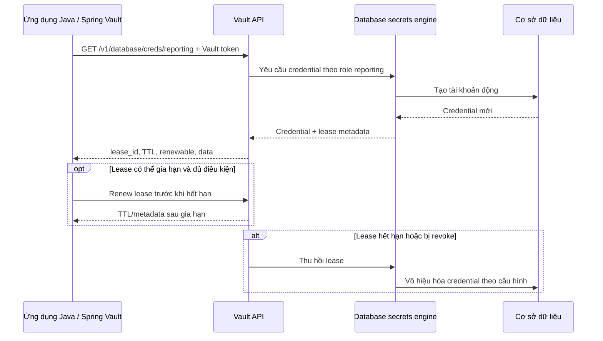
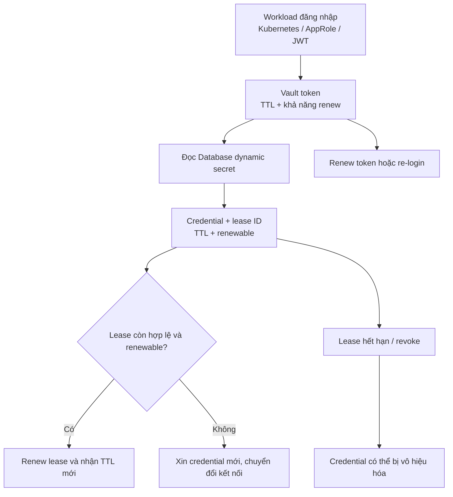

# Lease ID, TTL và khả năng gia hạn trong HashiCorp Vault

Trong HashiCorp Vault, nhiều bí mật **được cấp phát theo thời hạn**. Ví dụ, Database secrets engine có thể tạo một tài khoản PostgreSQL riêng cho ứng dụng, trả về thông tin đăng nhập cùng một **lease**. Khi hết thời hạn hoặc lease bị thu hồi, Vault có thể yêu cầu hệ thống đích vô hiệu hóa thông tin đăng nhập đó. Đây là cơ chế quan trọng để giảm tác động khi credential bị lộ và hạn chế sử dụng tài khoản tồn tại quá lâu.

Ba khái niệm cần đọc chính xác là **lease ID** (định danh lease), **TTL** (*time to live*, thời gian hiệu lực còn lại) và **renewable** (lease có thể được gia hạn theo điều kiện hiện hành hay không). Chúng gắn với quá trình ứng dụng Java dùng **Spring Vault** và `VaultTemplate` lấy secrets, nhưng **không đồng nghĩa** với thời hạn của Vault token, version của KV v2 hay thời gian hết hạn của chứng chỉ PKI.

Bài thuộc chương **Nền tảng Vault**. Sau khi hiểu lease, bạn có thể triển khai an toàn hơn các luồng xác thực theo workload, cấp quyền bằng policy, truy cập KV, nhận credential động, dùng Transit/PKI và xử lý lỗi hoặc kiểm thử tích hợp cho Spring Vault.

## 1. Mục tiêu học tập

Hoàn thành bài này, bạn có thể:

- Phân biệt **secret lease** với **Vault token**, **token TTL** và **secret KV v2 version**.
- Giải thích ý nghĩa của `lease_id`, `lease_duration`, `renewable` trong phản hồi API.
- Phân biệt **gia hạn lease**, **cấp lại secret**, **thu hồi lease** và **gia hạn token**.
- Dùng Vault CLI và các endpoint API phù hợp để kiểm tra, gia hạn và thu hồi lease trong môi trường thử nghiệm.
- Giải thích ứng dụng Spring Vault cần theo dõi lease như thế nào khi credential bị hết hạn, thu hồi hoặc được cấp lại.
- Thiết kế kiểm thử kiểm chứng TTL, renewal, revoke và hoạt động của ứng dụng sau khi credential thay đổi.

## 2. Lease là gì? Tại sao secrets động cần lease?

**Lease** là cơ chế Vault gắn một vòng đời được quản lý vào một secret hoặc tài nguyên được cấp. Tùy secrets engine, Vault có thể thực hiện việc gia hạn hoặc thu hồi tài nguyên khi lease không còn hiệu lực. Ví dụ:

1. Ứng dụng đã có Vault token phù hợp, gọi `database/creds/reporting`.
2. Database secrets engine tạo credential động theo role `reporting`.
3. Vault trả `username`, `password` và metadata gồm **lease ID**, **lease duration**, **renewable**.
4. Ứng dụng sử dụng credential để kết nối cơ sở dữ liệu trong phạm vi được phép.
5. Trước khi TTL hết, ứng dụng có thể yêu cầu **renew lease** nếu lease cho phép và còn nằm trong các giới hạn. Khi lease hết hạn hoặc bị revoke, Vault xử lý thu hồi theo cơ chế của engine.



**Giới hạn quan trọng:** Vault quản lý vòng đời và cố gắng thực hiện thao tác với backend; hiệu lực thu hồi trong hệ thống ngoài còn phụ thuộc khả năng kết nối, plugin và chính sách của backend. Không nên coi TTL là một bộ đếm bảo đảm rằng mọi phiên kết nối bên ngoài bị cắt chính xác đến từng mili giây.

### Lease không phải secret

| Thành phần | Ví dụ | Dùng làm gì? |
|---|---|---|
| **Credential động** | Username/password do Database engine tạo | Ứng dụng kết nối tới cơ sở dữ liệu |
| **Lease ID** | `database/creds/reporting/<opaque-id>` | Tham chiếu một lease cụ thể để tra cứu, renew hoặc revoke |
| **Lease TTL** | `1800` giây khi vừa cấp | Khoảng thời gian lease còn hiệu lực tại thời điểm đó |
| **Renewable** | `true` hoặc `false` | Cho biết lease được báo là có thể gia hạn; còn chịu giới hạn và điều kiện |
| **Vault token** | `<VAULT_TOKEN>` | Xác thực các yêu cầu gửi đến Vault |
| **Token TTL** | Chẳng hạn 30 phút | Thời hạn còn lại của token, khác TTL của credential |

Lease ID là **định danh opaque**: ứng dụng không tự tách hoặc suy diễn cấu trúc ID để đoán role, TTL, quyền hay cách thu hồi. Phần đường dẫn trong lease ID giúp quan sát nguồn cấp, nhưng toàn bộ chuỗi phải được xem như một định danh do Vault cấp. Bảo vệ nó trong log và hệ thống vận hành vì nó có thể dùng để tham chiếu tới một credential đang hoạt động.

## 3. Đọc đúng phản hồi API: `lease_id`, `lease_duration`, `renewable`

Giả sử Database secrets engine được mount tại `database/` và có role `reporting`. Token đã có capability phù hợp để đọc:

```http
GET /v1/database/creds/reporting
X-Vault-Token: <VAULT_TOKEN>
```

Phản hồi minh họa, đã lược bớt trường:

```json
{
  "lease_id": "database/creds/reporting/EXAMPLE_LEASE_ID",
  "lease_duration": 1800,
  "renewable": true,
  "data": {
    "username": "v-reporting-example",
    "password": "EXAMPLE_ONLY"
  }
}
```

Đây là dữ liệu **giả** minh họa cấu trúc phản hồi, không phải credential hoạt động.

- `lease_id`: tham chiếu lease cụ thể đã được Vault tạo. Mỗi lần cấp credential mới có thể tạo lease khác.
- `lease_duration`: thời gian hiệu lực tính bằng **giây** ở thời điểm Vault trả phản hồi. `1800` là 30 phút, không phải timestamp tuyệt đối.
- `renewable`: phản hồi cho biết lease có thể được yêu cầu renew. `true` **không bảo đảm** mọi lần renew đều thành công hoặc TTL có thể kéo dài vô hạn.
- `data`: dữ liệu bí mật mà engine trả về, có thể chứa username/password, khóa hoặc thông tin khác tùy engine.

**TTL giảm theo thời gian.** Nếu phản hồi trả 1800 giây và ứng dụng kiểm tra sau 10 phút, TTL còn lại thường thấp hơn; phải truy vấn trạng thái lease hoặc dựa vào lifecycle manager, không dùng mãi giá trị TTL ban đầu. Thời gian trên đồng hồ ứng dụng có thể lệch với máy chủ Vault, nên khi lập kế hoạch gia hạn cần có khoảng đệm.

### Phân biệt lease metadata với dữ liệu KV v2

Không phải API nào cũng tạo một secret lease:

| Loại dữ liệu/thao tác | Có lease ID cho secret được cấp? | Điểm cần nhớ |
|---|---|---|
| **Database dynamic credentials** | Thông thường có | Vault quản lý vòng đời credential động |
| **KV v2** | Thông thường không có lease cho dữ liệu tĩnh | `version` của key không phải TTL hoặc lease |
| **Transit encrypt/decrypt** | Không tạo lease cho ciphertext theo cách credential động | Hết hạn Vault token không làm ciphertext tự hết hiệu lực |
| **PKI issue** | Phụ thuộc cấu hình, loại endpoint và cơ chế lease của PKI | Thời hạn chứng chỉ X.509 khác với TTL của lease nếu có |
| **Vault auth login** | Trả token với TTL/renewability của token | Không xem `auth.lease_duration` là lease của một secret Database |

Ví dụ KV v2 có thể trả `lease_id: ""`, `lease_duration: 0`, `renewable: false` ở phần metadata chung của HTTP response, trong khi `data.metadata.version` mô tả phiên bản nội dung. Không nên cố renew `KV v2 version`.

## 4. TTL: thời gian còn lại, không phải lời hứa về thời điểm cố định

TTL của lease có thể chịu ảnh hưởng của nhiều lớp cấu hình:

- **Giá trị mặc định của mount** và giới hạn thời hạn do Vault quản lý.
- **Secrets engine/role**: cấu hình mặc định và tối đa của credential động.
- **Thời hạn tối đa của lease**, giới hạn do backend hoặc điều kiện phát hành.
- **Chính sách vận hành**, giới hạn theo thời gian và điều kiện có thể thay đổi.

Ví dụ một role Database yêu cầu TTL 20 phút, trong khi giới hạn hiệu lực tối đa của lease là 1 giờ. Khi vừa nhận credential, phản hồi có thể ghi `lease_duration=1200`. Sau 10 phút, nếu được gia hạn, ứng dụng có thể yêu cầu thêm thời gian, nhưng Vault sẽ quyết định TTL thực tế theo giới hạn. Khi chạm giới hạn tối đa, gia hạn có thể thất bại hoặc Vault có thể trả một TTL bị giới hạn; lúc đó ứng dụng phải lấy credential mới theo quy trình thay thế.

### Ba giá trị thường bị nhầm

```text
Ví dụ nhận credential động lúc T0

Token TTL:        45 phút  (thời gian còn lại của token gọi Vault)
Secret lease TTL: 20 phút  (thời gian còn lại của credential được cấp)
Role max TTL:     60 phút  (giới hạn thời gian lease có thể được kéo dài,
                           theo cấu hình và cách tính thực tế của Vault)
```

Các giá trị trên chỉ minh họa và không phải mặc định của Vault. Không thể suy ra TTL của Database credential từ TTL của Vault token, hoặc ngược lại.

### `renewable` khác `renewed`

`renewable: true` là **khả năng có thể yêu cầu**, không phải bằng chứng một lần renew đã diễn ra. Chỉ coi renewal thành công sau khi Vault trả kết quả thành công và ứng dụng cập nhật thông tin TTL/lease. Nếu `renewable: false`, ứng dụng phải chuẩn bị cấp secret mới, không lặp vô hạn các yêu cầu renew.

## 5. Gia hạn (renew) lease khác cấp lại (rotate/reissue) secret

Hai thao tác có mục tiêu khác nhau:

| Hành động | Tác động chính | Khi nào sử dụng |
|---|---|---|
| **Renew lease** | Kéo dài thời hạn của lease **hiện có**, nếu được cho phép | Credential vẫn có giá trị và cần tiếp tục sử dụng |
| **Reissue credential** | Gọi engine để nhận **credential mới**, thường kèm lease mới | Lease không renewable, gần max TTL, đã hết hạn hoặc renewal thất bại |
| **Revoke lease** | Yêu cầu Vault thu hồi lease và tài nguyên do engine quản lý | Dịch vụ dừng, credential bị nghi lộ hoặc chuyển sang credential khác |
| **Renew Vault token** | Gia hạn token đăng nhập Vault nếu được phép | Ứng dụng cần tiếp tục gọi Vault API |
| **Re-login** | Xác thực workload một lần nữa để nhận token mới | Token không thể renew, đã hết hạn hoặc chính sách yêu cầu đăng nhập lại |

Giả sử ứng dụng lấy credential Database ở thời điểm T0:

```text
T0          T+10'          T+15'                 T+20'
|------------|--------------|----------------------|
Credential: TTL ban đầu 20 phút
             |              |
             |              +-- Nếu renew thất bại: chuẩn bị cấp lại
             +-- Renew sớm, ghi nhận TTL Vault thực sự trả về
```

Renew thành công không nhất thiết cấp username/password mới; nó thường gia hạn lease đang có. Reissue credential có thể tạo username/password khác. Một ứng dụng dùng connection pool phải biết khác biệt này: chỉ tăng TTL của lease có thể không cần thay pool, còn nhận credential mới thường cần khởi tạo kết nối mới và kết thúc kết nối cũ an toàn.

**Không lập lịch gia hạn sát giây cuối cùng.** Tính độ trễ mạng, retry có giới hạn, sai lệch đồng hồ, restart ứng dụng và độ trễ của backend để chọn thời điểm gia hạn sớm. Khi Vault trả TTL ngắn hơn kỳ vọng, phải dùng TTL thực tế được trả về thay vì giá trị đã yêu cầu.

## 6. Tra cứu, gia hạn và thu hồi lease bằng Vault CLI

Phần này chỉ dành cho **Vault lab**, nơi bạn có token đủ quyền và credential giả. Giả định một Database secrets engine đã được quản trị viên cấu hình tại mount `database/` và có role `reporting`. Bật được engine **chưa đồng nghĩa** đã cấu hình kết nối database và role cấp credential.

### 6.1. Nhận một credential và ghi nhận lease ID

```bash
vault read database/creds/reporting
```

CLI có thể hiển thị `lease_id`, `lease_duration`, `lease_renewable` và dữ liệu credential. **Không sao chép hoặc chia sẻ phần username/password thực** trong log, screenshot, terminal recording hoặc báo cáo. Trong lab, ghi nhận lease ID vào vùng bảo mật được cấp phép để dùng cho các lệnh tiếp theo.

Ví dụ từ đây dùng ký hiệu `<LEASE_ID>`: khi thực hiện, phải thay bằng ID được Vault cấp, không phải tên role `reporting` hay API path `database/creds/reporting`.

### 6.2. Kiểm tra thông tin của lease

```bash
vault lease lookup <LEASE_ID>
```

Lệnh lookup giúp quan sát thời hạn còn lại và thuộc tính lease nếu token có quyền phù hợp. Không nhầm lookup của lease với lệnh tra cứu token:

```bash
vault token lookup
```

`vault token lookup` kiểm tra **Vault token hiện tại**; `vault lease lookup` kiểm tra **lease ID của secret động**. Chúng có chính sách truy cập và ngữ cảnh sử dụng khác nhau.

### 6.3. Renew một lease có thể gia hạn

```bash
vault lease renew -increment=15m <LEASE_ID>
```

`-increment=15m` là khoảng thời gian **đề nghị**, không phải bảo đảm. Vault có thể rút ngắn hoặc từ chối theo TTL tối đa, khả năng renew, quyền và trạng thái backend. Hãy kiểm tra **giá trị TTL được Vault trả về sau renew** hoặc lookup lại, thay vì giả định luôn còn đúng 15 phút.

### 6.4. Revoke một lease

```bash
vault lease revoke <LEASE_ID>
```

Revoke có thể làm credential ngừng hoạt động và ảnh hưởng trực tiếp đến truy cập backend. **Chỉ revoke lease được tạo riêng cho lab**, không thu hồi nhầm lease đang dùng bởi dịch vụ khác. Các thao tác revoke theo prefix hoặc hàng loạt còn có phạm vi ảnh hưởng rộng hơn và không dùng trong bài thực hành này.

Các lệnh quản lý lease có thể đòi capability bổ sung trên API hệ thống hoặc ràng buộc quyền đối với lease. Đừng mặc định một token chỉ có quyền `read` tại `database/creds/reporting` sẽ tự có quyền lookup, renew hoặc revoke tùy ý.

## 7. Cách các endpoint Vault API biểu diễn renewal

Phần đường dẫn **sau `/v1/`** cần phân biệt rõ:

| Tác vụ | Endpoint API | Đối tượng được quản lý |
|---|---|---|
| Xin credential động | `GET /v1/database/creds/reporting` | Cấp secret mới |
| Kiểm tra lease | `POST /v1/sys/leases/lookup` | Lease ID trong request body |
| Renew lease | `POST /v1/sys/leases/renew` | Lease ID trong request body |
| Revoke lease | `POST /v1/sys/leases/revoke` | Lease ID trong request body |
| Kiểm tra token hiện tại | `GET /v1/auth/token/lookup-self` | Vault token hiện tại |
| Renew token hiện tại | `POST /v1/auth/token/renew-self` | Vault token hiện tại |

Ví dụ phần request body cho renew lease:

```http
POST /v1/sys/leases/renew
X-Vault-Token: <VAULT_TOKEN>
Content-Type: application/json

{
  "lease_id": "database/creds/reporting/EXAMPLE_LEASE_ID",
  "increment": 900
}
```

`900` là khoảng thời gian yêu cầu tính bằng giây, tương đương 15 phút. API có thể trả về metadata sau gia hạn, nhưng kết quả còn phụ thuộc quyền và giới hạn TTL.

Để renew **token hiện tại**, request sử dụng endpoint khác:

```http
POST /v1/auth/token/renew-self
X-Vault-Token: <VAULT_TOKEN>
Content-Type: application/json

{
  "increment": "15m"
}
```

**Không gửi token ID vào trường `lease_id` để renew secret lease.** Cả hai vòng đời có thể sử dụng từ *lease/TTL*, nhưng endpoint, quyền và kết quả có ý nghĩa riêng. Khi ghi policy, API path cũng **không có tiền tố `/v1/`**.

## 8. Token TTL, secret lease và vòng đời phụ thuộc

Để một ứng dụng renew lease hay xin credential mới, ứng dụng cần **một Vault token hợp lệ có quyền phù hợp**. Đây là mối liên hệ vận hành, nhưng không làm cho hai loại TTL trở thành một.



Token có thể bị revoke trước khi hết TTL, và việc thu hồi token có thể tác động tới **các lease liên quan đến token** tùy cơ chế quản lý lease/token của Vault. Ứng dụng không được giả định credential còn dùng được chỉ vì trước đó đã đọc thành công. Ngược lại, một lần gia hạn token **không tự gia hạn mọi secret lease** mà ứng dụng đã nhận.

### Token và secret được quản lý bằng gì?

| Vòng đời | Dữ liệu phản hồi điển hình | Nơi thao tác |
|---|---|---|
| Vault token sau login | `auth.client_token`, `auth.lease_duration`, `auth.renewable` | Auth API, token lookup/renew/revoke |
| Dynamic secret lease | `lease_id`, `lease_duration`, `renewable`, `data` | API engine và `sys/leases/*` |
| KV v2 secret | Dữ liệu, metadata version, thông tin delete/destroy | `<mount>/data/*`, `<mount>/metadata/*` |
| PKI certificate | `certificate`, `serial_number`, thời hạn X.509; lease tùy cấu hình | PKI issue/revoke và quản lý chứng chỉ |

Thời hạn **NotAfter** trên chứng chỉ X.509 không đồng nghĩa với lease TTL. Thu hồi lease PKI (nếu engine phát lease) cũng cần xét việc client xác minh CRL/OCSP, vì hệ thống ngoài Vault có thể tiếp tục tin vào chứng chỉ nếu không kiểm tra trạng thái thu hồi.

## 9. Spring Vault: ai quản lý token, ai quản lý secret lease?

Trong Spring Vault, các trách nhiệm nên được tách rõ:

| Thành phần | Trách nhiệm |
|---|---|
| `ClientAuthentication` | Đăng nhập bằng workload credential để nhận Vault token |
| Session manager | Cung cấp token cho `VaultTemplate`; tùy implementation có thể quản lý làm mới/gia hạn phiên |
| `VaultTemplate` | Gọi Vault API, ví dụ đọc `database/creds/reporting` |
| `SecretLeaseContainer` | Thành phần Spring Vault giúp theo dõi/điều phối vòng đời secret leased, renew hoặc nhận lại theo cấu hình |
| Thành phần dùng credential | Thiết lập hoặc thay thế kết nối DB, phản ứng với việc secret đổi/hết hạn, tránh ghi lộ dữ liệu |

**Gọi `VaultTemplate.read(...)` một lần không tự động bảo đảm lease đó sẽ được renew mãi mãi.** Phần quản lý vòng đời phải được cấu hình rõ, và ứng dụng cần xử lý cả việc renew thất bại lẫn nhận credential mới. `SecretLeaseContainer` có thể hỗ trợ vòng đời của secret được đăng ký quản lý; ứng dụng vẫn phải tích hợp sự kiện/credential mới với nguồn tài nguyên thực sự sử dụng nó, ví dụ connection pool.

### 9.1. Đọc credential động bằng `VaultTemplate`

Giả sử đã cấu hình bean `VaultTemplate` với Vault endpoint có TLS và cơ chế auth workload phù hợp:

```java
import org.springframework.stereotype.Service;
import org.springframework.vault.core.VaultTemplate;
import org.springframework.vault.support.VaultResponse;

@Service
public class ReportingCredentialReader {

    private final VaultTemplate vaultTemplate;

    public ReportingCredentialReader(VaultTemplate vaultTemplate) {
        this.vaultTemplate = vaultTemplate;
    }

    public VaultResponse requestCredential() {
        // API path của secrets engine, không có tiền tố HTTP /v1/.
        VaultResponse response =
                vaultTemplate.read("database/creds/reporting");

        if (response == null || response.getData() == null) {
            throw new IllegalStateException("Vault chưa cấp credential reporting");
        }
        if (response.getLeaseId() == null || response.getLeaseId().isBlank()) {
            throw new IllegalStateException("Phản hồi thiếu lease ID mong đợi");
        }

        // Trao toàn bộ response (bao gồm metadata lease) cho lớp quản lý
        // credential/lifecycle. Tuyệt đối không log response hoặc password.
        return response;
    }
}
```

Ví dụ tập trung vào **đọc và kiểm tra dữ liệu lease**; nó chưa triển khai đầy đủ việc renew/rotate, đóng pool kết nối hoặc bảo đảm lỗi được xử lý an toàn. Khi dùng thực tế, lớp quản lý lifecycle phải nhận được metadata lease và có cơ chế thay thế credential trước khi hết hạn.

### 9.2. Vì sao cần một cơ chế quản lý lease?

Nếu mỗi lần khởi động ứng dụng bạn gọi một lần:

```java
VaultResponse secret = vaultTemplate.read("database/creds/reporting");
```

sau đó truyền username/password cho DataSource và không theo dõi TTL, ứng dụng có thể làm việc ban đầu nhưng gặp lỗi truy cập khi credential hết hạn. Session manager vẫn có thể duy trì **Vault token** đúng cách, nhưng **credential Database** vẫn có lease riêng.

Một thiết kế nên có luồng như sau:

```text
VaultTemplate hoặc SecretLeaseContainer
    |
    +-- Nhận secret động + lease metadata
    |       |
    |       +-- Nếu renewable: lên kế hoạch renew trước TTL
    |       +-- Nếu không renewable/sắp chạm max TTL: xin credential mới
    |
    +-- Thông báo cho lớp dùng secret
            |
            +-- Tạo kết nối/pool bằng credential mới
            +-- Chuyển traffic theo chính sách ứng dụng
            +-- Ngừng dùng credential cũ trước thời điểm mất hiệu lực
```

Các phiên bản Spring Vault và thư viện tích hợp có thể cung cấp abstraction/lifecycle callbacks khác nhau. Khi triển khai, chọn API phù hợp với phiên bản dự án; không mặc định chỉ đăng ký `VaultTemplate` là đủ để tạo lại DataSource, thay mật khẩu trong JDBC pool hoặc gia hạn lease động.

### 9.3. Quyền truy cập và role

Để xin credential `reporting`, policy quyền tối thiểu thường bắt đầu bằng:

```hcl
path "database/creds/reporting" {
  capabilities = ["read"]
}
```

Policy này cho phép gọi endpoint cấp credential nếu các ràng buộc khác thỏa mãn. Nó **không đồng nghĩa** với quyền quản trị Database engine hoặc quyền renew/revoke mọi lease trong Vault. Các thao tác lookup/renew/revoke trên API hệ thống cần được đánh giá và cấp riêng theo policy/quyền thực tế, tránh cấp wildcard `sys/leases/*` cho ứng dụng chỉ cần đọc credential.

## 10. Xử lý khi renew thất bại

Một vòng đời thực tế phải dự kiến nhiều tình huống:

| Tình huống | Hành vi thích hợp |
|---|---|
| Lease `renewable=false` | Không gửi renew vô ích; chuẩn bị xin credential mới |
| Renew trả TTL ít hơn đề nghị | Chấp nhận TTL thực tế, đặt lại lịch xử lý sớm hơn |
| Chạm max TTL | Chuyển sang cấp credential mới theo role |
| Vault tạm thời mất kết nối | Retry có giới hạn và backoff; không dùng vô thời hạn credential đã hết hiệu lực |
| Vault token hết hạn/revoked | Làm mới phiên hoặc re-login theo workload auth trước khi yêu cầu tiếp |
| Lease bị revoke | Ngừng dùng credential đó, lấy credential khác nếu được phép |
| Backend chậm thu hồi | Theo dõi log/audit và trạng thái backend; không cho rằng revoke tức thời đã áp dụng ở mọi nơi |
| Kết nối DB đang mở khi credential đổi | Thiết kế chuyển pool/drain kết nối, tránh cắt đột ngột truy vấn đang xử lý |

**Đừng renew vô hạn khi đã bị từ chối.** Phân biệt lỗi chính sách (`403`), không tìm thấy lease, lease hết hạn, backend không gia hạn được và lỗi mạng tạm thời. Với lỗi cố định như lease không renewable hoặc đã bị revoke, retry renew liên tục chỉ gây tải và che mất vấn đề.

### Ví dụ về thời điểm xử lý

Một lease ban đầu có TTL 20 phút. Ứng dụng có thể dự kiến renew sớm, chẳng hạn khi thời gian còn lại xuống ngưỡng an toàn do hệ thống đặt ra. Nếu Vault trả TTL mới 10 phút, lịch kế tiếp phải dựa trên **10 phút mới** và thời điểm phản hồi thực tế. Nếu Vault từ chối vì max TTL, ứng dụng chuyển sang nhận credential mới và thay đổi pool trước khi secret cũ hết hiệu lực.

Các mốc trên là ví dụ khái niệm; ngưỡng renewal phải được lựa chọn từ SLA, tốc độ cấp credential, đặc điểm backend và hành vi thực tế của thư viện. Không có một tỷ lệ cố định phù hợp mọi loại lease.

## 11. Giám sát lease mà không làm lộ secret

Các dấu hiệu nên theo dõi:

- Tỷ lệ cấp dynamic secret **thành công/thất bại** theo engine/role.
- Số lần renew thành công, bị từ chối, thất bại tạm thời; thời gian còn lại tới expiry.
- Số lần reissue và chuyển credential, kết quả cập nhật DataSource/connection pool.
- Lỗi token renewal hoặc login lại khiến ứng dụng không thể gọi Vault.
- Lỗi backend sau khi đổi credential, thời gian hồi phục và số kết nối cũ còn tồn tại.

Không log toàn bộ `VaultResponse`: response có thể chứa username, password và metadata nhạy cảm. Đối với lease ID, chỉ ghi định danh đã được kiểm soát/giảm khả năng truy vết theo chính sách nội bộ nếu cần correlation. Audit log của Vault có thể có cơ chế mã hóa băm hoặc xử lý trường nhạy cảm tùy cấu hình, nhưng vẫn cần kiểm soát truy cập và thời hạn lưu giữ.

### Phân biệt các nguồn lỗi

| Biểu hiện | Khả năng thường gặp | Cách kiểm tra |
|---|---|---|
| `403` khi đọc `database/creds/reporting` | Token thiếu `read`, sai policy hoặc đã hết hiệu lực | Kiểm tra auth/session, `vault token capabilities database/creds/reporting` |
| `404` khi đọc credential | Sai mount path, role chưa có hoặc API không đúng | Kiểm tra mount Database, tên role và đường dẫn |
| Xin được credential nhưng renew bị từ chối | Lease không renewable, thiếu quyền, chạm giới hạn hoặc lease không còn tồn tại | Kiểm tra `renewable`, TTL, trạng thái và policy |
| Token còn hợp lệ nhưng DB login thất bại | Credential lease đã hết/revoked, backend lỗi hoặc ứng dụng giữ credential cũ | Kiểm tra trạng thái lease và cập nhật connection pool |
| Token đã renew nhưng credential vẫn hết hạn | Renew token **không** renew secret lease | Theo dõi riêng vòng đời secret và token |
| Nhận credential mới nhưng ứng dụng vẫn dùng username cũ | Cơ chế chuyển cấu hình/connection pool chưa hoàn chỉnh | Kiểm tra listener, pool lifecycle và thứ tự thay thế |
| PKI cert có `NotAfter` nhưng không có lease ID | Endpoint/cấu hình PKI không phát lease tương ứng | Quản lý chứng chỉ theo thời hạn X.509 và cơ chế PKI phù hợp |

## 12. Thực hành có kiểm chứng trong Vault lab

**Điều kiện:** Vault lab đang chạy, người thực hành có token và quyền cần thiết, Database secrets engine đã được cấu hình để cấp một role thử nghiệm `reporting` trên **cơ sở dữ liệu dùng cho lab**. Không dùng tài khoản production hoặc credential thực. Nếu chưa có Database role, cần chuẩn bị hạ tầng lab trước; không thể thực hành renew bằng cách giả định một role chưa tồn tại.

### Bài A — Quan sát lease vừa cấp

1. Đăng nhập bằng token lab có quyền `read` tại `database/creds/reporting`.
2. Gọi `vault read database/creds/reporting`, ghi nhận **chỉ** giá trị `lease_duration` và `lease_renewable` vào phiếu thử nghiệm; lưu lease ID qua kênh bảo mật để sử dụng cho bước tiếp theo.
3. Dùng `vault lease lookup <LEASE_ID>` khi được cấp quyền; so sánh thời gian còn lại với duration ban đầu sau một khoảng chờ ngắn.
4. Giải thích vì sao lease ID không thể thay bằng tên role hoặc Vault token.

### Bài B — Renew và quan sát TTL thực

1. Chỉ thực hiện nếu lease còn hợp lệ, `renewable=true` và quyền renew đã được cấp.
2. Gửi `vault lease renew -increment=15m <LEASE_ID>`.
3. Ghi nhận TTL **Vault trả về** và so sánh với giá trị mong muốn; lưu ý kết quả có thể khác khi có max TTL.
4. Nếu renew thất bại, xác định nguyên nhân và mô tả cách cấp credential mới. Không lặp lệnh vô hạn.

### Bài C — Revoke trong phạm vi lab

1. Chuẩn bị một lease được tạo riêng cho thao tác revoke và không dùng bởi hệ thống khác.
2. Gọi `vault lease revoke <LEASE_ID>` bằng token lab phù hợp.
3. Kiểm chứng trạng thái lease và thử xác minh credential không còn sử dụng được **trong phạm vi cơ sở dữ liệu lab**, có xét khả năng thu hồi bất đồng bộ.
4. Giải thích tại sao chỉ renew Vault token không thể làm credential đã bị revoke hợp lệ trở lại.

### Bài D — Suy luận với Spring Vault

Giả sử `VaultTemplate.read("database/creds/reporting")` đã trả response có `lease_id`, `lease_duration` và `renewable`. Hãy mô tả thiết kế một service Java:

- Dùng session manager có thể duy trì token theo auth method đã chọn.
- Đăng ký/điều phối vòng đời dynamic secret bằng cơ chế phù hợp, chẳng hạn `SecretLeaseContainer`.
- Khi nhận credential mới, cập nhật connection pool có kiểm soát và ngừng dùng credential cũ.
- Khi renew thất bại, phân loại lỗi và xử lý fallback; không đưa password vào log.
- Kiểm thử trường hợp token vẫn hợp lệ nhưng secret lease đã hết hạn.

**Tiêu chí hoàn thành:** người học chỉ ra được sự khác biệt của **token TTL**, **secret lease TTL** và **KV version**; thực hiện lookup/renew/revoke đúng lease ID trong lab; kiểm tra TTL sau renew; và giải thích được cách Spring Vault phối hợp quản lý phiên/token với vòng đời credential động.

## 13. Câu hỏi tự kiểm tra

1. **`lease_duration=900` có phải thời điểm hết hạn tuyệt đối?** Không. Đó là số giây TTL được báo tại thời điểm phản hồi, tương đương 15 phút.
2. **`renewable=true` có bảo đảm renew vô hạn?** Không. Nó còn chịu giới hạn TTL, quyền, backend và trạng thái lease.
3. **KV v2 có version 7 thì secret còn 7 phút?** Không. Version chỉ là phiên bản dữ liệu.
4. **Ứng dụng renew Vault token thành công thì Database credential tự kéo dài TTL?** Không. Secret lease có vòng đời riêng.
5. **Có thể dùng `database/creds/reporting` làm lease ID?** Không. Đó là endpoint cấp secret; lease ID là định danh cụ thể Vault trả sau một lần cấp.
6. **Revoke lease có luôn ngắt tức thời mọi kết nối DB?** Không thể giả định. Hiệu lực phụ thuộc plugin và hệ thống đích; ứng dụng phải có cơ chế đóng/thay kết nối.
7. **Một phản hồi PKI không có lease ID nhưng có `NotAfter` phải quản lý theo gì?** Theo vòng đời chứng chỉ và khả năng thu hồi/xác minh PKI thực tế, không tự suy ra secret lease.

## 14. Ghi nhớ

**Lease ID** định danh một lease cụ thể; **TTL** là thời gian hiệu lực còn lại; **renewable** cho biết lease có thể được yêu cầu gia hạn theo điều kiện của Vault. **Renew** kéo dài lease hiện tại khi được phép, **reissue** cấp credential mới, còn **revoke** thu hồi lease và có thể vô hiệu hóa credential ở backend.

Trong Spring Vault, **quản lý Vault token** và **quản lý secret lease** là hai vòng đời cần theo dõi riêng. `VaultTemplate` gọi API để lấy secret; cơ chế như `SecretLeaseContainer` hỗ trợ quản lý lease; còn lớp dùng credential phải xử lý việc đổi kết nối và lỗi expiry. Xác minh quyền trên đúng endpoint, cập nhật TTL sau từng lần renew và kiểm thử cả đường đi thành công lẫn thất bại là nền tảng để dùng dynamic secrets an toàn.
