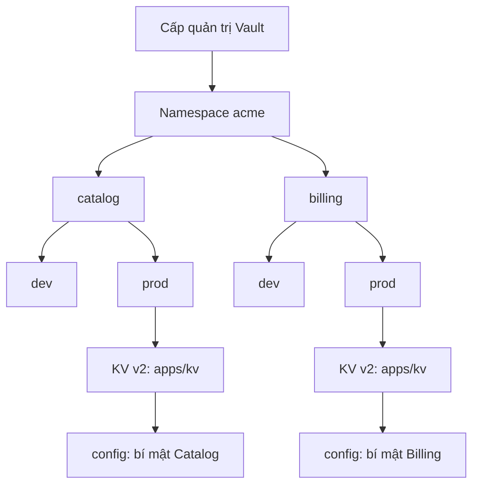
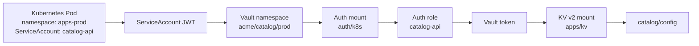

# Namespace và ranh giới tổ chức theo phiên bản, gói sản phẩm của HashiCorp Vault

Khi nhiều nhóm cùng sử dụng HashiCorp Vault, việc đặt bí mật dưới các đường dẫn như `catalog/`, `billing/` hoặc `production/` giúp tổ chức dữ liệu nhưng chưa giải quyết hết nhu cầu phân quyền quản trị. Một nhóm có thể cần tự quản lý auth method, secrets engine, policy, role và token trong phạm vi riêng mà không phải chia sẻ toàn bộ không gian cấu hình Vault với nhóm khác. **Vault namespace** giải quyết lớp nhu cầu này khi tính năng được hỗ trợ bởi phiên bản và gói sản phẩm đang sử dụng.

Đối với **Spring Vault**, namespace quyết định *ngữ cảnh mà request được xử lý*, còn `VaultTemplate` và các operations xác định *API được gọi trong ngữ cảnh đó*. Nhầm namespace với mount path, Kubernetes namespace hoặc đường dẫn secret sẽ dẫn đến lỗi `403`, `404` và đôi khi đọc dữ liệu ở môi trường không mong muốn.

Bài thuộc phần **Nền tảng Vault**, chuẩn bị cho việc ứng dụng Java xác thực theo workload, truy cập KV secrets, tuân thủ ACL policy, quản lý token và lease, dùng Transit/PKI và xây dựng kiểm thử tích hợp có ranh giới rõ ràng.

## 1. Mục tiêu học tập

Sau bài này, bạn có thể:

1. Giải thích **Vault namespace** là gì, phạm vi cô lập của nó và điểm khác với đường dẫn của secrets engine.
2. Phân biệt namespace của Vault với **Kubernetes namespace**, **auth mount**, **Vault policy** và **Vault cluster**.
3. Xác định cách chọn namespace qua `VAULT_NAMESPACE` hoặc header `X-Vault-Namespace` mà không ghép nhầm vào secret path.
4. Nhận diện khác biệt về khả năng sử dụng namespace giữa Vault Community/OSS, Vault Enterprise và các dịch vụ Vault được quản lý, có xét đến **phiên bản và gói cụ thể**.
5. Thiết kế phạm vi token, auth role, policy, KV v2 mount cho các nhóm và môi trường.
6. Kiểm thử được rằng cùng một relative path có thể dẫn đến những secret độc lập trong hai namespace khác nhau.

## 2. Vault namespace là gì?

**Vault namespace** là một ranh giới tổ chức logic bên trong một triển khai Vault hỗ trợ tính năng này. Namespace cho phép phân chia nhiều đối tượng quản trị của Vault theo ngữ cảnh riêng, thường bao gồm:

- Các **secrets engine mount** (KV, Database, Transit, PKI...) và cấu hình tương ứng.
- Các **auth method mount** (Kubernetes, AppRole, JWT...) cùng những role thuộc auth method đó.
- **ACL policy**, token và các đối tượng danh tính liên quan, theo phạm vi và quyền được cấp.
- Tài nguyên và quyền vận hành trong namespace, dưới sự quản lý của một cấp quản trị có thẩm quyền.

Ví dụ một tổ chức có thể dùng cây namespace như sau:

```text
Namespace cấp quản trị của triển khai Vault
└── acme/
    ├── catalog/
    │   ├── dev/
    │   └── prod/
    └── billing/
        ├── dev/
        └── prod/
```

Mỗi namespace con có thể đặt một KV mount cùng tên `apps/kv/` mà không buộc phải chia sẻ dữ liệu, auth role và ACL policy với namespace khác. Đường dẫn `apps/kv/data/config` vì thế chỉ xác định đủ tài nguyên khi biết thêm **namespace** và **Vault deployment**.



Namespace là **phân tách logic và phạm vi quản trị trên cùng triển khai Vault**. Đây không phải lời bảo đảm rằng các namespace có máy chủ, storage backend, tài nguyên CPU, cơ chế unseal hoặc miền sự cố vật lý hoàn toàn độc lập. Nếu cần giới hạn ảnh hưởng của sự cố ở mức hạ tầng, có thể phải triển khai **các Vault cluster riêng**.

## 3. Phân biệt namespace với các khái niệm gần giống

| Khái niệm | Ví dụ | Phân tách điều gì? | Có thay thế Vault namespace? |
|---|---|---|---|
| **Vault namespace** | `acme/catalog/prod` | Không gian quản trị logic và tài nguyên Vault theo ngữ cảnh | Chính là tính năng đang học |
| **Secrets mount path** | `apps/kv/` | Instance secrets engine trong một namespace | Không, chỉ tổ chức engine và API path |
| **Secret relative path** | `config/payment` | Tên một secret bên trong mount | Không, chỉ đặt tên dữ liệu |
| **Auth mount path** | `auth/k8s/` | Instance phương thức xác thực của Vault | Không, chỉ xác thực workload theo cấu hình mount |
| **ACL policy** | `catalog-read` | Capability trên các API path | Không, là cơ chế cấp quyền |
| **Kubernetes namespace** | `catalog-prod` | Phạm vi tài nguyên Kubernetes | Không, thuộc hệ thống khác |
| **Vault cluster** | Vault production riêng | Phạm vi triển khai/hạ tầng và vòng đời hệ thống | Có thể tạo ranh giới hạ tầng mạnh hơn, nhưng chi phí vận hành khác |

Một Kubernetes ServiceAccount có namespace `catalog-prod` **không tự khiến Vault chọn namespace** `acme/catalog/prod`. Khi dùng Kubernetes auth, Vault role có thể ràng buộc `bound_service_account_namespaces`, nhưng việc gửi request tới Vault namespace nào là **một quyết định cấu hình khác**.

Tương tự, không thể biến `apps/kv/catalog/prod` thành Vault namespace bằng cách thêm vài đoạn vào secret key. Nó chỉ là đường dẫn dữ liệu nằm dưới một mount.

## 4. Vì sao phải xét phiên bản Vault và gói sản phẩm?

**Tính năng namespace không nên được giả định tồn tại ở mọi bản cài Vault.** Khả năng sử dụng và cách quản trị phụ thuộc vào dòng sản phẩm, giấy phép, gói dịch vụ, phiên bản máy chủ và đôi khi cấu hình của nhà cung cấp dịch vụ. Cần phân biệt ba khái niệm:

1. **Phiên bản phần mềm (release version):** ví dụ phiên bản Vault server mà cluster đang chạy. Release có thể thay đổi API, giới hạn và hành vi.
2. **Gói/dòng sản phẩm (edition, tier, license):** quyết định những tính năng thương mại hoặc quản trị nào được cung cấp.
3. **Phiên bản KV engine:** KV v1 và KV v2 chỉ khác API/cơ chế dữ liệu của KV; **không quyết định** có hỗ trợ Vault namespace hay không.

### Bảng định hướng theo loại triển khai

| Môi trường/sản phẩm | Kỳ vọng về Vault namespace | Việc cần kiểm tra trước khi thiết kế |
|---|---|---|
| **Vault Community / bản OSS truyền thống** | Không được giả định có tính năng **Vault Enterprise namespaces**. Thường dùng một không gian Vault với mount và policy để tách nhóm | Xác nhận tính năng được cung cấp trong release/distribution thực tế; nếu không có, chọn mô hình mount/policy hoặc cluster riêng |
| **Vault Enterprise tự quản lý** | Có cơ chế Vault namespaces trong phạm vi gói và license hỗ trợ | License hiện hành, quyền quản trị namespace, release/server API, giới hạn và tính năng liên quan |
| **HCP Vault Dedicated / Vault được quản lý tương đương** | Dịch vụ có thể cung cấp namespace, nhưng ngữ cảnh gốc, quyền quản trị và giới hạn phụ thuộc gói cụ thể | Tên namespace quản trị ban đầu, tier dịch vụ, phiên bản được quản lý và tài liệu của dịch vụ |
| **HCP Vault Secrets** | Là một sản phẩm/dịch vụ khác với mô hình API và quyền riêng; không được coi là Vault Dedicated hoặc Vault Enterprise namespaces | Xác định rõ sản phẩm đang kết nối và API được cung cấp |
| **Vault dev server trong lab** | Phụ thuộc binary/edition dùng để chạy dev server; bật dev mode không tự mở khóa tính năng của một edition khác | Xác nhận binary, license, loại deployment và quyền token trong lab |

Tên các gói, điều kiện license và khả năng triển khai có thể thay đổi theo thời gian. **Không chọn kiến trúc namespace chỉ dựa vào số phiên bản hoặc câu “đang dùng Vault”**. Trước khi triển khai thực tế, đối chiếu *release notes*, tài liệu **Vault Enterprise Namespaces**, danh mục tính năng của gói và tài liệu dịch vụ được quản lý tương ứng.

Trong một số deployment Vault được quản lý, người dùng bắt đầu trong namespace quản trị được nhà cung cấp định sẵn (ví dụ một namespace tên `admin`) thay vì giả định có toàn quyền ở global root. Chỉ dùng **đường dẫn namespace thực tế mà deployment cung cấp**; các ví dụ `acme/` trong bài chỉ nhằm minh họa.

### Kiểm tra thực tế mà không suy diễn từ lỗi API

```bash
# Xác nhận Vault server được kết nối và release đang chạy.
vault status

# Chỉ có ý nghĩa khi deployment hỗ trợ namespace và token đủ quyền.
vault namespace list
```

Một lệnh namespace thất bại chưa đủ để kết luận chính xác nguyên nhân:

- **`403`** có thể do token thiếu quyền quản trị/list namespace.
- **`404` hoặc unsupported path** có thể do edition, release, API endpoint hoặc ngữ cảnh gọi không hỗ trợ.
- **Lỗi kết nối/TLS** không nói lên điều gì về license hay hỗ trợ namespace.

Cần kiểm tra **cả tính năng của sản phẩm lẫn quyền trên deployment**. Không dùng root token production chỉ để thử một tính năng.

## 5. Namespace được chọn thế nào khi gọi API?

Đối với Vault HTTP API, một cách chỉ định rõ ngữ cảnh là header **`X-Vault-Namespace`**. Ví dụ:

```http
GET /v1/apps/kv/data/catalog/config
X-Vault-Namespace: acme/catalog/prod
X-Vault-Token: <VAULT_TOKEN>
```

Phần **`/v1/apps/kv/data/catalog/config`** là HTTP API path cho KV v2 mount `apps/kv/` **trong namespace đang được chọn**. Header namespace xác định nơi Vault phân giải mount, policy và identity/token. Token vẫn phải có quyền hợp lệ trong ngữ cảnh yêu cầu.

Tách các tầng:

```text
Vault server URL:        https://vault.example.internal:8200
Vault namespace:         acme/catalog/prod
Secrets engine mount:    apps/kv
KV v2 endpoint:          data/
Secret relative path:    catalog/config

GET https://vault.example.internal:8200/v1/apps/kv/data/catalog/config
X-Vault-Namespace: acme/catalog/prod
X-Vault-Token: <VAULT_TOKEN>
```

**Không gắn `acme/catalog/prod` vào đối số `kv.get("catalog/config")`** nếu client đã chọn namespace qua header. Nếu bạn tự chèn namespace vào secret path, Vault có thể tìm một secret hoàn toàn khác trong cùng mount.

### Dùng Vault CLI

Vault CLI có thể nhận ngữ cảnh namespace qua biến môi trường `VAULT_NAMESPACE` (hoặc tùy chọn namespace được phiên bản CLI hỗ trợ). Ví dụ trong shell kiểu Bash:

```bash
export VAULT_ADDR="https://vault.example.internal:8200"
export VAULT_NAMESPACE="acme/catalog/prod"

vault secrets list
vault kv get -mount=apps/kv catalog/config
```

Hai lệnh cuối thực hiện trong namespace được chỉ định, với token của phiên CLI. Đặt `VAULT_NAMESPACE` **không cấp thêm quyền** cho token; nếu token không được chấp nhận hoặc policy không cho phép thì thao tác vẫn thất bại.

Nếu đang dùng PowerShell:

```powershell
$env:VAULT_ADDR = "https://vault.example.internal:8200"
$env:VAULT_NAMESPACE = "acme/catalog/prod"
vault secrets list
```

Trên những triển khai có cấu trúc namespace đặc thù, ví dụ có tiền tố namespace quản trị của dịch vụ được quản lý, dùng **giá trị namespace được quản trị viên cấp**. Không tự suy luận prefix từ tên team hay URL.

### Cùng path dưới hai namespace

| Thuộc tính | Request A | Request B |
|---|---|---|
| Vault server | `https://vault.example.internal:8200` | Cùng server |
| `X-Vault-Namespace` | `acme/catalog/prod` | `acme/billing/prod` |
| API path | `/v1/apps/kv/data/config` | `/v1/apps/kv/data/config` |
| KV mount | `apps/kv/` của Catalog | `apps/kv/` của Billing |
| Token/policy | Theo ngữ cảnh và quyền Catalog | Theo ngữ cảnh và quyền Billing |
| Secret nhận được | Dữ liệu cấu hình Catalog | Dữ liệu cấu hình Billing |

Dù server và API path **giống nhau**, tài nguyên được xử lý vẫn có thể độc lập do namespace khác nhau. Đây là lý do nên đưa namespace vào cấu hình và tiêu chí kiểm thử một cách tường minh.

## 6. Cây namespace, cấp quản trị và ủy quyền

Vault namespace có thể được tổ chức theo cấu trúc cha–con. Người quản trị ở cấp phù hợp có thể được ủy quyền tạo và quản lý namespace con theo capability và cơ chế quản trị của deployment. Tuy nhiên:

- **Namespace con không tự trở thành tài khoản root của toàn hệ thống.** Phạm vi quản trị vẫn chịu sự kiểm soát của cấp trên và quyền cấp trên deployment.
- **Policy trong namespace con không tự cấp quyền lên namespace cha** hoặc các namespace cùng cấp.
- **Cùng tên policy, role hoặc mount không làm chúng trở thành một tài nguyên chung** giữa những namespace độc lập.
- Quản trị viên ở cấp cha có thể có các cơ chế/đặc quyền điều hành namespace con khi được cấp quyền; không được hiểu namespace là ranh giới cách ly chống lại mọi quản trị viên có quyền trên cấp cha hoặc cluster.
- Các token, identity và auth method cần được thiết kế theo phạm vi namespace và quy tắc cấp quyền thực tế. Không mặc định token của namespace A được dùng cho namespace B.

Một mô hình giao trách nhiệm:

| Cấp | Nhóm chịu trách nhiệm | Ví dụ trách nhiệm |
|---|---|---|
| Triển khai Vault | Platform/Security | Vận hành cluster, license, audit, backup, namespace root/admin, tiêu chuẩn auth |
| Namespace tổ chức `acme/` | Nhóm bảo mật tổ chức | Quản lý chính sách ủy quyền, cấu trúc namespace con |
| Namespace dịch vụ `acme/catalog/` | Nhóm Catalog theo phân quyền | Quản lý các mount và policy được cho phép trong phạm vi dịch vụ |
| Namespace môi trường `acme/catalog/prod/` | Nhóm vận hành production | Auth role và secret dành cho workload production, quyền tối thiểu |

Đây là ví dụ phân cấp, không phải yêu cầu bắt buộc phải tạo namespace cho từng team hoặc môi trường. Namespace quá nhỏ có thể tăng số lượng mount, role, policy và công việc vận hành không cần thiết. Chọn độ hạt theo nhu cầu ủy quyền, kiểm soát thay đổi, môi trường và license.

## 7. Namespace ảnh hưởng đến auth method và danh tính thế nào?

Giả sử team Catalog có namespace `acme/catalog/prod` và auth method Kubernetes được mount tại `auth/k8s/` **trong namespace đó**:

```text
Vault namespace:  acme/catalog/prod
Auth mount:       auth/k8s/
Auth role:        auth/k8s/role/catalog-api
Secrets mount:    apps/kv/
Secret API path:  apps/kv/data/catalog/config
```

Pod Catalog chạy tại Kubernetes namespace `apps-prod` với ServiceAccount `catalog-api`. Khi login, client phải chọn đúng Vault namespace:

```http
POST /v1/auth/k8s/login
X-Vault-Namespace: acme/catalog/prod
Content-Type: application/json

{
  "role": "catalog-api",
  "jwt": "<SERVICE_ACCOUNT_JWT>"
}
```

Vault sẽ kiểm tra credential theo cấu hình auth method và role trong namespace đang được phân giải. Ví dụ role ràng buộc với Kubernetes ServiceAccount `catalog-api` ở Kubernetes namespace `apps-prod`; **hai giá trị này không tự xác định Vault namespace**.



Khi đăng nhập thành công, token phải được dùng phù hợp với namespace và các quy tắc xác thực/phân quyền. Đường dẫn auth role, tên role và policy trong namespace `acme/billing/prod` có thể giống chuỗi tên ở Catalog nhưng là cấu hình độc lập.

### Vault Identity và namespace

Entity, alias và group của Vault Identity có thể gắn policy với danh tính theo cơ chế hỗ trợ trong triển khai. Phạm vi quản lý identity và những khả năng tham chiếu qua cấp namespace cần dựa vào tài liệu và cấu hình edition cụ thể. **Không được hợp nhất danh tính giữa hai nhóm chỉ vì cùng tên ServiceAccount hoặc alias**. Quyền phải được kiểm tra trong ngữ cảnh namespace, auth mount và identity có liên quan.

## 8. ACL policy và đường dẫn API trong namespace

Với KV v2 `apps/kv/` trong `acme/catalog/prod`, policy chỉ đọc một secret:

```hcl
path "apps/kv/data/catalog/config" {
  capabilities = ["read"]
}
```

Policy được quản lý **trong ngữ cảnh namespace phù hợp**. Đường dẫn trong stanza không chứa tiền tố HTTP `/v1/` và thông thường không cần ghép `acme/catalog/prod/` vào trước `apps/kv/` khi policy áp dụng cho mount nằm ngay trong namespace đó.

Ví dụ kiểm tra:

```bash
export VAULT_NAMESPACE="acme/catalog/prod"
vault token capabilities apps/kv/data/catalog/config
vault token capabilities apps/kv/data/billing/config
```

Lệnh kiểm tra cần chạy bằng **token của workload hoặc token thử nghiệm có policy tương đương**, không phải admin/root token. Quyền đọc Catalog không tự cấp quyền Billing dù chúng dùng chung Vault server hoặc cùng một namespace cấp trên.

### Policy, token và lease theo ngữ cảnh

- **Token:** sau auth, token được phát hành theo phạm vi và quyền của phương thức xác thực; lựa chọn namespace trong request không biến token thiếu quyền thành token có quyền.
- **ACL policy:** capability được xét trên endpoint thực của mount, trong ngữ cảnh namespace; KV v2 đọc dữ liệu dùng `<mount>/data/<key>`, còn list thường dùng `<mount>/metadata/<prefix>`.
- **Secret lease:** lease ID của credential động gắn với tài nguyên đã được cấp và phải được quản lý trong ngữ cảnh được phép. Không suy ra rằng cùng tên role Database ở hai namespace trả cùng credential hay lease.
- **Transit/PKI:** mount `crypto/` hoặc `certs/` có thể tồn tại độc lập trong mỗi namespace. Namespace chỉ định instance engine, còn policy quyết định ứng dụng có thể gọi `encrypt/`, `issue/` hay endpoint khác.

## 9. Thực hành tạo namespace trong môi trường có hỗ trợ

**Điều kiện:** chỉ làm trên Vault Enterprise hoặc dịch vụ tương thích đã xác nhận có hỗ trợ namespaces, trong **môi trường lab được cấp phép**, với token có quyền quản trị tạo namespace và mount. Không tạo hoặc xóa namespace production để thử bài học. Nếu sản phẩm không hỗ trợ, chuyển sang phương án mô phỏng ở mục 12.

### 9.1. Tạo namespace con

Từ namespace quản trị được tổ chức cho phép (mặc định của deployment không nhất thiết là global root), các ví dụ CLI thường có dạng:

```bash
# Ví dụ minh họa cho một deployment cho phép tạo namespace con "team-a".
vault namespace create team-a
vault namespace list
```

Sau đó, với token đủ quyền trong namespace `team-a`:

```bash
export VAULT_NAMESPACE="team-a"

# Bật KV v2 riêng cho team-a, khi chưa có mount này.
vault secrets enable -path=apps/kv -version=2 kv

# Dùng dữ liệu giả trong lab.
vault kv put -mount=apps/kv catalog/config username=team-a-demo
vault kv get -mount=apps/kv catalog/config
```

Nếu `apps/kv` đã được bật, không chạy lại lệnh `enable`; dùng `vault secrets list -detailed` để kiểm tra loại/phiên bản engine. Tên namespace chỉ mang tính minh họa: trong cây có sẵn, tên đầy đủ có thể gồm nhiều cấp, và token quản trị phải có quyền trên cấp cần tạo.

### 9.2. Tạo cùng mount và key ở namespace khác

Với namespace thứ hai `team-b` đã được tạo hợp lệ, chuyển ngữ cảnh:

```bash
export VAULT_NAMESPACE="team-b"
vault secrets enable -path=apps/kv -version=2 kv
vault kv put -mount=apps/kv catalog/config username=team-b-demo
vault kv get -mount=apps/kv catalog/config
```

Hai giá trị `team-a-demo` và `team-b-demo` chỉ nhằm chứng minh hai namespace có thể có cùng relative path nhưng dữ liệu độc lập. Token cấp trong namespace này không nên được giả định có quyền truy cập namespace kia.

### 9.3. Policy cấp trong namespace nào?

Trong cả hai namespace, có thể tồn tại policy cùng tên `catalog-read`, với nội dung:

```hcl
path "apps/kv/data/catalog/config" {
  capabilities = ["read"]
}
```

Tuy nhiên, **tên policy giống nhau không đồng nghĩa cùng chính sách vận hành hoặc cùng tài nguyên**: chúng thuộc hai ngữ cảnh namespace khác nhau. Cấp token workload theo role/policy của đúng namespace, sau đó kiểm chứng capability và truy cập với token đó.

## 10. Spring Vault phải giữ namespace nhất quán qua login và đọc secret

Trong ứng dụng Spring Vault, hãy phân tách tối thiểu bốn thông số:

```text
Vault endpoint:          https://vault.example.internal:8200
Vault namespace:         acme/catalog/prod
Auth mount:              auth/k8s
KV mount:                apps/kv
Secret relative path:    catalog/config
```

Namespace được áp dụng ở lớp **client/request context**, thông thường bằng header `X-Vault-Namespace` hoặc cơ chế cấu hình tương đương mà thư viện đang dùng cung cấp. Nó không phải là chuỗi cần thêm vào `VaultEndpoint` host hoặc tên secret.

Ví dụ Java dưới đây giả định bean `VaultTemplate` đã được cấu hình với kết nối TLS, workload authentication **và namespace đích** nhất quán ở cả bước login và những request tiếp theo:

```java
import org.springframework.stereotype.Service;
import org.springframework.vault.core.VaultKeyValueOperations;
import org.springframework.vault.core.VaultKeyValueOperationsSupport.KeyValueBackend;
import org.springframework.vault.core.VaultTemplate;
import org.springframework.vault.support.VaultResponse;

@Service
public class CatalogSecretReader {

    private final VaultKeyValueOperations kv;

    public CatalogSecretReader(VaultTemplate vaultTemplate) {
        // Mount của KV v2 bên trong Vault namespace đã chọn.
        this.kv = vaultTemplate.opsForKeyValue("apps/kv", KeyValueBackend.KV_2);
    }

    public String getUsername() {
        // Relative path bên trong KV mount, không chứa namespace hoặc /data/.
        VaultResponse response = kv.get("catalog/config");
        if (response == null || response.getData() == null) {
            throw new IllegalStateException("Không tìm thấy secret Catalog");
        }

        Object value = response.getData().get("username");
        if (!(value instanceof String)) {
            throw new IllegalStateException("Thiếu trường username hợp lệ");
        }
        return (String) value;
    }
}
```

Trong ví dụ:

| Cấu hình/thao tác | Giá trị | Vai trò |
|---|---|---|
| Server URL | `https://vault.example.internal:8200` | Địa chỉ Vault cluster |
| Namespace | `acme/catalog/prod` | Ngữ cảnh Vault của toàn bộ workflow |
| Auth method | `auth/k8s` | Nơi workload đăng nhập trong ngữ cảnh đã chọn |
| KV operations | `opsForKeyValue("apps/kv", KV_2)` | Chọn mount KV v2 |
| Lấy secret | `get("catalog/config")` | Chọn relative path |
| HTTP path đích | `/v1/apps/kv/data/catalog/config` | API KV v2 được Spring Vault xử lý |

**Không tự thêm namespace vào** `kv.get("acme/catalog/prod/catalog/config")`. Cũng không giả định rằng cấu hình namespace của Spring Cloud Vault tự động áp dụng cho một `VaultTemplate` được tạo thủ công ở phần ứng dụng khác. API/cấu hình hỗ trợ namespace có thể khác theo **phiên bản Spring Vault/Spring Cloud Vault**; cần xác minh cơ chế cấu hình của phiên bản dự án và kiểm tra request thực tế.

### Tránh nhầm auth path và KV path

Nếu đăng nhập tại `auth/k8s/login` nhưng request đọc secret được gửi vào namespace khác, Vault có thể từ chối token hoặc xử lý trên một mount khác với dự định. Khi cấu hình `ClientAuthentication`, session manager và `VaultTemplate`, hãy bảo đảm tất cả các bước dùng **đúng cùng ngữ cảnh namespace**, trừ trường hợp đa namespace được thiết kế và cấp quyền tường minh.

Nếu một ứng dụng thực sự phải truy cập nhiều namespace, nên tách cấu hình và phiên/token theo mỗi ngữ cảnh, đặt tên rõ ràng các client hoặc adapter, và kiểm thử quyền từng luồng. **Không dùng một biến namespace mutable toàn cục được thay đổi giữa các thread** để điều hướng request: lỗi cạnh tranh có thể khiến request đi sai namespace.

## 11. Chiến lược tổ chức namespace cho nhiều môi trường

Một thiết kế điển hình có thể chọn namespace theo tổ chức, dịch vụ và môi trường:

```text
company/
├── catalog/
│   ├── dev/
│   ├── staging/
│   └── prod/
└── billing/
    ├── dev/
    ├── staging/
    └── prod/
```

| Quyết định thiết kế | Câu hỏi cần trả lời |
|---|---|
| Theo tổ chức hay team? | Ai được ủy quyền tự quản lý auth method, policy, mount? |
| Theo dịch vụ? | Secret và khóa mã hóa của dịch vụ nào cần ranh giới vận hành riêng? |
| Theo môi trường? | Dev và production có được dùng chung danh tính, policy hoặc credential không? |
| Theo tenant? | Số tenant, giới hạn license, chi phí tạo mount, chính sách vận hành và nguy cơ quyền chéo ra sao? |
| Theo hạ tầng? | Namespace logic đủ chưa hay cần cluster riêng để cô lập sự cố, backup, network, unseal? |

Lợi ích của namespace:

- Ủy quyền quản trị có phạm vi theo team hoặc môi trường.
- Tổ chức policy, auth, secrets engine và dữ liệu nhất quán.
- Giảm khả năng nhầm lẫn khi nhiều nhóm muốn dùng cùng tên mount/role.
- Cho phép tự động hóa quản trị trong một cấu trúc phân cấp được kiểm soát.

Chi phí và giới hạn:

- Phải quản lý thêm namespace lifecycle, mount, policy, audit và quyền quản trị.
- Cần kiểm chứng giới hạn gói sản phẩm, quota và tính năng theo release.
- Nhiều namespace vẫn chia sẻ phần hạ tầng Vault, nên không thay thế chiến lược HA/DR.
- Thay đổi tên hoặc đường dẫn namespace có thể ảnh hưởng tới header, auth flow, token, policy và cấu hình ứng dụng đang chạy.

## 12. Nếu phiên bản/gói không hỗ trợ namespaces thì sao?

Không nên mô phỏng namespace bằng cách đặt nhầm `X-Vault-Namespace` hoặc đưa `/v1/sys/namespaces` vào Vault Community không hỗ trợ tính năng này. Tùy mức độ cô lập cần thiết, có các lựa chọn:

| Nhu cầu | Hướng tiếp cận | Giới hạn cần hiểu |
|---|---|---|
| Phân chia bí mật theo ứng dụng trong một cluster | Mount path riêng như `catalog/kv/`, `billing/kv/`; ACL theo prefix | Không tạo một không gian quản trị namespace độc lập |
| Phân chia token và danh tính theo workload | Auth role, Kubernetes/JWT bound claims, token/identity policy tối thiểu | Vẫn chia sẻ auth configuration theo phạm vi triển khai |
| Phân chia quyền quản trị chi tiết | Policy cho endpoint quản trị và quy trình review chặt | Khác với mô hình ủy quyền phân cấp của Enterprise namespace |
| Cô lập mạnh môi trường production | Vault cluster/deployment riêng | Tăng chi phí vận hành và đồng bộ cấu hình |
| Cần đúng tính năng namespace | Nâng cấp/gói có hỗ trợ theo tài liệu nhà cung cấp | Cần kiểm tra license, API, migration và mức độ tương thích |

Ví dụ một thiết kế không có namespaces:

```text
Vault cluster (một không gian Vault)
├── catalog/kv/        -> KV v2 cho Catalog
├── billing/kv/        -> KV v2 cho Billing
├── auth/k8s/          -> role ràng buộc ServiceAccount của từng workload
└── ACL policies       -> chỉ cho phép từng role đọc mount được cấp
```

Policy của Catalog có thể giới hạn:

```hcl
path "catalog/kv/data/config" {
  capabilities = ["read"]
}
```

Giải pháp này vẫn hữu ích để **cấp quyền tối thiểu**, nhưng nó không cung cấp đầy đủ cấu trúc namespace cha–con, ranh giới quản trị hoặc cùng mức phân tách tài nguyên của Enterprise namespaces. Cần xác định yêu cầu bảo mật thay vì gọi mọi prefix là “namespace”.

## 13. Chẩn đoán lỗi liên quan đến namespace

| Triệu chứng | Nguyên nhân có thể | Cách xác minh |
|---|---|---|
| `404` ở API bí mật | Namespace đúng nhưng mount chưa được bật, hoặc key/relative path sai | Chọn namespace, chạy `vault secrets list -detailed`; xác minh KV v1/v2 |
| `403` với token còn TTL | Token không có capability trong namespace/path, hoặc sai ngữ cảnh auth | Kiểm tra token workload, auth mount và capability trên API path |
| CLI thành công nhưng Java nhận `404` | `VAULT_NAMESPACE` trong shell đúng nhưng HTTP client Java không gửi header tương ứng | Đối chiếu namespace của client và endpoint/mount thực tế |
| Đọc nhầm dữ liệu trong môi trường khác | Cấu hình namespace, server URL hoặc deployment profile bị sai | Xác nhận đầy đủ server + namespace + mount + key |
| `vault namespace list` trả `403` | Thiếu quyền liệt kê/quản trị | Dùng tài khoản được ủy quyền kiểm tra, không nâng thành root token |
| `vault namespace list` báo không hỗ trợ | Gói/edition hoặc API không có, hay ngữ cảnh không đúng | Xác minh tài liệu release, license, deployment |
| Kubernetes login thất bại dù ServiceAccount đúng | Vault auth mount/role nằm ở namespace khác hoặc điều kiện JWT không khớp | Kiểm tra `X-Vault-Namespace`, path `auth/.../login`, role và các bound claims |
| Policy đã viết nhưng token không đọc được KV v2 | Policy tạo ở namespace khác hoặc thiếu segment `data/` | Kiểm tra policy context và `<mount>/data/<secret>` |
| Secret lease renew thất bại | Lease/token/quyền hoặc namespace không phù hợp | Kiểm tra nơi lease được cấp, token, TTL, quyền và API `sys/leases` phù hợp |

Thứ tự chẩn đoán nên cố định:

1. **Vault deployment:** URL trỏ tới cluster nào và đang chạy edition/release nào?
2. **Namespace:** có hỗ trợ không, request đã chọn namespace chính xác chưa?
3. **Auth/token:** role và token có thuộc phạm vi phù hợp, có TTL và quyền đúng không?
4. **Secrets mount:** instance engine có tồn tại trong namespace đang chọn không?
5. **API path:** KV v2 đã có `data/` hoặc `metadata/`; Transit/PKI có đúng endpoint không?
6. **ACL capability:** token được phép làm gì trên API path thực?

Với audit và log, nên thu thập namespace, đường dẫn và mã lỗi theo chính sách bảo mật, **không ghi Vault token, ServiceAccount JWT, mật khẩu, plaintext hoặc toàn bộ response chứa secret**. Nếu log namespace có thể tiết lộ cấu trúc tổ chức nhạy cảm, cần kiểm soát quyền xem và thời gian lưu giữ phù hợp.

## 14. Bài thực hành có kiểm chứng

Bài thực hành yêu cầu **Vault lab thực sự có hỗ trợ namespace** và quyền quản trị phù hợp. Nếu môi trường chỉ có Community không hỗ trợ, hãy làm bài biến thể bằng hai KV mount riêng và ghi rõ giới hạn.

### Phần A — Hai namespace, cùng mount và cùng key

1. Tạo hoặc sử dụng hai namespace lab đã được phê duyệt: `team-a` và `team-b`.
2. Trong mỗi namespace, tạo KV v2 mount `apps/kv/` nếu chưa có.
3. Ghi secret giả tại `catalog/config`: `username=team-a-demo` trong namespace A và `username=team-b-demo` trong namespace B.
4. Đọc bằng CLI với `VAULT_NAMESPACE=team-a`, sau đó với `VAULT_NAMESPACE=team-b`.
5. Giải thích tại sao `/v1/apps/kv/data/catalog/config` giống nhau nhưng dữ liệu nhận khác khi header namespace thay đổi.

### Phần B — Quyền của token ứng dụng

1. Trong `team-a`, tạo policy chỉ có `read` trên `apps/kv/data/catalog/config`.
2. Cấp token thử nghiệm theo cơ chế auth role phù hợp trong namespace A.
3. Kiểm chứng token đọc được key của A và không có quyền đọc một secret khác ngoài phạm vi.
4. Kiểm chứng không thể mặc định dùng token đó để đọc B. Nếu có chính sách liên namespace được quản trị đặc biệt, phải xác minh tường minh phạm vi của token chứ không dựa vào tên giống nhau.
5. Không dùng root token làm bằng chứng kiểm thử phân quyền tối thiểu.

### Phần C — Java và Spring Vault

1. Cấu hình một `VaultTemplate` kết nối đúng Vault server và namespace A, kèm workload authentication/token hợp lệ.
2. Gọi `opsForKeyValue("apps/kv", KeyValueBackend.KV_2).get("catalog/config")`, xác nhận dữ liệu thuộc A.
3. Tạo một client/session độc lập được cấp quyền namespace B; lặp lại truy vấn và xác nhận dữ liệu B.
4. Cố ý dùng sai namespace **chỉ trong lab**; quan sát lỗi hoặc dữ liệu khác như thế nào. Không kỳ vọng mọi trường hợp sai namespace đều trả cùng một HTTP status.
5. Ghi lại kết quả bằng tên namespace, mount, secret path, capability và trạng thái, không chép lại token hoặc plaintext secret thực.

### Câu hỏi tự kiểm tra

1. **Kubernetes namespace `apps-prod` có tự chọn Vault namespace `acme/catalog/prod` không?** Không. Đây là hai hệ thống namespace khác nhau, cần cấu hình mapping/namespace context tường minh.
2. **KV v2 mount `apps/kv/` ở hai Vault namespace có dùng chung một secret `catalog/config` không?** Không mặc nhiên; mỗi mount trong ngữ cảnh riêng có dữ liệu riêng.
3. **Có thể thêm `acme/catalog/prod` vào `kv.get(...)` để thay thế header namespace không?** Không. Như vậy làm sai relative path.
4. **Chỉ biết Vault version có đủ để kết luận dùng được namespace không?** Không. Phải xác minh edition/gói, license, deployment và quyền.
5. **Namespace giúp cô lập lỗi hạ tầng giữa các Vault cluster không?** Không. Namespace là phân tách logic trong một deployment, còn cô lập hạ tầng cần xem xét cluster riêng.
6. **`403` ở `vault namespace list` có chứng minh edition không hỗ trợ không?** Không. Có thể do ACL thiếu quyền.

## 15. Ghi nhớ

**Vault namespace xác định không gian logic nơi auth method, policy, secrets engine, token và dữ liệu được quản lý; mount path xác định engine bên trong không gian đó; relative path xác định tài nguyên.** Namespace khác với Kubernetes namespace và cũng khác việc thêm một tiền tố vào tên key. Tính năng phải được xác nhận theo **dòng sản phẩm, gói/license và release của Vault deployment**.

Với ứng dụng Java, hãy thiết lập rõ **Vault server + namespace + auth mount + secrets mount + relative path**. Bảo đảm Spring Vault dùng cùng ngữ cảnh namespace khi login và khi `VaultTemplate` gọi API, đồng thời kiểm thử quyền của token trên API path thực. Khi môi trường không hỗ trợ Vault namespaces, dùng mount/policy hoặc cluster riêng theo mức độ cô lập cần thiết và ghi nhận giới hạn thay vì giả định mọi dạng phân chia đường dẫn đều có cùng thuộc tính bảo mật.
