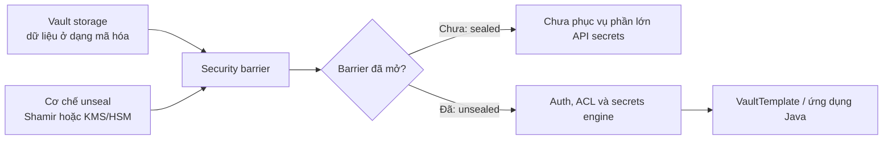
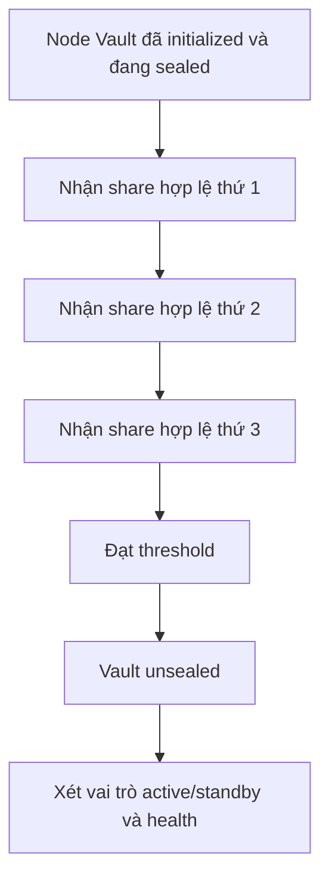
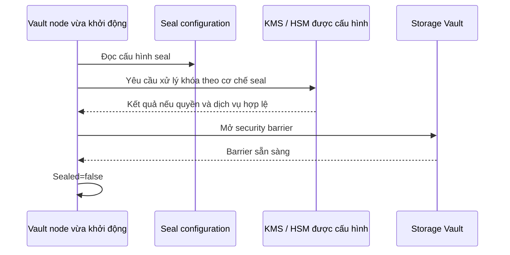
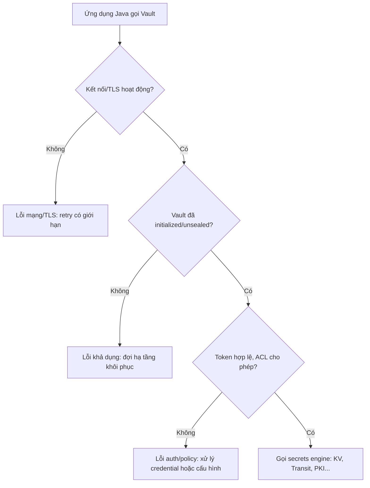

# Seal, unseal và trạng thái sẵn sàng của máy chủ HashiCorp Vault

HashiCorp Vault bảo vệ bí mật bằng một lớp mã hóa gọi là **security barrier**. Sau khi một Vault server được khởi động, chỉ việc tiến trình đang chạy và cổng HTTP mở **chưa đủ** để ứng dụng đọc được bí mật. Máy chủ phải được **khởi tạo (initialized)** và ở trạng thái **unsealed**; trong hệ thống HA còn cần xét nút **active** hay **standby** để định tuyến request đúng.

Đối với ứng dụng Java dùng **Spring Vault**, đây là kiến thức nền tảng trước khi cấu hình `ClientAuthentication` và `VaultTemplate`. Nếu Vault chưa sẵn sàng, việc đăng nhập theo workload, đọc KV, gia hạn token/lease, gọi Transit hoặc PKI đều có thể thất bại. Nhận biết chính xác trạng thái máy chủ giúp phân biệt lỗi hạ tầng với lỗi token, policy, secret path và API.

Bài này thuộc chương **Nền tảng Vault**. Các lệnh quản trị nhạy cảm chỉ được minh họa cho **Vault lab được phép thao tác**, không dành cho một cluster đang phục vụ ứng dụng thật.

## 1. Mục tiêu học tập

Sau bài học, bạn có thể:

1. Giải thích **seal**, **unseal**, **initialized**, **active** và **standby** theo đúng chức năng của từng trạng thái.
2. Phân biệt **Shamir unseal** với **auto-unseal qua KMS/HSM**, đặc biệt là khác biệt giữa unseal keys và recovery keys.
3. Dùng `vault status`, `vault operator unseal`, `/v1/sys/seal-status` và `/v1/sys/health` theo mục đích.
4. Hiểu mã trạng thái health mặc định của Vault và vì sao standby không nhất thiết là máy chủ hỏng.
5. Thiết kế kiểm tra availability/readiness, retry và xử lý lỗi cho ứng dụng Spring Vault mà không lưu hoặc phát tán unseal keys.
6. Lập bài kiểm thử tích hợp có thể xác nhận hành vi khi Vault sealed, unsealed, token không hợp lệ hoặc một nút HA chuyển vai trò.

## 2. Seal là gì và giải quyết vấn đề nào?

Khi Vault **sealed**, security barrier ở trạng thái khóa: Vault không có khả năng phục vụ phần lớn thao tác cần truy cập dữ liệu bí mật bên trong kho lưu trữ. Dữ liệu vẫn được lưu ở dạng mã hóa trên storage backend; **seal không phải xóa dữ liệu**. Các endpoint chẩn đoán trạng thái nhất định vẫn có thể hoạt động để người vận hành biết máy chủ đang sealed hay chưa initialized.

Vault thường chuyển sang sealed trong những tình huống:

- Tiến trình mới khởi động hoặc được khởi động lại và chưa unseal thành công.
- Người quản trị có đủ quyền **chủ động seal** trong một quy trình vận hành.
- Có sự kiện hoặc lỗi liên quan đến cơ chế seal, tùy loại seal và trạng thái của hệ thống.
- Một node trong cụm mới được đưa lên, còn các node khác có thể đang phục vụ bình thường.

Khi **unsealed**, Vault đã có khả năng sử dụng những khóa cần thiết để mở security barrier và xử lý request bình thường, **nếu** các thành phần khác như storage, HA, mạng, TLS và chính sách truy cập cũng hoạt động. Unsealed **không đồng nghĩa** mọi API sẽ trả `200 OK`: request vẫn có thể bị từ chối bởi auth method, token, ACL policy hoặc đường dẫn không tồn tại.

### Hình dung security barrier



Nhìn theo vòng đời:

```text
Khởi động Vault server
         |
         v
   Initialized?
     |       |
    No      Yes
     |       |
     v       v
  Cần init  Sealed?
             |     |
            Yes    No
             |     |
             v     v
         Unseal   Kiểm tra HA / health
           |              |
           +--------------+
                          v
           Phục vụ các API được phép
```

Seal là lớp bảo vệ quyền sử dụng dữ liệu bên trong Vault. Nó **không tự động xóa** credential tĩnh đã từng được client đọc ra bộ nhớ, không thay thế ACL policy và không bảo đảm một tài khoản Database động bên ngoài Vault đã bị vô hiệu hóa ngay khi máy chủ sealed.

## 3. Phân biệt initialized, sealed, unsealed và HA role

Đây là bốn câu hỏi khác nhau:

| Câu hỏi | Trạng thái/thuộc tính | Ý nghĩa |
|---|---|---|
| Vault đã được thiết lập dữ liệu bảo mật ban đầu chưa? | `initialized: true/false` | **Initialize** tạo cấu trúc và vật liệu khóa nền tảng ban đầu cho triển khai |
| Security barrier đã được mở chưa? | `sealed: true/false` | **Seal/unseal** quyết định khả năng Vault xử lý phần lớn thao tác bí mật |
| Node này đang đảm nhiệm vai trò nào? | **active**, **standby**, các vai trò HA khác tùy edition | **HA role** quyết định xử lý/forward request trong cụm nhiều node |
| API mà ứng dụng cần đã dùng được chưa? | Health + mạng/TLS/token/policy/backend | **Readiness theo mục đích**; phải xét thêm ngữ cảnh ứng dụng |

Các trạng thái điển hình:

| Initialized | Sealed | Trạng thái quan sát | Ý nghĩa vận hành |
|---|---|---|---|
| `false` | Thường chưa thể phục vụ secrets | **Uninitialized** | Chỉ được init một lần cho một storage/deployment mới |
| `true` | `true` | **Initialized, sealed** | Cần unseal thành công hoặc khôi phục lỗi auto-unseal |
| `true` | `false` | **Unsealed, active** | Node đang phục vụ vai trò active khi HA có hiệu lực |
| `true` | `false` | **Unsealed, standby** | Node HA chờ hoặc chuyển tiếp; không tự xem là lỗi |

Một node active còn phải có storage và mạng khỏe mạnh để phục vụ request. Một node standby có thể unsealed nhưng không trực tiếp xử lý tất cả thao tác như active. Tùy cấu hình HA và loại request, Vault có thể **forward** hoặc **redirect** tới active; client/load balancer phải hiểu topology.

> **Đừng nhầm:** `sealed=false` chỉ trả lời về security barrier. Một lỗi `403` do token thiếu quyền, một `404` do KV path sai hoặc sự cố DNS/TLS đều có thể xuất hiện khi Vault hoàn toàn unsealed.

## 4. Initialize khác unseal

**Initialize (`vault operator init`)** là bước **thiết lập ban đầu** cho một storage Vault mới chưa được initialized. Nó tạo vật liệu khóa và các thông tin bootstrap cần thiết. Trong mô hình Shamir, quá trình này có thể tạo các **unseal key shares** theo số lượng và ngưỡng được cấu hình, cùng initial root token.

**Unseal** là bước mở barrier cho một Vault đã initialized. Khi node restart và sealed trở lại, bạn **không chạy lại init**; bạn thực hiện quy trình unseal phù hợp loại seal. Trong cụm HA dùng chung storage, trạng thái initialized thuộc triển khai/storage; không khởi tạo lặp lại riêng từng node.

### Ví dụ initialize chỉ cho Vault lab dùng Shamir seal

```bash
# Chỉ chạy một lần trên storage Vault mới, chưa initialized, trong lab.
vault operator init -key-shares=5 -key-threshold=3
```

Ý nghĩa:

- `-key-shares=5`: tạo 5 phần khóa unseal theo cơ chế Shamir.
- `-key-threshold=3`: cần tối thiểu 3 phần khóa **khác nhau** hợp lệ để đạt ngưỡng unseal.
- Lệnh còn có thể hiển thị **initial root token** và thông tin rất nhạy cảm.

Không chạy lệnh trên Vault đã initialized hoặc Vault production đang chứa dữ liệu. Không sao chép output chứa unseal shares/root token vào CI logs, ticket, chat, bản ghi terminal hoặc repository. Việc giữ khóa theo nhiều người/cơ chế lưu ký phải tuân theo quy trình bảo mật riêng của tổ chức.

Với **auto-unseal**, thông tin bootstrap và loại khóa xuất ra có thể khác: thường là **recovery key shares** cho những tác vụ quản trị cần quorum, thay vì Shamir unseal shares dùng trực tiếp mở barrier. Không áp dụng mù quáng flags của ví dụ Shamir cho triển khai auto-unseal.

## 5. Manual unseal bằng Shamir shares

Trong mô hình Shamir, Vault phân tách vật liệu unseal thành nhiều shares và yêu cầu đạt **ngưỡng** để khôi phục khả năng mở barrier. Chẳng hạn cấu hình `5 shares, threshold 3` yêu cầu **3 phần hợp lệ khác nhau**. Dùng lại cùng một phần không tạo thêm tiến độ hợp lệ.



Quy trình quan sát trong lab:

```bash
vault status

# Gõ share bằng prompt tương tác, không đưa khóa vào tham số dòng lệnh.
vault operator unseal
vault operator unseal
vault operator unseal

vault status
```

Lệnh `vault operator unseal` không kèm key sẽ dùng prompt phù hợp của CLI để nhận share. Ví dụ có 3 lần do ngưỡng lab là 3; ngưỡng thực tế phải lấy từ cấu hình. **Không điền share thật vào ví dụ, biến môi trường chung hay command history**. Các share được giao cho người giữ khóa theo quy trình thực tế, thay vì dồn vào một máy/người chỉ để làm đủ lệnh.

Trong quá trình unseal, `vault status` có thể cho biết **unseal progress** và **threshold**; sau khi đạt ngưỡng và mở barrier thành công, `Sealed` chuyển sang `false`. Nếu nhập nhầm hoặc phải làm lại một phiên unseal dở dang, CLI có cơ chế reset tiến độ; chỉ dùng theo runbook của môi trường.

Trong cụm HA thủ công, các node thường phải được unseal theo cơ chế phù hợp sau khi khởi động; một node đã unsealed **không tự chứng minh** mọi node còn lại cũng đã unsealed.

## 6. Auto-unseal bằng KMS/HSM và recovery keys

**Auto-unseal** sử dụng một dịch vụ hoặc thiết bị tin cậy, ví dụ cloud KMS hay HSM được Vault hỗ trợ, để giúp Vault mở security barrier sau khởi động mà không cần nhân sự nhập Shamir shares mỗi lần.



Auto-unseal có lợi ích vận hành: giảm thao tác thủ công khi node restart và hỗ trợ tự phục hồi trong nhiều tình huống. Nhưng nó tạo thêm **dependency** vào KMS/HSM, cấu hình khóa, quyền gọi API và kết nối mạng. Nếu khóa bị vô hiệu hóa, quyền bị thu hồi hoặc dịch vụ KMS không sẵn sàng khi node khởi động, auto-unseal có thể thất bại và Vault tiếp tục sealed.

### Unseal keys và recovery keys không thể dùng thay nhau

| Cơ chế | Khóa được quản lý | Mục đích |
|---|---|---|
| Shamir manual unseal | **Unseal key shares** | Kết hợp đạt threshold để unseal |
| Auto-unseal qua KMS/HSM | Khóa/thiết bị bảo vệ của seal provider | Hỗ trợ Vault unseal theo cấu hình |
| Auto-unseal | **Recovery key shares** (khi được cấu hình/phát hành) | Dùng cho các thao tác quản trị/quorum được hỗ trợ, **không thay** KMS/HSM để unseal thông thường |

**Recovery keys không tự mở security barrier của auto-unseal khi KMS bị mất.** Vì vậy backup và phương án khôi phục phải bao gồm cả tính sẵn sàng/quyền của seal provider, chứ không chỉ cất recovery keys. Quy trình di chuyển seal provider, thay khóa hoặc khôi phục sau mất KMS/HSM cần runbook được kiểm chứng cho release Vault đang dùng; không đơn giản sửa cấu hình `seal` rồi restart cluster production.

## 7. Trạng thái HA: active, standby và các vai trò khác

Trong mô hình Vault HA, nhiều node có thể cùng tham gia một cluster nhưng chỉ một node đảm nhiệm vai trò **active** tại một thời điểm theo cơ chế HA thông thường. Những node **standby** có thể đã unsealed, theo dõi leadership và được sử dụng khi active thay đổi.

Một số phiên bản/gói thương mại còn có **performance standby** hoặc **disaster recovery secondary** với semantics riêng. Không suy ra mọi node unsealed đều xử lý được cùng loại request hoặc mọi node standby đều có thể dùng làm endpoint read/write trực tiếp.

```text
Vault cluster (ví dụ)
├── node-1   initialized=true, sealed=false, active
├── node-2   initialized=true, sealed=false, standby
└── node-3   initialized=true, sealed=true, chưa sẵn sàng
```

Những node trong cùng cluster không phải ba bộ secrets độc lập. Ứng dụng và load balancer cần phân biệt:

- **Node liveness:** process và network stack còn phản hồi không?
- **Node seal/readiness:** có initialized, unsealed và tham gia cluster theo vai trò phù hợp không?
- **Service availability:** có tuyến đường hợp lệ để request đến active hoặc node có thể phục vụ loại thao tác đó không?
- **Application authorization:** token và policy có cho phép API được gọi không?

Các khái niệm này liên quan nhưng không đồng nhất. Một standby nhận HTTP health status khác `200` theo mặc định **không có nghĩa** nó đang sealed hoặc phải bị restart.

## 8. Kiểm tra nhanh bằng `vault status` và `sys/seal-status`

Nếu có Vault CLI và địa chỉ máy chủ phù hợp:

```bash
vault status
vault status -format=json
```

Các trường thường hữu ích:

| Trường CLI/JSON | Ý nghĩa |
|---|---|
| `Initialized` / `initialized` | Storage Vault đã hoàn tất bước init chưa |
| `Sealed` / `sealed` | Security barrier đang khóa hay đã mở |
| `Seal Type` / `type` | Kiểu seal đang sử dụng, ví dụ Shamir hoặc seal tích hợp theo provider |
| `Total Shares` / `n` | Tổng số shares trong cấu hình liên quan |
| `Threshold` / `t` | Ngưỡng shares cần thiết với kiểu seal tương ứng |
| `Unseal Progress` | Tiến độ nhập shares khi có thao tác manual unseal |
| `HA Enabled`, `HA Mode` | Thông tin vai trò HA, khi áp dụng |

`vault status` có thể sử dụng **exit code khác 0 khi Vault sealed**, vì vậy script giám sát không nên coi mọi kết quả có thông tin sealed là lỗi chạy lệnh không đọc được. Cần xử lý cả exit code và dữ liệu phù hợp, thay vì giả định exit code `0` ở mọi trạng thái.

Một HTTP endpoint dành cho việc quan sát seal state:

```http
GET /v1/sys/seal-status
```

Phản hồi minh họa (đã lược bớt):

```json
{
  "type": "shamir",
  "initialized": true,
  "sealed": true,
  "t": 3,
  "n": 5,
  "progress": 1
}
```

`progress=1` trong ví dụ thể hiện tiến độ mở khóa thủ công, **không phải** token TTL hay lease TTL. Những trường xuất hiện thực tế phụ thuộc phiên bản, kiểu seal và trạng thái. Endpoint trạng thái có thể dùng khi Vault sealed nhưng không cung cấp khả năng đọc secret.

**Quy tắc bảo mật:** Trạng thái seal và thông tin cluster cũng có giá trị với người ngoài. Dù các health/status endpoint có thể được truy cập không cần Vault token trong nhiều triển khai, cần giới hạn tiếp cận ở mạng quản trị/giám sát phù hợp và bảo vệ log.

## 9. `/v1/sys/health`: trạng thái HTTP để điều phối lưu lượng

Endpoint health là công cụ hữu ích cho load balancer, Kubernetes probes và giám sát:

```bash
curl --silent --show-error --include \
  "$VAULT_ADDR/v1/sys/health"
```

Trong ví dụ, `VAULT_ADDR` là Vault base URL, chẳng hạn `https://vault.example.internal:8200`, **không** chứa sẵn `/v1/`. Hãy sử dụng TLS với CA được tin cậy; không tắt xác minh chứng chỉ để “vượt qua” lỗi sức khỏe.

Các **mã HTTP phổ biến theo mặc định**:

| Mã | Trạng thái Vault | Cách diễn giải |
|---|---|---|
| `200` | Initialized, unsealed, active | Node active theo semantics health thông thường |
| `429` | Initialized, unsealed, standby | Node standby; không nhất thiết đã hỏng |
| `472` | DR secondary | Trạng thái node ở secondary cho disaster recovery, khi tính năng được hỗ trợ |
| `473` | Performance standby | Vai trò performance standby, khi edition/cấu hình hỗ trợ |
| `501` | Uninitialized | Vault chưa init |
| `503` | Sealed | Security barrier đang sealed |

Mã/semantics cụ thể có thể được **tùy biến bằng query parameters** và còn phụ thuộc phiên bản/gói Vault. Một số chế độ HA không xuất hiện trong mọi triển khai; bảng là định hướng cho cấu hình health phổ biến, không phải cam kết bất biến trên mọi server.

### Điều chỉnh cách đánh giá standby

Vault cung cấp các query parameter như `standbyok` và `perfstandbyok` để điều chỉnh cách endpoint health báo trạng thái HTTP cho standby:

```bash
curl --silent --show-error --include \
  "$VAULT_ADDR/v1/sys/health?standbyok=true&perfstandbyok=true"
```

Tùy mục tiêu của probe, việc coi standby unsealed là khỏe mạnh có thể hợp lý, ví dụ khi tầng HA/forwarding đã xử lý request. Ngược lại, load balancer cần **chỉ chọn node active** có thể muốn giữ phân biệt `200` và `429`. **Không biến mọi non-200 thành “sealed”**; `429`, `472`, `473` mang ý nghĩa khác `503`.

### Health status không chứng minh được token có quyền

`GET /v1/sys/health` thành công chỉ cho biết tình trạng chung của Vault theo tiêu chí endpoint đó. Nó **không chứng minh** token Java có thể login, đọc `kv/data/...` hoặc gọi Transit/PKI. Để kiểm thử đường truy cập thật, cần thêm kiểm thử auth và quyền tối thiểu bằng workload credential.

## 10. Liveness, readiness và startup probes

Trong Kubernetes hoặc môi trường điều phối tương tự, có thể cần ba mục tiêu quan sát:

| Loại probe | Câu hỏi | Cách ứng dụng |
|---|---|---|
| **Startup** | Node đã có cơ hội hoàn thành bước khởi động chưa? | Tránh restart liên tục khi boot/unseal tốn thời gian |
| **Liveness** | Tiến trình còn vận hành đủ để tiếp tục kiểm tra/phục hồi không? | Chỉ restart khi có lý do rõ ràng; sealed không luôn đồng nghĩa process hỏng |
| **Readiness** | Node có thể nhận loại lưu lượng dự kiến ngay bây giờ không? | Loại node sealed/uninitialized khỏi endpoint phục vụ; xử lý standby theo chiến lược HA |

Ví dụ logic readiness cho **một đường truy cập chấp nhận active hoặc standby có forwarding đúng**:

```text
GET /v1/sys/health?standbyok=true&perfstandbyok=true
    HTTP 200 -> node đạt điều kiện health của probe này
    HTTP 501 -> chưa initialized, chưa ready
    HTTP 503 -> sealed, chưa ready
    các mã khác -> xét riêng vai trò HA, DR, lỗi mạng và cấu hình
```

Nếu đường truy cập chỉ nên chọn active, một probe khác có thể giữ `429` để phân biệt standby. Tùy sản phẩm, các mã health và cờ query có thể được tùy chỉnh. Khi thiết kế Kubernetes probes, phải kiểm tra thực tế trên cluster đang dùng, gồm thời gian khởi động, thay đổi active/standby, TLS và sức khỏe storage.

**Sai lầm vận hành thường gặp:** dùng liveness probe quá chặt khiến mỗi lần Vault sealed hoặc KMS chậm, Kubernetes liên tục kill/restart process. Điều đó có thể làm vấn đề trầm trọng hơn. Liveness nên phản ánh khả năng phục hồi của tiến trình; readiness chịu trách nhiệm rút node khỏi đường nhận request khi chưa phục vụ được.

## 11. Spring Vault phản ứng thế nào khi Vault sealed?

`VaultTemplate` không có khả năng tự unseal Vault theo mặc định. Nó gửi request đến Vault bằng một Vault token được session manager cung cấp; khi Vault sealed, các API đăng nhập và secrets engine thường không thể phục vụ bình thường. Các thao tác như đọc KV, `Transit encrypt`, phát hành chứng chỉ PKI hoặc gia hạn token/secret lease có thể thất bại cho tới khi Vault sẵn sàng.

### Luồng ứng dụng nên tách ba lớp lỗi



Phân loại trước khi retry:

- **Vault sealed (`503` ở health)**: lỗi khả dụng, thường cần vận hành khắc phục manual/auto-unseal; không sửa policy để chữa.
- **Uninitialized (`501` ở health)**: deployment chưa được bootstrap; ứng dụng không nên tự chạy `operator init`.
- **Standby (`429` health)**: là vai trò HA; kiểm tra forwarding, redirect và load balancer.
- **`403` khi gọi API**: có thể thiếu quyền, token không hợp lệ hoặc ngữ cảnh auth sai; cần kiểm tra auth/token/policy.
- **`404` khi đọc KV**: có thể sai mount, KV v1/v2 segment, tên secret hoặc namespace.
- **Lỗi TLS/DNS/connection refused**: là vấn đề kết nối; kiểm tra trước khi quy cho trạng thái seal.

### Readiness trong ứng dụng Spring Boot

Một dịch vụ có thể cần theo dõi sức khỏe Vault để phản ánh khả năng phục vụ các chức năng phụ thuộc Vault. Ví dụ sau dùng **Java 11+ và Spring Boot Actuator**, chủ động gọi health endpoint bằng `HttpClient`. Nó minh họa **readiness theo trạng thái cluster**, không thực hiện login và không thay thế kiểm thử ACL thực tế.

```java
import java.io.IOException;
import java.net.URI;
import java.net.http.HttpClient;
import java.net.http.HttpRequest;
import java.net.http.HttpResponse;
import java.time.Duration;

import org.springframework.beans.factory.annotation.Value;
import org.springframework.boot.actuate.health.Health;
import org.springframework.boot.actuate.health.HealthIndicator;
import org.springframework.stereotype.Component;

@Component("vaultAvailability")
public class VaultAvailabilityHealthIndicator implements HealthIndicator {

    private final HttpClient client;
    private final URI healthUri;

    public VaultAvailabilityHealthIndicator(
            @Value("${app.vault.health-url}") String healthUrl) {
        this.client = HttpClient.newBuilder()
                .connectTimeout(Duration.ofSeconds(2))
                .build();
        this.healthUri = URI.create(healthUrl);
    }

    @Override
    public Health health() {
        try {
            HttpRequest request = HttpRequest.newBuilder(healthUri)
                    .timeout(Duration.ofSeconds(3))
                    .GET()
                    .build();
            int status = client.send(
                    request, HttpResponse.BodyHandlers.discarding())
                    .statusCode();

            return (status == 200 ? Health.up() : Health.down())
                    .withDetail("vaultHealthHttpStatus", status)
                    .build();
        } catch (InterruptedException ex) {
            Thread.currentThread().interrupt();
            return Health.down().withDetail("cause", "interrupted").build();
        } catch (IOException ex) {
            return Health.down().withDetail("cause", "network").build();
        }
    }
}
```

Ví dụ cấu hình URI health theo environment:

```yaml
app:
  vault:
    health-url: "https://vault.example.internal:8200/v1/sys/health?standbyok=true&perfstandbyok=true"
```

Lớp Java dùng SSL truststore/context mặc định; nếu tổ chức sử dụng CA nội bộ, phải cấu hình TLS trust phù hợp. Để đưa indicator này vào **readiness** của Spring Boot Actuator, cần cấu hình health groups/probes theo cách triển khai và phân biệt với liveness. Nếu một Vault outage tạm thời khiến readiness của toàn bộ Java service chuyển DOWN, Kubernetes có thể dừng gửi traffic cho service; chỉ chọn cách này khi chức năng của service **thực sự không thể phục vụ** trong lúc Vault unavailable. Một ứng dụng đã cache dữ liệu an toàn và vẫn xử lý được request có thể cần health policy khác.

Không đưa token vào health URL hoặc log response chứa bí mật. Health endpoint không thay thế việc kiểm tra `VaultTemplate` đọc secret bằng token quyền tối thiểu.

## 12. Recovery, khởi động lại và tác động tới token/lease

Vault sealed không làm mất dữ liệu đang được lưu an toàn chỉ vì barrier bị đóng; nhưng ứng dụng **không thể trông chờ** các API Vault tiếp tục hoạt động trong giai đoạn sealed. Một số hệ quả:

| Thành phần phụ thuộc | Tác động có thể gặp | Cách chuẩn bị |
|---|---|---|
| **Workload login** | Không nhận Vault token mới khi server chưa phục vụ | Retry có giới hạn, quan sát health và tránh đăng nhập dồn dập |
| **Token renewal** | Không gọi renew kịp khi Vault unavailable | TTL phù hợp, re-login sau recovery, xử lý token hết hạn |
| **Dynamic secret lease** | Không yêu cầu renew/reissue được trong outage | Giám sát TTL, thiết kế credential rotation/pool và kế hoạch suy giảm dịch vụ |
| **KV secret** | Không đọc lại được trong khi sealed | Xác định chức năng nào có thể dùng cache hợp lệ và chính sách hạn chế dữ liệu nhạy cảm |
| **Transit encrypt/decrypt** | Không gọi được API khóa mã hóa | Thiết kế hành vi lỗi rõ ràng; không tự làm lộ khóa để bypass Vault |
| **PKI issue/revoke** | Không gọi được API PKI tương ứng | Quản lý thời gian sống/chứng chỉ và cơ chế phục hồi |
| **HA failover** | Node active thay đổi, request có thể bị gián đoạn | Endpoint/forwarding và retry có timeout phù hợp |

**Token TTL và secret lease TTL là hai vòng đời khác nhau.** Unseal lại không tự gia hạn token đã hết hạn, không tạo lại credential động đã mất hiệu lực và không sửa policy thiếu quyền. Khi Vault trở lại, Spring Vault phải phục hồi session và lớp quản lý lease cần quyết định renew hay reissue theo trạng thái thực tế.

### Runbook vận hành nên có gì?

1. Xác định URL node/cluster, TLS, storage và HA role.
2. Kiểm tra `vault status`, `sys/seal-status`, `sys/health` cho **từng node liên quan**, không chỉ một load balancer.
3. Nếu dùng Shamir, kích hoạt quy trình unseal có kiểm soát với người giữ shares.
4. Nếu dùng auto-unseal, kiểm tra KMS/HSM connectivity, quyền và trạng thái key, không cố dùng recovery shares thay thế.
5. Xác minh node trở lại trạng thái unsealed và vai trò HA phù hợp; sau đó kiểm tra workload authentication và một API an toàn theo quyền tối thiểu.
6. Theo dõi lỗi login, `403`, `503`, token renewal, dynamic lease và khả năng hoạt động của ứng dụng sau phục hồi.

Thay seal provider, chuyển loại seal, thay vật liệu khóa hoặc điều chỉnh quorum là các thao tác chuyên biệt cần quy trình đã được kiểm chứng theo release; không suy diễn các lệnh từ một bài thực hành nền tảng.

## 13. Thực hành trong Vault lab

Các bước dưới đây chỉ dành cho **lab riêng, được phép khởi tạo/seal/unseal**, không dùng cluster đang chia sẻ hoặc production. Nếu lab dùng `vault server -dev`, server thường đã tự initialized và unsealed; chế độ đó thuận tiện thử API nhưng **không phản ánh quy trình unseal production**.

### Bài A — Quan sát trạng thái trước khi làm gì

1. Đặt `VAULT_ADDR` tới Vault lab có TLS/endpoint phù hợp.
2. Chạy `vault status` và `vault status -format=json` để ghi nhận `Initialized`, `Sealed`, `Seal Type` và HA mode.
3. Gọi `GET /v1/sys/seal-status` và `GET /v1/sys/health`.
4. Đối chiếu kết quả: sealed có thể hiển thị qua trường JSON và mã `503`; uninitialized thường tương ứng `501` ở health; active unsealed thông thường `200`.
5. Giải thích tại sao `sys/health` hoạt động không đồng nghĩa có thể đọc secrets.

### Bài B — Init và manual unseal nếu lab dùng Shamir

1. Xác nhận storage của lab **chưa initialized**; chỉ trong điều kiện này mới chạy `vault operator init -key-shares=5 -key-threshold=3`.
2. Lưu các unseal shares và initial root token theo cơ chế bảo vệ dành riêng cho lab, không đưa vào bài nộp.
3. Chạy `vault operator unseal` bằng prompt tương tác theo số shares cần thiết.
4. Giữa các lần, quan sát `vault status`; sau khi đạt threshold, xác nhận `Sealed=false`.
5. Kiểm tra `/v1/sys/health` và giải thích sự khác biệt giữa “unsealed” và “request đã có quyền”.

### Bài C — Thử một chu kỳ seal/recovery trong lab

**Chỉ trong lab riêng có kế hoạch mở lại Vault và người giữ khóa sẵn sàng:**

```bash
# Thao tác này làm node được chỉ định ngừng phục vụ phần lớn Vault API.
vault operator seal

# Kiểm tra trạng thái; sau đó dùng quy trình unseal phù hợp.
vault status
```

Với Shamir, thực hiện `vault operator unseal` theo quorum để mở lại node; với auto-unseal, quan sát cách node khởi động và kết nối KMS/HSM theo quy trình lab. Xác minh sau phục hồi rằng `vault status` báo unsealed và workload có thể đăng nhập, đọc một secret **giả** bằng policy phù hợp.

Không dùng `vault operator seal` như cách “refresh” lỗi `403`, `404` hoặc lỗi cấu hình Spring Vault. Trong cluster đang có ứng dụng, lệnh này có thể gây gián đoạn và cần quyền quản trị cao.

### Bài D — Suy luận cho Spring Vault và HA

Cho ba kết quả health:

```text
node-a: HTTP 200, initialized=true, sealed=false
node-b: HTTP 429, initialized=true, sealed=false
node-c: HTTP 503, initialized=true, sealed=true
```

Hãy trả lời:

1. Node nào nhiều khả năng đang active? **node-a**, với semantics mặc định.
2. Node nào đang standby nhưng không sealed? **node-b**; không mặc định restart nó.
3. Node nào cần quy trình unseal/khắc phục seal provider? **node-c**.
4. Nếu `VaultTemplate` nhận `403` từ API KV sau khi node-a khỏe mạnh, có thể kết luận Vault sealed không? **Không**; kiểm tra token, policy, mount và path.
5. Nếu readiness coi standby hợp lệ, query flag nào giúp health báo phù hợp? **`standbyok=true`**, và **`perfstandbyok=true`** nếu cần xử lý performance standby.

Tiêu chí đạt bài thực hành là bạn phân biệt được initialized/sealed/HA, dùng đúng endpoint quan sát, giải thích được Shamir so với auto-unseal, và mô tả được hành vi Spring Vault trước/sau khi Vault phục hồi mà không cần sử dụng credential nhạy cảm trong báo cáo.

## 14. Các nhầm lẫn cần tránh

| Nhầm lẫn | Cách hiểu đúng |
|---|---|
| “Server trả HTTP nên Vault đã sẵn sàng.” | Health/status có thể phản hồi dù server sealed hoặc uninitialized |
| “Đã initialized thì luôn unsealed.” | Init là bước ban đầu; sau restart hoặc seal, có thể phải unseal |
| “Unseal xóa hoặc tạo lại dữ liệu.” | Unseal mở security barrier, không phải reinitialize storage |
| “Unseal bằng bất kỳ 3 shares nào, kể cả lặp.” | Shamir đòi số shares **hợp lệ, khác nhau** đạt threshold |
| “Recovery key trong auto-unseal mở barrier thay KMS.” | Recovery key dành cho thao tác/quorum phù hợp; phụ thuộc seal provider để unseal thông thường |
| “Standby trả 429 nghĩa là node chết.” | 429 thường biểu thị standby unsealed theo health mặc định |
| “Mọi lỗi 503 ứng dụng đều do sealed.” | Phải đối chiếu `sys/health`, load balancer và lỗi mạng/backends |
| “Chỉ cần auto-unseal thì không cần DR plan.” | KMS/HSM và cấu hình/quyền seal provider là dependency quan trọng |
| “Vault unsealed thì Spring Vault có quyền đọc mọi bí mật.” | Auth, token, policy và API path vẫn quyết định quyền |
| “Vault token được renew thì secret lease cũng tự gia hạn.” | Token và dynamic secret lease có lifecycle khác nhau |

## 15. Ghi nhớ

**Initialized** cho biết Vault đã được thiết lập ban đầu; **sealed** cho biết security barrier đang khóa; **unsealed** cho biết barrier đã mở; **active/standby** là vai trò HA. Shamir dùng quorum unseal shares khi mở thủ công, còn auto-unseal phụ thuộc vào KMS/HSM được cấu hình; **recovery keys không thay thế tự động cho seal provider**.

Đối với vận hành và Spring Vault, hãy dùng `vault status`/`sys/seal-status` để kiểm tra barrier, `sys/health` để hiểu trạng thái phục vụ và thiết kế probe phù hợp active/standby, rồi xác minh auth/token/policy riêng. Tránh unseal/init từ ứng dụng Java; thiết kế retry, session và quản lý lease theo tình trạng thực tế để ứng dụng phục hồi an toàn khi Vault trở lại.
