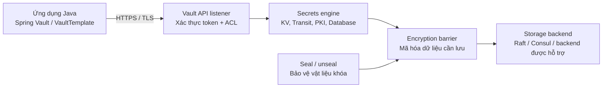
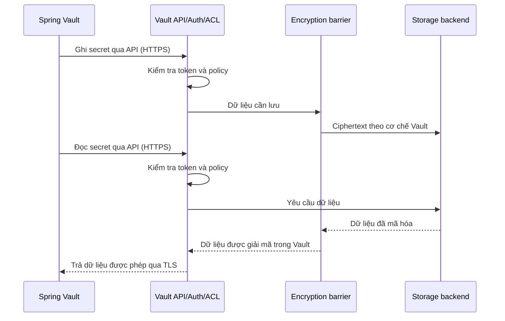

# Storage, mã hóa khi lưu và kết nối TLS trong HashiCorp Vault

Khi ứng dụng Java dùng **Spring Vault** truy cập một secret, có ít nhất hai yêu cầu bảo mật khác nhau: dữ liệu được **bảo vệ khi Vault lưu xuống storage** và đường truyền giữa ứng dụng với Vault phải **được bảo vệ bằng TLS**. Vault còn cần cơ chế **seal/unseal** để quản lý khả năng mở kho dữ liệu, và một storage backend đủ tin cậy để đảm bảo tính bền vững của thông tin. Các cơ chế này phối hợp với nhau nhưng không thay thế nhau.

Ví dụ, Vault lưu credential của ứng dụng vào KV v2 tại `apps/kv/`. Dữ liệu KV được Vault mã hóa trước khi ghi xuống backend; ứng dụng Spring Vault kết nối bằng `https://vault.example.internal:8200` và xác minh chứng chỉ của máy chủ; cuối cùng, Vault kiểm tra token và policy trước khi cho phép đọc. Nếu chứng chỉ TLS không hợp lệ, ứng dụng có thể thất bại **trước cả bước xác thực bằng token**. Nếu Vault sealed, kho dữ liệu vẫn có thể được lưu an toàn nhưng server chưa thể phục vụ đa số secrets API.

Bài học nằm trong chương **Nền tảng Vault**, làm tiền đề cho các phần sau về `VaultTemplate`, xác thực workload, KV secrets, vòng đời token và lease, Transit encryption, PKI, xử lý lỗi, quan sát hệ thống và kiểm thử tích hợp.

## 1. Mục tiêu học tập

Sau bài này, bạn có thể:

1. Phân biệt **physical storage backend**, **logical mount path** của secrets engine và **địa chỉ HTTP API**.
2. Giải thích lớp **encryption barrier** giúp bảo vệ dữ liệu khi lưu, và mối quan hệ với **seal/unseal**.
3. So sánh mức khái quát **Integrated Storage (Raft)** với storage backend bên ngoài như Consul, cùng những yêu cầu HA, backup và khôi phục.
4. Giải thích **TLS**, chuỗi chứng chỉ, CA, SAN, truststore và cách xác minh hostname khi Java kết nối Vault.
5. Cấu hình HTTPS và trust phù hợp cho Spring Vault, không tắt kiểm tra chứng chỉ để khắc phục lỗi kết nối.
6. Nhận diện lỗi storage, seal, mạng/TLS, token/policy và đường dẫn API qua triệu chứng thực tế.
7. Thiết kế một bài kiểm thử Vault lab xác nhận cả mã hóa khi lưu, TLS và phân quyền theo workload.

## 2. Ba lớp cần tách biệt: storage, encryption barrier và TLS



| Lớp | Nhiệm vụ | Không tự giải quyết được |
|---|---|---|
| **Storage backend** | Lưu dữ liệu bền vững và trạng thái Vault; tùy backend có thể hỗ trợ HA | Không tự quyết định token nào được đọc secret |
| **Encryption barrier** | Mã hóa dữ liệu Vault cần lưu trước khi ghi vào backend và giải mã khi được phép | Không bảo vệ đường truyền HTTP nếu không có TLS |
| **Seal/unseal** | Kiểm soát khả năng Vault sử dụng vật liệu khóa để mở barrier | Không thay thế policy hay mã hóa đường truyền |
| **TLS transport** | Bảo mật và xác thực kết nối giữa các thành phần có cấu hình TLS | Không tự mã hóa dữ liệu khi đã được ghi xuống ổ đĩa |
| **Authentication + ACL** | Xác minh workload/token và quyền trên API path | Không thay thế TLS, backup hay bảo vệ storage |

Chú ý thuật ngữ: **storage path** (ví dụ `/var/lib/vault/raft`) là thư mục trên máy chạy Vault; **secrets mount path** (ví dụ `apps/kv/`) là tiền tố API logic cho một secrets engine. Hai đường dẫn nằm ở **hai lớp khác nhau** và không thể thay thế cho nhau.

## 3. Storage backend lưu gì và được chọn như thế nào?

Vault cần một **storage backend** để lưu trạng thái và dữ liệu bền vững của hệ thống. Tùy secrets engine và cấu hình, dữ liệu có thể bao gồm cấu hình mount, policy, thông tin token/lease, KV secrets, metadata và các tài nguyên nội bộ khác. Không phải mọi secret động đều được lưu như một bản sao đầy đủ của hệ thống đích: ví dụ Database engine cấp credential qua kết nối tới database bên ngoài.

Một số cách triển khai thường gặp:

| Backend/kiểu triển khai | Đặc điểm | Cân nhắc vận hành |
|---|---|---|
| **Integrated Storage (Raft)** | Vault tự quản lý dữ liệu bằng Raft trên các node được cấu hình; có thể cung cấp HA theo topology phù hợp | Quorum, dung lượng ổ đĩa, backup snapshot, phục hồi, mở rộng và cập nhật node |
| **Consul storage** | Vault lưu dữ liệu vào một cụm Consul độc lập | Vận hành thêm Consul, bảo vệ kết nối và HA của cả hai hệ thống |
| **File storage** | Backend lưu trên filesystem, phù hợp các tình huống đơn giản hoặc lab theo giới hạn của backend | Không coi cấu hình một node/file là giải pháp HA production |
| **Backend khác được bản Vault hỗ trợ** | Tùy bản phát hành và phương án được tài liệu hỗ trợ | Kiểm tra hỗ trợ HA, tính nhất quán, tính bền vững, backup và migration |

**Integrated Storage (Raft)** là một lựa chọn phổ biến khi xây dựng Vault cluster vì không cần một cụm Consul riêng làm storage. Tuy nhiên, chọn Raft không tự biến một node thành HA: hệ thống phải có **topology, quorum, mạng và cơ chế khôi phục** phù hợp. Với cấu hình lab một node, lỗi ổ đĩa hoặc máy chủ vẫn có thể làm dịch vụ ngừng hoạt động.

Storage backend và secrets engine là hai khái niệm độc lập:

```text
Vault API:
  apps/kv/               -> KV v2 secrets engine
  crypto/                -> Transit secrets engine
  certs/                 -> PKI secrets engine

Vault physical storage:
  /var/lib/vault/raft/    -> dữ liệu lưu của backend Raft trên một node
```

Bạn có thể có nhiều KV mount trong cùng một Vault cluster dùng chung storage backend. Chính Vault phân biệt dữ liệu theo cấu trúc nội bộ; ứng dụng không được đọc/ghi trực tiếp thư mục storage thay cho API.

## 4. Ví dụ cấu hình Vault với Integrated Storage và TLS

Ví dụ HCL sau minh họa **một node Vault lab** dùng Integrated Storage trên Linux và TLS cho API listener:

```hcl
ui = true

api_addr     = "https://vault-1.example.internal:8200"
cluster_addr = "https://vault-1.example.internal:8201"

storage "raft" {
  path    = "/var/lib/vault/raft"
  node_id = "vault-1"
}

listener "tcp" {
  address         = "0.0.0.0:8200"
  cluster_address = "0.0.0.0:8201"

  tls_cert_file   = "/etc/vault/tls/server-chain.pem"
  tls_key_file    = "/etc/vault/tls/server-key.pem"
  tls_min_version = "tls12"
}
```

Ý nghĩa các thành phần:

- `storage "raft"` chọn **physical storage backend** và thư mục lưu dữ liệu. Đường dẫn phải có quyền filesystem phù hợp cho tiến trình Vault và được đặt trên volume đáp ứng yêu cầu bền vững.
- `node_id` định danh node Raft; triển khai nhiều node cần ID riêng và quy trình tham gia cluster phù hợp.
- `listener "tcp"` khai báo cổng API và cluster listener. File chứng chỉ và private key phục vụ TLS cho listener của Vault; private key phải được hạn chế quyền đọc.
- `api_addr` là địa chỉ Vault quảng bá cho client/redirect; `cluster_addr` phục vụ liên lạc cluster. Giá trị phải phù hợp DNS, routing, topology và cơ chế HA thực tế.
- `tls_min_version = "tls12"` đặt phiên bản TLS tối thiểu trong ví dụ; chính sách tổ chức có thể yêu cầu phiên bản/cipher chặt hơn theo khả năng của release và client.

Ví dụ **chưa phải cấu hình production hoàn chỉnh**: một cụm Raft nhiều node thường cần cấu hình join/discovery, đủ quorum, load balancer, seal provider, kiểm soát mạng, backup, audit và giám sát. Cần xác minh lựa chọn cấu hình với phiên bản Vault đang triển khai.

### Thư mục storage cần được bảo vệ

Tài khoản hệ điều hành chạy Vault nên có đúng quyền cần thiết trên thư mục storage và file TLS key. Tránh lưu private key trong repository, image container công khai hoặc thư mục mọi người có thể đọc. Bảo vệ volume bằng kiểm soát truy cập của hệ điều hành, mã hóa đĩa nếu cần, backup thích hợp và phân quyền vận hành.

Đường dẫn `/var/lib/vault/raft` trong ví dụ là **đường dẫn filesystem**, không phải path dùng cho `vault kv get` hoặc `VaultTemplate.read(...)`.

## 5. Encryption barrier bảo vệ dữ liệu khi lưu ra sao?

Vault có một lớp mã hóa nội bộ gọi là **encryption barrier**. Khi secrets engine hoặc thành phần lõi ghi dữ liệu cần bảo vệ, Vault mã hóa dữ liệu **trước khi gửi xuống storage backend**. Lúc đọc, Vault truy cập dữ liệu từ backend rồi giải mã bên trong server khi barrier đã mở và request được xử lý hợp lệ.



Lợi ích chính là giảm khả năng lộ plaintext từ bản sao storage, ổ đĩa hoặc hệ thống lưu trữ backend nếu những nguồn đó bị truy cập riêng lẻ. Tuy nhiên, đây **không phải một tuyên bố rằng mọi byte trong mọi log, backup, snapshot, metadata hay hệ thống ngoại vi đều được Vault mã hóa giống nhau**.

Đặc biệt:

1. **Vault không mã hóa lại những bản plaintext mà ứng dụng đã nhận** trong heap, log, crash dump hoặc hệ thống ghi cache của ứng dụng.
2. **Audit log** có cơ chế xử lý dữ liệu nhạy cảm riêng và có thể chứa metadata hữu ích cho người tấn công; cần bảo vệ quyền đọc, nơi lưu và thời hạn giữ log.
3. **Secrets động** được dùng ở hệ thống ngoài như Database; trạng thái hoặc dữ liệu của database đó phải được bảo vệ bằng cơ chế bảo mật riêng.
4. **Storage được mã hóa không làm máy chủ đang unsealed miễn nhiễm với mọi tấn công**. Một tiến trình Vault bị chiếm quyền hoặc một token có quá nhiều quyền vẫn có thể tạo rủi ro lớn.
5. **Backup/snapshot vẫn nhạy cảm** dù dữ liệu bên trong được mã hóa; phải kiểm soát truy cập, tính toàn vẹn, key material và quy trình khôi phục.

### Mã hóa của Vault có thay thế full-disk encryption không?

Không hoàn toàn. Encryption barrier bảo vệ dữ liệu Vault theo cơ chế của Vault, còn **full-disk encryption** bảo vệ ở lớp thiết bị/lưu trữ. Mã hóa đĩa có thể giúp giảm rủi ro mất thiết bị hoặc volume, nhưng không thay thế barrier; barrier không thay cho kiểm soát filesystem, bảo vệ khóa TLS, bản sao lưu hay hạ tầng host.

Một mô hình an toàn thường dùng **nhiều lớp**: barrier của Vault, mã hóa ổ đĩa khi phù hợp, TLS, kiểm soát quyền host/storage, chính sách cấp quyền Vault và quy trình backup/khôi phục được kiểm thử.

## 6. Seal/unseal liên quan thế nào đến mã hóa khi lưu?

Khi Vault ở trạng thái **sealed**, Vault chưa có khả năng sử dụng vật liệu khóa cần thiết để mở encryption barrier và phục vụ phần lớn secrets API. Sau khi **unseal**, Vault có thể giải mã dữ liệu cần thiết cho các request hợp lệ. Seal/unseal không phải thao tác bật hoặc tắt TLS, cũng không phải cách xóa dữ liệu.

Có hai mô hình vận hành tiêu biểu:

| Mô hình | Bước mở barrier | Điểm cần bảo vệ |
|---|---|---|
| **Shamir seal (manual unseal)** | Đạt ngưỡng các unseal key shares hợp lệ | Phân phối/lưu ký shares, quorum, initial root token, quy trình khôi phục |
| **Auto-unseal qua KMS/HSM** | Vault nhờ seal provider hỗ trợ mở barrier theo cấu hình | Quyền truy cập KMS/HSM, khóa seal provider, mạng và phương án phục hồi |

Trong auto-unseal, **recovery keys không mặc nhiên thay thế KMS/HSM để unseal thông thường**. Vì thế bảo vệ storage backend thôi chưa đủ: nếu mất quyền dùng seal provider hoặc không thể khôi phục vật liệu khóa cần thiết, dữ liệu mã hóa có thể trở nên không truy cập được dù ổ đĩa vẫn còn nguyên.

```text
Storage bền vững + dữ liệu đã mã hóa
                   |
                   +--> Seal provider / quorum hợp lệ?
                              |
                             Có --> Vault unsealed --> xử lý auth/ACL/API
                             Không --> Vault sealed --> chưa đọc secret được
```

**Initialize** chỉ dành cho storage Vault mới chưa initialized. Restart một node đã initialized nhưng sealed không phải lý do để chạy lại `vault operator init`; cần sử dụng quy trình unseal và recovery đúng với triển khai.

## 7. Integrated Storage, HA, snapshot và khôi phục

Raft duy trì dữ liệu theo cơ chế đồng thuận trong một cụm Vault được cấu hình đúng. Khi một node gặp sự cố, khả năng phục vụ còn phụ thuộc số node còn hoạt động, quorum, leadership, mạng và các giới hạn của deployment. Không suy từ việc có ba node rằng hệ thống chắc chắn chịu được mọi tình huống mất kết nối hoặc mất ổ đĩa.

### Snapshot của Raft

Vault hỗ trợ thao tác snapshot cho Integrated Storage. Trong **lab hoặc môi trường có quyền backup được phê duyệt**, có thể lưu snapshot bằng lệnh tương ứng:

```bash
# Chỉ thực hiện trên Integrated Storage (Raft) với quyền phù hợp.
# Đường dẫn đầu ra phải là vị trí backup được bảo vệ.
vault operator raft snapshot save /secure-backups/vault-lab.snap
```

Snapshot giúp hỗ trợ quy trình sao lưu/khôi phục dữ liệu Raft, nhưng:

- Cần bảo vệ file snapshot như **tài sản bảo mật nhạy cảm**, kể cả khi dữ liệu Vault được mã hóa.
- Cần quản lý khả năng sử dụng **seal provider/unseal hoặc recovery material phù hợp**, tùy phương án phục hồi.
- Cần kiểm thử phục hồi theo runbook của phiên bản Vault, không chỉ kiểm tra file đã xuất hiện.
- Khôi phục snapshot có thể làm thay đổi hoặc thay thế trạng thái dữ liệu Vault và phải được xem là thao tác có rủi ro cao; không thực hành restore trên cluster dùng chung.
- Snapshot Raft **không đồng nghĩa** với bản sao lưu độc lập cho mọi database hay cloud service mà secrets engine kết nối tới.

Với Consul hay backend khác, dùng quy trình backup được tài liệu backend và Vault hỗ trợ. Sao chép trực tiếp thư mục đang chạy hoặc một vài file Raft tùy tiện không được mặc định là backup có thể phục hồi.

### Khả năng sẵn sàng và khả năng khôi phục là hai vấn đề khác nhau

**HA** giúp duy trì dịch vụ trước một số sự cố node; **backup/restore** giúp xử lý mất hoặc hỏng dữ liệu; **DR** bao gồm cả kịch bản mất vùng, mất kết nối tới seal provider và quy trình khôi phục có kiểm chứng. Một cụm Raft đạt quorum vẫn có thể cần backup. Một backup hợp lệ không tự giúp ứng dụng tiếp tục phục vụ khi TLS hoặc toàn bộ endpoint không thể truy cập.

## 8. TLS bảo vệ kết nối Spring Vault như thế nào?

**TLS (Transport Layer Security)** bảo vệ dữ liệu trên đường truyền và giúp client xác thực máy chủ đang kết nối. Khi một ứng dụng Java gọi Vault qua HTTPS, client thực hiện TLS handshake và kiểm tra chứng chỉ máy chủ **trước khi gửi phần lớn dữ liệu HTTP ứng dụng**.

```mermaid
sequenceDiagram
    participant Java as Java / Spring Vault
    participant Vault as Vault HTTPS listener
    Java->>Vault: Kết nối TLS tới vault.example.internal:8200
    Vault-->>Java: Chứng chỉ máy chủ và chuỗi chứng chỉ
    Java->>Java: Xác minh CA/trust chain, SAN, hạn và quy tắc TLS
    alt Xác minh TLS thành công
        Java->>Vault: HTTP request kèm Vault token qua TLS
        Vault-->>Java: HTTP response qua TLS
    else Xác minh TLS thất bại
        Java--xVault: Ngừng handshake; chưa gọi secrets API
    end
```

Những điều cần xác nhận ở chứng chỉ:

1. **CA và chain:** chứng chỉ máy chủ nối đến CA mà client tin cậy; server gửi chain phù hợp khi cần.
2. **Hostname/SAN:** tên DNS hoặc IP trên URL phải khớp Subject Alternative Name của chứng chỉ. Chứng chỉ cho `vault-1.internal` không tự hợp lệ khi client gọi `vault.company.example`.
3. **Thời hạn:** chứng chỉ và các mắt xích liên quan phải còn hiệu lực theo kiểm tra của client.
4. **Thuật toán/giao thức:** client và server phải có phiên bản TLS, cipher và tham số bảo mật tương thích.
5. **Khóa riêng:** private key của server phải được bảo vệ; certificate chain công khai **không** thay thế private key.

**TLS và Vault token có vai trò riêng:** TLS xác minh endpoint và bảo mật kênh; Vault token xác thực phiên truy cập với API; ACL policy quyết định request có được đọc secret không. TLS handshake thành công **không** có nghĩa token hợp lệ hoặc secret có quyền đọc.

### CA công khai, CA nội bộ và truststore của Java

Nếu chứng chỉ Vault do CA đã có trong **JVM truststore** phát hành, Java thường xác minh được mà không cần cấu hình CA riêng. Nếu công ty dùng **private CA**, runtime Java cần được cung cấp trust anchor tương ứng qua truststore hoặc HTTP client được cấu hình trust phù hợp.

**Không sửa truststore để bỏ qua hostname verification**. Việc import CA đúng giúp client tin cậy chuỗi phát hành, nhưng hostname trên URL vẫn phải khớp SAN của certificate.

## 9. TLS ở load balancer và liên lạc giữa các node

Trong một kiến trúc HA, đường kết nối có thể gồm nhiều đoạn:

```text
Java / Spring Vault
    |
    | HTTPS, xác minh cert của địa chỉ client gọi
    v
Load balancer / reverse proxy (nếu có)
    |
    | TLS tới Vault listener nếu proxy terminate TLS ở phía trước
    v
Vault API listener (thường cổng 8200)
    |
    +--> Vault cluster communication (thường cổng 8201, cơ chế TLS nội bộ)
    +--> Storage backend ngoài (nếu có)
    +--> Database / KMS / cloud API theo cấu hình riêng
```

Nếu load balancer **terminate TLS**, kênh từ proxy tới Vault là **một kết nối khác** và cũng cần được bảo vệ, xác thực thích hợp. Chỉ nhìn URL HTTPS giữa Java và load balancer chưa chứng minh đoạn proxy → Vault đã được mã hóa. Trong những môi trường nhạy cảm, nên dùng TLS end-to-end hoặc re-encryption có kiểm soát.

**Port 8200 và 8201 không phải cùng một kênh:** Vault API listener và cluster listener phục vụ mục đích khác nhau. Liên lạc node-to-node có cơ chế xác thực/mã hóa nội bộ tùy release và cấu hình; không dùng chứng chỉ HTTPS API listener như bằng chứng duy nhất cho toàn bộ kết nối cluster.

Tương tự, bật TLS cho Vault API không mặc nhiên bật TLS cho Vault kết nối tới **Consul, Database, HSM, KMS hoặc dịch vụ ngoài**. Mỗi kết nối có cấu hình trust, authentication, network policy và yêu cầu riêng.

## 10. Cấu hình CLI truy cập Vault qua HTTPS

Ví dụ cho shell Bash trên máy có Vault CLI:

```bash
export VAULT_ADDR="https://vault.example.internal:8200"
export VAULT_CACERT="/etc/company/certs/company-root-ca.pem"

# Kiểm tra endpoint Vault, trạng thái sealed và HA.
vault status

# Kiểm tra HTTP health; status standby có thể không phải 200.
curl --silent --show-error --include \
  --cacert "$VAULT_CACERT" \
  "$VAULT_ADDR/v1/sys/health"
```

Trên Windows PowerShell, giá trị tương đương có thể được khai báo:

```powershell
$env:VAULT_ADDR = "https://vault.example.internal:8200"
$env:VAULT_CACERT = "C:\certs\company-root-ca.pem"
vault status
```

`VAULT_CACERT` được Vault CLI sử dụng để xác minh server certificate. Đó là file **CA certificate để tin cậy**, không phải private key của Vault và cũng không phải Vault token.

Với môi trường chỉ dùng CA mặc định mà CLI đã tin cậy, có thể không cần `VAULT_CACERT`. Nhưng khi dùng private CA, cần cấu hình certificate chain đúng thay vì đặt `VAULT_SKIP_VERIFY` hoặc dùng `curl -k` để vượt kiểm tra. Thao tác tắt TLS verification có thể khiến client dễ bị mạo danh server hoặc bị tấn công xen giữa.

### Health endpoint không đủ để kết luận đã truy cập được secrets

`GET /v1/sys/health` có thể trả `200` khi node active/unsealed, `429` khi standby, `501` khi uninitialized hoặc `503` khi sealed theo các mặc định thường gặp; có thêm mã theo chế độ HA/sản phẩm. Đây là thông tin **sức khỏe Vault server**, không chứng minh rằng token workload có capability `read` trên một KV secret cụ thể.

Một kiểm thử end-to-end phải đi qua HTTPS, workload authentication và API secrets engine với quyền phù hợp.

## 11. Spring Vault: endpoint HTTPS, JVM trust và VaultTemplate

Spring Vault cung cấp `VaultTemplate` để gọi API Vault. Client này phải biết:

- **Vault endpoint**: URL cơ sở, ví dụ `https://vault.example.internal:8200`, **không thêm `/v1/`** vào base URL.
- **Cơ chế xác thực**: Kubernetes/AppRole/JWT hoặc phương thức workload phù hợp để nhận Vault token; lab có thể dùng một token thử nghiệm được cấp trước.
- **TLS trust**: JVM hoặc HTTP client phải tin CA phù hợp và xác minh hostname.
- **Mount và secret path**: ví dụ KV v2 tại `apps/kv`, key `catalog/config`; không trộn storage filesystem path vào API.

### 11.1. Cấu hình Java mẫu cho lab

Ví dụ sử dụng token có sẵn **chỉ để minh họa cách khai báo HTTPS endpoint**. Trong production, nên dùng auth theo workload, chính sách tối thiểu và cơ chế quản lý phiên/token phù hợp.

```java
import java.net.URI;

import org.springframework.context.annotation.Configuration;
import org.springframework.vault.authentication.ClientAuthentication;
import org.springframework.vault.authentication.TokenAuthentication;
import org.springframework.vault.client.VaultEndpoint;
import org.springframework.vault.config.AbstractVaultConfiguration;

@Configuration
public class LabVaultClientConfig extends AbstractVaultConfiguration {

    @Override
    public VaultEndpoint vaultEndpoint() {
        return VaultEndpoint.from(
                URI.create("https://vault.example.internal:8200"));
    }

    @Override
    public ClientAuthentication clientAuthentication() {
        String token = System.getenv("VAULT_TOKEN");
        if (token == null || token.isBlank()) {
            throw new IllegalStateException("Thiếu VAULT_TOKEN trong lab");
        }
        return new TokenAuthentication(token);
    }
}
```

Ở ví dụ này, `VaultEndpoint` dùng HTTPS, còn `TokenAuthentication` chỉ cung cấp credential cho session. **Không đưa root token hoặc token production vào source code hoặc file cấu hình đã commit.** Ví dụ có thể cần điều chỉnh theo phiên bản Spring Vault mà dự án sử dụng.

### 11.2. Đọc KV v2 bằng VaultTemplate

Sau khi `VaultTemplate` đã được cấu hình đúng endpoint/TLS/auth:

```java
import org.springframework.stereotype.Service;
import org.springframework.vault.core.VaultKeyValueOperations;
import org.springframework.vault.core.VaultKeyValueOperationsSupport.KeyValueBackend;
import org.springframework.vault.core.VaultTemplate;
import org.springframework.vault.support.VaultResponse;

@Service
public class CatalogSecretReader {

    private final VaultKeyValueOperations kv;

    public CatalogSecretReader(VaultTemplate vaultTemplate) {
        this.kv = vaultTemplate.opsForKeyValue("apps/kv", KeyValueBackend.KV_2);
    }

    public String readUsername() {
        VaultResponse response = kv.get("catalog/config");
        if (response == null || response.getData() == null) {
            throw new IllegalStateException("Không tìm thấy Vault secret");
        }
        Object value = response.getData().get("username");
        if (!(value instanceof String)) {
            throw new IllegalStateException("Secret thiếu username hợp lệ");
        }
        return (String) value;
    }
}
```

Spring Vault xử lý endpoint KV v2 cần `data/`, nên `kv.get(...)` chỉ nhận **đường dẫn tương đối** của secret. `VaultTemplate` không đọc trực tiếp file `/var/lib/vault/raft`; nó luôn gọi **Vault API**. Token workload cần policy tương ứng với `apps/kv/data/catalog/config`.

### 11.3. CA nội bộ và JVM truststore

Nếu private CA chưa có trong hệ thống trust của Java, có thể tạo truststore riêng để triển khai cùng ứng dụng:

```bash
# Chạy ở môi trường chuẩn bị certificate/truststore, có quyền phù hợp.
# Lệnh sẽ yêu cầu xác nhận và đặt password cho truststore.
keytool -importcert \
  -alias company-vault-ca \
  -file company-root-ca.pem \
  -keystore vault-truststore.p12 \
  -storetype PKCS12
```

Sau đó cấu hình JVM sử dụng truststore theo cơ chế triển khai phù hợp, ví dụ:

```text
-Djavax.net.ssl.trustStore=/etc/company/vault-truststore.p12
-Djavax.net.ssl.trustStoreType=PKCS12
```

Với truststore có mật khẩu, quản lý cấu hình mật khẩu bằng cơ chế bảo vệ của runtime/deployment; tránh đưa mật khẩu vào mã nguồn, command history hoặc log. Một số HTTP client có thể cần được cấu hình SSL riêng, nên cần xác minh Spring Vault thực sự sử dụng trust configuration mong muốn. **Thay đổi truststore mặc định có thể ảnh hưởng đến các HTTPS client khác trong cùng JVM**; nếu ứng dụng kết nối nhiều CA hoặc yêu cầu ranh giới trust khác nhau, cân nhắc SSL context riêng cho client Vault.

Không import bừa chứng chỉ server tự ký vào truststore toàn cục nếu không có chính sách quản trị phù hợp; nên sử dụng CA/chuỗi chứng chỉ hợp lệ, quy trình cấp và xoay vòng có kiểm soát.

## 12. Phân biệt lỗi TLS với lỗi Vault API

| Triệu chứng | Lớp lỗi có thể gặp | Cách xử lý hợp lý |
|---|---|---|
| Java báo `PKIX path building failed` hoặc `unable to find valid certification path` | JVM không tin CA/chain của server | Kiểm tra CA, chain, JVM truststore hoặc SSL context của HTTP client |
| Báo `No subject alternative DNS name matching ...` | Hostname URL không khớp SAN | Dùng DNS đúng hoặc cấp lại chứng chỉ có SAN phù hợp |
| `certificate has expired` | Chứng chỉ hết hạn hoặc đồng hồ hệ thống sai | Kiểm tra lịch xoay vòng cert, chain và đồng hồ |
| TLS handshake failure | Protocol/cipher không tương thích hoặc vấn đề mTLS | Kiểm tra TLS versions, cipher và yêu cầu client certificate |
| `connection refused`, timeout | Server, mạng, listener, DNS hoặc load balancer | Kiểm tra port 8200, routing, firewall và sức khỏe node |
| Vault health trả `503` sealed | Vault chưa mở security barrier | Kiểm tra seal/unseal và KMS/HSM; không đổi CA hay policy để chữa |
| Login/KV trả `403` sau khi TLS thành công | Token, auth role, policy hoặc quyền trên path | Kiểm tra auth và `vault token capabilities` với token workload |
| KV v2 trả `404` | Mount/key sai, đường dẫn API KV v1/v2 nhầm hoặc secret chưa có | Kiểm tra `vault secrets list -detailed` và `data/` |
| Có HTTPS trước load balancer nhưng backend không an toàn | TLS chỉ bảo vệ một chặng | Kiểm tra TLS/re-encryption từ proxy tới Vault và TLS cho storage/backend ngoài |

**Thứ tự chẩn đoán nên đi từ ngoài vào trong:**

1. DNS/route và cổng của Vault server có truy cập được không?
2. TLS handshake có xác minh đúng CA, SAN, thời hạn và giao thức không?
3. Vault initialized, unsealed và có node HA phục vụ được request chưa?
4. Workload đã đăng nhập và token còn hiệu lực chưa?
5. Token có capability trên **API path thực** của engine chưa?
6. Secret, engine, namespace và dữ liệu backend có tồn tại đúng chỗ không?

Một lỗi TLS xảy ra trước khi server xử lý HTTP request thường không có mã `403` hoặc `404` từ secrets engine. Ngược lại, khi đã nhận HTTP status từ Vault, TLS có thể đã được thiết lập thành công nhưng các lớp logic tiếp theo vẫn có thể gặp lỗi.

## 13. Giám sát và kiểm thử tích hợp

Một hệ thống sử dụng Spring Vault nên quan sát các tín hiệu **độc lập**:

- **Storage**: độ trễ I/O, dung lượng, tình trạng Raft/quorum hoặc backend ngoài, backup và thử nghiệm phục hồi.
- **Seal/HA**: initialized/sealed/unsealed, trạng thái active/standby, thời gian unseal hoặc lỗi KMS/HSM.
- **TLS**: thời hạn chứng chỉ, lỗi handshake, chain/SAN, thay đổi CA và các lần xoay khóa TLS.
- **Auth/ACL**: tỉ lệ login thất bại, token hết hạn/revoke, `403` theo API path và role.
- **Secrets lifecycle**: tỷ lệ lỗi đọc KV, cấp credential động, renew/revoke lease, Transit/PKI và thao tác phụ thuộc backend.

Đừng thu thập plaintext secrets, Vault token, client private key, unseal shares hoặc toàn bộ `VaultResponse` để quan sát. Audit và ứng dụng nên ghi dữ liệu cần thiết theo chính sách redaction, hạn chế quyền xem và có thời hạn lưu.

### Một ma trận kiểm thử nhỏ

| Kịch bản | Điều kiện | Kết quả mong đợi |
|---|---|---|
| HTTPS hợp lệ | DNS/CA/chain đúng, Vault unsealed | TLS handshake thành công; có thể gọi health API |
| CA không được tin | Client truststore thiếu CA phù hợp | Handshake thất bại; không cố bỏ qua kiểm tra |
| SAN không khớp URL | Client gọi hostname không có trong cert SAN | Handshake/xác minh hostname thất bại |
| Vault sealed | Kết nối TLS vẫn hoạt động, barrier đóng | Health có thể báo sealed; secrets API không phục vụ bình thường |
| Token thiếu quyền | Vault/TLS hoạt động, policy không cấp `read` | Đọc KV bị từ chối; TLS vẫn đúng |
| Đúng KV v2 path | Token có quyền `read` đúng `apps/kv/data/catalog/config` | Spring Vault `get("catalog/config")` đọc dữ liệu mẫu |
| Raft node không đạt quorum | Mô phỏng có kiểm soát trong HA lab | Quan sát trạng thái phục vụ theo topology; không suy từ một node |
| Chứng chỉ được xoay hợp lệ | Client tin chain mới và SAN đúng | Tái kết nối thành công, không cần tắt TLS verification |

Kiểm thử bằng một Vault lab độc lập hoặc hạ tầng kiểm thử phù hợp. Các bài kiểm thử không nên tự động seal Vault hay dừng Raft node trong môi trường chia sẻ.

## 14. Bài thực hành trong Vault lab

**Điều kiện:** bạn có một Vault lab dùng TLS, có quyền kiểm tra trạng thái, một KV v2 mount `lab/kv/` (hoặc quyền tạo mount đó) và một token chỉ có quyền cần thiết cho secret mẫu. Có thể dùng test certificate từ CA của phòng lab; đừng dùng self-signed cert không được tin cậy rồi tắt TLS verification.

### Phần A — Xác minh kết nối HTTPS

1. Xác định `VAULT_ADDR` theo hostname xuất hiện trong SAN của Vault server certificate.
2. Với private CA, cấu hình `VAULT_CACERT` hoặc `--cacert` cho CLI/`curl`.
3. Chạy `vault status` và `curl --cacert ... "$VAULT_ADDR/v1/sys/health"`.
4. Ghi nhận hostname, issuer, thời hạn chứng chỉ và mã health; **không chụp thông tin token/private key**.
5. Trong lab, thử gọi bằng hostname không có trong SAN hoặc dùng truststore không có CA phù hợp; mô tả lỗi TLS. Khôi phục cấu hình đúng.

### Phần B — Phân biệt storage path với secrets path

1. Kiểm tra người vận hành đã cấu hình Raft tại đường dẫn filesystem nào (nếu dùng Raft); không đọc/ghi trực tiếp file storage.
2. Dùng CLI kiểm tra secrets engine:

```bash
vault secrets list -detailed

# Chỉ bật mount nếu lab/kv chưa tồn tại và được phép tạo.
vault secrets enable -path=lab/kv -version=2 kv

# Dữ liệu giả để thử API.
vault kv put -mount=lab/kv demo/service username=lab-user
vault kv get -mount=lab/kv demo/service
```

3. Chỉ ra mount path `lab/kv`, relative path `demo/service`, API path `lab/kv/data/demo/service`, và storage path là **bốn khái niệm khác nhau**.
4. Viết policy read-only cho endpoint `lab/kv/data/demo/service`; kiểm tra bằng token lab quyền tối thiểu.

### Phần C — Java và Spring Vault

1. Cấu hình `VaultEndpoint` tới `https://...` của lab, với JVM truststore hoặc SSL context phù hợp.
2. Dùng `ClientAuthentication` theo auth method của lab, sau đó gọi `VaultTemplate.opsForKeyValue("lab/kv", KeyValueBackend.KV_2).get("demo/service")`.
3. Xác nhận token có `read` đúng API path thì đọc thành công; token không có quyền thì bị từ chối mặc dù TLS handshake hợp lệ.
4. Thử loại bỏ trust anchor trong **client lab riêng**, xác nhận kết nối thất bại trước khi đọc secret; sau đó khôi phục trust.
5. Xác nhận log ứng dụng không chứa token, CA private key, plaintext secret hoặc nội dung phản hồi đầy đủ.

### Phần D — Backup và rủi ro khôi phục

Nếu lab dùng Integrated Storage, mô tả quy trình lưu một Raft snapshot vào vị trí an toàn và cách kiểm soát quyền, tính toàn vẹn, phương án khôi phục khóa/seal provider. **Không restore vào cluster đang chạy dùng chung**. Nếu lab dùng Consul, xác định vì sao phải có quy trình backup của backend tương ứng và kiểm thử khôi phục riêng.

### Câu hỏi tự kiểm tra

1. **TLS có thay Vault encryption barrier không?** Không. TLS bảo vệ đường truyền, barrier bảo vệ dữ liệu Vault khi lưu vào backend.
2. **Đường dẫn `/var/lib/vault/raft` có dùng trong `VaultTemplate.read(...)` không?** Không. Đó là storage path trên host Vault.
3. **Vault sealed nhưng storage vẫn còn dữ liệu nghĩa là API đọc secret hoạt động?** Không. Barrier chưa được mở.
4. **Import đúng CA nhưng URL không khớp SAN có được kết nối HTTPS hợp lệ không?** Không. Hostname verification vẫn phải đạt.
5. **Dùng `VAULT_SKIP_VERIFY` để sửa lỗi certificate có an toàn không?** Không. Cần khắc phục CA, chain, SAN hoặc cấu hình client.
6. **Raft snapshot có thể để ở kho lưu trữ công khai vì dữ liệu đã được mã hóa?** Không. Snapshot vẫn phải được bảo vệ và quản lý cùng phương án khôi phục.
7. **Token nhận `403` sau TLS handshake thành công là lỗi storage encryption?** Không thể suy như vậy; hãy kiểm tra auth/policy/path.

## 15. Ghi nhớ

**Storage backend** lưu dữ liệu Vault; **encryption barrier** mã hóa dữ liệu cần lưu trước khi ghi vào backend; **seal/unseal** kiểm soát khả năng mở barrier; **TLS** bảo vệ và xác thực đường truyền giữa client với Vault. Auth method và ACL policy tiếp tục quyết định workload nào được sử dụng secrets engine. Những lớp này hỗ trợ nhau để bảo vệ bí mật cả khi lưu lẫn khi truyền.

Trong Spring Vault, sử dụng **VaultEndpoint HTTPS**, xác minh **CA/chain/SAN** bằng trust configuration phù hợp, giữ token an toàn và cấp quyền theo **API path thực**. Với KV v2, `VaultTemplate.opsForKeyValue("lab/kv", KeyValueBackend.KV_2).get("demo/service")` truy cập qua Vault API, không truy cập trực tiếp ổ đĩa Raft. Thiết kế backup, HA, TLS rotation, quan sát và kiểm thử lỗi có kiểm soát là điều kiện để hệ thống hoạt động ổn định và an toàn.
