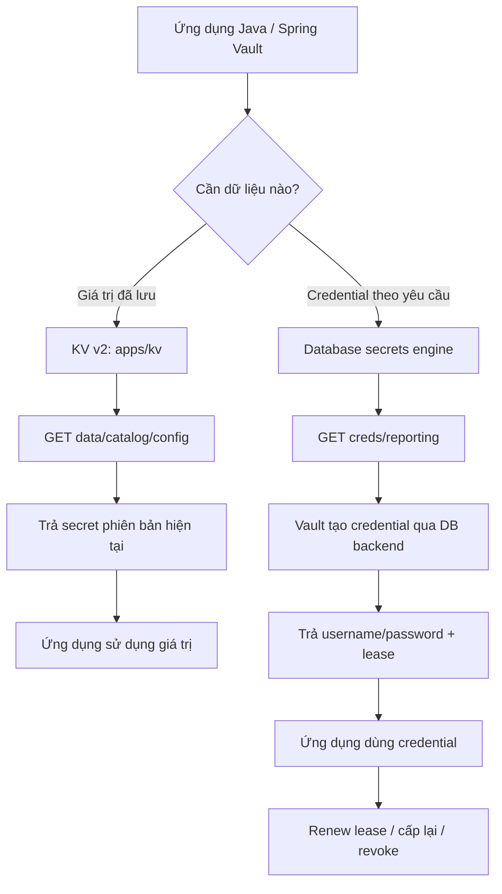
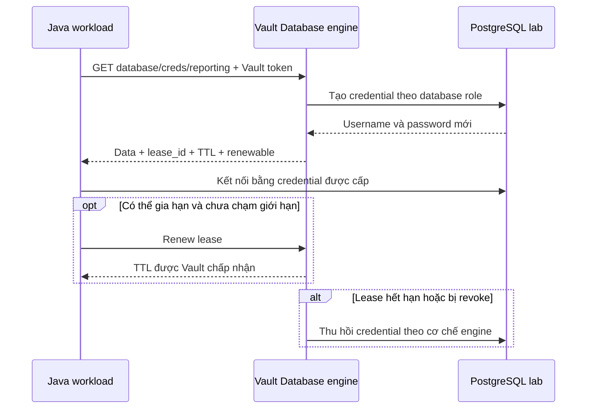
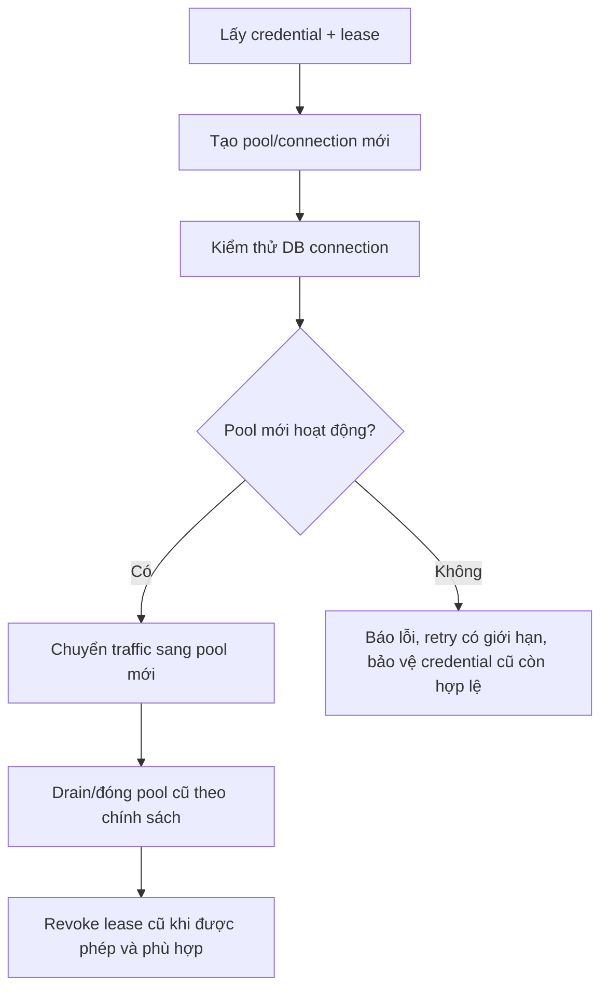

# Secret được lưu sẵn và thông tin xác thực được cấp theo yêu cầu trong HashiCorp Vault

Ứng dụng Java thường cần cả **giá trị bí mật đã được lưu trước** (ví dụ API key của một hệ thống đối tác) lẫn **thông tin xác thực được tạo khi có yêu cầu** (ví dụ tài khoản PostgreSQL có thời hạn riêng cho một lần chạy báo cáo). HashiCorp Vault hỗ trợ hai mô hình này, nhưng cách phát hành, thay đổi và thu hồi chúng **khác nhau về bản chất**.

Trong **Spring Vault**, cùng một `VaultTemplate` có thể gọi KV v2 để lấy secret lưu sẵn hoặc gọi Database secrets engine để yêu cầu credential động. Tuy nhiên, đọc một key từ KV **không tự sinh mật khẩu mới**; ngược lại, đọc endpoint cấp credential động **có thể tạo tài khoản mới ở hệ thống đích và tạo một lease mới**. Nắm được sự khác biệt giúp ứng dụng chọn đúng API, thiết kế quyền tối thiểu và xử lý an toàn khi token hoặc credential hết hạn.

Bài thuộc chương **Nền tảng Vault**, là cơ sở cho phần thực hành KV secrets, workload authentication, token và secret lease, Transit encryption, PKI, xử lý lỗi, giám sát và kiểm thử tích hợp với Spring Vault.

## 1. Mục tiêu học tập

Sau bài học, bạn có thể:

1. Phân biệt **stored/static secret**, **dynamic credential cấp theo yêu cầu**, **static role được xoay vòng** và **Vault token**.
2. Giải thích luồng tạo, đọc, thay đổi và thu hồi của mỗi loại secret.
3. Chỉ ra endpoint và quyền ACL thường dùng cho KV v2, Database dynamic credentials, Database static roles và PKI issue.
4. Đọc đúng các trường `data`, `lease_id`, `lease_duration` và `renewable` của phản hồi Vault.
5. Dùng `VaultTemplate` để đọc KV và yêu cầu credential động mà không nhầm cách quản lý vòng đời.
6. Lựa chọn chiến lược rotation, cache, lease renewal, xử lý kết nối và kiểm thử tích hợp phù hợp.

## 2. Hai mô hình bí mật: lấy thứ đã lưu hay cấp thứ mới?

### Secret được lưu sẵn (stored/static secret)

Một **stored secret** là giá trị đã được ghi vào Vault (thường qua KV secrets engine) và được đọc lại khi cần. Ví dụ:

- Khóa API do một đối tác phát hành và nhóm vận hành nạp vào KV.
- Một chuỗi cấu hình nhạy cảm mà ứng dụng cần sử dụng.
- Thông tin xác thực của tài khoản tồn tại sẵn do một hệ thống ngoài quản lý.

Khi ứng dụng đọc lại một phiên bản hiện hành của key, Vault **trả dữ liệu đã lưu**, không mặc nhiên sinh username/password mới. Với KV v2, dữ liệu có thể có **các phiên bản**; thao tác cập nhật tạo phiên bản mới, nhưng số phiên bản không phải TTL của credential.

### Credential được cấp theo yêu cầu (dynamic/on-demand credential)

Một **dynamic credential** thường được tạo bởi secrets engine khi một workload có quyền gọi endpoint phát hành. Ví dụ:

- Database secrets engine tạo username/password với role và thời hạn riêng.
- AWS secrets engine cấp credential hoặc credential tạm thời theo cơ chế được cấu hình.
- PKI secrets engine phát hành chứng chỉ mới theo role và thông tin yêu cầu.

Trong nhiều loại dynamic secrets, Vault phát hành **lease ID** và **lease TTL** để quản lý credential đã cấp. Khi lease hết hạn hoặc bị thu hồi, Vault có thể thực hiện hành động thu hồi trên hệ thống đích. Tuy nhiên, **không phải mọi API phát hành theo yêu cầu đều có lease hoặc cùng cơ chế renew/revoke**; phải đọc hợp đồng của engine và endpoint cụ thể.

### So sánh nhanh

| Tiêu chí | Secret lưu sẵn trong KV | Dynamic credential |
|---|---|---|
| Dữ liệu tồn tại từ khi nào? | Đã được người hoặc quy trình ghi trước | Thường được tạo trong lúc có yêu cầu |
| Một lần `read` thường làm gì? | Trả phiên bản dữ liệu hiện hành/được chỉ định | Có thể tạo một credential mới tại backend |
| Hai lần đọc liên tiếp | Thường cùng giá trị nếu key chưa thay đổi | Có thể là hai credential và hai lease khác nhau |
| Đường dẫn ví dụ | `apps/kv/data/catalog/config` (KV v2) | `database/creds/reporting` |
| Version dữ liệu | KV v2 hỗ trợ version | Không dùng KV version làm danh tính credential |
| TTL/lease | KV tĩnh thường không có secret lease | Thường có lease, tùy engine |
| Rotation | Ghi giá trị mới/đồng bộ bên ngoài | Engine tạo credential mới; lease cũ được quản lý riêng |
| Revoke | Xóa/giới hạn truy cập KV không tự hủy credential bên ngoài | Có thể thu hồi credential theo cơ chế engine |
| Phụ thuộc backend ngoài khi đọc | KV đọc từ dữ liệu Vault đã lưu | Có thể phải kết nối DB/cloud/CA ngay lúc cấp |

**Không phải mọi “secret được lưu trong Vault” đều là KV, và không phải mọi “credential có thời hạn” đều là dynamic secret có lease.** Cần phân loại dựa trên **semantics của endpoint phát hành** và vòng đời thực tế.

## 3. Sơ đồ vòng đời: KV khác cấp credential động ở đâu?



Hai luồng đều yêu cầu **Vault token hợp lệ và policy đủ quyền**, nhưng chỉ luồng dynamic cần cơ chế quản lý credential được tạo mới bên ngoài khi cấp phát. Chỉ cấu hình `VaultTemplate` để gọi `read` **không có nghĩa Spring Vault tự quản lý tất cả những vòng đời đó**.

## 4. Stored secret với KV v2

Giả sử Vault có **KV v2** tại mount `apps/kv/` và ứng dụng Catalog cần một API key mẫu ở relative path `catalog/config`.

### 4.1. Ghi và đọc bằng Vault CLI

Trong **Vault lab có quyền**, dùng giá trị giả:

```bash
# Mount apps/kv đã được bật dưới dạng KV v2.
vault kv put -mount=apps/kv catalog/config partnerApiKey=DEMO_NOT_A_REAL_KEY

# Lấy dữ liệu hiện hành.
vault kv get -mount=apps/kv catalog/config

# Xem metadata và các phiên bản của key.
vault kv metadata get -mount=apps/kv catalog/config
```

`apps/kv` là **secrets engine mount path**; `catalog/config` là **secret relative path**. CLI hiểu backend KV v2 và ánh xạ chúng sang endpoint HTTP chứa `data/`.

### 4.2. HTTP API đọc dữ liệu

```http
GET /v1/apps/kv/data/catalog/config
X-Vault-Token: <VAULT_TOKEN>
```

Phản hồi minh họa đã lược bớt:

```json
{
  "lease_id": "",
  "lease_duration": 0,
  "renewable": false,
  "data": {
    "data": {
      "partnerApiKey": "DEMO_NOT_A_REAL_KEY"
    },
    "metadata": {
      "version": 1
    }
  }
}
```

Ở đây:

- `data.data` chứa các cặp key/value mà ứng dụng muốn dùng.
- `data.metadata.version` là **số phiên bản của key KV v2**, không phải token TTL hoặc secret lease TTL.
- Phần `lease_id` trống và `lease_duration=0` ở response KV thông thường không có nghĩa API key đã hết hạn. Nó phản ánh việc **KV không phát hành leased credential theo mô hình này**.
- Một API key do đối tác cấp có thể **tự hết hạn ở phía đối tác**; KV không tự biết hoặc tự gia hạn hạn đó chỉ vì nó đang được lưu trong Vault.

Để xem phiên bản khác của cùng key, API KV v2 có thể dùng query parameter `version` khi quyền và trạng thái phiên bản cho phép:

```http
GET /v1/apps/kv/data/catalog/config?version=1
```

Đoạn `/v1/` là **tiền tố phiên bản HTTP API của Vault**, còn `version=1` là **phiên bản của KV key**. Hai số này không liên quan.

### 4.3. Cập nhật không đồng nghĩa thu hồi bên ngoài

```bash
vault kv put -mount=apps/kv catalog/config partnerApiKey=DEMO_ROTATED_KEY
```

Với KV v2, thao tác ghi tạo một **phiên bản secret mới**. Nhưng nếu đây là API key đang hoạt động ở hệ thống đối tác, việc cập nhật KV **không tự tắt khóa cũ** bên đối tác. Quy trình rotation phải phối hợp theo thứ tự được phê duyệt: tạo khóa mới, cập nhật nơi lưu, cho ứng dụng tiếp nhận, xác minh hoạt động, thu hồi khóa cũ, rồi kiểm tra không còn client phụ thuộc.

Tương tự, xóa một phiên bản KV không tương đương với revoke token OAuth, xóa tài khoản database hoặc thu hồi chứng chỉ X.509 đã phát hành.

## 5. Credential theo yêu cầu: Database secrets engine

Một ví dụ tiêu biểu là **Database dynamic credentials**. Quản trị viên cấu hình Vault kết nối tới DB với tài khoản đủ quyền quản lý credential và một **Database role** quy định cách tạo tài khoản, quyền trên DB, TTL mặc định/tối đa cùng điều kiện liên quan.

Ứng dụng Catalog hoặc một worker báo cáo có thể gọi:

```http
GET /v1/database/creds/reporting
X-Vault-Token: <VAULT_TOKEN>
```

Phản hồi minh họa:

```json
{
  "lease_id": "database/creds/reporting/EXAMPLE_LEASE_123",
  "lease_duration": 1200,
  "renewable": true,
  "data": {
    "username": "v-reporting-example",
    "password": "EXAMPLE_ONLY"
  }
}
```

Trong ví dụ, TTL ban đầu được báo là **1.200 giây (20 phút)**. Credential do engine cấp là một đối tượng khác với Vault token dùng để gọi Vault API.



### Vai trò của Database role

`database/creds/reporting` là **endpoint phát hành** theo Database role `reporting`, không phải một key KV có tên `creds/reporting`. Role của **secrets engine** quy định credential sẽ được tạo thế nào; nó khác với **auth role** như `auth/k8s/role/reporting-app` dùng để xác thực workload và phát hành Vault token.

**Không phải cứ gọi `vault read` là thao tác chỉ đọc, không có tác dụng phụ.** Với `database/creds/reporting`, lệnh đọc có thể tạo một tài khoản mới trên database. Vì thế việc liên tục gọi endpoint trong vòng lặp hoặc mỗi lần HTTP request của ứng dụng có thể làm tăng số credential/lease, gây tải và khó quản lý.

### Mỗi request có thể là một lần cấp phát mới

| Lần gọi | Kết quả ví dụ | Điều cần chú ý |
|---|---|---|
| Lúc 10:00 | User A, lease A | Được dùng cho một tập kết nối |
| Lúc 10:05 | User B, lease B | Không tự gia hạn hoặc thay thế lease A |
| Lúc 10:20 | Lease A hết hạn nếu không renew | User A có thể bị thu hồi theo cơ chế DB |
| Sau đó | User B vẫn theo TTL của lease B | TTL của hai lease độc lập |

Đây là sơ đồ minh họa thời gian, không phải cam kết rằng mọi Database plugin luôn tạo username khác nhau trong tất cả cấu hình. Cần dựa trên contract và role/plugin của backend đang dùng.

## 6. Static role được Vault xoay vòng: trường hợp trung gian

Vault Database secrets engine có khái niệm **static roles**, khác với cả KV lưu credential thủ công và Database dynamic role sinh user mới cho mỗi lần gọi.

Ví dụ:

```text
database/creds/reporting                -> dynamic role, có thể tạo user mới
database/static-creds/service-account  -> static role, quản lý credential của tài khoản cố định
```

Với static role, Vault có thể **quản lý và xoay mật khẩu của một tài khoản DB cố định** theo lịch/cấu hình. Request đọc `database/static-creds/service-account` có thể nhận credential hiện tại của tài khoản đó, thường kèm thông tin liên quan đến lịch rotation. **Đây không phải mô hình cấp một tài khoản mới cho từng lần đọc**, và cũng không nên mặc định response có secret lease giống `database/creds/<dynamic-role>`.

| Mô hình | Danh tính DB | Ai thường quản lý rotation? | Đường dẫn ví dụ |
|---|---|---|---|
| KV lưu password | Tài khoản đã tồn tại | Quy trình/hệ thống ngoài và cập nhật KV | `apps/kv/data/service/db` |
| Database static role | Một tài khoản DB ổn định | Vault theo cấu hình static role | `database/static-creds/service-account` |
| Database dynamic role | Tài khoản cấp theo yêu cầu | Vault tạo và thu hồi theo lease | `database/creds/reporting` |

**Từ “static” không có nghĩa là mật khẩu không bao giờ thay đổi.** Nó chủ yếu mô tả mô hình danh tính/tài khoản, còn rotation có thể được tự động hóa. Khi chọn API và mô hình lifecycle, hãy phân biệt rõ các trường hợp thay vì gộp tất cả vào “KV vs dynamic”.

## 7. Các secrets engine khác: API phát hành không luôn giống Database

HashiCorp Vault không chỉ lưu KV hoặc tạo database user. Một số ví dụ liên quan:

| Engine/chức năng | Endpoint khái quát | Sản phẩm của request | Lưu ý về vòng đời |
|---|---|---|---|
| KV v2 | `<kv>/data/<path>` | Dữ liệu đã lưu và metadata phiên bản | Không mặc nhiên có lease credential |
| Database dynamic | `database/creds/<role>` | Credential DB mới theo role | Thường có lease và cơ chế renew/revoke |
| Database static | `database/static-creds/<role>` | Credential của account ổn định | Rotation theo cấu hình; khác dynamic lease |
| PKI | `certs/issue/<role>` | Chứng chỉ X.509 mới | Theo hạn chứng chỉ; lease tùy endpoint/cấu hình |
| AWS secrets engine | Endpoint credential phù hợp role/loại AWS | Credential AWS hoặc tạm thời | TTL/renew/revoke phụ thuộc loại credential |
| Transit | `crypto/encrypt/<key>` | Ciphertext từ plaintext | **Không** cấp account/credential mới chỉ vì gọi encrypt |

**Transit encryption** cho phép một ứng dụng nhờ Vault dùng khóa do Vault quản lý để mã hóa/giải mã dữ liệu; gọi `crypto/encrypt/payment-key` không giống yêu cầu một credential database động. **PKI** phát hành chứng chỉ theo yêu cầu nhưng chứng chỉ có `NotBefore`/`NotAfter`, cơ chế thu hồi và cách kiểm tra hiệu lực riêng; không được xem mọi chứng chỉ là lease có thể renew như Database.

Khả năng phát lease, gia hạn và thu hồi phụ thuộc secrets engine, loại role, plugin và phiên bản Vault. Luôn kiểm tra metadata thực tế của response và cơ chế backend trước khi thiết kế ứng dụng.

## 8. ACL policy: cùng là `read` nhưng hậu quả khác nhau

Vault sử dụng policy để xác định token có capability nào trên **API path**. Với KV v2 tại `apps/kv/`, cấp quyền chỉ đọc một key:

```hcl
path "apps/kv/data/catalog/config" {
  capabilities = ["read"]
}
```

Với Database dynamic role `reporting`, có thể cấp quyền:

```hcl
path "database/creds/reporting" {
  capabilities = ["read"]
}
```

Hai stanza đều dùng capability `read` nhưng tác động khác nhau: đọc KV trả lại giá trị đã lưu, còn đọc Database dynamic endpoint có thể tạo credential/lease mới. Vì vậy chính sách hạn chế theo **role và path cụ thể** rất quan trọng. Không cấp `read` trên `database/creds/*` cho mọi ứng dụng nếu chúng chỉ cần một role.

Với PKI `issue/`, policy thường cần `update` thay vì `read`:

```hcl
path "certs/issue/client-cert" {
  capabilities = ["update"]
}
```

Policy PKI ở trên chỉ cho phép gọi endpoint issue theo role `client-cert` nếu các điều kiện khác thỏa mãn; **role PKI** vẫn phải giới hạn domain, SAN, TTL và các tham số được phép.

### Auth role không phải secrets role

```text
auth/k8s/role/report-worker       -> Auth role kiểm chứng workload
database/roles/reporting         -> Secrets role mô tả credential DB
database/creds/reporting         -> Endpoint phát credential DB
apps/kv/data/catalog/config      -> Endpoint đọc giá trị KV v2
```

Workload có thể đăng nhập bằng Kubernetes/AppRole/JWT để nhận Vault token với policy `read` trên `database/creds/reporting`. Token đó không tự có quyền quản trị Database role hay đọc toàn bộ mount.

Khi viết policy, **không thêm tiền tố HTTP `/v1/` vào path**. Cũng đừng nhầm `data/` của KV v2 với `creds/` của Database engine: mỗi engine có hợp đồng API riêng.

## 9. Token TTL và secret lease TTL là hai vòng đời

Một workload dùng credential động thường phải đồng thời quản lý hai loại thời hạn:

1. **Vault token TTL**: còn bao lâu ứng dụng có thể dùng token để gọi Vault API.
2. **Secret lease TTL**: còn bao lâu credential động được Vault quản lý trước khi cần renew/reissue hoặc bị thu hồi.

```text
Vault token (qua auth Kubernetes)
    TTL: 45 phút
    |
    +-- GET database/creds/reporting
               |
               +-- Credential A + lease A, TTL: 20 phút
               |
               +-- Lần gọi tiếp theo:
                    Credential B + lease B, TTL: 20 phút
```

Ví dụ trên dùng TTL giả định để dễ tính. Nếu ứng dụng renew Vault token thành công, **không có nghĩa lease A và B tự được renew**. Nếu một lease hết hạn, **không có nghĩa Vault token đã hết hạn**. Hơn nữa, revoke token có thể kéo theo hệ quả cho các lease liên quan theo cơ chế Vault.

### Đọc các trường của dynamic secret

```json
{
  "lease_id": "database/creds/reporting/EXAMPLE_ID",
  "lease_duration": 1200,
  "renewable": true,
  "data": {
    "username": "EXAMPLE_USER",
    "password": "EXAMPLE_PASSWORD"
  }
}
```

- `lease_id`: định danh **lease cụ thể**, không phải Database role và không phải Vault token.
- `lease_duration`: TTL tính bằng **giây** tại thời điểm phản hồi.
- `renewable`: lease có thể được đề nghị gia hạn; `true` không bảo đảm renew thành công mọi lần hoặc vượt giới hạn tối đa.
- `data`: credential, phải giữ bí mật.

Nếu lease không renewable, gần giới hạn tối đa hoặc renew thất bại vì lý do cố định, ứng dụng thường phải **yêu cầu credential mới**. Việc thay credential có thể đòi hỏi cập nhật connection pool và ngừng dùng kết nối cũ theo chính sách.

## 10. Spring Vault: đọc dữ liệu KV và lấy credential động

Spring Vault cung cấp `VaultTemplate` để gọi API, và các operations chuyên biệt cho KV. Giả sử bean `VaultTemplate` đã được cấu hình với TLS, workload authentication và session manager phù hợp.

### 10.1. Đọc KV v2 bằng operations chuyên biệt

```java
import org.springframework.stereotype.Service;
import org.springframework.vault.core.VaultKeyValueOperations;
import org.springframework.vault.core.VaultKeyValueOperationsSupport.KeyValueBackend;
import org.springframework.vault.core.VaultTemplate;
import org.springframework.vault.support.VaultResponse;

@Service
public class PartnerConfigurationReader {

    private final VaultKeyValueOperations kv;

    public PartnerConfigurationReader(VaultTemplate vaultTemplate) {
        this.kv = vaultTemplate.opsForKeyValue("apps/kv", KeyValueBackend.KV_2);
    }

    public String readPartnerApiKey() {
        // Relative path trong mount KV, KHÔNG thêm /v1/, data/ hay mount.
        VaultResponse response = kv.get("catalog/config");
        if (response == null || response.getData() == null) {
            throw new IllegalStateException("Không tìm thấy cấu hình Catalog");
        }

        Object value = response.getData().get("partnerApiKey");
        if (!(value instanceof String) || ((String) value).isBlank()) {
            throw new IllegalStateException("partnerApiKey không hợp lệ");
        }
        return (String) value;
    }
}
```

Điểm quan trọng: `opsForKeyValue("apps/kv", KV_2)` xác định mount và backend KV v2; `get("catalog/config")` chỉ nhận relative path. Spring Vault xử lý đoạn `data/` của API KV v2 và trả map dữ liệu secret cho operations này.

### 10.2. Yêu cầu credential động bằng VaultTemplate

```java
import org.springframework.stereotype.Service;
import org.springframework.vault.core.VaultTemplate;
import org.springframework.vault.support.VaultResponse;

@Service
public class ReportingCredentialRequester {

    private final VaultTemplate vaultTemplate;

    public ReportingCredentialRequester(VaultTemplate vaultTemplate) {
        this.vaultTemplate = vaultTemplate;
    }

    public VaultResponse issueDatabaseCredential() {
        // API path thực của Database engine, KHÔNG có /v1/.
        VaultResponse response = vaultTemplate.read("database/creds/reporting");
        if (response == null || response.getData() == null) {
            throw new IllegalStateException("Vault chưa cấp credential Database");
        }

        if (response.getLeaseId() == null || response.getLeaseId().isBlank()) {
            throw new IllegalStateException("Thiếu lease ID cho dynamic credential");
        }
        if (!(response.getData().get("username") instanceof String)
                || !(response.getData().get("password") instanceof String)) {
            throw new IllegalStateException("Credential Database không hợp lệ");
        }

        // Chỉ chuyển cho lớp quản lý lifecycle. Không log hoặc serialize response.
        return response;
    }
}
```

**Lưu ý:** Mỗi lần gọi `issueDatabaseCredential()` có thể tạo một credential mới. Đừng gọi phương thức này trước mỗi SQL query hoặc mỗi HTTP request nếu ứng dụng thực sự cần một pool kết nối dùng chung có quản lý vòng đời. Đoạn mã chỉ thể hiện yêu cầu cấp phát và kiểm tra cấu trúc; **chưa triển khai cache, renew, revoke, rotation hay thay đổi DataSource**.

### 10.3. Phần nào thuộc trách nhiệm nào?

| Thành phần | Trách nhiệm |
|---|---|
| `ClientAuthentication` | Dùng Kubernetes, AppRole, JWT hoặc phương thức phù hợp để lấy Vault token |
| Session manager | Cung cấp token cho request; có thể quản lý token renewal/re-login theo implementation |
| `VaultTemplate` | Gọi endpoint KV/Database/PKI/Transit của Vault |
| `VaultKeyValueOperations` | Hiểu API KV v1/v2, nhận relative path và diễn giải dữ liệu KV |
| `SecretLeaseContainer` | Có thể hỗ trợ theo dõi và xử lý lease của secret được đăng ký quản lý |
| Lớp nghiệp vụ/connection pool | Dùng credential, phản ứng khi secret thay đổi, thay kết nối an toàn |
| Vault server + backend | Xác thực token, đánh giá ACL, cấp phát hoặc trả secret, quản lý lease |

`VaultTemplate.read(...)` không tự biến một lần đọc thành một **quy trình quản lý lease lâu dài**. Khi ứng dụng cần dynamic secrets trong nhiều giờ/ngày, cần chọn cơ chế lifecycle phù hợp, chẳng hạn tích hợp `SecretLeaseContainer` và listener, hoặc tích hợp đã được framework dự án hỗ trợ.

## 11. Renewal, reissue và rotation khi dùng dynamic credentials

Với credential cấp theo yêu cầu, có ba lựa chọn không được nhầm:

| Hành động | Mục tiêu | Hậu quả đối với ứng dụng |
|---|---|---|
| **Renew lease** | Gia hạn thời hạn của credential đang dùng, nếu được phép | Thường tiếp tục dùng credential hiện tại |
| **Reissue/obtain new credential** | Xin một credential mới từ engine | Có thể đổi username/password và lease ID |
| **Revoke lease** | Yêu cầu Vault thu hồi credential/tài nguyên gắn với lease | Không tiếp tục dựa vào credential cũ |
| **Rotate stored KV secret** | Cập nhật dữ liệu đã lưu ở KV | Ứng dụng phải đọc giá trị mới; backend ngoài cần đồng bộ riêng |
| **Renew Vault token** | Kéo dài phiên truy cập Vault | Không mặc nhiên thay đổi TTL của secret lease |

Ví dụ lệnh dành cho **lease thử nghiệm** có quyền thích hợp:

```bash
# Lease ID cụ thể được Vault trả sau khi cấp credential, không phải tên role.
vault lease lookup <LEASE_ID>

# Yêu cầu gia hạn 15 phút, Vault có thể giới hạn hoặc từ chối.
vault lease renew -increment=15m <LEASE_ID>

# Chỉ revoke lease của lab sau khi không còn client sử dụng.
vault lease revoke <LEASE_ID>
```

**Không nên cấp wildcard quyền quản trị `sys/leases/*` cho mọi ứng dụng.** Chính sách đọc credential và quyền quản lý lease là những phạm vi cần được đánh giá riêng; một token có `read` trên `database/creds/reporting` không mặc nhiên được lookup/revoke tùy ý mọi lease.

### Chuyển credential cho connection pool



Việc revoke credential cũ **trước khi** pool mới hoạt động có thể làm mất kết nối của dịch vụ. Ngược lại, giữ credential cũ hoạt động quá lâu làm tăng bề mặt tấn công. Thứ tự thay đổi cần được thiết kế theo độ dài giao dịch, thời hạn lease còn lại và khả năng revoke của backend.

Vault có thể không cắt ngay mọi phiên database đang mở khi lease hết hạn; tác động của revoke phụ thuộc plugin và hệ thống đích. Ứng dụng vẫn phải kiểm soát pool và không dựa hoàn toàn vào một sự kiện thu hồi phía Vault để đóng toàn bộ kết nối.

## 12. Chính sách cache và refresh phải theo loại secret

### Stored KV

Ứng dụng có thể cân nhắc cache một số bí mật KV trong bộ nhớ trong thời gian cần thiết để giảm số lần gọi Vault, **nếu** chính sách an toàn cho phép. Cần định nghĩa rõ khi nào refresh và phản ứng khi key bị rotate. KV v2 cho phép đọc metadata version, nhưng không tự gửi sự kiện “hãy cập nhật ứng dụng” đến mọi client.

Không được xem `lease_duration=0` của KV là “cache vô hạn”. Thời gian cache nên lấy từ nhu cầu nghiệp vụ, rủi ro bảo mật và chính sách rotation của bí mật.

### Dynamic credentials

Với dynamic credentials, cache thường liên quan đến **thời gian sống được quản lý bởi lease**. Cần:

- Lưu lease ID và TTL trong thành phần quản lý vòng đời đã được bảo vệ.
- Không yêu cầu cấp credential mới cho mỗi thao tác khi dùng một nguồn kết nối chia sẻ.
- Gia hạn sớm nếu lease renewable và còn trong giới hạn.
- Chuẩn bị cấp lại credential khi lease không thể renew, gần max TTL hoặc đã hết hạn.
- Xử lý trường hợp Vault tạm unavailable, token hết hạn và connection pool phải chuyển credential.

**Mức cache phù hợp phụ thuộc loại credential.** Ví dụ một batch job chạy vài phút có thể lấy một credential ngắn hạn và revoke khi kết thúc. Một service chạy liên tục cần lifecycle tự động đáng tin cậy.

## 13. Chọn mô hình nào cho từng trường hợp?

| Nhu cầu | Hướng tiếp cận phù hợp | Lý do và điều kiện |
|---|---|---|
| API key do bên thứ ba phát hành, không có API cấp mới | KV v2 để lưu và quản lý version | Có kế hoạch rotation/thu hồi với đối tác |
| Cấu hình nhạy cảm ổn định của một dịch vụ | KV v2 + policy chỉ đọc đúng key | Quản lý người ghi, version và cache/refresh |
| Dịch vụ cần tài khoản DB ngắn hạn | Database dynamic role | Vault tạo/revoke credential theo lease; cần quản lý pool |
| Hệ thống legacy chỉ hỗ trợ username DB cố định | Database static role nếu plugin hỗ trợ | Vault có thể xoay password cho account ổn định |
| CI job cần credential cloud tạm thời | Engine/role phát credential phù hợp (ví dụ AWS) | Ưu tiên thời hạn ngắn và thu hồi theo backend |
| Ứng dụng cần chứng chỉ mTLS mới | PKI issue theo role | Tuân thủ SAN/domain/TTL/CRL/OCSP và quản lý chứng chỉ |
| Cần mã hóa dữ liệu nhưng không lấy khóa về ứng dụng | Transit encrypt/decrypt | Đây là API crypto, không phải cấp credential Database |

Một hệ thống có thể kết hợp các mô hình: cấu hình đối tác lưu KV, tài khoản database động, chứng chỉ dịch vụ qua PKI và dữ liệu nhạy cảm mã hóa qua Transit. **Không cần ép mọi bí mật vào một loại engine**, nhưng phải giữ policy và vòng đời riêng cho từng loại.

## 14. Rủi ro bảo mật và cách giảm thiểu

- **Vault token là bearer credential:** lấy token bằng auth workload (Kubernetes, AppRole, JWT...) và dùng policy quyền tối thiểu; tránh root token trong ứng dụng.
- **KV tĩnh có thể giữ giá trị cũ:** khi rotate giá trị ở hệ thống ngoài, phải cập nhật KV và đảm bảo client đã chuyển trước khi thu hồi credential cũ.
- **Dynamic credential có thể bị cấp quá nhiều:** không gọi endpoint cấp phát trên mỗi query nếu không cần; theo dõi số lượng lease và lỗi backend.
- **Lease TTL không phải biên bảo mật tuyệt đối của hệ thống ngoài:** thu hồi thực tế phụ thuộc backend, phiên kết nối đang mở và cơ chế plugin.
- **TLS và mã hóa khi lưu đều cần thiết:** ứng dụng dùng HTTPS và xác minh CA/hostname; Vault bảo vệ dữ liệu trong storage nhưng không bảo vệ plaintext đã bị client ghi ra log.
- **Đừng log toàn bộ `VaultResponse`:** response động có password; KV có thể chứa khóa API; audit và telemetry phải redaction phù hợp.
- **Dùng path ACL đúng semantics:** KV v2 đọc tại `<mount>/data/<key>`, Database dynamic tại `database/creds/<role>`, PKI issue tại `certs/issue/<role>`.
- **Giám sát vòng đời:** đo tỷ lệ đọc KV, cấp credential, renew, revoke, rotation, lỗi `403`/`404` và kết nối backend; không ghi giá trị bí mật vào metric label.
- **Kiểm thử lỗi:** tính đến Vault sealed/unavailable, token TTL, mất kết nối DB, không renew được và cấu hình role không còn hợp lệ.

## 15. Chẩn đoán lỗi theo loại secret

| Hiện tượng | Có thể do | Hướng xác minh |
|---|---|---|
| KV v2 trả `404` | Key không tồn tại, version bị xóa, mount sai hoặc dùng path KV v1 | Kiểm tra `vault secrets list -detailed`, `data/`, relative path và metadata key |
| KV v2 trả `403` | Token thiếu `read` tại `apps/kv/data/catalog/config` | Dùng token workload chạy `vault token capabilities` đúng API path |
| Database `creds` trả `403` | Token thiếu quyền đọc role hoặc session không hợp lệ | Kiểm tra `database/creds/reporting`, auth role và policy |
| Database `creds` lỗi dù ACL đúng | Database role, connection/backend, plugin hoặc quyền tạo user có vấn đề | Kiểm tra trạng thái engine/backend và log đã lọc thông tin nhạy cảm |
| Số lượng tài khoản DB tăng bất thường | Ứng dụng liên tục gọi API phát credential | Kiểm tra tần suất cấp phát, lease và chiến lược pool/cache |
| Database credential từng dùng được rồi hết hiệu lực | Lease hết hạn hoặc bị revoke | Xác minh TTL, renewal/reissue và connection pool |
| Token vẫn valid nhưng credential DB bị từ chối | Token TTL khác secret lease TTL | Theo dõi lifecycle của lease thay vì chỉ session manager |
| KV key đã rotate nhưng ứng dụng vẫn dùng giá trị cũ | Cache/refresh chưa cập nhật | Kiểm tra chiến lược refresh và thứ tự thu hồi credential cũ |
| PKI cert hết hạn dù Vault token vẫn valid | Chứng chỉ có thời hạn riêng | Kiểm tra `NotAfter`, cấp chứng chỉ mới và cấu hình TLS |
| App đọc lại response chứa `lease_id=""` ở KV | KV không phát dynamic credential lease | Không renew KV; quản lý version/rotation riêng |

Lỗi TLS/network có thể xuất hiện **trước** cả auth và secrets engine; cần xác minh HTTPS, Vault initialized/unsealed và token trước khi kết luận lỗi do loại secret.

## 16. Thực hành với Vault lab

**Điều kiện:** sử dụng Vault lab riêng, không dùng credential production. Có KV v2 mount `lab/kv/` (hoặc quyền bật), và **nếu muốn thử dynamic credential**, cần có một Database secrets engine đã được quản trị viên lab cấu hình kết nối và role `reporting` trên cơ sở dữ liệu lab. Chỉ bật Database engine chưa đủ để yêu cầu credential; phải có database connection và role phù hợp.

### Bài A — Quan sát stored KV secret

1. Kiểm tra `lab/kv/` là KV v2 bằng `vault secrets list -detailed`.
2. Ghi key giả:

```bash
vault kv put -mount=lab/kv catalog/config partnerApiKey=DEMO_FIRST
vault kv get -mount=lab/kv catalog/config
vault kv metadata get -mount=lab/kv catalog/config
```

3. Đọc lại lần nữa; giải thích vì sao cùng một key và version có thể trả giá trị giống nhau.
4. Thay phiên bản bằng giá trị giả mới:

```bash
vault kv put -mount=lab/kv catalog/config partnerApiKey=DEMO_SECOND
vault kv metadata get -mount=lab/kv catalog/config
```

5. Xác định số version mới, phân biệt nó với TTL và lease. Không kết luận `DEMO_FIRST` đã bị thu hồi ở hệ thống ngoài chỉ vì KV được cập nhật.

### Bài B — Quan sát credential cấp theo yêu cầu

Với role `reporting` trên **database lab** đã được thiết lập:

```bash
# Có thể tạo credential thật của database lab, không in kết quả ra log chia sẻ.
vault read database/creds/reporting
```

1. Ghi nhận **chỉ** `lease_duration`, `lease_renewable` và sự tồn tại của `lease_id` vào phiếu thử nghiệm; bảo vệ username/password và lease ID.
2. Nếu được phép và an toàn, yêu cầu credential lần hai rồi so sánh **khái niệm** lease mới với lease cũ mà không tiết lộ dữ liệu nhạy cảm.
3. Quan sát các lease bằng công cụ được cấp quyền phù hợp. Nếu lease renewable, có thể thử renew **một lease cụ thể** với quyền hợp lệ.
4. Thu hồi riêng các lease tạo cho lab sau khi không còn kết nối đang sử dụng, theo quy trình lab; không chạy lệnh revoke theo prefix trên môi trường chia sẻ.

### Bài C — Kiểm tra quyền và Spring Vault

1. Tạo policy chỉ `read` trên `lab/kv/data/catalog/config` cho một token lab.
2. Tạo policy khác chỉ `read` trên `database/creds/reporting` nếu có Database engine lab.
3. Xác nhận token KV đọc được key KV nhưng không tự được cấp credential Database; token Database được cấp credential theo role nhưng không mặc nhiên đọc mọi key KV.
4. Dùng `VaultTemplate.opsForKeyValue("lab/kv", KV_2).get("catalog/config")` để đọc stored secret.
5. Dùng `VaultTemplate.read("database/creds/reporting")` trên một phiên có quyền và kiểm tra các trường lease; **không hiển thị password trong log hoặc báo cáo**.
6. Mô tả cách xử lý khi Vault token vẫn còn TTL nhưng lease Database đã hết, hoặc khi KV version thay đổi mà ứng dụng vẫn cache giá trị cũ.

### Bài D — Bảng quyết định thực tế

Xét ba trường hợp sau và chọn chiến lược:

| Tình huống | Lựa chọn phù hợp | Vì sao? |
|---|---|---|
| Khóa API duy nhất do đối tác phát hành thủ công | KV v2 | Vault lưu/chia sẻ có kiểm soát; rotation phụ thuộc đối tác |
| Batch job dài 5 phút cần credential PostgreSQL riêng | Database dynamic role | Credential ngắn hạn, phân quyền qua DB role và lease |
| Legacy service chỉ chấp nhận một tài khoản DB cố định | Database static role nếu hỗ trợ | Có thể tự động xoay mật khẩu của tài khoản cố định |

**Tiêu chí hoàn thành:** người học giải thích được tại sao đọc KV v2 khác gọi endpoint Database credentials, phân biệt version với lease, xác minh được quyền từng endpoint bằng token thử nghiệm, và mô tả được cách ứng dụng đổi credential mà không làm lộ dữ liệu.

## 17. Câu hỏi tự kiểm tra

1. **Gọi `vault kv get` hai lần có tự tạo hai API key mới không?** Không. KV đọc lại giá trị đã lưu, trừ khi có cập nhật giữa các lần đọc.
2. **Gọi `vault read database/creds/reporting` có thể tạo tài khoản DB mới không?** Có. Với dynamic role, endpoint đọc có thể kích hoạt cấp phát credential mới ở backend.
3. **`lease_duration=0` trong response KV có nghĩa dữ liệu đã hết hạn không?** Không. KV thông thường không cấp secret lease theo cách dynamic credentials.
4. **KV v2 version 4 nghĩa credential còn hiệu lực bốn phút?** Không. Version là số phiên bản của dữ liệu KV.
5. **Gia hạn Vault token có tự gia hạn mọi lease Database không?** Không. Token TTL và secret lease TTL phải quản lý riêng.
6. **Xóa password khỏi KV có tự vô hiệu hóa password của database không?** Không. Phải thu hồi/đổi credential trên hệ thống DB theo quy trình.
7. **Database static role và dynamic role có luôn sinh username mới mỗi lần đọc không?** Không. Static role thường quản lý tài khoản cố định và xoay password; dynamic role có thể tạo credential theo yêu cầu.
8. **Transit encrypt có cấp một tài khoản cloud mới không?** Không. Nó thực hiện thao tác mã hóa bằng khóa do Transit quản lý.
9. **Có thể dùng `read` chung một policy để hiểu tác dụng của tất cả endpoint không?** Không. Cùng capability nhưng semantics của endpoint có thể có tác dụng phụ khác nhau.

## 18. Ghi nhớ

**Stored secret** thường là dữ liệu đã được ghi trước và đọc lại, điển hình qua **KV v2**; **dynamic/on-demand credential** được secrets engine cấp phát khi có request, thường kèm **lease** và tác động đến backend như Database. **Database static role** là mô hình trung gian: danh tính tài khoản ổn định nhưng Vault có thể xoay credential theo cấu hình. Vì vậy phải phân biệt **KV version**, **token TTL**, **secret lease TTL** và **thời hạn thực của credential ở hệ thống ngoài**.

Trong Spring Vault, `VaultKeyValueOperations` thuận tiện cho secret KV, còn `VaultTemplate.read("database/creds/<role>")` có thể kích hoạt **cấp credential mới**, không chỉ “lấy một giá trị”. Xác thực bằng workload, cấp policy theo API path cụ thể, quản lý lease và rotation, kiểm soát connection pool, bảo vệ TLS/log và kiểm thử cả tình huống thất bại là điều kiện để dùng bí mật lưu sẵn lẫn credential cấp theo yêu cầu một cách an toàn.
