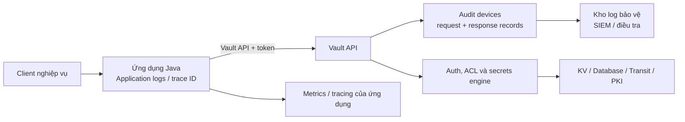
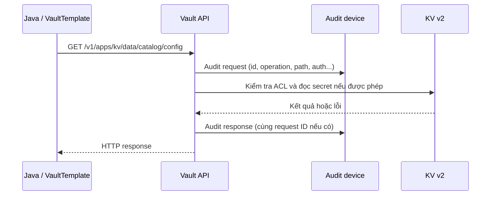

# Audit log và dấu vết của từng yêu cầu trong HashiCorp Vault

Khi ứng dụng Java dùng **Spring Vault** đọc một secret, phát hành credential Database hay gọi Transit encryption, câu hỏi vận hành không chỉ là *request thành công hay thất bại*. Nhóm bảo mật còn cần biết **ai đã yêu cầu**, **lúc nào**, **qua phương thức xác thực nào**, **gọi API path nào** và **kết quả ra sao**. HashiCorp Vault cung cấp **audit devices** để ghi nhận các sự kiện request/response phục vụ điều tra, kiểm toán và phát hiện bất thường.

Ví dụ, dịch vụ `catalog-api` đọc KV v2 tại `apps/kv/data/catalog/config`. Nếu Vault trả `403 permission denied`, một bản ghi audit phù hợp có thể giúp phân biệt token của workload nào đang gọi, endpoint nào bị từ chối và thời điểm xảy ra. Nhưng audit log **không phải nơi được phép xem plaintext của bí mật**, cũng không tự thay thế log Java, metrics hay distributed tracing.

Bài thuộc chương **Nền tảng Vault** của **Spring Vault**. Kiến thức về audit là phần kết nối giữa xác thực workload, token, ACL policy, KV secrets, lease, Transit, PKI, xử lý lỗi, giám sát và kiểm thử tích hợp.

## 1. Mục tiêu học tập

Sau bài này, bạn có thể:

1. Giải thích audit log của Vault dùng để làm gì và khác **operational log**, **metrics** và **application trace** như thế nào.
2. Nhận biết cách hoạt động của **audit device**, cặp sự kiện **request/response** và định danh **request ID**.
3. Đọc những trường quan trọng như thời gian, operation, API path, auth/entity, namespace và trạng thái lỗi khi chúng xuất hiện trong bản ghi.
4. Hiểu vai trò của **HMAC** trong việc bảo vệ một số giá trị nhạy cảm, giới hạn của HMAC và nguy cơ từ cấu hình ghi dữ liệu thô.
5. Bật và kiểm tra một audit device **trong Vault lab** mà không làm lộ token, unseal key hoặc giá trị secret.
6. Kết hợp dấu vết Vault với log/trace của ứng dụng Java và `VaultTemplate` để phân tích lỗi `403`, `404`, lỗi token hoặc lease.
7. Thiết kế retention, phân quyền đọc, cảnh báo và bài kiểm thử kiểm chứng khả năng audit của hệ thống.

## 2. Audit log là gì? Khác gì với server log và trace?

**Audit log** là bản ghi an ninh về các tương tác với Vault API đi qua cơ chế kiểm toán. Vault phát sự kiện cho các audit devices được bật, giúp người được cấp quyền xem xét hoạt động truy cập và quản trị. Một request thường có bản ghi **request** và, khi được xử lý tới giai đoạn tương ứng, bản ghi **response** để quan sát kết quả.

Đừng gộp mọi nguồn quan sát dưới nhãn “Vault log”:

| Nguồn thông tin | Trả lời câu hỏi | Ví dụ | Giới hạn |
|---|---|---|---|
| **Vault audit log** | Ai/tác vụ nào đã gọi Vault API, khi nào, theo đường dẫn nào? | Request đọc KV, login Kubernetes, yêu cầu renew lease | Không phải distributed trace đầu-cuối; một số giá trị được HMAC |
| **Vault operational/server log** | Tiến trình Vault, storage, HA, seal hoặc plugin đang gặp điều gì? | Lỗi Raft, lỗi kết nối backend, lỗi KMS | Không nhằm liệt kê đầy đủ từng truy cập secret |
| **Vault metrics** | Tỷ lệ lỗi, độ trễ, tải và tình trạng vận hành biến đổi ra sao? | Số lượng request, latency, status code | Là dữ liệu tổng hợp, không phải hồ sơ từng request |
| **Log ứng dụng Java** | Nghiệp vụ nào gọi Vault và xử lý ra sao? | Lần khởi động Catalog cần secret | Không tự nhìn thấy toàn bộ chính sách/hoạt động nội bộ của Vault |
| **Distributed tracing** | Một yêu cầu nghiệp vụ đi qua các service nào? | HTTP → Catalog → Vault → DB | Không mặc nhiên tự ghép được với Vault audit ID |

Audit giúp **truy vết hoạt động** nhưng không tự chứng minh rằng mọi sự kiện xảy ra trên các hệ thống ngoại vi đều đã được ghi. Ví dụ, sau khi Vault cấp một credential Database, các truy vấn SQL tiếp theo do ứng dụng thực hiện được quan sát qua log và audit của **database**, không phải toàn bộ nằm trong audit log của Vault.



## 3. Audit device và luồng ghi nhận yêu cầu

**Audit device** là đầu ra được Vault cấu hình để nhận bản ghi kiểm toán. Tùy phiên bản và cơ chế hỗ trợ, thiết bị có thể ghi ra **file**, **syslog** hoặc hình thức truyền log khác. Cần kiểm tra tính năng cụ thể của release, hệ điều hành và môi trường quản trị thay vì giả định mọi kiểu device đều có sẵn.

Luồng khái quát:

1. Java sử dụng Vault token để gọi endpoint, chẳng hạn `GET /v1/apps/kv/data/catalog/config`.
2. Vault tạo/tham chiếu **request ID** và đưa sự kiện request vào luồng audit.
3. Vault xác thực token, đánh giá capability, thực hiện secrets engine nếu request hợp lệ.
4. Vault ghi nhận kết quả tại sự kiện response nếu request đã đến giai đoạn có response được audit.
5. Hệ thống thu thập log đưa bản ghi tới nơi lưu tập trung có kiểm soát để đối chiếu và phân tích.



**Một yêu cầu không nhất thiết luôn có đủ cả hai bản ghi.** Ví dụ lỗi xảy ra trước khi request đi tới lớp audit, TLS handshake không hoàn thành, kết nối bị ngắt hoặc sự cố ghi audit có thể làm dấu vết không đầy đủ. Vì vậy, không xem việc thiếu response record là bằng chứng chắc chắn rằng Vault chưa xử lý bất kỳ phần nào của request.

### Có nên bật nhiều audit devices?

Trong các hệ thống quan trọng, nhiều audit devices có thể giúp tăng khả năng ghi nhận khi một đầu ra gặp sự cố. Tuy nhiên đây là thay đổi vận hành cần phê duyệt, theo dõi dung lượng và kết nối tới hệ thống nhận log. Vault có cơ chế bảo đảm audit: **nếu mọi audit device đang được bật đều không thể ghi nhận khi request cần audit, Vault có thể từ chối xử lý/phản hồi request**. Vì thế lỗi audit output có khả năng tác động tới **availability**, không chỉ tới dashboard.

Không bật hoặc tắt audit device trên cluster production chỉ để thử bài học.

## 4. Cấu trúc một bản ghi audit

Vault thường ghi dữ liệu audit dạng **JSON**. Trường, định dạng và mức che giấu tùy phiên bản, loại request, auth method, device và cấu hình. Một ví dụ **giả lập** cho request đọc KV v2:

```json
{
  "time": "2026-01-15T10:00:00Z",
  "type": "request",
  "auth": {
    "display_name": "kubernetes-catalog-api",
    "policies": ["catalog-read"],
    "entity_id": "EXAMPLE_ENTITY_ID"
  },
  "request": {
    "id": "EXAMPLE_REQUEST_ID_A",
    "operation": "read",
    "path": "apps/kv/data/catalog/config",
    "remote_address": "192.0.2.10",
    "client_token": "hmac-sha256:EXAMPLE_HASHED_TOKEN"
  }
}
```

Đây **không phải đầu ra được lấy từ một Vault thật**. Các giá trị `EXAMPLE_...` chỉ minh họa vị trí trường; không phải HMAC hợp lệ hay token thật.

Một bản ghi response tương ứng có thể có dạng:

```json
{
  "time": "2026-01-15T10:00:00Z",
  "type": "response",
  "request": {
    "id": "EXAMPLE_REQUEST_ID_A",
    "operation": "read",
    "path": "apps/kv/data/catalog/config"
  },
  "response": {
    "data": {
      "data": {
        "username": "hmac-sha256:EXAMPLE_HASHED_VALUE"
      }
    }
  }
}
```

Trong audit thực tế, nội dung response có thể có thêm hoặc ít trường, một số giá trị có thể đã bị HMAC, bị lược bỏ hoặc không xuất hiện. **Không kỳ vọng bản ghi audit phản ánh đầy đủ cấu trúc JSON của response mà Spring Vault nhận được**.

### Các trường cần biết

| Trường thường gặp | Ý nghĩa | Lưu ý |
|---|---|---|
| `time` | Thời điểm sự kiện audit | Xem timezone, độ chính xác và đồng bộ đồng hồ |
| `type` | `request` hoặc `response` | Dùng để ghép các pha của một request |
| `request.id` | Request ID do Vault ghi nhận | Khóa đối chiếu quan trọng trong audit |
| `request.operation` | Tác vụ logic như `read`, `update`, `list` | Không suy quyền chỉ từ HTTP method |
| `request.path` | API path mà Vault xử lý | Thường không gồm prefix HTTP `/v1/` |
| `request.remote_address` | Địa chỉ mạng được Vault quan sát | Có thể là proxy/LB, không luôn là IP cuối cùng của client |
| `auth.display_name` | Mô tả phiên/danh tính nếu có | Không dùng riêng tên này làm định danh bảo mật tuyệt đối |
| `auth.policies`, `auth.entity_id` | Thông tin policy/Identity theo ngữ cảnh | Trường có thể vắng mặt hoặc được trình bày khác |
| `response`, `error` | Kết quả/lỗi được audit | Có thể bị che giấu, tùy loại request và device |
| Thông tin namespace | Ngữ cảnh namespace khi tính năng hỗ trợ | Vị trí và biểu diễn tùy release/edition |

**`request.id` không phải token ID hoặc lease ID.** Vault token dùng để xác thực; lease ID dùng để quản lý vòng đời secret động; request ID dùng để nhận biết **một lần gọi API**. Nếu một request được retry ba lần, thường sẽ có những lần xử lý/request ID khác nhau, dù chúng cùng thuộc một thao tác nghiệp vụ của ứng dụng.

## 5. Request ID: mấu chốt để nối dấu vết

Giả sử có một lượt đọc KV thành công rồi một lượt thất bại:

```text
Request ID: req-example-001
  type=request   operation=read  path=apps/kv/data/catalog/config
  type=response  result=success

Request ID: req-example-002
  type=request   operation=read  path=apps/kv/data/billing/config
  type=response  result=permission denied
```

Đây là sơ đồ **khái niệm**, không phải schema audit chuẩn. Trong log thật, kết quả có thể được suy ra từ nội dung `response`/`error` hoặc những trường do phiên bản Vault ghi nhận, thay vì có trường cố định tên `result`.

Khi điều tra:

1. **Tìm request ID** trong bản ghi audit hoặc trong phản hồi Vault/API nếu client và endpoint cung cấp.
2. **Ghép các sự kiện** có cùng ID trong nguồn log và khung thời gian thích hợp.
3. Xác định operation, path, auth method/identity, namespace, và lỗi liên quan.
4. Đối chiếu với **mốc thời gian, app instance, deployment, job ID hoặc trace ID** bên phía Java.
5. Kết luận nguyên nhân dựa trên cả các log tương ứng, không chỉ nhìn một dòng audit.

Vault **không mặc nhiên sử dụng distributed trace ID của Spring Boot làm request ID trong audit**. Để ghép một request nghiệp vụ với request Vault, ứng dụng cần lưu dấu mốc không nhạy cảm, hoặc có cơ chế được thiết kế và xác minh để lấy request ID từ phản hồi/client. Đừng tự gắn một header tùy ý rồi tuyên bố rằng Vault chắc chắn ghi nó trong audit của mọi version.

### Khi không lấy được request ID từ Java

Có thể khoanh vùng bằng:

- Thời gian theo UTC với đồng hồ các hệ thống được đồng bộ.
- Tên service/instance và deployment environment.
- Operation và API path đã chuẩn hóa hoặc alias an toàn.
- Loại lỗi HTTP, auth role hoặc thông tin danh tính không nhạy cảm.
- Thông tin route/LB nếu mạng nhiều lớp.

Vì request lặp lại có thể giống nhau về thời gian/path, phương pháp này là **tương quan theo bằng chứng**, không phải ghép tuyệt đối. Không tạo cơ chế log plaintext token chỉ để “định danh chính xác hơn”.

## 6. HMAC trong audit log: bảo vệ giá trị nhưng không biến log thành vô hại

Vault dùng **HMAC** cho nhiều trường nhạy cảm trong audit record theo cơ chế bảo vệ của audit device. Điều đó giúp người điều tra thấy được cấu trúc và tương quan mà không cần phát tán các giá trị như token hoặc nội dung secret ở dạng plaintext.

Ví dụ minh họa:

```text
Giá trị ứng dụng nhận:
  username = demo-user
  password = [giá trị bí mật, không hiển thị]

Trong audit record, một số trường có thể được biểu diễn:
  username = hmac-sha256:...
  password = hmac-sha256:...
```

### HMAC khác băm thuần túy

HMAC sử dụng một **khóa bí mật** để tạo giá trị xác thực/đại diện cho dữ liệu. Một người chỉ có bản ghi log không nên mặc nhiên suy ra plaintext từ HMAC. Tuy nhiên:

- Những dữ liệu có không gian giá trị nhỏ hoặc dữ liệu có thể kiểm thử qua kênh được cấp quyền cần được xem xét riêng; HMAC không thay thế phân quyền log.
- Mỗi audit device có ngữ cảnh khóa HMAC của riêng nó; cùng plaintext **không nhất thiết cho chuỗi HMAC giống nhau giữa các device**.
- Một số trường metadata/đường dẫn có thể được ghi ở dạng đọc được để hỗ trợ điều tra.
- Cấu hình exemptions/điều chỉnh HMAC có thể làm trường nhạy cảm xuất hiện ở dạng thô, tùy feature và version.
- Dữ liệu có thể bị rò rỉ qua **log ứng dụng, proxy hoặc debug HTTP client**, ngay cả khi audit device của Vault đã HMAC.

Vì vậy, **audit log vẫn là dữ liệu nhạy cảm** và cần encryption-at-rest, quyền truy cập tối thiểu, retention và kiểm soát xuất/nhập.

### Có thể đối chiếu HMAC để tìm một giá trị không?

Vault có những công cụ/API cho phép tính giá trị HMAC theo **audit device** khi caller có quyền thích hợp, ví dụ lệnh CLI `vault audit hash` trong các phiên bản hỗ trợ. Việc đối chiếu phục vụ điều tra cần quy trình được phê duyệt: không đặt **token hoặc mật khẩu thật** trực tiếp trên command line, vì shell history và process list có thể ghi lại. Ưu tiên dùng **giá trị thử nghiệm không nhạy cảm** nếu minh họa cơ chế.

Không cố “giải mã” HMAC từ file audit; HMAC **không phải dạng mã hóa thuận nghịch**.

## 7. Những điều audit log không chứng minh được

Một audit record có thể chứng minh rằng Vault **đã quan sát một lời gọi API** trong điều kiện ghi nhận tương ứng. Nhưng không nên suy rộng:

| Nhận định dễ sai | Cách hiểu chính xác hơn |
|---|---|
| “Không thấy event thì request chắc chắn không xảy ra.” | Có thể request không đến lớp audit, log chưa được thu thập, device lỗi hoặc pipeline bị mất dữ liệu |
| “Có record đọc KV thì người dùng đã xem plaintext.” | Record chỉ cho biết lời gọi Vault và kết quả ở phạm vi ghi nhận; việc ứng dụng dùng dữ liệu thế nào là câu chuyện khác |
| “Audit response luôn chứa đúng HTTP status và mọi field.” | Schema/trường/giá trị có thể khác theo endpoint, phiên bản và cách bảo vệ |
| “Audit log cho biết mọi query dùng credential Database vừa cấp.” | Cần audit/log của database để biết query bên ngoài Vault |
| “Có HMAC nghĩa là file audit được phép chia sẻ công khai.” | Log vẫn chứa metadata tổ chức, path, identity và các dấu vết nhạy cảm |
| “Health check không có audit record chứng minh node chết.” | Health/status hoặc lỗi TLS có thể đi theo đường xử lý khác; cần operational metrics và log |

Audit là một thành phần của hệ thống điều tra, không phải bảo đảm truy vết tuyệt đối trong mọi tình huống mạng và backend.

## 8. Bật audit device trong Vault lab

**Chỉ thực hiện với Vault lab riêng** và token có quyền quản trị audit thích hợp. Trên production, bật/tắt device, chọn loại output, rotation và đẩy log tới hệ thống phân tích cần quy trình vận hành được phê duyệt.

### 8.1. Kiểm tra các audit devices

```bash
vault audit list
vault audit list -detailed
```

Thông tin trả về tùy cấu hình, có thể bao gồm tên mount audit device, loại device và các tùy chọn được công khai ở mức phù hợp. **Tên mount của audit device không phải secrets engine mount** và cũng không phải path KV.

### 8.2. Bật file audit cho lab

Ví dụ lệnh dưới đây chạy từ một phiên Vault CLI có quyền quản trị:

```bash
# File path được diễn giải trên máy/container đang chạy Vault,
# không phải thư mục trên laptop đang gọi lệnh.
vault audit enable -path=lab-audit file \
  file_path=/var/log/vault/lab-audit.log
```

Các lưu ý:

- `lab-audit` là tên/mount path **của audit device** trong Vault.
- `/var/log/vault/lab-audit.log` nằm ở môi trường filesystem **của tiến trình Vault** và phải ghi được bởi Vault với quyền phù hợp.
- Trong container, cần volume và quyền filesystem thích hợp; không mặc nhiên file xuất hiện trên máy chạy CLI.
- Môi trường multi-node/HA phải thiết kế đường lưu hoặc pipeline log nhất quán trên **các node có thể ghi audit**, tránh chỉ kiểm tra một node.
- Khi Vault không ghi được audit records vào các output cần thiết, request có thể bị ảnh hưởng; trước khi enable phải bảo đảm dung lượng, quyền và hệ thống thu thập hoạt động.

Sau khi bật:

```bash
vault audit list -detailed
```

Không xóa hoặc truncate file audit đang được Vault sử dụng tùy tiện; retention và log rotation cần tuân theo cách vận hành được hỗ trợ và được kiểm thử.

### 8.3. Tắt device chỉ khi đã kết thúc lab

Trong môi trường lab độc lập, với sự cho phép của người sở hữu:

```bash
# Chỉ dùng nếu thực sự cần tắt audit device lab-audit đã tạo.
vault audit disable lab-audit
```

**Không thực hiện bước này trên production hoặc môi trường chia sẻ.** Tắt audit có thể làm mất khả năng ghi nhận request, ảnh hưởng tính tuân thủ và điều tra. Việc disable device cũng không đồng nghĩa tự xóa an toàn tất cả các file log đã tạo.

## 9. Truy vết KV v2 và kiểm chứng quyền bằng audit

Giả sử lab có KV v2 mount `apps/kv/`, secret giả `catalog/config`, và audit device đã hoạt động. Một token của Catalog có policy:

```hcl
path "apps/kv/data/catalog/config" {
  capabilities = ["read"]
}
```

Ứng dụng hoặc CLI đọc secret:

```http
GET /v1/apps/kv/data/catalog/config
X-Vault-Token: <VAULT_TOKEN>
```

Trong audit, người điều tra sẽ quan tâm:

- **Path logic:** `apps/kv/data/catalog/config`; phần `/v1/` là HTTP API prefix, thông thường không nằm trong path ACL.
- **Operation:** `read`.
- **Danh tính:** auth method, entity ID, policy, thông tin token được phép ghi nhận.
- **Thời gian và request ID:** để nối các bản ghi.
- **Kết quả:** thành công hoặc `permission denied`, tùy trường có sẵn trong bản ghi.

Nếu ứng dụng cố đọc `apps/kv/data/billing/config` mà token không có quyền, request có thể bị trả `403`. Audit có thể cho thấy **đường dẫn thực bị gọi**, giúp nhận biết sai cấu hình hoặc vượt phạm vi quyền. Đừng chỉ xem request thất bại rồi cấp wildcard `apps/kv/data/*` để “chữa”; hãy kiểm tra yêu cầu nghiệp vụ.

### KV v2 có hai lớp API cần phân biệt

| Hành động | Path thường dùng | Capability |
|---|---|---|
| Đọc dữ liệu | `apps/kv/data/catalog/config` | `read` |
| Ghi phiên bản mới | `apps/kv/data/catalog/config` | `create` hoặc `update` theo tình huống |
| Liệt kê tên key | `apps/kv/metadata/catalog` | `list` |
| Xem metadata một key | `apps/kv/metadata/catalog/config` | `read` |

Audit log giúp xác minh ứng dụng đã thực sự gọi `data/` hay `metadata/`; điều này hữu ích khi Vault CLI hoạt động nhưng `VaultTemplate.read(...)` dùng sai endpoint.

## 10. Truy vết login, token, lease, Transit và PKI

Các tác vụ khác cũng để lại dấu vết theo endpoint và loại thao tác. Tùy audit configuration, có thể quan sát các luồng như:

| Hoạt động | API path ví dụ (không có `/v1/`) | Cần điều tra điều gì? |
|---|---|---|
| Kubernetes login | `auth/k8s/login` | Auth role nào được dùng, kết quả login, danh tính workload |
| AppRole login | `auth/approle/login` | Lần xác thực bằng AppRole nào, có bị từ chối không |
| Token renew | `auth/token/renew-self` | Có yêu cầu gia hạn token, thành công hay lỗi |
| KV v2 read | `apps/kv/data/catalog/config` | Token nào gọi, path đúng không, được cấp `read` không |
| Database credential issue | `database/creds/reporting` | Role nào đã cấp credential, tần suất cấp phát |
| Lease renew | `sys/leases/renew` | Có yêu cầu renew lease, có bị từ chối/giới hạn không |
| Lease revoke | `sys/leases/revoke` | Ai yêu cầu thu hồi lease, vào thời điểm nào |
| Transit encrypt | `crypto/encrypt/payment-key` | Lượt gọi mã hóa và quyền `update` |
| PKI certificate issue | `certs/issue/service-client` | Lượt cấp chứng chỉ theo PKI role |
| Policy thay đổi | `sys/policies/acl/catalog-read` | Tác động quản trị tới quyền của workload |

**Chú ý:** đọc `database/creds/reporting` có thể **tạo credential mới** ở backend, dù operation trên Vault là `read`. Audit record về request này không tự thay thế log quản trị của Database. Với PKI, việc chứng chỉ được phát hành, sử dụng hoặc thu hồi ngoài Vault còn cần giám sát theo X.509 và cấu hình PKI.

Các endpoint auth/login có thể chứa JWT, SecretID hoặc credential nhạy cảm trong request; đó là lý do tuyệt đối tránh bật cơ chế logging request body thô trên gateway hoặc Java HTTP client chỉ để đối chiếu với audit.

## 11. Spring Vault: ghi log ứng dụng an toàn để điều tra

Spring Vault cung cấp `ClientAuthentication`, session manager và `VaultTemplate`. Các thành phần này giúp ứng dụng có Vault token và gọi API, nhưng **không tự động tạo distributed tracing end-to-end trong audit log** của Vault. Phần quan sát của ứng dụng nên ghi:

- Tên thao tác có ý nghĩa, chẳng hạn `vault.kv.read`, `vault.transit.encrypt`.
- Một **mã nghiệp vụ hoặc trace ID** không nhạy cảm của request đang xử lý.
- Tên môi trường, service và **alias secret** đã được cho phép ghi log.
- Kết quả thành công/thất bại, loại lỗi được phân loại và latency.
- Khi có thể lấy request ID Vault qua API/client một cách an toàn, lưu ánh xạ tương quan trong cơ chế được kiểm soát.

**Không ghi** token, secret content, password, JWT, response `VaultResponse` đầy đủ hoặc exception body không được làm sạch. Với ứng dụng Spring, bật debug log cho HTTP client đôi khi có thể vô tình ghi headers và payload; phải đánh giá cấu hình logging của phiên bản thư viện trước khi bật.

### Ví dụ Java: đặt mã theo dõi trước khi gọi `VaultTemplate`

```java
import java.util.UUID;

import org.slf4j.Logger;
import org.slf4j.LoggerFactory;
import org.springframework.stereotype.Service;
import org.springframework.vault.core.VaultKeyValueOperations;
import org.springframework.vault.core.VaultKeyValueOperationsSupport.KeyValueBackend;
import org.springframework.vault.core.VaultTemplate;
import org.springframework.vault.support.VaultResponse;

@Service
public class AuditedCatalogSecretReader {

    private static final Logger log =
            LoggerFactory.getLogger(AuditedCatalogSecretReader.class);

    private final VaultKeyValueOperations kv;

    public AuditedCatalogSecretReader(VaultTemplate vaultTemplate) {
        this.kv = vaultTemplate.opsForKeyValue("apps/kv", KeyValueBackend.KV_2);
    }

    public String readUsername() {
        // Dùng trace ID nghiệp vụ hiện có nếu đã triển khai tracing.
        String operationId = UUID.randomUUID().toString();

        try {
            VaultResponse response = kv.get("catalog/config");
            if (response == null || response.getData() == null) {
                log.warn("vault.kv.read outcome=not_found opId={} secretAlias={}",
                        operationId, "catalog-config");
                throw new IllegalStateException("Không có cấu hình Catalog");
            }

            Object username = response.getData().get("username");
            if (!(username instanceof String)) {
                log.warn("vault.kv.read outcome=invalid_shape opId={}",
                        operationId);
                throw new IllegalStateException("Thiếu username hợp lệ");
            }

            log.info("vault.kv.read outcome=success opId={} secretAlias={}",
                    operationId, "catalog-config");
            return (String) username;
        } catch (org.springframework.vault.VaultException ex) {
            // Không log ex.getMessage(), request headers hoặc response body.
            log.warn("vault.kv.read outcome=vault_error opId={} secretAlias={}",
                    operationId, "catalog-config");
            throw ex;
        }
    }
}
```

Điểm cần hiểu:

1. `operationId` là **ID ở ứng dụng**, **không phải** `request.id` của Vault. Đừng gán hai khái niệm này là một.
2. `secretAlias=catalog-config` là tên ổn định không nhạy cảm thay vì ghi secret plaintext, user credentials hoặc path tùy ý từ người dùng.
3. Khi Vault trả `403` hoặc xảy ra lỗi, ứng dụng ghi **loại sự kiện**, không dump toàn bộ exception body.
4. Nếu business request đã có trace ID, nên dùng trace ID đó; UUID minh họa ở đây chỉ dùng khi chưa có ngữ cảnh tracing.
5. Logging cần được thiết kế để tránh spam và kiểm soát khối lượng khi một vòng retry xảy ra.

Ví dụ này chỉ giải quyết **logging an toàn ở application layer**. Việc lấy và gắn request ID của Vault, đo latency, phân loại chi tiết status hoặc thêm OpenTelemetry tracing cần tích hợp có kiểm chứng theo HTTP client và phiên bản Spring Vault thực tế.

### Muốn quan sát lỗi `403` mà không lộ bí mật

Có thể kết hợp:

```text
Application log:
  service=catalog-api
  operation=vault.kv.read
  secretAlias=catalog-config
  outcome=vault_error
  appTraceId=APP-EXAMPLE-001

Vault audit (cùng cửa sổ thời gian):
  request.id=EXAMPLE_REQUEST_ID_B
  operation=read
  path=apps/kv/data/catalog/config
  auth.display_name=kubernetes-catalog-api
  error=permission denied
```

Ví dụ là **mô hình tương quan**. Nếu không có ánh xạ request ID được xác minh, không được khẳng định chắc chắn hai dòng là cùng một request chỉ vì cùng path và thời gian gần nhau.

## 12. Lọc, bảo vệ và tập trung audit logs

File audit trên host Vault chỉ là điểm phát sinh dữ liệu. Một hệ thống vận hành thường cần pipeline thu thập tới kho log/SIEM có phân quyền, kiểm soát tính toàn vẹn và retention.

### Nguyên tắc bảo vệ

- **Phân quyền đọc/ghi:** chỉ tiến trình Vault và thành phần thu thập log được phê duyệt truy cập file; người dùng ứng dụng không được đọc audit log.
- **TLS cho log shipping:** bảo vệ kết nối từ node Vault tới collector và từ collector tới kho phân tích.
- **Mã hóa khi lưu:** log storage, snapshot và backup phải dùng các cơ chế bảo vệ phù hợp.
- **Retention:** định nghĩa thời gian lưu dựa trên yêu cầu pháp lý và vận hành; hết hạn thì xóa theo chính sách, không giữ vô hạn mặc định.
- **Tính toàn vẹn:** phát hiện chỉnh sửa/xóa log trái phép, kiểm soát quyền thay đổi pipeline và cấu hình audit device.
- **Đồng bộ thời gian:** dùng đồng hồ đáng tin cậy để tương quan giữa Vault, ứng dụng, proxy và database.
- **Giới hạn dữ liệu:** không bật ghi nguyên văn payload nhạy cảm; đánh giá kỹ cấu hình HMAC exemptions và quyền truy cập các field metadata.
- **Phòng quá tải:** theo dõi disk usage, throughput, queue và sự cố audit sink; ghi audit không thành công có thể ảnh hưởng API availability.

Trong HA, không nên chỉ đọc file trên một node rồi kết luận toàn bộ hệ thống không có request. Cần thu thập đúng nguồn theo topology và cơ chế forwarding của deployment.

### Ví dụ lọc JSON theo request ID trong lab

Nếu người vận hành **được phép đọc audit file trên host Vault** và file có định dạng JSON từng dòng, có thể dùng `jq` để lấy **chỉ metadata cần thiết**, không in token/response data:

```bash
# Chỉ ví dụ: ID và file đều thuộc Vault lab.
# Tránh đưa nội dung toàn bộ audit record ra terminal chia sẻ.
RID="EXAMPLE_REQUEST_ID_A"
AUDIT_LOG="/var/log/vault/lab-audit.log"

jq -c --arg rid "$RID" \
  'select(.request.id == $rid) |
   {time, type, request_id: .request.id,
    operation: .request.operation, path: .request.path}' \
  "$AUDIT_LOG"
```

Kết quả có thể trống nếu file không thuộc node xử lý request, request ID không tồn tại, log chưa được thu thập hoặc schema khác dự kiến. Không cố sửa bằng cách bật dump raw response. Với production, nên dùng truy vấn từ log pipeline đã được kiểm soát thay vì đăng nhập trực tiếp vào host Vault để đọc tất cả file audit.

## 13. Giám sát và cảnh báo từ audit

Các tín hiệu hữu ích có thể gồm:

| Nhóm tín hiệu | Ví dụ | Ý nghĩa |
|---|---|---|
| **Auth** | Login thất bại tăng bất thường tại `auth/k8s/login` | Workload binding, JWT hoặc thử đăng nhập trái phép |
| **Authorization** | `403` liên tiếp trên path không thuộc service | Sai policy/path hoặc truy cập ngoài phạm vi |
| **Dynamic secrets** | Tần suất gọi `database/creds/reporting` tăng đột biến | Ứng dụng cấp phát credential quá thường xuyên |
| **Token/lease** | Renew/revoke tăng bất thường | Lỗi lifecycle hoặc thay đổi hành vi workload |
| **Transit/PKI** | Số lần encrypt/issue vượt baseline | Cần kiểm tra tải và nguồn yêu cầu |
| **Quản trị** | Thay đổi policy, auth role, audit device | Tác động bảo mật cần đối chiếu change approval |
| **Pipeline audit** | Thiếu log ở node, disk đầy hoặc collector ngắt | Rủi ro mất dấu vết và ảnh hưởng khả dụng |

Giám sát nên dùng số liệu tổng hợp và **không đưa token ID, lease ID, mật khẩu hay request ID vô hạn vào metric labels**, vì gây rủi ro dữ liệu và độ phình cardinality. Ngưỡng cảnh báo phải được hiệu chỉnh theo môi trường, lịch deploy, chính sách rotation và hành vi bình thường của ứng dụng.

### Những câu hỏi điều tra điển hình

1. Tại sao service `billing-api` cố đọc KV của Catalog?
2. Có bao nhiêu lượt yêu cầu credential Database mới trước khi connection pool bắt đầu lỗi?
3. Một token workload bất ngờ thiếu quyền từ thời điểm nào, có thay đổi policy/role gần đó không?
4. Có ai gọi `auth/token/renew-self` hoặc `sys/leases/revoke` ngoài luồng dự kiến?
5. Audit pipeline có bị gián đoạn cùng thời điểm Vault API trở nên chậm hoặc lỗi không?

Audit log giúp đặt câu hỏi và đối chiếu bằng chứng; câu trả lời cuối cùng có thể cần thêm **Vault server logs, metrics, GitOps/change records, app traces và log hệ thống ngoài**.

## 14. Chẩn đoán lỗi kết hợp audit và ứng dụng

| Hiện tượng | Cần kiểm tra ở đâu | Lưu ý |
|---|---|---|
| Java báo lỗi TLS/PKIX | TLS trust, SAN, network và log client | Handshake thất bại có thể xảy ra trước khi Vault tạo audit event |
| Vault health trả `503` sealed | `sys/health`, `vault status`, operational log | Không mặc định có cặp audit như một lượt đọc secret |
| KV v2 trả `403` | Audit operation/path/auth + ACL policy | Kiểm tra `<mount>/data/<key>` và token workload |
| KV v2 trả `404` | Mount, key, version và audit path | Phân biệt `data/` với `metadata/` |
| Login Kubernetes thất bại | Audit `auth/k8s/login` + cấu hình auth role | Không ghi JWT thô vào log Java |
| Token hết hạn, renew thất bại | Audit token login/renew + session manager | TTL token khác secret lease |
| Credential DB được cấp liên tục | Audit `database/creds/<role>` và app trace | Mỗi call có thể tạo credential/lease mới |
| Lease revoke ngoài dự kiến | Audit `sys/leases/revoke` và backend log | Xem token/ngữ cảnh thực hiện và kết quả |
| Không thấy audit records | Audit device config, pipeline, node, timestamp | Không kết luận không có request ngay lập tức |
| Audit sink lỗi khiến Vault khó phục vụ | Vault operational logs và sức khỏe audit output | Một số cấu hình thiếu audit output thành công có thể chặn request |

### Một quy trình điều tra tối thiểu

1. **Xác định khoảng thời gian UTC**, Vault deployment/namespace và service bị ảnh hưởng.
2. **Kiểm tra tình trạng Vault:** TLS, seal/HA, storage, audit device và pipeline.
3. **Tìm dấu vết API:** operation, path, request ID và auth/entity có thể quan sát.
4. **So sánh quyền và ngữ cảnh:** auth role, token policies, ACL trên endpoint thực.
5. **Đối chiếu application trace và backend logs** khi Vault cấp dynamic credential hoặc chứng chỉ.
6. **Viết kết luận có mức độ chắc chắn:** phân biệt bằng chứng trực tiếp với suy luận từ thời gian/path.
7. **Lưu kết quả đã làm sạch** và giữ bằng chứng theo quy trình an toàn/retention.

## 15. Thực hành trong Vault lab

**Điều kiện:** Vault lab riêng, token quản trị có quyền bật audit device, một KV v2 mount `lab/kv/` và các token thử nghiệm quyền tối thiểu. Sử dụng secret giả và môi trường có thể kiểm soát log; không chạy trên cluster production hoặc tắt audit device đang được hệ thống khác sử dụng.

### Bài A — Bật audit và tạo một sự kiện đọc hợp lệ

1. Kiểm tra các audit devices bằng `vault audit list -detailed`.
2. Với lab riêng và đường dẫn file ghi được ở server, bật file audit:

```bash
vault audit enable -path=lab-audit file \
  file_path=/var/log/vault/lab-audit.log
```

3. Kiểm tra lại danh sách, bảo đảm cấu hình và quyền file/pipeline đúng.
4. Nếu mount `lab/kv/` chưa tồn tại và được phép tạo, dùng:

```bash
vault secrets enable -path=lab/kv -version=2 kv
```

5. Ghi và đọc một **giá trị hoàn toàn giả**:

```bash
vault kv put -mount=lab/kv catalog/config username=lab-user
vault kv get -mount=lab/kv catalog/config
```

6. Tìm audit event của `lab/kv/data/catalog/config`, quan sát request ID, operation, timestamp và các trường auth được ghi nhận, **không copy nguyên bản record nếu nó chứa thông tin nhạy cảm**.

### Bài B — Tạo một lỗi `403` có kiểm soát

Tạo policy lab chỉ đọc một key:

```hcl
path "lab/kv/data/catalog/config" {
  capabilities = ["read"]
}
```

Với token thử nghiệm được cấp **chỉ policy cần thiết** và không có quyền bổ sung ngoài dự kiến:

1. Đọc `catalog/config` thành công.
2. Cố đọc key khác `billing/config` trong lab; kết quả kỳ vọng là bị từ chối.
3. So sánh audit path của hai request:

```text
lab/kv/data/catalog/config   -> read được phép
lab/kv/data/billing/config   -> read bị từ chối nếu không có policy khác
```

4. Dùng `vault token capabilities lab/kv/data/billing/config` bằng token tương ứng để xác minh quyền.
5. Không “sửa lỗi” bằng root token hoặc policy wildcard; bài học là **biết quyền nào bị từ chối và tại sao**.

### Bài C — Truy vết từ ứng dụng Spring Vault

1. Cấu hình Java `VaultTemplate` kết nối Vault lab qua TLS với token/workload auth phù hợp.
2. Gọi `opsForKeyValue("lab/kv", KeyValueBackend.KV_2).get("catalog/config")`.
3. Log **mã nghiệp vụ không nhạy cảm**, alias secret và kết quả; không log `VaultResponse`.
4. Đối chiếu timestamp, auth identity, operation và API path trong audit.
5. Nếu có cơ chế lấy request ID của Vault đã được xác minh theo phiên bản client, lưu ánh xạ với application trace ID; nếu không, ghi rõ việc ghép theo thời gian chỉ là tương quan gần đúng.
6. Lặp lại với token không có quyền để quan sát lỗi ứng dụng và sự kiện audit tương ứng.

### Bài D — Quan sát độ bền của audit pipeline

Không làm đầy ổ đĩa, không tắt audit device hoặc cắt collector trên hệ thống dùng chung. Trong lab cô lập, **mô tả** kịch bản audit sink không ghi được và tác động có thể có đến request Vault. Thiết kế cảnh báo dung lượng, lỗi ship log và phương án dự phòng. Sau bài thực hành, việc disable `lab-audit` chỉ được thực hiện nếu chủ môi trường lab cho phép và không ảnh hưởng hoạt động kiểm toán nào khác.

**Tiêu chí hoàn thành:** người học nhận ra cặp request/response, biết `request.id` dùng để tương quan, phân biệt Vault audit ID với app trace ID, giải thích được HMAC và chứng minh có thể điều tra `403` mà không tiết lộ plaintext secret.

## 16. Câu hỏi tự kiểm tra

1. **Audit log có phải file chứa toàn bộ secret plaintext để debug nhanh không?** Không. Audit được thiết kế phục vụ kiểm toán; nhiều trường nhạy cảm được HMAC và log phải tiếp tục được bảo vệ.
2. **`request.id` có phải Vault token hoặc lease ID không?** Không. Nó dùng để định danh một lần request qua Vault.
3. **HTTP client của Java báo `PKIX path building failed` nhưng audit không có event; có bất thường không?** Không nhất thiết; TLS handshake có thể thất bại trước khi request được xử lý/audit.
4. **Có thể dùng `VAULT_TOKEN` làm metric label để ghép log không?** Không. Token là credential bí mật, không được ghi vào telemetry.
5. **Hai audit devices có chắc HMAC cùng plaintext giống nhau không?** Không. Cơ chế khóa HMAC của mỗi device có thể khác.
6. **Đọc `database/creds/reporting` có luôn là thao tác vô hại vì tên operation là `read` không?** Không. Nó có thể tạo credential động và lease mới.
7. **Một request thiếu response record có chứng minh client không nhận dữ liệu không?** Không thể kết luận chỉ từ sự thiếu vắng đó.
8. **Audit device ghi log thất bại chỉ ảnh hưởng đến báo cáo, không bao giờ ảnh hưởng Vault API?** Sai. Khi không có audit output ghi thành công theo yêu cầu, Vault có thể không xử lý request bình thường.
9. **Spring trace ID có mặc nhiên bằng Vault audit request ID không?** Không. Cần cơ chế correlation được thiết kế và kiểm chứng.

## 17. Ghi nhớ

**Vault audit log** tạo dấu vết về những request đi qua Vault, thường gồm sự kiện **request/response**, **request ID**, operation, API path và thông tin xác thực/kết quả phù hợp. **Audit device** chịu trách nhiệm xuất bản ghi; **HMAC** bảo vệ nhiều giá trị nhạy cảm, nhưng log vẫn cần bảo mật, kiểm soát truy cập, retention và giám sát khả dụng.

Trong **Spring Vault**, `ClientAuthentication` và `VaultTemplate` giúp workload gọi Vault, còn Vault audit giúp người vận hành xem lại hoạt động theo **đúng token/identity context và API path thực**. Hãy ghi log nghiệp vụ an toàn ở Java, đối chiếu với audit và operational logs, không để lộ secret hay token, đồng thời kiểm thử cả lượt đọc thành công lẫn `403`. Khả năng truy vết tốt không chỉ giúp điều tra sự cố mà còn hỗ trợ phát hiện quyền quá rộng, cấp phát credential bất thường và kiểm chứng nguyên tắc **least privilege**.
