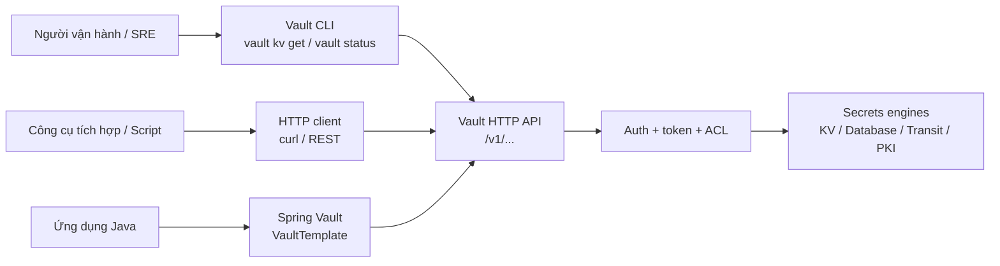
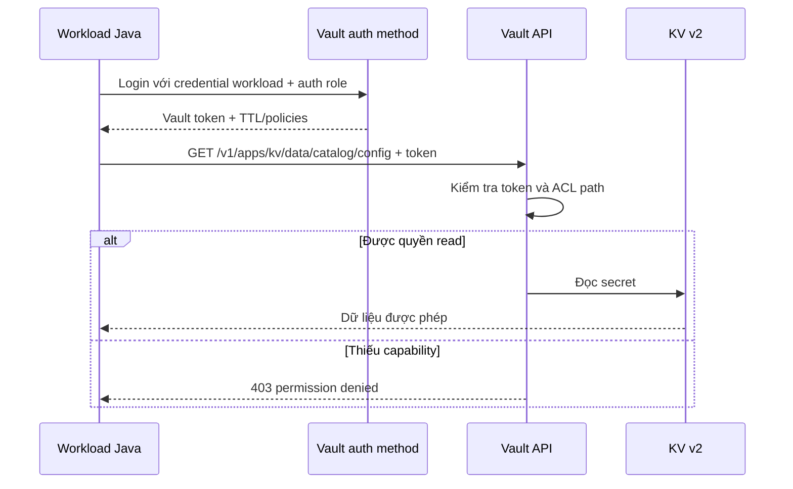
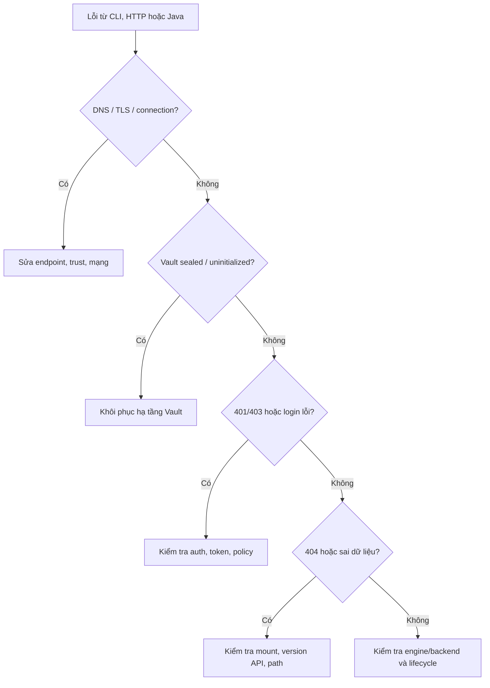

# Vai trò của CLI, HTTP API và thư viện Java khi làm việc với HashiCorp Vault

Một ứng dụng Java có thể đọc bí mật bằng **Spring Vault**, trong khi người vận hành lại dùng lệnh `vault kv get`, còn công cụ tích hợp dùng HTTP request `GET /v1/...`. Ba cách tiếp cận đều làm việc với **HashiCorp Vault**, nhưng có các mức trừu tượng khác nhau: **CLI** thuận tiện cho thao tác và chẩn đoán, **HTTP API** là giao thức nền tảng, còn **thư viện Java Spring Vault** giúp đưa Vault vào vòng đời của ứng dụng với cơ chế xác thực, phiên/token, ánh xạ dữ liệu và xử lý lỗi.

Điều quan trọng không phải chọn “cách nào đúng hơn”, mà là biết **giao diện nào phù hợp cho từng công việc** và **không nhầm đường dẫn, kiểu dữ liệu hay trách nhiệm bảo mật** khi chuyển giữa chúng. Chẳng hạn, trong KV v2, CLI có thể tự thêm `data/` vào API bên dưới, nhưng khi dùng `VaultTemplate.read(...)` trực tiếp bạn phải truyền đúng đường dẫn API logic; với `opsForKeyValue(..., KV_2)`, Spring Vault lại tự xử lý chi tiết đó.

Bài học nằm trong chương **Nền tảng Vault** của **Spring Vault**. Các ví dụ dùng Java, KV secrets, xác thực theo workload, chính sách quyền tối thiểu, vòng đời token/lease, Transit encryption và PKI để tạo nền tảng cho xử lý lỗi, giám sát và kiểm thử tích hợp.

## 1. Mục tiêu học tập

Sau khi hoàn thành bài học, bạn có thể:

1. Giải thích vai trò và ranh giới trách nhiệm của **Vault CLI**, **Vault HTTP API**, **Spring Vault** và, khi cần, **Spring Cloud Vault**.
2. Ánh xạ cùng một thao tác giữa lệnh CLI, HTTP method/URL và các phương thức Java.
3. Phân biệt URL máy chủ, tiền tố `/v1/`, mount path, đường dẫn API của engine và đường dẫn secret tương đối.
4. Biết vì sao KV v2, Database dynamic credentials, Transit và PKI không dùng chung một cấu trúc endpoint.
5. Cấu hình `VaultTemplate` theo hướng dùng HTTPS, xác thực workload và ACL policy thay vì hardcode root token.
6. Hiểu khác biệt giữa phản hồi JSON của HTTP API, `VaultResponse` và operations chuyên biệt.
7. Kiểm thử tích hợp và chẩn đoán lỗi bằng một quy trình đối chiếu CLI → HTTP API → Java mà không tiết lộ bí mật.

## 2. Ba giao diện, một Vault server



| Giao diện | Người dùng điển hình | Ưu điểm | Giới hạn và trách nhiệm |
|---|---|---|---|
| **Vault CLI** | SRE, bảo mật, nhà phát triển trong lab | Lệnh theo tác vụ, hỗ trợ quản trị và kiểm tra tình trạng | Không phải nơi phù hợp để nhúng hàng loạt shell command quản trị trong Java service |
| **HTTP API** | Công cụ tích hợp, script, client đa ngôn ngữ | Giao thức minh bạch; nhìn rõ method, URL, header và payload | Phải tự giải quyết encoding, token, timeout, response, lỗi và lifecycle nếu không có thư viện |
| **Spring Vault** | Ứng dụng Java/Spring | Tích hợp `VaultTemplate`, `ClientAuthentication`, session manager và operations theo engine | Không tự thay thế ACL, TLS, secrets lifecycle hay chính sách ứng dụng |
| **Spring Cloud Vault** | Ứng dụng Spring dùng Vault làm nguồn cấu hình | Tích hợp secret vào quá trình nạp cấu hình/property sources | Có mục tiêu khác với lập trình trực tiếp bằng `VaultTemplate`; cách cấu hình phụ thuộc phiên bản |

**CLI và Spring Vault rốt cuộc vẫn gọi Vault API.** Chúng không có quyền đặc biệt chỉ vì là công cụ của HashiCorp hoặc thư viện Java. Vault vẫn xác thực token và áp dụng policy trên endpoint được yêu cầu.

## 3. Phân biệt server URL, API prefix, mount và relative path

Giả sử Vault chạy tại `https://vault.example.internal:8200`; KV v2 được mount tại `apps/kv/`; key cần đọc là `catalog/config`.

```text
Vault base URL       https://vault.example.internal:8200
HTTP API prefix      /v1/
KV mount path        apps/kv/
KV v2 API segment    data/
Secret relative path catalog/config

HTTP URL cuối cùng:
https://vault.example.internal:8200/v1/apps/kv/data/catalog/config
```

Đường dẫn được diễn giải theo từng lớp:

| Thành phần | Ví dụ | Xuất hiện ở đâu? |
|---|---|---|
| **Server URL** | `https://vault.example.internal:8200` | Cấu hình client/CLI |
| **HTTP prefix** | `/v1/` | URL request HTTP Vault |
| **Mount path** | `apps/kv` | Định danh secrets engine instance |
| **KV v2 operation** | `data/` | Endpoint API KV v2 khi đọc/ghi dữ liệu |
| **Relative path** | `catalog/config` | Tên secret bên trong mount |
| **ACL path** | `apps/kv/data/catalog/config` | Stanza trong policy, **không** có `/v1/` |

Không phải engine nào cũng có `data/`. Database dùng các endpoint như `creds/`, Transit dùng `encrypt/`, PKI dùng `issue/`. Phần **sau mount** phụ thuộc hợp đồng API của engine.

### Một lỗi dễ mắc ở cả ba giao diện

```text
CLI KV v2:
  mount: apps/kv
  key:   catalog/config

VaultTemplate.read(...) mức thấp:
  path:  apps/kv/data/catalog/config

KV operations của Spring Vault:
  mount: apps/kv, backend KV_2
  key:   catalog/config
```

Nếu bạn đặt `data/` vào key của `VaultKeyValueOperations.get(...)`, hoặc thêm `/v1/` vào `VaultTemplate.read(...)`, rất dễ sinh request sai đường dẫn.

## 4. Vault CLI: công cụ vận hành và kiểm tra giả thuyết

**Vault CLI** là giao diện dòng lệnh của Vault. CLI tiện lợi khi người vận hành cần kiểm tra trạng thái server, danh sách mount, cách phân quyền token, secret trong lab hoặc một role đã được cấu hình. Nó cũng hữu ích để xác định **lỗi nằm ở hạ tầng Vault hay phần tích hợp Java**.

Ví dụ môi trường shell Bash:

```bash
export VAULT_ADDR="https://vault.example.internal:8200"
export VAULT_CACERT="/etc/company/certs/company-ca.pem"

# Kiểm tra tình trạng Vault và vai trò HA.
vault status

# Xem các mount, loại và phiên bản của secrets engines.
vault secrets list -detailed

# Kiểm tra capability của token CLI hiện tại trên API path thật.
vault token capabilities apps/kv/data/catalog/config
```

Trong lab, CLI còn hỗ trợ thao tác KV v2:

```bash
vault kv put -mount=apps/kv catalog/config username=demo
vault kv get -mount=apps/kv catalog/config
vault kv metadata get -mount=apps/kv catalog/config
vault kv list -mount=apps/kv catalog
```

Ở đây `-mount=apps/kv` chỉ rõ **mount path**; `catalog/config` là **relative path**, không bao gồm `apps/kv/data/`.

### CLI không xóa bỏ yêu cầu bảo mật

- CLI cần kết nối HTTPS và tin cậy CA của Vault như client khác. Không dùng tùy chọn bỏ kiểm tra chứng chỉ để chữa lỗi TLS.
- Token dùng cho CLI phải có quyền phù hợp. **Root token không phù hợp** để kiểm chứng policy quyền tối thiểu của một workload.
- Các lệnh ghi secret có thể đi vào shell history; chỉ thực hiện với **dữ liệu giả** trong lab hoặc dùng cơ chế nhập liệu/bảo vệ credential được tổ chức phê duyệt.
- Các lệnh quản trị như bật mount, chỉnh policy, thay auth role hoặc seal Vault có ảnh hưởng vận hành; không đưa chúng vào startup script của ứng dụng để “tự sửa” lỗi.

**Vai trò tốt nhất của CLI trong phát triển:** kiểm chứng mount path, trạng thái server, auth role, policy và giá trị API path trước khi cấu hình Java. CLI không thay thế bài kiểm thử bằng **đúng token workload**.

## 5. HTTP API: giao thức nền tảng và hợp đồng chính xác

Vault HTTP API dùng URL có prefix `/v1/`. Một request thường có:

- **HTTP method:** `GET`, `POST`, `DELETE`, hoặc phương thức thích hợp của endpoint.
- **URL path:** `/v1/<mount>/<endpoint>`.
- **Vault token:** thường qua header `X-Vault-Token` đối với endpoint yêu cầu xác thực.
- **Namespace (nếu deployment hỗ trợ):** ví dụ header `X-Vault-Namespace`.
- **Payload:** JSON cho nhiều thao tác ghi hoặc login.
- **Response:** HTTP status, JSON body, metadata về token/lease và dữ liệu.

Ví dụ đọc KV v2:

```http
GET /v1/apps/kv/data/catalog/config
X-Vault-Token: <VAULT_TOKEN>
```

Ví dụ ghi dữ liệu cho KV v2:

```http
POST /v1/apps/kv/data/catalog/config
X-Vault-Token: <VAULT_TOKEN>
Content-Type: application/json

{
  "data": {
    "username": "demo"
  }
}
```

**Lưu ý:** payload KV v2 cho thao tác ghi có wrapper `data`, trong khi API KV v1 có hợp đồng khác. Việc gọi API bằng `curl` cho bạn nhiều quyền kiểm soát, nhưng bạn phải tự chọn đúng endpoint, capability, JSON shape, timeout và xử lý response.

### Dùng curl có kiểm soát

```bash
# Chỉ là minh họa request; dùng token thử nghiệm và kênh quản lý credential an toàn.
curl --silent --show-error \
  --cacert "$VAULT_CACERT" \
  --header "X-Vault-Token: $VAULT_TOKEN" \
  "$VAULT_ADDR/v1/apps/kv/data/catalog/config"
```

Không đưa token thật vào tài liệu, file script public hoặc log. Trên máy dùng chung, header/biến shell và command line có thể có rủi ro quan sát; dùng cơ chế client/secret injection được môi trường phê duyệt. **Không in phản hồi chứa plaintext secret ra terminal hoặc pipeline log chia sẻ**.

### Prefix của HTTP API không phải KV version

`/v1/` vẫn xuất hiện khi dùng KV v2. `v1` ở đây là **HTTP API version prefix**, còn `KV_2` là phiên bản API của **secrets engine**. Đây là hai tầng khác nhau.

## 6. So sánh cùng một thao tác KV trên CLI, HTTP và Java

Với KV v2 `apps/kv/` và key `catalog/config`:

| Mục đích | CLI | HTTP API | Spring Vault |
|---|---|---|---|
| Đọc dữ liệu | `vault kv get -mount=apps/kv catalog/config` | `GET /v1/apps/kv/data/catalog/config` | `opsForKeyValue("apps/kv", KV_2).get("catalog/config")` |
| Ghi dữ liệu | `vault kv put -mount=apps/kv catalog/config username=demo` | `POST /v1/apps/kv/data/catalog/config` với JSON `data` | `opsForKeyValue("apps/kv", KV_2).put("catalog/config", map)` |
| Đọc metadata | `vault kv metadata get -mount=apps/kv catalog/config` | `GET /v1/apps/kv/metadata/catalog/config` | Dùng KV operations hỗ trợ metadata theo API của phiên bản thư viện |
| Liệt kê key | `vault kv list -mount=apps/kv catalog` | `LIST /v1/apps/kv/metadata/catalog` hoặc cơ chế GET `?list=true` | Dùng operations liệt kê tương ứng |
| Kiểm tra quyền | `vault token capabilities apps/kv/data/catalog/config` | Token capabilities API | Dùng client hoặc kiểm thử kết quả của thao tác được cấp quyền |

Ở cả ba giao diện, policy đọc KV v2 điển hình là:

```hcl
path "apps/kv/data/catalog/config" {
  capabilities = ["read"]
}
```

Nếu ứng dụng cần `list`, ACL phải cấp capability `list` trên endpoint **`metadata/`** tương ứng. `read` tại `data/` không tự cấp `list` tại `metadata/`.

## 7. Đọc phản hồi: JSON API không giống ngay đối tượng Java

Một response KV v2 qua HTTP API thường có lớp `data` bên ngoài chứa lớp `data` của secret và lớp `metadata` phiên bản:

```json
{
  "lease_id": "",
  "lease_duration": 0,
  "renewable": false,
  "data": {
    "data": {
      "username": "demo"
    },
    "metadata": {
      "version": 1
    }
  }
}
```

Các trường cần phân biệt:

| Trường | Ý nghĩa | Có phải credential mới không? |
|---|---|---|
| `data.data.username` | Giá trị secret được lưu ở KV | Không, chỉ là dữ liệu đang lưu |
| `data.metadata.version` | Số phiên bản dữ liệu của KV v2 | Không |
| `lease_id` rỗng | KV thông thường không cấp secret lease động | Không |
| `lease_duration=0` | Không có TTL secret lease theo mô hình dynamic này | Không có nghĩa KV đã “hết hạn” |

Khi dùng `VaultTemplate.read("apps/kv/data/catalog/config")` mức thấp, `VaultResponse.getData()` đại diện phần `data` ngoài, tức có thể còn cấu trúc `data` và `metadata` lồng nhau. Với `VaultKeyValueOperations` được cấu hình đúng `KV_2`, thư viện xử lý wrapper của KV v2 và cung cấp map dữ liệu secret thông qua response của KV operations.

Đừng sao chép logic parse từ JSON KV v2 trực tiếp sang các `VaultResponse` chuyên biệt mà không xét mức trừu tượng của client.

## 8. Xác thực: CLI, HTTP và Java cùng cần một danh tính Vault

Ứng dụng production nên lấy token thông qua **workload authentication**, chẳng hạn Kubernetes auth, AppRole hoặc JWT/OIDC theo yêu cầu triển khai. Xác thực thành công chỉ tạo một phiên/token; **ACL policy** quyết định các quyền theo API path.



### Kubernetes auth ở mức HTTP

Nếu auth method được mount tại `auth/k8s/`, ví dụ endpoint login là:

```http
POST /v1/auth/k8s/login
Content-Type: application/json

{
  "role": "catalog-api",
  "jwt": "<SERVICE_ACCOUNT_JWT>"
}
```

Phản hồi có thể chứa `auth.client_token`, `auth.lease_duration`, `auth.renewable` và thông tin policies. **Không log raw JWT hoặc client token.** Một Vault Kubernetes auth role có thể ràng buộc ServiceAccount, namespace Kubernetes, audience và các điều kiện khác; auth role không phải một ACL policy và cũng không phải Database secrets role.

### Java xử lý xác thực ra sao?

Spring Vault cung cấp interface **`ClientAuthentication`** và các implementation phục vụ nhiều auth method. Thay vì tự gửi JSON login trong mọi class nghiệp vụ, ứng dụng cấu hình phương thức xác thực phù hợp và để session manager cung cấp token cho `VaultTemplate`.

Điều này không thay thế bảo vệ credential: JWT, Role ID/Secret ID hoặc token vẫn phải đến từ nguồn được quản lý an toàn theo môi trường. **Không hardcode root token** để làm mọi ví dụ Java “chạy được”.

## 9. Spring Vault và Spring Cloud Vault khác nhau thế nào?

**Spring Vault** là thư viện Java để tương tác chương trình với Vault API. Các abstraction quan trọng gồm:

| Thành phần | Vai trò |
|---|---|
| `VaultEndpoint` | Địa chỉ Vault server và thông số endpoint ở phía client |
| `ClientAuthentication` | Cách ứng dụng nhận Vault token |
| Session manager | Cung cấp token cho request; lifecycle phụ thuộc implementation/cấu hình |
| `VaultTemplate` | Client trung tâm để đọc/ghi API path và lấy operations theo engine |
| `VaultKeyValueOperations` | Các thao tác theo semantics KV v1/KV v2 |
| `VaultResponse` | Cấu trúc response chung, dữ liệu và metadata khi có |
| `SecretLeaseContainer` | Hỗ trợ quản lý vòng đời lease cho secrets được đăng ký phù hợp |

**Spring Cloud Vault** tích hợp Vault với hệ sinh thái Spring Cloud/Spring Boot như một nguồn cấu hình/property source. Nó hữu ích khi ứng dụng muốn nạp cấu hình từ Vault ở giai đoạn khởi động và quản lý property theo convention của framework.

Hai công cụ có liên quan nhưng **không phải một**:

- Khi cần lập trình **gọi Transit, đọc một key KV theo thời điểm nghiệp vụ, cấp Database credential, thao tác PKI**, Spring Vault và `VaultTemplate` thường là điểm bắt đầu.
- Khi cần **đưa các key cấu hình Vault vào Spring Environment**, Spring Cloud Vault có thể phù hợp hơn.
- Dự án có thể dùng cả hai, nhưng phải thống nhất endpoint, namespace, TLS, auth và lifecycle; không tự giả định một `VaultTemplate` tạo thủ công sẽ kế thừa mọi cấu hình từ một thành phần khác.

Cú pháp cấu hình Spring Cloud Vault và khả năng tích hợp theo engine thay đổi theo phiên bản Spring Cloud/Spring Boot. Khi triển khai thật, sử dụng tài liệu đúng version của dự án thay vì sao chép cấu hình từ một release khác.

## 10. Java: đọc KV v2 an toàn với `VaultTemplate`

Giả sử ứng dụng có bean `VaultTemplate` đã được cấu hình với HTTPS, CA trust phù hợp và `ClientAuthentication` theo workload. Một service chỉ cần đọc secret có thể viết:

```java
import org.springframework.stereotype.Service;
import org.springframework.vault.core.VaultKeyValueOperations;
import org.springframework.vault.core.VaultKeyValueOperationsSupport.KeyValueBackend;
import org.springframework.vault.core.VaultTemplate;
import org.springframework.vault.support.VaultResponse;

@Service
public class CatalogConfigurationReader {

    private final VaultKeyValueOperations kv;

    public CatalogConfigurationReader(VaultTemplate vaultTemplate) {
        this.kv = vaultTemplate.opsForKeyValue("apps/kv", KeyValueBackend.KV_2);
    }

    public String readUsername() {
        VaultResponse response = kv.get("catalog/config");
        if (response == null || response.getData() == null) {
            throw new IllegalStateException("Không tìm thấy cấu hình Catalog");
        }

        Object value = response.getData().get("username");
        if (!(value instanceof String)) {
            throw new IllegalStateException("Trường username không hợp lệ");
        }
        return (String) value;
    }
}
```

Các điểm cần nhớ:

1. `"apps/kv"` là **mount path**, không phải URL đầy đủ.
2. `KeyValueBackend.KV_2` cho biết backend KV cần API có `data/` và `metadata/`.
3. `kv.get("catalog/config")` nhận **relative path**, không thêm `/v1/`, `apps/kv/` hoặc `data/`.
4. Thư viện nhận response qua HTTP và diễn giải theo operations đã chọn.
5. Service **không log toàn bộ response** vì nó có thể chứa secret.

Nếu token không có `read` tại `apps/kv/data/catalog/config`, thao tác có thể bị Vault từ chối dù class Java biên dịch và kết nối TLS thành công.

### Khi nào dùng `VaultTemplate.read(...)` mức thấp?

Khi gọi trực tiếp một endpoint không sử dụng operations chuyên biệt, bạn có thể truyền API path bên trong Vault:

```java
VaultResponse raw =
        vaultTemplate.read("apps/kv/data/catalog/config");
```

`VaultTemplate` tự thêm phần HTTP API prefix; không truyền `"v1/apps/kv/data/catalog/config"`. Với KV v2, response mức thấp giữ cấu trúc wrapper đặc thù của endpoint, nên nếu chỉ làm việc với dữ liệu KV, `VaultKeyValueOperations` thường dễ hiểu hơn.

## 11. Java: lấy credential Database theo yêu cầu

Không phải mọi request `GET` của Vault là “đọc dữ liệu cũ”. Ví dụ Database secrets engine có endpoint:

```http
GET /v1/database/creds/reporting
X-Vault-Token: <VAULT_TOKEN>
```

Endpoint này có thể tạo một tài khoản database mới theo role `reporting`, trả về username/password **và lease**:

```json
{
  "lease_id": "database/creds/reporting/EXAMPLE_LEASE",
  "lease_duration": 1200,
  "renewable": true,
  "data": {
    "username": "v-reporting-demo",
    "password": "EXAMPLE_ONLY"
  }
}
```

Code Java mức API:

```java
import org.springframework.stereotype.Service;
import org.springframework.vault.core.VaultTemplate;
import org.springframework.vault.support.VaultResponse;

@Service
public class ReportingCredentialRequester {

    private final VaultTemplate vaultTemplate;

    public ReportingCredentialRequester(VaultTemplate vaultTemplate) {
        this.vaultTemplate = vaultTemplate;
    }

    public VaultResponse requestNewCredential() {
        VaultResponse response = vaultTemplate.read("database/creds/reporting");
        if (response == null || response.getData() == null) {
            throw new IllegalStateException("Vault chưa cấp credential");
        }
        if (response.getLeaseId() == null || response.getLeaseId().isBlank()) {
            throw new IllegalStateException("Dynamic credential thiếu lease ID");
        }

        // Chuyển response vào thành phần quản lý vòng đời được bảo vệ.
        // Không log password, token hoặc toàn bộ VaultResponse.
        return response;
    }
}
```

Đây **chỉ là ví dụ yêu cầu cấp phát**, chưa xử lý refresh/renew/reissue hoặc cập nhật connection pool. Gọi endpoint mỗi lần nhận một HTTP request từ người dùng có thể khiến ứng dụng tạo quá nhiều credential và lease; cần có chiến lược quản lý vòng đời.

So sánh:

| Cách gọi | Hệ quả thường gặp | Loại quản lý vòng đời |
|---|---|---|
| `kv.get("catalog/config")` | Đọc lại dữ liệu KV đã lưu | Version, rotation và cache theo chính sách |
| `vaultTemplate.read("database/creds/reporting")` | Có thể cấp credential Database mới | Lease ID, TTL, renew/reissue/revoke và connection pool |

## 12. Transit và PKI: mỗi engine có hợp đồng API riêng

Các engine khác không dùng API path KV v2:

| Mục đích | Vault CLI minh họa | HTTP API | Capability thường cần |
|---|---|---|---|
| Mã hóa bằng Transit key `payment-key` tại `crypto/` | `vault write crypto/encrypt/payment-key plaintext=...` | `POST /v1/crypto/encrypt/payment-key` | `update` |
| Yêu cầu chứng chỉ theo PKI role `service-client` tại `certs/` | `vault write certs/issue/service-client common_name=...` | `POST /v1/certs/issue/service-client` | `update` |
| Đọc KV v2 `apps/kv/` | `vault kv get -mount=apps/kv catalog/config` | `GET /v1/apps/kv/data/catalog/config` | `read` |
| Xin Database credential tại `database/` | `vault read database/creds/reporting` | `GET /v1/database/creds/reporting` | `read` |

### Ví dụ Transit qua HTTP

```http
POST /v1/crypto/encrypt/payment-key
X-Vault-Token: <VAULT_TOKEN>
Content-Type: application/json

{
  "plaintext": "SGVsbG8="
}
```

`plaintext` ở đây là dữ liệu minh họa được mã hóa **base64** theo yêu cầu API Transit. Đây không phải mật khẩu Database và cũng không phải secret key được trả trực tiếp cho Java. Response thường có ciphertext và thông tin phiên bản khóa phù hợp; chính sách phải giới hạn endpoint/key được phép mã hóa. Không đưa plaintext nhạy cảm hoặc ciphertext ra log nếu quy định dữ liệu cấm.

### Ví dụ PKI qua HTTP

```http
POST /v1/certs/issue/service-client
X-Vault-Token: <VAULT_TOKEN>
Content-Type: application/json

{
  "common_name": "service.lab.example",
  "ttl": "1h"
}
```

PKI role phải được cấu hình cho phép tên miền, TTL và thuộc tính chứng chỉ được yêu cầu. Không giả định mọi chứng chỉ PKI có cùng semantics lease như Database credential; cần quản lý `NotBefore`, `NotAfter` và thu hồi/xác minh chứng chỉ theo cơ chế PKI.

Trong Spring Vault, nên ưu tiên các operations chuyên biệt đã được phiên bản thư viện hỗ trợ; nếu dùng `VaultTemplate.write(...)` mức thấp, phải truyền **đúng API path và JSON body**. Không ghép `data/` của KV vào Transit hoặc PKI.

## 13. Quyền truy cập: giao diện không cấp thêm capability

Vault ACL kiểm tra request theo **API path**, không theo việc request được gửi bằng CLI, curl hay Java. Với một ứng dụng Catalog chỉ cần đọc KV và mã hóa bằng Transit:

```hcl
path "apps/kv/data/catalog/config" {
  capabilities = ["read"]
}

path "crypto/encrypt/payment-key" {
  capabilities = ["update"]
}
```

Policy này không tự cho phép:

- Đọc `apps/kv/data/billing/config`.
- Liệt kê key dưới `apps/kv/metadata/catalog`.
- Giải mã bằng `crypto/decrypt/payment-key`.
- Phát hành chứng chỉ tại `certs/issue/service-client`.
- Quản trị mount, policy hoặc auth role.

Với token của workload:

```bash
vault token capabilities apps/kv/data/catalog/config
vault token capabilities crypto/encrypt/payment-key
vault token capabilities apps/kv/data/billing/config
```

Không kiểm tra bằng root token rồi kết luận ứng dụng cũng có quyền tương đương. Nếu dùng Vault namespaces ở deployment hỗ trợ, phải nhất quán **namespace + token + mount path** trên cả ba giao diện.

## 14. Token TTL khác lease TTL: thư viện không tự làm mọi việc

Spring Vault có thể dùng session manager để duy trì **Vault token** theo cấu hình, nhưng một **dynamic secret lease** là một vòng đời riêng.

```text
ClientAuthentication
    |
    v
Vault token + token TTL
    |
    v
VaultTemplate --> Database creds endpoint
                     |
                     v
              Dynamic credential
              lease_id + lease_duration + renewable
                     |
              Renew / reissue / revoke
```

| Vấn đề | Giao diện/cách xử lý liên quan |
|---|---|
| Token hết hạn | Auth API, session manager hoặc re-login |
| Secret lease gần hết hạn | Lease lifecycle manager/SecretLeaseContainer hoặc logic chuyên biệt |
| KV key được rotate | Đọc phiên bản mới, cập nhật cache và ứng dụng |
| Credential Database đổi | Nhận secret mới, chuyển connection pool, xử lý lease cũ |
| Chứng chỉ PKI sắp hết hạn | Phát hành/gia hạn theo cơ chế PKI; cập nhật kết nối/chứng chỉ |

**Gia hạn Vault token không tự gia hạn mọi Database lease.** Cũng không nên giả định mọi response từ `VaultTemplate.read(...)` đã được đăng ký vào `SecretLeaseContainer` để gia hạn. Việc quản lý leased secrets phải được thiết lập phù hợp và được kiểm thử với ứng dụng thực tế.

## 15. TLS, timeout, retry và log: các yêu cầu xuyên suốt

| Chủ đề | CLI | HTTP API thủ công | Spring Vault |
|---|---|---|---|
| **TLS** | `VAULT_ADDR=https://...`, CA trust thích hợp | HTTP client xác minh CA, SAN và TLS version | JVM truststore/SSL context cho client, endpoint HTTPS |
| **Token** | Phiên CLI dùng token theo môi trường | Header `X-Vault-Token` khi endpoint yêu cầu | `ClientAuthentication` và session manager |
| **Timeout** | Theo cấu hình CLI | Tự đặt connection/read timeout | Cấu hình HTTP client, timeout và tài nguyên pool |
| **Retry** | Người vận hành chủ động | Script phải tự phân loại lỗi | Cần retry policy phù hợp theo thao tác |
| **Dữ liệu bí mật** | Không in vào log/ticket | Không dump body/header nhạy cảm | Không log `VaultResponse`, token hoặc exception chứa payload |
| **Quan sát** | `vault status`, `vault token capabilities` | Status/header/request ID khi có | Log nghiệp vụ đã làm sạch, metrics/tracing và Vault audit |

### Đặc biệt cẩn trọng khi retry

Một lần gọi KV read thường là thao tác quan sát, nhưng một request `GET /database/creds/reporting` **có thể tạo credential mới**. Một retry do mất kết nối sau khi Vault đã xử lý request có thể tạo thêm credential/lease. Tương tự, `POST` ghi dữ liệu, phát hành chứng chỉ hoặc thao tác Transit có semantics riêng.

Vì thế:

1. Chỉ retry tự động khi hiểu rõ **idempotency và tác dụng phụ** của endpoint.
2. Dùng timeout, backoff và giới hạn lần thử; không tạo vòng lặp vô hạn.
3. Nếu response bị mất sau khi request đã được xử lý, đừng mặc định retry là “không làm gì thêm”.
4. Theo dõi số lần cấp credential, lease, kết quả rotation và sự thay đổi của backend.
5. Với lỗi cố định `403` do thiếu quyền, không retry mãi; cần sửa policy/role hoặc token theo quy trình.

### Trình tự xử lý lỗi



Không phải mọi HTTP status đều có thể diễn giải chỉ bằng một con số: `503` từ Vault health khi sealed khác lỗi `503` của load balancer; `404` có thể do mount/secret sai hoặc phiên bản key không tồn tại.

## 16. Chọn giao diện cho công việc thực tế

| Công việc | Giao diện nên ưu tiên | Vì sao? |
|---|---|---|
| Kiểm tra Vault có sealed/standby hay không | CLI hoặc HTTP health | Quan sát trạng thái server độc lập với business code |
| Bật KV mount, kiểm tra policy trong lab | CLI | Rõ ràng cho người vận hành; cần quyền quản trị |
| Debug URL/method/payload KV v2 | HTTP API hoặc curl đã kiểm soát | Thấy đúng hợp đồng API cần gửi |
| Ứng dụng Java đọc key KV v2 | Spring Vault `VaultKeyValueOperations` | Tránh tự nối `data/` và parse JSON wrapper |
| Java gọi một API không có operations phù hợp | `VaultTemplate.read/write` theo endpoint | Tận dụng client/session; vẫn phải hiểu API contract |
| Quản lý leased Database credential | Spring Vault + lifecycle integration | Token và lease phải được quản lý riêng; cập nhật DataSource |
| Nạp cấu hình Vault vào Spring Environment | Spring Cloud Vault | Property source/config integration |
| Đối chiếu lỗi authorization của workload | CLI capability + Vault audit + log Java | Phân biệt policy/path với lỗi code và TLS |
| Kiểm thử end-to-end | CLI/HTTP để thiết lập và xác minh, Java để chạy luồng thực | Kiểm tra cả contract Vault và hành vi ứng dụng |

Trong production, thao tác quản trị nên đi qua quy trình có kiểm soát hoặc Infrastructure as Code phù hợp. Không đưa `vault policy write`, `vault secrets enable`, `vault operator init` hay lệnh tương tự vào service runtime chỉ vì có thể gọi chúng bằng shell từ Java.

## 17. Thực hành: đối chiếu CLI → HTTP → Java trong một Vault lab

**Điều kiện:** Vault lab đã initialized/unsealed, kết nối HTTPS phù hợp, có token thử nghiệm theo quyền tối thiểu. KV v2 được mount tại `lab/kv/` hoặc bạn có quyền tạo mount này. Chỉ sử dụng **giá trị giả**.

### Bước A — Xác minh mount và dữ liệu bằng CLI

```bash
vault status
vault secrets list -detailed

# Chỉ chạy nếu lab/kv chưa tồn tại và có quyền bật mount trong lab.
vault secrets enable -path=lab/kv -version=2 kv

vault kv put -mount=lab/kv demo/service username=lab-user
vault kv get -mount=lab/kv demo/service
```

Việc chạy `vault secrets enable` trên mount đã tồn tại sẽ không phải bước bắt buộc; nếu mount có sẵn, xác minh nó thực sự là KV v2 và bỏ qua lệnh enable.

### Bước B — Viết policy đúng API path

Tạo policy trong lab:

```hcl
path "lab/kv/data/demo/service" {
  capabilities = ["read"]
}
```

Nạp policy bởi phiên quản trị lab có quyền, phát token thử nghiệm cho workload và kiểm tra:

```bash
vault token capabilities lab/kv/data/demo/service
vault token capabilities lab/kv/data/other/service
```

Kỳ vọng token chỉ đọc được `demo/service`, không đọc các path khác ngoài phạm vi. Nếu token có thêm Identity policies hay quyền bổ sung, phải đánh giá capability thực tế chứ không chỉ đọc một policy file.

### Bước C — Kiểm tra HTTP API

```http
GET /v1/lab/kv/data/demo/service
X-Vault-Token: <VAULT_TOKEN>
```

Xác nhận response có `data.data.username=lab-user` và metadata version. Không in token hoặc response secret thực vào pipeline log. Cố ý thử một path ngoài quyền trong lab, quan sát lỗi từ API nhưng không sửa bằng root token.

### Bước D — Kiểm tra Spring Vault

Trong ứng dụng Java đã cấu hình endpoint, TLS và authentication của lab:

```java
VaultResponse response = vaultTemplate
        .opsForKeyValue("lab/kv", KeyValueBackend.KV_2)
        .get("demo/service");
```

Xác nhận `response.getData().get("username")` tương ứng với giá trị giả đã ghi, và token thiếu quyền không thể đọc một key ngoài policy. Sau đó thử đọc bằng API mức thấp:

```java
VaultResponse raw = vaultTemplate.read("lab/kv/data/demo/service");
```

Giải thích vì sao `get(...)` và `read(...)` nhận path khác nhau và cách xử lý wrapper JSON KV v2. Không log toàn bộ response.

### Bước E — Bảng đối chiếu cuối cùng

| Câu hỏi | Đáp án |
|---|---|
| CLI path để đọc secret? | `vault kv get -mount=lab/kv demo/service` |
| HTTP endpoint? | `GET /v1/lab/kv/data/demo/service` |
| Policy path? | `lab/kv/data/demo/service` |
| Spring KV operations mount? | `lab/kv` với `KeyValueBackend.KV_2` |
| Spring KV operations key? | `demo/service` |
| Spring raw `VaultTemplate.read(...)` path? | `lab/kv/data/demo/service` |
| Ai thêm prefix HTTP `/v1/` cho Java? | HTTP client bên dưới Spring Vault |
| Token và lease có tự động giống nhau không? | Không. Chúng có vòng đời riêng |

**Tiêu chí hoàn thành:** bạn có thể giải thích và tái tạo cùng một lượt đọc KV qua cả ba giao diện; xác minh đúng capability của token; phân biệt response JSON với Spring operations; và chỉ ra được vì sao một lỗi Java có thể bắt nguồn từ TLS, auth, policy, mount hoặc cấu trúc API.

## 18. Những nhầm lẫn phổ biến

| Nhầm lẫn | Hiểu đúng |
|---|---|
| “CLI và Java có quyền khác nhau vì một bên là công cụ quản trị.” | Quyền do token/Identity, policy và API path quyết định |
| “`vault kv get -mount=apps/kv catalog/config` tương đương raw `read("apps/kv/catalog/config")`.” | KV v2 raw API cần `data/` |
| “`VaultTemplate.read(...)` phải có prefix `v1/`.” | Prefix HTTP được client quản lý; truyền logical API path |
| “`KV_2` nghĩa endpoint bắt đầu `/v2/`.” | KV version không phải HTTP API prefix |
| “`read` luôn không có tác dụng phụ.” | Database dynamic `creds/` có thể cấp credential mới |
| “Đã có `VaultTemplate` thì tự động renew mọi lease.” | Secret lifecycle cần cấu hình/quản lý riêng |
| “Bật Spring Cloud Vault là mọi call `VaultTemplate` tự đúng namespace/TLS.” | Cấu hình phải được xác minh với client đang sử dụng |
| “Nếu CLI với root token đọc được thì workload cũng đọc được.” | Cần kiểm tra bằng chính token và policy của workload |
| “Bỏ hostname verification là cách hợp lệ để xử lý lỗi PKIX.” | Phải sửa CA/chain/SAN và cấu hình trust |
| “Retry vô hạn một request cấp credential là an toàn.” | Có thể tạo thêm tài khoản/lease trên backend |

## 19. Ghi nhớ

**Vault CLI** giúp người vận hành quản trị và xác minh trạng thái; **HTTP API** xác định hợp đồng endpoint chính xác; **Spring Vault** đưa API đó vào ứng dụng Java qua `ClientAuthentication`, session manager, `VaultTemplate` và operations theo engine. **Spring Cloud Vault** bổ sung khả năng tích hợp Vault như nguồn cấu hình của hệ sinh thái Spring. Tất cả vẫn chịu cùng nguyên tắc xác thực, phân quyền và an toàn TLS.

Khi chuyển từ CLI/HTTP sang Java, hãy giữ rõ các tầng: **server URL → `/v1/` → mount path → endpoint của engine → relative path**. Với KV v2, ưu tiên `opsForKeyValue(..., KeyValueBackend.KV_2)`; với API mức thấp, dùng đúng logical path. Với dynamic credentials, xem cả **lease TTL** và cơ chế rotation; với Transit/PKI, tuân theo API contract riêng. Kiểm chứng qua CLI và HTTP trong lab, chạy test thực tế bằng token workload và tuyệt đối không để lộ secrets/token trong log là nền tảng cho ứng dụng Spring Vault an toàn và dễ vận hành.
