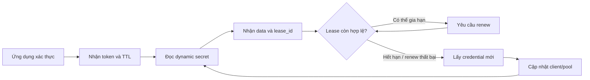

# Đọc cấu trúc phản hồi Vault: `data`, `auth`, `metadata` và thông tin lease

Khi ứng dụng Java gọi HashiCorp Vault qua Spring Vault, kết quả không đơn thuần là một `Map` chứa username và password. Vault trả về một **phong bì phản hồi** (*response envelope*) có thể chứa dữ liệu nghiệp vụ, kết quả xác thực, thông tin phiên bản và quyền thuê (*lease*). Việc hiểu các lớp này giúp ứng dụng đọc đúng secret, không nhầm thời gian sống của token với thời gian sống của secret và xử lý gia hạn/thu hồi đúng cách.

Trong phạm vi Spring Vault, ta sẽ xem cách phản hồi xuất hiện khi gọi `VaultTemplate`, khi truy cập KV secrets, khi xác thực theo workload (chẳng hạn AppRole hoặc Kubernetes) và khi làm việc với dynamic secrets. Các ví dụ JSON dưới đây được rút gọn và dùng giá trị giả; các endpoint, mount và chính sách thực tế có thể khác nhau.

## 1. Nhìn tổng thể: phản hồi Vault có nhiều lớp

Một phản hồi HTTP thành công của Vault thường có hình dạng gần như sau. **Không phải endpoint nào cũng trả đủ mọi trường**:

```json
{
  "request_id": "8d7e...",
  "lease_id": "database/creds/reporting/abc...",
  "lease_duration": 3600,
  "renewable": true,
  "data": {
    "username": "v-reporting-abc",
    "password": "<REDACTED>"
  },
  "auth": null,
  "warnings": null,
  "wrap_info": null
}
```

| Trường | Ý nghĩa | Cần chú ý |
| --- | --- | --- |
| `data` | Payload của thao tác, ví dụ secret, ciphertext, chứng chỉ hoặc thông tin token tra cứu. | Cấu trúc bên trong phụ thuộc secret engine/API; KV v2 còn có một lớp `data` lồng bên trong. |
| `auth` | Thông tin đăng nhập và token mới cấp trong phản hồi xác thực. | Có thể là `null` khi chỉ đọc secret. Token thường nằm ở `auth.client_token`. |
| `lease_id` | Định danh lease của secret động đã cấp. | Chuỗi rỗng hoặc không có nghĩa là không có lease để quản lý theo định danh đó. |
| `lease_duration` | Thời hạn lease tại thời điểm phản hồi, tính bằng **giây**. | Không đồng nghĩa với TTL của token trong `auth`. |
| `renewable` | Lease được đánh dấu có khả năng xin gia hạn. | Không bảo đảm mọi yêu cầu gia hạn đều thành công; còn phụ thuộc giới hạn và policy. |
| `request_id` | ID để đối chiếu yêu cầu khi điều tra sự cố. | Có ích cho quan sát hệ thống; không chứa nội dung secret. |
| `warnings` | Cảnh báo từ Vault, nếu có. | Phản hồi thành công vẫn có thể kèm cảnh báo. |
| `wrap_info` | Thông tin response wrapping, nếu được yêu cầu. | Wrapped token là thông tin nhạy cảm; payload ban đầu chưa nằm trực tiếp trong `data`. |

Một số phiên bản Vault còn trả trường như `mount_type`; không nên giả định mọi phiên bản hoặc engine có cùng tập trường. Trường `metadata` **không phải một khối chung bắt buộc ở gốc**: nó thường xuất hiện bên trong `data.metadata` của KV v2, hoặc trong `auth.metadata` của phản hồi đăng nhập, với ý nghĩa khác nhau.

Có thể hình dung các lớp như sau:

```text
Vault HTTP response (phong bì)
├── request_id
├── data                → kết quả của thao tác
│   ├── ...             → KV v1 / database / Transit / PKI ...
│   └── {data, metadata}→ riêng cấu trúc đọc secret KV v2
├── auth                → token + thuộc tính xác thực (nếu đăng nhập)
├── lease_id            → lease của secret động (nếu có)
├── lease_duration      → TTL của lease ở lớp ngoài (giây)
└── renewable           → khả năng gia hạn lease ở lớp ngoài
```

## 2. `data`: đọc đúng payload theo secret engine

### 2.1. KV v1: `data` chứa trực tiếp cặp khóa–giá trị

Giả sử mount `secret/` được bật ở **KV v1**, đọc đường dẫn logic `secret/payments` có thể trả:

```json
{
  "lease_id": "",
  "lease_duration": 0,
  "renewable": false,
  "data": {
    "api_key": "<REDACTED>",
    "region": "ap-southeast-1"
  },
  "auth": null
}
```

Đường đi đến giá trị là `data.api_key`. KV v1 lưu dữ liệu tĩnh; `lease_duration: 0` ở đây không có nghĩa giá trị tự hết hạn sau 0 giây. Muốn thay đổi hoặc thu hồi giá trị, cần cập nhật secret, đổi thông tin xác thực ở hệ thống đích và điều chỉnh quyền truy cập phù hợp.

### 2.2. KV v2: `data.data` mới là giá trị, `data.metadata` là phiên bản

Với mount `secret/` ở **KV v2**, API đọc trực tiếp dùng đường dẫn `secret/data/payments`. Cấu trúc có thêm một lớp:

```json
{
  "request_id": "a1b2...",
  "lease_id": "",
  "lease_duration": 0,
  "renewable": false,
  "data": {
    "data": {
      "api_key": "<REDACTED>",
      "region": "ap-southeast-1"
    },
    "metadata": {
      "created_time": "2026-11-20T09:00:00Z",
      "deletion_time": "",
      "destroyed": false,
      "version": 3
    }
  },
  "auth": null
}
```

Đọc bằng HTTP hoặc `VaultTemplate.read(...)` theo đường dẫn API thô:

- `data.data.api_key`: giá trị secret thực tế.
- `data.metadata.version`: số phiên bản dữ liệu được trả về (ví dụ `3`).
- `data.metadata.created_time`: thời điểm tạo phiên bản đó.
- `data.metadata.deletion_time` và `destroyed`: thông tin trạng thái xóa/hủy phiên bản.

KV v2 còn có API metadata riêng tại `secret/metadata/<path>` để quản lý phiên bản, cấu hình và thông tin lịch sử; kết quả của API này có hình dạng khác thao tác `secret/data/<path>`. Đừng nhầm `data.metadata` khi đọc secret KV v2 với `auth.metadata` khi đăng nhập, hoặc với metadata ứng dụng tự lưu như một trường bên trong secret.

**Điểm dễ sai:** gọi raw API và lấy `response.getData().get("api_key")` với KV v2 sẽ không thấy giá trị, vì `response.getData()` lúc này là `Map` chứa hai khóa `data` và `metadata`. Nếu dùng API KV v2 chuyên dụng của Spring Vault, thư viện xử lý cấu trúc lồng này để trả về dữ liệu secret thuận tiện hơn.

### 2.3. `data` cũng có thể là kết quả Transit hoặc PKI

Không có quy tắc rằng `data` luôn là username/password:

| Thao tác | Ví dụ thuộc tính của `data` | Cách hiểu |
| --- | --- | --- |
| `transit/encrypt/orders` | `ciphertext`, `key_version` | Ciphertext và phiên bản khóa dùng để mã hóa; không có plaintext trong kết quả mã hóa. |
| `transit/decrypt/orders` | `plaintext` | Thường là dữ liệu giải mã được biểu diễn Base64; phải giải mã và bảo vệ trước khi dùng. |
| `pki/issue/backend-role` | `certificate`, `issuing_ca`, `private_key`, `serial_number` | Vật liệu chứng chỉ; private key nếu engine trả về phải được bảo vệ như secret. |
| `database/creds/readonly` | `username`, `password` | Tài khoản động đi kèm lease để xử lý vòng đời. |

Vì vậy, luôn xác định **endpoint + secret engine + phiên bản** trước khi ánh xạ `data` sang class Java.

## 3. `auth`: đọc token được cấp khi đăng nhập

Khi ứng dụng xác thực theo workload, ví dụ gọi endpoint `auth/approle/login` hoặc `auth/kubernetes/login`, Vault có thể trả một đối tượng `auth`:

```json
{
  "lease_id": "",
  "lease_duration": 0,
  "renewable": false,
  "data": null,
  "auth": {
    "client_token": "<REDACTED>",
    "accessor": "<REDACTED>",
    "policies": ["default", "payments-read"],
    "metadata": {"role": "payments-service"},
    "lease_duration": 3600,
    "renewable": true,
    "token_type": "service"
  }
}
```

Ý nghĩa các trường quan trọng:

| Trường trong `auth` | Ý nghĩa |
| --- | --- |
| `client_token` | Token dùng để gọi các API Vault tiếp theo, theo các quyền được cấp. |
| `accessor` | Định danh hỗ trợ các thao tác quản trị/tra cứu token phù hợp quyền; cũng cần bảo vệ. |
| `policies` | Các policy gắn với token; quyết định khả năng đọc, ghi, tạo, gia hạn hoặc thu hồi ở những đường dẫn cụ thể. |
| `metadata` | Thuộc tính do phương thức xác thực gắn với danh tính/role; không phải metadata phiên bản KV v2. |
| `lease_duration` | TTL của token được cấp, tính bằng giây. |
| `renewable` | Token có được đánh dấu cho phép gia hạn hay không. |
| `token_type` | Loại token, ví dụ `service` hoặc `batch`; vòng đời và khả năng gia hạn khác nhau. |

Ở ví dụ trên, `auth.lease_duration = 3600` mô tả **token sống 3.600 giây**, còn `lease_duration = 0` ở gốc **không** có nghĩa token đã hết hạn. Đây là hai đối tượng vòng đời khác nhau. Trong các đáp ứng đọc KV hoặc Transit thông thường, `auth` có thể là `null`; đó là hành vi bình thường vì endpoint không cấp token mới.

Spring Vault hỗ trợ `ClientAuthentication` để đăng nhập và các `SessionManager` để cung cấp token cho các lời gọi tiếp theo. Với workload có token hết hạn hoặc cần gia hạn, nên sử dụng cơ chế quản lý phiên phù hợp (ví dụ `LifecycleAwareSessionManager`) thay vì tự đọc `auth.client_token` rồi cố định token mãi trong cấu hình hoặc biến toàn cục. Khả năng gia hạn thực tế phụ thuộc vào loại token, phương thức xác thực, policy và giới hạn TTL phía Vault.

## 4. Lease: hiểu thời hạn và quyền gia hạn

**Lease** là quyền sử dụng một tài nguyên/secret trong một khoảng thời gian do Vault quản lý. Dynamic secrets như thông tin đăng nhập database thường có lease riêng. Ví dụ:

```json
{
  "lease_id": "database/creds/readonly/6h3Q...",
  "lease_duration": 1800,
  "renewable": true,
  "data": {
    "username": "v-readonly-6h3Q",
    "password": "<REDACTED>"
  },
  "auth": null
}
```

Đọc đúng ba trường ở lớp ngoài:

1. `lease_id` định danh lease để Vault có thể nhận diện khi renew/revoke.
2. `lease_duration: 1800` là **30 phút kể từ lúc cấp/phản hồi**; ứng dụng không nên xem đây là giờ hết hạn tuyệt đối cố định vì còn độ trễ mạng, vòng đời xử lý và lần gia hạn tiếp theo.
3. `renewable: true` cho biết có thể **yêu cầu** gia hạn, không cam kết Vault sẽ gia hạn vô hạn; max TTL, policy, secret engine và trạng thái token vẫn có thể khiến thao tác bị từ chối.

Các trường cần phân biệt:

| Tình huống | Nên đọc TTL nào? | Nên quản lý bằng gì? |
| --- | --- | --- |
| Token được cấp sau đăng nhập | `auth.lease_duration` | Session/token lifecycle trong Spring Vault. |
| Database credential động | `lease_duration` ở gốc, kèm `lease_id` | Theo dõi renew/revoke lease, thay credential khi hết hạn. |
| KV v1/KV v2 tĩnh | Thường không có lease động (`lease_id` rỗng; TTL 0). | Chiến lược xoay vòng secret, cập nhật giá trị và cache của ứng dụng. |
| Chứng chỉ từ PKI | Xem lease khi endpoint cấp, đồng thời kiểm tra `not_after`/thời hạn chứng chỉ. | Quản lý cả lease (nếu có) và hạn chứng chỉ; không đồng nhất hai thời hạn. |

Spring Vault có `SecretLeaseContainer` để hỗ trợ yêu cầu, gia hạn và thông báo vòng đời lease cho một số loại secret động. Có thể lắng nghe sự kiện hết hạn/gia hạn thất bại, rồi thay mới credential và kết nối đang dùng. Điều này đặc biệt quan trọng với connection pool database: lấy được secret mới **chưa đủ** nếu pool vẫn giữ kết nối hoặc thông tin đăng nhập cũ.

Ví dụ vòng đời thường gặp:



Đối với secret KV tĩnh, nhánh lease trên không áp dụng như một cơ chế tự động xoay vòng mật khẩu. Nếu `lease_id` trống hoặc `renewable: false`, đừng tự tạo `lease_id` hay gửi yêu cầu renew theo phỏng đoán.

## 5. Đọc phản hồi trong Java với Spring Vault

### 5.1. API KV v2 chuyên dụng: lấy payload cho ứng dụng

Khi mount `secret` đã được cấu hình là KV v2, ưu tiên API KV của Spring Vault để ứng dụng không phải tự xử lý `data.data`:

```java
import java.util.Map;

import org.springframework.vault.core.VaultKeyValueOperations;
import org.springframework.vault.core.VaultKeyValueOperationsSupport.KeyValueBackend;
import org.springframework.vault.core.VaultTemplate;
import org.springframework.vault.support.VaultResponse;

public class PaymentSecretReader {
    private final VaultTemplate vaultTemplate;

    public PaymentSecretReader(VaultTemplate vaultTemplate) {
        this.vaultTemplate = vaultTemplate;
    }

    public String loadApiKey() {
        VaultKeyValueOperations kv = vaultTemplate.opsForKeyValue(
                "secret", KeyValueBackend.KV_2);

        // "payments" là đường dẫn logic bên trong mount "secret".
        VaultResponse response = kv.get("payments");
        if (response == null || response.getData() == null) {
            throw new IllegalStateException("Không tìm thấy secret payments");
        }

        Map<String, Object> secret = response.getData();
        Object apiKey = secret.get("api_key");
        if (!(apiKey instanceof String) || ((String) apiKey).isEmpty()) {
            throw new IllegalStateException("Thiếu api_key hợp lệ");
        }

        // Không log apiKey và không đưa giá trị này vào exception.
        return (String) apiKey;
    }
}
```

Ở đây `kv.get("payments")` xử lý cấu trúc KV v2 và `getData()` chứa trực tiếp các khóa ứng dụng như `api_key`, `region`. Nếu mount là KV v1 thì chọn `KeyValueBackend.KV_1`. Việc chọn sai loại backend có thể dẫn đến đọc sai endpoint hoặc lỗi từ Vault.

### 5.2. `VaultTemplate.read(...)`: tự phân tách payload và metadata KV v2

Khi cần nghiên cứu cấu trúc phản hồi thô hoặc lấy số phiên bản từ phần metadata của lần đọc, có thể gọi đúng API path KV v2:

```java
import java.util.Map;

import org.springframework.vault.core.VaultTemplate;
import org.springframework.vault.support.VaultResponse;

public class RawKv2Reader {
    public void inspect(VaultTemplate vaultTemplate) {
        VaultResponse response = vaultTemplate.read("secret/data/payments");
        if (response == null || response.getData() == null) {
            throw new IllegalStateException("Không đọc được secret KV v2");
        }

        Map<String, Object> envelope = response.getData();
        Object payloadValue = envelope.get("data");
        Object metadataValue = envelope.get("metadata");
        if (!(payloadValue instanceof Map) || !(metadataValue instanceof Map)) {
            throw new IllegalStateException("Cấu trúc KV v2 không hợp lệ");
        }

        Map<?, ?> payload = (Map<?, ?>) payloadValue;
        Map<?, ?> metadata = (Map<?, ?>) metadataValue;

        Object apiKey = payload.get("api_key");
        Object version = metadata.get("version");

        // Chỉ dùng version cho giám sát; tuyệt đối không log apiKey.
        if (version == null || !(apiKey instanceof String)) {
            throw new IllegalStateException("Thiếu version hoặc api_key");
        }
    }
}
```

Hai ví dụ minh họa **hai mức trừu tượng khác nhau**:

- `VaultTemplate.read("secret/data/payments")`: đọc endpoint raw; `getData()` là lớp bọc KV v2 chứa `data` và `metadata`.
- `vaultTemplate.opsForKeyValue("secret", KV_2).get("payments")`: dùng API KV chuyên dụng; `getData()` cung cấp payload đã được Spring Vault mở lớp bọc.

Trong ứng dụng thực tế, nên ánh xạ dữ liệu đã kiểm tra kiểu sang DTO cấu hình và có xử lý khi khóa thiếu, version không mong đợi hoặc policy từ chối truy cập. Không ép kiểu lồng nhiều tầng trước khi kiểm tra `null` và `instanceof Map`.

### 5.3. Vì sao `VaultResponse` không đại diện cho mọi phản hồi?

Các API Spring Vault có thể trả các kiểu khác nhau tùy thao tác: đọc thông thường trả `VaultResponse`/`VaultResponseSupport<T>`, còn xác thực, Transit, PKI hay API chuyên dụng có thể dùng mô hình riêng. Không nên giả định mọi lời gọi đều có phương thức hoặc kiểu dữ liệu `getData()` giống ví dụ KV.

Nếu cần inspect JSON ở tầng HTTP để học hoặc gỡ lỗi, hãy kiểm tra tài liệu endpoint và lọc bỏ giá trị nhạy cảm trước khi ghi log. Các phương thức xác thực của Spring Vault thường trích xuất token và đưa vào `SessionManager`, nên mã nghiệp vụ có thể không cần chạm trực tiếp vào `auth.client_token`.

## 6. Xử lý các trường hợp dễ nhầm và lỗi thực tế

| Hiện tượng | Nguyên nhân có thể | Cách kiểm tra / xử lý |
| --- | --- | --- |
| `getData().get("api_key")` trả `null` | Đọc raw KV v2 nhưng quên lớp `data` lồng bên trong. | Xem `data.data.api_key` hoặc dùng `VaultKeyValueOperations` cho KV v2. |
| `auth == null` dù đọc secret thành công | Endpoint đọc secret không phát hành token mới. | Dùng session token hiện tại; chỉ kiểm tra `auth` tại luồng xác thực phù hợp. |
| `lease_duration == 0` khi đọc KV | KV tĩnh không cấp dynamic lease. | Không xem đó là mật khẩu hết hạn lập tức; áp dụng rotation/caching riêng. |
| Token sắp hết hạn nhưng root `lease_duration == 0` | Nhầm TTL root với `auth.lease_duration`. | Theo dõi TTL token qua cơ chế auth/session; không suy từ lease của secret. |
| Đã nhận password mới nhưng kết nối database hỏng | Lease cũ hết hạn, pool chưa thay thông tin xác thực. | Theo dõi lease và cập nhật credential/pool tương ứng. |
| HTTP `403` | Token không có quyền phù hợp với path/capability. | Kiểm tra policy, token và API path thực tế (KV v2 thường có `/data/`). |
| HTTP `404` | Sai mount/path, phiên bản bị xóa hoặc secret không tồn tại. | Kiểm tra engine version và đường dẫn; phân biệt thiếu dữ liệu với thiếu quyền. |
| Nhận `wrap_info` thay vì secret rõ | Endpoint dùng response wrapping. | Dùng quy trình unwrap được cấp quyền; bảo vệ wrapping token như credential. |

**Nguyên tắc quan sát an toàn:** có thể log tên thao tác, logical path đã kiểm soát, thời lượng, `request_id`, mã lỗi và trạng thái có/không có lease. Không ghi vào log toàn bộ JSON body, `auth.client_token`, `auth.accessor`, `data.password`, `data.api_key`, dữ liệu giải mã Transit hoặc private key từ PKI. Ngay cả exception và công cụ APM cũng cần được cấu hình tránh thu thập các giá trị này.

Khi yêu cầu thất bại (403/404/5xx), ứng dụng có thể nhận exception thay vì một phong bì JSON thành công; không mặc định rằng phản hồi lỗi sẽ có đủ `data`, `auth` và các trường lease. Với lỗi tạm thời, dùng retry có giới hạn và backoff cho thao tác phù hợp; không lặp vô hạn hoặc ghi đè secret khi chưa xác định nguyên nhân.

## 7. Bài thực hành đọc phản hồi

Cho ba trường hợp sau, hãy xác định vị trí giá trị và vòng đời cần quản lý:

**Tình huống A — KV v2**

```json
{
  "lease_id": "",
  "lease_duration": 0,
  "renewable": false,
  "data": {
    "data": {"jdbc_url": "jdbc:postgresql://db.internal:5432/app"},
    "metadata": {"version": 7, "destroyed": false}
  },
  "auth": null
}
```

**Tình huống B — đăng nhập bằng AppRole**

```json
{
  "lease_duration": 0,
  "data": null,
  "auth": {
    "client_token": "<REDACTED>",
    "lease_duration": 900,
    "renewable": true,
    "policies": ["app-read"]
  }
}
```

**Tình huống C — database dynamic secret**

```json
{
  "lease_id": "database/creds/app/xyz",
  "lease_duration": 1200,
  "renewable": true,
  "data": {"username": "v-app-xyz", "password": "<REDACTED>"},
  "auth": null
}
```

Đáp án tự kiểm tra:

1. **A:** JDBC URL ở `data.data.jdbc_url`, phiên bản ở `data.metadata.version`; không có dynamic lease cần renew. Nếu dùng API KV v2 chuyên dụng, giá trị được lấy từ payload đã mở lớp bọc.
2. **B:** Token ở `auth.client_token`; TTL token là **900 giây**, không phải TTL root bằng 0. Session manager cần quản lý vòng đời token theo cấu hình xác thực và policy.
3. **C:** Credential ở `data.username` và `data.password`; lease có ID riêng, TTL **1.200 giây** và có thể xin gia hạn. Nếu renew không thành công hoặc đến hạn, ứng dụng phải lấy credential mới và cập nhật thành phần đang dùng credential cũ.

## 8. Ghi nhớ khi thiết kế ứng dụng

- **Đọc theo loại endpoint:** `data` là payload nhưng cấu trúc thay đổi giữa KV v1, KV v2, Transit, PKI và dynamic secrets.
- **Đọc metadata đúng lớp:** `data.metadata` của KV v2 mô tả phiên bản secret; `auth.metadata` mô tả thuộc tính xác thực; không hoán đổi ý nghĩa.
- **Tách token và secret lease:** `auth.lease_duration` là TTL của token mới cấp, còn `lease_duration` ở gốc liên quan lease của kết quả tương ứng.
- **Xử lý trạng thái vắng mặt:** `auth: null`, `lease_id: ""`, `lease_duration: 0` có thể hoàn toàn bình thường với secret tĩnh.
- **Dùng API chuyên dụng khi có thể:** `VaultKeyValueOperations` giúp đơn giản hóa việc đọc KV v2; session manager và lease container hỗ trợ quản lý vòng đời.
- **Bảo vệ secret trên toàn đường đi:** kiểm soát policy tối thiểu, không log payload nhạy cảm và kiểm tra lỗi khi token, lease hoặc dữ liệu không còn hợp lệ.

Khi phân biệt rõ **payload**, **thông tin xác thực**, **metadata** và **lease**, ứng dụng Java có thể vừa đọc đúng kết quả của Vault, vừa duy trì quyền truy cập an toàn trong suốt vòng đời của workload.
