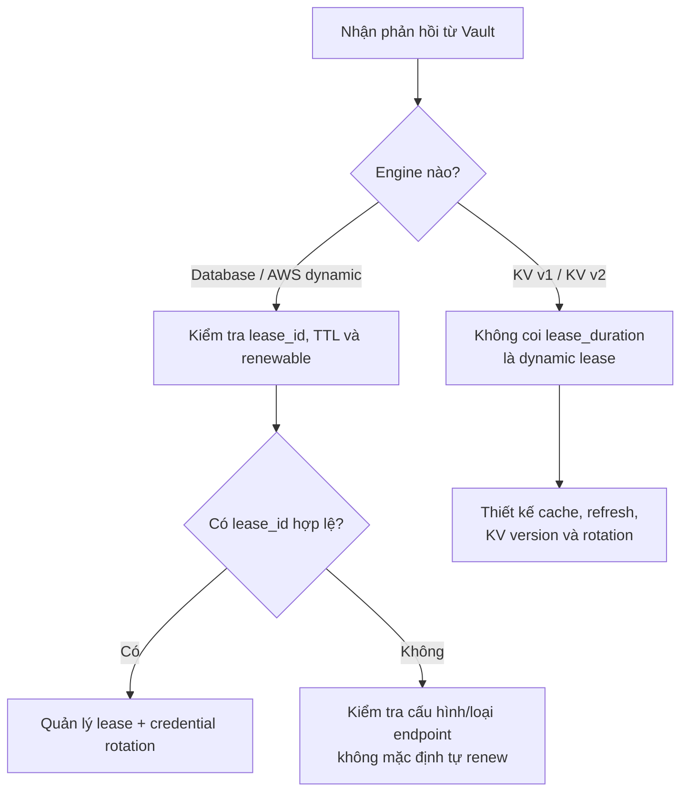
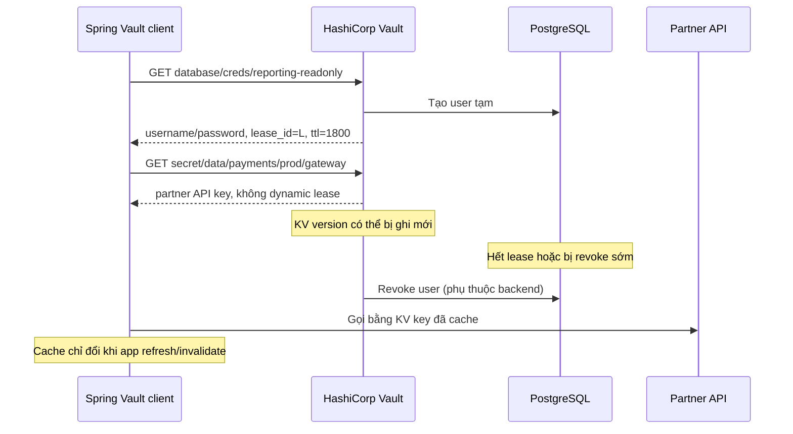

# Phân biệt lease của secret động với TTL gợi ý của KV

## 1. Vì sao cùng có TTL nhưng vòng đời rất khác nhau?

Trong chương **Vòng đời lease** của **Spring Vault**, một nhầm lẫn phổ biến là nhìn thấy `lease_duration` hoặc thời gian sống trong phản hồi **HashiCorp Vault** rồi kết luận mọi secret đều có thể `renew` và `revoke` như nhau. Thực tế, **secret động có lease thật** khác căn bản với **giá trị được lưu trong KV secrets engine**. Với KV, trường thời gian có thể chỉ là **gợi ý cho phía đọc**; nó không chứng minh Vault đã tạo một lease có thể thu hồi để tự xóa secret.

Sự khác biệt này ảnh hưởng trực tiếp tới ứng dụng Java dùng `VaultTemplate` / `VaultOperations`, cơ chế `SecretLeaseContainer`, cache và quy trình rotation. Nó cũng quyết định ứng dụng có phải xử lý tài khoản được Vault tạo ra trong PostgreSQL, AWS hay chỉ làm mới một API key tĩnh đang được lưu trong KV.

**Sau bài học, bạn có thể:**

1. Đọc các trường `lease_id`, `lease_duration`, `renewable` và phân biệt lease hợp lệ với TTL mang tính gợi ý.
2. Giải thích vòng đời secret động, tác động của renew, revoke, token bị thu hồi và lỗi tại hệ thống đích.
3. Phân biệt KV v1/KV v2, phiên bản dữ liệu, thời điểm xóa bản KV v2 và TTL của cache phía Java.
4. Chọn đúng cách dùng Spring Vault: quản lý lease cho dynamic secrets và chính sách refresh riêng cho KV.
5. Thiết kế kiểm thử và vận hành không phụ thuộc vào giả định sai về TTL.

> **Nguyên tắc quan trọng:** Một trường `lease_duration` có giá trị dương không đủ để chứng minh secret có lease động. Hãy kiểm tra loại engine, `lease_id` thực tế, `renewable` và semantics của backend.

## 2. Định nghĩa: lease thật, TTL và gợi ý TTL

### Lease của secret động là gì?

Một **lease** là mối quan hệ vòng đời do Vault quản lý đối với secret được cấp phát. Khi đọc credential động từ `database/creds/<role>`, Vault có thể tạo tài khoản/mật khẩu trên database rồi trả về:

- `lease_id`: định danh lease để Vault theo dõi, renew hoặc revoke.
- `lease_duration`: thời gian sống của lease, thường tính bằng **giây**.
- `renewable`: backend và policy có cho phép thử renew hay không.
- `data`: nội dung secret như `username` và `password`; tuyệt đối không đưa vào log.

Khi lease hết hạn hoặc bị revoke, Vault yêu cầu backend xử lý thu hồi credential tương ứng. Việc hủy/vô hiệu hóa ở database hoặc cloud là thao tác thực tế ngoài Vault, có thể cần thời gian và có thể thất bại. Bản sao credential ở RAM, disk, pool hoặc client khác không tự biến mất.

### TTL gợi ý của KV là gì?

**KV** là kho lưu giá trị tĩnh/được version hóa do người hoặc workload ghi vào. Vault không tạo tài khoản từ KV, cũng không cấp dynamic lease mỗi lần bạn đọc một key. Với một số phản hồi KV, đặc biệt KV v1 tùy phiên bản/cấu hình, trường `lease_duration` có thể mang ý nghĩa *khuyến nghị thời gian client nên cache dữ liệu trước khi đọc lại*.

Ví dụ một secret KV có TTL gợi ý 3600 giây có nghĩa rằng **ứng dụng có thể chọn đọc lại sau một giờ**. Điều đó **không** tự động có nghĩa:

- Vault sẽ xóa key sau một giờ.
- API key chứa trong KV sẽ hết hiệu lực ở hệ thống đối tác sau một giờ.
- Có lease ID để gọi `sys/leases/renew` hoặc `sys/leases/revoke`.
- Giá trị mới được đẩy tới JVM ngay khi người vận hành thay secret.

Với **KV v2**, phản hồi đọc giá trị thường có `lease_id` rỗng, `lease_duration=0` và `renewable=false`. Metadata về **version** và thời gian xóa version là cơ chế riêng, không biến KV thành secret động có lease.

### Phân biệt bằng một bảng

| Tiêu chí | Secret động có lease | KV secret và TTL gợi ý |
|---|---|---|
| Nguồn secret | Backend sinh credential theo yêu cầu, ví dụ Database/AWS secrets engine | Giá trị lưu sẵn trong KV v1/v2 |
| Ví dụ đường dẫn | `database/creds/reporting-readonly` | `secret/data/payments/prod/gateway` (API KV v2) |
| `lease_id` | Thường không rỗng; định danh lease thực | Thường rỗng; không có lease động để quản lý |
| `lease_duration` | TTL của lease theo backend/policy | Có thể là hint ở KV v1; KV v2 thường trả 0 |
| `renewable` | Có thể `true` hoặc `false` theo loại credential | Thường `false` |
| Khi hết TTL | Vault xử lý hết hạn/revoke lease, có thể vô hiệu hóa credential bên ngoài | Giá trị KV vẫn tồn tại cho đến khi được cập nhật/xóa theo cơ chế KV |
| Khi revoke lease | Có thể thu hồi credential theo backend | Không thể dùng lease revoke để "xóa KV key" nếu không có lease |
| Thay đổi giá trị | Thường tạo credential/lease mới | Ghi lại KV key; KV v2 có version mới |
| Cache phía Java | Phải gắn với lease và kế hoạch rotation | TTL cache do ứng dụng tự chọn; cần refresh/invalidate |

**Lưu ý:** `renewable=false` cũng **không đồng nghĩa** "không có lease": nhiều dynamic secrets có lease thật nhưng không cho renew. Dấu hiệu đáng tin cậy là semantics của engine và lease ID, không chỉ một boolean.

## 3. Đọc phản hồi JSON đúng cách

### 3.1. Phản hồi dynamic database credentials

Một phản hồi minh họa của Vault khi đọc `database/creds/reporting-readonly`:

```json
{
  "request_id": "example-request",
  "lease_id": "database/creds/reporting-readonly/example-lease",
  "lease_duration": 1800,
  "renewable": true,
  "data": {
    "username": "v-reporting-example",
    "password": "<REDACTED>"
  }
}
```

Ở đây, Vault đã phát hành lease trong **30 phút**. Có thể dùng lease ID để thực hiện renew/revoke **nếu policy và backend cho phép**. Không được suy luận việc renew chắc chắn kéo dài đủ số giây yêu cầu: Vault có thể giới hạn theo role, mount, max TTL hoặc thời hạn của token.

### 3.2. Phản hồi KV v1 có TTL gợi ý

Một phản hồi **minh họa về semantics** của KV v1:

```json
{
  "request_id": "example-request",
  "lease_id": "",
  "lease_duration": 3600,
  "renewable": false,
  "data": {
    "partnerApiKey": "<REDACTED>"
  }
}
```

Ở trường hợp này `lease_duration=3600` là dữ liệu ứng dụng có thể tham khảo để quyết định **thời điểm đọc lại**, còn `lease_id=""` cho biết không có một dynamic lease ID được phát hành. Giá trị `3600` chỉ để minh họa; phản hồi thực tế phụ thuộc backend và cấu hình Vault. Ngay cả khi ứng dụng hoàn toàn bỏ qua hint, Vault cũng **không tự revoke partner API key** dựa vào trường đó.

### 3.3. Phản hồi KV v2

KV v2 trả về dữ liệu và metadata trong cấu trúc lồng nhau của HTTP API, ví dụ:

```json
{
  "lease_id": "",
  "lease_duration": 0,
  "renewable": false,
  "data": {
    "data": {
      "partnerApiKey": "<REDACTED>"
    },
    "metadata": {
      "version": 5,
      "created_time": "2026-11-25T09:00:00Z",
      "deletion_time": "",
      "destroyed": false
    }
  }
}
```

`version=5` là phiên bản của key tại KV v2, **không phải lease number**. `deletion_time` và `destroyed` phản ánh trạng thái *version*, không phải thời hạn token hoặc lease. Khi dùng Spring Vault với `opsForKeyValue("secret", KeyValueBackend.KV_2)`, thư viện xử lý lớp JSON KV v2 để trả dữ liệu theo API thuận tiện hơn; đừng bóc tay theo cấu trúc HTTP ở mọi use case.

### 3.4. Quy tắc phân loại



Đừng xây dựng một hàm tổng quát `if (lease_duration > 0) renewSecret()`. Hàm đó sẽ diễn giải sai KV v1 và còn bỏ sót dynamic credentials không renewable.

## 4. Timeline: hai secret cùng hiện "30 phút" nhưng kết quả khác nhau

Giả sử một service Java đọc hai loại secret lúc 10:00:

- Database engine tạo user `v-readonly` với **lease TTL 30 phút**.
- KV v1 chứa API key đối tác và phản hồi **hint 30 phút**.

| Mốc thời gian | Dynamic database credential | KV secret |
|---|---|---|
| 10:00 | Vault tạo user, lease L sống đến khoảng 10:30 nếu không renew/revoke | Vault trả giá trị key và hint 30 phút |
| 10:15 | App có thể renew L nếu lease renewable và policy cho phép | Người vận hành có thể cập nhật KV; ứng dụng vẫn có thể đang dùng bản cache |
| 10:30 | Nếu L hết hạn, Vault bắt đầu revoke user theo backend | KV key không tự biến mất do hint; app **nên** xác minh cache/đọc lại theo policy |
| 10:35 | App cần credential khác nếu user đã bị revoke | App có thể đọc version mới, hoặc version cũ nếu chưa thay key |
| Bất kỳ lúc nào | Operator revoke token sở hữu L, có thể kéo theo L dù chưa hết TTL | Revoke token chỉ ngăn request mới bằng token đó; dữ liệu đã ghi trong KV vẫn còn |



TTL hint không đồng nghĩa đối tác chấp nhận key trong đúng 30 phút; quyền sử dụng key do **bên phát hành key** quyết định. Nếu ứng dụng tiếp tục dùng key cũ sau khi đối tác đã revoke, request sẽ thất bại dù KV vẫn lưu giá trị ấy.

## 5. Vì sao dynamic lease có thể bị thu hồi trước TTL?

Một lease động phụ thuộc vào chính sách Vault, trạng thái token sở hữu, backend và điều kiện vận hành. Các tình huống phổ biến:

1. **Token sở hữu bị thu hồi:** Với service token thông thường, Vault thu hồi các leases gắn với token; child token và leases của nó cũng có thể bị cascade revoke theo cây token.
2. **Lease bị revoke trực tiếp:** Người vận hành có quyền gọi `vault lease revoke <lease-id>` hoặc API tương ứng mà không nhất thiết thu hồi token.
3. **Token hết hạn hoặc bị giới hạn thời gian sống:** Có thể dẫn tới revocation chuỗi lease theo quan hệ sở hữu.
4. **Secrets engine/role thay đổi:** Cấu hình và policy mới có thể ảnh hưởng lần renew tiếp theo, việc cấp credential mới hoặc quy trình thu hồi.
5. **Backend có giới hạn riêng:** Database user có thể bị vô hiệu hóa tại hệ thống đích vì nguyên nhân ngoài Vault.

Không thể bảo đảm credential thực ở database biến mất **ngay tại thời điểm** Vault nhận lệnh revoke: plugin có thể gặp lỗi kết nối hoặc backend trì hoãn. Nếu Vault báo lease không thể revoke thành công, đội vận hành cần kiểm tra trạng thái hệ thống đích và xử lý theo runbook. Bản sao `username/password` trong JVM cũng không bị tự động xóa.

Đối với token type **batch** hoặc orphan token, quan hệ với lease có khác biệt so với cây **service token** bình thường. Vì vậy khi xác định phạm vi cascade revocation phải kiểm tra token type, parent relation và lease thực sự, không chỉ đoán từ TTL.

## 6. KV có phiên bản và thời gian xóa, nhưng đó không phải lease

KV v2 bổ sung cơ chế lịch sử phiên bản và các tùy chọn bảo vệ dữ liệu:

| Cơ chế KV v2 | Chức năng | Có giống dynamic lease không? |
|---|---|---|
| `version` | Đánh số mỗi lần ghi giá trị KV v2 | Không; version chỉ định bản dữ liệu đã lưu |
| `created_time` | Thời điểm ghi phiên bản | Không; không phải thời điểm tạo credential động |
| `max_versions` | Giới hạn số phiên bản giữ lại cho key | Không; quản lý lịch sử, không quản lý tài khoản bên ngoài |
| `delete_version_after` | Quy định khoảng thời gian sau đó phiên bản có thể bị **soft-delete** theo chính sách KV v2 | Không; là chính sách xóa version, không phát hành lease ID |
| `deletion_time` | Thời gian phiên bản bị đánh dấu xóa hoặc được lên lịch xóa | Không; không có renew lease |
| `destroyed` | Phiên bản đã bị hủy dữ liệu vĩnh viễn hay chưa | Không; tách biệt với revoke token |
| `cas_required` | Bắt buộc cơ chế check-and-set khi ghi để tránh overwrite sai version | Không; liên quan điều khiển đồng thời khi ghi |

### `delete_version_after` dễ gây hiểu lầm

Giả sử KV v2 có `delete_version_after="24h"`: đây là chính sách liên quan đến thời điểm **soft-delete phiên bản** sau khi ghi, có giới hạn tùy mount/key configuration. Nó không có nghĩa:

- API key do đối tác cấp tự hết hiệu lực sau 24 giờ.
- Mỗi lần đọc được cấp một lease 24 giờ.
- Ứng dụng được gọi `sys/leases/renew` để kéo dài thời gian lưu version.
- Dữ liệu đã cache ở client bị Vault xóa khỏi JVM sau 24 giờ.

Xóa mềm (*soft delete*) còn khác `destroy` vĩnh viễn theo semantics KV v2; thao tác undelete có điều kiện riêng. Khi lập quy trình rotation, phải biết version mới/đã soft-delete/đã destroy, nhưng không dùng các trạng thái đó như TTL của credential được cấp bởi engine khác.

### KV không phải bộ quản lý trạng thái credential ở hệ thống ngoài

Nếu KV chứa API key do đối tác cấp, việc `vault kv put` giá trị mới chỉ thay **giá trị được lưu**. Key cũ vẫn có thể hoạt động ở đối tác cho đến khi tổ chức thực sự thu hồi key đó; key mới có thể chưa được đối tác kích hoạt. Quy trình rotation phải phối hợp với hệ thống đích:

1. Phát hành credential mới tại đối tác hoặc hệ thống sở hữu.
2. Ghi KV version mới bằng quy trình được cấp quyền.
3. Refresh cache/instance Java để dùng credential mới.
4. Kiểm tra dịch vụ downstream sử dụng credential mới thành công.
5. Thu hồi credential cũ ở hệ thống đích sau cửa sổ chồng lấn phù hợp.

KV versioning cho phép lưu lại thay đổi và rollback theo policy, nhưng một phiên bản cũ có thể chứa credential đã bị thu hồi ở nơi khác. "Có thể đọc version cũ" không có nghĩa "credential còn hợp lệ".

## 7. Chọn cơ chế Spring Vault theo từng loại secret

### 7.1. Đọc KV v2 qua `VaultOperations`

Đối với một API key tĩnh, dùng `VaultKeyValueOperations` thay vì yêu cầu `SecretLeaseContainer` renew một lease không tồn tại:

```java
import java.util.Map;

import org.springframework.stereotype.Component;
import org.springframework.vault.core.VaultOperations;
import org.springframework.vault.core.VaultKeyValueOperationsSupport.KeyValueBackend;
import org.springframework.vault.support.VaultResponse;

@Component
public final class PartnerApiKeyProvider {
    private final VaultOperations vault;

    public PartnerApiKeyProvider(VaultOperations vault) {
        this.vault = vault;
    }

    public String load() {
        VaultResponse response = vault
            .opsForKeyValue("secret", KeyValueBackend.KV_2)
            .get("payments/prod/gateway");

        Map<String, Object> data =
            response == null ? null : response.getData();
        if (data == null || !(data.get("apiKey") instanceof String)
                || ((String) data.get("apiKey")).isBlank()) {
            throw new IllegalStateException(
                "Thiếu API key của gateway trong KV");
        }
        return (String) data.get("apiKey");
    }
}
```

Ví dụ:

- `"secret"` là tên mount **KV v2**. `"payments/prod/gateway"` là logical path, không chứa đoạn `data/`.
- Trường `apiKey` là schema nội bộ của ứng dụng. Nếu key bị thiếu/sai kiểu, fail closed và báo lỗi cấu hình; không dùng giá trị giả.
- Phương thức `load()` thực hiện đọc mới mỗi lần gọi. Nếu nghiệp vụ cần cache, phải bọc nó trong provider có TTL/refresh và đồng bộ truy cập rõ ràng.
- Không ghi response hoặc secret plaintext trong log, tracing hay exception trả về client.

### 7.2. Quản lý dynamic secrets với `SecretLeaseContainer`

Với dynamic database credentials, Spring Vault có `SecretLeaseContainer` hỗ trợ theo dõi lease và các thao tác renew/rotate. Ví dụ cấu hình ở nơi ứng dụng quản lý lifecycle:

```java
import org.springframework.context.annotation.Bean;
import org.springframework.context.annotation.Configuration;
import org.springframework.scheduling.TaskScheduler;
import org.springframework.vault.core.VaultOperations;
import org.springframework.vault.core.lease.SecretLeaseContainer;

@Configuration
class DatabaseLeaseConfiguration {

    @Bean
    SecretLeaseContainer databaseLeaseContainer(
            VaultOperations operations, TaskScheduler scheduler) {

        SecretLeaseContainer leases =
                new SecretLeaseContainer(operations, scheduler);

        // Credential động cần được làm mới theo vòng đời lease.
        leases.requestRotatingSecret(
                "database/creds/reporting-readonly");

        // Ứng dụng cần thêm listener xử lý credential mới
        // và thay datasource/pool trước khi phục vụ lưu lượng.
        return leases;
    }
}
```

Mã trên minh họa cấu hình container quản lý lease. Trong ứng dụng thật, cần khai báo listener trước khi container được start/initialize, bảo đảm Spring quản lý lifecycle, tránh tạo hai container cho cùng một lease và gắn cơ chế thay **database connection pool** theo sự kiện cấp/rotation.

Điểm cần phân biệt:

| API / thành phần | Dùng cho | Không nên dùng để |
|---|---|---|
| `VaultOperations.opsForKeyValue(..., KV_2)` | Đọc/ghi KV v2 với logical path và data schema | Gia hạn một dynamic lease không tồn tại |
| `SecretLeaseContainer` | Theo dõi, renew hoặc rotate secret có lease thích hợp | Coi tất cả KV response có `lease_duration` là secret động |
| `LifecycleAwareSessionManager` | Quản lý Vault authentication token, renew/re-login theo khả năng | Gia hạn tất cả leases hoặc tự thay DB pool |
| `SessionLeaseContainer` (khi tích hợp hỗ trợ) | Phối hợp session lifecycle và secret lease lifecycle | Thay thế công việc chuyển client/pool sang credential mới |
| Cache ứng dụng | Hạn chế lượt đọc KV, đặt ngưỡng độ cũ theo nghiệp vụ | Tự khẳng định credential còn hiệu lực ở hệ thống đích |

**Chú ý:** Renew **Vault token** và renew **secret lease** là hai hành động khác nhau. Token hết hạn/revoke có thể ảnh hưởng secret lease động. Spring Vault tự đăng nhập lại chỉ cung cấp token mới; credential đã bị backend revoke cần được cấp mới và áp dụng lại cho consumer.

### 7.3. Nếu `renewable=false` với secret động

Dynamic secret vẫn có thể mang lease ID nhưng không được renew. Với loại này:

1. Xem thời gian còn lại của lease và chính sách max TTL.
2. Xin credential mới **trước** thời điểm cũ hết hiệu lực, có biên an toàn.
3. Chuyển connection pool/SDK client sang credential mới sau khi xác minh.
4. Đóng/drain tài nguyên cũ; xử lý rollback nếu credential mới thất bại.

Không dùng `renewable=false` như lý do lưu credential mãi mãi. Khi lease hết hạn, credential có thể bị revoke dù chưa từng được renew.

## 8. Cache: TTL của ứng dụng là một quyết định riêng

Một provider KV có thể chọn TTL cache 5 phút ngay cả khi phản hồi KV v1 có hint 30 phút. Đó là **chính sách độ cũ tối đa do nghiệp vụ chọn**. Khi thiết kế, nên tính từ:

- Tần suất rotation: key đối tác đổi mỗi ngày hay mỗi 10 phút?
- Cửa sổ hiệu lực đồng thời của key cũ/mới: hệ thống ngoài có cho phép hai keys không?
- Chi phí gọi Vault: độ trễ, rate limit, lỗi mạng, số replicas.
- Yêu cầu bảo mật: nếu một key bị lộ và buộc revoke tức thời, liệu cache 30 phút có chấp nhận được?
- Độ sẵn sàng: khi Vault tạm ngừng, dùng bản cache cũ trong thời gian nào còn an toàn?

Một quy tắc thô khi có cửa sổ rotation dài `W`, thời gian refresh tối đa `C` và biên an toàn `M` là **chọn `C < W - M`**. Đây là yêu cầu về thiết kế vận hành, không phải quan hệ TTL do Vault tự áp đặt.

### Hai thiết kế thường gặp

| Thiết kế | Cách hoạt động | Chi phí/rủi ro |
|---|---|---|
| **Đọc KV mỗi lần** | Mỗi use case yêu cầu Vault hiện tại | Latency và phụ thuộc Vault cho từng request; không cần cache invalidation |
| **Cache có TTL và refresh** | Lưu giá trị trong bộ nhớ với hết hạn theo ứng dụng | Có độ cũ, cần xử lý refresh đồng thời và chính sách khi Vault lỗi |

Tránh **cache vô thời hạn** chỉ vì secret đến từ Vault. Vault KV không push giá trị mới đến mọi tiến trình Java, nên việc vận hành phải có quy trình làm mới/rollout. Ngược lại, một dynamic secret cache "30 phút" nhưng không quản lý lease vẫn có thể bị revoke ở phút thứ 5.

### Khi refresh KV thất bại

Không có câu trả lời mặc định cho mọi nghiệp vụ:

1. Với credential dùng cho giao dịch tài chính, có thể phải chặn yêu cầu khi quá giới hạn độ cũ hoặc không xác minh được credential.
2. Với chức năng không quan trọng, có thể tạm ngừng tính năng đó, ghi metric và thông báo vận hành.
3. Chỉ áp dụng **stale-while-revalidate** nếu hệ thống đích vẫn chấp nhận credential cũ và tổ chức đã cho phép rõ ràng.
4. Dùng backoff/jitter và gộp các request cùng refresh để tránh hàng trăm replicas đồng thời gây bão request lên Vault.

Không biến `lease_duration` của KV thành SLA freshness mặc định khi chưa có phân tích nghiệp vụ. Trong KV v2, `lease_duration=0` cũng **không bắt buộc** bạn phải đọc lại trên mọi request; có thể cache theo chính sách được thiết kế.

## 9. Policy: quyền nào phục vụ loại secret nào?

Một ứng dụng đọc KV v2 và một ứng dụng xin database credential cần quyền tương ứng với **đúng endpoint**.

```hcl
# KV v2: cho phép đọc chính xác một key
path "secret/data/payments/prod/gateway" {
  capabilities = ["read"]
}

# Database secrets engine: cho phép lấy dynamic credential của đúng role
path "database/creds/reporting-readonly" {
  capabilities = ["read"]
}
```

Đây là ví dụ policy dành cho workload có cả hai nhu cầu. Trong thiết kế production, nếu hai service không cần dùng chung cả KV lẫn Database, nên tách policies/roles để giảm blast radius.

Đường dẫn của KV **HTTP API/policy** có đoạn `data`, còn khi gọi `VaultOperations.opsForKeyValue("secret", KV_2).get("payments/prod/gateway")`, truyền logical path không có `data`. Dynamic database endpoint `database/creds/reporting-readonly` không có lớp `data` của KV v2.

Các hành động renew/revoke lease chịu chính sách và quyền API Vault tương ứng. Đừng cấp quyền quản lý `sys/leases/*` toàn cục cho mọi workload chỉ để "refresh KV". KV refresh là yêu cầu **read** mới; không cần revoke hoặc renew một lease không tồn tại.

## 10. Thực hành trên Vault thử nghiệm

Chỉ thực hiện các bước sau trong môi trường **sandbox** được cấp quyền, với secrets engine và database thử nghiệm đã cấu hình. Dùng dữ liệu giả, không in password/API key ra terminal hoặc CI logs.

### 10.1. Quan sát dynamic lease

Trong CLI có `jq` và quyền đọc role `reporting-readonly`:

```bash
vault read -format=json database/creds/reporting-readonly \
  | jq '{lease_id, lease_duration, renewable}'
```

Dự kiến `lease_id` có giá trị, `lease_duration` khác 0 và `renewable` phản ánh cấu hình. Để kiểm chứng vòng đời, lưu lease ID vào biến trong terminal test riêng, tra cứu lease, thử renew nếu được phép và thực hiện revoke có kiểm soát. Không bật shell tracing trong shell xử lý credentials. Mọi thao tác revoke có thể tác động tới user thật trong database thử nghiệm.

### 10.2. Quan sát KV v2

```bash
vault kv get -mount=secret -format=json payments/prod/gateway \
  | jq '{lease_id, lease_duration, renewable, version: .data.metadata.version}'
```

Kỳ vọng KV v2 có `lease_id=""`, `lease_duration=0` và `renewable=false`; phiên bản được đọc từ metadata. CLI có thể hiển thị cấu trúc khác tùy version; nếu cần, kiểm tra output test đã được **lọc dữ liệu nhạy cảm**, không in nguyên response khi có `apiKey`.

Đọc KV nhiều lần không tạo ra dynamic lease mới. Thử cập nhật `apiKey` giả tại key thử nghiệm (bằng workload có quyền ghi), rồi đọc lại để quan sát `version` tăng. Key có version mới nhưng vẫn **không xuất hiện lease ID**.

### 10.3. Kiểm tra "TTL hint có làm dữ liệu biến mất không?"

Nếu môi trường test có KV v1 trả về `lease_duration > 0`, hãy:

1. Đọc key test và ghi lại **chỉ** `lease_id`/`lease_duration`/`renewable`.
2. Đợi qua mốc TTL hint (hoặc cấu hình khoảng thời gian ngắn riêng cho test nếu được phép).
3. Đọc lại bằng Vault token còn quyền và còn hạn.
4. Xác minh key vẫn tồn tại nếu không có thao tác cập nhật/xóa độc lập.

Đây là kiểm thử ý nghĩa của TTL hint, **không** phải test revoke một lease: không có lease ID để revoke từ KV. Nếu token đọc đã hết hạn, cần đăng nhập lại trước khi kết luận trạng thái lưu trữ KV.

## 11. Kiểm thử Java: phân biệt hai hợp đồng

### 11.1. Unit test cho KV provider

Mock `VaultOperations` và `VaultKeyValueOperations` trong Java để kiểm tra:

- `get(logicalPath)` trả giá trị đúng schema; provider map đúng field.
- Response `null`, missing key, empty key hoặc field sai kiểu phải tạo lỗi cấu hình.
- Code không gọi API `sys/leases/renew`/`revoke` chỉ vì đọc một KV secret.
- Khi bọc bằng cache, TTL cache hết hạn dẫn tới read mới; refresh đồng thời được giới hạn.
- Chỉ số truy cập/cache không ghi plaintext key.

### 11.2. Integration test cho dynamic lease

Sử dụng Vault sandbox và PostgreSQL thử nghiệm để kiểm tra:

1. Đọc `database/creds/reporting-readonly` tạo lease ID thật; credential ban đầu kết nối thành công.
2. Gia hạn lease nếu renewable, kiểm tra TTL thực tế được Vault trả về, không dùng thời lượng yêu cầu như kết quả mặc định.
3. Revoke riêng lease, xác minh tài khoản tại PostgreSQL được backend xử lý; connection pool không tiếp tục dùng credentials cũ cho kết nối mới.
4. Revoke Vault token sở hữu lease trước thời điểm hết TTL, kiểm chứng lease bị xử lý revoke (có thể có độ trễ hoặc lỗi plugin).
5. Re-login và xin credential mới, chuyển pool sang credential mới; không "tái sử dụng" lease cũ.
6. Cho database tạm không thể kết nối khi revoke, quan sát lỗi/irrevocable lease; xác minh cách cảnh báo và khắc phục.

**Không** viết test cho Vault KV theo cách "đợi `lease_duration` giây rồi assert dữ liệu đã bị xóa", bởi đó là giả định sai. Với KV v2, test version và `delete_version_after` phải là bài toán riêng về metadata và soft-delete.

## 12. Lỗi thiết kế thường gặp

| Lỗi | Hậu quả | Cách sửa |
|---|---|---|
| Cho rằng `lease_duration > 0` nghĩa là có lease thật | Gọi renew/revoke sai cho KV v1 | Xác định engine + `lease_id`; KV dùng refresh |
| Cho rằng `renewable=false` nghĩa là "tĩnh" | Bỏ qua lease không renewable của dynamic credentials | Dựa vào loại secret/lease ID; lên lịch cấp credential mới |
| Đặt `lease_duration=0` của KV v2 bằng "không được cache" | Gây request quá tải tới Vault | Chọn cache TTL theo SLA và rotation |
| Dùng cache TTL để quản lý DB dynamic credentials | Credential bị revoke trước cache TTL vẫn được dùng | Dùng lease-aware rotation và thay pool |
| Dùng KV versioning để "revoke API key" tại đối tác | Key cũ có thể vẫn còn hiệu lực ngoài Vault | Thu hồi tại issuer/đối tác và cập nhật KV |
| Coi `delete_version_after` là TTL của lease | Hiểu sai thời điểm soft-delete và quyền khôi phục version | Quản lý KV version lifecycle riêng |
| Tự thêm `/data/` vào logical path của `opsForKeyValue(KV_2)` | 404 hoặc đọc sai path | Tách mount, logical path, Vault HTTP policy path |
| Token được renew thì cho rằng lease cũng được renew | Credential có thể hết hạn/revoke trước kỳ vọng | Theo dõi token và lease độc lập |
| Log toàn bộ `VaultResponse` để đọc TTL | Lộ secret plaintext trong logs | Log metadata đã lọc và metric hữu hạn |
| Revoke Vault token rồi coi mọi DB session đã dừng ngay | Có thể tồn tại connection cũ hoặc backend revoke lỗi | Kiểm tra backend và thay/đóng pool theo runbook |

## 13. Bài tập tình huống

**Tình huống A — KV v1 trả TTL dương.** Một Java service đọc API key từ KV v1, thấy `lease_duration=7200`, `renewable=false` và `lease_id=""`. Nhà phát triển viết cron gọi `sys/leases/renew` sau mỗi 90 phút. Hãy chỉ ra điều gì sai và đề xuất chiến lược cache/refresh khi đối tác cho phép key cũ và key mới cùng hợp lệ trong 15 phút.

**Tình huống B — Dynamic DB credential bị thu hồi giữa TTL.** App lấy lease PostgreSQL có TTL 45 phút; sau 8 phút token sở hữu bị revoke. Cache Java vẫn cho phép dùng username/password 45 phút. Hãy mô tả quy trình phát hiện lỗi, re-login, lấy credential mới, thay connection pool, xử lý transaction và ghi metric.

**Tình huống C — KV v2 xóa version.** KV v2 được cấu hình `delete_version_after=24h` và một ứng dụng cache giá trị trong 1 giờ. Sau 24 giờ phiên bản cũ bị soft-delete nhưng một replica vẫn còn plaintext trong RAM. Hãy phân biệt: trạng thái version ở Vault, trạng thái credential tại hệ thống phát hành, hiệu lực cache trong replica và khả năng undelete/destroy theo policy.

**Tình huống D — Lease không renewable.** Một secrets engine phát hành credential động với `lease_id` hợp lệ, `lease_duration=1200`, `renewable=false`. Hãy giải thích tại sao vẫn cần quản lý lease, cách xác định ngưỡng yêu cầu credential mới trước hết hạn, và vì sao không nên cố gọi renew vô hạn.

Để đánh giá lời giải, kiểm tra bốn câu hỏi: **Vault có tạo lease ID thật không? TTL điều khiển tài nguyên nào? Ai có thể renew/revoke nó? Ứng dụng cần làm gì khi dữ liệu trong RAM không còn khớp với hệ thống nguồn?**

## 14. Tài liệu tham khảo

- [HashiCorp Vault — Lease concepts](https://developer.hashicorp.com/vault/docs/concepts/lease): lease ID, TTL, renewal, revocation và đặc tính của KV.
- [HashiCorp Vault — Tokens](https://developer.hashicorp.com/vault/docs/concepts/tokens): vòng đời token, cascade revocation, service/batch tokens.
- [HashiCorp Vault — KV v1](https://developer.hashicorp.com/vault/docs/secrets/kv/kv-v1): KV static secrets và API.
- [HashiCorp Vault — KV v2](https://developer.hashicorp.com/vault/docs/secrets/kv/kv-v2): versioning, metadata, soft-delete, destroy.
- [HashiCorp Vault — Database secrets engine](https://developer.hashicorp.com/vault/docs/secrets/databases): dynamic credentials và cơ chế revocation.
- [HashiCorp Vault — Lease CLI](https://developer.hashicorp.com/vault/docs/commands/lease): lookup/renew/revoke lease.
- [Spring Vault — Credentials Rotation](https://docs.spring.io/spring-vault/reference/vault/credential-rotation.html): `SecretLeaseContainer`, vòng đời renewable/rotating secret.
- [Spring Vault — SecretLeaseContainer Javadoc](https://docs.spring.io/spring-vault/reference/api/java/org/springframework/vault/core/lease/SecretLeaseContainer.html): API theo dõi lease và sự kiện.
- [Spring Vault — Authentication and Token Lifecycle](https://docs.spring.io/spring-vault/reference/vault/authentication.html): `ClientAuthentication` và `LifecycleAwareSessionManager`.
