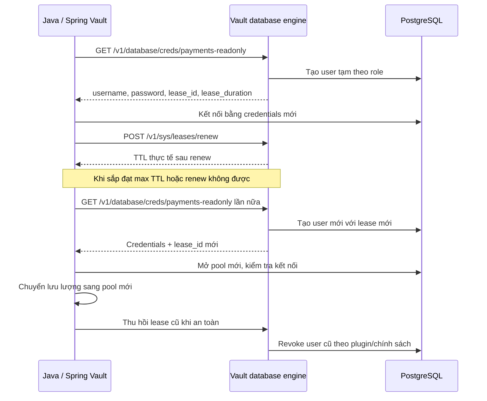
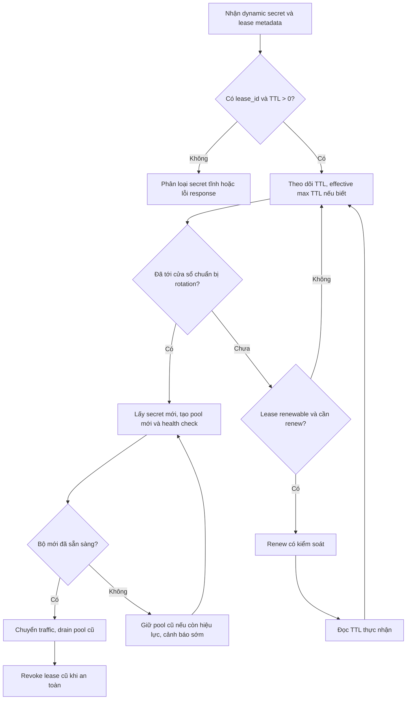

# Giới hạn max TTL và thời điểm cần lấy secret mới

## 1. Vì sao gia hạn lease không thể thay thế việc lấy secret mới?

Khi ứng dụng Java sử dụng **Spring Vault** để lấy dynamic secrets từ HashiCorp Vault, chẳng hạn tài khoản database tạm thời, Vault thường trả một **lease**. Lease xác định khoảng thời gian Vault quản lý quyền sử dụng bí mật được cấp. Ứng dụng có thể gia hạn lease nếu backend cho phép, nhưng việc gia hạn không nhất thiết kéo dài mãi mãi: **max TTL (maximum time to live)** hoặc ràng buộc của token/engine có thể đặt giới hạn trên tuổi thọ thực tế.

Ví dụ, dịch vụ `payments-api` nhận thông tin đăng nhập PostgreSQL lúc 10:00, lease ban đầu 20 phút và giới hạn tối đa 60 phút kể từ lúc cấp. Việc renew ở 10:15 có thể giúp tài khoản tiếp tục dùng được, nhưng không được giả định rằng có thể kéo dài tài khoản cũ vô hạn sau 11:00. Dịch vụ cần **lấy một bộ credentials mới, chuyển kết nối sang bộ mới và giải phóng tài nguyên cũ** trước khi lease hiện tại mất hiệu lực.

Sau bài này, bạn có thể:

- Phân biệt `lease_duration`, TTL còn lại, `renewable`, `default_ttl` và **effective max TTL**.
- Đọc lease metadata, renew/revoke qua HTTP API và lý giải vì sao `increment` chỉ là đề nghị.
- Chọn thời điểm **renew** và thời điểm **cấp secret mới** cho database credentials.
- Sử dụng `SecretLeaseContainer` của Spring Vault và hiểu khác biệt giữa `RENEW` và `ROTATE`.
- Thiết kế chuyển đổi connection pool, giám sát, xử lý lỗi và kiểm thử tích hợp khi lease đạt trần TTL.

> **Phạm vi:** Trọng tâm là dynamic secrets có lease như database credentials. KV v2 secrets tĩnh, Vault client token, chứng chỉ PKI và Transit encryption có vòng đời riêng; không áp dụng một lịch renew lease chung cho tất cả.

## 2. Vòng đời của một dynamic secret

Giả sử Vault đã mount database secrets engine tại `database/`, có role `payments-readonly`. Ứng dụng gọi:

```http
GET /v1/database/creds/payments-readonly HTTP/1.1
Host: vault.example.internal:8200
X-Vault-Token: <workload-token>
```

Phản hồi minh họa (giá trị đã thay thế):

```json
{
  "lease_id": "database/creds/payments-readonly/example-lease-id",
  "lease_duration": 1200,
  "renewable": true,
  "data": {
    "username": "v-payments-example",
    "password": "<new-database-password>"
  }
}
```

`lease_duration: 1200` biểu thị thời gian lease ban đầu là **1.200 giây = 20 phút** tại thời điểm cấp. `renewable: true` cho biết backend cho phép yêu cầu gia hạn trong những điều kiện nhất định. Nó **không** xác nhận giới hạn tối đa là bao nhiêu, cũng **không** bảo đảm mỗi lần renew sẽ thành công.



Với database plugin, kết quả cụ thể khi lease hết hạn hoặc bị revoke phụ thuộc hệ quản trị CSDL, câu lệnh thu hồi và các phiên kết nối đang tồn tại. **Không giả định** mọi session SQL đang mở bị đóng tức thì hoặc chắc chắn tiếp tục dùng được. Ứng dụng phải quản lý pool, timeout và thao tác dở dang theo khả năng thực tế của database.

### Bốn thời điểm khác nhau

| Mốc | Nghĩa | Hệ quả vận hành |
| --- | --- | --- |
| **Issue time** | Khi Vault phát hành lease/credentials. | Mốc bắt đầu tính tuổi lease; lưu metadata an toàn để lập kế hoạch. |
| **Current expiration** | Khi lease hiện tại hết hiệu lực nếu không renew. | Renew trước thời điểm này hoặc lấy secret mới kịp lúc. |
| **Effective max lifetime** | Giới hạn tuổi tối đa được backend và cấu hình áp dụng. | Renew có thể bị rút ngắn hoặc từ chối khi gần chạm trần. |
| **Rotation/cutover time** | Khi ứng dụng lấy credentials mới và chuyển các thành phần phụ thuộc. | Phải dành đủ thời gian để thử kết nối và hoàn tất chuyển đổi. |

Điểm dễ nhầm: **gia hạn lease không tạo username/password mới**. `renew` thường kéo dài quyền sử dụng của **secret hiện có**, trong khi đọc lại `database/creds/payments-readonly` để cấp mới tạo **secret và lease khác**.

## 3. `default_ttl` và `max_ttl` được áp dụng thế nào?

Vault có các mức cấu hình TTL. Những giá trị có hiệu lực phụ thuộc loại secrets engine, phiên bản Vault, role và mount; không thể suy ra **max TTL** chỉ từ trường `lease_duration` của một lần cấp secret.

| Mức cấu hình | Vai trò | Ví dụ |
| --- | --- | --- |
| **System default/max TTL** | Giá trị mặc định hoặc giới hạn toàn Vault khi cấu hình chi tiết không ghi đè được. | Chính sách toàn hệ thống giới hạn tuổi token/lease. |
| **Mount tuning** | `default_lease_ttl`, `max_lease_ttl` trên secrets engine mount. | Mount `database/` có max TTL là `1h`. |
| **Role/secret-specific settings** | TTL ban đầu và giới hạn riêng của role hoặc backend nếu hỗ trợ. | `database/roles/payments-readonly` đặt `default_ttl=20m`, `max_ttl=1h`. |
| **Giới hạn token và quan hệ thu hồi** | Lease có thể bị revoke khi Vault token gắn với lease hết hạn/bị revoke. | Token phiên bị thu hồi trước khi lease chạm max TTL. |

Vault xét các giới hạn liên quan để xác định TTL hiệu lực. Thông thường, một giới hạn thấp hơn sẽ khống chế một yêu cầu TTL dài hơn; cấu hình mount và backend có thể chi phối cách tính **effective max TTL**. Vì vậy, nếu role ghi `max_ttl=4h` nhưng mount chỉ cho tối đa `1h`, không được mặc định lease sẽ sống đủ bốn giờ.

Người vận hành có quyền tương ứng có thể kiểm tra cấu hình (lệnh minh họa, không dùng token production trong bài tập):

```bash
# Cấu hình mặc định và trần TTL của mount database.
vault read sys/mounts/database/tune

# Cấu hình cụ thể của database role.
vault read database/roles/payments-readonly
```

Tùy backend, các field có thể có `default_ttl`, `max_ttl`, `default_lease_ttl`, `max_lease_ttl`. Đừng sửa TTL mount/role để “cứu” một lease đang sắp hết hạn khi chưa kiểm tra tác động lên những lease đã cấp và policy vận hành. **Lịch sử thay đổi cấu hình không đồng nghĩa mọi lease đang tồn tại được tính lại theo cùng cách**; hành vi cần được kiểm chứng trên secrets engine và Vault version thực tế.

### Vì sao `renewable=true` vẫn chạm trần?

Một lease có thể được đánh dấu renewable vì backend hỗ trợ gia hạn, nhưng điều kiện gia hạn còn bao gồm:

1. Lease vẫn đang tồn tại và chưa bị revoke.
2. Token gửi yêu cầu còn hiệu lực, có quyền gọi endpoint renew thích hợp.
3. Backend hỗ trợ renew cho loại secret đó và trạng thái của secret hiện tại.
4. Lease chưa chạm giới hạn tối đa có hiệu lực hoặc các ràng buộc tương đương.
5. Vault/backend còn sẵn sàng phục vụ và không từ chối vì lỗi tài nguyên hoặc hạ tầng.

Do đó, **`renewable=true` là tín hiệu có thể thử renew, không phải bảo đảm có thể tiếp tục dùng secret hiện tại vô hạn**. Khi lease gần max TTL, Vault có thể trả TTL ngắn hơn thời gian đề nghị hoặc lỗi không thể gia hạn, tùy loại engine và trạng thái.

## 4. Kiểm tra lease, renew và revoke bằng Vault HTTP API

### 4.1. Lookup lease hiện có

Endpoint quản trị lease nhận `lease_id` trong JSON:

```http
POST /v1/sys/leases/lookup HTTP/1.1
X-Vault-Token: <authorized-token>
Content-Type: application/json

{"lease_id":"database/creds/payments-readonly/example-lease-id"}
```

Các trường metadata thường gồm `id`, `issue_time`, `expire_time`, `last_renewal_time`, `renewable` và `ttl`. Thời hạn **`ttl` là số giây còn lại tại lúc lookup**; `expire_time` phản ánh mốc hết hạn hiện tại. Chúng không nhất thiết cho biết chính xác thời điểm max TTL nếu thiếu thông tin backend/mount/role.

```json
{
  "id": "database/creds/payments-readonly/example-lease-id",
  "issue_time": "2026-11-25T10:00:00Z",
  "expire_time": "2026-11-25T10:35:00Z",
  "last_renewal_time": "2026-11-25T10:15:00Z",
  "renewable": true,
  "ttl": 600
}
```

Đây là ví dụ các trường quan trọng theo tài liệu Lease API; response thực tế và lớp đóng gói JSON có thể khác theo endpoint, Vault version và client. Không ghi `lease_id` hay metadata chứa danh tính nhạy cảm một cách không kiểm soát vào metric/log.

### 4.2. Renew một lease

```http
POST /v1/sys/leases/renew HTTP/1.1
X-Vault-Token: <authorized-token>
Content-Type: application/json

{
  "lease_id": "database/creds/payments-readonly/example-lease-id",
  "increment": 1200
}
```

`increment` ở endpoint này là **số giây mong muốn tính từ thời điểm gia hạn**, không phải số giây cộng thêm vào hạn hiện tại. Ví dụ, renew tại 10:15 với `increment=1200` là yêu cầu TTL khoảng 20 phút kể từ 10:15 (hướng tới 10:35), chứ không phải cộng 20 phút vào thời điểm cũ 10:20 để được 10:40.

Vault có quyền áp dụng thời gian ngắn hơn hoặc bỏ qua đề nghị. Sau một lần renew thành công, phải dùng **`lease_duration` và `renewable` Vault thực trả về** để cập nhật lịch; không tự lấy `increment` làm TTL chắc chắn.

### 4.3. Revoke khi không còn sử dụng

```http
POST /v1/sys/leases/revoke HTTP/1.1
X-Vault-Token: <authorized-token>
Content-Type: application/json

{"lease_id":"database/creds/payments-readonly/example-lease-id"}
```

Revoke yêu cầu Vault/engine thực hiện thu hồi tài nguyên liên quan. Chỉ chủ động revoke lease cũ **sau khi** các thành phần phụ thuộc đã chuyển sang secret mới hoặc đã ngừng sử dụng; nếu cần thu hồi khẩn cấp khi lộ credential, ưu tiên an toàn và chấp nhận ảnh hưởng dịch vụ. Quyền lookup, renew, revoke phụ thuộc Vault ACL và chính sách của môi trường; đừng cấp toàn quyền `sys/leases/*` cho mọi service chỉ để sử dụng dynamic secrets.

**Phân biệt token:** `POST /v1/auth/token/renew-self` dùng để gia hạn **Vault client token**; `POST /v1/sys/leases/renew` dùng để gia hạn **secret lease**. Không lấy `lease_id` làm token và không dùng token renew để kỳ vọng database credentials được kéo dài tự động.

## 5. Cách xác định thời điểm lấy secret mới

Một ứng dụng cần theo dõi cả **hạn hiện tại** và **giới hạn tối đa**. Khi không đủ quyền xem chính xác max TTL, phải thiết kế theo TTL nhận được và chính sách rotation bảo thủ; không coi phép tính từ một giá trị mặc định là bảo đảm từ Vault.

Đặt:

- `t_issue`: thời điểm nhận lease lần đầu.
- `t_expire`: thời điểm hết hạn hiện tại do Vault trả về (hoặc suy từ TTL ngay sau response).
- `t_max`: thời điểm giới hạn tối đa **đã được xác minh** từ role/mount/backend; nếu chưa biết, không dùng nó làm dữ kiện chắc chắn.
- `T_cutover`: thời gian tối đa cho việc lấy secret mới, tạo pool, health check, chuyển traffic và xử lý retry.
- `T_buffer`: khoảng dự phòng cho độ trễ mạng, Vault, database, lệch đồng hồ và jitter.

Một thời điểm cần **bắt đầu chuẩn bị secret mới** có thể được chọn như sau:

```text
T_prepare <= min(t_expire, t_max nếu đã biết) - T_cutover - T_buffer
```

Nếu một hệ thống để `T_cutover = 3 phút`, `T_buffer = 5 phút`, thì phải bắt đầu chuẩn bị **ít nhất 8 phút trước hạn được tin cậy gần nhất**. Trong thực tế, nên ưu tiên margin lớn hơn nếu pool nhiều kết nối, database chậm cấp user hoặc cần rollover nhiều instance.

### Ví dụ timeline: 20 phút ban đầu, max TTL 60 phút

Giả sử role database có TTL mặc định 20 phút và max TTL hiệu lực 60 phút tính từ 10:00. Các mốc trong bảng chỉ là ví dụ, phụ thuộc Vault/backend và kết quả renew thật:

| Thời điểm | Thao tác | Hạn lease có thể nhận | Nhận xét |
| --- | --- | --- | --- |
| 10:00 | Lấy `database/creds/payments-readonly` | 10:20 | Nhận credentials A, `lease_id=A`. |
| 10:15 | Renew A, đề nghị 20 phút | 10:35 | Renew kéo dài **từ lúc renew**. |
| 10:30 | Renew A, đề nghị 20 phút | 10:50 | A vẫn là cùng username/password. |
| 10:40 | Bắt đầu cấp credentials B | Theo lease riêng của B | Kiểm tra B và chuẩn bị pool mới trước trần của A. |
| 10:45 | Chuyển luồng truy cập sang B | B hoạt động theo TTL riêng | Ngừng tạo connection bằng A, rút dần pool cũ. |
| Trước 11:00 | Đóng kết nối còn lại/thu hồi A khi an toàn | A không còn cần thiết | Tránh phụ thuộc vào renew cuối sát trần. |

Nếu đợi tới 10:55 rồi mới renew thêm 20 phút, Vault có thể rút ngắn TTL theo trần 11:00 hoặc từ chối. Khi đó ứng dụng còn quá ít thời gian để lấy credentials mới, dựng pool và xác minh readiness. **Max TTL là ngưỡng lên kế hoạch rotation, không phải thời điểm hợp lý để bắt đầu rotation.**

Khi lập lịch, cần lưu lại thời điểm nhận response bằng đồng hồ đơn điệu để tính countdown cục bộ khi phù hợp, đồng thời tham chiếu `expire_time` từ Vault để kiểm tra sai lệch. Tránh tính TTL dựa trên đồng hồ nhiều node không đồng bộ hoặc đọc một bản lookup đã cũ.



Flowchart không có nghĩa cứ lỗi rotation là retry liên tục. Cần backoff và hạn chót rõ ràng. Nếu credentials mới không thể cấp trước khi A hết hạn, ứng dụng phải báo degraded/unavailable theo thiết kế thay vì tiếp tục gửi kết nối bằng một bộ credentials đã biết không còn hợp lệ.

## 6. Spring Vault: `SecretLeaseContainer` renew và rotate

Trong Spring Vault, `SecretLeaseContainer` quản lý những secret được đăng ký theo path, tự yêu cầu secret ban đầu, lập lịch gia hạn lease hợp lệ và phát các sự kiện vòng đời. Thành phần này hữu ích khi ứng dụng cần sử dụng database credentials trong thời gian dài.

Hai cách đăng ký quan trọng trong API `RequestedSecret`:

| Chế độ | Cách gọi | Hành vi cơ bản |
| --- | --- | --- |
| **RENEW** | `RequestedSecret.renewable(path)` hoặc `requestRenewableSecret(path)` | Cố gắng renew lease khi có thể; secret không còn dùng được sau khi lease hết hạn. |
| **ROTATE** | `RequestedSecret.rotating(path)` hoặc `requestRotatingSecret(path)` | Renew lease khi được phép; sau khi lease hết hạn/được nhận diện là hết hạn, yêu cầu secret mới từ cùng path. |

Mẫu cấu hình Java với Spring Vault 4.x, sử dụng `VaultOperations` và `TaskScheduler` đã được cấp đúng:

```java
import org.springframework.context.annotation.Bean;
import org.springframework.context.annotation.Configuration;
import org.springframework.scheduling.TaskScheduler;
import org.springframework.vault.core.VaultOperations;
import org.springframework.vault.core.lease.SecretLeaseContainer;
import org.springframework.vault.core.lease.domain.RequestedSecret;
import org.springframework.vault.core.lease.event.SecretLeaseCreatedEvent;
import org.springframework.vault.core.lease.event.SecretLeaseExpiredEvent;
import org.springframework.vault.core.lease.event.SecretLeaseRotatedEvent;

@Configuration
class DatabaseLeaseConfiguration {

    @Bean
    SecretLeaseContainer databaseLeaseContainer(
            VaultOperations vault, TaskScheduler scheduler) {

        SecretLeaseContainer container =
                new SecretLeaseContainer(vault, scheduler);

        RequestedSecret secret = RequestedSecret.rotating(
                "database/creds/payments-readonly");

        container.addRequestedSecret(secret);
        container.addLeaseListener(event -> {
            if (!secret.equals(event.getSource())) {
                return;
            }
            if (event instanceof SecretLeaseRotatedEvent) {
                // Đã nhận bộ secret mới: cập nhật thành phần tiêu thụ
                // qua dịch vụ quản lý connection pool của ứng dụng.
            } else if (event instanceof SecretLeaseCreatedEvent) {
                // Nhận secret lần đầu: khởi tạo pool phù hợp.
            } else if (event instanceof SecretLeaseExpiredEvent) {
                // Đánh dấu bộ credential cũ không còn dùng được.
            }
        });
        return container; // SmartLifecycle: Spring quản lý start/stop.
    }
}
```

Đoạn trên minh họa **đăng ký và phân loại event**; nó chưa cài đặt việc đọc credential từ event, cập nhật connection pool hay cách tránh downtime. Khi triển khai, cần xử lý payload bí mật bằng một dịch vụ riêng có thể kiểm tra kết nối và thay pool an toàn. Nếu dự án đã dùng Spring Cloud Vault property source hoặc `SecretLeaseContainer` do auto-configuration tạo sẵn, hãy tích hợp với container hiện có thay vì tự tạo hai thành phần cùng quản lý một lease.

Các sự kiện hữu ích khác có `AfterSecretLeaseRenewedEvent` (renew thành công) và `SecretLeaseErrorEvent` (lỗi lấy/renew/revoke). Đăng ký listener **trước khi container bắt đầu** để tránh bỏ lỡ secret được cấp lúc khởi tạo. Không log `data.username`, `data.password`, `lease_id` đầy đủ hoặc Vault token trong listener.

### Giới hạn của chế độ ROTATE mặc định

Theo tài liệu Spring Vault, `SecretLeaseContainer` gia hạn cho tới khi lease hết hiệu lực rồi mới lấy secret mới trong chế độ **ROTATE**. Vault **không chủ động gửi sự kiện** cho Spring; container nhận biết hết hạn qua lịch và quan sát cục bộ, nên event có thể đến **muộn hơn mốc expire_time thực tế**. Các ngưỡng nội bộ (ví dụ expiry threshold, minimum renewal) giúp điều khiển lịch gia hạn nhưng không bảo đảm chuyển pool trước trần TTL.

Đối với yêu cầu *không mất kết nối* hoặc *zero-downtime rotation*, cần xem xét **prefetch** một bộ secret độc lập khi lease cũ còn thời gian an toàn, kiểm tra kết nối mới và chuyển traffic trước khi thu hồi/hết hạn lease cũ. Có thể xây orchestration riêng hoặc sử dụng abstraction quản lý secret phù hợp version; không mặc định `RequestedSecret.rotating(...)` thực hiện chiến lược hai pool chuyển đổi sớm.

## 7. Chuyển database credentials mới mà không gián đoạn quá mức

Khi một dynamic credential là tài khoản database dùng bởi HikariCP hoặc một pool tương đương, thay biến `username/password` trong một object đang chạy chưa chắc đủ. **Những kết nối đã tạo** thường giữ thông tin xác thực tại thời điểm chúng được mở; các kết nối mới sử dụng cấu hình của pool tùy thư viện và cách cập nhật. Để kiểm soát rollout, một chiến lược đáng tin cậy là:

1. **Đọc metadata của lease A** (TTL, renewable, thời điểm cấp) khi tạo pool A và ghi trạng thái không chứa password.
2. **Bắt đầu lấy secret B trước hạn an toàn** của A, tạo HikariDataSource/pool B mới với credential B; giới hạn kích thước pool B để tránh làm đầy connection limit của database.
3. **Health check B** bằng kết nối thật và truy vấn nhẹ dưới quyền tối thiểu; nếu B chưa sẵn sàng, giữ A khi vẫn còn hợp lệ và phát cảnh báo.
4. **Chuyển nguồn cung cấp connection** sang pool B một cách có kiểm soát, đảm bảo request/transaction mới lấy connection từ B, còn transaction đang chạy trên A có cơ hội hoàn tất trong một thời gian drain giới hạn.
5. **Đóng pool A** và revoke lease A khi không còn request nào phụ thuộc, hoặc thực hiện theo chính sách khẩn cấp nếu A lộ credential; xác minh revoke không làm gián đoạn B.
6. **Theo dõi lease B** từ thời điểm được cấp, vì B có TTL và max TTL riêng. Lặp lại quy trình cho lần rotation tiếp theo.

Lịch ở ví dụ trên giả định 10:40 là thời điểm đủ sớm để lấy B. Cửa sổ thật phải dựa vào thời gian cấp credentials ở Vault/database, thời gian mở pool mới, số request song song và lịch sử độ trễ của hệ thống. Nếu có nhiều replica, thêm jitter và quota để tránh tất cả instance cùng yêu cầu credentials hoặc tạo pool mới vào một thời điểm.

**Không chuyển lỗi thành giá trị mặc định:** khi B không được cấp, `VaultTemplate` có thể ném exception HTTP/ACL/timeout. Không thay bằng tài khoản chia sẻ hard-code và không giữ A qua hạn chỉ vì request trước đó vẫn chạy. Hãy xác định giới hạn thời gian phục vụ A và hành vi fail-closed/fail-degraded phù hợp với nghiệp vụ.

## 8. Quan hệ giữa lease với token, PKI, KV và Transit

| Loại thông tin | Có lease cần theo dõi như database credentials? | Cách làm mới đúng |
| --- | --- | --- |
| **Database dynamic credentials** | Thường có `lease_id`, `lease_duration`, `renewable`; có thể revoke tại backend. | Renew khi còn điều kiện; lấy **credentials mới** trước max TTL/hết hạn. |
| **Vault client token** | Có TTL và khả năng renew, nhưng là **vòng đời session/auth**, không phải lease database. | `auth/token/renew-self` hoặc re-login bằng workload identity. |
| **KV v2 secret tĩnh** | Thường không có dynamic lease như database; có version/metadata. | Cập nhật version rồi đọc lại/refresh cache khi ứng dụng cần. |
| **Transit encryption key** | Khóa được Vault quản lý, client không nhận raw key theo flow chuẩn; không cấp một lease DB cho mỗi lần encrypt. | Quay vòng key bằng Transit API theo policy, quản lý ciphertext/key version riêng. |
| **PKI certificate** | Có thời hạn `notAfter`; nhiều trường hợp **không có lease** được quản lý giống database credentials. | Cấp chứng chỉ mới/ký CSR mới và thay chứng chỉ trước khi hết hạn; không giả định renew lease làm kéo dài X.509 certificate. |

Điểm liên quan đặc biệt: **Vault token bị hết hạn/revoke có thể làm các lease gắn với phiên đó bị revoke**, ngay cả khi `lease_duration` của secret còn dài. Trong Spring Vault, `LifecycleAwareSessionManager` quản lý token và `SecretLeaseContainer` quản lý leased secret; khi session đăng nhập lại, có thể cần phối hợp khởi tạo lại secret qua các listener/cơ chế session lease để tránh tiếp tục dùng credentials gắn với token cũ. Đối với token dạng batch, cách gắn lease có khác biệt; cần đọc tài liệu Vault cho kiểu token thực tế.

## 9. Lỗi thường gặp và cách ứng phó

| Triệu chứng | Nguyên nhân khả dĩ | Phản ứng nên thiết kế |
| --- | --- | --- |
| Renew thành công nhưng TTL mới ngắn hơn `increment` | Đã gần max TTL, backend rút ngắn TTL hoặc policy giới hạn. | Tin TTL thực nhận, khởi động rotation sớm. |
| `renewable=true` nhưng renew trả lỗi | Lease đã bị revoke/hết hạn, chạm max TTL, token hết hạn, thiếu quyền hoặc backend lỗi. | Phân loại lỗi, lấy secret mới khi còn quyền; không retry vô hạn. |
| Lấy secret B trả `403` | Token không hợp lệ hoặc policy thiếu `read` tại `database/creds/<role>`. | Kiểm tra auth/session và ACL; không lộ token/password. |
| Lease A còn TTL nhưng database từ chối kết nối | Credential đã bị thu hồi ngoài Vault, plugin lỗi, database password/role đổi hoặc token cha bị revoke. | Thử kết nối thực, xác minh database/Vault audit và cấp lại khi phù hợp. |
| Nhiều instance hết hạn cùng lúc | Cùng thời điểm phát hành hoặc lịch rotation cố định. | Jitter khi cấp/renew, phân tán lịch và giới hạn đồng thời. |
| Pool đổi password nhưng request vẫn lỗi | Connection cũ vẫn tồn tại hoặc datasource chưa tạo lại kết nối. | Chuyển pool/khởi tạo lại connection theo cơ chế của thư viện, drain transaction cũ. |
| `SecretLeaseRotatedEvent` đến muộn | Container phát hiện hết hạn sau mốc thực tế; event không do Vault push. | Thiết kế prefetch riêng nếu SLA cần zero-downtime; đo tail latency. |
| Secret mới cấp xong nhưng ứng dụng chết trước cutover | Có lease B đang hoạt động chưa được sử dụng và pool A chưa giải phóng. | Có cleanup/rollback có giới hạn, revoke secret thừa khi an toàn. |

Giám sát theo **workload, auth method, secrets engine, role và loại lỗi**, không gắn giá trị credential vào metric label. Các tín hiệu hữu ích: TTL còn lại, thời gian tới cửa sổ rotation, số lần renew bị rút ngắn, số lần renew thất bại, thời gian cấp credentials, thời gian health check pool B, số connection còn ở pool A, thời gian cutover và các lease revoke lỗi. Ghi log `request_id` của Vault và thời điểm, nhưng bảo vệ lease identifier như metadata nhạy cảm, không công khai toàn bộ.

## 10. Bộ kiểm thử tích hợp tối thiểu

Một bài thực hành nên dùng Vault test/dev cô lập cùng database test, secrets engine có role TTL ngắn, token và policy quyền tối thiểu. Không dùng dữ liệu production, credential thật hay thu hồi lease đang phục vụ traffic thật.

| Kịch bản | Cấu hình / tác động thử | Kỳ vọng |
| --- | --- | --- |
| Nhận dynamic secret | Role trả TTL 2 phút và lease renewable. | Có `lease_id`, `lease_duration`, `renewable`, username/password dùng được. |
| Gia hạn trước hạn | Renew lease khi còn hiệu lực, dùng `increment` khác TTL hiện tại. | Phản hồi có TTL thực nhận; lịch mới tính theo thời điểm renew. |
| Trần max TTL | Cấu hình role/mount max TTL ngắn rồi thử renew nhiều lần. | TTL bị giới hạn hoặc renew không còn hiệu lực; ứng dụng chuyển sang cấp B. |
| Lấy secret mới | Gọi `database/creds/<role>` hai lần. | A/B có lease riêng; pool B kết nối được trước khi A hết hạn. |
| Cấp B thất bại | Tạm làm Vault unavailable hoặc thiếu ACL trong môi trường test. | Cảnh báo rõ, backoff có giới hạn; không tiếp tục A quá hạn. |
| Revoke A sau cutover | Đóng pool A rồi revoke lease A. | Pool B vẫn phục vụ, không còn connection phụ thuộc A. |
| Token hết hạn giữa chừng | Token phiên có TTL ngắn hơn lease A, buộc re-login. | Session phục hồi/cấp secret mới theo cấu hình; kiểm tra tác động thu hồi lease. |
| `RENEW` so với `ROTATE` | Đăng ký hai chế độ trong những test độc lập. | `RENEW` không tự cấp secret mới sau hết hạn; `ROTATE` làm việc sau khi lease được nhận diện là hết hạn. |
| Không blocking trong WebFlux | Dùng reactive API hoặc xử lý blocking ngoài event-loop. | Latency không tăng bất thường khi refresh/rotate và không gọi `VaultTemplate` blocking trên event-loop. |

Test event từ Spring nên xác minh cả `SecretLeaseCreatedEvent`, `AfterSecretLeaseRenewedEvent`, `SecretLeaseRotatedEvent` và `SecretLeaseErrorEvent` khi phù hợp, nhưng sự có mặt của event **không thay** xác nhận database thực sự chấp nhận credentials mới. Với timer, không dùng phép so sánh TTL chính xác từng mili-giây; cho phép độ lệch hợp lý từ scheduling và thời gian thực thi Vault.

## 11. Bài tập phân tích timeline

Một service Java dùng Spring Vault có pool database A cấp lúc **09:00**, `lease_duration=900` giây (15 phút), `renewable=true`, effective max TTL là **45 phút** kể từ lúc cấp. Mất tối đa 4 phút để lấy một pool mới, thêm 3 phút dự phòng. Ứng dụng chỉ renew A mỗi 10 phút và muốn tránh gián đoạn.

**Câu hỏi 1:** Nếu ở 09:10 gửi renew với `increment=900`, thời điểm hết hạn mới là bao giờ? **Có thể khoảng 09:25**, vì 900 giây được tính từ thời điểm renew, nhưng luôn phải đọc TTL thực tế do Vault trả về.

**Câu hỏi 2:** Nếu effective max TTL A là 45 phút, mốc tuyệt đối theo giả định là bao giờ? **09:45.** Giới hạn này không được kéo dài bằng cách liên tục gọi renew A.

**Câu hỏi 3:** Nếu cần 4 phút cutover và 3 phút dự phòng, bắt đầu cấp B muộn nhất lúc nào theo giả định trên? **09:38** theo công thức `09:45 − 4 phút − 3 phút`. Trong sản xuất nên thêm margin từ số liệu latency thực tế.

**Câu hỏi 4:** Đúng 09:45 mới nhận `SecretLeaseExpiredEvent`, khi đó gọi B có đủ bảo đảm không gián đoạn? **Không.** Event có thể đến muộn; cấp B và dựng pool còn mất thời gian. Với SLA liên tục, phải chuẩn bị B từ trước và health check độc lập.

**Câu hỏi 5:** Nếu token của service bị revoke lúc 09:25 thì có thể tin A còn sống đến 09:45 không? **Không.** Các lease gắn với token có thể bị thu hồi khi token bị revoke; cần theo dõi cả vòng đời token và khả năng xác thực lại.

## 12. Ghi nhớ và tài liệu tham khảo

- **TTL hiện tại khác max TTL:** `lease_duration` và `ttl` giúp biết thời hạn gần nhất; trần lifetime phải xét cấu hình system/mount/role/backend và trạng thái liên quan.
- **Renew không tạo secret mới:** `increment` là đề nghị TTL tính từ thời điểm renew; Vault quyết định TTL thực tế theo giới hạn.
- **Cần lấy secret mới trước hạn:** cấp B, health check, chuyển pool, drain A rồi mới revoke A khi an toàn.
- **`SecretLeaseContainer` giúp quản lý lease:** `RENEW` và `ROTATE` có hành vi khác nhau; chế độ `ROTATE` mặc định không bảo đảm cutover sớm không gián đoạn.
- **Token và lease phụ thuộc nhưng không đồng nhất:** token bị revoke có thể khiến lease liên quan bị thu hồi trước thời điểm expiration riêng.
- **Quan sát cả Vault lẫn nơi sử dụng secret:** kết quả HTTP 200 khi cấp B chưa đủ nếu database hoặc connection pool vẫn lỗi.

Tài liệu chính thức để đối chiếu với phiên bản triển khai:

- [HashiCorp Vault — Lease, Renew, and Revoke](https://developer.hashicorp.com/vault/docs/concepts/lease).
- [HashiCorp Vault — Lease HTTP API](https://developer.hashicorp.com/vault/api-docs/system/leases).
- [HashiCorp Vault — Tune lease TTL](https://developer.hashicorp.com/vault/docs/troubleshoot/tune-lease-ttl).
- [HashiCorp Vault — Tokens and token lease relationships](https://developer.hashicorp.com/vault/docs/concepts/tokens).
- [Spring Vault — Credentials Rotation, SecretLeaseContainer](https://docs.spring.io/spring-vault/reference/vault/credential-rotation.html).
- [Spring Vault — SecretLeaseContainer Javadoc](https://docs.spring.io/spring-vault/reference/api/java/org/springframework/vault/core/lease/SecretLeaseContainer.html).

Trong **SPRING_VAULT**, chiến lược đúng cho dynamic secrets là **renew để sử dụng hiệu quả một lease còn hợp lệ, nhưng chuẩn bị secret mới trước khi lease chạm giới hạn hoặc mất khả năng gia hạn**. Khi kết hợp hiểu biết về max TTL với `VaultTemplate`, `SecretLeaseContainer`, workload authentication, token lifecycle và chuyển đổi connection pool có kiểm soát, ứng dụng Java có thể vận hành KV, Transit, PKI và dynamic secrets an toàn mà không phụ thuộc vào những giả định sai về thời hạn của credentials.
