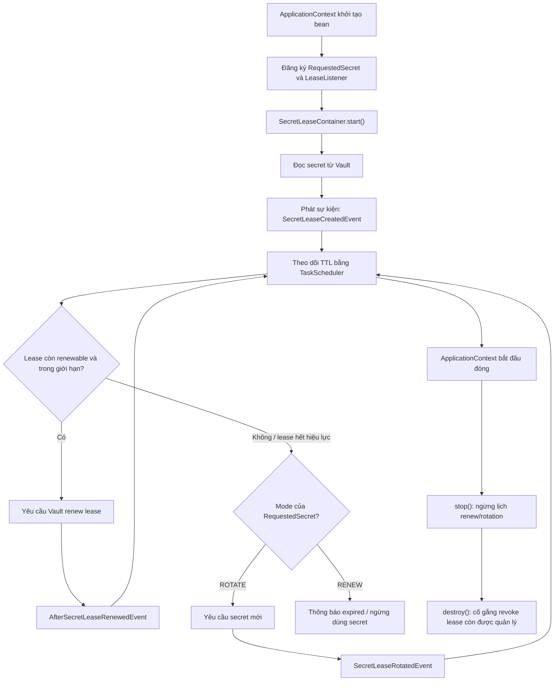
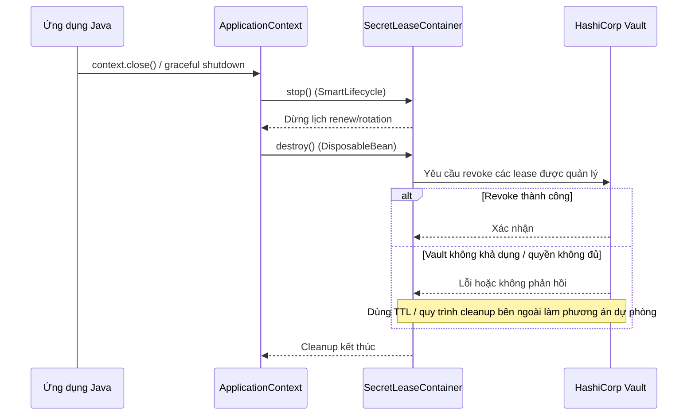
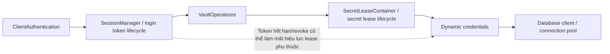

# SecretLeaseContainer và vòng đời theo ApplicationContext

## 1. Bối cảnh và mục tiêu bài học

Trong **SPRING_VAULT**, một ứng dụng Java thường truy cập HashiCorp Vault qua `VaultTemplate` để đọc KV secrets, lấy thông tin truy cập database, thực hiện Transit encryption hoặc làm việc với PKI. Một số dữ liệu được Vault cấp **có thời hạn sử dụng** và có thể bị thu hồi. Với dynamic credentials, ứng dụng phải duy trì tính hợp lệ của credential trong suốt thời gian chạy, rồi kết thúc phiên một cách có kiểm soát khi ngừng hoạt động.

`SecretLeaseContainer` trong Spring Vault là thành phần **theo dõi các secret đã đăng ký, lấy secret từ Vault, gia hạn lease và yêu cầu secret mới khi cần rotation**. Thành phần này triển khai các hợp đồng vòng đời của Spring, nên có thể gắn với `ApplicationContext`: khởi động cùng context, thực hiện công việc trong khi ứng dụng chạy và dọn dẹp khi context đóng.

Sau bài học thuộc chương **Vòng đời lease**, bạn có thể:

1. Phân biệt **TTL của Vault token** với **TTL và `lease_id` của dynamic secret**.
2. Hiểu `SecretLeaseContainer`, `RequestedSecret`, `TaskScheduler` và listener phối hợp với nhau như thế nào.
3. Phân biệt `requestRenewableSecret` với `requestRotatingSecret`.
4. Tích hợp container như Spring bean để được quản lý trong vòng đời `ApplicationContext`.
5. Giải thích chính xác khác biệt giữa `start()`, `stop()` và `destroy()`, đặc biệt là **thời điểm revoke lease**.
6. Xử lý `SecretLeaseCreatedEvent`, `SecretLeaseRotatedEvent`, `SecretLeaseExpiredEvent` và lỗi giao tiếp với Vault.
7. Thiết kế xử lý graceful shutdown, readiness, lỗi token và kiểm thử tích hợp.

> Các ví dụ dùng mount/role thử nghiệm và credential giả định. Không ghi username/password động, Vault token, private key hoặc `lease_id` vào HTTP response hay application log. Quyền đọc secret và quyền quản trị lease phải tuân theo policy Vault của từng môi trường.

## 2. Lease là gì và vì sao cần quản lý theo vòng đời ứng dụng?

**Lease** là thông tin về thời hạn và trạng thái của secret do Vault quản lý. Khi đọc một credential động từ database secrets engine, Vault có thể trả:

```json
{
  "request_id": "example-request-id",
  "lease_id": "database/creds/orders-reader/example-lease",
  "lease_duration": 120,
  "renewable": true,
  "data": {
    "username": "v-example-generated-user",
    "password": "<REDACTED>"
  }
}
```

Dữ liệu trên chỉ để minh họa, không phải credential có thể sử dụng. Những trường quan trọng:

| Trường | Ý nghĩa | Ứng dụng cần làm gì? |
| --- | --- | --- |
| `lease_id` | Định danh lease do Vault cấp | Giữ trong tầng quản lý lease; không xuất cho người dùng |
| `lease_duration` | TTL tính bằng giây tại thời điểm cấp hoặc renew | Lập lịch kiểm tra/gia hạn trước khi hết hạn |
| `renewable` | Cho biết có thể đề nghị gia hạn lease theo điều kiện Vault | Renew khi đủ điều kiện; xử lý trường hợp không thể renew |
| `data.username/password` | Credential động truy cập database | Cấp cho thành phần tiêu thụ nội bộ, bảo vệ và thay thế khi rotation |
| `request_id` | Định danh request phục vụ tương quan | Có thể dùng có chọn lọc khi quan sát, không thay cho lease ID |

Với ví dụ TTL 120 giây, credential có thể hết hiệu lực sau hai phút nếu không được gia hạn. Nếu ứng dụng kết nối database bằng credential này và không đổi credential sau khi lease bị thu hồi, kết nối mới có thể thất bại dù tiến trình Java vẫn còn chạy.

### Không phải secret nào cũng có lease động

| Nguồn dữ liệu hoặc thao tác | Đặc trưng vòng đời | Có phù hợp với `SecretLeaseContainer`? |
| --- | --- | --- |
| Database dynamic credentials | Vault cấp username/password có `lease_id`, TTL và quy tắc renew/revoke | **Có**, ví dụ điển hình để renew hoặc rotate |
| Một số secret engine tạo credential động khác | Có thể có `lease_id` và TTL tùy engine/role | Có nếu cơ chế engine thực sự hỗ trợ lease cần quản lý |
| KV v2 secret tĩnh | Versioned data, thường không có lease động có thể renew/revoke như database creds | Không nên giả định đọc KV v2 sẽ sinh renewable lease |
| Transit encrypt/decrypt | Thao tác mã hóa bằng khóa do Vault giữ | Không phải dynamic credential lease của mỗi lần encrypt |
| Vault login token | Có TTL, khả năng renew, có thể bị revoke | Quản lý bằng **`SessionManager`/token lifecycle**, khác với lease của secret |
| PKI certificate | Có hiệu lực theo `notBefore/notAfter`; cơ chế cấp lại có đặc thù riêng | Xem `CertificateContainer`/luồng PKI phù hợp; không mặc định coi như database lease |

Hai đồng hồ khác nhau có thể cùng hoạt động:

- **Vault token TTL:** thời hạn của token mà Spring Vault dùng để xác thực các request đến Vault.
- **Dynamic secret lease TTL:** thời hạn credential được cấp từ một secrets engine; có thể gắn với token yêu cầu secret.

Vault token hết hạn hoặc bị revoke có thể làm các lease do token đó sở hữu bị thu hồi. Do đó giữ secret lease hợp lệ không bảo đảm token phiên Vault hợp lệ mãi, và gia hạn token cũng không tự động renew mọi secret lease.

## 3. `SecretLeaseContainer` làm việc như thế nào?

`SecretLeaseContainer` thuộc package `org.springframework.vault.core.lease`. Nó được tạo từ `VaultOperations` cùng một `TaskScheduler` hoặc dùng constructor có scheduler mặc định theo phiên bản API. Với mỗi `RequestedSecret` đã đăng ký, container có thể lấy secret ban đầu, theo dõi lease và lập lịch renewal/rotation.



Sơ đồ mô tả luồng cơ bản, không bảo đảm một secret luôn được renew thành công hoặc được rotate đúng tại mốc TTL. Điều đó còn phụ thuộc Vault, quyền của token, kết nối mạng, tác vụ scheduler, giới hạn lifetime và trạng thái của ứng dụng.

### Các thành phần chính

| Thành phần | Vai trò |
| --- | --- |
| `VaultOperations` / `VaultTemplate` | Gửi request lấy secret, renew và revoke lease tới Vault |
| `RequestedSecret` | Định nghĩa path và chế độ `RENEW` hoặc `ROTATE` |
| `SecretLeaseContainer` | Quản lý danh sách secret, lịch và trạng thái lease |
| `TaskScheduler` | Thực thi các tác vụ renew/rotate theo thời gian |
| `LeaseListener` | Nhận sự kiện tạo secret, renew, rotate, hết hạn hoặc revocation |
| `LeaseErrorListener` | Nhận các sự kiện lỗi khi giao tiếp Vault hoặc xử lý lease |
| `ApplicationContext` | Quản lý lifecycle của bean khi khởi tạo, chạy và shutdown |

Một `RequestedSecret` được đăng ký lặp lại với cùng đặc tính được container coi là **một registration** theo cơ chế của `SecretsRegistry`. Khi dùng nhiều thành phần cùng yêu cầu một secret, cần quy hoạch rõ ai nhận event và ai sở hữu việc cập nhật credential; đừng tạo nhiều container độc lập chỉ để nhận cùng một secret.

## 4. Hai chiến lược: `RENEW` và `ROTATE`

Spring Vault cung cấp hai phương thức tiện lợi:

```java
RequestedSecret renewable =
        container.requestRenewableSecret("database/creds/orders-reader");

RequestedSecret rotating =
        container.requestRotatingSecret("database/creds/orders-reader");
```

Đây là hai lựa chọn **thay thế nhau cho một registration theo nhu cầu**, không phải lời khuyên đăng ký cả hai trên cùng role trong một ứng dụng.

| Tiêu chí | `requestRenewableSecret(path)` | `requestRotatingSecret(path)` |
| --- | --- | --- |
| Chế độ | `RequestedSecret.Mode.RENEW` | `RequestedSecret.Mode.ROTATE` |
| Khi lease renewable và Vault cho phép | Thử renew trước thời điểm hết hạn | Cũng có thể renew trong thời gian còn hợp lệ |
| Khi lease hết hạn hoặc không thể tiếp tục | Không mặc nhiên lấy credential mới để thay credential cũ | Có cơ chế yêu cầu secret mới sau khi lease hết hiệu lực |
| Tình huống phù hợp | Thành phần chủ động xử lý trạng thái hết hạn, không muốn thay credential tự động | Dynamic credential cần tiếp tục được cấp mới trong thời gian app hoạt động |
| Điều kiện ứng dụng cần xử lý | Dừng dùng secret hết hạn và xử lý thông báo | Chuyển thành phần tiêu thụ sang secret mới khi có event |

**Rotation của Spring Vault không có nghĩa chỉ đổi nội dung biến Java.** Vault thường phát hành **một credential mới** cho role động; ứng dụng phải thay đổi cách client thật (ví dụ pool kết nối database) sử dụng credential. Nếu pool vẫn giữ username/password cũ, `SecretLeaseContainer` có thể rotate thành công nhưng request đến database vẫn thất bại.

Không nên đặt chế độ `ROTATE` cho mọi dữ liệu theo phản xạ. KV v2 tĩnh, Transit và PKI có vòng đời riêng; chọn đúng đối tượng có lease và mục tiêu nghiệp vụ.

## 5. Liên kết với `ApplicationContext`: ba thời điểm quan trọng

`SecretLeaseContainer` triển khai `InitializingBean`, `SmartLifecycle` và `DisposableBean`. Khi được quản lý như một Spring bean, các interface này tạo mối liên hệ trực tiếp với vòng đời của context.

| Thời điểm của Spring | Hook liên quan | Hành vi cần hiểu |
| --- | --- | --- |
| Bean đã được tạo và dependency đã gắn | `afterPropertiesSet()` từ `InitializingBean` | Hoàn tất khâu khởi tạo cấu trúc; Spring gọi tự động khi bean được quản lý |
| Context refresh / lifecycle start | `start()` từ `SmartLifecycle` | Bắt đầu lấy các secret đã đăng ký, lập lịch renew và phát event |
| Context stop (bao gồm bước stop khi close) | `stop()` từ `Lifecycle` | Dừng lập lịch renew/rotation và phát event; **không tự revoke/expire các lease đang hoạt động** |
| Bean destruction lúc context close | `destroy()` từ `DisposableBean` | Shutdown container, dừng hoạt động và **cố gắng revoke các lease còn được quản lý** |

Đây là khác biệt phải ghi nhớ: **`stop()` và `destroy()` không tương đương**. Chỉ gọi `stop()` không đảm bảo credential động bị thu hồi. Với bean được Spring quản lý bình thường, khi `ApplicationContext.close()` chạy trọn quy trình, Spring dừng các lifecycle bean và sau đó hủy bean, nên `destroy()` được gọi. Việc revoke thành công vẫn phụ thuộc Vault còn sẵn sàng và request có quyền hợp lệ.

### Điều gì xảy ra nếu không chạy trong `ApplicationContext`?

Với container được khởi tạo thủ công trong một chương trình không có Spring quản lý:

```java
SecretLeaseContainer container =
        new SecretLeaseContainer(vaultOperations, taskScheduler);

container.requestRotatingSecret("database/creds/orders-reader");

try {
    container.afterPropertiesSet();  // Khởi tạo thủ công.
    container.start();               // Bắt đầu quản lý lease.
    // ... công việc ứng dụng ...
} finally {
    container.destroy();             // Kết thúc và yêu cầu revoke.
}
```

Đoạn code giả định đã có `vaultOperations` và `taskScheduler` hợp lệ. Đặc điểm quan trọng ở đây là **ứng dụng tự chịu trách nhiệm gọi các hook**. Khi container là bean do Spring quản lý, **không** tự gọi `afterPropertiesSet()` hoặc `start()` từ `@PostConstruct` vì Spring vốn đã quản lý initialization/lifecycle; làm vậy dễ tạo timing không mong muốn và khó kiểm soát startup.

### Trình tự lifecycle có ảnh hưởng đến tính sẵn sàng

Một bean database client có thể cần username/password ngay trong `@PostConstruct`, trong khi `SecretLeaseContainer` có thể chỉ phát secret sau khi lifecycle start. Vì vậy, chỉ khai báo bean container không tự bảo đảm credential đã đến trước khi khởi tạo connection pool. Hãy bố trí dependency, cơ chế cấp credential và readiness hợp lý. Trong `AbstractVaultConfiguration`, Spring Vault có cơ chế đăng ký và khởi động container sớm nhằm hỗ trợ các thành phần cần credential ở startup; vẫn cần xem xét thứ tự phụ thuộc trong ứng dụng cụ thể.

## 6. Ví dụ Spring bean quản lý `SecretLeaseContainer`

Ví dụ cho ứng dụng Spring Boot dùng **Spring Vault core trực tiếp**, đã có `VaultOperations` và xác thực Vault được cấu hình. Database secrets engine tại `database/` đã có role `orders-reader` cấp credential động.

> **Phạm vi cấu hình:** Chỉ tự khai báo bean dưới đây khi ứng dụng chưa có `SecretLeaseContainer` do `AbstractVaultConfiguration` hoặc Spring Cloud Vault tạo. Tạo thêm container tùy tiện có thể làm tăng số lease được cấp và gây vòng đời không thống nhất.

### 6.1. Đăng ký scheduler và container

```java
package example.vault;

import java.time.Duration;

import org.slf4j.Logger;
import org.slf4j.LoggerFactory;
import org.springframework.beans.factory.annotation.Qualifier;
import org.springframework.context.annotation.Bean;
import org.springframework.context.annotation.Configuration;
import org.springframework.scheduling.TaskScheduler;
import org.springframework.scheduling.concurrent.ThreadPoolTaskScheduler;
import org.springframework.vault.core.VaultOperations;
import org.springframework.vault.core.lease.SecretLeaseContainer;
import org.springframework.vault.core.lease.domain.RequestedSecret;
import org.springframework.vault.core.lease.event.AfterSecretLeaseRenewedEvent;
import org.springframework.vault.core.lease.event.SecretLeaseCreatedEvent;
import org.springframework.vault.core.lease.event.SecretLeaseExpiredEvent;
import org.springframework.vault.core.lease.event.SecretLeaseRotatedEvent;

@Configuration(proxyBeanMethods = false)
public class VaultLeaseConfiguration {

    private static final Logger log =
            LoggerFactory.getLogger(VaultLeaseConfiguration.class);

    @Bean
    ThreadPoolTaskScheduler vaultLeaseScheduler() {
        ThreadPoolTaskScheduler scheduler = new ThreadPoolTaskScheduler();
        scheduler.setPoolSize(2);
        scheduler.setThreadNamePrefix("vault-lease-");
        return scheduler;
    }

    @Bean
    SecretLeaseContainer secretLeaseContainer(
            VaultOperations vaultOperations,
            @Qualifier("vaultLeaseScheduler") TaskScheduler scheduler) {

        SecretLeaseContainer container =
                new SecretLeaseContainer(vaultOperations, scheduler);

        container.setMinRenewal(Duration.ofSeconds(10));
        container.setExpiryThreshold(Duration.ofSeconds(30));

        RequestedSecret requested = container.requestRotatingSecret(
                "database/creds/orders-reader");

        // Đăng ký listener khi bean còn đang được cấu hình, trước khi start.
        container.addLeaseListener(event -> {
            if (!requested.equals(event.getSource())) {
                return;
            }

            if (event instanceof SecretLeaseRotatedEvent) {
                log.info("Vault credential rotated for orders-reader");
            } else if (event instanceof SecretLeaseCreatedEvent) {
                log.info("Vault credential initially obtained for orders-reader");
            } else if (event instanceof AfterSecretLeaseRenewedEvent) {
                log.debug("Vault lease renewed for orders-reader");
            } else if (event instanceof SecretLeaseExpiredEvent) {
                log.warn("Vault lease expired for orders-reader");
            }
        });

        container.addErrorListener(event -> {
            // Không ghi raw event, lease_id, credentials hoặc Vault token.
            log.warn("Vault lease processing failed; check internal metrics/audit");
        });

        // Spring quản lý afterPropertiesSet(), start(), stop(), destroy().
        return container;
    }
}
```

Ví dụ trên chỉ log **loại sự kiện** để minh họa, chưa cấu hình kết nối database thật. Trong hệ thống thực tế, cần cung cấp credential mới cho pool đúng cách, duy trì state “credential đang hợp lệ” và cập nhật readiness. Chỉ nhận event mà không cập nhật thành phần sử dụng credential chưa hoàn thành bài toán rotation.

Lưu ý kỹ thuật:

- `RequestedSecret` ở đây dùng path **đọc secret** `database/creds/orders-reader`, không phải đường dẫn lease renew hay endpoint của auth method.
- `TaskScheduler` chạy các công việc nền. Không nên thực hiện thao tác chặn lâu trong listener; có thể ảnh hưởng chu kỳ renew/rotation.
- Đặt listener **trước khi** bean được start để không bỏ lỡ event đầu tiên.
- `SecretLeaseRotatedEvent` là một dạng của `SecretLeaseCreatedEvent` trong hierarchy event; nếu phân nhánh, kiểm tra rotated **trước** created để không nhầm event.
- `@Bean` không cần thêm `initMethod`/`destroyMethod` khi đối tượng đã triển khai `InitializingBean`/`DisposableBean`.
- Không tự động tạo một `SecretLeaseContainer` mới cho mỗi request HTTP hoặc mỗi lần đọc database.

### 6.2. Tại sao nhận event không đồng nghĩa dữ liệu đã đổi ở client?

Giả sử ứng dụng dùng một connection pool:

```text
Vault database/creds/orders-reader
       |
       v
SecretLeaseCreatedEvent / SecretLeaseRotatedEvent
       |
       v
Credential manager của ứng dụng
       |
       v
Đổi cấu hình/khởi tạo pool mới và chuyển traffic
       |
       v
Dừng pool cũ khi kết nối đang xử lý đã hoàn tất
```

Đối với connection pool, đổi trường username/password sau khi đã tạo các connection vật lý có thể không làm thay đổi những connection đang tồn tại. Thiết kế rotation cần quyết định cách **thay pool hoặc cấp connection mới**, kiểm tra kết nối bằng credential mới, chuyển workload và loại credential cũ đúng thời điểm. Tránh cập nhật credential đồng thời từ nhiều thread mà không đồng bộ trạng thái.

Một `LeaseListener` có thể nhận thông tin secret có tính nhạy cảm. Mọi DTO, log và sự kiện chuyển sang hệ thống khác phải che dữ liệu này. Nếu ứng dụng chỉ cần truyền credential cho một adapter trong cùng tiến trình, tránh publish toàn bộ secret thành event công khai hoặc response từ REST controller.

### 6.3. Vì sao không đặt `start()` trong `@PostConstruct`?

Ví dụ không nên dùng:

```java
@PostConstruct
void manuallyStart() {
    secretLeaseContainer.start(); // Tránh ép start thủ công trong Spring bean.
}
```

Bộ xử lý `SmartLifecycle` của Spring chịu trách nhiệm start/stop các lifecycle bean. Can thiệp thủ công có thể làm các event đến khi bean phụ thuộc chưa sẵn sàng. Nếu cấu hình cần credential **trước** khi Spring hoàn tất một bean khác, dùng cơ chế hỗ trợ startup sớm của `AbstractVaultConfiguration`/`ManagedSecret` hoặc dependency rõ ràng, thay vì tự gọi `start()` ở một callback tùy tiện.

## 7. Cấu hình với `AbstractVaultConfiguration` và Spring Cloud Vault

Spring Vault có nhiều đường tích hợp, cần chọn đúng cơ chế của ứng dụng.

| Cách tích hợp | Ai tạo và quản lý container? | Điều cần làm |
| --- | --- | --- |
| Ứng dụng thuần Spring Vault với `AbstractVaultConfiguration` | Cấu hình cơ sở cung cấp `SecretLeaseContainer` và scheduler | Đăng ký managed secret/registrar hoặc lấy bean đã có để cấu hình; tránh tạo bean trùng |
| Ứng dụng Spring Boot + Spring Cloud Vault | Auto-configuration quản lý secret/lease lifecycle theo các tính năng được bật | Dùng property cấu hình lifecycle, không tự dựng lớp container nếu không cần |
| Ứng dụng tạo bean `SecretLeaseContainer` thủ công | Chính cấu hình `@Bean` của ứng dụng | Đảm bảo bean được ApplicationContext quản lý và listener đã đăng ký trước start |
| Chương trình Java chạy ngoài Spring | Code tự tạo container và scheduler | Tự gọi `afterPropertiesSet()`, `start()` và `destroy()` khi kết thúc |

Ví dụ cấu hình **Spring Cloud Vault** cho các phiên bản hỗ trợ thuộc tính bên dưới:

```yaml
spring:
  cloud:
    vault:
      config:
        lifecycle:
          enabled: true
          min-renewal: 10s
          expiry-threshold: 30s
      session:
        lifecycle:
          enabled: true
```

Hai nhóm property có mục tiêu **khác nhau**:

- `spring.cloud.vault.config.lifecycle.*`: vòng đời secret/lease do Spring Cloud Vault quản lý.
- `spring.cloud.vault.session.lifecycle.*`: vòng đời **Vault login token** của phiên ứng dụng.

Theo tài liệu Spring Cloud Vault, lease lifecycle và session lifecycle thường được bật mặc định, nhưng phụ thuộc dependency/config và phiên bản. Nếu tắt lease lifecycle, credential có thể hết hạn mà ứng dụng không tự renew/rotate và lease có thể còn tồn tại sau shutdown nếu không có cơ chế revoke khác. Trước khi chỉnh các giá trị, xác minh phiên bản Spring Cloud Vault đang được dùng và role Vault có TTL phù hợp.

Với các bản Spring Vault/Spring Cloud Vault mới, `ManagedSecret` và `SecretRegistrar` là lớp trừu tượng cao hơn cho đăng ký secret và chuyển credential sang thành phần tiêu thụ. Chúng có thể phù hợp hơn việc tự viết listener xử lý rotation.

## 8. Ba phương thức lifecycle không thể đánh đồng

Đây là phần cốt lõi của bài học.

### 8.1. `start()`: bắt đầu quản lý

Khi container đã initialized, `start()` sẽ yêu cầu những secret đã đăng ký, ghi nhận lease và kích hoạt các tác vụ định kỳ. Listener có thể nhận `SecretLeaseCreatedEvent` ngay khi khởi động. Nếu yêu cầu secret thất bại, cần quan sát error event và xử lý readiness hoặc khởi tạo ứng dụng thất bại theo chính sách.

Trong Spring context, `SmartLifecycle` cho phép Spring gọi start theo thứ tự lifecycle. Đối với bean từ `AbstractVaultConfiguration`, hạ tầng có thể chủ động start sớm để đáp ứng nhu cầu credential của bean khác.

### 8.2. `stop()`: ngừng quản lý lịch, chưa revoke

Theo hợp đồng API, `stop()` làm container ngừng lịch renewal, rotation và dispatch events. **Các lease còn hoạt động không tự bị expired/revoke do riêng lời gọi stop**. Dừng để tạm ngưng và hủy bean là hai hành vi khác nhau.

Ví dụ:

```text
10:00  Credential có lease TTL 20 phút, renewable
10:05  Gọi container.stop()
10:05  Lịch renew/rotate ngừng; lease không tự bị revoke ngay
10:20  Lease có thể hết hạn theo Vault, nếu không có tác nhân khác can thiệp
```

Các thời điểm chỉ là minh họa và giả định không có renew/revoke từ client khác. Không thể dùng `stop()` thay cho quy trình revoke trong môi trường có yêu cầu cleanup credential.

### 8.3. `destroy()`: kết thúc container và cố gắng revoke

`destroy()` là hook `DisposableBean` dành cho shutdown hẳn container. Nó dừng lịch và **gửi yêu cầu revoke các lease còn được quản lý** khi điều kiện cho phép. Sau khi container đã bị destroyed, không được coi nó là một đối tượng có thể khởi động lại như container mới.

Trình tự thường gặp khi đóng `ApplicationContext`:



**Không bảo đảm revoke hoàn tất trong mọi kiểu chấm dứt tiến trình.** `SIGKILL`, node chết, mất mạng, Vault downtime hoặc shutdown quá gấp có thể ngăn code cleanup chạy hoặc ngăn Vault nhận request. TTL của dynamic credential và cơ chế thu hồi phía Vault vẫn là giới hạn quan trọng khi ứng dụng không thể cleanup đúng cách.

Một lưu ý nữa: nếu Vault token của ứng dụng đã bị revoke/hết hạn ngay trước giai đoạn cleanup, request revoke lease từ container có thể thất bại. Cần thiết kế thứ tự đóng kết nối, thời gian graceful termination và cơ chế xử lý orphaned leases phù hợp.

## 9. Quan hệ giữa `SecretLeaseContainer` và `SessionManager`

Trong ứng dụng dùng Spring Vault, **secret lease** và **login token** là hai vòng đời cần phối hợp.



| Vấn đề | Thành phần xử lý chính |
| --- | --- |
| Đăng nhập Vault bằng Kubernetes/JWT, AppRole hoặc userpass | `ClientAuthentication` |
| Gia hạn/đăng nhập lại Vault token | `SessionManager`, ví dụ `LifecycleAwareSessionManager` |
| Lấy, renew, rotate dynamic secret theo lease | `SecretLeaseContainer` |
| Chuyển credential mới đến kết nối database | Code nghiệp vụ, client adapter, `ManagedSecret` hoặc tích hợp tương ứng |
| Thu hồi credential khi ứng dụng shutdown | `SecretLeaseContainer.destroy()` và quy tắc revoke của Vault |
| Cấp/chuyển chứng thư PKI | `CertificateContainer` hoặc cơ chế PKI thích hợp |

Trường hợp dễ hiểu sai: ứng dụng đã renew được **Vault token**, nhưng database credential đã hết hạn lease vì lịch renew secret thất bại. Khi đó Vault request có thể vẫn thành công, nhưng database connection mới sẽ bị từ chối. Chiều ngược lại, secret lease còn TTL nhưng token Vault bị revoke có thể khiến lease cũng bị thu hồi. Không dùng kết quả token lookup để kết luận mọi credential động vẫn hợp lệ.

Spring Vault cung cấp các authentication listener để phối hợp khi token session được thay mới. Khi triển khai phiên bản có `SessionLeaseContainer`, có thể kết nối listener của container với `SessionManager` để secret lifecycle phản ứng sau khi re-login. Hành vi tích hợp thực tế phụ thuộc cấu hình framework và version; không tự khẳng định việc tự tạo một container sẽ tự hồi phục mọi lease sau khi token thay đổi nếu chưa kết nối cơ chế liên quan.

## 10. Thiết kế shutdown trong Kubernetes và ứng dụng server

Trong Kubernetes, khi Pod bị yêu cầu dừng, hệ thống gửi tín hiệu chấm dứt đến process và dành một khoảng grace period trước khi có thể ép kết thúc. Với Spring Boot, cần bảo đảm Java process nhận tín hiệu để context có cơ hội đóng.

Một Pod template minh họa:

```yaml
apiVersion: apps/v1
kind: Deployment
metadata:
  name: orders-api
spec:
  replicas: 1
  selector:
    matchLabels:
      app: orders-api
  template:
    metadata:
      labels:
        app: orders-api
    spec:
      terminationGracePeriodSeconds: 45
      containers:
        - name: api
          image: example.invalid/orders-api:demo
          ports:
            - containerPort: 8080
```

Image `example.invalid` chỉ là placeholder. Không triển khai manifest này mà không bổ sung cấu hình thật của image, Vault auth, liveness/readiness và bảo mật môi trường.

Quy trình shutdown nên phối hợp:

1. Ngừng nhận request mới và báo `readiness=false` khi tiến trình chuẩn bị dừng.
2. Đợi những request/transaction cần thiết hoàn thành trong giới hạn thời gian.
3. Dừng hoặc thay thế thành phần sử dụng credential khi đã phù hợp.
4. Cho `ApplicationContext` thực hiện `SmartLifecycle.stop()` và `DisposableBean.destroy()`, trong đó container có cơ hội revoke leases.
5. Ghi nhận kết quả revoke thất bại qua kênh vận hành nội bộ; TTL của dynamic secret là phương án dự phòng khi không thể cleanup từ client.

Không dùng `preStop` hook tự gọi `destroy()` của bean đồng thời với Spring context close; việc gọi thủ công đồng thời có thể tạo race và khó theo dõi trạng thái. Hãy để vòng đời bean do context quản lý, trừ khi ứng dụng có yêu cầu rất cụ thể và kiểm thử riêng.

Không đặt `terminationGracePeriodSeconds` cực ngắn nếu thành phần cần thời gian kết thúc transaction và cleanup. Tuy vậy, ngay cả thời gian dài cũng không bảo đảm Vault còn truy cập được; cần có giới hạn TTL và xử lý sự cố độc lập.

## 11. Lắng nghe event và xử lý lỗi an toàn

### 11.1. Các event quan trọng

| Event | Khi nào xuất hiện | Gợi ý xử lý |
| --- | --- | --- |
| `SecretLeaseCreatedEvent` | Vừa lấy secret/lease ban đầu | Cấp credential cho client và đánh dấu đã sẵn sàng |
| `AfterSecretLeaseRenewedEvent` | Renew lease thành công | Cập nhật metric TTL/renewal, giữ credential đang hoạt động |
| `SecretLeaseRotatedEvent` | Credential đã được cấp mới khi rotation | Chuyển client/pool sang credential mới an toàn |
| `SecretLeaseExpiredEvent` | Container phát hiện lease hết hiệu lực | Ngừng dùng credential cũ, hạn chế request và cảnh báo |
| `SecretNotFoundEvent` | Không lấy được secret tại path được yêu cầu | Báo lỗi cấu hình/secret chưa sẵn sàng |
| `BeforeSecretLeaseRevocationEvent` | Trước khi revoke | Chuẩn bị đóng phần sử dụng credential nếu còn cơ hội |
| `AfterSecretLeaseRevocationEvent` | Revoke thành công | Xác nhận cleanup trên metric/audit |
| `SecretLeaseErrorEvent` | Lỗi Vault/I/O/lease operation | Phân loại, cảnh báo, tránh ghi raw secret vào log |

Các event là **callback phía client**, không phải Vault chủ động push một thông báo hết hạn đến Java. Spring Vault dựa vào lịch và tương tác với Vault để phát hiện trạng thái. Event có thể đến muộn hơn thời điểm credential thực sự hết hạn; không dựa vào event như cam kết thời gian tuyệt đối.

Một điểm vận hành quan trọng: listener có thể chạy trên thread đang khởi động container hoặc thread của scheduler. Nếu listener block lâu, gọi database chậm hoặc truy cập network không kiểm soát, nó có thể cản việc renew/rotation. Hãy xử lý nhẹ, chuyển các tác vụ nặng sang cơ chế bất đồng bộ có kiểm soát và đồng bộ trạng thái credential để tránh race.

### 11.2. Lỗi cần phân biệt

| Triệu chứng | Nguyên nhân thường gặp | Hướng xử lý |
| --- | --- | --- |
| Lần đầu không nhận `SecretLeaseCreatedEvent` | Container chưa start, chưa đăng ký secret, path/role sai hoặc lỗi Vault | Kiểm tra lifecycle, registration, audit và error listener |
| HTTP 403 khi đọc `database/creds/...` | Token thiếu `read` hoặc role/path không đúng | Kiểm tra Vault ACL và auth identity; không mở quyền wildcard vô tội vạ |
| Renew lease trả lỗi | Lease hết hạn/không renewable, vượt max TTL, token không hợp lệ, mạng lỗi | Kiểm tra status Vault, error event và cơ chế rotate |
| Credential xoay vòng nhưng DB tiếp tục lỗi | Pool vẫn dùng credential cũ hoặc transaction chưa được điều phối | Cập nhật/rebuild connection pool theo thiết kế |
| Khi shutdown lease vẫn còn | Chỉ gọi `stop()`, `destroy()` không chạy hoặc revoke thất bại | Xác nhận context close và audit Vault; dùng TTL làm safety net |
| Container mới tạo nhưng application có hai nguồn lease | Auto-config đã tạo container khác | Kiểm tra bean ownership; chỉ giữ cấu hình tích hợp được chủ đích |
| Credential không sẵn sàng trong `@PostConstruct` | Container chưa đến phase start, chưa lấy được secret | Thiết kế startup dependency/readiness đúng |
| Nhiều event rotate gần nhau | TTL ngắn, scheduler timing hoặc lỗi Vault | Tuning TTL, ngưỡng renew và idempotent update |
| Event hết hạn xuất hiện trễ | Scheduler bận, mất mạng hoặc bị delay | Dựa vào trạng thái credential và kiểm tra kết nối thật, không dùng event làm đồng hồ tuyệt đối |

### 11.3. Giám sát mà không lộ secret

Các metric có ích: số lần tạo secret, renew thành công/thất bại, số lần rotate, số lease hết hạn, thời gian còn lại đến mốc expiry, độ trễ response Vault, và tình trạng credential hiện hành đã được chuyển vào client hay chưa.

Hạn chế log chứa `lease_id`, `data.username`, `data.password`, `X-Vault-Token` hoặc toàn bộ event object. Một vài loại lease ID có thể tiết lộ path/role nội bộ, và log toàn bộ event có thể chứa dữ liệu secret. Nếu cần liên kết audit, dùng correlation ID/mã request nội bộ đã kiểm soát quyền truy cập.

Phân biệt **lỗi login token** với **lỗi renew secret lease** bằng nguồn event, endpoint và metric. Tránh phát cảnh báo “Vault down” cho mọi HTTP 403 nếu nguyên nhân thực là policy quá hẹp.

## 12. Tuning TTL, threshold và scheduler

Giả sử Vault database role cấp credential có TTL ban đầu **120 giây**, renewable và max lifetime **10 phút**. Ứng dụng dùng `expiryThreshold=30s`, `minRenewal=10s`.

| Mốc minh họa | Diễn giải |
| --- | --- |
| `t=0` | Vault cấp secret với TTL 120 giây và lease ID |
| Trước hạn khoảng 30 giây | Container có thể lên lịch renew theo ngưỡng đã cấu hình |
| Sau một lần renew thành công | Vault trả lại thời gian còn hợp lệ theo policy, container cập nhật lịch |
| Khi chạm max TTL hoặc không thể renew | Lease không thể kéo dài mãi; với `ROTATE` sẽ cần credential mới |
| Khi ứng dụng đóng | Container đã được Spring quản lý sẽ cố revoke lease tại bước destroy |

Đây **không phải lịch cố định**, bởi timing phụ thuộc Vault response, `TaskScheduler`, đồng hồ local, thời gian mạng, min renewal và lỗi thực tế. Một lease TTL ngắn hơn ngưỡng cấu hình có thể khiến event/renew liên tục hoặc bị đánh giá không phù hợp để renew; cần tính toán dựa vào TTL nhỏ nhất thực tế của engine.

**`setExpiryThreshold(Duration)`** quyết định thời điểm chủ động renew trước hạn. **`setMinRenewal(Duration)`** giới hạn khoảng tối thiểu để tránh renew quá dày. Hai tham số này chỉ điều chỉnh thời điểm phía client; chúng **không kéo dài max TTL** mà Vault áp đặt.

Tối ưu hóa cần cân nhắc:

- TTL càng ngắn thì hậu quả khi credential lộ càng được hạn chế, nhưng tăng tần suất Vault request, event và rotate.
- TTL càng dài thì giảm tải rotation nhưng credential bị lộ có cửa sổ sử dụng lâu hơn.
- Scheduler không nên quá ít thread khi nhiều lease hoặc listener có tác vụ nặng.
- Đồng hồ hệ thống và tình trạng mạng ảnh hưởng đến lịch tính TTL; giám sát độ trễ và chênh lệch thời gian.
- Khi Vault không truy cập được, phải đánh dấu trạng thái credential dựa trên khả năng thực sự, không tự coi secret đã renew chỉ vì job scheduler chạy.

## 13. Kiểm thử tích hợp theo vòng đời `ApplicationContext`

Dùng Vault dev/Testcontainers riêng và một database test cô lập. Cấu hình database secrets engine cấp credential động cho role `orders-reader` với TTL ngắn thích hợp. Token test chỉ có quyền theo role cần dùng; không sử dụng database production.

### Ma trận kiểm thử

| Trường hợp | Thiết lập/hành động | Kỳ vọng |
| --- | --- | --- |
| Startup thành công | Context khởi tạo bean và đăng ký secret trước start | Có event tạo secret; dynamic credential được cấp |
| Renewal | Lease renewable, TTL ngắn, Vault còn truy cập được | Có renew event và TTL được gia hạn trong giới hạn |
| Rotation | Dùng `ROTATE`, để lease hết khả năng renew/expire | Container yêu cầu secret mới; client chuyển sang credential mới |
| Mode `RENEW` | Yêu cầu renewable và để lease hết hiệu lực | Không tự coi như đã có credential mới; app xử lý hết hạn |
| `stop()` | Gọi stop khi còn active lease trong lab | Lịch renew/rotation dừng; lease không bị revoke chỉ vì stop |
| `destroy()` | Đóng ApplicationContext bình thường | Cố gắng revoke active lease; audit/lookup xác nhận khi có quyền |
| Vault không có mạng lúc shutdown | Ngắt kết nối trong môi trường test | Cleanup lỗi được ghi nhận, app không tuyên bố revoke đã thành công |
| Vault token hết hạn trước lease | Cố ý giới hạn session token trong test | Quan sát auth/lease error; kiểm tra cơ chế re-login và phục hồi |
| Listener khởi tạo muộn | Đăng ký listener sau khi start | Có thể bỏ lỡ event đầu tiên; cấu hình lại để đăng ký trước |
| Scheduler bận | Tạo tình huống callback chậm có kiểm soát | Event bị delay; hệ thống cảnh báo và không dùng credential hết hạn |
| Nhiều registration giống nhau | Đăng ký cùng `RequestedSecret` lặp lại | Một registration logic theo hợp đồng registry |
| Rotation và pool kết nối | Gắn pool test vào credential callback | Pool mới dùng credential hợp lệ; kết nối cũ được dừng có kiểm soát |

### Kịch bản ứng dụng Spring với context thật

Trong integration test, dùng `AnnotationConfigApplicationContext` hoặc `@SpringBootTest` cùng Vault cô lập, sau đó xác minh vòng đời của bean. Khi tạo context thủ công để kiểm thử:

```java
try (var context =
        new org.springframework.context.annotation.AnnotationConfigApplicationContext(
                VaultTestConfiguration.class,
                VaultLeaseConfiguration.class)) {

    SecretLeaseContainer container =
            context.getBean(SecretLeaseContainer.class);

    // Context refresh có thể tự start SmartLifecycle bean.
    org.assertj.core.api.Assertions.assertThat(container.isRunning()).isTrue();

    // Đợi event hoặc readiness từ fixture test (có timeout rõ ràng).
    // Kiểm tra credential động bằng kết nối DB test.
}
// Ra khỏi try-with-resources sẽ close ApplicationContext,
// khiến Spring stop lifecycle và destroy bean.
```

`VaultTestConfiguration` ở ví dụ là **fixture do dự án test cung cấp**, không phải một class có sẵn trong Spring Vault. Cần cấu hình `VaultOperations` xác thực tới Vault lab; ví dụ trên nhấn mạnh kiểm tra **vòng đời thực của context** thay vì chỉ mock lời gọi `start()`. Trong test tự động, dùng cơ chế chờ event có timeout, không dùng sleep dài hoặc dự đoán thời điểm renewal tuyệt đối.

Sau khi close context, xác minh revoke thông qua Vault audit hoặc lease lookup bằng danh tính test có quyền, đồng thời kiểm tra Vault thật sự đã từ chối credential đó khi được yêu cầu. Không chỉ dựa vào `isRunning() == false` để kết luận lease đã bị revoke: đó là hai trạng thái khác nhau.

### Lưu ý với test shutdown và teardown

- Nếu test chủ động gọi `destroy()`, không tái sử dụng cùng instance container cho test tiếp theo.
- Không dùng token root trong code ứng dụng test; chỉ dùng token quản trị cho bước dựng fixture và xác minh riêng.
- Khi container tự revoke lease, database test có thể thu hồi credential làm một số connection cũ bị ngắt; test cần đóng connection pool đúng thứ tự.
- Không ghi raw credential hoặc lease ID vào test report, CI logs và ảnh chụp màn hình.
- Đừng bỏ qua kiểm thử “Vault tạm mất kết nối đúng lúc context close”; graceful shutdown là mục tiêu **best effort**, TTL vẫn là lớp bảo vệ cuối cùng.

## 14. Những lỗi thiết kế cần tránh

1. **Tạo container rồi quên `start()`** khi chạy ngoài Spring: sẽ không phát event hay lập lịch renew.
2. **Tự gọi `start()` trong `@PostConstruct`** của bean do Spring quản lý: gây lệch lifecycle và thứ tự phụ thuộc.
3. **Cho rằng `stop()` sẽ revoke lease**: API chỉ dừng lịch và không tự expire active lease.
4. **Cho rằng `destroy()` luôn thành công**: còn phụ thuộc mạng, Vault token, quyền và quá trình shutdown.
5. **Chỉ lắng nghe event mà không cập nhật connection pool**: credential mới không tự thay credential đã gắn với pool.
6. **Nhầm token TTL và secret lease TTL**: hai đồng hồ này liên quan nhưng không đồng nhất.
7. **Đưa KV v2 vào luồng dynamic lease một cách máy móc**: KV versioning khác với renewable credential lease.
8. **Tạo container thứ hai khi Spring Cloud Vault đã quản lý**: khó xác định ownership và có thể phát hành lease trùng.
9. **Log event/response nguyên vẹn**: có thể làm lộ username/password động và thông tin vận hành.
10. **Không kiểm thử shutdown theo `ApplicationContext`**: bỏ sót bước revoke khi dừng ứng dụng thực.

## 15. Câu hỏi ôn tập

1. Vì sao dynamic database credential cần được theo dõi lease trong suốt thời gian ứng dụng Java chạy?
2. `SecretLeaseContainer` và `LifecycleAwareSessionManager` quản lý cùng một TTL hay hai loại TTL khác nhau?
3. Khi `ApplicationContext` gọi `stop()`, lease còn hiệu lực có tự bị revoke không?
4. Bước nào của `DisposableBean` yêu cầu revoke lease?
5. `requestRenewableSecret` khác `requestRotatingSecret` như thế nào khi lease không còn dùng được?
6. Một event `SecretLeaseRotatedEvent` có bảo đảm HikariCP đã dùng username/password mới không? Vì sao?
7. Tại sao phải đăng ký `LeaseListener` trước khi container bắt đầu?
8. Vì sao SIGKILL hoặc mất mạng khi shutdown khiến TTL của dynamic secret vẫn cần thiết?
9. Vì sao một Vault token còn TTL không chứng minh database credential vẫn hợp lệ?
10. Trong Spring Cloud Vault, property nào quản lý **secret lease lifecycle**, và property nào quản lý **session token lifecycle**?

**Gợi ý:** (2) hai vòng đời; (3) không; (4) `destroy()`; (5) mode ROTATE có thể lấy credential mới; (6) pool phải được cập nhật theo thiết kế; (7) tránh bỏ lỡ event đầu tiên; (8) cleanup best effort; (9) lease có TTL/revocation riêng; (10) `spring.cloud.vault.config.lifecycle.*` và `spring.cloud.vault.session.lifecycle.*`.

## 16. Tổng kết

- `SecretLeaseContainer` quản lý **lease của secret**: request, renew, rotate và thông báo sự kiện.
- Khi là Spring bean, nó tham gia lifecycle của `ApplicationContext` qua `InitializingBean`, `SmartLifecycle` và `DisposableBean`.
- **`start()`** bắt đầu lấy secret và lập lịch; **`stop()`** dừng lịch nhưng không revoke active lease; **`destroy()`** kết thúc container và cố gắng revoke.
- `requestRenewableSecret` và `requestRotatingSecret` phản ánh hai mục tiêu sử dụng secret khác nhau; rotation cần cập nhật thành phần tiêu thụ credential.
- `SessionManager` giữ vòng đời **Vault token**, còn `SecretLeaseContainer` quản lý **dynamic secret lease**; token bị revoke có thể ảnh hưởng lease phụ thuộc.
- Graceful shutdown, event handling, readiness, monitoring và TTL ngắn phù hợp giúp giảm nguy cơ credential tồn tại ngoài vòng đời ứng dụng.
- Mọi kiểm thử và log phải che Vault token, lease ID, username/password động và secret data.

## Tài liệu tham khảo

- [Spring Vault — Credential Rotation và SecretLeaseContainer](https://docs.spring.io/spring-vault/reference/vault/credential-rotation.html)
- [Spring Vault — SecretLeaseContainer Javadoc](https://docs.spring.io/spring-vault/reference/api/java/org/springframework/vault/core/lease/SecretLeaseContainer.html)
- [Spring Vault — RequestedSecret Javadoc](https://docs.spring.io/spring-vault/reference/api/java/org/springframework/vault/core/lease/domain/RequestedSecret.html)
- [Spring Vault — Lease events package](https://docs.spring.io/spring-vault/reference/api/java/org/springframework/vault/core/lease/event/package-summary.html)
- [Spring Vault — AbstractVaultConfiguration Javadoc](https://docs.spring.io/spring-vault/reference/api/java/org/springframework/vault/config/AbstractVaultConfiguration.html)
- [Spring Cloud Vault — Lifecycle management](https://docs.spring.io/spring-cloud-vault/reference/advanced-topics.html)
- [Spring Cloud Vault — Common application properties](https://docs.spring.io/spring-cloud-vault/reference/appendix.html)
- [HashiCorp Vault — Lease, Renew and Revoke](https://developer.hashicorp.com/vault/docs/concepts/lease)
- [Kubernetes — Pod termination](https://kubernetes.io/docs/concepts/workloads/pods/pod-lifecycle/#pod-termination)
